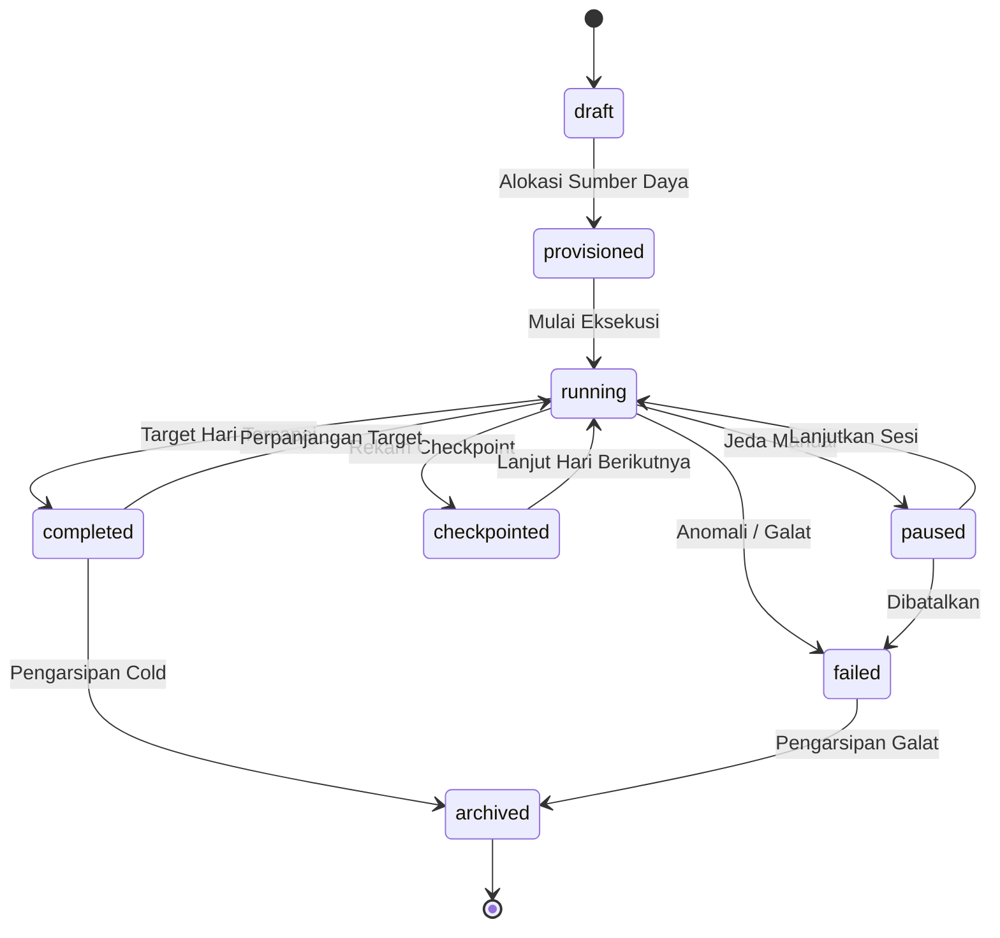

# Konsep Inti Kernel Simulasi Waktu Virtual & Digital Twin Bus (Fase 67 & R8)

Dokumen ini mendefinisikan arsitektur konseptual, fondasi matematis, invarian sistemik, katalog skenario bisnis, dan batas eksekusi kernel simulasi deterministik pada platform Superweb.

---

## 1. Masalah Bisnis & Konteks Strategis

Dalam pengelolaan ekosistem enterprise terdistribusi dengan modul yang saling terhubung (Hospital, Hotel, Logistics, Finance, Procurement, dll.), validasi alur kerja multi-tahun sering kali terhambat oleh ketergantungan pada waktu kalender riil. Proses-proses seperti akrual depresiasi aset bulanan, bunga pinjaman, night audit hotel, denda demurrage peti kemas di pelabuhan, dan pemulangan pasien rawat inap membutuhkan waktu berbulan-bulan hingga bertahun-tahun untuk mengumpulkan data historis yang memadai.

Kernel Simulasi Waktu Virtual (Fase 67) memecahkan masalah ini dengan menyediakan fasilitas kompresi waktu bisnis (time compression). Satu tahun operasional bisnis (365 hari virtual) dapat dijalankan dalam hitungan detik atau menit secara terkontrol, sepenuhnya deterministik, dan dapat diulang (*reproducible*).

### Manfaat Utama:
1. **Verifikasi Deterministik:** Menjamin bahwa dua simulasi dengan seed yang sama pada snapshot state yang identik akan menghasilkan rantai status dan neraca buku besar yang presisi 100%.
2. **Isolasi Sandbox Tanpa Kontaminasi Data:** Memungkinkan simulasi skenario ekstrem (*stress test*, krisis likuiditas, pandemi) tanpa mengubah data produksi berkat isolasi savepoint transaksi basis data transaksional (D35).
3. **Auditability Kriptografis:** Setiap hari virtual menghasilkan fingerprint hash SHA-256 kanonikal yang dirantai dari genesis seed hingga hari penutupan.

---

## 2. Aktor & Matriks Hak Akses (RBAC)

Kernel simulasi mengoperasikan kontrol hak akses berbutir halus berbasis RBAC tabel `user_role` dan model peran:

| Peran (Role) | Tanggung Jawab Operasional | Izin Endpoint |
|---|---|---|
| `admin` | Administrator penuh platform; bypass gate policy, provisi infrastruktur skala, audit korupsi | `*` (seluruh endpoint admin/simulation) |
| `sim_operator` | Operator simulasi tersertifikasi; memulai sesi, jeda, resume, melihat diff, mengekspor laporan | `/admin/simulation/*` dengan batas Anti-IDOR |
| `spine_operator` | Operator event spine; memantau inbox consumer, gap deteksi, dan poison dead-letter queue | Konsol Spine & Inbox (Fase R8) |
| `auditor` | Pengawas independen kepatuhan; inspeksi integritas rantai hash, sertifikat algoritma A1-A3 | Read-only inspection & audit export |
| *Role Lain / Guest* | Pengguna operasional kasir, mekanik, perawat, atau publik tanpa kredensial simulasi | DITOLAK (HTTP 401 / 403 Forbidden) |

### Mekanisme Anti-IDOR:
Sesi simulasi yang dibuat oleh `sim_operator` tertentu mencatat `created_by`. Operator lain tidak dapat memodifikasi, menjeda, atau melanjutkan sesi milik operator rekanan tanpa hak `admin`.

---

## 3. Konsep Inti Arsitektur

### 3.1. Discrete Event Scheduling (Algoritma A1)
Eksekusi event dalam satu hari virtual tidak didasarkan pada waktu dinding (*wall-clock*), melainkan berbasis antrean prioritas binary min-heap deterministik. Kunci pengurutan event:
$$\text{SortKey} = (\text{virtual\_second} \text{ ASC}, \text{priority} \text{ ASC}, \text{sequence} \text{ ASC})$$
Menjadwalkan event ke waktu virtual lampau ($\text{event.second} < \text{current.second}$) merupakan operasi terlarang dan akan memicu `PastEventScheduledException` (`PAST_EVENT`).

### 3.2. Topological Dependency Ordering (Algoritma A2)
Sebelum siklus pergantian hari ditutup, seluruh `SimTickHandler` yang terdaftar dieksekusi. Urutan eksekusi antar handler diatur oleh pengurutan topologis Kahn A2. Jika modul Logistics membutuhkan output dari Hotel Night Audit, dan Hotel membutuhkan output dari Hospital Discharge, urutan eksekusi dijamin:
$$\text{Hospital Discharge} \longrightarrow \text{Hotel Night Audit} \longrightarrow \text{Logistics Demurrage}$$
Deteksi dependensi melingkar (*cyclic dependency*) menggunakan algoritma DFS color-marking (WHITE/GRAY/BLACK) dan melempar `CyclicDependencyException` yang merinci simpul yang terlibat siklus.

### 3.3. Pseudo-Random Number Generation Deterministik (Algoritma A3)
Generator bilangan acak menggunakan Lehmer LCG MINSTD Park-Miller:
$$X_{n+1} = (48271 \times X_n) \pmod{2^{31} - 1}$$
Setiap modul atau sub-domain membuat sub-stream independen melalui fungsi pemecahan deterministik:
$$\text{sub\_seed} = \text{split}(\text{seed}, \text{"stream\_name"})$$
Hal ini memastikan bahwa penambahan event acak pada modul Hospital tidak mengubah urutan acak pada modul Logistics.

### 3.4. Rantai Fingerprint Hash SHA-256 (D34)
Integritas jalannya simulasi disegel secara kriptografis melalui rantai hash:
- $h_0 = \text{SHA256}(\text{"sim-run\|seed="} \cdot \text{seed})$
- $h_i = \text{SHA256}(h_{i-1} \cdot \text{"\|"} \cdot \text{day} \cdot \text{"\|"} \cdot \text{canonicalJson}(\text{summary}_i))$

Setiap perbedaan kecil pada output handler atau state domain akan menyebabkan efek longsoran (*avalanche effect*) pada hash rantai, yang langsung terdeteksi oleh `sim:diff` pada hari pertama divergensi.

---

## 4. Tujuh Invarian Sistemik

1. **Invarian Monotonisitas Waktu:** Jam virtual tidak pernah melangkah mundur. Waktu maju secara diskret atau dalam lompatan harian/detik.
2. **Invarian Kausalitas Deterministik:** Diberikan keadaan awal $S_0$ dan seed acak $K$, urutan keadaan $S_1, S_2, \dots, S_n$ selalu identik di setiap lingkungan komputasi.
3. **Invarian Keseimbangan Buku Besar (Ledger Probe):** Dalam mode sandbox maupun live, total debit selalu sama dengan total kredit pada setiap akhir siklus tick:
   $$\sum \text{Debit} - \sum \text{Kredit} = 0$$
4. **Invarian Kebersihan Sandbox Transaksional (Zero Contamination):** Seluruh mutasi basis data dalam mode sandbox selalu di-rollback di akhir sesi. Tidak ada baris phantom yang bocor ke tabel operasional.
5. **Invarian Append-Only Audit:** Tabel riwayat transisi status (`sim_run_transitions`) dan catatan twin (`sim_twin_states`) bersifat append-only. Modifikasi atau penghapusan rekaman masa lalu dilarang oleh guard model.
6. **Invarian Idempotensi Kunci:** Operasi inisiasi atau resume dengan `Idempotency-Key` yang sama selalu menghasilkan representasi respon yang identik tanpa memicu eksekusi ganda.
7. **Invarian Asiklisitas Dependensi Handler:** Graf dependensi antar modul tidak boleh memiliki siklus. Setiap siklus dependensi digagalkan pada tahap validasi pra-eksekusi.

---

## 5. Mesin Status Sesi Simulasi (State Machine)

Siklus hidup setiap sesi simulasi dikendalikan oleh mesin status formal dengan 8 status:

### Matriks Transisi Sah:
- `draft` $\rightarrow$ `provisioned`, `failed`
- `provisioned` $\rightarrow$ `running`, `failed`
- `running` $\rightarrow$ `paused`, `checkpointed`, `completed`, `failed`
- `paused` $\rightarrow$ `running`, `failed`, `archived`
- `checkpointed` $\rightarrow$ `running`, `paused`, `completed`, `failed`
- `completed` $\rightarrow$ `running` (saat perpanjangan hari), `archived`
- `failed` $\rightarrow$ `archived`
- `archived` $\rightarrow$ *Terminal*

---

## 6. Digital Twin State Bus

Digital Twin Bus mencatat proyeksi keadaan entitas riil (misal kendaraan armada, episode rawat inap, kamar hotel, peti kemas pelabuhan) secara asinkron maupun sinkron.

### Struktur Rantai State Twin:
Setiap pembaruan entitas twin menghasilkan rekaman baru di tabel `sim_twin_states` dengan:
- `event_hash` = $\text{SHA256}(\text{prev\_hash} \cdot \text{"\|"} \cdot \text{canonicalJson}(\text{payload}))$
- `prev_hash` = hash rekaman sebelumnya untuk entitas tersebut (atau `null` untuk genesis).

### Deduplikasi State Identik:
Jika pembaruan dikirimkan dengan payload yang identik dan menghasilkan hash yang sama dengan state aktif saat ini, rekaman baru tidak ditambahkan ke tabel, menjaga efisiensi ruang penyimpanan.

---

## 7. Batas-Batas & Skalabilitas Simulasi

1. **Rentang Hari:** Minimal 1 hari virtual, maksimal 1.825 hari virtual (5 tahun buku bisnis) per sesi run.
2. **Kapasitas Partisi Outbox:**
   - Tier `light`: 2 partisi, kapasitas $\le 30$ hari.
   - Tier `medium`: 8 partisi, kapasitas $\le 365$ hari.
   - Tier `heavy`: 32 partisi, kapasitas $\le 1.825$ hari.
3. **Plafon Memori:** Alokasi memori runtime dijaga di bawah 512MB melalui batching checkpoint periodik (setiap 7 hari) dan pembersihan buffer internal.

---

## 8. Katalog 15 Kasus Uji Skenario Bisnis

1. **SCN-01 (Klaim Rawat Inap & Auto-Discharge):** Evaluasi pelepasan pasien setelah 3 hari rawat dan penagihan biaya kamar otomatis.
2. **SCN-02 (Night Audit Hotel & Room Tax):** Akrual harian tarif kamar 50 kamar terisi dengan pembebanan pajak hotel 10%.
3. **SCN-03 (Penalti Demurrage Peti Kemas Bertingkat):** Evaluasi denda keterlambatan peti kemas setelah masa tenggang 5 hari bebas (Tier 1 vs Tier 2).
4. **SCN-04 (Depresiasi Garis Lurus Aset Tetap):** Penyusutan bulanan aset kendaraan dan peralatan pabrik setiap kelipatan hari ke-30.
5. **SCN-05 (Amortisasi Cicilan Pinjaman):** Penagihan angsuran pokok dan bunga pinjaman jatuh tempo setiap tanggal 1 virtual.
6. **SCN-06 (Bagi Hasil Waralaba / Franchise Royalty):** Perhitungan royalti 5% dari pendapatan kotor outlet setiap penutupan minggu.
7. **SCN-07 (Kadaluwarsa Poin Loyalitas Pelanggan):** Hangusnya poin loyalitas yang tidak aktif setelah 365 hari virtual.
8. **SCN-08 (Material Requirements Planning - MRP Explosion):** Pemicuan purchase order bahan baku otomatis saat buffer stock berada di bawah ambang minimum.
9. **SCN-09 (Simulasi Crash & Resume Hari ke-200):** Penghentian paksa simulasi di tengah jalan, lalu dilanjutkan dari checkpoint hari ke-200 hingga hari ke-365; pembuktian hash akhir tetap sama persis dengan full run.
10. **SCN-10 (Stress Test Lonjakan Pasien Rumah Sakit):** Peningkatan intake pasien 250% untuk menguji batas kapasitas tempat tidur.
11. **SCN-11 (Peak Season Liburan Akhir Tahun Hotel):** Okupansi kamar 98% selama 14 hari virtual berturut-turut.
12. **SCN-12 (Kongesti Pelabuhan Ekstrem):** Penumpukan 100 kontainer dengan rata-rata dwell time 20 hari memicu penalti demurrage masif.
13. **SCN-13 (Keseimbangan Ledger Multi-Valuta):** Pembuktian zero balance probe ledger pada ribuan transaksi konversi valas.
14. **SCN-14 (Anti-IDOR Operator Isolation):** Pembuktian penolakan akses saat operator B mencoba memanipulasi sesi simulasi yang diinisiasi operator A.
15. **SCN-15 (Deteksi Korup Checkpoint):** Pembuktian bahwa modifikasi satu bit pada hash checkpoint terdeteksi oleh `sim:audit` dan mengembalikan exit code non-zero.

