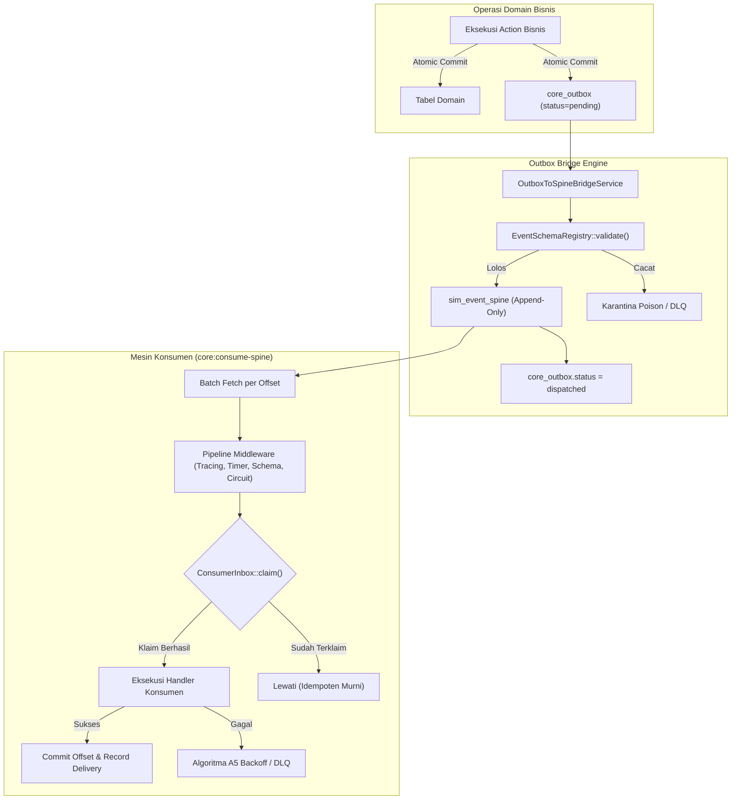
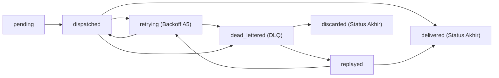

# Konsep Arsitektur Universal Event Spine (Fase R8)

## 1. Latar Belakang & Filosofi Desain

Universal Event Spine adalah tulang punggung komunikasi asinkron terdistribusi enterprise SuperWeb. Arsitektur ini dirancang untuk mengatasi fragmentasi aliran data lintas modul bisnis, menghilangkan kopling langsung (*temporal coupling*), dan memastikan setiap perubahan keadaan (*state mutation*) dapat dipancarkan, dicatat secara append-only, dikonsumsi dengan jaminan idempotensi persisten, dan diputar ulang (*deterministic replay*) untuk keperluan audit maupun rekonstruksi proyeksi (*read-model rehydration*).

Arsitektur pesan konvensional seringkali menghadapi berbagai cacat fundamental:
1. **Kehilangan Idempotensi Pasca Restart**: Idempotensi yang hanya disimpan di memori proses worker akan musnah saat proses mati atau restart.
2. **Kemacetan Head-of-Line Akibat Poison Message**: Satu pesan cacat yang gagal diproses berulang kali menahan kemajuan offset konsumen untuk pesan-pesan sehat berikutnya.
3. **Penyimpangan Skema Liar (Schema Drift)**: Produsen mengubah struktur payload secara sepihak, memicu exception tak terduga pada modul hilir.
4. **Celah Urutan Tak Terdeteksi (Silent Sequence Gaps)**: Dalam aliran event aggregate, hilangnya nomor urut tertentu luput dari pengawasan operator.
5. **Thundering Herd Akibat Retry Statis / Non-Deterministik**: Pemanggilan fungsi acak sistem atau retry serentak menimbulkan beban puncak sesaat yang melumpuhkan basis data.

Universal Event Spine Fase R8 menyelesaikan kelima tantangan di atas dengan pendekatan matematis bersertifikat, State Machine terformalisasi, dan jaminan transaksi lokal database murni tanpa dependensi eksternal pihak ketiga (IZIN-2).

---

## 2. Struktur Aliran Pesan: Dual-Path Integration

Sistem perpesanan di SuperWeb memiliki dua jalur utama yang dipertegas batas dan tanggung jawabnya:
1. **Transactional Outbox (`core_outbox`)**:
   Bertugas sebagai gerbang penampung pesan saat operasi bisnis dieksekusi di dalam transaksi database domain (`DB::transaction`). Pesan ditulis bersamaan dengan perubahan entitas bisnis, menjamin bahwa pesan tidak pernah dipancarkan jika transaksi bisnis di-rollback.
2. **Event Spine Append-Only Log (`sim_event_spine`)**:
   Bertugas sebagai log aliran pesan terurut global yang ber-partisi topik. Setiap pesan memiliki pengenal UUID permanen, nama ber-versi, payload terstruktur, dan catatan waktu virtual/nyata yang terinjeksi.
3. **Outbox-to-Spine Bridge (`OutboxToSpineBridgeService`)**:
   Pekerja latar belakang yang memindahkan pesan outbox berstatus `pending` ke dalam `sim_event_spine` secara batch dan berurutan per aggregate.

---

## 3. Siklus Hidup Pengiriman Pesan (State Machine 7 Status)

Pengiriman event dikelola oleh `EventDeliveryStateMachine` dengan 7 status formal:
- **`pending`**: Event telah terdaftar dan menunggu giliran pemrosesan oleh grup konsumen.
- **`dispatched`**: Event telah diambil oleh worker dan sedang dieksekusi oleh middleware/handler.
- **`delivered`**: Event berhasil diproses secara tuntas dan claim tercatat di `core_consumer_inbox`.
- **`retrying`**: Terjadi kegagalan sementara; worker menjadwalkan jeda retry eksponensial deterministik berdasarkan Algoritma A5.
- **`dead_lettered`**: Batas maksimum percobaan (6 kali) terlampaui atau terjadi kegagalan fatal yang memerlukan campur tangan operator.
- **`replayed`**: Pesan dari antrean DLQ dipicu ulang secara manual oleh operator berwenang (`spine_operator`).
- **`discarded`**: Pesan DLQ diabaikan secara permanen dengan alasan audit tertulis (batch > 20 pesan mewajibkan persetujuan Approval Engine).

---

## 4. Tiga Algoritma Kunci Bersertifikat

### A4: AggregateSequenceGapDetector
Menjamin integritas urutan pesan per aggregate ID dengan kompleksitas $O(n \log n)$. Celah urutan yang hilang dideteksi sebagai pasangan tuple `(awal, akhir)` dan disimpan pada tabel `core_spine_gaps`. Urutan kedatangan pesan yang acak tidak dianggap sebagai celah sepanjang seluruh nomor urut hadir tanpa celah yang bolong. Duplikasi nomor urut dilaporkan terpisah tanpa menghentikan pemrosesan aggregate lain.

### A5: DeterministicBackoff
Menghitung jeda retry eksponensial dengan jitter terdistribusi seragam tanpa menggunakan generator acak non-deterministik (`rand()`) atau pemanggilan sleep:
$$\text{mentah} = \min(\text{batas}, \text{dasar} \times 2^{n - 1})$$
$$\text{seed} = ((\text{idPesan} \bmod m) \times (n + 1)) \bmod m \quad (\text{bila } 0 \to 1)$$
$$x = (\text{seed} \times 48.271) \bmod m$$
$$\text{jitter} = x \bmod \left(\lfloor \text{mentah} / 4 \rfloor + 1\right)$$
$$\text{jeda} = \text{mentah} + \text{jitter}$$
Formula ini memastikan bahwa untuk ID pesan dan nomor percobaan yang sama, nilai jeda yang dihasilkan pada mesin mana pun di seluruh cluster akan selalu 100% identik.

### A6: SchemaAdditiveCompatibilityChecker
Menegakkan aturan evolusi skema berbasis backward-compatibility:
- Penambahan atribut baru opsional $\to$ **DIPERBOLEHKAN**.
- Penambahan nilai enum baru $\to$ **DIPERBOLEHKAN**.
- Penghapusan atribut yang ada $\to$ **DITOLAK** (`PROPERTY_REMOVED`).
- Perubahan tipe data $\to$ **DITOLAK** (`TYPE_CHANGED`).
- Penambahan atribut wajib $\to$ **DITOLAK** (`REQUIRED_ADDED`).
- Penghapusan nilai enum $\to$ **DITOLAK** (`ENUM_VALUE_REMOVED`).
- Penyempitan rentang nilai $\to$ **DITOLAK** (`RANGE_NARROWED`).

---

## 5. Idempotensi Persisten Tahan-Restart (`core_consumer_inbox`)

Cache statis in-memory `SpineConsumerRegistry::$processedEvents` diubah fungsinya menjadi cache L1 berkecepatan tinggi, sementara jaminan idempotensi absolut dipegang oleh tabel basis data `core_consumer_inbox`.

Operasi `claim(consumer_group, message_id)` dijalankan secara atomik. Jika record sudah ada, claim mengembalikan `false` dan eksekusi handler dilewati. Hal ini menjamin bahwa pengulangan dispatch dari outbox maupun replay stream tidak akan pernah menghasilkan efek samping bisnis ganda, bahkan jika server di-restart di tengah proses.
