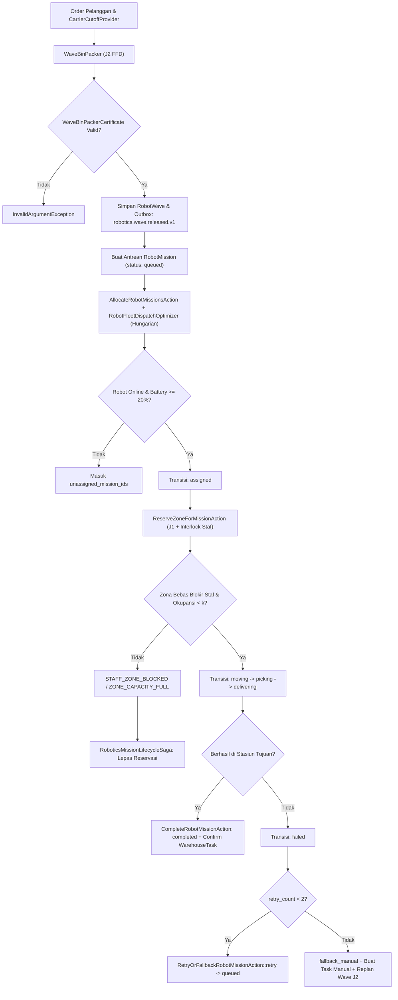
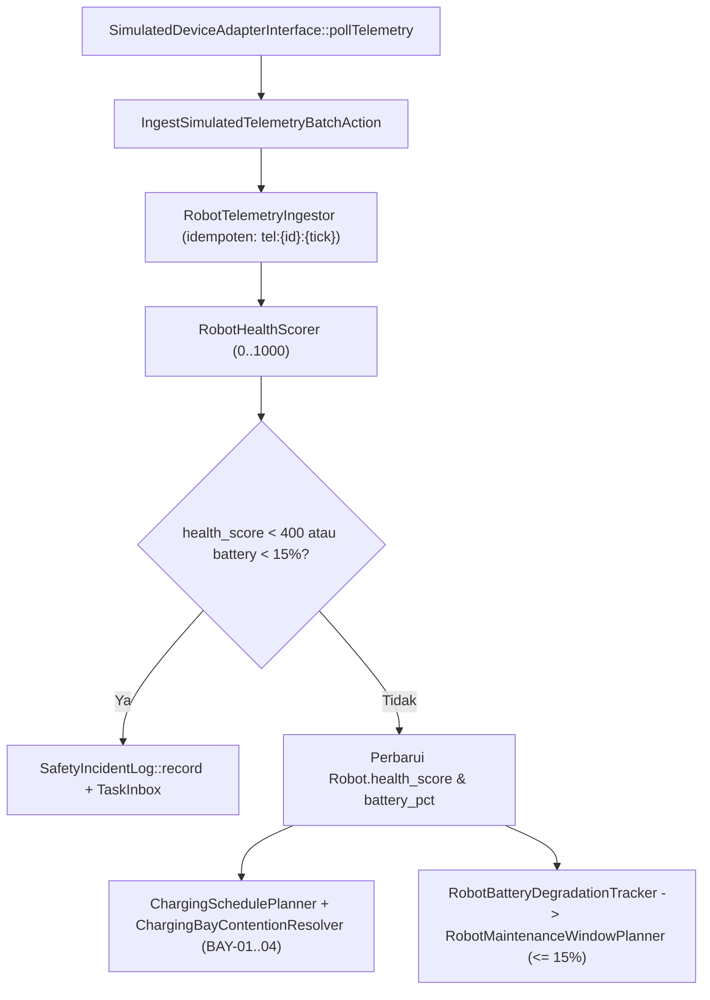
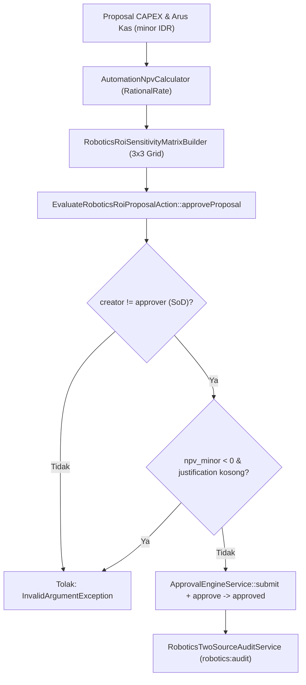

# Diagram Alir End-to-End Robotika Gudang — Fase 279

- **Fase**: 279 (W8-P6.3)
- **Tujuan**: Visualisasi alur operasional dari penerimaan order hingga penyelesaian misi, fallback manual, pengisian daya, dan audit dua sumber.

## 1. Alur Perencanaan Wave Hingga Eksekusi Misi

## 2. Alur Telemetri, Energi, Charging & Maintenance

## 3. Alur Tata Kelola ROI (`J3`) & Audit Dua Sumber

