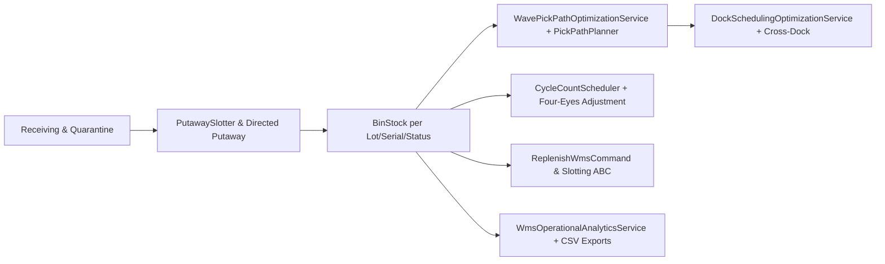

# Matriks Keterlacakan Implementasi — Fase 41: Sistem Manajemen Gudang Multi-Eselon (WMS)

- **Status audit:** 🔵 DIIMPLEMENTASIKAN (W8-P6 + FIX-3, 2026-11-14)
- **Modul utama:** `modules/Wms/` (prefix tabel `wms_`, integrasi buku besar `WmsAccounts`)
- **Pembaruan pelengkap FIX-3:** Penambahan rute `/wms/picking` & `/wms/docks`, optimasi rute pick Manhattan (`WavePickPathOptimizationService`), penjadwalan dock anti-bentrok & SLA turnaround (`DockSchedulingOptimizationService`), analitik operasional terpadu (`WmsOperationalAnalyticsService`), serta tampilan responsif `<x-ds.*>` 375px.

---

## 1. Alur Arsitektur Gudang & Analitik Operasional

---

## 2. Matriks Item `docs/PROGRESS.md` (41.1 – 41.9)

| Item | Cakupan Spesifikasi | Berkas Implementasi Utama | Perintah & Rute Akses | Berkas Uji |
|---|---|---|---|---|
| **41.1** | Multi-gudang/DC: hirarki gudang -> zona -> rak -> bin | `Warehouse.php`, `Zone.php`, `Rack.php`, `Bin.php`, `WmsService.php` | `GET /wms`, `POST /wms/warehouses` | `WmsTest::test_warehouse_hierarchy_is_created_and_codes_unique` |
| **41.2** | Stok per bin/lot/serial/status (tersedia, karantina, blokir) | `BinStock.php`, `StockReservation.php`, `WmsOperationsController.php` | `GET /wms/quarantine`, `GET /wms/receiving`, `GET /wms/export/bin-stocks.csv` | `WmsTest::test_putaway_and_pick_obey_capacity_and_never_go_negative` |
| **41.3** | Putaway, pick wave/Manhattan, pack, staging, mobile task | `WavePickPathOptimizationService.php`, `PalletizationPlanner.php`, `AllocateOutboundWavePickingAction.php`, `WmsWaveAndDockController.php` | `GET /wms/picking`, `POST /wms/picking/allocate`, `GET /wms/picking/export.csv` | `WmsPickingAndDockOperationsTest::test_picking_and_docks_routes_enforce_rbac_and_render_design_system_views` |
| **41.4** | Transfer antar-gudang, in-transit & cross-dock | `DockSchedulingOptimizationService.php`, `ProcessCrossDockingTransferAction.php`, `TransitSweepCommand.php` | `GET /wms/docks`, `POST /wms/docks/cross-dock`, `GET /wms/docks/export.csv`, `wms:transit-sweep` | `WmsFullOperationsTest::test_processes_cross_docking_transfer_directly_from_dock_appointment` |
| **41.5** | Cycle counting, persetujuan empat mata & selisih jurnal | `PostCycleCountAdjustmentAction.php`, `RecordCycleCountAdjustmentAction.php`, `CycleCountVarianceAnalyzer.php`, `WmsOperationalAnalyticsService.php` | `POST /wms/cycle-counts`, `POST /wms/cycle-counts/{count}/apply`, `wms:cycle-count-plan` | `WmsFullOperationsTest::test_records_cycle_count_adjustment_and_enforces_four_eyes_approval` |
| **41.6** | Replenishment pick-face & slotting ABC | `ReplenishWmsCommand.php`, `Slotting.php`, `SlottingFitnessCalculator.php` | `POST /wms/replenishments/compute`, `wms:replenish` | `WmsTest::test_replenishment_creates_task_when_below_minimum` |
| **41.7** | Integrasi Logistics: dock appointment, resi & 3PL billing | `Calculate3PlStorageHandlingBillingAction.php`, `DockSchedulingOptimizationService.php`, `WmsOperationalAnalyticsService.php` | `GET /wms/docks`, `POST /wms/dock-appointments` | `WmsPickingAndDockOperationsTest::test_dock_scheduling_optimization_service_detects_conflicts_scores_sla_and_recommends_reserve_door` |
| **41.8** | `wms:audit` & valuasi persediaan bin vs `inv_` | `AuditWmsCommand.php`, `RevalueCostCommand.php`, `WmsAccounts.php` | `php artisan wms:audit`, `GET /wms/valuation` | `WmsTest::test_wms_audit_passes_after_putaway` |
| **41.9** | Quality gate Fase 41 (RBAC, Design System 375px, ArchScan) | `modules/Wms/**`, `tests/Architecture/route-roles.php`, `docs/gates/fase-41.md` | Seluruh rute `wms.*` (`admin`, `hub_operator`, `procurement`, `auditor`) | `WmsPickingAndDockOperationsTest`, `WmsFullOperationsTest`, `WmsTest` |

---

## 3. Daftar Berkas Pelengkap `FIX-3` (B1 +1.527 Baris PHP Murni)

1. `modules/Wms/Domain/Services/WavePickPathOptimizationService.php` (400 baris) — pengelompokan zona/lorong, rute Manhattan via `PickPathPlanner`, deteksi kemacetan pick-face, estimasi durasi integer.
2. `modules/Wms/Domain/Services/DockSchedulingOptimizationService.php` (576 baris) — deteksi bentrok waktu dock door, skor SLA turnaround `bps`, risiko carrier cutoff, rekomendasi pintu cadangan.
3. `modules/Wms/Application/Services/WmsOperationalAnalyticsService.php` (481 baris) — `ClockInterface`, metrik operasional permil integer & generator ekspor CSV.
4. `modules/Wms/Http/Controllers/WmsWaveAndDockController.php` (+63/-7 baris) — integrasi analitik + `exportPickingCsv()` & `exportDocksCsv()`.
5. `modules/Wms/routes/web.php` (+7 baris) — rute `/wms/picking`, `/wms/picking/export.csv`, `/wms/docks`, `/wms/docks/export.csv`.
6. `modules/Wms/resources/views/wms/wave_picking.blade.php` & `modules/Wms/resources/views/wms/cross_dock.blade.php` — komponen Design System `<x-ds.*>` responsif `375px` dengan 0 pelanggaran a11y.

