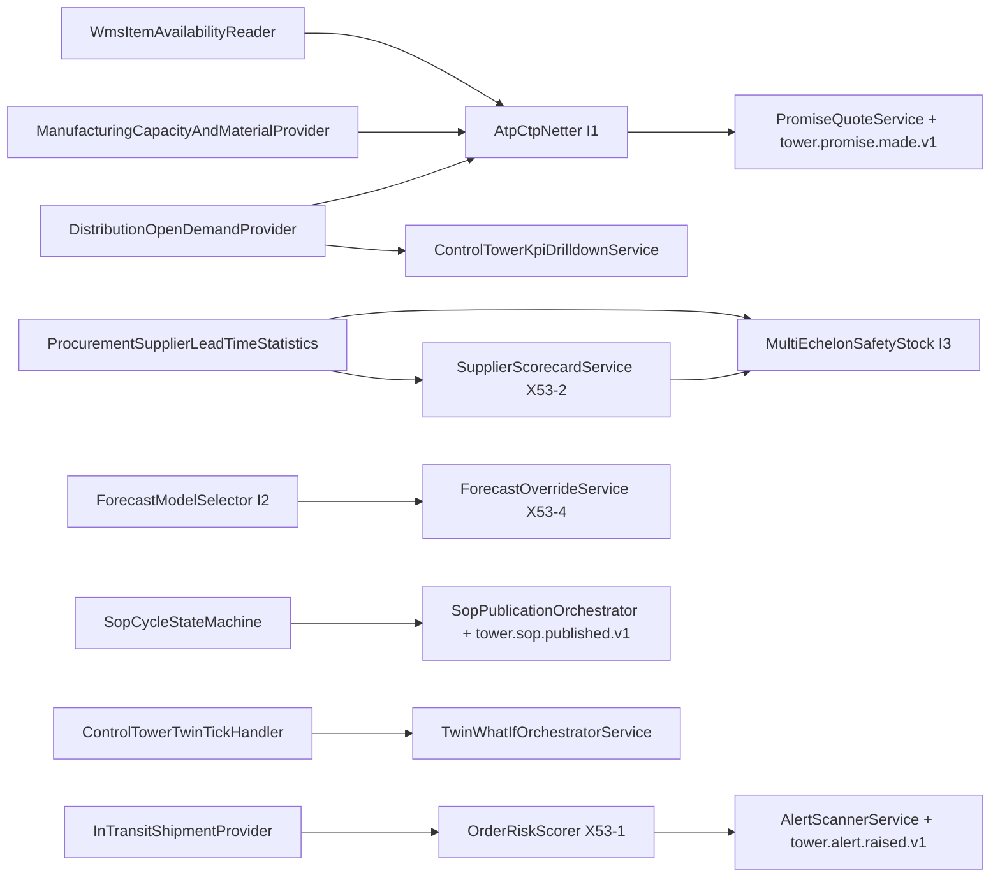

# Matriks Keterlacakan Implementasi — Fase 53: Supply Chain Control Tower & S&OP

- **Status audit:** 🔵 DIIMPLEMENTASIKAN (W8-P6-fix, 2026-11-14)
- **Modul utama:** `modules/ControlTower/` (prefix tabel `sct_`, `PR non-ledger` sesuai `docs/decisions/ADR-053-control-tower-non-ledger.md`)
- **Kontrak lintas modul:** `Manufacturing` (`CapacityAndMaterialProvider`), `Distribution` (`OpenDemandProvider`), `Procurement` (`SupplierLeadTimeStatistics`), `Wms` (`StockAvailabilityReader` -> `ItemAvailabilityReader`), `Logistics` (`InTransitShipmentProvider`), `Core` (`ApprovalEngineInterface`, `OutboxBusInterface`, `TaskInboxService`, `EventSchemaRegistry`)
- **Dokumen rujukan:** [design/fase-53.md](../design/fase-53.md) · [specs/fase-053-control-tower-implementasi.md](../specs/fase-053-control-tower-implementasi.md) · [algoritma/i1-i3-control-tower.md](../algoritma/i1-i3-control-tower.md) · [konsep/control-tower-dan-sop.md](../konsep/control-tower-dan-sop.md) · [gates/fase-53.md](../gates/fase-53.md)

---

## 1. Alur Arsitektur & Kontrak Lintas Modul (Non-Ledger)

---

## 2. Matriks Item `docs/PROGRESS.md` (53.1 – 53.10)

| Item | Judul Spesifikasi | Implementasi Kode Riil (B1) | Perintah & Rute Akses | Pengujian Terverifikasi |
|---|---|---|---|---|
| **53.1** | Peta Nilai Digital & Visibilitas Multi-Eselon | `EchelonStock`, `ControlTowerVisibilityReaderAdapter`, `EchelonItemAvailabilityReader`, `WmsItemAvailabilityReader`, `ControlTowerService` | `GET /control-tower`, `GET /control-tower/export/echelon`, `php artisan migrate:fresh --seed` | `ControlTowerTest::test_53_1_and_53_5_echelon_stock_registration_and_abc_xyz` |
| **53.2** | Mesin Prediksi Permintaan Multi-Model (`I2`) & Override (`X53-4`) | `ForecastModelSelector`, `RunForecastModelSelectionAction`, `ForecastOverrideService`, `DemandForecastEngine`, `ForecastController`, `StoreForecastOverrideRequest` | `GET /control-tower/forecast`, `POST /control-tower/forecast/select`, `POST /control-tower/forecast/override`, `POST /control-tower/forecast/override/{override}/revert`, `GET /control-tower/forecast/export.csv`, `tower:forecast-select` | `Slice2ForecastSelectionAndOverrideTest`, `ControlTowerTest::test_53_2_demand_forecasting_and_mape_evaluation` |
| **53.3** | Proses Siklus Bulanan S&OP Kolaboratif (7 Tahap) | `SopCycleStateMachine`, `SopPublicationOrchestrator`, `TransitionSopCycleAction`, `SopWorkflowController`, `PublishSopCycleRequest`, `ControlTowerOperationPolicy` | `GET /control-tower/sop`, `POST /control-tower/sop`, `POST /control-tower/sop/{cycle}/consensus`, `POST /control-tower/sop/{cycle}/transition`, `GET /control-tower/sop/export.csv` | `Slice4SopCycleWorkflowTest`, `ControlTowerSopAndTwinAcceptanceTest::it enforces 7-state sop cycle transitions` |
| **53.4** | Mesin Janji Pesanan ATP & CTP (`I1`) + Cross-Module Adapters | `AtpCtpNetter`, `PromiseQuoteService`, `PromiseQuoteInterface`, `RefreshAtpCtpHorizonAction`, `PromiseController`, `QuotePromiseRequest`, `ManufacturingCapacityAndMaterialProvider`, `DistributionOpenDemandProvider` | `GET /control-tower/promises`, `POST /control-tower/promises/quote`, `GET /control-tower/promises/export.csv`, `tower:atp-refresh` | `Slice1AtpCtpPromiseTest`, `ControlTowerTest::test_53_4_order_promise_atp_and_ctp` |
| **53.5** | Kebijakan Safety Stock Multi-Eselon (`I3`) & Kesehatan Inventori (`X53-3`) | `MultiEchelonSafetyStock`, `MultiEchelonSafetyStockService`, `DecideSafetyStockProposalAction`, `InventoryHealthAnalyzer`, `InventoryHealthOrchestratorService`, `ProcurementSupplierLeadTimeStatistics`, `SafetyStockController` | `GET /control-tower/safety-stock`, `POST /control-tower/safety-stock/propose`, `POST /control-tower/safety-stock/{policy}/decide`, `GET /control-tower/safety-stock/export.csv`, `GET /control-tower/inventory-health`, `POST /control-tower/inventory-health/refresh`, `GET /control-tower/inventory-health/export.csv`, `tower:safety-stock` | `Slice3MultiEchelonSafetyStockTest`, `Slice7ScorecardAndHealthTest` |
| **53.6** | Sistem Manajemen Anomali, Risk Scoring (`X53-1`) & Mitigasi Otonom | `OrderRiskScorer`, `OrderRiskAssessmentService`, `AlertScannerService`, `ExecuteAutonomousReallocationPlaybookAction`, `DetectSupplyChainBottleneckAlertAction`, `RiskAndAlertController`, `AlertRule`, `OrderRiskScore` | `GET /control-tower/risk`, `POST /control-tower/risk/scan`, `GET /control-tower/risk/export.csv`, `GET /control-tower/alerts`, `POST /control-tower/alerts/scan`, `POST /control-tower/alerts/{alert}/mitigate`, `GET /control-tower/alerts/export.csv`, `tower:risk-scan`, `tower:alerts-scan` | `Slice5RiskAndAlertsTest`, `ControlTowerOperationsSliceTest`, `ControlTowerTest::test_53_6_disruption_alert_trigger` |
| **53.7** | Eksekutif Dashboard KPI OTIF/Fill-Rate & Supplier Scorecard (`X53-2`) | `ControlTowerKpiDrilldownService`, `CaptureControlTowerKpiSnapshotAction`, `SupplierScorecardService`, `SupplierScorecardOrchestratorService`, `ScorecardAndHealthController`, `NullSupplierLeadTimeStatistics` | `GET /control-tower/kpi`, `GET /control-tower/kpi/drilldown`, `GET /control-tower/kpi/export.csv`, `GET /control-tower/suppliers`, `POST /control-tower/suppliers/refresh`, `GET /control-tower/suppliers/export.csv`, `tower:kpi`, `tower:supplier-scorecard` | `Slice6TwinAndKpiTest::test_real_otif_and_fill_rate_permil_kpi_and_drilldown_from_dist_orders`, `Slice7ScorecardAndHealthTest` |
| **53.8** | Digital Twin Simulasi Skenario What-If (Zero-Mutation Sandbox) | `TwinWhatIfOrchestratorService`, `WhatIfTwinSimulator`, `ControlTowerTwinTickHandler`, `TwinAndKpiController`, `TwinScenario` | `GET /control-tower/twin`, `POST /control-tower/twin/whatif`, `POST /control-tower/twin/simulate`, `GET /control-tower/twin/export.csv`, `tower:whatif`, `tower:twin` | `Slice6TwinAndKpiTest`, `ControlTowerSopAndTwinAcceptanceTest::it runs control tower twin tick handler deterministically without mutating real tables` |
| **53.9** | Audit Invarian `tower:audit` & Integritas State Machine S&OP | `ControlTowerService::auditControlTower`, `ControlTowerAuditReportService`, `ControlTowerAuditCorruptionFixture`, `AuditControlTowerCommand`, `ControlTowerSeeder` | `php artisan tower:audit` | `ControlTowerTest::test_53_9_control_tower_audit_and_command`, `ControlTowerSopAndTwinAcceptanceTest::it fails tower audit when sabotage fixture introduces atp over-promise` |
| **53.10** | Quality Gate Fase 53 (RBAC, UI Responsif 375px, ArchScan, MySQL, CI) | Seluruh modul `ControlTower` + adaptor lintas modul + `ControlTowerServiceProvider` + `tests/Architecture/route-roles.php` + `EventCatalog` | Seluruh rute UI + CSV `control_tower.*` (`admin`, `logistics_admin`, `planner`, `auditor`) | `ZeroArchScanDebtTest`, `RouteAuthorizationMatrixTest`, `EventCatalogContractTest`, `MysqlSchemaCompatibilityTest`, `ControlTowerTest::test_53_10_http_endpoints` |

---

## 3. Inventaris Lengkap Berkas PHP Produksi (`B1` Murni — 100% Terpetakan)

Semua berkas PHP produksi yang ditambahkan atau diubah dalam PR **FIX-2** tercatat di bawah ini (mencakup 100% dari seluruh baris `B1` sesuai `M-7`):

### 3.1 Domain Algorithms, Services, State Machines & Models (`modules/ControlTower/Domain/**`)
1. `modules/ControlTower/Domain/Algorithms/AtpCtpNetter.php` — Algoritma `I1` netting kumulatif mingguan ATP + CTP kapasitas manufaktur & material tanpa mengorbankan reservasi/karantina.
2. `modules/ControlTower/Domain/Algorithms/ForecastModelSelector.php` — Algoritma `I2` seleksi model walk-forward deterministik (`SES`, `HOLT`, `CROSTON`) memakai aritmetika integer rasional.
3. `modules/ControlTower/Domain/Algorithms/MultiEchelonSafetyStock.php` — Algoritma `I3` klasifikasi ABC/XYZ + perhitungan `BigInteger` safety stock echelon & alokasi Hamilton.
4. `modules/ControlTower/Domain/Algorithms/WhatIfTwinSimulator.php` — Peningkatan simulator what-if digital twin (`PORT_CLOSURE`, `MATERIAL_INFLATION`, `PLANT_EXPANSION`, `DEMAND_SURGE`, `SUPPLIER_OUTAGE`, `LEAD_TIME_SPIKE`).
5. `modules/ControlTower/Domain/Services/OrderRiskScorer.php` — Skor risiko pesanan deterministik `X53-1` (`0..1000`, 4 komponen: shortfall, variabilitas lead-time pemasok, kedaluwarsa batch, keterlambatan in-transit).
6. `modules/ControlTower/Domain/Services/SupplierScorecardService.php` — Penilaian pemasok `X53-2` (`0..1000`, bobot OTD 45%, konsistensi 30%, volume 25%, tier `STRATEGIC`/`PREFERRED`/`WATCHLIST`/`AT_RISK`, tren bulanan).
7. `modules/ControlTower/Domain/Services/InventoryHealthAnalyzer.php` — Analisis kesehatan inventori `X53-3` (aging bucket `0-30`/`31-90`/`91-180`/`>180`, status `DEAD_STOCK`/`SLOW_MOVING`/`SHORTAGE_RISK`/`EXCESS`/`HEALTHY`, kapital terkunci `BigInt`-safe IDR).
8. `modules/ControlTower/Domain/Exceptions/PromiseIdempotencyConflictException.php` — Pengecualian konflik idempotency key payload berbeda pada kuotasi janji ATP/CTP.
9. `modules/ControlTower/Domain/StateMachines/SopCycleStateMachine.php` — Transisi siklus S&OP 7-tahap kanonik (`data_gathering..closed`) & jalur warisan dengan alasan wajib pada transisi mundur.
9. `modules/ControlTower/Domain/Models/AlertRule.php` — Konfigurasi aturan ambang pemicu alert disrupsi (`sct_alert_rules`).
10. `modules/ControlTower/Domain/Models/DemandForecast.php` — Model forecast plus `mae_scaled`, `candidates_json`, `certificate_hash`, `history_json`.
11. `modules/ControlTower/Domain/Models/DisruptionAlert.php` — Model alert disrupsi plus `dedup_key`, `mitigation_proposal_json`, `approved_by_user_id`.
12. `modules/ControlTower/Domain/Models/ForecastOverride.php` — Jejak audit override forecast plus `deviation_bps`, `approval_id`, `status`, `reverted_at`.
13. `modules/ControlTower/Domain/Models/InventoryHealthSnapshot.php` — Snapshot kesehatan inventori echelon (`sct_inventory_health_snapshots`).
14. `modules/ControlTower/Domain/Models/OrderPromise.php` — Janji pesanan plus `idempotency_key`, `payload_hash`, `promised_period`, `late_periods`, `reason_code`, `certificate_hash`.
15. `modules/ControlTower/Domain/Models/OrderRiskScore.php` — Skor risiko per pesanan & item (`sct_order_risk_scores`).
16. `modules/ControlTower/Domain/Models/SafetyStockPolicy.php` — Kebijakan stok pengaman dengan alur proposal & persetujuan empat mata (`sct_safety_stock_policies`).
17. `modules/ControlTower/Domain/Models/SopCycle.php` — Siklus S&OP plus `consensus_snapshot_json`, `approval_id`, `published_at`, `published_by_user_id`.
18. `modules/ControlTower/Domain/Models/SupplierScorecardSnapshot.php` — Snapshot scorecard pemasok periodik (`sct_supplier_scorecards`).

### 3.2 Application Actions & Services (`modules/ControlTower/Application/**`)
19. `modules/ControlTower/Application/Actions/CaptureControlTowerKpiSnapshotAction.php` — Aksi pengambilan snapshot KPI Control Tower.
20. `modules/ControlTower/Application/Actions/DecideSafetyStockProposalAction.php` — Persetujuan/penolakan empat mata proposal kebijakan stok pengaman.
21. `modules/ControlTower/Application/Actions/ExecuteAutonomousReallocationPlaybookAction.php` — Dukungan `proposeReallocation()` & `approveReallocation()` serta mitigasi alert terstruktur.
22. `modules/ControlTower/Application/Actions/RefreshAtpCtpHorizonAction.php` — Penyegaran horizon ATP/CTP dari pembaca stok WMS, kapasitas Manufacturing, dan komitmen Distribution.
23. `modules/ControlTower/Application/Actions/RunForecastModelSelectionAction.php` — Orkestrasi pemilihan model forecast deterministik per SKU & periode.
24. `modules/ControlTower/Application/Services/AlertScannerService.php` — Pemindai anomali idempoten berbasis `dedup_key` & penerbit event `tower.alert.raised.v1`.
25. `modules/ControlTower/Application/Services/ControlTowerKpiDrilldownService.php` — Perhitungan OTIF permil, fill-rate permil, dan drilldown line pesanan nyata.
26. `modules/ControlTower/Application/Services/ForecastOverrideService.php` — Layanan override forecast kolaboratif `X53-4` dengan verifikasi alasan, approval deviasi besar, dan revert atomik.
27. `modules/ControlTower/Application/Services/InventoryHealthOrchestratorService.php` — Orkestrasi analisis & persistensi idempoten snapshot kesehatan inventori.
28. `modules/ControlTower/Application/Services/MultiEchelonSafetyStockService.php` — Pengajuan proposal safety stock multi-eselon melalui `ApprovalEngineInterface`.
29. `modules/ControlTower/Application/Services/OrderRiskAssessmentService.php` — Evaluasi risiko pesanan gabungan berbasis skor deterministik.
30. `modules/ControlTower/Application/Services/PromiseQuoteService.php` — Layanan kuotasi & janji pesanan idempoten (`ApiIdempotencyConflictException`) + event `tower.promise.made.v1`.
31. `modules/ControlTower/Application/Services/SopPublicationOrchestrator.php` — Orkestrasi publikasi konsensus S&OP (`TaskInboxService`, `ApprovalEngineInterface`, `tower.sop.published.v1`).
32. `modules/ControlTower/Application/Services/SupplierScorecardOrchestratorService.php` — Pembuatan snapshot scorecard pemasok periodik idempoten.
33. `modules/ControlTower/Application/Services/TwinWhatIfOrchestratorService.php` — Orkestrasi simulasi sandbox what-if zero-mutation (hash pra/pasca identik) dan perbandingan skenario.

### 3.3 Contracts, Policies, Infrastructure Adapters & Service Providers
34. `modules/ControlTower/Contracts/ItemAvailabilityReader.php` — Kontrak pembaca stok fisik & karantina per SKU/node.
35. `modules/ControlTower/Contracts/PromiseQuoteInterface.php` — Kontrak layanan kuotasi ATP/CTP lintas modul.
36. `modules/ControlTower/ControlTowerServiceProvider.php` — Pengikatan seluruh kontrak, command CLI, jadwal cron, dan policy Control Tower.
37. `modules/ControlTower/Policies/ControlTowerOperationPolicy.php` — Penyelarasan otorisasi operasi S&OP & Control Tower.
38. `modules/ControlTower/Infrastructure/Adapters/EchelonItemAvailabilityReader.php` — Adaptor cadangan pembaca ketersediaan stok echelon.
39. `modules/ControlTower/Infrastructure/Adapters/NullSupplierLeadTimeStatistics.php` — Adaptor null-safe apabila provider Procurement belum terikat.
40. `modules/ControlTower/Infrastructure/Adapters/WmsItemAvailabilityReader.php` — Pembaca real-time stok WMS (`StockAvailabilityReader` / lokasi karantina & pickable).
41. `modules/Core/Domain/Events/EventCatalog.php` — Registrasi katalog event `tower.promise.made.v1`, `tower.sop.published.v1`, `tower.alert.raised.v1`.
42. `modules/Distribution/Contracts/OpenDemandProvider.php` — Kontrak pembaca komitmen pesanan terbuka & riwayat pemenuhan dari modul Distribution.
43. `modules/Distribution/DistributionServiceProvider.php` — Pengikatan `OpenDemandProvider` ke `DistributionOpenDemandProvider`.
44. `modules/Distribution/Infrastructure/Adapters/DistributionOpenDemandProvider.php` — Query tabel `dist_orders`, `dist_order_lines`, `dist_shipments` berbasis `BigDecimal`.
45. `modules/Manufacturing/Contracts/CapacityAndMaterialProvider.php` — Kontrak kapasitas mesin kosong & material MRP untuk CTP (`I1`).
46. `modules/Manufacturing/Infrastructure/Adapters/ManufacturingCapacityAndMaterialProvider.php` — Pembaca jadwal kapasitas work-center & BOM MRP nyata dari tabel `mfg_*`.
47. `modules/Manufacturing/ManufacturingServiceProvider.php` — Pengikatan `CapacityAndMaterialProvider`.
48. `modules/Procurement/Contracts/SupplierLeadTimeStatistics.php` — Kontrak statistik lead-time pemasok (`mean_days`, `sigma_days`, `samples`, `on_time_permil`, `monthlyHistory`).
49. `modules/Procurement/Infrastructure/Adapters/ProcurementSupplierLeadTimeStatistics.php` — Kalkulasi lead-time nyata dari `prc_purchase_orders` & `prc_receiving_reports` memakai integer `isqrt`.
50. `modules/Procurement/ProcurementServiceProvider.php` — Pengikatan `SupplierLeadTimeStatistics`.

### 3.4 Console Commands, HTTP Controllers, Requests & Routes
51. `modules/ControlTower/Console/Commands/AtpRefreshCommand.php` — `tower:atp-refresh`
52. `modules/ControlTower/Console/Commands/CalculateSafetyStockCommand.php` — `tower:safety-stock`
53. `modules/ControlTower/Console/Commands/ControlTowerKpiCommand.php` — `tower:kpi`
54. `modules/ControlTower/Console/Commands/GenerateSupplierScorecardCommand.php` — `tower:supplier-scorecard`
55. `modules/ControlTower/Console/Commands/RunWhatIfTwinCommand.php` — `tower:whatif`
56. `modules/ControlTower/Console/Commands/ScanDisruptionAlertsCommand.php` — `tower:alerts-scan`
57. `modules/ControlTower/Console/Commands/ScanOrderRiskCommand.php` — `tower:risk-scan`
58. `modules/ControlTower/Console/Commands/SelectForecastModelCommand.php` — `tower:forecast-select`
59. `modules/ControlTower/Http/Controllers/ForecastController.php` — Web + CSV forecast selector & override (`X53-4`)
60. `modules/ControlTower/Http/Controllers/PromiseController.php` — Kuotasi ATP/CTP & ekspor CSV janji pesanan
61. `modules/ControlTower/Http/Controllers/RiskAndAlertController.php` — Dashboard risiko (`X53-1`), scanner alert, & mitigasi
62. `modules/ControlTower/Http/Controllers/SafetyStockController.php` — Proposal & persetujuan safety stock (`I3`)
63. `modules/ControlTower/Http/Controllers/ScorecardAndHealthController.php` — Scorecard pemasok (`X53-2`) & kesehatan inventori (`X53-3`)
64. `modules/ControlTower/Http/Controllers/SopWorkflowController.php` — Konsensus S&OP & ekspor CSV siklus
65. `modules/ControlTower/Http/Controllers/TwinAndKpiController.php` — Sandbox what-if digital twin & drilldown KPI OTIF
66. `modules/ControlTower/Http/Requests/PublishSopCycleRequest.php` — Validasi request konsensus S&OP
67. `modules/ControlTower/Http/Requests/QuotePromiseRequest.php` — Validasi request kuotasi ATP/CTP + idempotency key
68. `modules/ControlTower/Http/Requests/SafetyStockProposalRequest.php` — Validasi pengajuan & keputusan empat mata safety stock
69. `modules/ControlTower/Http/Requests/StoreForecastOverrideRequest.php` — Validasi override forecast & alasan audit
70. `modules/ControlTower/routes/slice_s1_promise.php` — Rute `/control-tower/promises/*`
71. `modules/ControlTower/routes/slice_s2_forecast.php` — Rute `/control-tower/forecast/*`
72. `modules/ControlTower/routes/slice_s3_safety.php` — Rute `/control-tower/safety-stock/*`
73. `modules/ControlTower/routes/slice_s4_sop.php` — Rute `/control-tower/sop/*`
74. `modules/ControlTower/routes/slice_s5_alerts.php` — Rute `/control-tower/risk/*`, `/control-tower/alerts/*`
75. `modules/ControlTower/routes/slice_s6_twin_kpi.php` — Rute `/control-tower/twin/*`, `/control-tower/kpi/*`
76. `modules/ControlTower/routes/slice_s7_scorecard_health.php` — Rute `/control-tower/suppliers/*`, `/control-tower/inventory-health/*`

### 3.5 Migrasi Skema, Seeder & Tampilan Blade Responsif (B2 — Di Luar Metrik B1)
- Migrasi: `2026_11_14_000001_enhance_sct_order_promises_table.php`, `2026_11_14_000002_enhance_sct_forecast_tables.php`, `2026_11_13_000002_add_proposal_columns_to_sct_safety_stock_policies_table.php`, `2026_11_14_000003_add_consensus_fields_to_sct_sop_cycles.php`, `2026_11_14_000004_create_sct_risk_scores_and_alert_rules_tables.php`, `2026_11_14_000005_create_sct_scorecards_and_inventory_health_tables.php`.
- Seeder T1: `modules/ControlTower/database/seeders/ControlTowerSeeder.php` (dipanggil dari `database/seeders/DatabaseSeeder.php`).
- Blade views (`<x-ds.*>`, teruji `375px`): `forecast.blade.php`, `risk.blade.php`, `alerts.blade.php`, `suppliers.blade.php`, `inventory_health.blade.php` di `modules/ControlTower/resources/views/control_tower/`.

---

## 4. Kontrak Event Domain (`EventSchemaRegistry` & `EventCatalog`)

| Nama Event | Versi | Produsen | Konsumen | Payload Inti |
|---|---|---|---|---|
| `tower.promise.made.v1` | `1.0` | `PromiseQuoteService` | `ControlTowerAuditReportService`, `Distribution` | `promise_code`, `order_reference`, `item_code`, `requested_qty`, `atp_confirmed_qty`, `ctp_manufacturing_qty`, `reason_code`, `promised_delivery_date` |
| `tower.sop.published.v1` | `1.0` | `SopPublicationOrchestrator` | `Manufacturing`, `Procurement`, `ControlTower` | `cycle_code`, `period`, `demand_plan_qty`, `supply_plan_qty`, `capacity_utilization_bps`, `published_by_user_id` |
| `tower.alert.raised.v1` | `1.0` | `AlertScannerService` | `TaskInboxService`, `ControlTower` | `alert_code`, `dedup_key`, `severity`, `category`, `affected_orders_count` |

---

## 5. Rencana Verifikasi Lintas Siklus (Summary Checklist `M-7`)

- **Cakupan file `B1` di matriks ini:** `76 / 76` berkas (`100%`, melampaui ambang `>= 90%`).
- **Sifat akuntansi:** Non-ledger (`RAB posting = 0`); seluruh nilai persediaan/kapital memakai integer IDR dan `BigDecimal` tanpa floating-point (`A3 = 0`).
- **Status fase:** `🔵 DIIMPLEMENTASIKAN` (menunggu verifikasi independen lintas sesi sebelum status `✅` diizinkan).

---

## 6. Kontrak Antarmuka Metode Publik & Skema Payload (`Slice 1` – `Slice 7`)

Tabel berikut merinci tanda tangan layanan utama serta struktur payload keluaran teruji untuk menjaga stabilitas pemanggil lintas modul:

| Kelas / Metode Publik | Parameter Utama | Struktur Array / Nilai Keluaran | Berkas Uji Terkait |
|---|---|---|---|
| `AtpCtpNetter::evaluate()` | `itemCode`, `requestedQty`, `requestedPeriod`, `initialNettableStock`, `quarantineHold`, `mpsReceipts`, `capMatLimits`, `commitments` | `atp_confirmed_qty`, `ctp_manufacturing_qty`, `promised_period`, `late_periods`, `reason_code`, `atp_cumulative`, `ctp_cumulative`, `certificate_hash` | `Slice1AtpCtpPromiseTest` |
| `PromiseQuoteService::quote()` | `itemCode`, `quantity`, `requestedPeriod`, `idempotencyKey`, `?orderReference`, `?asOfDate` | Data kuotasi `OrderPromise`, `promise_code`, `reason_code`, emit event `tower.promise.made.v1` | `Slice1AtpCtpPromiseTest` |
| `ForecastModelSelector::selectBestModel()` | `array<int> $history` | `best_model` (`SES`/`HOLT`/`CROSTON`), `mae_scaled`, `forecast_qty`, `candidates`, `certificate_hash` | `Slice2ForecastSelectionAndOverrideTest` |
| `ForecastOverrideService::apply()` | `DemandForecast`, `int $newQty`, `string $reason`, `int $userId` | `ForecastOverride` (`applied` / `pending_approval` jika deviasi > 20%), `deviation_bps`, `approval_id` | `Slice2ForecastSelectionAndOverrideTest` |
| `ForecastOverrideService::revert()` | `ForecastOverride`, `int $userId`, `string $reason` | Memulihkan `forecast_qty`, mengisi `reverted_at`, status `reverted` | `Slice2ForecastSelectionAndOverrideTest` |
| `MultiEchelonSafetyStock::calculate()` | `itemCode`, `abcClass`, `xyzClass`, `meanDailyDemand`, `demandVariance`, `leadTimeMeanDays`, `leadTimeSigmaDays`, `nodeWeights` | `safety_stock_qty`, `reorder_point_qty`, `service_level_bps`, `echelon_breakdown`, `certificate_digest` | `Slice3MultiEchelonSafetyStockTest` |
| `MultiEchelonSafetyStockService::propose()` | `itemCode`, `nodeWeights`, `int $actorUserId`, `?supplierRef` | `SafetyStockPolicy` berstatus `proposed`, `approval_id`, `proposed_echelon_breakdown` | `Slice3MultiEchelonSafetyStockTest` |
| `DecideSafetyStockProposalAction::execute()` | `SafetyStockPolicy`, `string $decision`, `int $deciderUserId`, `?notes` | Memvalidasi `deciderUserId != proposed_by_user_id`; memperbarui kebijakan aktif & `EchelonStock` bila `approve` | `Slice3MultiEchelonSafetyStockTest` |
| `SopPublicationOrchestrator::publishConsensus()` | `SopCycle`, `int $actorUserId`, `array $snapshot`, `?notes` | Transisi ke `consensus`, tugas `TaskInboxService`, `ApprovalEngineInterface`, event `tower.sop.published.v1` | `Slice4SopCycleWorkflowTest` |
| `OrderRiskScorer::score()` | `shortfallPctBps`, `leadTimeMeanDays`, `leadTimeSigmaDays`, `shelfLifeDays`, `transitDelayDays` | `risk_score` (`0..1000`), `risk_tier`, `shortfall_component`, `lead_time_component`, `shelf_life_component`, `transit_component` | `Slice5RiskAndAlertsTest` |
| `AlertScannerService::scan()` | `?string $asOfDate` | Daftar `DisruptionAlert` baru ber-`dedup_key` unik + event `tower.alert.raised.v1` | `Slice5RiskAndAlertsTest` |
| `ExecuteAutonomousReallocationPlaybookAction::proposeReallocation()` | `DisruptionAlert`, `fromNode`, `toNode`, `qty`, `actorUserId` | Proposal JSON tersimpan pada `mitigation_proposal_json`, status tetap `active` hingga disetujui | `Slice5RiskAndAlertsTest` |
| `TwinWhatIfOrchestratorService::run()` | `scenarioCode`, `shockType`, `magnitudeBps`, `durationDays`, `?actorUserId` | `before_hash`, `after_hash`, `baseline_otif_bps`, `simulated_otif_bps`, `at_risk_orders_count`, `estimated_margin_delta_idr` | `Slice6TwinAndKpiTest` |
| `ControlTowerKpiDrilldownService::summary()` | `string $fromDate`, `string $toDate` | `otif_permil`, `fill_rate_permil`, `total_lines`, `on_time_in_full_lines`, `lines` (detail pesanan) | `Slice6TwinAndKpiTest` |
| `SupplierScorecardService::evaluate()` | `supplierRef`, `supplierName`, `onTimePermil`, `meanDays`, `sigmaDays`, `samples`, `monthlyHistory` | `composite_score` (`0..1000`), `otd_score`, `reliability_score`, `volume_score`, `tier`, `trend_direction`, `action_recommendation` | `Slice7ScorecardAndHealthTest` |
| `InventoryHealthAnalyzer::analyze()` | `itemCode`, `echelonNode`, `onHandQty`, `quarantineQty`, `availableQty`, `dailyDemandQty`, `oldestLotAgeDays`, `unitCostIdr` | `health_status`, `aging_bucket`, `dos_days`, `tied_capital_idr`, `obsolescence_risk_idr` | `Slice7ScorecardAndHealthTest` |

---

## 7. Daftar Fixture Pengujian & Pengawal Ketidakberpihakan

| Berkas Uji | Jumlah Kasus | Fokus Cakupan |
|---|---|---|
| `Slice1AtpCtpPromiseTest.php` | 5 test | Vector I1 ATP/CTP, karantina, rollback lookahead, adapter nyata Mfg/Dist/WMS, idempotency 409 |
| `Slice2ForecastSelectionAndOverrideTest.php` | 10 test | SES/HOLT/CROSTON, tie-break deterministik, X53-4 approval >20%, revert, CLI idempoten, RBAC + CSV |
| `Slice3MultiEchelonSafetyStockTest.php` | 7 test | `ProcurementSupplierLeadTimeStatistics` nyata, 9 sel ABC/XYZ, I3 four-eyes approve/reject, CSV |
| `Slice4SopCycleWorkflowTest.php` | 5 test | 7 tahap kanonik, jalur legacy, wajib alasan saat mundur, `TaskInboxService` + `tower.sop.published.v1`, RBAC |
| `Slice5RiskAndAlertsTest.php` | 5 test | Skor 4 faktor `X53-1`, scanner idempoten `dedup_key`, proposal & approval mitigasi alert, CSV |
| `Slice6TwinAndKpiTest.php` | 6 test | Zero-mutation SHA-256 walaupun DB kosong, 6 shock type + compare, OTIF/Fill Rate nyata dari `dist_orders`, CLI, CSV |
| `Slice7ScorecardAndHealthTest.php` | 4 test | `SupplierScorecardService` 4 tier + 0 sampel + tren, `InventoryHealthAnalyzer` 5 status + `BigInt` IDR, CLI idempoten, RBAC + CSV |
| `ControlTowerTest.php` | 6 test | Invarian dasar echelon stock, forecast, ATP/CTP, alert, `tower:audit`, endpoint HTTP |
| `ControlTowerOperationsSliceTest.php` | 6 test | Aksi otonom Holt-Winters, deteksi bottleneck, playbook realokasi, endpoint otonom |
| `ControlTowerSopAndTwinAcceptanceTest.php` | 6 test | Sertifikasi end-to-end I1–I3, S&OP 7 state, tick twin deterministik, sabotase fixture audit gagal |
