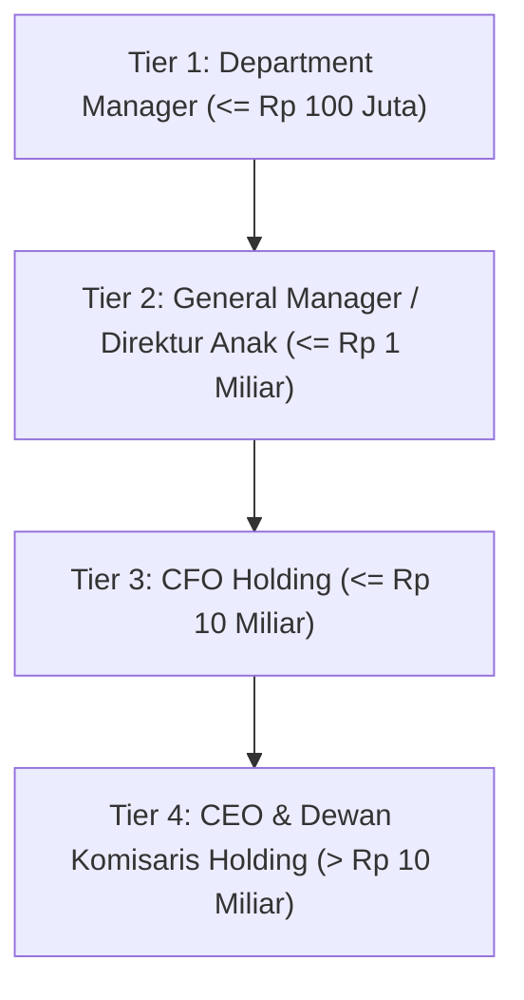

# Panduan Lengkap: Matriks Delegasi Wewenang Korporat (Delegation of Authority - DoA)

## 1. Prinsip Dasar Delegasi Wewenang
Matriks Delegasi Wewenang (*Delegation of Authority / DoA*) mengatur wewenang penandatanganan dokumen dan persetujuan pengeluaran dana moneter di seluruh jenjang manajemen konglomerasi, guna memastikan kepatuhan tata kelola tanpa menghambat kecepatan operasional.

---

## 2. Matriks Batas Limit Otorisasi Belanja

| Kategori Transaksi | Tier 1 (Manager) | Tier 2 (Director) | Tier 3 (CFO Holding) | Tier 4 (Board) |
|---|---|---|---|---|
| **Belanja Operasional Rutin (OPEX)** | $\le$ Rp 100.000.000 | $\le$ Rp 1.000.000.000 | $\le$ Rp 10.000.000.000 | $>$ Rp 10.000.000.000 |
| **Belanja Modal / Aset Tetap (CAPEX)** | $\le$ Rp 50.000.000 | $\le$ Rp 500.000.000 | $\le$ Rp 5.000.000.000 | $>$ Rp 5.000.000.000 |
| **Penarikan Utang Bank / Sindikasi** | Dilarang | Dilarang | $\le$ Rp 25.000.000.000 | $>$ Rp 25.000.000.000 |
| **Akuisisi Saham & M&A Deal** | Dilarang | Dilarang | Dilarang | Semua Nominal |
| **Pemberian Jaminan Korporat (Corporate Guarantee)** | Dilarang | Dilarang | Dilarang | Wajib RUPS / Komisaris |

---

## 3. Penegakan Sistemik pada Aplikasi
1. **Validasi Otorisasi di FormRequest**:
   - Setiap pengajuan pengeluaran kas divalidasi terhadap limit peran pengguna yang aktif. Percobaan bypass ditolak dengan status HTTP 403 Forbidden.
2. **Pengecekan SoD Konflik Peran**:
   - Sistem menolak transaksi apabila pembuat (*creator*) dan penyetujui (*approver*) adalah individu yang sama atau memiliki hubungan SoD CRITICAL.
3. **Pencatatan Audit Trail Permanen**:
   - Setiap persetujuan membubuhkan jejak digital berupa user ID, tanggal-waktu tersertifikasi SimClock, IP address, dan ringkasan nilai transaksi.
