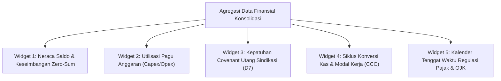

# Panduan Eksekutif: Dashboard Indikator Kinerja Utama (KPI) Keuangan Konsolidasi C-Level & Board

## 1. Sasaran Dashboard Eksekutif
Dashboard Eksekutif Keuangan Grup (`/enterprise-finance`) dirancang untuk menyajikan ringkasan kesehatan finansial konglomerasi secara waktu-nyata (*real-time*) kepada Chief Executive Officer (CEO), Chief Financial Officer (CFO), dan Komite Audit Dewan Komisaris.

---

## 2. Komponen Widget & Indikator Visual

### A. Widget Kepatuhan Covenant Utang Sindikasi
- **Indikator**: Menampilkan jarum status (Hijau = Compliant, Kuning = Warning, Merah = Breach) untuk rasio DSCR, DER, ISCR, dan Current Ratio.
- **Interaksi**: Drill-down langsung ke detail fasilitas kredit sindikasi dan histori sertifikat SHA-256 yang diterbitkan.

### B. Widget Realisasi Anggaran vs Pagu
- **Indikator**: Batang progres pemakaian pagu belanja korporat per unit bisnis.
- **Pemberitahuan**: Penanda peringatan oranye untuk departemen dengan utilisasi $> 90\%$, dan penanda merah terkunci untuk pelanggaran Hard-Stop.

### C. Widget Modal Kerja & Likuiditas
- **Indikator**: Grafik perputaran piutang (DSO), persediaan (DIO), utang (DPO), dan siklus kas bersih (CCC).
- **Benchmark**: Perbandingan efisiensi modal kerja antar-lini industri manufaktur, logistik, dan perdagangan.

---

## 3. Ekspor Laporan Resmi C-Level
Dari tampilan dashboard eksekutif, pejabat berwenang dapat langsung mengunduh 8 berkas laporan resmi berekstensi CSV dengan jaminan integritas SHA-256 untuk lampiran rapat umum pemegang saham (RUPS) dan laporan tahunan emiten (*Annual Report*).
