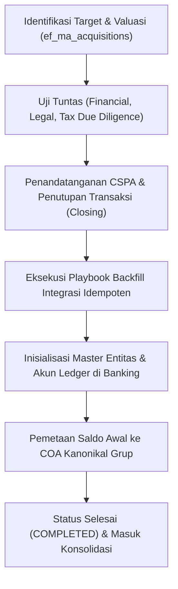

# Panduan Operasional: Merger & Akuisisi (M&A) Due Diligence dan Backfill Integrasi Monolith

## 1. Ikhtisar Alur Kerja Transaksi M&A
Akuisisi perusahaan baru oleh holding konglomerasi membutuhkan harmonisasi sistem keuangan target ke dalam arsitektur monolith SuperWeb.

---

## 2. Prosedur Uji Tuntas Finansial (Financial Due Diligence)
1. **Analisis Kualitas Laba (Quality of Earnings - QoE)**:
   - Menghilangkan pendapatan satu kali (*one-off gains*) dan penyesuaian normalisasi EBITDA target.
2. **Uji Tuntas Liabilitas Tersembunyi (Debt-Like Items)**:
   - Mengidentifikasi kewajiban pensiun yang belum didanai, sengketa pajak yang sedang berjalan, dan komitmen sewa pembiayaan di luar neraca (*off-balance sheet leases*).
3. **Penentuan Nilai Goodwill atau Pembelian Diskon (Badwill Sesuai PSAK 22)**:
   $$\text{Goodwill} = \text{Harga Pembelian} - \text{Nilai Wajar Aset Neto Teridentifikasi}$$

---

## 3. Eksekusi Playbook Backfill Idempoten
Proses migrasi saldo target ke sistem monolith dijalankan melalui `ConglomerateCapitalAndGovernanceService::executeMaIntegrationPlaybook()`:
- **Prinsip Idempotensi Ketat**: Eksekusi berulang dengan `deal_code` yang sama tidak menduplikasi akun atau memposting ulang jurnal saldo awal.
- **Pencatatan Entitas Baru**: Entitas baru otomatis didaftarkan di master entitas legal grup (`ic_entities`) dengan NPWP terenkripsi dan mata uang fungsional resmi.
