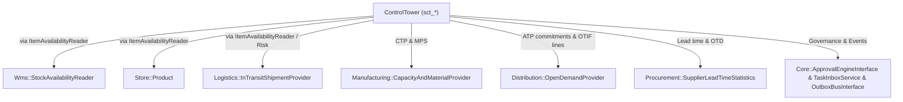

# Integrasi Digital Twin, Kontrak Lintas Modul & Event Schema — Control Tower (Fase 53)

---

## 1. Isolasi Sandbox Digital Twin (`TwinWhatIfOrchestratorService` & `ControlTowerTwinTickHandler`)

Simulasi What-If di Control Tower wajib mempertahankan integritas mutlak atas data operasional nyata (`no side effects on live tables`).

### Mekanisme Jaminan Nol Mutasi
1. **Hash Pra-Simulasi (`before_hash`):** Sebelum skenario dijalankan, `TwinWhatIfOrchestratorService` menghitung checksum SHA-256 kanonik atas baris aktif di `sct_echelon_stocks`, `sct_order_promises`, dan `sct_disruption_alerts`.
2. **Eksekusi Sandbox (`WhatIfTwinSimulator` & `ControlTowerTwinTickHandler`):**
   - `ControlTowerTwinTickHandler` mengimplementasikan `Modules\Core\Contracts\SimTickHandlerInterface` sehingga dapat dijadwalkan bersama kernel simulasi P3 (`SimulationRunnerService`, mode `'sandbox'`).
   - Skenario yang didukung: `PORT_CLOSURE`, `MATERIAL_INFLATION`, `SUPPLY_DELAY`, `DEMAND_SPIKE`, `SUPPLIER_LOSS`, dan `WAREHOUSE_CAPACITY`.
3. **Hash Pasca-Simulasi (`after_hash`):** Setelah simulasi selesai dan hasil skenario dicatat terpisah pada tabel `sct_twin_scenarios`, checksum dihitung ulang. Apabila `before_hash !== after_hash`, sistem melempar `TWIN_STATE_MUTATION_DETECTED` dan menggugurkan hasil simulasi.
4. **Perbandingan Skenario (`compareScenarios`):** Planner dapat membandingkan dua skenario tersimpan secara *side-by-side* guna mengukur trade-off antara penurunan `otif_bps`, jumlah pesanan berisiko, serta `estimated_margin_delta_idr`.

---

## 2. Arsitektur Kontrak Lintas Modul (`A1 / A2 Zero Violations`)

- **Dari `ControlTower` keluar:** hanya mengimpor namespace `Contracts` milik modul lain. Query langsung ke tabel `wms_*`, `mfg_*`, `dist_*`, `prc_*`, `sup_*`, atau `store_*` dari dalam `ControlTower` tidak ada.
- **Dari modul pesanan masuk ke `ControlTower`:** memanggil `Modules\ControlTower\Contracts\PromiseQuoteInterface::quote(...)` untuk mengevaluasi dan mengunci janji pengiriman dengan `idempotency_key` deterministik.
- **Keamanan Internal Modul Mitra:**
  - `ManufacturingCapacityAndMaterialProvider` mengakses eksklusif tabel `mfg_*` dan di-bind sebagai singleton/service pada `ManufacturingServiceProvider`.
  - `DistributionOpenDemandProvider` mengakses eksklusif tabel `dist_*` dan di-bind pada `DistributionServiceProvider`.
  - `ProcurementSupplierLeadTimeStatistics` mengakses tabel `prc_*` beserta kontrak model `Modules\Supplier\Contracts\Supplier` dan di-bind pada `ProcurementServiceProvider`.

---

## 3. Katalog Event Domain & Validasi Skema (`EventCatalog` & `EventSchemaRegistry`)

Ketiga event berikut terdaftar di `Modules\Core\Domain\Events\EventCatalog` sekaligus diregistrasikan melalui `EventSchemaRegistry` (kompatibilitas aditif A6, `schema_version = 1`):

| Nama Event | Produser | Konsumen Terdaftar | Field Kunci `data` |
| :--- | :--- | :--- | :--- |
| `tower.promise.made.v1` | `ControlTower` | `Sales`, `Distribution`, `Logistics` | `promise_code`, `item_code`, `requested_qty`, `atp_confirmed_qty`, `ctp_manufacturing_qty`, `status`, `promised_period`, `certificate_hash` |
| `tower.sop.published.v1` | `ControlTower` | `Manufacturing`, `Procurement`, `Distribution`, `Finance` | `cycle_code`, `period`, `scenario_type`, `demand_plan_qty`, `supply_plan_qty`, `published_by_user_id`, `published_at` |
| `tower.alert.raised.v1` | `ControlTower` | `Logistics`, `Procurement`, `Core` | `alert_code`, `severity`, `category`, `item_code`, `echelon_node`, `risk_score`, `dedup_key` |

Setiap payload yang dikirim ke `OutboxBusInterface` mengikuti amplop wajib `EventCatalog::validatePayloadStructure()` (`event_id`, `occurred_at`, `aggregate_type`, `aggregate_id`, `idempotency_key`, `schema_version`, `data`).

---

## 4. Jadwal Otomatis (`Schedule`) & Pemanfaatan Produksi

Dalam `ControlTowerServiceProvider::boot()`, penjadwalan harian/periodik diikat pada:
- Pemindaian risiko & disrupsi berkala (`tower:risk-scan`, `tower:alerts-scan`) dengan deduplikasi `dedup_key` agar pengulangan jadwal tidak membanjiri tabel alert maupun duplikasi event outbox.
- Pengambilan KPI eksekutif (`tower:kpi`) berbasis `ClockInterface` sehingga pencatatan snapshot harian selalu idempoten per `snapshot_date`.
- Pembaruan skor pemasok berkala (`tower:supplier-scorecard`) mengikuti data penerimaan barang terbaru.
