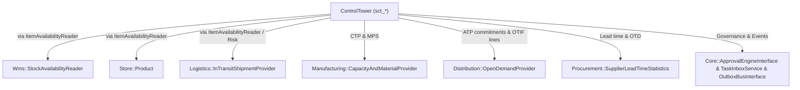

# Integrasi Digital Twin, Kontrak Lintas Modul & Event Schema — Control Tower (Fase 53)

---

## 1. Isolasi Sandbox Digital Twin (`TwinWhatIfOrchestratorService` & `ControlTowerTwinTickHandler`)

Simulasi What-If di Control Tower wajib mempertahankan integritas mutlak atas data operasional nyata (`no side effects on live tables`).

### Mekanisme Jaminan Nol Mutasi
1. **Hash Pra-Simulasi (`before_hash`):** Sebelum skenario dijalankan, `TwinWhatIfOrchestratorService` menghitung checksum SHA-256 kanonik atas baris aktif di `sct_echelon_stocks`, `sct_order_promises`, dan `sct_disruption_alerts`.
2. **Eksekusi Sandbox (`WhatIfTwinSimulator` & `ControlTowerTwinTickHandler`):**
   - `ControlTowerTwinTickHandler` mengimplementasikan `Modules\Core\Contracts\SimTickHandlerInterface` sehingga dapat dijadwalkan bersama kernel simulasi P3 (`SimulationRunnerService`, mode `'sandbox'`).
   - Skenario yang didukung: `PORT_CLOSURE`, `MATERIAL_INFLATION`, `SUPPLY_DELAY`, `DEMAND_SPIKE`, `SUPPLIER_LOSS`, dan `WAREHOUSE_CAPACITY`.
3. **Hash Pasca-Simulasi (`after_hash`):** Setelah simulasi selesai dan hasil skenario dicatat terpisah pada tabel `sct_twin_scenarios`, checksum dihitung ulang. Apabila `before_hash !== after_hash`, sistem melempar `TWIN_STATE_MUTATION_DETECTED` dan menggugurkan hasil simulasi.
4. **Perbandingan Skenario (`compareScenarios`):** Planner dapat membandingkan dua skenario tersimpan secara *side-by-side* guna mengukur trade-off antara penurunan `otif_bps`, jumlah pesanan berisiko, serta `estimated_margin_delta_idr`.

---

## 2. Arsitektur Kontrak Lintas Modul (`A1 / A2 Zero Violations`)

- **Dari `ControlTower` keluar:** hanya mengimpor namespace `Contracts` milik modul lain. Query langsung ke tabel `wms_*`, `mfg_*`, `dist_*`, `prc_*`, `sup_*`, atau `store_*` dari dalam `ControlTower` tidak ada.
- **Dari modul pesanan masuk ke `ControlTower`:** memanggil `Modules\ControlTower\Contracts\PromiseQuoteInterface::quote(...)` untuk mengevaluasi dan mengunci janji pengiriman dengan `idempotency_key` deterministik.
- **Keamanan Internal Modul Mitra:**
  - `ManufacturingCapacityAndMaterialProvider` mengakses eksklusif tabel `mfg_*` dan di-bind sebagai singleton/service pada `ManufacturingServiceProvider`.
  - `DistributionOpenDemandProvider` mengakses eksklusif tabel `dist_*` dan di-bind pada `DistributionServiceProvider`.
  - `ProcurementSupplierLeadTimeStatistics` mengakses tabel `prc_*` beserta kontrak model `Modules\Supplier\Contracts\Supplier` dan di-bind pada `ProcurementServiceProvider`.

---

## 3. Katalog Event Domain & Validasi Skema (`EventCatalog` & `EventSchemaRegistry`)

Ketiga event berikut terdaftar di `Modules\Core\Domain\Events\EventCatalog` sekaligus diregistrasikan melalui `EventSchemaRegistry` (kompatibilitas aditif A6, `schema_version = 1`):

| Nama Event | Produser | Konsumen Terdaftar | Field Kunci `data` |
| :--- | :--- | :--- | :--- |
| `tower.promise.made.v1` | `ControlTower` | `Sales`, `Distribution`, `Logistics` | `promise_code`, `item_code`, `requested_qty`, `atp_confirmed_qty`, `ctp_manufacturing_qty`, `status`, `promised_period`, `certificate_hash` |
| `tower.sop.published.v1` | `ControlTower` | `Manufacturing`, `Procurement`, `Distribution`, `Finance` | `cycle_code`, `period`, `scenario_type`, `demand_plan_qty`, `supply_plan_qty`, `published_by_user_id`, `published_at` |
| `tower.alert.raised.v1` | `ControlTower` | `Logistics`, `Procurement`, `Core` | `alert_code`, `severity`, `category`, `item_code`, `echelon_node`, `risk_score`, `dedup_key` |

Setiap payload yang dikirim ke `OutboxBusInterface` mengikuti amplop wajib `EventCatalog::validatePayloadStructure()` (`event_id`, `occurred_at`, `aggregate_type`, `aggregate_id`, `idempotency_key`, `schema_version`, `data`).

---

## 4. Jadwal Otomatis (`Schedule`) & Pemanfaatan Produksi

Dalam `ControlTowerServiceProvider::boot()`, penjadwalan harian/periodik diikat pada:
- Pemindaian risiko & disrupsi berkala (`tower:risk-scan`, `tower:alerts-scan`) dengan deduplikasi `dedup_key` agar pengulangan jadwal tidak membanjiri tabel alert maupun duplikasi event outbox.
- Pengambilan KPI eksekutif (`tower:kpi`) berbasis `ClockInterface` sehingga pencatatan snapshot harian selalu idempoten per `snapshot_date`.
- Pembaruan skor pemasok berkala (`tower:supplier-scorecard`) mengikuti data penerimaan barang terbaru.

---

## 4. Integrasi Lintas Modul & Spesifikasi Digital Twin What-If (`Slice 1`, `3`, `6`, `7`)

### 4.1 Kontrak & Adaptor Lintas Modul (Bebas `A1`/`A2`)
Control Tower berkomunikasi dengan modul operasional lain semata melalui interface di namespace `Contracts`:

| Kontrak Interface | Modul Penyedia | Implementasi Konkret | Tabel / Sumber Nyata | Data Yang Disajikan |
|---|---|---|---|---|
| `ItemAvailabilityReader` | `ControlTower` -> `Wms` | `WmsItemAvailabilityReader` (cadangan `EchelonItemAvailabilityReader`) | `wms_stock_balances`, `StockAvailabilityReader` | `on_hand`, `quarantine_hold`, `in_transit`, `reserved` per SKU & node |
| `CapacityAndMaterialProvider` | `Manufacturing` | `ManufacturingCapacityAndMaterialProvider` | `mfg_work_centers`, `mfg_production_orders`, `mfg_mrp_plans` | Kapasitas mesin bebas & ketersediaan bahan baku MRP per periode mingguan (`ctp_cap`) + `mps_receipts` |
| `OpenDemandProvider` | `Distribution` | `DistributionOpenDemandProvider` | `dist_orders`, `dist_order_lines`, `dist_shipments` | Komitmen open orders per bucket 7 hari (`commitmentsByPeriod`) & histori fulfillment (`fulfillmentLines`) memakai `BigDecimal` |
| `SupplierLeadTimeStatistics` | `Procurement` | `ProcurementSupplierLeadTimeStatistics` | `prc_purchase_orders`, `prc_po_lines`, `prc_receiving_reports`, `prc_receiving_lines` | `mean_days`, `sigma_days` (integer `isqrt`), `samples`, `on_time_permil`, `primarySupplierForItem`, `monthlyHistory` |
| `InTransitShipmentProvider` | `Logistics` | Binding standar modul `Logistics` | `log_shipments` | Status keterlambatan pengapalan berjalan untuk input `OrderRiskScorer` |

### 4.2 Spesifikasi 6 Skenario Digital Twin What-If (`TwinWhatIfOrchestratorService`)
Setiap eksekusi what-if menjalankan sandbox terisolasi (`zero-mutation`): sistem mengambil digest `SHA-256` seluruh baris aktif `sct_echelon_stocks`, `sct_order_promises`, `sct_demand_forecasts`, dan `sct_safety_stock_policies` sebelum serta sesudah eksekusi dan memverifikasi `before_hash === after_hash`.

| `shock_type` | Dampak ke Kapasitas / Lead Time | Dampak ke Permintaan / Harga | Output Kritis yang Dihitung |
|---|---|---|---|
| `PORT_CLOSURE` | Menunda suplai impor & in-transit selama `duration_days` berdasarkan bobot `shock_magnitude_bps` | Pesanan bergantung stok impor masuk bucket terlambat | `simulated_otif_bps`, `at_risk_orders_count`, `estimated_margin_delta_idr` |
| `MATERIAL_INFLATION` | Tidak mengubah kapasitas fisik secara langsung | Mengerek HPP komponen sesuai `shock_magnitude_bps` | Penurunan margin kotor grup (`estimated_margin_delta_idr < 0`) |
| `PLANT_EXPANSION` | Menambah kapasitas manufaktur harian & suplai MPS periodik | Menurunkan ketergantungan lembur/subkontrak | Peningkatan OTIF simulasi & pengurangan order berisiko |
| `DEMAND_SURGE` | Mempercepat konsumsi ATP buffer pada 4 periode pertama | Mengalikan open demand efektif sebesar `(10000 + magnitude) / 10000` | Identifikasi SKU pertama yang menembus `BOTTLENECK_SHORTFALL` |
| `SUPPLIER_OUTAGE` | Memutus suplai pemasok terdampak selama durasi skenario | Memicu pengalihan ke stok pengaman eselon `DC`/`PLANT` | Jumlah hari bertahan sebelum stockout (DOS efektif) |
| `LEAD_TIME_SPIKE` | Memperlebar $\mu_L$ dan $\sigma_L$ pemasok proporsional terhadap magnitudo | Meningkatkan kebutuhan `SafetyStock` `I3` & skor risiko `X53-1` | Kenaikan `safety_stock_delta` dan penurunan `simulated_otif_bps` |

### 4.3 Perbandingan Skenario & Portabilitas SQLite / MySQL 8.4
- `TwinWhatIfOrchestratorService::compareScenarios()` menerima daftar skenario dan mengembalikan perbandingan berdampingan (`baseline_otif_bps`, `simulated_otif_bps`, `otif_delta_bps`, `at_risk_orders_count`, `estimated_margin_delta_idr`, ranking ketahanan).
- Semua kueri tanggal pada `InventoryHealthOrchestratorService`, `ProcurementSupplierLeadTimeStatistics`, dan `DistributionOpenDemandProvider` menghindari fungsi dialek khusus SQLite (`strftime`) maupun fungsi khusus MySQL (`DATE_FORMAT`) dengan memakai `whereDate`, `whereBetween`, dan agregasi PHP `CarbonImmutable` agar perilaku identik di SQLite maupun MySQL 8.4.
