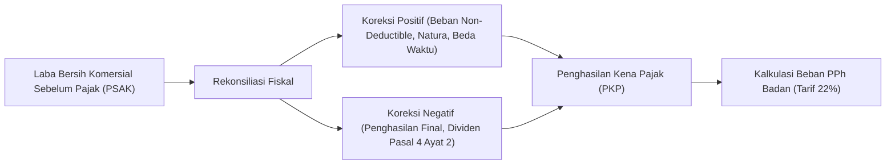

# Panduan Perpajakan Korporat: Rekonsiliasi Fiskal Laba Komersial & Pelaporan SPT Unifikasi

## 1. Ikhtisar Kewajiban Perpajakan Konglomerasi
Setiap entitas bisnis di dalam konglomerasi memiliki kewajiban pelaporan pajak bulanan (Masa) dan tahunan (Tahunan) kepada Direktorat Jenderal Pajak (DJP). Modul `EnterpriseFinance` memfasilitasi rekonsiliasi antara laba bersih komersial menurut standar akuntansi keuangan (PSAK) dan penghasilan neto fiskal menurut Undang-Undang Pajak Penghasilan (UU PPh).

---

## 2. Rincian Koreksi Fiskal Standar
1. **Koreksi Fiskal Positif**:
   - Beban sumbangan atau donasi yang tidak memenuhi kriteria PP No. 93 Tahun 2010.
   - Beban jamuan dan entertainment tanpa daftar nominatif resmi.
   - Biaya perolehan aset yang disusutkan lebih cepat daripada masa manfaat fiskal.
   - Sanksi denda dan bunga administrasi perpajakan.
2. **Koreksi Fiskal Negatif**:
   - Penghasilan bunga deposito perbankan yang telah dikenakan PPh Final $20\%$.
   - Dividen yang diterima dari anak perusahaan dalam negeri yang dikecualikan dari objek pajak sesuai UU Harmonisasi Peraturan Perpajakan (UU HPP).

---

## 3. Simulator Kepatuhan PPN & Bukti Potong Unifikasi
Modul merekonsiliasi Pajak Pertambahan Nilai (PPN) secara periodik:
- **Pajak Keluaran (PK)** yang dipungut dari penjualan faktur pajak.
- **Pajak Masukan (PM)** yang dibayarkan kepada vendor rekanan.
- **PPN Kurang/Lebih Bayar**: $\text{PPN Terutang} = \max(0, \text{PK} - \text{PM})$.
- Pencatatan provisi utang PPN ke buku besar perbankan via `LedgerService` pada akun `ef:vat_payable:IDR`.
