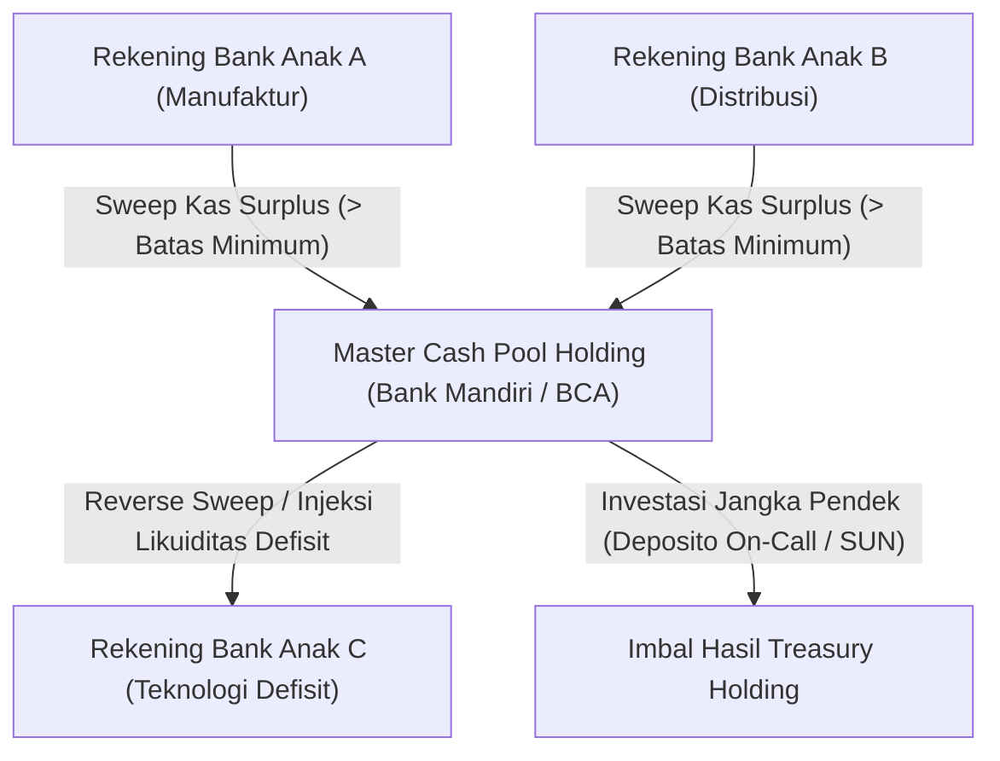

# Panduan Integrasi: Manajemen Likuiditas Terpusat & Mekanisme Cash Sweeping Grup

## 1. Konsep Centralized Cash Pooling
*Centralized Cash Pooling* adalah strategi perbendaharaan holding untuk memusatkan saldo kas dari seluruh rekening bank anak perusahaan ke rekening induk holding pada akhir hari kerja, guna meminimalkan pinjaman eksternal dan menurunkan beban bunga grup secara agregat.

---

## 2. Prosedur Sweeping Kas Harian
1. **Penetapan Ambang Saldo Minimum (Target Balance)**:
   - Setiap rekening operasional anak perusahaan mempertahankan saldo kas minimum harian untuk menutupi kebutuhan pengeluaran tunai tak terduga (misal Rp 50.000.000).
2. **Kalkulasi Nilai Sweep**:
   - Jika $\text{Saldo Akhir Hari} > \text{Target Balance}$, selisih lebih disapu (*swept*) ke rekening master pool holding.
3. **Penyelesaian Cerukan (Overdraft Coverage)**:
   - Jika suatu anak perusahaan memiliki saldo kas di bawah target akibat pengeluaran mendesak, master pool secara otomatis mentransfer dana talangan (*notional cover*) melalui pinjaman antar-entitas (intercompany loan) yang diatur di modul Intercompany Fase 52.

---

## 3. Akuntansi & Bunga Antar-Entitas
- Penempatan dana anak perusahaan di master pool diakui sebagai simpanan pihak berelasi yang berhak memperoleh imbalan bunga pasar wajar (*arm's length interest*).
- Penarikan dana talangan dikenakan bunga pinjaman intercompany sesuai suku bunga acuan ditambah spread risiko yang diaudit secara periodik.
