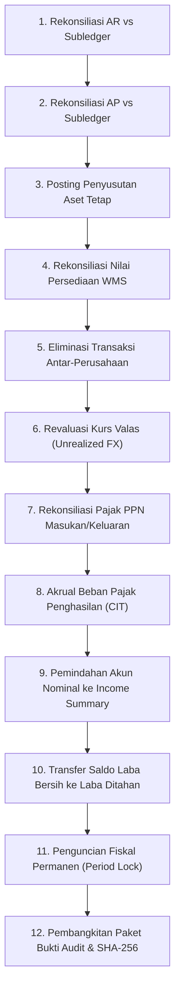

# Panduan Komprehensif: Finance Controller — Tata Kelola Finansial Grup & Tutup Buku (Fase 54)

## 1. Peran & Tanggung Jawab
Finance Controller memegang mandat tata kelola keuangan tertinggi pada level holding dan subholding. Lingkup tanggung jawab utama mencakup:
1. **Otorisasi dan Pengendalian Anggaran Korporat**: Menetapkan pagu belanja operasional (OPEX) dan belanja modal (CAPEX) per cost center, memantau utilisasi komitmen (*encumbrance*), serta mengevaluasi deviasi anggaran bulanan.
2. **Pemberlakuan Pemisahan Tugas (Segregation of Duties - SoD)**: Memastikan tidak ada pengguna yang memiliki otoritas berkonflik dalam siklus pengadaan, pencairan kas, dan rekonsiliasi akuntansi.
3. **Pengujian Kendali Internal (Risk & Control Matrix - RCM)**: Mengawasi efektivitas titik kendali otomatis (three-way matching, toleransi timbangan logistik, batas margin minimum) dan memitigasi defisiensi pengendalian.
4. **Rekonsiliasi Fiskal & Pelaporan Perpajakan Nasional**: Memastikan kepatuhan pelaporan SPT Masa PPN 1111, PPh 21, PPh 22, PPh 23, dan PPh 4 ayat 2, serta validasi nomor seri faktur gapless.
5. **Eksekusi dan Penguncian Tutup Buku Fiskal (Month-End & Year-End Close)**: Memimpin tahapan verifikasi subledger, pembukuan jurnal penutup, dan penguncian permanen periode buku besar anti-backdating.

---

## 2. Struktur Hierarki Anggaran & Mekanisme Pengendalian Pagu

### 2.1 Hierarki Alokasi Anggaran
Platform Enterprise Finance memetakan struktur belanja korporat ke dalam 4 tingkatan:
1. **Entitas Hukum (Legal Entity)**: Level teratas entitas pelapor (misal: `CORP-HOLDING`, `SUB-LOGISTICS`, `SUB-MINING`).
2. **Direktorat / Divisi**: Unit strategis organisasi (misal: `DIR-TECH`, `DIR-OPS`, `DIR-FINANCE`).
3. **Pusat Biaya (Cost Center)**: Unit operasional yang menyerap biaya secara langsung (misal: `CC-IT-INFRA`, `CC-FLEET-MAINT`, `CC-CORP-LEGAL`).
4. **Mata Anggaran (Account Code / Line Item)**: Akun beban standar dalam bagan akun GL (misal: `5101-SERVER-HOSTING`, `5204-FUEL-EXPENSE`, `5302-PROFESSIONAL-FEES`).

### 2.2 Saldo Pagu Empat Dimensi
Setiap mata anggaran dikelola dalam formula keseimbangan kas ketat:
$$\text{Sisa Pagu Bebas (Available)} = \text{Pagu Disetujui (Allocated)} - (\text{Komitmen Tertahan (Encumbered)} + \text{Realisasi Belanja (Spent)})$$

- **Pagu Disetujui (Allocated Amount)**: Plafon belanja resmi yang disahkan dalam RKAP (Rencana Kerja dan Anggaran Perusahaan).
- **Komitmen Tertahan (Encumbered / Reserved)**: Dana yang dicadangkan segera setelah Purchase Requisition (PR) atau Purchase Order (PO) disetujui. Pagu ini diblokir sehingga tidak dapat digunakan oleh pengadaan lain.
- **Realisasi Belanja (Spent / Liquidated)**: Nilai faktur tagihan vendor yang telah diverifikasi kelengkapan dokumennya (three-way match) dan dicatat sebagai beban aktual di buku besar.
- **Sisa Bebas (Available Balance)**: Batas maksimal transaksi baru yang dapat diajukan oleh departemen terkait.

### 2.3 Kebijakan Pengendalian: Hard-Stop vs Soft-Stop
- **Hard-Stop Enforcement**: Mode baku untuk seluruh pengadaan non-darurat. Sistem secara mutlak menolak setiap permintaan reservasi komitmen dari modul Procurement atau Logistics jika nilai permohonan melebihi sisa pagu bebas. Transaksi digagalkan dengan pengecualian `BudgetGuardrailBreachException`.
- **Soft-Stop Exception**: Diaktifkan khusus untuk pengadaan bahan baku utama atau tanggap darurat operasional. Sistem mengizinkan reservasi sementara dengan menerbitkan peringatan otomatis dan menugaskan tiket eskalasi persetujuan khusus ke Finance Controller dan Direktur Keuangan.

---

## 3. Matriks Pemisahan Tugas (Segregation of Duties - SoD) & Dispensasi

### 3.1 Matriks 12 Konflik Risiko Kritis
Sistem memindai seluruh penugasan peran secara berkala untuk mendeteksi potensi kecurangan atau benturan kepentingan internal:

| ID Konflik | Nama Aturan Konflik | Peran Pertama | Peran Kedua | Klasifikasi Risiko |
| :--- | :--- | :--- | :--- | :--- |
| `SOD-01` | Pengaju PO vs Penyetuju PO | `procurement_buyer` | `procurement_manager` | **CRITICAL** |
| `SOD-02` | Penginput Tagihan AP vs Eksekutor Kas Bank | `ap_clerk` | `treasury_disburser` | **CRITICAL** |
| `SOD-03` | Kasir Kas Fisik vs Rekonsiliator Bank | `cashier` | `bank_reconciler` | **HIGH** |
| `SOD-04` | Pengelola Master Vendor vs Pemroses Pembayaran | `master_data_admin` | `ap_officer` | **CRITICAL** |
| `SOD-05` | Kasir POS vs Void Supervisor | `pos_cashier` | `pos_void_admin` | **HIGH** |
| `SOD-06` | Pembuat Alokasi Anggaran vs Penyetuju Revisi | `budget_planner` | `budget_approver` | **HIGH** |
| `SOD-07` | Penerima Fisik Gudang vs Pemeriksa Opname Stok | `warehouse_receiver` | `inventory_controller` | **MEDIUM** |
| `SOD-08` | Penginput Data Payroll vs Penyetuju Penggajian | `payroll_clerk` | `hr_finance_director` | **CRITICAL** |
| `SOD-09` | Pengusul Inisiatif CAPEX vs Anggota Evaluator | `project_sponsor` | `capex_evaluator` | **HIGH** |
| `SOD-10` | Penagih Piutang (AR) vs Otorisator Penghapusan | `ar_collector` | `credit_risk_manager` | **HIGH** |
| `SOD-11` | Penghitung Beban Pajak vs Penandatangan SPT | `tax_preparer` | `tax_approver` | **MEDIUM** |
| `SOD-12` | Auditor Internal vs Super Administrator Sistem | `internal_auditor` | `system_security_admin` | **CRITICAL** |

### 3.2 Prosedur Penerbitan Dispensasi Waktu-Terbatas
Dalam skenario operasional mendesak (misalnya staf akuntansi cuti sakit saat periode tutup buku):
1. Masuk ke antarmuka `/enterprise-finance/sod`.
2. Isi formulir **Penerbitan Dispensasi SoD**:
   - Tentukan ID Operator yang diberikan wewenang darurat.
   - Pilih Aturan SoD yang dimintakan pengecualian.
   - Cantumkan Justifikasi Bisnis terperinci (minimal 20 karakter).
   - Tentukan durasi berlaku (maksimal 30 hari kalender).
3. Klik tombol **Terbitkan Dispensasi SoD**.
4. Sistem mencatat pengecualian ke tabel `ef_sod_exceptions` dengan status `ACTIVE` dan mencatat identitas penandatangan di log audit keamanan.

---

## 4. Alur 12 Langkah Prosedur Tutup Buku Periode Fiskal (Month-End Close)

Eksekusi penutupan periode fiskal merupakan proses berurutan yang menuntut kepatuhan 100% terhadap kriteria checklist. Tahapan berikut wajib dipastikan telah tuntas:

### Rincian Verifikasi Tiap Langkah:
1. **Langkah 1 (Piutang Usaha - AR)**: Memanggil `ArSubledgerTotalAdapter`. Saldo total faktur piutang pelanggan terbuka harus persis sama dengan saldo buku besar `ef:nominal_ar:{entitas}`. Selisih toleransi adalah Rp 0.
2. **Langkah 2 (Utang Usaha - AP)**: Memanggil `ApSubledgerTotalAdapter`. Saldo utang pemasok yang belum terbayar harus cocok dengan saldo buku besar `ef:nominal_ap:{entitas}`.
3. **Langkah 3 (Penyusutan Aset)**: Memanggil `FixedAssetSubledgerTotalAdapter`. Memastikan jurnal beban depresiasi bulanan mesin, gedung, dan kendaraan telah diposting.
4. **Langkah 4 (Nilai Persediaan Gudang)**: Memanggil `InventorySubledgerTotalAdapter`. Total kuantitas bin stock dikalikan biaya standar persediaan harus sesuai dengan saldo buku besar persediaan.
5. **Langkah 5 (Eliminasi Intercompany)**: Menghapus saldo piutang/utang dan laba kotor transaksi antar entitas anak perusahaan konsolidasi.
6. **Langkah 6 (Revaluasi Kurs Valas)**: Menyesuaikan saldo kas valuta asing dan utang luar negeri dengan kurs tengah Bank Indonesia pada hari terakhir periode fiskal.
7. **Langkah 7 (Rekonsiliasi PPN)**: Menandingkan Faktur Pajak Keluaran terhadap Faktur Pajak Masukan dan memposting setoran ke akun kliring perpajakan.
8. **Langkah 8 (Pencadangan Pajak Badan)**: Mengkalkulasi estimasi beban PPh Badan tahun berjalan sesuai tarif Pasal 17 UU HPP (22%).
9. **Langkah 9 (Pemindahan Akun Nominal)**: Memposting debit pada akun pendapatan dan kredit pada akun beban ke akun penampung sementara `ef:income_summary:{entitas}:IDR`.
10. **Langkah 10 (Penetapan Laba Bersih)**: Memindahkan saldo kredit bersih dari `ef:income_summary` ke akun modal `ef:retained_earnings:{entitas}:IDR`.
11. **Langkah 11 (Penguncian Permanen)**: Mendaftarkan entitas dan periode ke `ef_financial_period_locks` dengan bendera `is_locked = true`. Sistem menolak penulisan jurnal baru ber-tanggal periode tersebut.
12. **Langkah 12 (Penyegelan Audit)**: Memanggil `AuditDataPackGeneratorService` untuk menghasilkan arsip ZIP terkompresi berisi rekapitulasi buku besar, subledger, dan manifest hash SHA-256 yang ditandatangani secara digital.

---

## 5. Rekonsiliasi Fiskal & Pelaporan Perpajakan Nasional

### 5.1 Penanganan PPN (Pajak Pertambahan Nilai) 11%
- **PPN Keluaran**: Dipungut atas penjualan barang/jasa kepada pelanggan dan dicatat pada akun `ef:vat_output_payable:{entitas}:IDR`.
- **PPN Masukan**: Pajak yang dibayar kepada pemasok atas faktur pembelian barang kena pajak, dicatat pada `ef:vat_input_receivable:{entitas}:IDR`.
- **Kompensasi & Setoran**:
  $$\text{PPN Kurang Bayar} = \text{PPN Keluaran} - \text{PPN Masukan}$$
  Jika bernilai positif, Finance Controller mengeksekusi setoran kas negara via tombol **Eksekusi Penyetoran PPN**. Jurnal otomatis memindahkan kewajiban ke akun kliring `ef:vat_settlement_clearing:{entitas}:IDR`.

### 5.2 Standar Nomor Seri Faktur Pajak (NSFP) Gapless
Untuk memenuhi regulasi Direktorat Jenderal Pajak (DJP):
- Setiap faktur pajak elektronik simulasi yang diterbitkan wajib memiliki nomor seri urut tanpa ada nomor yang terlewat (*gapless*).
- Pola baku penomoran: `010.001-YY.XXXXXXXX` di mana `YY` adalah dua digit tahun fiskal dan `XXXXXXXX` adalah 8 digit angka urut berkesinambungan.
- Audit berkala `enterprise:tax-recon` memvalidasi ketiadaan celah (*zero gap*) dan keunikan nomor faktur dalam database.

---

## 6. Penanganan Galat & Eskalasi Insiden Tutup Buku

| Gejala Galat | Akar Masalah | Tindakan Perbaikan Segera |
| :--- | :--- | :--- |
| `SubledgerReconciliationMismatchException` | Terjadi ketidakcocokan antara subledger AR/AP dengan GL | Jalankan `php artisan enterprise:audit` untuk menemukan ID voucher transaksi yang tidak memiliki ayat jurnal pembalik di subledger. Perbaiki transaksi gantung sebelum menutup periode. |
| `PeriodAlreadyLockedException` | Upaya memposting jurnal pada periode yang telah dikunci | Dilarang membuka kunci secara langsung. Mutasi susulan harus dicatat pada periode buku berjalan sebagai *prior period adjustment*. |
| `BudgetGuardrailBreachException` | Permintaan PO ditolak karena sisa pagu bebas habis | Lakukan pengajuan revisi anggaran resmi via workflow `DRAFT -> SUBMITTED -> REVIEWED -> APPROVED` dengan persetujuan direktur keuangan. |
| `SodViolationException` | Penugasan wewenang berkonflik pada operator | Cabut peran yang bertentangan atau terbitkan dispensasi SoD resmi berbatas waktu jika terjadi keadaan darurat operasional. |
