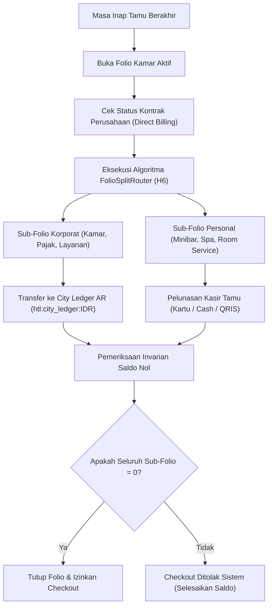

# Panduan Operasional Front Desk: Folio Split Multi-Payer & Checkout Saldo Nol (Fase 92)

Dokumen ini memandu petugas Front Desk Agent, Kasir Kantor Depan, dan Duty Manager dalam menjalankan prosedur pemisahan tagihan multi-penanggung (*folio splitting*), penagihan piutang korporat (*City Ledger AR*), dan penutupan folio saldo nol.

---

## 1. Alur Transaksi Folio Multi-Payer

---

## 2. Kategori Pembebanan Biaya (Eligibilitas Penagihan)

Sesuai perjanjian kerjasama bisnis korporat (Corporate Corporate Rate Agreement):
1. **Pos yang Ditanggung Perusahaan (Corporate Direct Billing)**:
   - Biaya Sewa Kamar Harian (`ROOM_CHARGE`)
   - Pajak Daerah PBJT 10% (`HOTEL_TAX`)
   - Biaya Layanan 10% (`SERVICE_CHARGE`)
   - Internet Bisnis Berkecepatan Tinggi (`BUSINESS_INTERNET`)
   - Penjemputan / Pengantaran Bandara Resmi (`AIRPORT_TRANSFER`)
2. **Pos yang Wajib Dibayar Pribadi oleh Tamu (Personal Incidental Charges)**:
   - Konsumsi Makanan & Minuman di Kamar (`ROOM_SERVICE`)
   - Makanan dan Minuman di Kulkas Mini Kamar (`MINIBAR`)
   - Layanan Perawatan Tubuh & Pijat (`SPA`)
   - Pencucian Pakaian Pribadi (`LAUNDRY`)
   - Kerusakan Fasilitas Kamar atau Kehilangan Kunci (`DAMAGE_PENALTY`)

---

## 3. Prosedur Penyelesaian Transaksi di Kasir Front Desk

### 3.1 Verifikasi Otorisasi Perusahaan
- Buka menu **Folio Split Multi-Payer Workbench** pada nomor kamar terkait.
- Pastikan surat jaminan perusahaan (*Letter of Authorization / LOA*) atau voucher korporat telah tercatat dengan nomor akun City Ledger yang sah.
- Verifikasi bahwa batas kredit perusahaan belum terlampaui.

### 3.2 Penagihan ke City Ledger AR
- Masukkan kode perusahaan (misal: `CORP-ASTRA-01`).
- Sistem memindahkan beban kamar ke buku besar piutang usaha perusahaan secara otomatis.
- Cetak salinan *Guest Signature Folio* untuk ditandatangani oleh tamu sebagai bukti telah menikmati fasilitas kamar.

### 3.3 Penagihan Insidental Personal
- Berikan rincian tagihan personal (minibar, spa, restoran) kepada tamu.
- Terima pembayaran via kartu kredit/debit, uang tunai, atau QRIS.
- Sistem mencatat pelunasan personal ke kasir front desk.

### 3.4 Validasi Penutupan Saldo Nol
- Sistem secara ketat memeriksa bahwa:
  $$\text{Saldo Sisa} = \text{Total Tagihan} - (\text{Transfer Korporat} + \text{Pembayaran Personal}) = 0$$
- Setelah saldo tepat 0, klik **Eksekusi Split & Tutup Folio**. Status reservasi berubah menjadi `CHECKED_OUT`.
