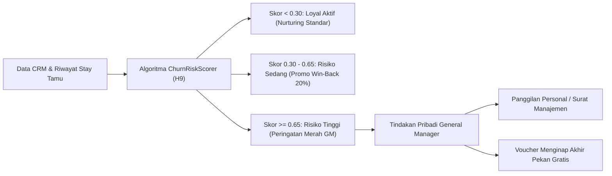

# Panduan Eksekutif General Manager: Pengawasan Retensi Churn, Pagu City Ledger & Dividen Timeshare (Fase 92)

Dokumen ini ditujukan untuk General Manager (GM), Resident Manager, dan Financial Controller dalam memantau kinerja operasional, solvabilitas piutang korporat, dividen kepemilikan vila fraksional, dan mitigasi risiko atrisi tamu (Churn Risk).

---

## 1. Menara Kontrol Retensi Tamu & Algoritma ChurnRiskScorer (H9)

Kepuasan dan retensi tamu merupakan penggerak utama nilai seumur hidup tamu (*Customer Lifetime Value / CLV*). Sistem Superweb memantau riwayat setiap tamu menggunakan Algoritma H9.

### 1.1 Protokol Intervensi Risiko Tinggi (Skor $\ge 0.65$)
1. **Penyebab Utama Risiko Tinggi**:
   - Masa jeda menginap telah melebihi 180 hari ($D_{recency} \ge 180$).
   - Frekuensi menginap menurun drastis dibanding tahun sebelumnya.
   - Pernah terjadi insiden pelayanan atau komplain yang belum diselesaikan secara tuntas.
   - Memberikan rating ulasan $\le 3.0$ pada platform survei tamu.
2. **Mandat Tindakan GM**:
   - GM atau Guest Relation Manager (GRM) wajib menghubungi tamu secara personal melalui telepon atau surat resmi dalam waktu 48 jam.
   - Menawarkan voucher menginap akhir pekan gratis (*Complimentary Weekend Stay*) atau voucher santap malam eksklusif IDR 500.000 di restoran hotel.

---

## 2. Pengawasan Buku Besar Piutang Kota (City Ledger AR Governance)

Sebagai bagian dari tata kelola keuangan hotel yang sehat:
1. **Persetujuan Pagu Kredit Korporat**:
   - Pagu kredit di atas IDR 50.000.000 wajib mendapat persetujuan tertulis dari Financial Controller dan GM.
   - Peringatan sistem muncul apabila utilisasi pagu piutang korporat mencapai $\ge 70\%$.
2. **Jadwal Umur Piutang (Aging Schedule)**:
   - **0–30 Hari**: Piutang lancar (*Current*). Faktur bulanan dikirimkan secara otomatis pada tanggal 1 setiap bulan.
   - **31–60 Hari**: Peringatan penagihan tingkat 1 dikirimkan ke bagian keuangan perusahaan.
   - **> 60 Hari**: Akun korporat ditangguhkan (*SUSPENDED*). Fasilitas direct billing dibekukan sementara hingga seluruh tunggakan dilunasi.

---

## 3. Tata Kelola Dividen Unit Timeshare Vila Resort

1. **Jaminan Transparansi Pemilik**:
   - Pendapatan sewa kotor (*Gross Rental Income*) dari kamar vila yang disewakan ke publik dipublikasikan secara transparan pada portal investor.
   - Pemotongan biaya manajemen resmi adalah tepat $15.00\%$.
2. **Distribusi Dividen Pro-Rata**:
   - Hasil sewa bersih disetorkan langsung ke rekening perantara investor per tanggal 5 setiap bulan.
   - GM wajib memastikan bahwa audit operasional tata graha dan pemeliharaan fasilitas vila berjalan dengan standar bintang lima.
