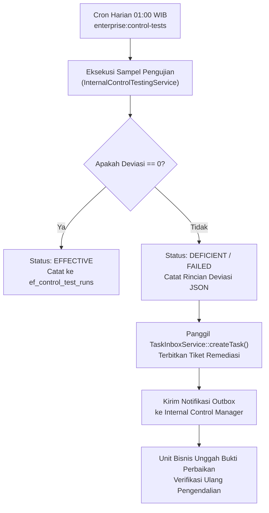

# Panduan Pengguna: Internal Control & Risk Manager — Pengendalian Internal & Risk Control Matrix (Fase 54)

## 1. Peran & Tanggung Jawab
Internal Control & Risk Manager bertanggung jawab atas perancangan, implementasi, dan pengujian efektivitas pengendalian internal atas pelaporan keuangan (Internal Control over Financial Reporting - ICFR) di seluruh lini bisnis holding. Ruang lingkup tugas mencakup:
1. **Pemeliharaan Risk Control Matrix (RCM)**: Mengidentifikasi risiko kecurangan (*fraud risk*) dan risiko salah saji material dalam siklus operasional, serta merumuskan titik kendali pencegahan (*preventive control*) dan pendeteksian (*detective control*).
2. **Pengujian Kendali Otomatis (Automated Control Testing)**: Memantau pelaksanaan pengujian otomatis harian melalui command `enterprise:control-tests` dan menganalisis deviasi sampel.
3. **Manajemen Tindakan Korektif (Remediation Tracking)**: Mengkoordinasikan tindak lanjut atas temuan defisiensi pengendalian dengan unit bisnis terkait melalui tiket tugas `CoreTask`.
4. **Pelaporan Kesiapan SOX 404 / Kepatuhan GCG**: Menyajikan rekapitulasi efektivitas pengendalian kepada Komite Audit dan Dewan Komisaris.

---

## 2. Struktur Risk Control Matrix (RCM) & 4 Titik Kendali Inti

### 2.1 Katalog Titik Kendali Operasional
Platform Enterprise Finance mengotomatisasi pengujian 4 titik kendali operasional kritis yang dievaluasi setiap hari pada pukul 01.00 WIB:

1. **`CP-01-FOUR-EYES` — Verifikasi Prinsip Persetujuan Ganda (Maker-Checker)**:
   - **Tujuan Pengendalian**: Mencegah penerbitan anggaran fiktif atau perubahan plafon sepihak tanpa otorisasi berjenjang.
   - **Aturan Bisnis**: Pengguna pembuat draf (`created_by`) dilarang bertindak sebagai penyetuju (`approved_by`).
   - **Metode Uji**: Memindai seluruh record anggaran berstatus `APPROVED` dan `ACTIVE` pada tabel `ef_budgets`. Jika ditemukan `created_by == approved_by`, pengujian menandai status `FAILED`.

2. **`CP-02-THREE-WAY-MATCH` — Pencocokan Tiga Pihak Pengadaan Barang/Jasa**:
   - **Tujuan Pengendalian**: Menjamin tidak ada pembayaran kas yang dikeluarkan tanpa bukti fisik penerimaan barang dan kesepakatan harga PO resmi.
   - **Aturan Bisnis**: Faktur tagihan vendor wajib memiliki referensi Purchase Order (PO) yang sah dan Goods Receipt Note (GRN) yang terverifikasi di gudang logistik.
   - **Metode Uji**: Mengambil 50 sampel pembayaran AP terbaru dan memverifikasi kelengkapan dokumen pendukung. Deviasi terhitung jika ada faktur lunas tanpa GRN.

3. **`CP-03-WEIGHING-TOLERANCE` — Validasi Batas Toleransi Timbangan Logistik**:
   - **Tujuan Pengendalian**: Mencegah kebocoran muatan kargo atau komoditas tambang/pertanian akibat manipulasi timbangan jembatan (*weighbridge*).
   - **Aturan Bisnis**: Selisih antara berat timbang awal saat keberangkatan (*gross weight*) dengan berat penerimaan di gudang tujuan (*net received*) tidak boleh melampaui toleransi $\le 1.5\%$.
   - **Metode Uji**: Memindai tiket timbangan armada logistik pada periode berjalan. Deviasi terhitung jika ditemukan selisih berat $> 1.5\%$ tanpa berita acara susut wajar.

4. **`CP-04-MARGIN-FLOOR` — Perlindungan Margin Penjualan Minimum**:
   - **Tujuan Pengendalian**: Menghindari penjualan rugi atau pemberian diskon berlebihan yang merugikan arus kas perusahaan.
   - **Aturan Bisnis**: Harga jual akhir produk kepada distributor atau agen tidak boleh lebih rendah dari Harga Pokok Penjualan (HPP) ditambah margin dasar ($5\%$).
   - **Metode Uji**: Memeriksa seluruh Sales Order tertutup pada modul Store dan Distribution. Deviasi terhitung jika margin kotor $< 5\%$.

---

## 3. Alur Pengujian Otomatis & Penanganan Defisiensi

### Prosedur Tindak Lanjut Defisiensi:
1. Ketika pengujian otomatis menemukan anomali, sistem mencatat riwayat ke `ef_control_test_runs` dan menerbitkan tugas mitigasi manajerial melalui modul `CoreTask`.
2. Internal Control Manager meninjau tiket tugas pada antarmuka `/enterprise-finance/controls`.
3. Unit kerja terkait diberikan waktu maksimal 5 hari kerja untuk mengunggah dokumen klarifikasi atau ayat jurnal korektif.
4. Setelah tindakan perbaikan disetujui, Internal Control Manager menjalankan uji ulang khusus via tombol **Jalankan Uji Ulang Kontrol**.

---

## 4. Evaluasi Kematangan Pengendalian & Pelaporan Komite Audit

Internal Control Manager menyusun Laporan Efektivitas Pengendalian Kuartalan (*Quarterly ICFR Report*) berdasarkan agregasi data pengujian:

### 4.1 Metrik Efektivitas Pengendalian
Sistem menghitung rasio efektivitas pengendalian otomatis (*Control Effectiveness Ratio - CER*):
$$\text{CER} = \left( \frac{\text{Jumlah Pengujian Berstatus EFFECTIVE}}{\text{Total Pengujian Dilakukan}} \right) \times 100\%$$
- **Target Standar Korporat**: $\text{CER} \ge 98.0\%$.
- Jika $\text{CER} < 95.0\%$, Finance Controller dan Komite Audit wajib menyelenggarakan rapat penelaahan khusus mitigasi risiko material (*Deficiency Remediation Meeting*).

### 4.2 Matriks Klasifikasi Temuan Pengendalian
Setiap penyimpangan dikelompokkan ke dalam 3 tingkatan keparahan:
1. **Defisiensi Pengendalian (Control Deficiency)**: Kelemahan operasional kecil yang tidak berpotensi menimbulkan salah saji material (misal: keterlambatan pengunggahan lampiran faktur $< 24$ jam).
2. **Kelemahan Signifikan (Significant Deficiency)**: Defisiensi atau kombinasi beberapa defisiensi yang layak mendapat perhatian pihak yang bertanggung jawab atas tata kelola (misal: deviasi timbangan berulang pada satu hub logistik).
3. **Kelemahan Material (Material Weakness)**: Defisiensi pengendalian yang berpotensi wajar bahwa salah saji material pada laporan keuangan tahunan atau interim tidak akan tercegah atau terdeteksi tepat waktu (misal: bypass prinsip Maker-Checker pada penganggaran).
