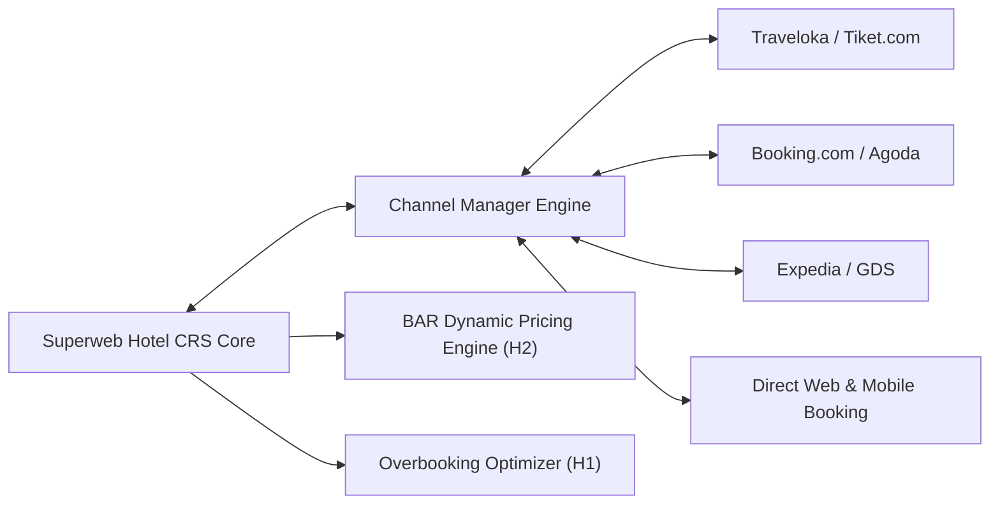

# Kebijakan Distribusi Channel Manager, CRS & Manajemen Tarif

Dokumen kebijakan ini mengatur integrasi distribusi inventaris kamar, pembagian saluran penjualan (Online Travel Agencies / OTA, Global Distribution Systems / GDS, Direct Booking), serta strategi harga dinamis Best Available Rate (BAR) dan batas overbooking terkontrol pada Superweb Hotel.

---

## 1. Arsitektur Distribusi Dua Arah (Two-Way CRS Synchronization)

Sistem Central Reservation System (CRS) Superweb Hotel terhubung secara dua arah dengan Online Travel Agents (seperti Traveloka, Agoda, Booking.com, Expedia) melalui protokol integrasi API OTA:

### 1.1 Mekanisme Sinkronisasi
1. **Push Update (ARI - Availability, Rate, Inventory)**:
   - Setiap terjadi transaksi reservasi, modifikasi, atau pembatalan di Superweb PMS, ketersediaan bersih kamar (*net remaining inventory*) diperbarui dan di-push ke seluruh OTA dalam waktu < 3 detik.
2. **Pull / Webhook Ingestion**:
   - Pemesanan baru dari OTA diterima via webhook endpoint terproteksi (`/api/v1/hotel/channel-manager/bookings`).
   - Sistem memvalidasi Idempotency-Key untuk mencegah pemrosesan ganda akibat transmisi ulang (network retry) oleh OTA.
3. **Pemberlakuan Paritas Harga (Rate Parity Guard)**:
   - Sistem memonitor kepatuhan tarif di seluruh saluran publik untuk memastikan tarif kamar direct website selalu bersaing atau lebih menguntungkan (misalnya dengan benefit complimentary breakfast atau loyalty points).

---

## 2. Strategi Penetapan Harga Dinamis (BestAvailableRateCalculator - H2)

Algoritma H2 menghitung Best Available Rate secara real-time berdasarkan matriks okupansi, waktu tunggu kedatangan (booking lead time), elastisitas permintaan musiman, dan panjang masa menginap (Length of Stay / LOS).

### 2.1 Formula Perhitungan Tarif
Tarif dinamis dihitung dengan formula:
$$BAR = BaseRate \times (1 + Factor_{Occupancy} + Factor_{LeadTime} + Factor_{Seasonal} - Incentive_{LOS})$$

- **Faktor Okupansi ($Factor_{Occupancy}$)**:
  - Okupansi < 40%: $-10\%$ (Stimulasi permintaan low season)
  - Okupansi 40% - 69%: $0\%$ (Tarif standar dasar)
  - Okupansi 70% - 84%: $+15\%$ (Yield optimization tier 1)
  - Okupansi 85% - 94%: $+30\%$ (Yield optimization tier 2)
  - Okupansi $\ge 95\%$: $+50\%$ (Penjualan kamar premium sisa)
- **Faktor Waktu Tunggu ($Factor_{LeadTime}$)**:
  - Pemesanan jauh hari (> 30 hari): Diskon Early Bird $-10\%$
  - Pemesanan hari yang sama (Same-Day / Last Minute): Surcharge $+5\%$ hingga $+15\%$ tergantung tren permintaan.
- **Insentif Panjang Masa Menginap ($Incentive_{LOS}$)**:
  - Inap $\ge 3$ malam: Diskon paket menginap $-5\%$
  - Inap $\ge 7$ malam: Diskon paket long stay $-12\%$

---

## 3. Kebijakan Batas Overbooking Terkontrol (OverbookingLimitOptimizer - H1)

Hotel menerapkan strategi overbooking ilmiah untuk memitigasi risiko kerugian akibat pembatalan mendadak (*cancellations*) dan ketidakhadiran tanpa kabar (*no-shows*).

### 3.1 Parameter Model Probabilitas
Algoritma H1 mengombinasikan:
- Tingkat No-Show Historis ($\mu_{ns}, \sigma_{ns}$)
- Biaya Kerugian Kamar Kosong (*Spoilage Cost* = Marjin Kontribusi Kamar)
- Biaya Pemindahan Tamu Terlantar (*Walk Cost / Bump Cost* = Biaya taksi, akomodasi hotel bintang setara/lebih tinggi, kompensasi voucher, dan risiko reputasi)

### 3.2 Rasio Overbooking Maksimal yang Diizinkan
- Properti tidak diizinkan melakukan overbooking melebihi $110\%$ dari total inventaris kamar fisik pada tipe kamar standar.
- Kamar tipe Suite, Presidential, dan Penthouse **DILARANG KERAS** dioverbook ($Limit = 100\%$).
- Pada periode *High Demand Peak Season* (Libur Idul Fitri, Natal, Tahun Baru), batas overbooking diturunkan maksimal ke $103\%$ karena probabilitas no-show sangat rendah (< 1%).

---

## 4. Prosedur Book-Out & Penanganan Tamu Terlantar (Walk-Out Handling)

Bila terjadi kondisi overbooking tak terhindarkan saat kedatangan tamu:
1. **Identifikasi Prioritas Pemindahan**:
   - Dilarang memindahkan: Anggota Loyalty tier Platinum/VIP, tamu delegasi pernikahan/MICE, tamu lansia atau keluarga dengan balita.
   - Tamu walk-in atau reservasi pihak ketiga tanpa jaminan lanjutan dialihkan terlebih dahulu.
2. **Penyediaan Akomodasi Alternatif**:
   - Pemesanan kamar di hotel mitra kelas setaraf atau lebih tinggi di kawasan sekitar.
   - Pembayaran biaya kamar hotel alternatif ditanggung sepenuhnya oleh hotel (Posting ke akun biaya operasional FO).
3. **Kompensasi Tambahan**:
   - Transportasi gratis antar hotel.
   - Voucher menginap gratis 1 malam (*Complimentary Stay Voucher*) yang berlaku selama 6 bulan.
   - Permintaan maaf resmi dari General Manager.

