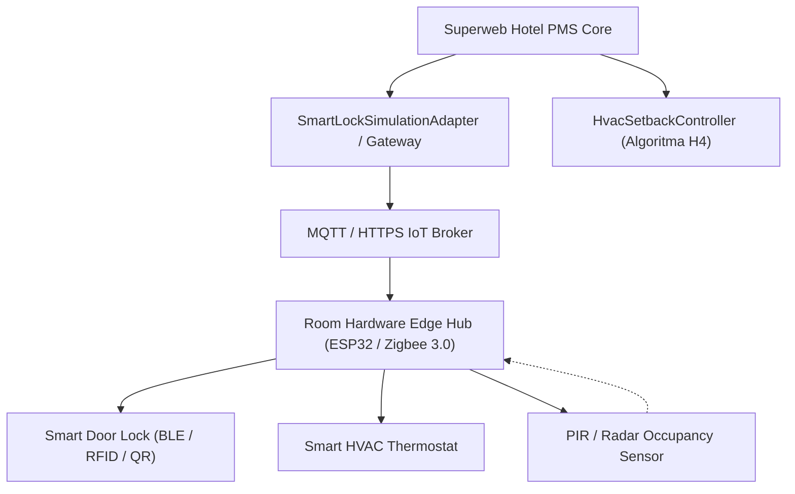

# Manual Integrasi IoT: Smart Lock Kamar & Kontrol Suhu HVAC

Dokumen teknis ini menjelaskan arsitektur integrasi, protokol komunikasi, mekanisme enkripsi kunci kamar digital, dan algoritma efisiensi energi HVAC cerdas pada Superweb Hotel PMS (Fase 91).

---

## 1. Arsitektur Komunikasi Smart Room IoT

Sistem Smart Room Superweb dirancang dengan model *hybrid cloud-edge* untuk memastikan keandalan operasional bahkan saat terjadi pemadaman konektivitas internet (*offline resilience*).



Komponen utama:
1. **PMS Core**: Mengelola siklus hidup reservasi tamu, status kamar, dan otorisasi waktu akses kamar.
2. **SmartLockSimulationAdapter**: Abstraksi adaptor perangkat keras yang mengimplementasikan antarmuka `SmartLockAdapterInterface`. Menyediakan enkripsi token dan sinkronisasi status perangkat.
3. **HvacSetbackController (H4)**: Algoritma bersertifikat penentu suhu setpoint berdasarkan status okupansi kamar (`VACANT`, `OCCUPIED_PRESENT`, `OCCUPIED_AWAY`, `NIGHT_SLEEP`).

---

## 2. Enkripsi dan Keamanan Kunci Digital (Digital Key Security)

Untuk mencegah pemalsuan, *replay attack*, atau manipulasi waktu aktif kunci kamar, Superweb mewajibkan penggunaan enkripsi simetris terkelola (`Crypt::encryptString`) dengan rotasi kunci berkala.

### 2.1 Struktur Payload Token Digital
Payload token kunci digital terdiri dari data terstruktur JSON yang dienkripsi:
```json
{
  "reservation_id": "9d8e7f6a-1234-4567-89ab-cdef01234567",
  "property_id": "prop-grand-superweb-01",
  "room_number": "Suite 808",
  "guest_id": "gst-44819",
  "valid_from": "2026-11-08T14:00:00+08:00",
  "valid_until": "2026-11-10T12:00:00+08:00",
  "privileges": ["DOOR_ENTRY", "ELEVATOR_ACCESS", "EXECUTIVE_LOUNGE"],
  "nonce": "a7b3c9d1e5f84201"
}
```

### 2.2 Aturan Validasi Kunci Pada Perangkat Keras
1. **Verifikasi Tanda Tangan / Dekripsi**: Perangkat membaca token (via Bluetooth Low Energy advertising packet atau pemindaian QR code dinamis). Jika dekripsi gagal atau token korup, akses ditolak (*Door LED Red*).
2. **Validasi Rentang Waktu (Time Window Validation)**:
   - Akses hanya diizinkan jika `valid_from <= Waktu_Lokal_Kunci <= valid_until`.
   - Jam perangkat keras pintu disinkronkan via RTC (Real-Time Clock) dengan protokol NTP terenkripsi.
3. **Pencabutan Akses Instan (Instant Revocation)**:
   - Jika tamu melakukan early checkout atau kamar dibatalkan, PMS mengirim pesan pembatalan (*blacklist message*) ke broker IoT kamar.
   - Pintu segera menghapus hash token tersebut dari daftar akses sah lokal.

---

## 3. Algoritma Efisiensi Energi HVAC (HvacSetbackController)

Algoritma H4 mengatur suhu target termostat AC kamar berdasarkan matriks kondisi real-time untuk menghemat konsumsi energi listrik hingga 28% tanpa mengorbankan kenyamanan tamu.

### 3.1 Aturan Setpoint Suhu dan Mode Kipas

| Status Kamar | Kehadiran Tamu | Suhu Target (°C) | Mode Kipas | Alasan Operasional |
| :--- | :--- | :--- | :--- | :--- |
| `VACANT_DIRTY` | Kosong | 28.0 | LOW / ECO | Mencegah kelembapan tinggi, konsumsi daya minimal |
| `VACANT_CLEAN` | Kosong | 27.0 | LOW / ECO | Kamar siap huni, suhu stabil |
| `PRE_ARRIVAL` | Menjelang tiba (< 60 mnt) | 23.0 | AUTO | Pendinginan awal menyambut kedatangan tamu |
| `OCCUPIED_IN` | Tamu di dalam kamar | 21.0 - 23.0 | AUTO / USER | Suhu kenyamanan tamu sesuai preferensi profil |
| `OCCUPIED_AWAY`| Tamu di luar kamar | 25.5 | ECO | Setback mode, hemat daya selama tamu bepergian |
| `NIGHT_SLEEP` | Tamu tidur (23:00 - 06:00)| 22.0 | QUIET | Pengendalian suhu stabil dan tingkat kebisingan rendah |

### 3.2 Logika Penyesuaian Dinamis Suhu Luar Ruang
Jika suhu lingkungan luar gedung mencapai suhu ekstrem (> 34°C):
- Setback mode disesuaikan menjadi maksimal 26.0°C untuk menghindari lonjakan beban kompresor yang terlalu berat saat tamu kembali ke kamar (*thermal pull-down latency optimization*).
- Sensor jendela dan pintu balkon dipantau: bila pintu balkon terbuka lebih dari 3 menit saat AC aktif, sistem otomatis mematikan kompresor pendingin.

---

## 4. Prosedur Darurat dan Fail-Safe

1. **Pemadaman Jaringan IoT (Network Outage)**:
   - Smart Lock tetap berfungsi secara mandiri (offline) karena otentikasi kunci digital dievaluasi secara lokal menggunakan public-key cryptography atau shared secret yang telah diunduh perangkat saat provisioning.
2. **Baterai Lemah (Low Battery Warning)**:
   - Smart Lock mengirim sinyal peringatan saat kapasitas baterai di bawah 20%. Petugas maintenance wajib mengganti baterai dalam 24 jam.
   - Tersedia port USB-C cadangan darurat di gagang luar pintu untuk pasokan daya portabel (power bank) jika baterai mati total.
3. **Kunci Fisik Mekanis**:
   - Setiap pintu kamar hotel tetap dilengkapi silinder anak kunci mekanis berstandar tinggi yang disimpan di lemari besi Front Desk untuk kebutuhan evakuasi darurat.

