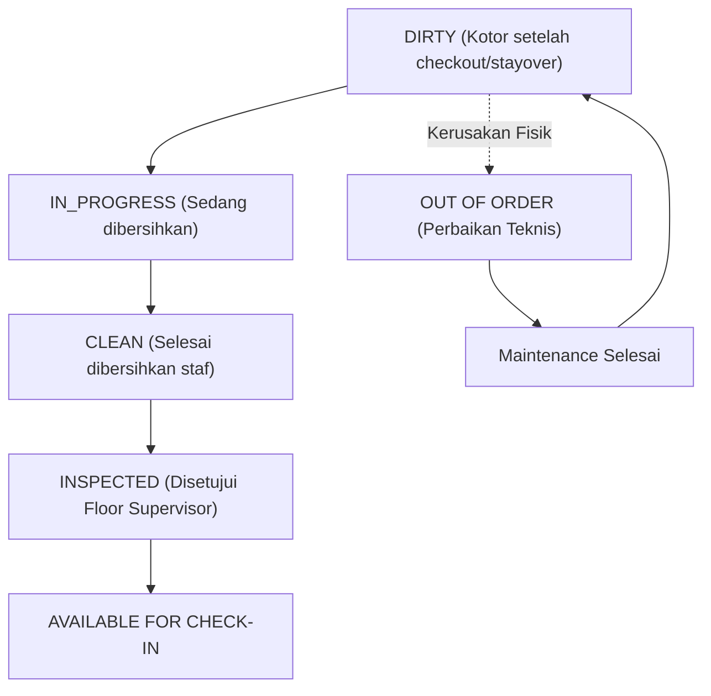

# Manual Operasional Tata Graha (Housekeeping) & Inspeksi Kamar

Dokumen operasional ini mengatur prosedur pembersihan kamar, inspeksi kualitas, perutean dinamis penugasan room attendant berbasis algoritma `HousekeepingRouteSequencer` (H3), dan integrasi status kamar PMS.

---

## 1. Alur Siklus Status Kebersihan Kamar

Sistem PMS melacak kondisi fisik dan kebersihan kamar secara real-time melalui state machine terstandar:

### 1.1 Definisi Status Kamar
- **Dirty (Kotor)**: Kamar yang baru saja ditinggalkan tamu (Check-Out) atau kamar menginap (Stayover) yang memerlukan pembersihan harian.
- **In Progress (Sedang Dikerjakan)**: Room attendant telah memindai QR kamar atau memulai tugas pembersihan di tablet tata graha.
- **Clean (Bersih)**: Pembersihan fisik telah selesai, linen dan amenities telah diganti, namun belum diverifikasi supervisor.
- **Inspected (Terinspeksi)**: Floor Supervisor telah memeriksa kamar menggunakan checklist digital dan menyetujui kamar untuk ditempati tamu baru. Resepsionis hanya dapat melakukan check-in pada kamar dengan status `INSPECTED`.
- **Out of Order (OOO)**: Kamar memiliki kerusakan fasilitas serius (kebocoran, AC rusak, renovasi) yang menyebabkan kamar tidak dapat dijual (*removed from available inventory*).
- **Out of Service (OOS)**: Kamar mengalami gangguan minor yang tidak mempengaruhi penjualan namun memerlukan perhatian perbaikan ringan saat kamar kosong.

---

## 2. Pengoptimalan Rute Tata Graha (HousekeepingRouteSequencer - H3)

Algoritma H3 menyusun urutan penugasan kamar bagi staf tata graha (*Room Attendant*) untuk meminimalkan waktu transit antar lantai dan memprioritaskan kamar kedatangan awal (*VIP & Early Arrival Priority*).

### 2.1 Kriteria Pembobotan Urutan
1. **Prioritas Tamu (Urgency Weight)**:
   - VIP Arrival Terjadwal (< 2 jam): Bobot tertinggi (Prioritas 1)
   - Guaranteed Early Arrival: Bobot tinggi (Prioritas 2)
   - Checkout Normal (Tamu baru diperkirakan tiba sore): Bobot sedang (Prioritas 3)
   - Stayover Clean (Tamu masih menginap): Bobot fleksibel (Prioritas 4)
2. **Kedekatan Lokasi (Spatial Proximity)**:
   - Kamar pada lantai yang sama dikelompokkan bersama untuk menghemat pergerakan troli dan lift.
   - Algoritma menghitung shortest path perutean kamar berdasarkan nomor kamar dan sayap gedung (North Wing / South Wing).

---

## 3. Standar Pemeriksaan 40 Poin Inspeksi Kamar

Floor Supervisor wajib memvalidasi daftar 40 poin pemeriksaan sebelum mengubah status kamar menjadi `INSPECTED`:
1. **Area Pintu & Foyer**: Fungsi kartu kunci pintu, engsel pintu tidak berdecit, safety latch berfungsi, lampu foyer menyala, bel kamar aktif.
2. **Area Kamar Tidur**: Sprei ditarik kencang tanpa kerutan, sarung bantal simetris, matras tidak bernoda, meja samping bersih dari debu, telepon berfungsi bebas noise.
3. **Kenyamanan & Udara**: Pengaturan termostat AC sesuai profil target (23°C), sirkulasi udara segar tanpa bau apek/rokok, tirai blackout menutup rapat dan bersih.
4. **Elektronik & Smart Room**: Smart TV terhubung ke jaringan IPTV tamu, remote TV disanitasi, stopkontak meja & USB charging port menyala.
5. **Kamar Mandi**: Tekanan air panas dan dingin stabil, saluran pembuangan lancar tanpa genangan, kloset higienis bersertifikasi sanitasi, kaca bebas bercak air, handuk lengkap (bath towel, hand towel, face towel, bath mat).
6. **Amenities & Bar**: Complimentary tea/coffee lengkap, 2 botol air mineral bersegel, minibar dingin dan terisi sesuai daftar inventaris standar, safe deposit box terbuka dan berfungsi normal.

---

## 4. Perbedaan Prosedur Pembersihan: Stayover vs Departure

### 4.1 Pembersihan Kamar Menginap (Stayover Clean)
- Waktu standar pengerjaan: 15–20 menit per kamar.
- Staf mengetuk pintu 3 kali seraya menyebutkan identitas ("Housekeeping"). Jangan memasuki kamar bila tanda *Do Not Disturb* (DND) aktif.
- Merapikan tempat tidur (ganti linen jika telah menginap $\ge 2$ malam atau diminta khusus oleh tamu via *Linen Reuse Environmental Card*).
- Membersihkan sampah kamar dan kamar mandi, mengganti handuk kotor yang diletakkan di lantai.
- Mengisi ulang amenities yang telah terpakai (sabun, shampoo, dental kit, air mineral, teh/kopi).
- Menyedot debu karpet secara ringan dan menyeka permukaan meja kerja.

### 4.2 Pembersihan Kamar Keberangkatan (Departure / Check-Out Deep Clean)
- Waktu standar pengerjaan: 30–45 menit per kamar.
- Seluruh sprei, sarung bantal, duvet cover, dan handuk dilepas total dan dikirim ke bagian Laundry.
- Pemeriksaan menyeluruh terhadap kemungkinan barang tamu yang tertinggal (*Lost & Found procedure*).
- Pembersihan dan disinfeksi total sanitasi kamar mandi (kloset, shower screen, wastafel).
- Pemeriksaan kelengkapan dan segel minibar, pelaporan konsumsi tamu ke Front Desk via tablet PMS.
- Pembersihan debu di bawah ranjang, belakang perabot, dan ventilasi AC.
- Pengaturan ulang suhu termostat ke mode hemat energi (`VACANT_CLEAN` = 27.0°C).
