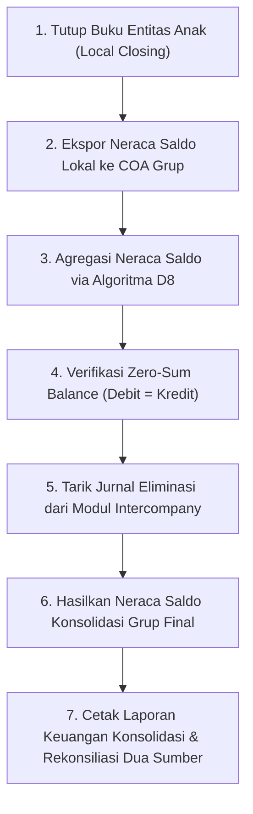

# Panduan Operasional: Agregasi Neraca Saldo Multi-Entitas & Eliminasi Konsolidasi

## 1. Ikhtisar Alur Kerja Konsolidasi
Proses konsolidasi neraca saldo (Trial Balance) grup dilakukan secara bertahap pada setiap akhir bulan penutupan buku (*month-end closing*):

---

## 2. Pengecekan Integritas Keseimbangan Jurnal
1. **Pengecekan Pra-Konsolidasi**: Pastikan seluruh entitas telah menyelesaikan transaksi cermin di modul Intercompany dan tidak ada transaksi berstatus gantung (*unmatched*).
2. **Kalkulasi Agregasi Zero-Sum**: Jalankan `php artisan ef:aggregate-trial-balance --period=2026-10`. Algoritma D8 akan menjumlahkan saldo debit dan kredit dari seluruh entitas.
3. **Penyelesaian Diskrepansi**: Apabila $\Delta \neq 0$, sistem menampilkan daftar entitas yang menyebabkan ketidakseimbangan beserta voucher akun terkait.

---

## 3. Ekspor Laporan Resmi
Hasil konsolidasi diekspor menggunakan `ConsolidatedTrialBalanceReportExporter` dengan format CSV ber-checksum SHA-256 yang memuat rincian saldo sebelum eliminasi, jurnal eliminasi, dan saldo akhir konsolidasi.
