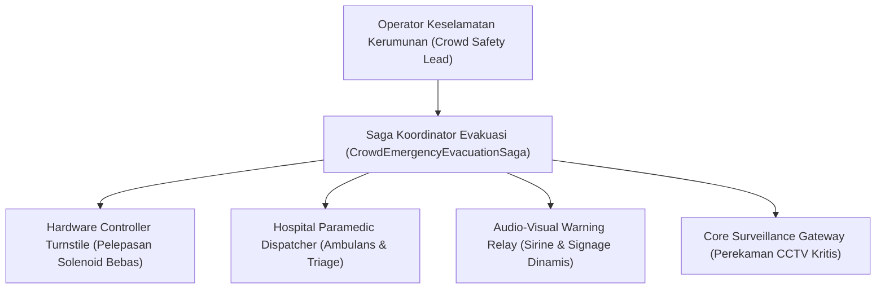

# Panduan Disaster Recovery & Evakuasi Cepat Venue Hiburan (Fase 117)

## 1. Pendahuluan & Landasan Regulasi

Panduan ini mendokumentasikan tata cara operasional keselamatan dan mitigasi bencana kerumunan (crowd disaster recovery) untuk seluruh venue hiburan dan festival skala besar dalam ekosistem SuperWeb Venue & Entertainment (modul `modules/Venue/`, KONSEP §10F, Lini 15).

Implementasi teknis mengacu pada:
- **NFPA 101 Life Safety Code (2024 Edition)**: Bab 12 dan 13 mengenai standar sarana jalan keluar (means of egress) fasilitas pertemuan massal.
- **Fruin Pedestrian Planning and Design Standard**: Klasifikasi Level of Service (LoS A sampai F).
- **Instruksi Menteri Dalam Negeri & Peraturan Kepolisian**: Standar manajemen pengamanan stadion dan festival musik di Indonesia.

---

## 2. Struktur Komando Keselamatan (Incident Command Structure)

Dalam situasi eskalasi kepadatan atau keadaan darurat, komando operasional dialihkan secara otomatis ke hierarki berikut:

### Matriks Peran dan Wewenang

| Peran Petugas | Wewenang Sistem | Akses Rute SuperWeb | Tindakan di Lapangan |
|---|---|---|---|
| `crowd_safety` | Eksekusi override evakuasi, buka paksa gerbang keluar | `venue.crowd.emergency`, `venue.crowd.dashboard` | Mengoordinasikan marshals di depan panggung |
| `venue_manager` | Otorisasi pembatalan acara, koordinasi logistik | `venue.crowd.incidents.resolve`, `venue.events.close` | Berkomunikasi dengan aparat kepolisian & dinas damkar |
| `venue_staff` | Pemantauan gerbang lokal, bantuan evakuasi fisik | `venue.gate.scan`, `venue.biometrics.kiosk` | Membuka pintu rintangan manual (panic bar) |
| `compliance_officer` | Audit pasca-insiden, verifikasi zeroization log | `venue.permits.index`, audit ledger | Menyiapkan laporan berita acara CAPA |

---

## 3. Ambang Batas Kepadatan & Tindakan Bertingkat

Sistem Crowd Safety AI (Algoritma V14) memantau kepadatan massa secara terus-menerus melalui sensor LiDAR dan kamera optical flow:

1. **Kondisi Hijau (< 2.5 orang/m²)**:
   - Operasi turnstile normal: Face-ID dan pemindaian barcode tiket aktif dua arah.
   - Laju throughput target: 25–35 orang per menit per unit gerbang.

2. **Kondisi Kuning (2.5 - 3.8 orang/m² - Waspada)**:
   - Notifikasi dini ke layar komando operator.
   - Pintu masuk utama beralih ke mode perlambatan (slow entry, 1 tamu tiap 8 detik).
   - Petunjuk arah digital mengarahkan penonton baru ke zona samping panggung yang masih longgar.

3. **Kondisi Oranye (3.8 - 4.5 orang/m² - Bahaya Desakan)**:
   - Algoritma V14 mendeteksi ancaman lonjakan 15 menit ke depan (`surge_predicted_15m = true`).
   - Sistem merekomendasikan pembukaan gerbang sekunder (bypass ingress).
   - Petugas pengamanan panggung (pit marshals) membentuk barisan pemecah massa (wedge formation).

4. **Kondisi Merah (> 4.5 orang/m² - Darurat Mutlak)**:
   - Eksekusi instan `CrowdEmergencyEvacuationSaga`.
   - Gerbang masuk ditutup total (ingress lockdown).
   - Seluruh solenoid gerbang keluar dilepaskan tanpa daya (fail-safe open), memungkinkan dorongan bebas tanpa validasi tiket.
   - Panggilan ambulans otomatis ke rumah sakit mitra terdekat melalui kontrak G7-K23.

---

## 4. Perhitungan Debit Klirens Egress Evakuasi

Sesuai standar NFPA 101, rumus debit klirens evakuasi yang diterapkan dalam `VenueCrowdSimulationEngine`:

$$\text{Throughput} = W_{\text{exit}} \times 73 \text{ orang/meter/menit}$$

$$\text{Waktu Klirens} = \frac{\text{Jumlah Tamu}}{\text{Throughput}} + \frac{D_{\text{jarak}}}{72 \text{ meter/menit}}$$

### Ketentuan Ambang Batas:
- Seluruh ruangan venue wajib dapat dikosongkan secara total dalam waktu maksimal **8,0 menit**.
- Jika estimasi waktu klirens melebihi 8,0 menit, sistem menolak penerbitan tiket tambahan (hard capacity cap).
