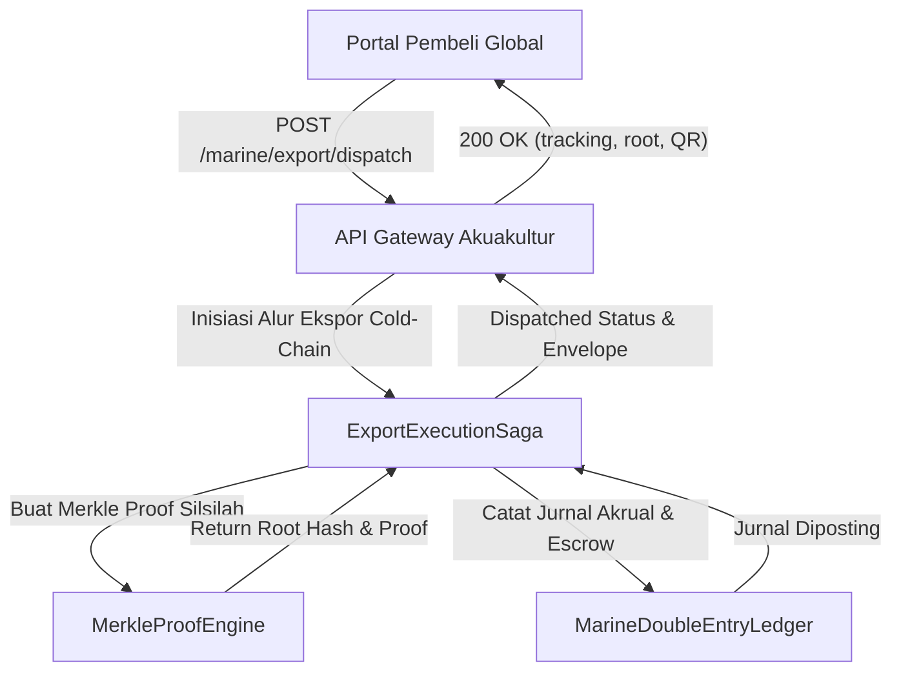

# Panduan Integrasi API Ekspor Akuakultur & Verifikasi Merkle Proof (Fase 171)

Panduan ini mendokumentasikan spesifikasi teknis protokol integrasi API, struktur payload JSON, alur autentikasi antarmuka pengadaan pembeli global, serta tata cara verifikasi bukti kriptografis Merkle audit trail untuk komoditas ekspor udang vaname dan ikan laut.

---

## 1. Arsitektur Komunikasi & Protokol Pertukaran Data

Sistem ekspor akuakultur dirancang memenuhi standar industri pertukaran data rantai pasok perikanan global (*Global Dialogue on Seafood Traceability* / GDST 1.2) dan terintegrasi secara modular dengan modul-modul *Enterprise Resource Planning* (ERP):
- **Autentikasi**: JSON Web Token (JWT) berbasis HMAC-SHA256 atau otorisasi Bearer Token role-based access control (RBAC).
- **Format Payload**: UTF-8 Encoded JSON dengan penegakan skema kanonikal.
- **Enkripsi Transit**: TLS 1.3 wajib pada seluruh saluran pertukaran data eksternal.
- **Integritas Transaksi**: Header HTTP `X-Idempotency-Key` wajib disertakan pada mutasi transaksi finansial dan penerbitan izin ekspor.



---

## 2. Spesifikasi Endpoint Integrasi Ekspor

### 2.1 Pendaftaran & Sampling Batch Tambak
Mengirimkan data penimbangan sampling periodik benur/udang di tambak guna memperbarui estimasi biomassa, tingkat kelangsungan hidup (*survival rate*), dan estimasi FCR.

- **Metode**: `POST`
- **Rute**: `/marine/batches/sample`
- **Header Wajib**:
  ```http
  Content-Type: application/json
  Accept: application/json
  Authorization: Bearer <token>
  ```
- **Contoh Payload Request**:
  ```json
  {
    "batch_id": 142,
    "sample_date": "2026-11-09",
    "sampled_count": 100,
    "total_weight_grams": 1850.5,
    "average_body_weight_grams": 18.51,
    "observed_survival_rate_percent": 88.5,
    "cumulative_feed_consumed_kg": 4200.0,
    "operator_notes": "Sampling mingguan siklus DOC-65 tambak blok Delta-2"
  }
  ```
- **Respon Sukses (200 OK)**:
  ```json
  {
    "status": "success",
    "code": 200,
    "data": {
      "batch_code": "BATCH-VAN-2026-11-001",
      "days_of_culture": 65,
      "mean_body_weight_grams": 18.51,
      "estimated_biomass_kg": 2450.0,
      "economic_fcr": 1.25,
      "biological_fcr": 1.18,
      "fcr_status": "OPTIMAL_FEED_EFFICIENCY",
      "timestamp": "2026-11-09T08:30:00Z"
    }
  }
  ```

---

### 2.2 Penerbitan Sertifikat Kesehatan Ekspor & Rekomendasi Karantina
Memvalidasi hasil uji laboratorium uji residu kimia (antibiotik kloramfenikol, nitrofuran, tetrasiklin, logam berat timbal/merkuri) terhadap ambang batas negara tujuan ekspor sebelum sertifikat SPS diterbitkan.

- **Metode**: `POST`
- **Rute**: `/marine/export/health-certificate`
- **Contoh Payload Request**:
  ```json
  {
    "export_lot_id": 88,
    "target_destination_market": "EUROPEAN_UNION",
    "laboratory_assay_ids": [401, 402, 403],
    "inspection_date": "2026-11-09",
    "veterinary_inspector_code": "VET-ID-INA-9921",
    "compliance_regime": "EU_REGULATION_2019_1871"
  }
  ```
- **Respon Sukses (200 OK)**:
  ```json
  {
    "status": "success",
    "code": 200,
    "data": {
      "health_certificate_number": "HC-INA-2026-EU-08812",
      "export_lot_code": "LOT-EXP-2026-HLSO-004",
      "destination_market": "EUROPEAN_UNION",
      "chloramphenicol_status": "NOT_DETECTED_BELOW_0_3_PPB",
      "nitrofuran_status": "NOT_DETECTED_BELOW_0_5_PPB",
      "export_eligibility": "APPROVED_FOR_EXPORT",
      "issued_at": "2026-11-09T09:15:00Z",
      "digital_seal_hash": "e3b0c44298fc1c149afbf4c8996fb92427ae41e4649b934ca495991b7852b855"
    }
  }
  ```

---

## 3. Struktur & Verifikasi Merkle Proof Paspor Lot

Setiap lot ekspor akuakultur dibangun di atas pohon Merkle (*Merkle tree*) kanonikal SHA-256 yang merangkum seluruh tahapan rantai pasok dari induk benih (*hatchery*) hingga pelepasan pabean kontainer reefer.

### 3.1 Komponen Daun (*Leaf Nodes*) Pohon Merkle
Urutan indeks kanonikal node daun adalah sebagai berikut:
1. `LEAF_0`: Data Induk & Sertifikat SPF Benur Hatchery (`HATCHERY_LINEAGE`)
2. `LEAF_1`: Catatan Kuantitas & Formula Pakan Bebas Deforestasi (`FEED_FORMULATION`)
3. `LEAF_2`: Log Telemetri Kualitas Air Tambak & Penggunaan Energi (`WATER_TELEMETRY`)
4. `LEAF_3`: Berita Acara Panen & Grading Ukuran Udara/Es Tambak (`HARVEST_EVENT`)
5. `LEAF_4`: Pencucian, Pemotongan Kepala, & Pembekuan Kontak Cepat CCP2 (`PROCESSING_FREEZE`)
6. `LEAF_5`: Sertifikat Hasil Uji Laboratorium Akreditasi ISO 17025 (`LABORATORY_ASSAY`)
7. `LEAF_6`: Pengemasan Vakum, Label QR Interoperabel & Palet Kontainer (`PACKAGING_PALLET`)
8. `LEAF_7`: Telemetri Rantai Dingin GPS/Suhu Kontainer Reefer Kontrak Sewa (`REEFER_COLD_CHAIN`)

### 3.2 Format Pembuktian Kriptografis (*Cryptographic Proof Payload*)
Pembeli global atau auditor karantina dapat memvalidasi keaslian salah satu tahapan tanpa harus membuka informasi sensitif lokasi koordinat tambak (redaksi data):

```json
{
  "lot_code": "LOT-EXP-2026-HLSO-004",
  "merkle_root": "8f4a1c5d9e3b2a7e6f8d0b4c2a1e3f5a7c9b1d3e5f7a9b1c3d5e7f9a1b3c5d7e",
  "leaf_index": 5,
  "leaf_type": "LABORATORY_ASSAY",
  "leaf_content_hash": "a1b2c3d4e5f60718293a4b5c6d7e8f90a1b2c3d4e5f60718293a4b5c6d7e8f90",
  "proof_path": [
    {
      "direction": "LEFT",
      "hash": "1234567890abcdef1234567890abcdef1234567890abcdef1234567890abcdef"
    },
    {
      "direction": "RIGHT",
      "hash": "abcdef1234567890abcdef1234567890abcdef1234567890abcdef1234567890"
    },
    {
      "direction": "LEFT",
      "hash": "778899aabbccddeeff00112233445566778899aabbccddeeff00112233445566"
    }
  ],
  "verification_status": "MATHEMATICALLY_AUTHENTIC"
}
```

### 3.3 Algoritma Verifikasi Klien (Implementasi Contoh TypeScript/Python)
```python
import hashlib

def verify_merkle_proof(leaf_hash: str, proof: list, expected_root: str) -> bool:
    current_hash = bytes.fromhex(leaf_hash)
    for step in proof:
        sibling = bytes.fromhex(step["hash"])
        if step["direction"] == "LEFT":
            current_hash = hashlib.sha256(sibling + current_hash).digest()
        else:
            current_hash = hashlib.sha256(current_hash + sibling).digest()
    return current_hash.hex() == expected_root.lower()
```

---

## 4. Penanganan Galat & Kode Status Respons

| Kode Galat | Pesan Standar | Penyebab & Solusi Penanganan |
|---|---|---|
| `ERR_AQUA_MASS_BALANCE_BREACH` | "Export quantity exceeds allowable physical yield" | Volume ekspor melebihi batas konversi neraca massa panen riil. Periksa rekonsiliasi rendemen. |
| `ERR_AQUA_MRL_TOLERANCE_EXCEEDED` | "Laboratory assay violates target market maximum residue limit" | Terdeteksi residu antibiotik di atas ambang MRL karantina. Karantina lot dan lakukan uji banding. |
| `ERR_AQUA_COLD_CHAIN_TEMPERATURE_BREACH` | "Reefer temperature exceeded critical threshold (-15°C)" | Terjadi kegagalan daya genset reefer kontainer > 4 jam. Periksa integritas sensor dan klaim asuransi. |
| `ERR_AQUA_EUDR_DEFORESTATION_FAIL` | "Production polygon conflicts with post-2020 forest degradation" | Lokasi tambak melanggar *cut-off date* EUDR (31 Desember 2020). Tolak penerbitan surat jalan ekspor. |
