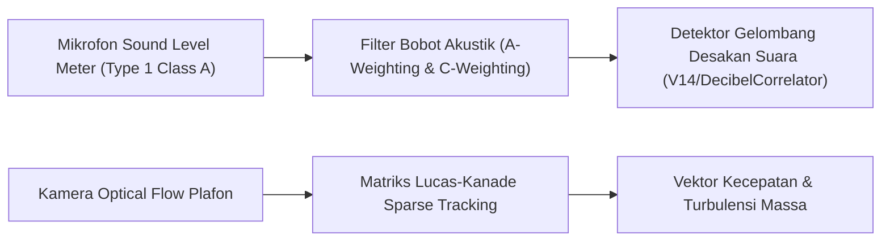

# Panduan Kalibrasi Sensor Optical Flow & Decibel SPL Panggung (Fase 117)

## 1. Pendahuluan & Tujuan Kalibrasi

Lingkungan festival musik luar ruang (outdoor festival) dan kelab hiburan pantai menyajikan tantangan akustik dan pencahayaan ekstrem: dentuman bass frekuensi rendah ($20 - 80\text{ Hz}$), kilatan lampu sorot strobo konser, serta asap panggung (fog/haze machines). Sensor keselamatan kerumunan harus dikalibrasi secara presisi agar tidak memicu alarm palsu (false alarms) seraya tetap peka terhadap ancaman desakan massa nyata.

---

## 2. Prosedur Kalibrasi Pengukur Tingkat Tekanan Suara (Sound Level Meter)

Sesuai standar IEC 61672-1 Kelas 1 untuk pengukuran kebisingan lingkungan:

### Langkah Kalibrasi Akustik:
1. Pasangkan kalibrator akustik portabel ($94.0\text{ dB SPL} \pm 0.2\text{ dB}$ pada $1.000\text{ Hz}$) pada kapsul mikrofon.
2. Pastikan respons mikrofon membaca tepat $94.0\text{ dBA}$ pada konsol input.
3. Atur filter bobot frekuensi:
   - **Bobot dBA (A-weighting)**: Digunakan untuk memantau dosis paparan pendengaran staf dan penonton sesuai regulasi NIOSH ($85\text{ dBA}$ batas aman 8 jam).
   - **Bobot dBC (C-weighting)**: Digunakan untuk mendeteksi energi ledakan frekuensi rendah (sub-bass / kick) guna membedakan dentuman musik ritmis dari suara teriakan panik massa.

---

## 3. Konfigurasi Filter Algoritma Aliran Optik (Optical Flow Tuning)

Algoritma pelacak gerak kerumunan menggunakan aproksimasi diferensial Lucas-Kanade dengan parameter:

| Parameter Algoritma | Nilai Default | Penyesuaian Konser Malam |
|---|---|---|
| Jendela Pencarian Spasial | $21 \times 21$ piksel | $31 \times 31$ piksel (mengkompensasi gerakan cepat penonton melompat) |
| Ambang Gradien Minimum | 0.04 | 0.08 (menyaring kabut panggung dan asap buatan) |
| Jendela Rata-rata Bergerak | 5 detik (150 frame) | 3 detik (mempercepat deteksi desakan tiba-tiba) |
| Ambang Batas Turbulensi | 0.75 | 0.85 saat penampilan panggung rock/metal (mosh pit legal) |

---

## 4. Validasi Rutin Pra-Acara (Pre-Show Check)

Sebelum gerbang masuk dibuka untuk umum, teknisi keselamatan wajib:
1. Memutar rekaman nada uji merah muda (pink noise) pada $90\text{ dBA}$ selama 30 detik untuk memverifikasi seluruh mikrofon zona.
2. Meminta 5 orang staf berjalan melintasi area cakupan kamera untuk memverifikasi vektor kecepatan optical flow terbaca tepat pada arah yang benar.
