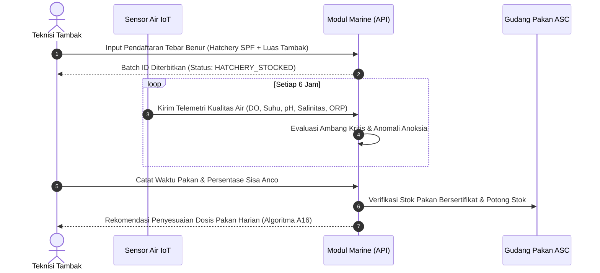
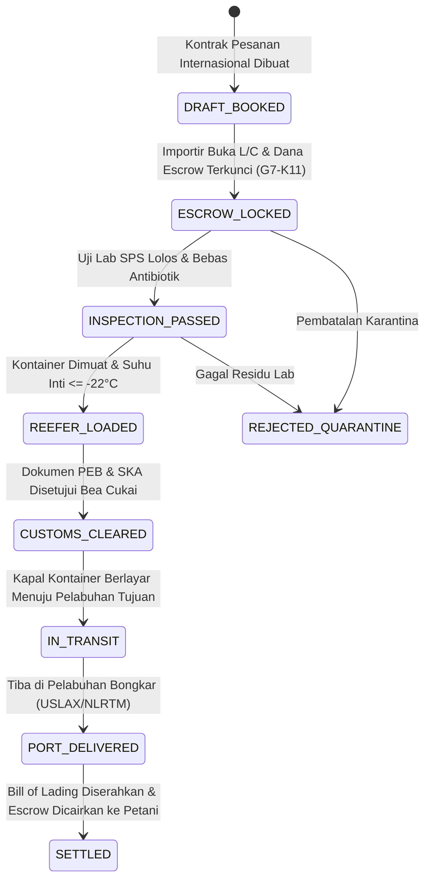

# Panduan Operasional SOP: Ekspor Akuakultur, Ketelusuran Seafood & Blue ESG (Fase 171)

## 1. Pendahuluan & Sasaran Pengguna

Panduan Operasional Standar (*Standard Operating Procedure / SOP*) ini ditujukan bagi:
1. **Kepala Operasi Tambak (*Farm Managers*) & Teknisi Lapangan:** Prosedur tebar benur SPF, pemantauan kualitas air IoT, pemberian pakan harian, dan pencatatan biosekuriti.
2. **Pengawas Mutu Pabrik Pengolahan (*QA/QC Processing Plant*):** Pengawasan titik kendali kritis HACCP CCP2, pengeringan, pembekuan cepat IQF, dan verifikasi neraca massa ASC/MSC.
3. **Manajer Ekspor & Logistik Pelabuhan (*Export Logistics Coordinators*):** Prosedur pemesanan kontainer pendingin reefer, penerbitan Health Certificate karantina KKP, Certificate of Origin (COO), dan verifikasi Bill of Lading.
4. **Analis Keuangan & Petugas Escrow (*Trade Finance Officers*):** Verifikasi dokumen Letter of Credit (UCP 600) dan pelepasan dana escrow bagi hasil petambak.
5. **Petugas Keberlanjutan & Auditor ESG (*ESG & Carbon Officers*):** Inventarisasi biomassa mangrove silvofishery, pemantauan satelit EUDR, dan penerbitan kredit karbon biru.

---

## 2. Prosedur Hulu: Pembenihan SPF, Tebar Benur & Biosekuriti

### 2.1. Verifikasi Asal Benur Hatchery
- Setiap bibit udang vaname atau kerapu yang masuk kawasan tambak **wajib** berasal dari fasilitas pembenihan (*Hatchery*) tersertifikasi Specific Pathogen Free (SPF) yang masih aktif terdaftar di tabel `mar_hatcheries`.
- Periksa nomor sertifikat SPF (contoh: `SPF-CERT-ID-2026-9901`) dan asal indukan (*broodstock origin*, misal Kona Bay Hawaii atau SIS Florida).
- Lakukan aklimatisasi suhu dan salinitas bertahap selama minimal 2 jam di bak tandon sebelum penebaran ke petak pembesaran.

### 2.2. Protokol Masa Bera & Sanitasi Tambak Pasca Panen
Sebelum siklus tebar baru dimulai, petak tambak wajib menjalani masa istirahat/bera (*fallowing*) minimal 14 hari:
1. **Pengeringan Dasar Kolam:** Keringkan tanah dasar kolam di bawah sinar matahari langsung hingga tanah retak-retak (kedalaman retak $\ge 2\text{ cm}$) untuk mengoksidasi gas beracun amonia dan hidrogen sulfida.
2. **Pembersihan Lumpur Organik (*Sludge Siphon*):** Sedot endapan lumpur sisa pakan siklus sebelumnya dan alirkan ke instalasi pengolahan limbah (IPAL) untuk dijadikan kompos mangrove.
3. **Pengapuran Tanah Dasar:** Taburkan kapur pertanian (Kalsium Karbonat $CaCO_3$ atau Kalsium Oksida $CaO$) dengan dosis minimal $1000\text{ kg/hektar}$ untuk menaikkan pH tanah dasar ke kisaran optimal $7.5\text{ s.d. }8.5$ serta menonaktifkan spora parasit *Enterocytozoon hepatopenaei* (EHP).
4. **Disinfeksi Air Pasok:** Lakukan klorinasi air pasok tandon dengan dosis minimal $25\text{ ppm}$ kaporit aktif, lalu endapkan selama minimal 3 hari hingga residu klorin aktif turun di bawah $0.01\text{ ppm}$ sebelum benur ditebar.



---

## 3. Prosedur Pemanenan & Titik Kendali Kritis HACCP CCP2

### 3.1. Operasi Pemanenan & Rapid Ice Slurry Chilling
- Pemanenan dilakukan pada malam atau dini hari untuk meminimalkan paparan panas sinar matahari.
- Begitu jaring panen diangkat dari kolam, udang hidup **wajib langsung dimasukkan ke dalam bak bubur es air laut (*chilled ice slurry*)** dengan suhu terukur antara $-1.5^\circ\text{C}$ hingga $0.0^\circ\text{C}$.
- Pendinginan kejut es (*rapid chill killing*) ini berfungsi mematikan udang secara higienis, mempertahankan kekenyalan serat otot (*muscle rigor*), dan menghentikan perkembangbiakan bakteri pembusuk.

### 3.2. Verifikasi Neraca Massa Pemrosesan (Algoritma A15)
Di pabrik pengolahan (*processing plant*), operator timbang memasukkan data panen kotor (*gross biomass*) dan hasil olahan (*net processed product*):
- Untuk bentuk Headless Shell-On (HLSO), rendemen bersih tidak boleh melebihi batas biologis teoritis $68.0\%$ dari biomassa panen hidup.
- Glazing air es pelindung dehidrasi ditetapkan standar $8.0\%$.
- Jika sistem mendeteksi rasio rendemen melebihi batas ASC/MSC, lot pengolahan otomatis diblokir dengan peringatan pencampuran ilegal (*unauthorized blending*).

### 3.3. Uji Titik Kendali Kritis Pembekuan Cepat (HACCP CCP2)
- Pembekuan wajib menggunakan fasilitas *Individually Quick Frozen (IQF) Tunnel Freezer* dengan suhu hembusan udara minimal $-35.0^\circ\text{C}$.
- Petugas QA memeriksa suhu inti udang (*core temperature*) menggunakan termometer tusuk digital yang telah dikalibrasi.
- **Standar Ambang Batas CCP2:** Suhu inti produk beku wajib $\le -18.0^\circ\text{C}$ (standar optimal pabrik $-22.0^\circ\text{C}$). Jika suhu inti $>-18.0^\circ\text{C}$, karton dilarang masuk gudang pendingin utama dan harus dibekukan ulang.

---

## 4. Prosedur Karantina SPS & Pengujian Residu Antibiotik

Sebelum kontainer diberangkatkan, sampel lot ekspor wajib diuji di laboratorium terakreditasi ISO/IEC 17025 (BUSKIPM / Karantina Ikan KKP):
1. **Residu Antibiotik Terlarang (Zero Tolerance):**
   - Chloramphenicol: Batas deteksi $< 0.3\text{ ppb}$.
   - Nitrofuran metabolit (AOZ, AMOZ, SEM, AHD): Batas deteksi $< 0.5\text{ ppb}$.
   - Jika ditemukan residu sekecil apapun di atas batas deteksi, sistem otomatis mengunci lot ke status `QUARANTINE_REJECTED` dan menerbitkan surat perintah pemusnahan (*destruction order*).
2. **Histamin:**
   - Standar ekspor Amerika Serikat (US FDA): Maksimal $50.0\text{ ppm}$.
   - Standar ekspor Uni Eropa: Maksimal $100.0\text{ ppm}$.
3. **Mikrobiologi Pangan:**
   - *Salmonella sp.*: Wajib negatif (absen dalam 25 gram sampel).
   - *Vibrio cholerae* & *Vibrio parahaemolyticus*: Wajib negatif / terkontrol.
4. **Penerbitan Health Certificate:**
   - Setelah seluruh parameter laboratorium lulus, sistem menerbitkan izin kesehatan karantina resmi (*SPS Health Certificate*) dengan nomor registrasi KKP.

---

## 5. Prosedur Logistik Rantai Dingin Kontainer Reefer

### 5.1. Pemuatan & Pemasangan Segel Karantina
- Kontainer reefer 40-kaki High Cube (misal Maersk / MSC / ONE) diperiksa kebersihannya dan di-pre-cool hingga suhu ruangan dalam kontainer mencapai $-22.0^\circ\text{C}$.
- Karton dimasukkan secara bertingkat dengan sirkulasi udara lantai T-bar yang bebas hambatan.
- Pintu kontainer ditutup rapat dan dipasangi segel bea cukai (*Customs Bolt Seal*) dan segel karantina ikan (*KKP Tamper Seal*).

### 5.2. Telemetri Real-Time & Penanganan Suhu Anomali (Cold-Chain Breach)
- Sensor IoT kontainer merekam suhu udara pasok (*supply air*), udara balik (*return air*), dan probe kargo (*cargo probe*) setiap 30 menit serta mengirimkannya via transmisi satelit/seluler ke platform.
- **Ambang Batas Alarm Dingin:** Jika suhu kargo naik di atas $-15.0^\circ\text{C}$ selama lebih dari 120 menit berurutan, sistem secara otomatis mengirimkan sinyal bahaya (*Cold-Chain Thermal Breach Alert*) kepada operator kapal dan mencatat peristiwa anomali di tabel `mar_cold_chain_telemetry_logs`.

---

## 6. Prosedur Penyelesaian Keuangan & Fair-Trade Escrow (G7-K11)



1. **Penguncian Escrow:** Saat pesanan ekspor dikonfirmasi, dana senilai nilai panen petambak plasma dikunci di rekening penampung escrow (Trade Finance G7-K11).
2. **Kondisi Pencairan (*Release Triggers*):**
   - Sertifikat uji laboratorium SPS telah dinyatakan lulus (`PASSED_FOR_EXPORT`).
   - Verifikasi neraca massa panen terbukti konsisten dengan input tambak.
   - Dokumen Ocean Bill of Lading (BL) telah diterbitkan oleh agen pelayaran resmi.
3. **Pencairan Otomatis:** Sistem mengeksekusi pencairan escrow ke rekening petambak plasma dikurangi potongan biaya pakan dan benur yang telah disepakati di muka, menjamin tidak adanya pemotongan liar di luar kontrak.

---

## 7. Prosedur Blue ESG: Verra VM0033 & Kepatuhan EUDR

### 7.1. Audit Geolokasi Anti-Deforestasi EUDR
- Setiap batch tambak wajib memiliki koordinat poligon batas lahan tambak dalam format GeoJSON.
- Verifikasi citra satelit optik (Sentinel-2 10m / Landsat-8) memastikan bahwa tapak tambak telah beroperasi sebelum tanggal **31 Desember 2020** dan tidak ada konversi hutan mangrove lindung baru setelah tanggal tersebut.
- Sistem menerbitkan berkas uji tuntas (*Due Diligence Statement*) dengan nomor referensi resmi untuk dilampirkan pada sistem kepabeanan Uni Eropa (*TRACES-NT*).

### 7.2. Metodologi Serapan Karbon Biru Mangrove Silvofishery
- Survei lapangan berkala mengukur Diameter at Breast Height (DBH) tegakan pohon mangrove dan kerapatan pohon per hektar.
- Algoritma A18 menghitung biomassa atas tanah (AGB), sistem perakaran bawah tanah (BGB), dan karbon organik sedimen (SOC).
- Unit kredit karbon bersih ($tCO_2e$) diterbitkan dengan nomor seri Verra VCS dan dapat dipensiunkan secara permanen (*retirement*) untuk menetralkan jejak karbon ekspor udang tambak mitra (*Carbon-Neutral Certified Export Lot*).

---

## 8. Protokol Penanganan Insiden Biosekuriti & Karantina Darurat

Apabila terjadi anomali biologis di petak tambak atau cemaran kimia pada produk olahan, staf operasional wajib mengikuti protokol eskalasi bertingkat berikut:

```
[Deteksi Gejala Klinis / Kematian Massal Udang]
                     │
                     ▼
       [Pengambilan Sampel Darurat PCR]
                     │
       ┌─────────────┴─────────────┐
       ▼                           ▼
[WSSV / IMNV Negatif]     [WSSV / IMNV Positif!]
       │                           │
       ▼                           ▼
[Optimasi Aerasi & Probiotik] [Isolasi Petak Tambak 100%]
                                   │
                                   ▼
                         [Klorinasi Air Kolam 40 ppm]
                                   │
                                   ▼
                         [Musnahkan Biomassa Terinfeksi]
                                   │
                                   ▼
                         [Klaim Polis Asuransi Kematian]
```

### 8.1 Tindakan Tanggap Cepat Kasus White Spot Syndrome Virus (WSSV)
1. **Isolasi Saluran Pembuangan**: Tutup pintu air masuk (*inlet*) dan pintu air keluar (*outlet*) petak tambak yang bersangkutan dalam waktu kurang dari 15 menit sejak gejala bercak putih teramati.
2. **Klorinasi Masal**: Larutkan kalsium hipoklorit minimal $40\text{ ppm}$ ke seluruh badan air kolam terinfeksi untuk membunuh vektor virus dan inang alami.
3. **Pemberitahuan Otoritas**: Laporkan status kejadian luar biasa (KLB) ke Stasiun Karantina Ikan dan Pengendalian Mutu (SKIPM) setempat dalam tempo $1 \times 24\text{ jam}$.
4. **Pencatatan Insiden**: Catat insiden pada model `DiseaseHealthScreening` dengan parameter `pcr_result_positive = true` untuk memblokir pergerakan panen ke pabrik pengolahan.

---

## 9. Matriks Audit Harian & Lembar Periksa Rekonsiliasi Dua Sumber

| Waktu Pemeriksaan | Objek / Parameter | Standar Mutu Target | Instrumen Pengukuran | Tindakan Bila Menyimpang |
|---|---|---|---|---|
| Setiap 2 Jam | Oksigen Terlarut (DO) | $\ge 4.5\text{ mg/L}$ | Sensor Optik IoT YSI | Nyalakan kincir air tambahan & auto-aerator |
| Setiap 6 Jam | Suhu Air Tambak | $28.0^\circ\text{C} - 31.5^\circ\text{C}$ | Thermistor PT100 | Naikkan elevasi kolom air tandon jika panas |
| Harian (Pagi) | pH Air Kolam | $7.5 - 8.5$ (Fluktuasi $< 0.5$) | Glass Electrode pH Meter | Aplikasi kapur dolomit jika pH asam |
| Harian (Sore) | Alkalinitas Total | $\ge 120.0\text{ mg/L } CaCO_3$ | Titrasi Asam Sulfat | Tambahkan natrium bikarbonat ($NaHCO_3$) |
| Per Batch Panen | Uji Residu Kloramfenikol | Tidak Terdeteksi ($< 0.3\text{ ppb}$) | LC-MS/MS ISO 17025 | Tolak bahan baku & investigasi pemasok |
| Per Pengapalan | Suhu Udara Reefer | $\le -22.0^\circ\text{C}$ | Data-logger Carrier Transicold | Hubungi teknisi pendingin pelabuhan |


