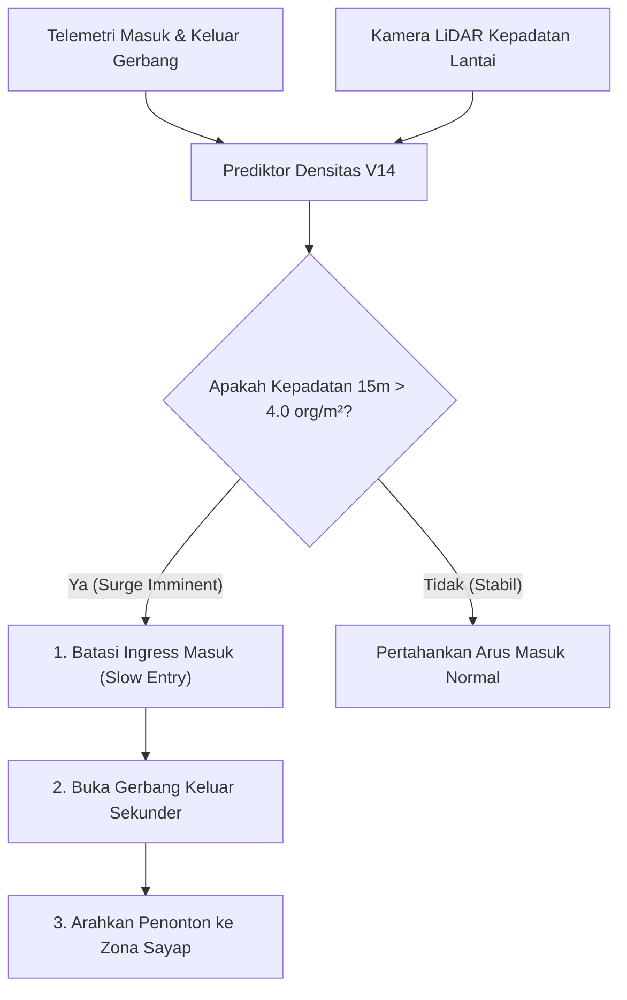

# Pedoman Taktis Penanganan Ancaman Lonjakan Kerumunan Festival (Fase 117)

## 1. Pendahuluan & Fenomena Gelombang Kejut Kerumunan

Lonjakan massa (crowd surge) pada konser musik dan festival hiburan terjadi ketika kepadatan fisik penonton melebihi daya tampung geometris, mengakibatkan hilangnya kontrol gerakan individu. Pada densitas di atas 4,0 orang/m², kontak fisik antar penonton menjadi kontinu, menciptakan fenomena gelombang kejut cairan (fluid shockwave) yang dapat merobohkan barikade dan menyebabkan asfiksia posisi (positional asphyxia).

Pedoman ini merumuskan protokol taktis bagi operator sistem SuperWeb Venue, tim keamanan panggung, dan petugas medis darurat.

---

## 2. Peringatan Dini Berbantuan AI (CrowdDensitySurgePredictor V14)

Algoritma V14 menganalisis vektor telemetri gerbang dan kamera densitas untuk memprediksi lonjakan massa 15 menit sebelum mencapai titik kritis:

### Parameter Prediksi Algoritma V14
- **Laju Masuk (Ingress Velocity)**: Tamu per menit yang divalidasi gerbang turnstile.
- **Laju Keluar (Egress Velocity)**: Tamu yang meninggalkan zona menuju toilet atau bar.
- **Faktor Cuaca**: Penyesuaian kelembapan udara dan hujan yang mendorong penonton berkumpul di bawah atap pelindung panggung.

---

## 3. Taktik Pengurangan Kepadatan Sektoral (Decrowding Actions)

Jika zona panggung memasuki status waspada oranye atau merah, operator wajib segera mengambil tindakan berikut:

### Tindakan A: Pengalihan Gerbang Ingress (Gate Diversion)
1. Pintu gerbang utama langsung membatasi akses masuk ke zona mosh pit.
2. Lampu petunjuk arah LED di atas gerbang beralih ke warna kuning berkedip.
3. Aplikasi ponsel tamu dialihkan dengan penawaran voucher promo personal (Fase 117.5) di area F&B yang masih sepi guna menarik minat perpindahan penonton.

### Tindakan B: Manajemen Barikade Mojo (Barrier Pressure Relief)
1. Petugas barikade panggung memastikan pin pelepas cepat (quick-release pins) siap dibuka jika terjadi penumpukan di barisan depan.
2. Penonton yang mengalami dehidrasi atau sesak napas dievakuasi langsung melewati atas barikade panggung ke koridor steril timur.

### Tindakan C: Pemanggilan Armada Paramedis (Contract G7-K23)
1. Sistem mengirimkan sinyal darurat otomatis ke modul Hospital (`MedicalEmergencyResponseDispatcher`).
2. Tim triage medis menyiapkan tabung oksigen dan tandu evakuasi di pos pertolongan pertama terdekat.
3. Koordinasi lokasi GPS ambulans ditayangkan pada layar pengawas komando.
