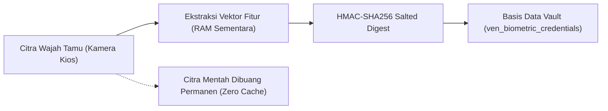
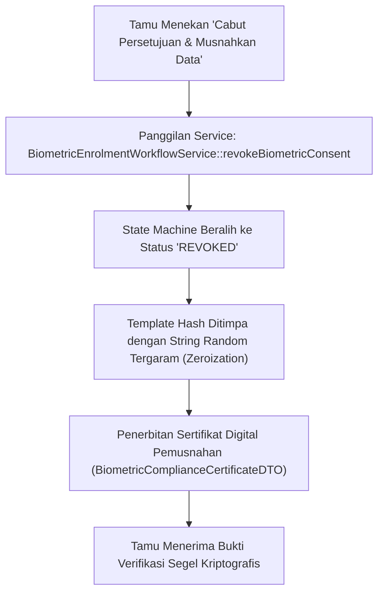

# Pedoman Penanganan Pelanggaran Data & Kepatuhan UU PDP No. 27/2022 (Fase 117)

## 1. Landasan Hukum & Definisi Data Biometrik

Berdasarkan Undang-Undang Nomor 27 Tahun 2022 tentang Pelindungan Data Pribadi (UU PDP), data biometrik diklasifikasikan sebagai **Data Pribadi yang Bersifat Spesifik** (Pasal 4 ayat 2 huruf c). Pemrosesan data biometrik tunduk pada standar kepatuhan ketat:

- **Pasal 20**: Pengendali data wajib memiliki dasar pemrosesan yang sah, berupa persetujuan eksplisit yang terekam secara digital.
- **Pasal 35**: Kewajiban menjaga kerahasiaan dan menerapkan enkripsi kriptografi tinggi.
- **Pasal 46**: Kewajiban pemberitahuan tertulis dalam waktu maksimal **$3 \times 24$ jam** kepada subjek data dan Lembaga Otoritas jika terjadi insiden kegagalan pelindungan data pribadi.
- **Pasal 43**: Hak subjek data untuk meminta penghapusan dan/atau pemusnahan data pribadi miliknya (Right to Erasure).

---

## 2. Arsitektur Isolasi Data Vault Biometrik

Untuk memenuhi asas minimalisasi data (data minimization), sistem Venue & Entertainment SuperWeb mengadopsi prinsip **Zero Raw Biometric Storage**:

### Karakteristik Kriptografis Template Vault:
1. **Irreversibilitas**: Template yang disimpan berupa string heksadesimal 64-karakter hasil fungsi hash satu arah dengan garam rahasia platform (`SUPERWEB-PDP-ROOT-KEY-2026`).
2. **Anti-Korelasi Lintas Sistem**: Salt unik per pengguna mencegah pencocokan silang (cross-matching) antara template venue dengan database biometrik eksternal.
3. **Penyimpanan Terpisah**: Tabel `ven_biometric_credentials` diisolasi dari tabel identitas profil umum `users` dan transaksi pembayaran tiket.

---

## 3. Alur Kerja Permohonan Pemusnahan Mandiri (Right to Erasure)

Setiap tamu yang telah mendaftarkan biometrik memiliki hak untuk mencabut persetujuan kapan saja melalui Portal Privasi (`/venue/biometrics/enrolment`):

---

## 4. Prosedur Tanggap Darurat Insiden Pelanggaran (Breach Response Playbook)

Jika sensor atau sistem mendeteksi percobaan akses tidak sah ke tabel vault biometrik:

1. **Jam T+0 (Deteksi & Isolasi)**:
   - Modul Core Intrusion Detection memutus koneksi API gerbang turnstile.
   - Kunci enkripsi vault diputar (key rotation) secara otomatis.

2. **Jam T+12 (Penyelidikan Forensik Digital)**:
   - Tim audit keamanan memeriksa log integritas hash template via `php artisan venue:audit-crowd`.
   - Menghitung jumlah record terdampak. Karena data tersimpan hanya berupa salted hash satu arah, citra wajah tamu tetap tidak dapat direkonstruksi oleh pihak peretas.

3. **Jam T+48 (Pemberitahuan Resmi)**:
   - Mengirimkan laporan insiden resmi kepada Komisi Pelindungan Data Pribadi Indonesia sesuai mandat Pasal 46 UU PDP.
   - Notifikasi transparansi kepada pengguna terdaftar melalui email dan notifikasi aplikasi.
