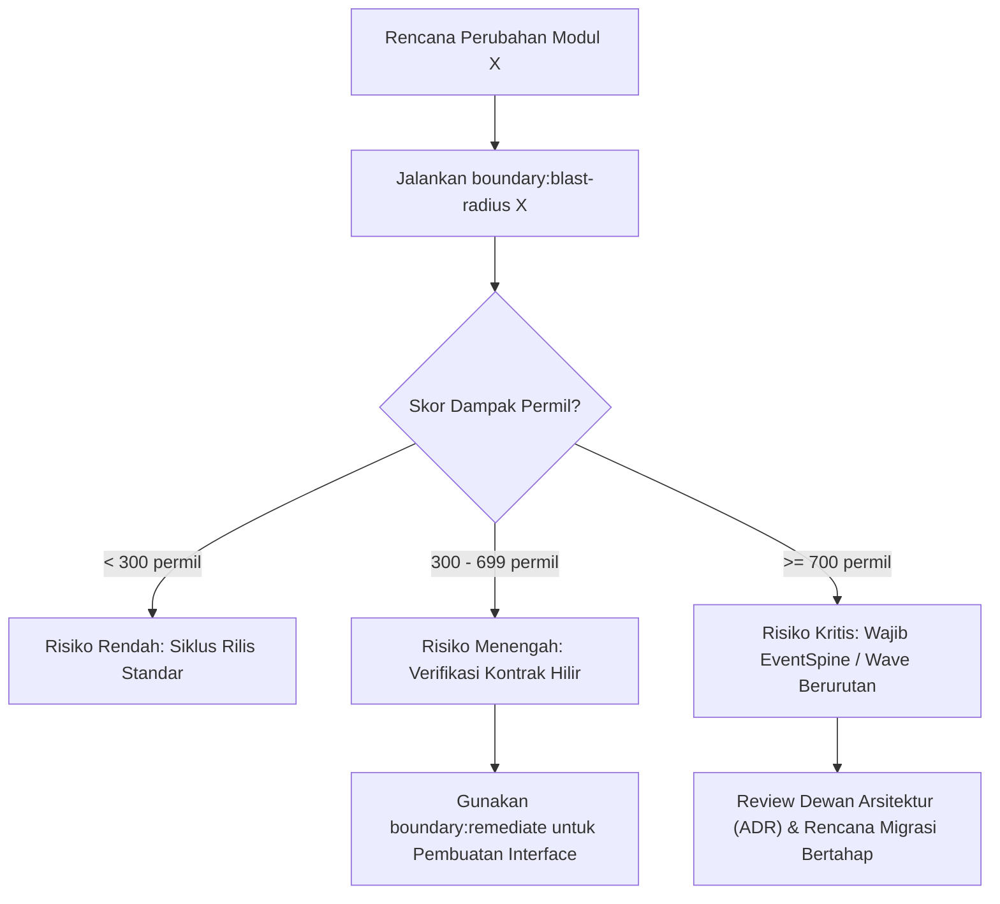

# Panduan Platform Architect — Analisis Radius Ledakan Perubahan Modul (Blast Radius Guide)

## 1. Tujuan Panduan
Panduan operasional ini ditujukan bagi Platform Architect dan Engineering Lead saat merencanakan perubahan besar, refaktorisasi antarmuka, pemisahan modul (*module splitting*), atau penghapusan kapabilitas lama. Analisis radius ledakan (*blast radius*) memetakan seluruh dampak riak ke modul konsumen hilir secara kuantitatif sebelum kode dikomit ke master.

---

## 2. Alur Kerja Pemeriksaan Radius Ledakan



---

## 3. Eksekusi Command CLI

### 3.1 Menjalankan Pemindaian Cepat
Untuk memeriksa dampak perubahan pada modul `Core`:
```bash
php artisan boundary:blast-radius Core
```

Keluaran mencakup:
- **Skor Dampak Permil**: Derajat risiko keseluruhan $[0..1.000]$.
- **Maksimal Riak**: Level kedalaman transitif terjauh.
- **Konsumen Langsung & Transitif**: Daftar modul yang terpengaruh.
- **Jalur Dampak Kritis**: Rantai konsumen terpanjang.
- **Rekomendasi Mitigasi**: Solusi perbaikan arsitektur.

### 3.2 Menghasilkan Format JSON untuk Pipa CI
```bash
php artisan boundary:blast-radius Core --format=json > blast-radius-core.json
```

---

## 4. Pola Mitigasi Berdasarkan Skenario

### 4.1 Skenario 1: Kedalaman Riak Tinggi ($\delta > 3$)
**Penyebab**: Rantai pemanggilan sinkron bertingkat ($A \to B \to C \to D$).
**Solusi**:
1. Putus kopling sinkron menggunakan `OutboxBusInterface` dan `EventSpineInterface`.
2. Modul hilir mendengarkan domain event asinkron daripada melakukan pemanggilan query RPC/Service langsung.

### 4.2 Skenario 2: Fan-in Konsumen Langsung Tinggi ($C_a > 10$)
**Penyebab**: Modul menjadi bottleneck sentral yang dikonsumsi banyak modul bisnis.
**Solusi**:
1. Ekstraksi interface kontrak yang ramping (*Interface Segregation Principle*).
2. Tempatkan kontrak pada `Modules/Core/Contracts` atau direktori kontrak modul terkait.
3. Hindari membocorkan model Eloquent domain internal ke modul konsumen.

