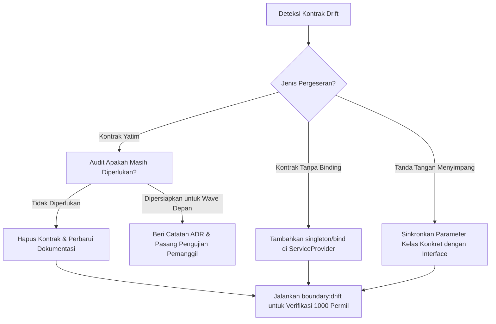

# Panduan Platform Architect — Pencegahan & Audit Pergeseran Kontrak (Contract Drift)

## 1. Konsep Pergeseran Kontrak (Contract Drift)
Pergeseran kontrak (*contract drift*) terjadi ketika antarmuka formal (*interface contracts*) mengalami degradasi struktural seiring perkembangan basis kode:
1. **Kontrak Yatim (*Orphaned Contracts*)**: Interface didefinisikan namun tidak memiliki pemanggil sama sekali di modul lain.
2. **Kontrak Tanpa Binding (*Unbound Contracts*)**: Interface tidak terdaftar di service container sehingga gagal diinjeksikan secara otomatis saat runtime.
3. **Penyimpangan Tanda Tangan (*Signature Divergence*)**: Parameter atau tipe kembalian pada kelas konkret menyimpang dari kontrak antarmuka.

---

## 2. Pemindaian Drift Menggunakan CLI

### 2.1 Pemindaian Seluruh Modul
Jalankan command audit drift secara berkala:
```bash
php artisan boundary:drift
```

Keluaran menyediakan:
- **Total Kontrak**: Jumlah seluruh interface resmi di bawah `Modules/*/Contracts/`.
- **Kontrak Terikat**: Jumlah kontrak yang terdaftar di Laravel Service Container.
- **Kontrak Yatim**: Daftar FQN kontrak yang tidak dipanggil oleh modul eksternal mana pun.
- **Skor Kesehatan**: Persentase integritas kontrak dalam permil $[0..1.000]$.

### 2.2 Memeriksa Hanya Kontrak Yatim
Untuk membersihkan kode mati (*dead code*) atau kontrak kadaluwarsa:
```bash
php artisan boundary:drift --orphans-only
```

---

## 3. Protokol Pemulihan Kontrak Tergeser



### 3.1 Registrasi Binding Service Provider
Setiap kali interface kontrak baru dibuat, selalu daftarkan implementasi konkret di Service Provider modul pemilik:
```php
// Contoh pada Modules/Core/CoreServiceProvider.php
$this->app->singleton(
    \Modules\Core\Contracts\VehicleDirectory::class,
    \Modules\Core\Infrastructure\Repositories\EloquentVehicleDirectory::class
);
```

Dengan mempertahankan skor kesehatan kontrak $\ge 900$ permil, integritas modular platform SuperWeb tetap terlindungi dari fragmentasi arsitektur.

