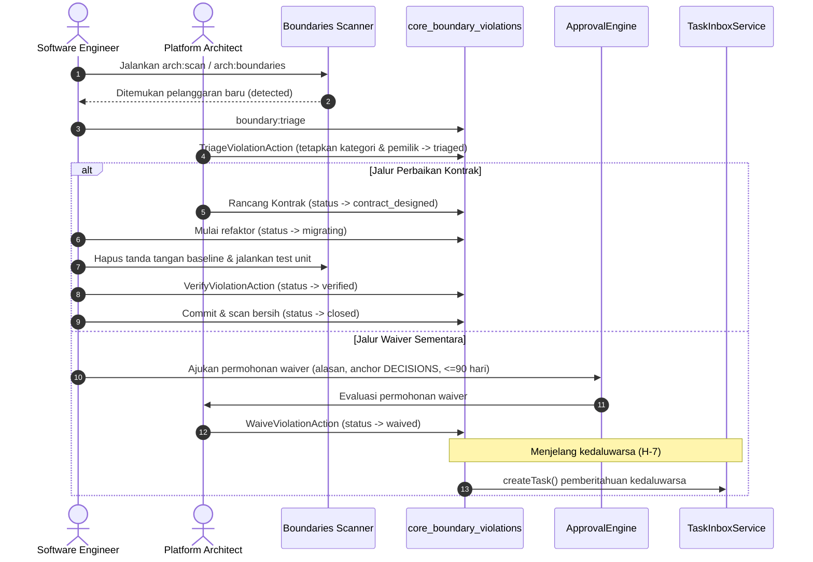

# Panduan Peran Platform Architect — Fase R4: Batas Modul & Tata Kelola Arsitektur

Panduan resmi bagi insinyur pemegang peran `platform_architect` dalam menegakkan tata kelola modularitas, resolusi utang teknis, dan perancangan kontrak cross-module pada monolit terdistribusi SuperWeb.

---

## 1. Tanggung Jawab Utama Platform Architect
1. **Menjaga Integritas Topologi Asiklik (ADP)**: Memastikan graf dependensi antar modul bisnis tidak memuat siklus terarah (SCC $> 1$).
2. **Penegakan Kepemilikan Skema Tunggal**: Menolak segala bentuk kueri SQL lintas batas tabel tanpa otorisasi kontrak atau registrasi `shared_tables`.
3. **Audit Ratchet Baseline**: Memastikan utang arsitektur pada `tests/Architecture/baselines/arch-scan.json` hanya bergerak turun secara monoton dan tidak pernah bertambah tanpa persetujuan luar biasa.
4. **Evaluasi & Pengawasan Waiver**: Menjamin tidak ada dispensasi arsitektur yang beroperasi tanpa anchor dokumen keputusan dan tenggat waktu kedaluwarsa maksimal 90 hari.

---

## 2. Standar Perancangan Kontrak Cross-Module
Saat dua atau lebih modul bisnis membutuhkan pertukaran entitas atau data (seperti domain `Vehicle` yang diakses oleh AutoServe, Logistics, Mall, dan Store), Platform Architect wajib menerapkan pola berikut:

### 2.1 Lokasi & Penamaan Kontrak
- Kontrak diletakkan pada direktori `modules/Core/Contracts/`.
- Nama antarmuka mencerminkan kapabilitas bisnis, bukan entitas basis data murni:
  - Gunakan `VehicleDirectory` untuk layanan query/lookup.
  - Gunakan `VehicleSnapshot` sebagai representasi data Value Object (DTO) yang *immutable*.
  - Gunakan `VehicleModelResolver` jika modul bisnis membutuhkan integrasi relasi Eloquent (`belongsTo`, scope) tanpa coupling ke kelas implementasi `Domain\Models\Vehicle`.

### 2.2 Larangan Tipe Data Float & Coupling
- Seluruh nilai moneter dan kuantitas wajib dinyatakan dalam bilangan bulat minor unit (`int`).
- Kontrak dilarang membocorkan kelas-kelas internal modul pemilik (`Domain\Models\*`, `Domain\Entities\*`).

---

## 3. Kebijakan Persetujuan Waiver Arsitektur

### 3.1 Kriteria Kelayakan Waiver
Waiver arsitektur hanya dapat disetujui jika memenuhi seluruh kondisi berikut:
1. **Ada Anchor Resmi**: Tercatat di `docs/DECISIONS.md` dengan format anchor yang dapat ditautkan (`#w8-d...`).
2. **Ada Alasan Teknis Konkret**: Menjelaskan mengapa perbaikan langsung saat ini akan menimbulkan risiko operasional atau membutuhkan refaktor bertahap.
3. **Tenggat Waktu Ketat**: Masa berlaku dispensasi tidak boleh melebihi **90 hari** sejak tanggal persetujuan.
4. **Pemisahan Tugas (Separation of Duties)**: Pemohon waiver dilarang menyetujui pengajuannya sendiri. Persetujuan harus melalui alur `ApprovalEngine`.

### 3.2 Batasan Penurunan Baseline via Waiver
Sesuai aturan ketat T-10:
- Penurunan baseline $A1 + A2$ minimal harus mencapai $\ge 50\%$.
- Kontribusi penurunan yang berasal dari waiver bertenggat dibatasi **maksimal 50% dari total penurunan**.
- Minimal 50% penurunan lainnya wajib dicapai melalui eliminasi kode nyata (pembuatan kontrak atau refaktor migrasi skema).

---

## 4. Alur Kerja Triage & Resolusi Pelanggaran



---

## 5. Prosedur Pembaruan Baseline Ratchet
Setelah pelanggaran berhasil diperbaiki di kode sumber:
1. Pastikan seluruh pengujian unit dan fitur modul hijau:
   ```bash
   vendor/bin/pest modules/Core/tests
   ```
2. Jalankan perintah penurunan baseline:
   ```bash
   php artisan arch:scan --update-baseline
   ```
3. Verifikasi file `tests/Architecture/baselines/arch-scan.json` menggunakan `git diff`. Pastikan angka pelanggaran hanya berkurang dan tidak ada penambahan aturan baru.
4. Jalankan `vendor/bin/pest tests/Architecture/ArchScanBaselineTest.php` untuk memverifikasi keabsahan baseline.

---

## 6. Protokol Analisis Dampak Radius Ledakan (Blast Radius Protocol)
Sebelum melakukan pemecahan modul (*module decomposition*) atau migrasi antarmuka publik:
1. Jalankan `php artisan boundary:blast-radius <ModuleName> --format=json`.
2. Analisis metrik:
   - Jika skor dampak $\ge 700$ permil, lakukan migrasi menggunakan pendekatan bertahap (*strangler fig pattern*).
   - Pastikan tidak ada konsumen hilir yang mengimpor langsung kelas internal model Eloquent.
3. Gunakan `boundary:remediate <id>` untuk menghasilkan resep antarmuka kontrak otomatis sebelum menulis kode perbaikan.

---

## 7. Audit Integritas Dua Sumber (Dual-Source Audit Checklist)
Setiap pipeline CI dan rilis wave wajib menjalankan verifikasi dua sumber melalui `boundary:audit`:
1. **Scan vs Database**: Setiap pelanggaran yang terdeteksi pada berkas PHP wajib memiliki baris padanannya di tabel `core_boundary_violations`.
2. **Baseline vs Scan**: Tidak boleh ada pelanggaran baru melebihi batas ratchet di `tests/Architecture/baselines/arch-scan.json`.
3. **Anchor Keputusan**: Setiap status `waived` wajib memiliki anchor keputusan yang valid di `docs/DECISIONS.md`.
4. **Bebas Siklus Dependensi**: Pemindaian Tarjan SCC wajib membuktikan 0 siklus terlarang pada graf modul.
5. **Konflik Prefiks**: Pemetaan prefiks tabel di `config/modules.php` wajib bebas dari tumpang-tindih atau duplikasi ambigu.

