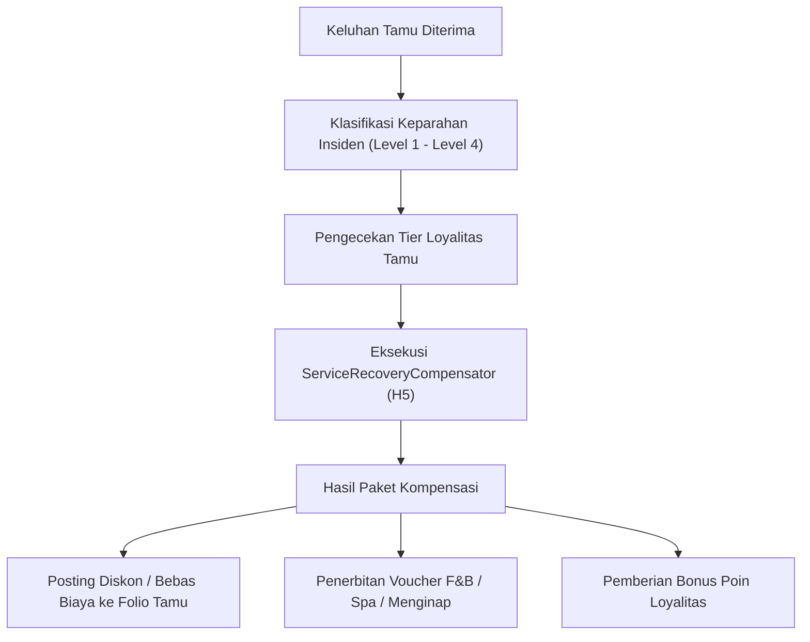

# Protokol Penanganan Keluhan Tamu & Kompensasi Service Recovery

Dokumen ini mengatur prosedur standar, pedoman etika layanan, dan mekanisme kompensasi otomatis berbasis algoritma `ServiceRecoveryCompensator` (H5) dalam rangka menyelesaikan ketidaknyamanan tamu hotel secara proporsional, cepat, dan transparan.

---

## 1. Prinsip Dasar Pemulihan Layanan (Service Recovery Framework)

Kepuasan tamu adalah prioritas tertinggi operasional hotel. Setiap staf hotel berwenang dan bertanggung jawab mengambil inisiatif pemulihan layanan menggunakan metode **L-A-S-T**:
1. **Listen (Mendengarkan)**: Dengarkan keluhan tamu dengan empati tanpa memotong pembicaraan. Catat fakta spesifik mengenai waktu, lokasi, dan staf terkait.
2. **Apologize (Meminta Maaf)**: Sampaikan permohonan maaf yang tulus atas ketidaknyamanan yang dialami tamu, tanpa mencari pembenaran atau menyalahkan departemen lain.
3. **Solve (Menyelesaikan)**: Berikan solusi segera yang dapat ditindaklanjuti. Jika membutuhkan waktu perbaikan fisik (misal perbaikan AC atau pipa), tawarkan perpindahan kamar segera.
4. **Thank (Berterima Kasih)**: Ucapkan terima kasih kepada tamu atas masukan berharga yang membantu manajemen meningkatkan standar pelayanan.

---

## 2. Tingkat Keparahan Insiden & Matriks Kompensasi (Algoritma H5)

Algoritma H5 menghitung paket kompensasi yang adil dan seimbang berdasarkan klasifikasi keparahan insiden, riwayat loyalitas tamu, serta tarif kamar per malam.

### 2.1 Klasifikasi Keparahan Insiden

| Level | Kategori Insiden | Contoh Kasus | Wewenang Staf |
| :--- | :--- | :--- | :--- |
| **Level 1 (Minor)** | Gangguan kecil tanpa dampak fisik | Keterlambatan antar handuk, amenity kurang lengkap, remote TV baterai habis | Front Desk Agent / Housekeeper |
| **Level 2 (Moderate)** | Gangguan kenyamanan terukur | Kebisingan koridor, pesanan room service terlambat > 45 mnt, AC kurang dingin | Duty Manager / Supervisor |
| **Level 3 (Major)** | Gangguan fasilitas esensial | Kerusakan air panas, kebocoran kamar mandi, kamar bau rokok di area non-smoking | Front Office Manager / Executive Housekeeper |
| **Level 4 (Critical)** | Insiden serius & keselamatan/hukum | Kesalahan pemesanan berujung book-out, serangga/hama di kamar, staf tidak sopan ekstrem | General Manager / Resident Manager |

---

## 3. Ketentuan Kompensasi Finansial & Akuntansi Folio

Setiap kompensasi keuangan yang dibebankan langsung ke folio kamar harus dicatat ke dalam buku besar akuntansi dengan tipe transaksi `HOTEL_SERVICE_RECOVERY`:
- **Debit**: Biaya Pemulihan Layanan (`htl:service_recovery_expense:IDR`)
- **Kredit**: Piutang Buku Tamu (`htl:guest_ledger:IDR`)

Pencatatan ini memastikan transparansi biaya operasional dan memungkinkan audit internal melacak departemen yang menjadi sumber keluhan berulang (*root-cause service failure analysis*).

---

## 4. Pelacakan dan Tindak Lanjut Pasca Insiden

1. **Pencatatan di Guest Profile CRM**:
   - Setiap insiden wajib dicatat di profil tamu dengan kode tag keluhan.
   - Preferensi spesifik tamu diperbarui (misal: "Alergi bantal bulu angsa", "Memerlukan kamar tenang jauh dari lift").
2. **Tindak Lanjut Sebelum Check-Out**:
   - Duty Manager wajib menyapa tamu secara personal sebelum keberangkatan untuk memastikan bahwa sisa masa inap berlangsung menyenangkan.
3. **Analisis Mingguan Quality Assurance**:
   - Tim manajemen hotel mengulas seluruh insiden Service Recovery setiap hari Senin untuk perbaikan proses preventif.

