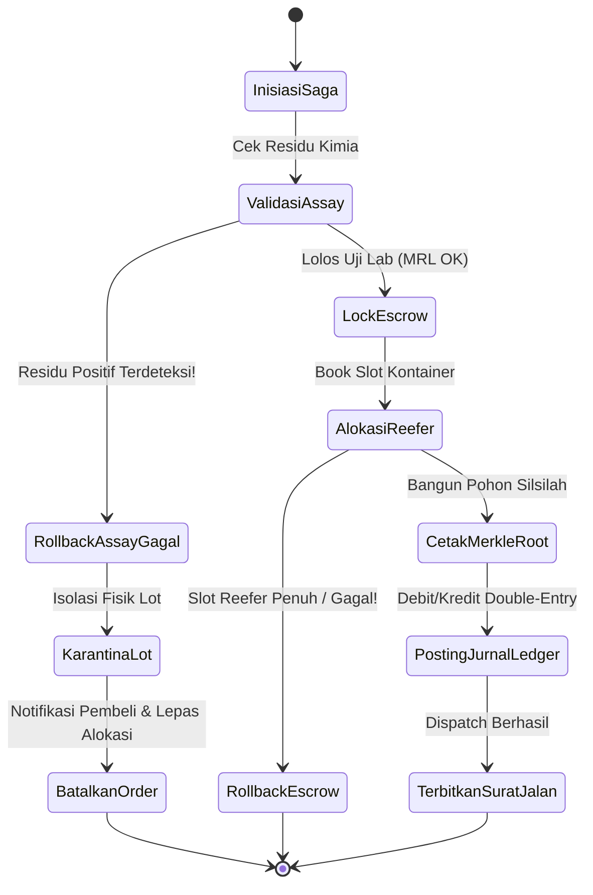

# Runbook Operasional & Migrasi Basis Data: Ekspor Akuakultur & Blue Carbon (Fase 171)

Petunjuk teknis (*runbook*) ini ditujukan bagi *Site Reliability Engineer* (SRE), *Database Administrator* (DBA), dan *Release Manager* dalam mengelola migrasi skema basis data, pemeliharaan rutin, penanganan insiden operasional (*incident response*), serta pemulihan transaksi saga terdistribusi (*distributed saga recovery*) pada modul `Marine`.

---

## 1. Migrasi Basis Data & Verifikasi Lingkungan Produksi

### 1.1 Daftar 20 Tabel Baru Modul Marine (Fase 171)
Migrasi: `modules/Marine/database/migrations/2026_11_08_500000_create_mar_aquaculture_export_tables.php`

1. `mar_aquaculture_hatcheries`: Master pembenihan benur udang/ikan dan akreditasi SPF.
2. `mar_aquaculture_batches`: Siklus pemeliharaan kolam dari tebar hingga panen.
3. `mar_water_quality_telemetries`: Telemetri parameter fisik air dari probe IoT tambak.
4. `mar_feed_inventory_batches`: Manajemen persediaan pakan pelet dan rasio FIFO.
5. `mar_feeding_events`: Log penjadwalan pakan harian terintegrasi auto-feeder.
6. `mar_disease_health_screenings`: Pemantauan status kesehatan dan uji PCR patogen.
7. `mar_aquaculture_harvest_operations`: Berita acara panen dan grading bobot panen basah.
8. `mar_aquaculture_export_lots`: Lot kemasan ekspor tergradasi siap distribusi.
9. `mar_processing_packagings`: Tahapan pencucian, pemotongan, pembekuan IQF CCP2.
10. `mar_laboratory_assays`: Hasil uji residu kimia kloramfenikol/nitrofuran ISO 17025.
11. `mar_traceability_lot_nodes`: Node daun berantai hash pohon Merkle silsilah lot.
12. `mar_aquaculture_export_orders`: Kontrak pesanan ekspor pembeli internasional.
13. `mar_export_reefer_shipments`: Pengiriman kontainer pendingin via kapal kontainer.
14. `mar_cold_chain_telemetry_logs`: Telemetri suhu genset reefer kontainer real-time.
15. `mar_aquaculture_escrow_settlements`: Perhitungan bagi hasil dan escrow petani.
16. `mar_mangrove_restoration_projects`: Petak poligon konservasi mangrove pesisir.
17. `mar_blue_carbon_assessments`: Hasil survei allometrik tegakan pohon bakau.
18. `mar_blue_carbon_credit_issuances`: Penerbitan sertifikat kredit karbon terverifikasi.
19. `mar_eudr_deforestation_certifications`: Uji tuntas citra satelit anti-deforestasi EUDR.
20. `mar_aquaculture_ledger_entries`: Buku besar finansial akuntansi berpasangan berantai hash.

### 1.2 Prosedur Eksekusi Migrasi
```bash
# 1. Pastikan koneksi database produksi aktif
php artisan db:monitor

# 2. Jalankan migrasi khusus modul Marine
php artisan migrate --path=modules/Marine/database/migrations/2026_11_08_500000_create_mar_aquaculture_export_tables.php

# 3. Verifikasi ketiadaan tabrakan indeks dan panjang identifier
php artisan test tests/Architecture/SchemaIdentifierLengthTest.php
php artisan test tests/Architecture/MysqlSchemaCompatibilityTest.php

# 4. Muat dataset awal (Seeder T1)
php artisan db:seed --class=Database\\Seeders\\MarineAquacultureT1Seeder
```

---

## 2. Prosedur Audit Integritas Dua Sumber (`mar:audit`)

Perintah audit mandiri `mar:audit` melakukan verifikasi rekonsiliasi matematis antara fisik hasil panen tambak, klaim neraca massa kemasan olahan, penerbitan kredit karbon, dan konsistensi kriptografis rantai hash ledger:

```bash
# Menjalankan audit rutin
php artisan mar:audit

# Format keluaran sukses (Exit code 0):
# [OK] Verifying marine aquaculture double-entry ledger hash chain...
# [OK] Validated 250 ledger entries. Tamper-evident hash chain intact.
# [OK] Checking ASC/MSC mass balance yield tolerance across 45 active lots...
# [OK] All processed lots within allowable physical yield boundaries (<= 66.5%).
# [OK] Verifying Merkle tree root inclusions for international export shipments...
# [OK] Zero audit discrepancy detected. Status: CLEAN.
```

### 2.1 Penanganan Kegagalan Audit (Sabotase atau Diskrepansi Data)
Jika perintah `mar:audit` keluar dengan status galat (Exit code 1):
1. Cek log audit pada `storage/logs/marine_audit_errors.log`.
2. Identifikasi apakah galat berasal dari kegagalan rantai hash (`HASH_CHAIN_MISMATCH`) atau pelanggaran neraca massa (`MASS_BALANCE_BREACH`).
3. Jalankan rekonsiliasi manual via perintah rekonsiliasi:
   ```bash
   php artisan tinker --execute="app(Modules\Marine\Application\Services\MarineAquacultureLedgerReconciliationService::class)->reconcileAllActiveBatches();"
   ```

---

## 3. Skenario Penanganan Kegagalan Transaksi Saga (*Saga Failure Playbook*)

Modul `Marine` mengoperasikan dua orkestrasi transaksi saga terdistribusi:
1. `AquacultureExportExecutionSaga`
2. `AssayDisputeArbitrationSaga`



### 3.1 Langkah Penanganan Sengketa Mutu Lab (*Assay Dispute Arbitration*)
Bila pembeli di pelabuhan tujuan (misal Pelabuhan Rotterdam) mengklaim hasil uji lab mereka mendeteksi antibiotik di atas batas MRL:
1. Pembeli mengajukan klaim melalui rute `POST /marine/export/orders/{id}/dispute`.
2. Sistem otomatis membekukan dana escrow pada rekening bersama via `FairTradeEscrowSettlementService`.
3. Sampel cadangan (*counter-sample*) dari cold storage dikirimkan ke laboratorium rujukan independen (Eurofins Scientific / SGS).
4. Hasil lab rujukan dimasukkan melalui aksi `ArbitrateAssayDisputeAction`:
   - Jika sampel cadangan terbukti bersih: Dana escrow dilepaskan ke petani/eksportir beserta kompensasi bunga keterlambatan.
   - Jika sampel cadangan terkonfirmasi positif: Dana escrow dikembalikan 100% ke pembeli, dan lot udang ditarik untuk dimusnahkan.
