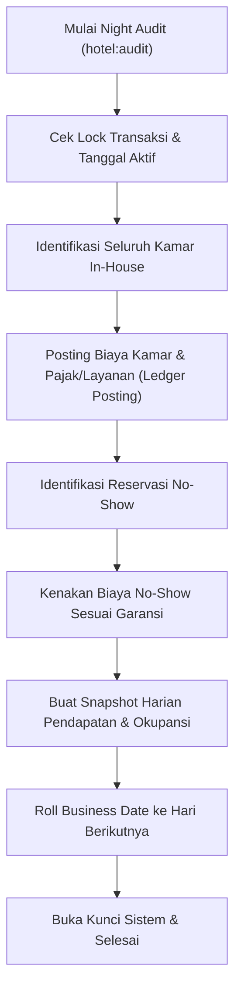

# Standar Operasional Prosedur: Front Desk & Night Audit PMS

Dokumen ini mendefinisikan standar operasional prosedur (SOP) untuk staf front desk, night auditor, dan manajer operasional hotel pada sistem Property Management System (PMS) Superweb Hotel Modul G7-P6.

---

## 1. Siklus Tamu (Guest Cycle)

Siklus tamu dalam PMS Superweb mencakup 5 tahapan utama:
1. **Pra-Kedatangan (Pre-Arrival)**: Pembuatan reservasi via CRS, OTA Channel Manager, direct web booking, atau walk-in. Penghitungan dynamic pricing Best Available Rate (BAR) dan overbooking limit protection.
2. **Kedatangan & Check-In (Arrival & Check-In)**: Verifikasi identitas tamu (KTP/Paspor), penarikan deposit jaminan (cash, pre-auth credit card, atau digital wallet), penetapan nomor kamar bersih (Inspected), dan penerbitan smart digital key (BLE/QR/NFC).
3. **Masa Inap (Stay / In-House)**: Pembebanan transaksi harian kamar (room charge), F&B outlet room charge, laundry, minibar, spa, penyesuaian service recovery, serta audit folio kredit tamu.
4. **Keberangkatan & Check-Out (Departure & Check-Out)**: Verifikasi status minibar & fasilitas kamar, rekonsiliasi akhir folio (Folio Zero-Balance Principle), pengembalian sisa deposit, pencetakan / pengiriman faktur resmi, pencabutan hak akses digital key, dan pembaruan status kamar menjadi Dirty.
5. **Pasca-Keberangkatan (Post-Departure)**: Pengarsipan riwayat tamu, pengalihan tagihan belum lunas ke City Ledger (Direct Billing AR) jika disepakati kredit korporat/agen, pembersihan kamar oleh tata graha (Housekeeping), dan pengiriman survei kepuasan tamu.

---

## 2. Prosedur Check-In dan Idempotensi Registrasi

### 2.1 Verifikasi Identitas & Pembayaran Jaminan
- Resepsionis wajib memverifikasi dokumen identitas resmi tamu (KTP untuk WNI, Paspor & Visa untuk WNA).
- Sistem memvalidasi tanggal kedatangan dengan `HotelBusinessDateService`. Tamu yang tiba sebelum waktu check-in resmi (14:00) diproses sebagai *Early Check-In* dengan aturan surcharge otomatis atau waiver yang diotorisasi Duty Manager.
- Deposit jaminan (Security Deposit) wajib dibukukan ke dalam folio tamu dengan polaritas liability:
  - Debit: Kas / Bank / Gateway Perantara (`htl:cash_frontdesk` / `bnk:clearing:IDR`)
  - Kredit: Deposit Tamu (`htl:guest_deposit:IDR`)

### 2.2 Penerbitan Kunci Kamar Digital & Fisik
- Sistem Smart Room IoT Manager menerbitkan encrypted digital key token yang mencakup:
  - `reservation_id`
  - `room_number`
  - `valid_from` (waktu check-in)
  - `valid_until` (waktu check-out standar 12:00 tanggal keberangkatan)
- Kunci fisik RFID ditulis menggunakan encoder simulator/hardware, dan kunci digital (QR/BLE pass) dikirimkan ke aplikasi tamu atau SMS/Email.

---

## 3. Prosedur Night Audit Idempoten

Night audit adalah proses penutupan buku harian operasional hotel dan pemindahan tanggal bisnis ke hari berikutnya. Di Superweb PMS, proses ini dikontrol oleh `RunNightAuditFase91Action` dan command `hotel:audit`.

### 3.1 Langkah-Langkah Eksekusi
1. **Pengecekan Pra-Audit**:
   - Pastikan seluruh kasir outlet (Resto, Bar, Spa, Toko) telah melakukan *End of Day Shift Closure* dan posting folio tertunda telah bersih.
   - Periksa daftar kedatangan yang belum tiba (Expected Arrivals). Tandai sebagai late arrival atau no-show.
2. **Posting Otomatis Biaya Kamar (Room Charge Posting)**:
   - Sistem membebankan tarif kamar (Room Rate), service charge (10%), dan hotel tax (10%) ke folio masing-masing kamar yang berstatus `IN_HOUSE`.
   - Transaksi diposting ke ledger secara double-entry:
     - Debit: `htl:guest_ledger:IDR`
     - Kredit: `htl:room_revenue:IDR`, `htl:service_charge:IDR`, `htl:hotel_tax:IDR`
3. **Penanganan No-Show**:
   - Reservasi bergaransi kartu kredit atau deposit yang tidak hadir diproses no-show. Biaya satu malam pertama didebit dari deposit atau ditagihkan ke jaminan.
4. **Pembuatan Snapshot Harian**:
   - Sistem merekam metrik kunci: Total Kamar Tersedia, Kamar Terjual, Kamar Rusak (OOO), Total Tamu, Room Revenue, Total Revenue, ADR (Average Daily Rate), RevPAR (Revenue per Available Room).
   - Data disimpan pada tabel `htl_daily_revenue_snapshots`. Idempotensi dijamin melalui unique constraint `(property_id, business_date)`.
5. **Pemindahan Tanggal Bisnis (Business Date Roll)**:
   - Tanggal bisnis dimajukan 1 hari (`business_date = business_date + 1`).

---

## 4. Penanganan Pembayaran dan Prinsip Folio Saldo Nol

Sesuai standar audit akuntansi perhotelan:
1. **Folio Tamu Terbuka Selama Menginap**:
   - Segala konsumsi dan biaya dicatat sebagai tagihan piutang sementara pada `htl:guest_ledger:IDR`.
2. **Batas Kredit (Credit Limit Monitoring)**:
   - Apabila saldo terutang melebihi pagu kredit (default IDR 5.000.000 atau jumlah deposit), sistem memberikan peringatan `Credit Limit Exceeded` kepada Front Desk untuk meminta tambahan deposit jaminan (*top up deposit*).
3. **Penyelesaian Akhir Saat Check-Out**:
   - Tamu wajib melunasi saldo neto tagihan:
     `Sisa Tagihan = Total Pembebanan - Total Pembayaran/Deposit`
   - Kamar tidak dapat di-checkout jika saldo neto $\neq 0$.
   - Setelah saldo menjadi 0, folio ditutup (`status = CLOSED`), status reservasi diubah menjadi `CHECKED_OUT`, dan hak akses smart lock dibatalkan secara instan.

---

## 5. Matriks Eskalasi Masalah Front Desk

| Jenis Masalah | Wewenang Penanganan | Tindakan Sistem |
| :--- | :--- | :--- |
| Early Check-in (< 10:00) | Duty Manager | Penerapan surcharge early arrival atau waiver otorisasi |
| Permintaan Pindah Kamar | Resepsionis & Housekeeping | Update `room_id` pada reservasi, re-generate digital key, status kamar lama menjadi Dirty |
| Overbooking Terjadi | Front Office Manager | Eksekusi `OverbookingLimitOptimizer` & Book-Out ke hotel mitra sekunder dengan voucher kompensasi |
| Keluhan Layanan Serius | Guest Relation Manager | Eksekusi `ServiceRecoveryCompensator` (diskon folio, voucher complimentary, point multiplier) |
| Kegagalan Sistem Kunci IoT | Front Desk / Maintenance | Penerbitan physical mechanical master card & fallback token offline |

