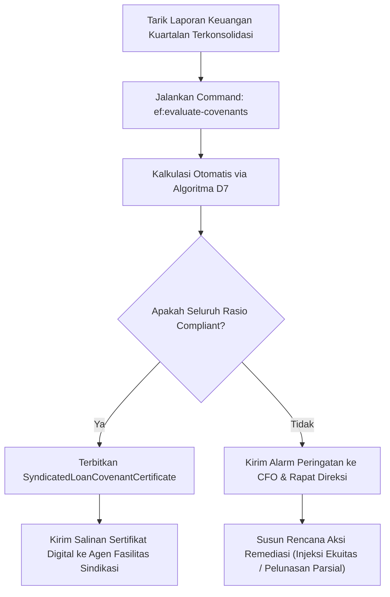

# Panduan Operasional: Pemantauan & Evaluasi Covenant Utang Sindikasi

## 1. Tujuan Panduan
Panduan ini ditujukan bagi tim Treasury Korporat dan Komite Keuangan Grup untuk memantau pemenuhan syarat dan ketentuan rasio finansial pada fasilitas kredit sindikasi bank, guna menghindari status cidera janji (*event of default*).

---

## 2. Prosedur Evaluasi Kuartalan

---

## 3. Parameter Ambang Batas Perjanjian Kredit
1. **DSCR (Debt Service Coverage Ratio)**: Minimal 1.250 permille ($1,25\times$). Mengukur kecukupan arus kas operasi membayar bunga dan pokok pinjaman.
2. **DER (Debt to Equity Ratio)**: Maksimal 2.500 permille ($2,50\times$). Menjaga struktur modal agar tidak *overleveraged*.
3. **ISCR (Interest Service Coverage Ratio)**: Minimal 2.000 permille ($2,00\times$). Menjamin laba operasi mampu menutup beban bunga minimal dua kali lipat.
4. **Current Ratio**: Minimal 1.100 permille ($1,10\times$). Menjamin aset lancar cukup melunasi utang jatuh tempo dalam satu tahun.

---

## 4. Dokumen Bukti & Kepatuhan Auditor
Setiap hasil evaluasi kuartalan menghasilkan file laporan CSV resmi di `storage/reports/` dengan tanda tangan digital SHA-256 yang siap diaudit oleh auditor independen dan sindikasi bank kreditur.
