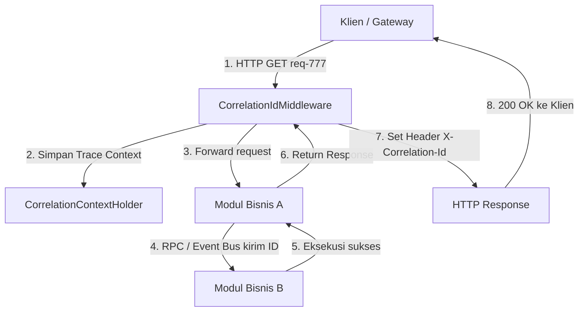

# Panduan Arsitektur Penelusuran Terdistribusi W3C TraceContext (Fase 237)

## 1. Pendahuluan & Urgensi
Dalam ekosistem enterprise monorepo multi-modul yang melayani lusinan transaksi antar-pilar (misalnya: alur pembelian C2C melibatkan Store $\rightarrow$ Payment $\rightarrow$ Banking Ledger $\rightarrow$ Inventory $\rightarrow$ Core Passport $\rightarrow$ Logistics), pelacakan sebuah permintaan (request) saat terjadi kegagalan atau degradasi performa menjadi tantangan yang sangat kompleks jika dilakukan secara manual melalui pencarian log terpisah.

Setiap modul dapat mencatat log dengan format dan timestamp yang sedikit berbeda. Tanpa benang merah yang mengikat rantai pemanggilan tersebut, penelusuran akar masalah (root cause analysis) membutuhkan waktu berjam-jam dan rentan salah diagnosa.

Modul `Platform` (`plt_`) bersama komponen kernel di `app/Http/Middleware/CorrelationIdMiddleware` menghadirkan standardisasi **Distributed Tracing** yang mematuhi spesifikasi internasional **W3C TraceContext (Recommendation 2021)**.

---

## 2. Standar Format Header W3C `traceparent`

Header `traceparent` memuat informasi 4 komponen heksadesimal diskret yang dipisahkan oleh tanda hubung (`-`):

$$\text{traceparent} = \text{version}-\text{trace\_id}-\text{parent\_id}-\text{trace\_flags}$$

### Rincian Komponen Header:
1. **Version (2 digit hex)**:
   - Versi spesifikasi W3C saat ini adalah `00`. Nilai `ff` dilarang oleh spesifikasi.
2. **Trace ID (32 digit hex / 16 byte)**:
   - Pengidentifikasi global unik yang merepresentasikan seluruh perjalanan transaksi dari ujung ke ujung.
   - Tetap sama sepanjang perjalanan request melintasi gateway, modul internal, hingga event queue/outbox.
   - Contoh: `4bf92f3577b34da6a3ce929d0e0e4736`.
3. **Parent ID / Span ID (16 digit hex / 8 byte)**:
   - Pengidentifikasi unik untuk segmen eksekusi atau operasi spesifik dalam satu layanan.
   - Berubah setiap kali request berpindah dari satu batas layanan (hop) ke layanan berikutnya (child span).
   - Contoh: `00f067aa0ba902b7`.
4. **Trace Flags (2 digit hex / 8 bit)**:
   - Mengontrol opsi perekaman dan sampling.
   - Nilai `01` menandakan transaksi ini di-sample untuk telemetri lengkap (`sampled = true`).
   - Nilai `00` menandakan transaksi tidak di-sample untuk menghemat storage metrik.

---

## 3. Propagasi Header & Konteks Korelasi

### Alur Kerja Middleware (`CorrelationIdMiddleware`):
Ketika permintaan HTTP masuk ke sistem:
1. Middleware membaca header `X-Correlation-Id` atau `traceparent`.
2. Jika header tidak ditemukan (permintaan baru dari luar), middleware menghasilkan UUID/TraceID baru secara deterministik.
3. Konteks disimpan di `CorrelationContextHolder` (static thread/request-scoped state).
4. Respons HTTP secara otomatis menyertakan header `X-Correlation-Id` dan `traceparent` kembali ke pemanggil (client/gateway).

---

## 4. Mekanisme Baggage untuk Metadata Transaksional

Selain pengenal rantai pemanggilan, penelusuran terdistribusi mendukung header **`tracestate`** dan **Baggage**. Baggage memungkinkan informasi kontekstual non-sensitif disalurkan bersama request:
- `tenant_id`: ID perusahaan atau entitas penyewa.
- `user_role`: Peran pengguna yang menginisiasi aksi.
- `client_version`: Versi aplikasi mobile atau web klien.

Nilai baggage ini disimpan dalam objek immutable `CorrelationContext` dan disalin otomatis saat child span diciptakan via `createChildSpan()`.

---

## 5. Visualisasi Waterfall & Pengukuran Durasi

Endpoint Dev Portal `/platform/dev/trace/{correlationId}` menyediakan visualisasi graf waterfall:
- Menampilkan setiap lompatan layanan (hops) beserta latensi individual.
- Menghitung total durasi waktu eksekusi (`total_duration_ms`).
- Mengidentifikasi titik hambatan performa (bottleneck) dan timeout pada transaksi multi-modul.

