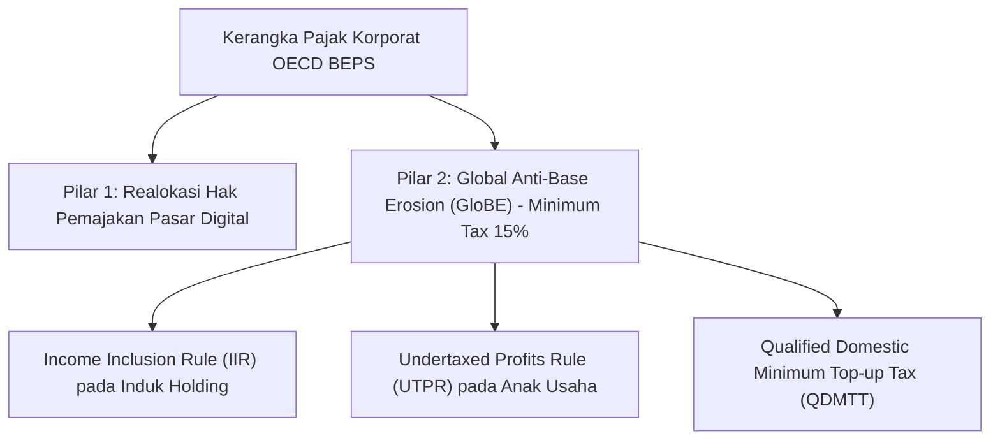

# Referensi Tata Kelola Pajak Internasional: OECD Base Erosion and Profit Shifting (BEPS) Pilar 1 & Pilar 2

## 1. Ikhtisar Standar OECD BEPS
Proyek OECD/G20 Base Erosion and Profit Shifting (BEPS) menetapkan standar global untuk mencegah penghindaran pajak agresif oleh perusahaan multinasional dan konglomerasi melalui pengalihan laba ke yurisdiksi dengan tarif pajak rendah (*tax havens*).

---

## 2. Ketentuan Utama Pilar 2 (Pajak Minimum Global 15%)
1. **Ambang Penerapan (Scope)**:
   - Berlaku bagi grup konglomerasi dengan pendapatan konsolidasi global melebihi EUR 750 Juta (atau ekuivalen Rp 12,5 Triliun) dalam laporan keuangan konsolidasi.
2. **Perhitungan Tarif Pajak Efektif (Effective Tax Rate - ETR)**:
   - ETR dihitung per yurisdiksi negara:
     $$\text{ETR}_{\text{yurisdiksi}} = \frac{\text{Total Pajak Tercakup (Covered Taxes)}}{\text{Laba Bersih GloBE (GloBE Income)}}$$
   - Jika ETR di suatu yurisdiksi di bawah $15\%$, holding dikenakan pajak tambahan (*Top-up Tax*) untuk menutup selisih hingga tarif minimum $15\%$.

---

## 3. Integrasi dengan Modul EnterpriseFinance
Modul `EnterpriseFinance` memantau ETR per entitas anak di luar negeri (seperti anak usaha di Singapura):
- Mengidentifikasi potensi liabilitas pajak tambahan (*GloBE Top-up Tax provision*).
- Menjamin penyusunan laporan Country-by-Country Reporting (CbCR) yang sinkron dengan pelaporan keuangan konsolidasi grup.
