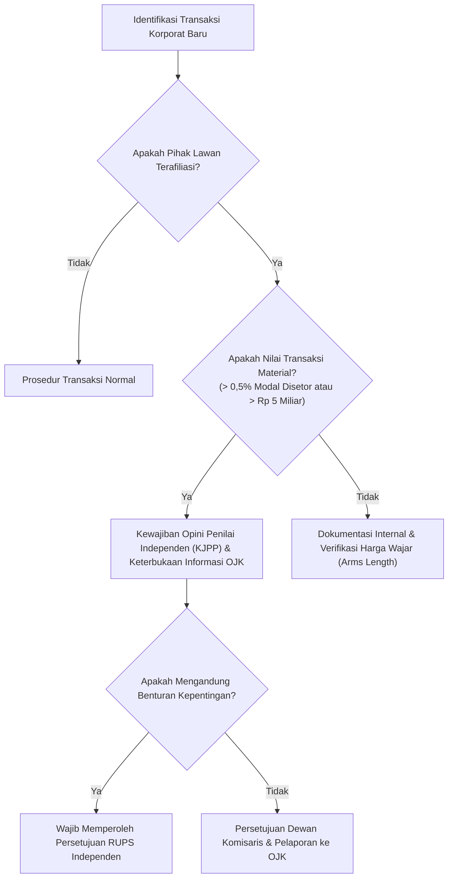

# Referensi Regulasi Pasar Modal: POJK No. 42/POJK.04/2020 Mengenai Transaksi Afiliasi dan Benturan Kepentingan

## 1. Latar Belakang & Ruang Lingkup
Peraturan Otoritas Jasa Keuangan (POJK) No. 42/POJK.04/2020 mengatur kewajiban keterbukaan informasi dan persetujuan pemegang saham independen bagi Perusahaan Terbuka (Emiten) dan konglomerasi yang melakukan transaksi dengan pihak terafiliasi atau transaksi yang mengandung benturan kepentingan.

---

## 2. Batasan Kuantitatif & Ambang Materialitas
1. **Ambang Keterbukaan Informasi**:
   - Transaksi dengan nilai melebihi $0,5\%$ dari modal disetor Perusahaan Terbuka atau jumlah yang paling rendah antara $0,5\%$ modal disetor dan Rp 5.000.000.000 (lima miliar rupiah) wajib diumumkan kepada publik dan dilaporkan kepada OJK paling lambat 2 (dua) hari kerja setelah tanggal transaksi.
2. **Kewajiban Penilaian Independen (KJPP)**:
   - Nilai transaksi wajib dinilai oleh Penilai Publik terdaftar di OJK untuk memastikan bahwa transaksi dilakukan dengan syarat dan ketentuan yang wajar (*fairness opinion*).
3. **Pengecualian Transaksi Rutin**:
   - Transaksi operasional rutin yang dilakukan dalam rangka kegiatan usaha utama perusahaan yang telah diungkapkan dalam prospektus atau laporan tahunan dikecualikan dari kewajiban persetujuan RUPS, namun tetap wajib mematuhi pengujian harga wajar (*arm's length principle*).

---

## 3. Penerapan pada Modul EnterpriseFinance
Modul `EnterpriseFinance` memantau secara real-time akumulasi transaksi afiliasi sepanjang tahun buku:
- Setiap kali pengajuan transaksi belanja atau pinjaman diajukan, sistem membandingkan nilai transaksi terhadap persentase ekuitas modal disetor holding.
- Jika akumulasi transaksi melampaui ambang batas materialitas POJK 42, sistem secara otomatis mengunci persetujuan (*approval lock*) dan menerbitkan notifikasi kepatuhan regulasi di `/enterprise-finance/compliance`.
