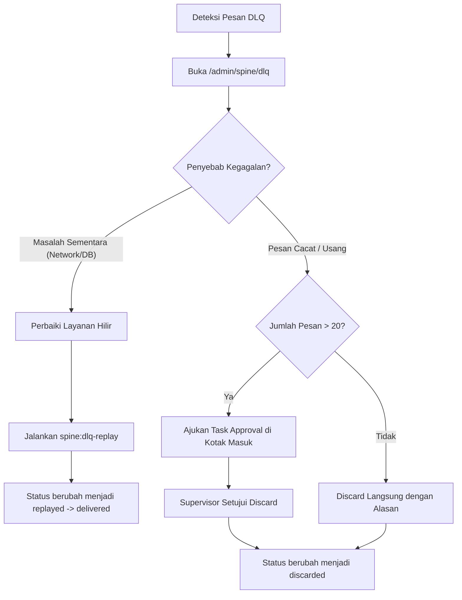

# Runbook Operasional — Universal Event Spine (Fase R8)

## 1. Ikhtisar & Peran Pengguna

Runbook ini adalah panduan standar operasional (*Standard Operating Procedure*) bagi `spine_operator`, System Administrator, dan Auditor Keamanan dalam mengelola, memantau, memecahkan masalah, dan memulihkan insiden pada ekosistem perpesanan Universal Event Spine.

### Hak Akses Peran RBAC
- **`spine_operator`**: Akses penuh ke dashboard `/admin/spine`, konsol DLQ `/admin/spine/dlq`, pemantau konsumen `/admin/spine/consumers`, pelacak celah `/admin/spine/gaps`, pendaftaran skema `/admin/spine/schemas`, eksekusi replay, dan eksekusi audit.
- **`auditor`**: Akses baca dan verifikasi ke `/admin/spine/schemas`, laporan lag CSV, dan hasil audit dua sumber.
- **`superadmin`**: Akses administratif penuh dan persetujuan otorisasi ganda untuk pembuangan massal DLQ (> 20 pesan).

---

## 2. Pemantauan Rutin & Metrik Kunci

### Perintah Pemeriksaan Cepat
```bash
# 1. Menampilkan laporan lag konsumen dan nilai p95 lag terkini
php artisan spine:lag-report

# 2. Menjalankan audit dua sumber silang
php artisan spine:audit

# 3. Memindai celah urutan aggregate pada outbox stream
php artisan spine:gap-scan
```

### Ambang Batas Peringatan Operasional
1. **Nearest-Rank P95 Lag > 500 pesan**: Menunjukkan adanya degradasi throughput worker atau perlambatan basis data.
2. **DLQ Messages > 20 pesan**: Menunjukkan adanya kegagalan sistemik hilir (downstream network issue, auth failure, atau schema mismatch).
3. **Open Gaps > 0**: Menunjukkan adanya pesan outbox yang tertinggal atau gagal ditulis pada transaksi pengirim.
4. **Poison Messages > 0**: Menunjukkan pesan dengan struktur tidak valid yang diisolasi ke `core_poison_messages`.

---

## 3. Penanganan Insiden & Prosedur Pemulihan

### Skenario 1: Pesan Menumpuk di Dead-Letter Queue (DLQ)
**Gejala**: Peringatan DLQ aktif di dashboard `/admin/spine`, jumlah pesan di antrean bertambah.
**Langkah Penanganan**:
1. Buka antarmuka DLQ di browser: `https://app.superweb.local/admin/spine/dlq`.
2. Periksa kolom `last_error` untuk mengidentifikasi penyebab umum (misal kegagalan koneksi database, timeout API pihak ketiga, atau deadlocks).
3. Bila masalah eksternal telah teratasi:
   - Pilih pesan yang ingin diputar ulang.
   - Masukkan alasan operasional (misal: "Downstream API gateway restarted and operational").
   - Klik **Putar Ulang Terpilih** atau jalankan via CLI:
     ```bash
     php artisan spine:dlq-replay --group=logistics_fulfillment --reason="Post-maintenance retry"
     ```
4. Bila pesan terbukti palsu atau tidak perlu diproses lagi:
   - Lakukan **Discard** dengan alasan tertulis resmi.
   - Bila jumlah pesan yang akan dibuang $> 20$, sistem akan secara otomatis menerbitkan tugas persetujuan di Kotak Masuk "Tugas Saya". Supervisor atau superadmin wajib menyetujui sebelum status berubah ke `discarded`.



---

### Skenario 2: Karantina Poison Message
**Gejala**: Muncul entri baru di tab `Karantina Poison Messages` pada `/admin/spine/dlq?tab=poison`.
**Dampak**: Pesan diisolasi tanpa memblokir offset konsumen lain (stream tetap mengalir lancar).
**Langkah Penanganan**:
1. Buka tab karantina poison messages.
2. Klik baris pesan untuk menginspeksi payload JSON, class exception, dan stack trace lengkap.
3. Koordinasikan dengan tim pengembang modul pengirim jika ditemukan anomali struktur data biner atau pelanggaran parser.
4. Setelah perbaikan kode dideploy, lakukan pemutaran ulang terarah.

---

### Skenario 3: Celah Urutan Aggregate Terbuka (Open Sequence Gap)
**Gejala**: Command `spine:gap-scan` atau cron 15 menit mendeteksi pasangan celah (misal rentang `[4, 4]` atau `[7, 8]`).
**Langkah Penanganan**:
1. Buka halaman `/admin/spine/gaps`.
2. Periksa `aggregate_type` dan `aggregate_id` yang terpengaruh.
3. Verifikasi apakah ada transaksi yang tertunda di modul pengirim (`core_outbox` dengan status `pending`).
4. Jika pesan yang hilang berhasil dikirimkan oleh pengirim, jalankan `php artisan spine:gap-scan` untuk memverifikasi bahwa status celah otomatis berubah menjadi `resolved`.
5. Jika pesan yang hilang dipastikan dibatalkan secara sah oleh sistem luar, gunakan tombol **Tutup Celah** secara manual.

---

## 4. Pemutaran Ulang Aliran (Replay) & Rekonstruksi Proyeksi

Bila terjadi kerusakan data lokal atau kebutuhan verifikasi forensik:
```bash
# Memutar ulang stream untuk grup konsumen tertentu dari offset 0 hingga 500
php artisan spine:replay logistics_worker --topic="lgx.shipment.*" --from=0 --to=500
```
Command ini akan menghitung akumulasi status proyeksi melalui reducer deterministik dan menampilkan hash kanonikal SHA-256. Dua kali eksekusi dengan rentang yang sama **wajib menghasilkan nilai hash yang identik**.

