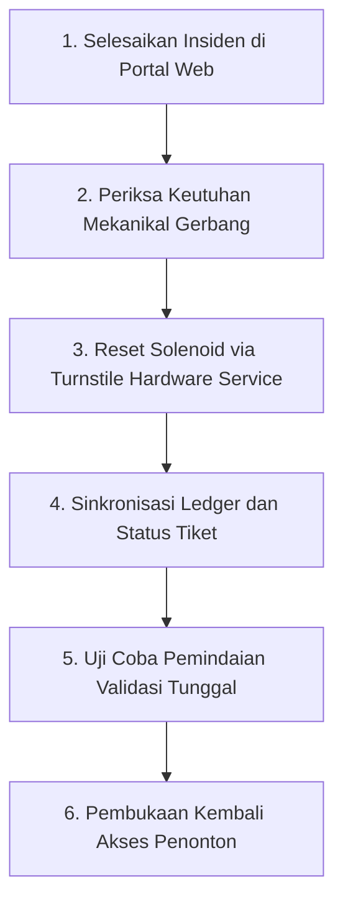

# Runbook Rekonversi Gerbang Normal Pasca-Evakuasi Darurat (Fase 117)

## 1. Tujuan & Ringkasan Prosedur

Runbook ini memandu operator keselamatan venue dalam memulihkan sistem gerbang turnstile fisik, sensor optical flow, dan basis data tiket dari mode darurat (`FAIL_SAFE_FREE` / `EMERGENCY_OPEN`) kembali ke mode operasional normal berbayar pasca-insiden kerumunan teratasi.

---

## 2. Prasyarat Pemulihan (Recovery Prerequisites)

Sebelum menjalankan rekonversi, operator komando wajib memverifikasi bahwa:
- [ ] Kepadatan seluruh sektor venue telah turun di bawah **2,0 orang/m²** (terkonfirmasi via sensor LiDAR).
- [ ] Seluruh korban cedera (jika ada) telah dievakuasi tuntas ke pos medis atau ambulans rumah sakit.
- [ ] Fisik lengan turnstile dan barikade tidak mengalami kerusakan struktural atau deformasi bengkok.
- [ ] Kepala Keamanan (`crowd_safety`) dan Manajer Venue (`venue_manager`) telah menandatangani persetujuan pemulihan di konsol web.

---

## 3. Langkah-Langkah Eksekusi Bertahap



### Langkah 1: Penyelesaian Insiden di Web UI
1. Masuk ke halaman **Manajemen Insiden Kerumunan** (`/venue/crowd/incidents`).
2. Temukan kode insiden aktif (misal `CRUSH-101-1-STAGE`).
3. Klik tombol **Selesaikan &rarr;**, isi formulir catatan investigasi petugas keselamatan.
4. Klik simpan untuk memicu transisi state machine ke status `RESOLVED`.

### Langkah 2: Reset Firmware & Solenoid Gerbang
Jalankan perintah kalibrasi hardware melalui konsol kontrol gerbang:
```bash
php artisan venue:reset-turnstiles --venue=VEN-ATLAS-01 --all-gates
```
Perintah ini akan:
- Memberikan daya listrik kembali ke koil solenoid elektromagnetik ($24\text{ VDC}$).
- Mengunci lengan pemutar gerbang satu arah ke mode ingress terkontrol.
- Mengaktifkan kembali sensor inframerah anti-passback.

### Langkah 3: Uji Coba Kredensial Sampel (Smoke Test)
1. Bawa satu tiket uji coba terdaftar ke Turnstile Alpha 01.
2. Tempelkan barcode atau hadapkan wajah terdaftar ke kamera Kios Face-ID.
3. Pastikan indikator lampu hijau menyala dan lengan turnstile mengizinkan tepat satu putaran $120^\circ$.
4. Pastikan pemindaian ulang kedua dalam waktu kurang dari 60 detik ditolak oleh sistem anti-passback.

### Langkah 4: Pemulihan Jaringan & Laporan CAPA
1. Operator menyusun dokumen CAPA (Corrective and Preventive Action) otomatis dari audit log insiden.
2. Ledger rekonsiliasi tiket dan kompensasi (jika ada tiket yang dibatalkan selama evakuasi) diposting ke akuntansi keuangan platform.
