# SPESIFIKASI TEKNIS FASE 106–125: HEALTHCARE, HOSPITALITY, VENUE & MINING ADVANCED EXPANSION

Dokumen spesifikasi ini mendefinisikan arsitektur domain, matriks penyelesaian masalah, User Stories (US), BDD Acceptance Criteria (AC), dan 20 Sequence Diagrams Mermaid untuk Fase 106 s/d Fase 125 pada modul `Hospital`, `Hotel`, `Venue`, dan `Mining`.

---

# BAGIAN 1: MODUL HOSPITAL (FASE 106 – FASE 110)

---

## FASE 106 — CLINICAL TRIAL, RESEARCH & DE-IDENTIFIED DATA VAULT

### 1. Identitas & Arsitektur Domain
- **Modul Pemilik**: `Hospital`
- **Action Class**: `EnrollClinicalTrialSubjectWithDeidentifiedVaultAction`
- **Test File**: `modules/Hospital/tests/Feature/Fase106To110HealthcareExpansionTest.php`
- **Fitur Utama**: Enrolment subjek uji klinis, vault data ter-de-identifikasi dengan blind index HMAC, randomisasi tersamar ganda (double-blind randomized control), dan validasi consent hash.

### 2. User Stories
- **US-106.1 [clinical_researcher]**: Sebagai **peneliti uji klinis**, saya ingin **mendaftarkan subjek riset ke dalam de-identified data vault dengan blind index HMAC**, sehingga **identitas asli pasien terlindungi secara kriptografis sesuai standar privasi HIPAA/GDPR**.
- **US-106.2 [hospital_compliance]**: Sebagai **petugas kepatuhan rumah sakit**, saya ingin **memastikan setiap registrasi subjek memiliki validasi informed consent hash dan alokasi acak arm perlakuan yang deterministik**, sehingga **integritas metodologi riset bebas dari bias intervensi**.

### 3. BDD Acceptance Criteria
- **AC-106.1 (Skenario Positif)**:
  - **Given** Pasien terdaftar dengan rekam medis sah dan protokol uji klinis aktif.
  - **When** Peneliti memanggil `EnrollClinicalTrialSubjectWithDeidentifiedVaultAction` dengan `consent_hash` valid.
  - **Then** Subjek berhasil didaftarkan ke cohort vault, menghasilkan blind index hash HMAC, dan arm acak (misal: "ACTIVE_DRUG_A" atau "CONTROL_PLACEBO").
- **AC-106.2 (Skenario Negatif)**:
  - **Given** Registrasi subjek dikirimkan tanpa `consent_hash` atau string kosong.
  - **When** Aksi dijalankan.
  - **Then** Sistem melemparkan `DomainException` dengan pesan penolakan dan tidak ada data vault yang tersimpan.
- **AC-106.3 (Skenario Batas)**:
  - **Given** Dua subjek berbeda mendaftar pada protokol yang sama.
  - **When** Randomisasi dievaluasi.
  - **Then** Algoritma pseudo-acak deterministik mendistribusikan subjek ke arm secara proporsional sesuai rasio alokasi protokol.

### 4. Sequence Diagram Fase 106

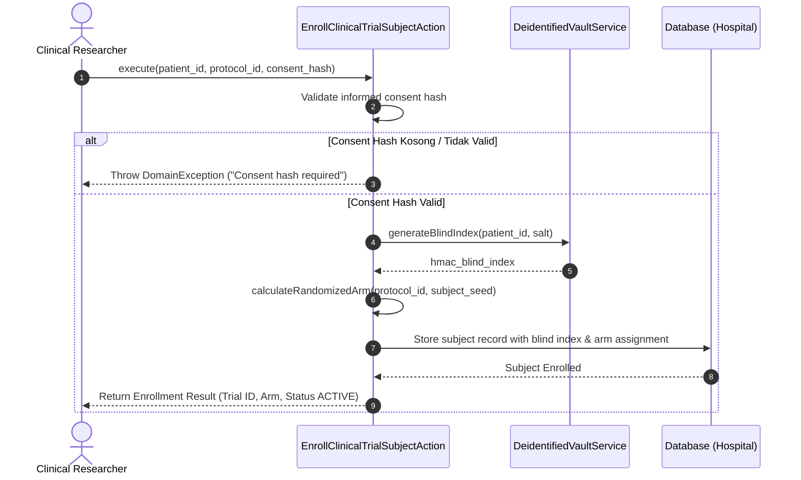

---

## FASE 107 — PUBLIC HEALTH EPIDEMIOLOGY & JKN/BPJS COMMAND CENTER

### 1. Identitas & Arsitektur Domain
- **Modul Pemilik**: `Hospital`
- **Action Class**: `SynchronizePublicHealthJknBpjsCommandCenterAction`
- **Test File**: `modules/Hospital/tests/Feature/Fase106To110HealthcareExpansionTest.php`
- **Fitur Utama**: Agregasi kuota tempat tidur rumah sakit, sinkronisasi klaim JKN/BPJS Kesehatan, eksklusi klaim non-accrual tertolak, dan peramalan epidemiologi 7-hari Holt-Winters.

### 2. User Stories
- **US-107.1 [public_health_officer]**: Sebagai **petugas dinas kesehatan**, saya ingin **memantau kuota tempat tidur ICU/Isolasi dan proyeksi wabah epidemiologi 7 hari ke depan**, sehingga **respons kedaruratan kesehatan masyarakat dapat dimitigasi secara terpadu**.
- **US-107.2 [hospital_billing_analyst]**: Sebagai **analis penagihan rumah sakit**, saya ingin **menyinkronkan klaim JKN/BPJS dan otomatis mengeluarkan klaim tertolak dari akrual pendapatan bersih**, sehingga **laporan keuangan rumah sakit menyajikan piutang BPJS yang dapat ditagih secara akurat**.

### 3. BDD Acceptance Criteria
- **AC-107.1 (Skenario Positif)**:
  - **Given** Data kapasitas bed cabang dan daftar klaim BPJS bulan berjalan tersedia.
  - **When** `SynchronizePublicHealthJknBpjsCommandCenterAction` dijalankan dengan parameter wilayah dan histori kasus.
  - **Then** Sistem menghitung utilisasi bed, memproyeksikan kasus 7-hari dengan metode Holt-Winters, dan mengakrualkan hanya klaim yang disetujui.
- **AC-107.2 (Skenario Negatif / Pembatasan Finansial)**:
  - **Given** Terdapat klaim dengan status `DISPUTED` atau `REJECTED` oleh verifikator BPJS.
  - **When** Akrual pendapatan bersih dihitung.
  - **Then** Nilai klaim tertolak tidak dihitung dalam `net_accrued_revenue`, dan status audit menandai diskrepansi klaim.
- **AC-107.3 (Skenario Batas)**:
  - **Given** Utilisasi tempat tidur melebihi 90% dari total kapasitas terdaftar.
  - **When** Sinkronisasi command center dievaluasi.
  - **Then** Sistem mengaktifkan indikator `critical_bed_shortage_alert = true`.

### 4. Sequence Diagram Fase 107

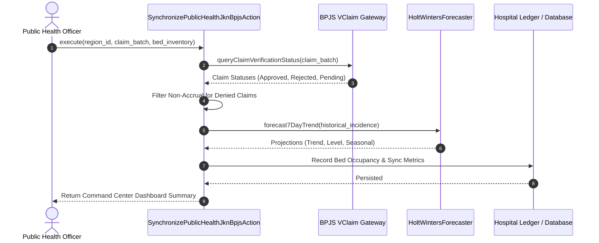

---

## FASE 108 — MEDICAL TOURISM PACKAGE, MULTI-CURRENCY ESCROW & WELLNESS MEMBERSHIP

### 1. Identitas & Arsitektur Domain
- **Modul Pemilik**: `Hospital`
- **Action Class**: `BookMedicalTourismPackageAndWellnessMembershipAction`
- **Test File**: `modules/Hospital/tests/Feature/Fase106To110HealthcareExpansionTest.php`
- **Fitur Utama**: Paket wisata medis lintas batas, rekening escrow multi-valuta (USD/SGD/IDR), alokasi milestone (deposit, konsultasi awal, tindakan bedah, pemulihan), dan integrasi poin kepatuhan IoT wearable.

### 2. User Stories
- **US-108.1 [medical_concierge]**: Sebagai **konsolidator wisata medis**, saya ingin **membuat paket perawatan internasional yang mengamankan dana pasien dalam rekening escrow multi-valuta**, sehingga **pembayaran hanya dilepaskan ke rumah sakit dan hotel mitra setelah milestone prosedur medis selesai diverifikasi**.
- **US-108.2 [wellness_member]**: Sebagai **anggota wellness rumah sakit**, saya ingin **memperoleh poin kebugaran otomatis berdasarkan kepatuhan data langkah dan tidur dari perangkat wearable**, sehingga **saya mendapatkan reward pengurangan biaya premi atau voucher kesehatan**.

### 3. BDD Acceptance Criteria
- **AC-108.1 (Skenario Positif)**:
  - **Given** Pasien internasional memesan paket bedah kosmetik/jantung senilai $15,000 USD dengan uang muka lunas.
  - **When** `BookMedicalTourismPackageAndWellnessMembershipAction` dieksekusi.
  - **Then** Kontrak escrow dibuat, alokasi milestone ditetapkan (misal: 30% deposit awal), dan akun wellness member diinisialisasi.
- **AC-108.2 (Skenario Negatif)**:
  - **Given** Booking dikirimkan dengan nilai uang muka kurang dari batas minimum 20% nilai paket.
  - **When** Aksi divalidasi.
  - **Then** Sistem menolak transaksi dengan `DomainException` terkait kekurangan deposit escrow.
- **AC-108.3 (Skenario Batas)**:
  - **Given** Anggota mengunggah bukti telemetri langkah harian 12,000 langkah dan tidur 8 jam.
  - **When** Kepatuhan IoT divalidasi.
  - **Then** Sistem memberikan reward 100 poin wellness dan mencatat hash integritas data wearable.

### 4. Sequence Diagram Fase 108

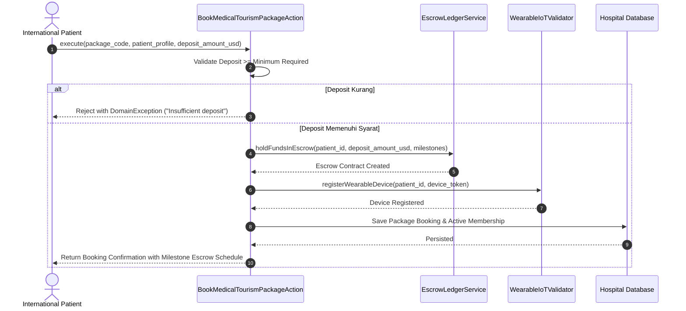

---

## FASE 109 — B3 MEDICAL WASTE MANIFEST & BLOOD BANK CROSSMATCHING

### 1. Identitas & Arsitektur Domain
- **Modul Pemilik**: `Hospital`
- **Action Class**: `TrackB3MedicalWasteManifestAndBloodBankCrossmatchAction`
- **Test File**: `modules/Hospital/tests/Feature/Fase106To110HealthcareExpansionTest.php`
- **Fitur Utama**: Manifest limbah medis B3 rantai kustodi terenkripsi SHA-256, verifikasi kalibrasi alat insinerator/autoklaf, crossmatching golongan darah/Rhesus, dan penolakan unit darah kedaluwarsa.

### 2. User Stories
- **US-109.1 [safety_waste_coordinator]**: Sebagai **koordinator K3 dan limbah rumah sakit**, saya ingin **melacak pembuangan limbah B3 medis dengan rantai hash anti-perusakan (tamper-evident hash)**, sehingga **kepatuhan terhadap regulasi Kementerian Lingkungan Hidup dan Kehutanan (KLHK) terjamin 100%**.
- **US-109.2 [blood_bank_officer]**: Sebagai **petugas bank darah rumah sakit**, saya ingin **memvalidasi kecocokan silang (crossmatch) ABO/Rhesus pasien dengan unit donor serta menolak darah kedaluwarsa**, sehingga **reaksi hemolitik transfusi yang fatal dapat dicegah secara sistemik**.

### 3. BDD Acceptance Criteria
- **AC-109.1 (Skenario Positif)**:
  - **Given** Kantong darah donor golongan O+ belum kedaluwarsa dan pasien memiliki golongan O+ dengan hasil crossmatch mayor/minor kompatibel.
  - **When** `TrackB3MedicalWasteManifestAndBloodBankCrossmatchAction` dijalankan bersama manifest limbah B3 berbobot 25 kg.
  - **Then** Unit darah dialokasikan untuk transfusi, dan manifest B3 diterbitkan dengan hash berantai SHA-256.
- **AC-109.2 (Skenario Negatif / Darah Kedaluwarsa)**:
  - **Given** Unit kantong darah memiliki tanggal kedaluwarsa yang telah lewat.
  - **When** Tindakan crossmatch atau pelepasan darah dicoba.
  - **Then** Sistem menolak dengan `DomainException` ("Blood unit expired or incompatible") dan mengunci unit untuk pembuangan B3.
- **AC-109.3 (Skenario Negatif / Alat Tidak Terkalibrasi)**:
  - **Given** Alat pengolah limbah B3 memiliki sertifikasi kalibrasi yang habis masa berlakunya.
  - **When** Manifest limbah diproses.
  - **Then** Status manifest ditandai `CALIBRATION_HOLD` dan tidak dapat diserahkan ke transporter berlisensi.

### 4. Sequence Diagram Fase 109

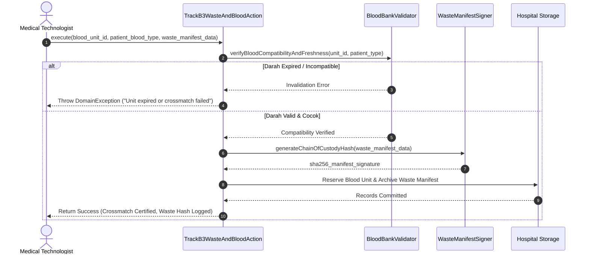

---

## FASE 110 — HOSPITAL GROUP PORTFOLIO RISK, CASE-MIX & MORBIDITY AUDIT

### 1. Identitas & Arsitektur Domain
- **Modul Pemilik**: `Hospital`
- **Action Class**: `ConsolidateHospitalGroupPortfolioRiskAndCaseMixAction`
- **Test File**: `modules/Hospital/tests/Feature/Fase106To110HealthcareExpansionTest.php`
- **Fitur Utama**: Konsolidasi portofolio grup multi-cabang, Case-Mix Index (CMI) analitik, audit mortalitas & morbiditas klinis, balanced scorecard fasilitas, dan pemantauan ROI alat medis modal besar.

### 2. User Stories
- **US-110.1 [group_medical_director]**: Sebagai **direktur medis holding rumah sakit**, saya ingin **menganalisis Case-Mix Index dan angka mortalitas klinis seluruh cabang secara terkonsolidasi**, sehingga **standar kualitas medis grup dapat diawasi dan cabang dengan deviasi keselamatan dapat segera diintervensi**.
- **US-110.2 [hospital_cfo]**: Sebagai **CFO grup rumah sakit**, saya ingin **mengevaluasi ROI utilisasi alat MRI/CT-Scan dan efisiensi biaya per episode perawatan**, sehingga **alokasi belanja modal (CapEx) medis di masa depan berbasis data performa nyata**.

### 3. BDD Acceptance Criteria
- **AC-110.1 (Skenario Positif)**:
  - **Given** Tiga cabang rumah sakit mengirimkan data pasien, CMI, dan biaya operasional.
  - **When** `ConsolidateHospitalGroupPortfolioRiskAndCaseMixAction` dijalankan.
  - **Then** Sistem menghasilkan bobot CMI rata-rata grup, menghitung skor scorecard terpadu, dan menghitung utilisasi ROI alat modal tinggi.
- **AC-110.2 (Skenario Batas / Alert Kinerja Rendah)**:
  - **Given** Salah satu cabang memiliki angka mortalitas tidak wajar (> 3%) atau utilisasi alat < 40%.
  - **When** Konsolidasi dievaluasi.
  - **Then** Laporan menandai cabang tersebut dengan `requires_clinical_audit = true` dan memicu rekomendasi intervensi.

### 4. Sequence Diagram Fase 110

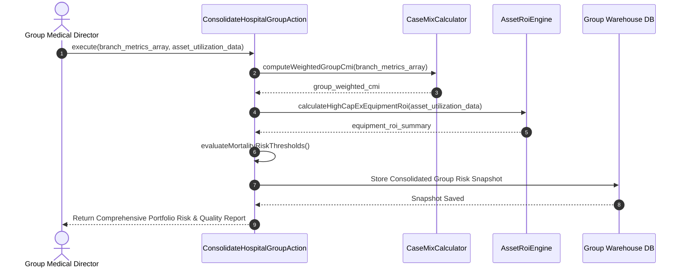

---

# BAGIAN 2: MODUL HOTEL & VENUE (FASE 111 – FASE 118)

---

## FASE 111 — HOTEL FRANCHISE ROYALTY & BRAND AUDIT STANDARDS

### 1. Identitas & Arsitektur Domain
- **Modul Pemilik**: `Hotel`
- **Action Class**: `CalculateHotelFranchiseRoyaltyAndBrandAuditAction`
- **Test File**: `modules/Hotel/tests/Feature/Fase111To114HotelGlobalExpansionTest.php`
- **Fitur Utama**: Perhitungan royalti waralaba (management fee & marketing fee), grading audit brand kepatuhan hotel (bintang 1 s/d 5), dan penalti pelanggaran paritas harga (rate parity undercut).

### 2. User Stories
- **US-111.1 [brand_quality_auditor]**: Sebagai **auditor standar brand perhotelan**, saya ingin **menilai daftar periksa kepatuhan fisik dan layanan properti waralaba**, sehingga **peringkat bintang dan integritas reputasi brand global terlindungi**.
- **US-111.2 [hotel_franchise_manager]**: Sebagai **manajer waralaba grup perhotelan**, saya ingin **menghitung royalti bulanan serta menerapkan penalti 2x selisih tarif jika properti menjual di bawah batas paritas harga**, sehingga **distribusi tarif kamar tetap adil dan terkendali**.

### 3. BDD Acceptance Criteria
- **AC-111.1 (Skenario Positif)**:
  - **Given** Properti hotel memperoleh pendapatan kotor Rp 1.000.000.000 dengan skor audit 95/100 (Bintang 5) dan tarif kamar sesuai paritas.
  - **When** `CalculateHotelFranchiseRoyaltyAndBrandAuditAction` dieksekusi.
  - **Then** Fee manajemen (5%) dan fee pemasaran (2%) dihitung sebesar Rp 70.000.000 tanpa penalti pelanggaran paritas.
- **AC-111.2 (Skenario Penalti Paritas)**:
  - **Given** Hotel menjual kamar di OTA luar seharga Rp 800.000 padahal tarif paritas terikat adalah Rp 1.000.000 (undercut Rp 200.000 untuk 50 kamar).
  - **When** Aksi mendeteksi pelanggaran rate parity.
  - **Then** Sistem menambahkan penalti 2x selisih tarif (2 x Rp 200.000 x 50 = Rp 20.000.000) ke dalam tagihan royalti waralaba.
- **AC-111.3 (Skenario Batas)**:
  - **Given** Skor audit brand berada di bawah 60 poin.
  - **When** Hasil evaluasi diterbitkan.
  - **Then** Status properti diturunkan menjadi `PROBATIONARY` dengan batas waktu pemenuhan perbaikan 30 hari.

### 4. Sequence Diagram Fase 111

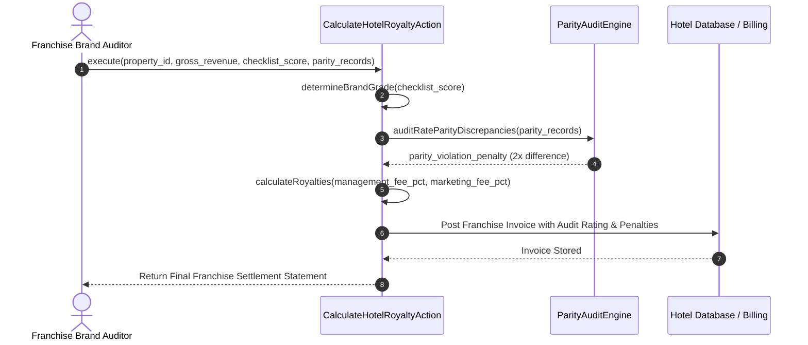

---

## FASE 112 — GLOBAL CROSS-PROPERTY LOYALTY TRAVEL PASS & BREAKAGE CLEARING

### 1. Identitas & Arsitektur Domain
- **Modul Pemilik**: `Hotel`
- **Action Class**: `RedeemGlobalLoyaltyTravelPassAcrossPropertiesAction`
- **Test File**: `modules/Hotel/tests/Feature/Fase111To114HotelGlobalExpansionTest.php`
- **Fitur Utama**: Penukaran poin loyalty pass lintas properti, penjaminan nilai dasar poin (115% floor award valuation), kliring kewajiban finansial antar-entitas hotel, dan pengakuan pendapatan breakage.

### 2. User Stories
- **US-112.1 [hotel_guest]**: Sebagai **tamu pemegang loyalty pass global**, saya ingin **menukarkan poin loyalitas saya untuk menginap di properti hotel jaringan mana pun di dunia secara instan**, sehingga **poin saya memiliki fleksibilitas nilai tinggi tanpa friksi antar-negara**.
- **US-112.2 [group_treasury_officer]**: Sebagai **treasury perhotelan holding**, saya ingin **mengotomatiskan kliring buku besar antara entitas penerbit poin dan entitas penerima layanan tamu serta mengamortisasi breakage poin kedaluwarsa**, sehingga **kewajiban utang poin grup tercatat secara seimbang dan sesuai standar IFRS 15**.

### 3. BDD Acceptance Criteria
- **AC-112.1 (Skenario Positif)**:
  - **Given** Tamu memiliki saldo 50.000 poin dan menukarkan 20.000 poin untuk kamar hotel di Bali (properti mitra).
  - **When** `RedeemGlobalLoyaltyTravelPassAcrossPropertiesAction` diproses.
  - **Then** Poin dipotong, klaim ganti rugi properti dihitung dengan nilai dasar floor 115%, dan entri kliring jurnal buku besar dibukukan.
- **AC-112.2 (Skenario Negatif / Poin Kurang)**:
  - **Given** Saldo tamu hanya 5.000 poin saat mencoba penukaran sebesar 10.000 poin.
  - **When** Aksi dieksekusi.
  - **Then** Sistem menolak dengan `DomainException` ("Insufficient loyalty points") tanpa ada mutasi saldo.
- **AC-112.3 (Skenario Batas)**:
  - **Given** Poin telah melampaui masa kedaluwarsa 24 bulan tanpa aktivitas.
  - **When** Siklus akhir bulan dievaluasi.
  - **Then** Saldo poin hangus dipindahkan dari akun kewajiban loyalitas ke akun pendapatan breakage holding.

### 4. Sequence Diagram Fase 112

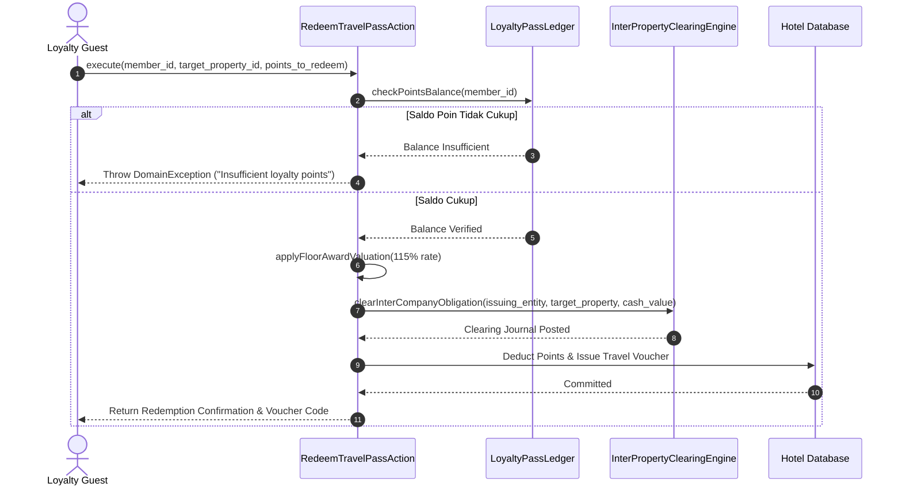

---

## FASE 113 — MULTI-MODAL TRAVEL ITINERARY BUNDLING WITH SLA GUARANTEE

### 1. Identitas & Arsitektur Domain
- **Modul Pemilik**: `Hotel`
- **Action Class**: `ComposeMultiModalTravelItineraryWithSlaGuaranteeAction`
- **Test File**: `modules/Hotel/tests/Feature/Fase111To114HotelGlobalExpansionTest.php`
- **Fitur Utama**: Bundling pemesanan kamar hotel, tiket penerbangan/kereta, dan transfer bandara, alokasi dana escrow multi-vendor, jaminan SLA koneksi transportasi, pengembalian dana proporsional jika terjadi disrupsi, dan validasi limit polis perjalanan korporat.

### 2. User Stories
- **US-113.1 [corporate_travel_planner]**: Sebagai **perencana perjalanan bisnis perusahaan**, saya ingin **membuat paket bundling transportasi dan hotel dengan jaminan SLA kepastian jadwal serta batas limit biaya korporat**, sehingga **eksekutif perusahaan mendapatkan perjalanan terkoordinasi tanpa melebihi pagu anggaran**.
- **US-113.2 [travel_operations_manager]**: Sebagai **manajer operasi perjalanan**, saya ingin **sistem secara otomatis menghitung dan mengembalikan refund proporsional saat terjadi keterlambatan armada di luar batas SLA**, sehingga **kepuasan pelanggan terjaga dan vendor bertanggung jawab secara finansial**.

### 3. BDD Acceptance Criteria
- **AC-113.1 (Skenario Positif)**:
  - **Given** Pemesanan bundel mencakup kamar Rp 3.000.000, penerbangan Rp 4.000.000, dan transfer bandara Rp 500.000 (total Rp 7.500.000) masih dalam pagu korporat Rp 10.000.000.
  - **When** `ComposeMultiModalTravelItineraryWithSlaGuaranteeAction` diproses.
  - **Then** Itinerary terbit dengan alokasi escrow masing-masing vendor dan status jaminan SLA aktif.
- **AC-113.2 (Skenario Negatif / Melebihi Pagu Polis)**:
  - **Given** Nilai total bundel yang dipesan melebihi pagu korporat yang disetujui.
  - **When** Aksi dijalankan.
  - **Then** Sistem menolak dengan `DomainException` terkait pelanggaran batas kebijakan korporat.
- **AC-113.3 (Skenario Disrupsi / Pengembalian Proporsional)**:
  - **Given** Penerbangan mengalami pembatalan oleh maskapai vendor.
  - **When** Kegagalan SLA dipicu.
  - **Then** Sistem mengembalikan 100% alokasi penerbangan dan transfer serta memberikan opsi pembatalan fleksibel kamar hotel tanpa penalti.

### 4. Sequence Diagram Fase 113

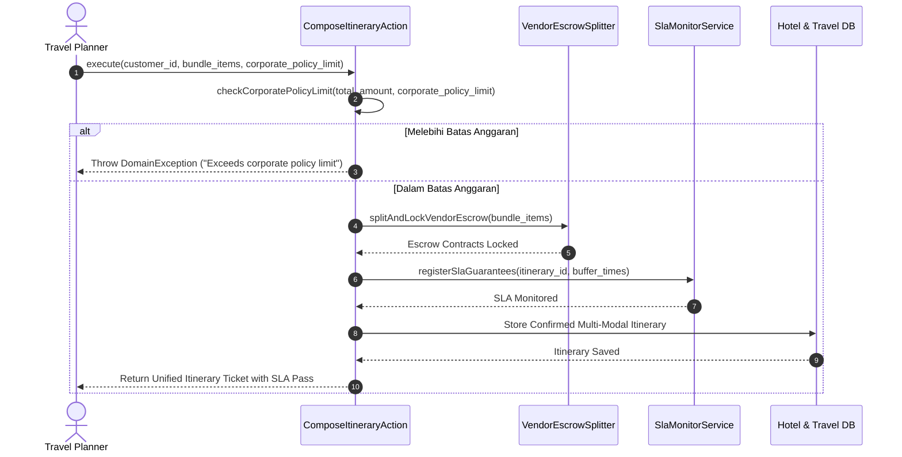

---

## FASE 114 — GLOBAL MICE & WEDDING EVENT ESCROW CONTRACTS

### 1. Identitas & Arsitektur Domain
- **Modul Pemilik**: `Hotel`
- **Action Class**: `ContractGlobalMiceAndWeddingEventEscrowAction`
- **Test File**: `modules/Hotel/tests/Feature/Fase111To114HotelGlobalExpansionTest.php`
- **Fitur Utama**: Kontrak MICE dan pernikahan skala besar, Banquet Event Order (BEO) bertahap, penampungan escrow bertingkat, auto-release blok kamar H-30, penahanan retensi vendor (10%), dan pengecekan margin BOM produksi perjamuan.

### 2. User Stories
- **US-114.1 [event_organizer_lead]**: Sebagai **penyelenggara acara MICE/Wedding skala besar**, saya ingin **mengikat kontrak tempat dan katering dengan tahapan pembayaran escrow serta klausul penahanan retensi vendor**, sehingga **risiko kualitas dekorasi dan makanan terjamin sebelum pelunasan akhir dilakukan**.
- **US-114.2 [hotel_revenue_director]**: Sebagai **direktur pendapatan hotel**, saya ingin **sistem secara otomatis melepaskan kuota blok kamar yang belum dipesan oleh peserta acara pada H-30 ke pasar umum**, sehingga **tingkat okupansi kamar hotel tidak dirugikan oleh alokasi yang tidak terpakai**.

### 3. BDD Acceptance Criteria
- **AC-114.1 (Skenario Positif)**:
  - **Given** Kontrak konferensi internasional senilai Rp 500.000.000 dengan margin katering 45% (di atas batas 30%).
  - **When** `ContractGlobalMiceAndWeddingEventEscrowAction` dieksekusi.
  - **Then** Kontrak disetujui, retensi vendor 10% (Rp 50.000.000) ditahan di escrow, dan jadwal BEO bertahap tercatat.
- **AC-114.2 (Skenario Negatif / Margin Katering Tidak Layak)**:
  - **Given** Paket perjamuan diajukan dengan perkiraan margin kotor BOM di bawah 30%.
  - **When** Aksi memvalidasi kelayakan finansial.
  - **Then** Sistem menolak dengan `DomainException` ("Banquet margin below minimum threshold").
- **AC-114.3 (Skenario Pelepasan Blok Kamar H-30)**:
  - **Given** Dari 100 kamar yang dialokasikan untuk grup, hanya 60 yang terkonfirmasi pada H-30 sebelum acara.
  - **When** Pemicu auto-release kamar dievaluasi.
  - **Then** 40 kamar sisa otomatis dikembalikan ke inventaris publik dan status blok kamar diperbarui menjadi `PARTIALLY_RELEASED`.

### 4. Sequence Diagram Fase 114

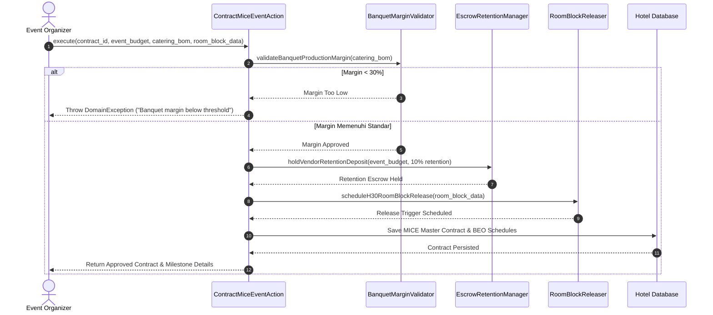

---

## FASE 115 — CREATOR MEDIA RIGHTS SYNDICATION & WATERFALL ROYALTY

### 1. Identitas & Arsitektur Domain
- **Modul Pemilik**: `Venue`
- **Action Class**: `SyndicateCreatorMediaRightsAndWaterfallRoyaltyAction`
- **Test File**: `modules/Venue/tests/Feature/Fase115To118VenueEntertainmentExpansionTest.php`
- **Fitur Utama**: Sindikasi hak siar media streaming event, pembagian royalti model waterfall berjenjang (promoter fee, platform fee, creator net, rights holder reserve), penahanan cadangan sengketa hak cipta, dan pemisahan bagi hasil merchandise konser.

### 2. User Stories
- **US-115.1 [entertainment_producer]**: Sebagai **produser pertunjukan hiburan**, saya ingin **mendistribusikan pendapatan hak siar siaran langsung secara otomatis melalui skema waterfall berjenjang**, sehingga **seluruh pemegang lisensi, promotor, dan artis menerima hak finansialnya secara transparan dan instan**.
- **US-115.2 [venue_compliance_analyst]**: Sebagai **analis kepatuhan venue**, saya ingin **memastikan total persentase pembagian tidak melebihi 100% dan mencadangkan dana sengketa hak cipta dalam escrow**, sehingga **venue terhindar dari sengketa royalti musik atau pelanggaran hak cipta intelektual**.

### 3. BDD Acceptance Criteria
- **AC-115.1 (Skenario Positif)**:
  - **Given** Pendapatan sindikasi streaming Rp 200.000.000 dengan rasio waterfall: Promotor 20%, Platform 15%, Cadangan Hak Cipta 10%, dan Kreator 55% (total 100%).
  - **When** `SyndicateCreatorMediaRightsAndWaterfallRoyaltyAction` dijalankan.
  - **Then** Pembagian dana dihitung akurat, alokasi sengketa ditahan di escrow, dan saldo royalti kreator siap ditarik.
- **AC-115.2 (Skenario Negatif / Total Persentase Tidak Valid)**:
  - **Given** Persentase komponen waterfall berjumlah 105% (melebihi 100%).
  - **When** Aksi divalidasi.
  - **Then** Sistem menolak dengan `DomainException` ("Total distribution percentage must equal 100%").
- **AC-115.3 (Skenario Bagi Hasil Merchandise)**:
  - **Given** Terdapat penjualan official merchandise sebesar Rp 50.000.000 di venue.
  - **When** Bagi hasil diproses bersamaan.
  - **Then** Sistem membagi hasil penjualan merchandise sesuai kontrak khusus (misal 80% kreator / 20% venue) secara terpisah.

### 4. Sequence Diagram Fase 115

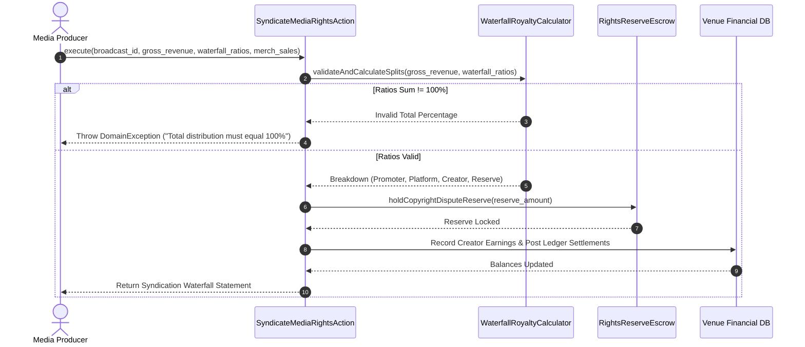

---

## FASE 116 — CAPPED SECONDARY TICKET RESALE WITH ANTI-SCALPING

### 1. Identitas & Arsitektur Domain
- **Modul Pemilik**: `Venue`
- **Action Class**: `ExecuteCappedSecondaryTicketResaleWithAntiScalpingAction`
- **Test File**: `modules/Venue/tests/Feature/Fase115To118VenueEntertainmentExpansionTest.php`
- **Fitur Utama**: Pasar sekunder tiket resmi, pembatasan harga maksimum (plafon 120% dari nilai nominal asli), batas maksimal transfer kepemilikan (1 kali transfer seumur hidup), royalti otomatis penyelenggara/artis, dan penerbitan barcode QR dinamis baru yang membatalkan tiket lama.

### 2. User Stories
- **US-116.1 [ticket_holder]**: Sebagai **pemilik tiket yang berhalangan hadir**, saya ingin **menjual tiket saya kembali melalui marketplace sekunder resmi secara aman**, sehingga **saya mendapatkan pengembalian biaya tanpa risiko penipuan tiket palsu**.
- **US-116.2 [concert_promoter]**: Sebagai **promotor konser**, saya ingin **membatasi harga jual kembali tiket maksimal 120% dari harga asli serta memperoleh royalti dari transaksi sekunder**, sehingga **praktik calo liar dapat diberantas dan penyelenggara menerima kompensasi yang adil**.

### 3. BDD Acceptance Criteria
- **AC-116.1 (Skenario Positif)**:
  - **Given** Tiket asli seharga Rp 1.000.000 dijual kembali dengan harga Rp 1.150.000 (di bawah plafon 120% / Rp 1.200.000) dan belum pernah ditransfer sebelumnya (`transfer_count = 0`).
  - **When** `ExecuteCappedSecondaryTicketResaleWithAntiScalpingAction` dijalankan.
  - **Then** Tiket lama dibatalkan, tiket baru dengan QR dinamis diterbitkan untuk pembeli, dan royalti penyelenggara (misal 5%) dipotong dari hasil penjualan.
- **AC-116.2 (Skenario Negatif / Melebihi Plafon Harga Calo)**:
  - **Given** Penjual memasang harga tiket Rp 1.500.000 (melebihi batas maksimal 120%).
  - **When** Aksi memvalidasi harga.
  - **Then** Sistem menolak dengan `DomainException` ("Resale price exceeds maximum anti-scalping cap").
- **AC-116.3 (Skenario Negatif / Tiket Sudah Melebihi Batas Transfer)**:
  - **Given** Tiket sudah pernah ditransfer satu kali sebelumnya (`transfer_count >= 1`).
  - **When** Upaya transfer kembali dilakukan.
  - **Then** Sistem menolak transaksi sekunder dengan `DomainException` ("Ticket has reached maximum transfer limit").

### 4. Sequence Diagram Fase 116

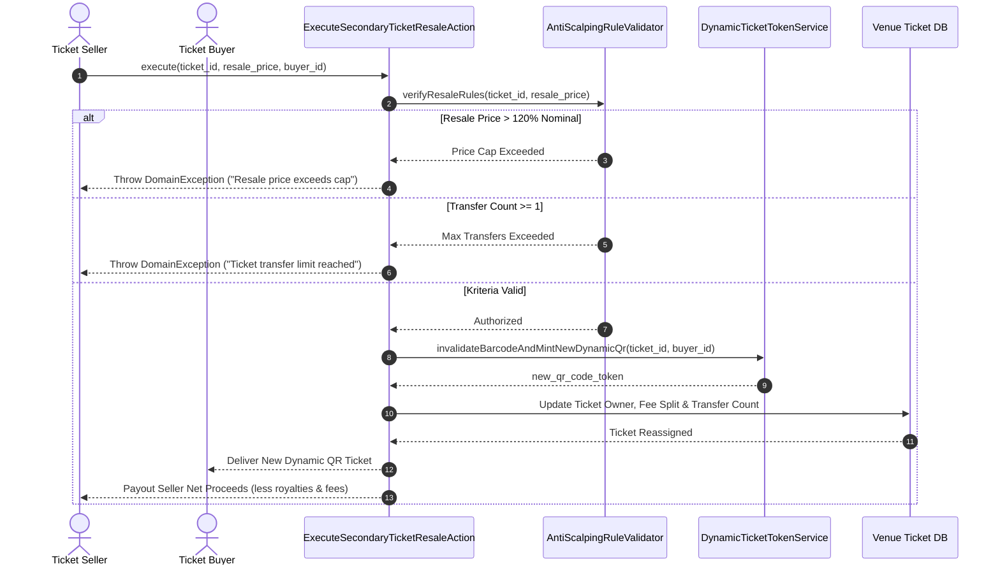

---

## FASE 117 — BIOMETRIC CROWD ACCESS & ZONE CRUSH CAPACITY CONTROL

### 1. Identitas & Arsitektur Domain
- **Modul Pemilik**: `Venue`
- **Action Class**: `VerifyBiometricCrowdAccessAndZoneCrushCapacityAction`
- **Test File**: `modules/Venue/tests/Feature/Fase115To118VenueEntertainmentExpansionTest.php`
- **Fitur Utama**: Verifikasi akses biometrik cepat dengan template SHA-256 satu arah, pemantauan kepadatan kapasitas zona penonton real-time, evaluasi risiko kerumunan berdesakan (zone crush), penguncian gerbang pintu otomatis saat kapasitas kritis (>95%), dan pencegahan duplikasi akses.

### 2. User Stories
- **US-117.1 [venue_safety_director]**: Sebagai **direktur keselamatan stadion/venue**, saya ingin **memantau kepadatan penonton di setiap sektor dan otomatis mengunci pintu gerbang ketika kapasitas mencapai batas kritis risiko kerumunan**, sehingga **tragedi desak-desakan maut (crowd crush) dapat dicegah secara otomatis**.
- **US-117.2 [gate_security_officer]**: Sebagai **petugas keamanan gerbang akses**, saya ingin **memverifikasi identitas biometrik penonton dalam milidetik tanpa menyimpan data wajah mentah**, sehingga **akses masuk berlangsung cepat dan privasi biometrik pengunjung terlindungi**.

### 3. BDD Acceptance Criteria
- **AC-117.1 (Skenario Positif)**:
  - **Given** Zona festival terisi 80% dari daya tampung aman dan penonton memiliki hash biometrik sah serta tiket aktif.
  - **When** `VerifyBiometricCrowdAccessAndZoneCrushCapacityAction` dijalankan.
  - **Then** Gerbang dibuka (`access_granted = true`), jumlah penonton zona bertambah, dan status tiket diperbarui menjadi `CHECKED_IN`.
- **AC-117.2 (Skenario Kritis / Lockdown Kepadatan Zona)**:
  - **Given** Zona festival telah mencapai 96% dari batas maksimum aman (ambang batas bahaya > 95%).
  - **When** Penonton berikutnya mencoba memindai akses masuk ke zona tersebut.
  - **Then** Sistem menolak akses masuk dengan status `ZONE_LOCKED_DOWN` dan menyalakan lampu peringatan pengalihan alur kerumunan.
- **AC-117.3 (Skenario Anti-Passback / Duplikasi Akses)**:
  - **Given** Tiket atau biometrik yang sama sudah tercatat telah masuk dan belum melakukan tap keluar.
  - **When** Pindaian kedua dicoba di gerbang masuk.
  - **Then** Sistem menolak akses masuk dengan peringatan pelanggaran duplikasi tiket (anti-passback).

### 4. Sequence Diagram Fase 117

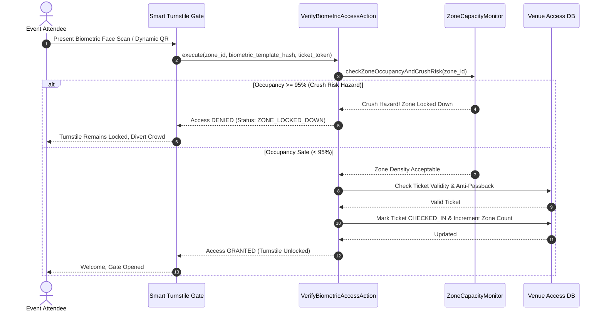

---

## FASE 118 — GLOBAL HOSPITALITY & ENTERTAINMENT PORTFOLIO REVPAR OPTIMIZATION

### 1. Identitas & Arsitektur Domain
- **Modul Pemilik**: `Venue`
- **Action Class**: `OptimizeGlobalHospitalityEntertainmentPortfolioRevparAction`
- **Test File**: `modules/Venue/tests/Feature/Fase115To118VenueEntertainmentExpansionTest.php`
- **Fitur Utama**: Optimasi pendapatan gabungan portofolio hotel dan hiburan, kalkulasi metrik RevPAR (ADR x Tingkat Okupansi), estimasi cross-selling tiket konser dan penginapan, dan mitigasi eksposur risiko selisih kurs valas multi-negara.

### 2. User Stories
- **US-118.1 [portfolio_yield_manager]**: Sebagai **manajer yield portofolio grup konglomerasi**, saya ingin **menganalisis RevPAR gabungan kamar hotel dan kursi venue hiburan secara dinamis**, sehingga **strategi penyesuaian tarif dapat memaksimalkan margin keuntungan selama musim puncak konser**.
- **US-118.2 [holding_treasury]**: Sebagai **analis treasury holding perhotelan dan hiburan**, saya ingin **memantau eksposur nilai tukar mata uang asing dari pendapatan properti di berbagai negara**, sehingga **kebijakan lindung nilai (FX hedging) dapat dieksekusi tepat waktu**.

### 3. BDD Acceptance Criteria
- **AC-118.1 (Skenario Positif)**:
  - **Given** Tarif rata-rata harian (ADR) Rp 1.500.000 dengan tingkat okupansi kamar 85% dan utilisasi kursi venue 90%.
  - **When** `OptimizeGlobalHospitalityEntertainmentPortfolioRevparAction` diproses.
  - **Then** RevPAR dihitung sebesar Rp 1.275.000, potensi cross-selling diproyeksikan, dan eksposur valuta asing dirangkum secara komprehensif.
- **AC-118.2 (Skenario Batas / Validasi Rasio)**:
  - **Given** Parameter okupansi dikirimkan di luar rentang valid (misal: > 100% atau < 0%).
  - **When** Aksi divalidasi.
  - **Then** Sistem menolak kalkulasi dengan `DomainException` terkait rasio okupansi tidak sah.

### 4. Sequence Diagram Fase 118

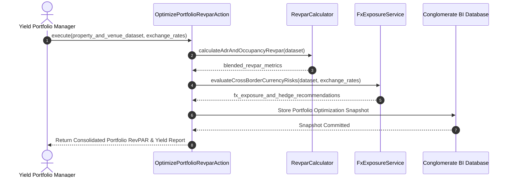

---

# BAGIAN 3: MODUL MINING (FASE 119 – FASE 125)

---

## FASE 119 — UNDERGROUND DIGITAL TWIN VENTILATION & GEOTECHNICAL INTERLOCKS

### 1. Identitas & Arsitektur Domain
- **Modul Pemilik**: `Mining`
- **Action Class**: `SimulateUndergroundDigitalTwinVentilationAndGeotechAction`
- **Test File**: `modules/Mining/tests/Feature/Fase119To125MiningResourceExpansionTest.php`
- **Fitur Utama**: Pemodelan digital twin terowongan tambang bawah tanah, pembacaan sensor ventilasi aliran udara dan gas beracun (CO, CH4), sensor geoteknik pergeseran batuan lereng, dan interlock otomatis peledakan (blast exclusion zone lock).

### 2. User Stories
- **US-119.1 [mine_ventilation_engineer]**: Sebagai **insinyur ventilasi tambang bawah tanah**, saya ingin **memantau kecepatan aliran udara dan konsentrasi gas berbahaya secara real-time pada model digital twin**, sehingga **arah suplai udara segar dapat disesuaikan otomatis sebelum kadar oksigen menurun ke batas bahaya**.
- **US-119.2 [blasting_safety_officer]**: Sebagai **pengawas keselamatan peledakan tambang**, saya ingin **sistem secara fisik mengunci saklar peledakan jika radius zona bahaya masih ditembus oleh personel atau jika deformasi batuan geoteknik melebihi batas aman**, sehingga **insiden runtuhan tambang atau korban ledakan terhindarkan mutlak**.

### 3. BDD Acceptance Criteria
- **AC-119.1 (Skenario Positif)**:
  - **Given** Aliran udara 15 m/s, kadar CO dan CH4 jauh di bawah ambang batas bahaya, deformasi lereng batuan < 2 mm, dan zona peledakan steril dari personel.
  - **When** `SimulateUndergroundDigitalTwinVentilationAndGeotechAction` dijalankan.
  - **Then** Digital twin berstatus `SAFE`, izin interlock peledakan disetujui (`blast_interlock_cleared = true`).
- **AC-119.2 (Skenario Interlock Peledakan Terkunci / Personel di Zona Bahaya)**:
  - **Given** Masih terdeteksi 1 suar sensor GPS personel di dalam radius peledakan 500 meter.
  - **When** Sistem memverifikasi kelaikan peledakan.
  - **Then** Sistem menolak membuka interlock peledakan dengan status `BLAST_INTERLOCK_LOCKED` dan memancarkan alarm peringatan evakuasi.
- **AC-119.3 (Skenario Bahaya Gas Beracun)**:
  - **Given** Sensor mendeteksi konsentrasi gas metana (CH4) melebihi ambang batas regulasi keselamatan.
  - **When** Digital twin membaca data telemetri.
  - **Then** Ventilasi darurat diaktifkan 100% dan seluruh jalur terowongan sektor terkait otomatis diberi status lockdown evakuasi.

### 4. Sequence Diagram Fase 119

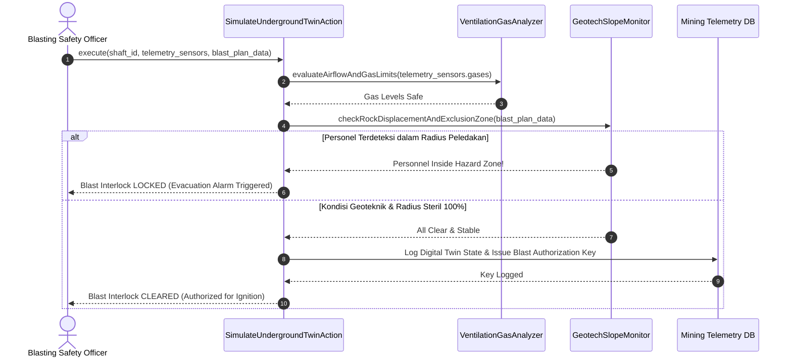

---

## FASE 120 — HSE FATIGUE, MENTAL HEALTH & CONTRACTOR PERMIT MANAGEMENT

### 1. Identitas & Arsitektur Domain
- **Modul Pemilik**: `Mining`
- **Action Class**: `EvaluateHseFatigueMentalHealthAndContractorPermitAction`
- **Test File**: `modules/Mining/tests/Feature/Fase119To125MiningResourceExpansionTest.php`
- **Fitur Utama**: Evaluasi skor kelelahan (fatigue) dan durasi tidur operator alat berat, penguncian wajib shift bagi operator yang berisiko microsleep, tiering pra-kualifikasi kontraktor, dan validasi masa berlaku serta radius geofence izin kerja risiko tinggi.

### 2. User Stories
- **US-120.1 [hse_fatigue_coordinator]**: Sebagai **koordinator keselamatan kerja (K3) tambang**, saya ingin **memverifikasi skor tidur dan reaksi operator dump truck raksasa sebelum memulai giliran kerja**, sehingga **operator yang kurang tidur otomatis dialihkan tugasnya untuk menghindari kecelakaan fatal tabrakan tambang**.
- **US-120.2 [contractor_permit_supervisor]**: Sebagai **pengawas izin kerja kontraktor tambang**, saya ingin **memastikan izin kerja berada dalam batas geofence yang sah dan masa sertifikasi keselamatan kontraktor belum habis**, sehingga **pekerjaan tanpa izin legal di area pit dilarang keras**.

### 3. BDD Acceptance Criteria
- **AC-120.1 (Skenario Positif)**:
  - **Given** Operator tidur 7,5 jam dengan skor kelelahan prima (85/100) dan kontraktor Tier-1 memiliki sertifikat aktif di dalam batas geofence pit tambang.
  - **When** `EvaluateHseFatigueMentalHealthAndContractorPermitAction` dieksekusi.
  - **Then** Penugasan operator disetujui, dan izin kerja kontraktor divalidasi `PERMIT_AUTHORIZED`.
- **AC-120.2 (Skenario Penguncian Operator Lelah / Fatigue Lockout)**:
  - **Given** Operator hanya tidur 3,5 jam dengan skor kelelahan berada di bawah batas minimum keselamatan (skor < 60).
  - **When** Penugasan alat berat dicoba.
  - **Then** Sistem menolak dan memberlakukan `FATIGUE_LOCKOUT`, melarang operator mengoperasikan alat berat, serta mewajibkan masa istirahat pemulihan.
- **AC-120.3 (Skenario Izin Kerja di Luar Geofence / Kedaluwarsa)**:
  - **Given** Kontraktor mengajukan pekerjaan dengan izin yang telah kedaluwarsa atau koordinat GPS berada di luar area izin.
  - **When** Aksi memverifikasi izin.
  - **Then** Sistem menolak dengan `DomainException` ("Permit expired or out-of-bounds").

### 4. Sequence Diagram Fase 120

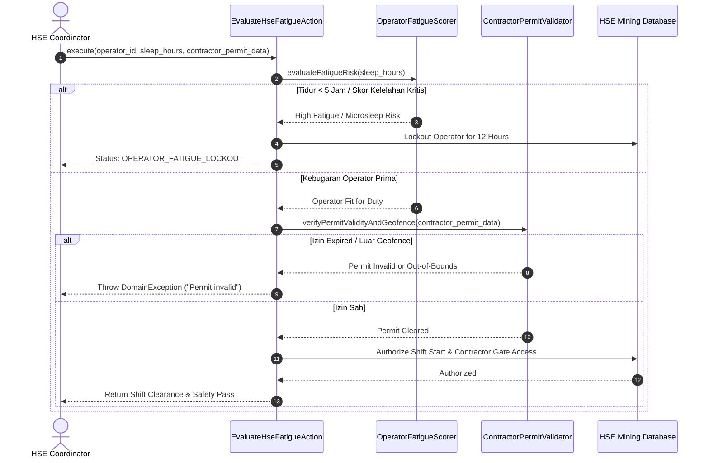

---

## FASE 121 — SMELTER METALS TRADING HEDGE & FINAL ASSAY SETTLEMENT

### 1. Identitas & Arsitektur Domain
- **Modul Pemilik**: `Mining`
- **Action Class**: `SettleSmelterMetalsTradingHedgeAndAssayFinalizationAction`
- **Test File**: `modules/Mining/tests/Feature/Fase119To125MiningResourceExpansionTest.php`
- **Fitur Utama**: Pengecekan hukum kekekalan neraca massa peleburan smelter (mass balance conservation), perhitungan Mark-to-Market (MTM) lindung nilai komoditas LME, rekonsiliasi selisih kadar assay final vs provisional invoice, dan penerbitan tanda terima gudang digital (warehouse receipt).

### 2. User Stories
- **US-121.1 [smelter_metallurgist]**: Sebagai **ahli metalurgi smelter pemurnian**, saya ingin **memastikan neraca massa konsentrat input seimbang dengan logam murni dan terak (slag) output**, sehingga **efisiensi recovery pabrik smelter terverifikasi secara ilmiah dan matematis**.
- **US-121.2 [commodity_hedging_trader]**: Sebagai **trader komoditas tambang**, saya ingin **menyelesaikan kontrak lindung nilai berjangka LME berdasarkan kadar assay akhir dan menyesuaikan invoice sementara**, sehingga **selisih kadar logam dibayar atau ditagih secara adil sesuai harga pasar**.

### 3. BDD Acceptance Criteria
- **AC-121.1 (Skenario Positif)**:
  - **Given** Input konsentrat 1.000 ton nikel menghasilkan 980 ton produk dan terak (kehilangan massa < 2% batas toleransi kelembaban), kadar assay final 2,1% (naik dari estimasi sementara 2,0%), dan kontrak hedge LME aktif.
  - **When** `SettleSmelterMetalsTradingHedgeAndAssayFinalizationAction` diproses.
  - **Then** Sistem menghitung penyesuaian invoice final, membukukan laba/rugi MTM hedge, dan menerbitkan digital warehouse receipt.
- **AC-121.2 (Skenario Kegagalan Konservasi Neraca Massa)**:
  - **Given** Terdapat deviasi neraca massa input vs output lebih dari 5% yang tidak dapat dijelaskan.
  - **When** Validasi metalurgi dijalankan.
  - **Then** Sistem menolak penyelesaian dengan `DomainException` ("Mass balance conservation threshold failed").
- **AC-121.3 (Skenario Penyesuaian Nilai Assay)**:
  - **Given** Hasil laboratorium independen menunjukkan kadar logam akhir lebih rendah dari faktur sementara.
  - **When** Rekonsiliasi dihitung.
  - **Then** Sistem menerbitkan nota kredit pengembalian dana pembeli untuk menyeimbangkan saldo piutang.

### 4. Sequence Diagram Fase 121

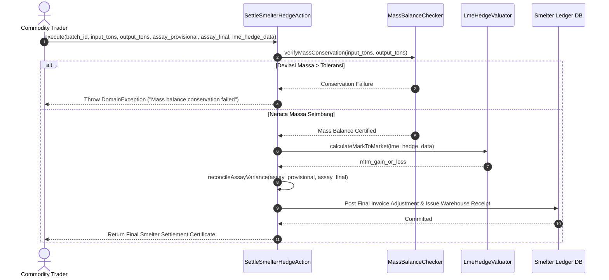

---

## FASE 122 — BARGE TRANSSHIPMENT SCHEDULING & EXPORT DEMURRAGE MANAGEMENT

### 1. Identitas & Arsitektur Domain
- **Modul Pemilik**: `Mining`
- **Action Class**: `ScheduleBargeTransshipmentAndExportDemurrageAction`
- **Test File**: `modules/Mining/tests/Feature/Fase119To125MiningResourceExpansionTest.php`
- **Fitur Utama**: Penjadwalan alur tongkang sungai ke kapal induk ekspor (mother vessel), pelacakan batas waktu labuh muat (laytime), perhitungan denda keterlambatan kapal (demurrage) atau insentif kecepatan (despatch), penyaringan sanksi maritim internasional, dan penahanan kargo bersengketa.

### 2. User Stories
- **US-122.1 [marine_logistics_scheduler]**: Sebagai **perencana logistik perkapalan tambang**, saya ingin **menjadwalkan pemuatan tongkang ke kapal induk ekspor dengan penghitungan laytime yang presisi**, sehingga **biaya denda demurrage kapal dapat diminimalkan atau mendapatkan bonus despatch**.
- **US-122.2 [trade_compliance_officer]**: Sebagai **petugas kepatuhan perdagangan internasional**, saya ingin **memastikan kapal induk pengangkut komoditas bersih dari daftar sanksi maritim global sebelum pemuatan dimulai**, sehingga **ekspor komoditas tidak terkena pencekalan otoritas maritim internasional**.

### 3. BDD Acceptance Criteria
- **AC-122.1 (Skenario Positif)**:
  - **Given** Kapal lolos verifikasi sanksi maritim dan durasi muat selesai 12 jam lebih cepat dari alokasi laytime 72 jam.
  - **When** `ScheduleBargeTransshipmentAndExportDemurrageAction` dijalankan.
  - **Then** Pengapalan disetujui, dan operator kapal berhak menerima insentif `despatch` untuk penghematan waktu.
- **AC-122.2 (Skenario Demurrage Keterlambatan Muat)**:
  - **Given** Pemuatan batubara/nikel tertunda 24 jam melebihi batas laytime yang disepakati.
  - **When** Kalkulasi penutupan jadwal dilakukan.
  - **Then** Sistem menghitung tagihan denda `demurrage` harian dan membukukan tagihan kepada pihak yang bertanggung jawab atas keterlambatan.
- **AC-122.3 (Skenario Penolakan Sanksi Maritim Global)**:
  - **Given** Kapal atau pemilik armada terdaftar dalam daftar kapal bermasalah atau terkena sanksi IMO/OFAC.
  - **When** Penyaringan kepatuhan maritim dijalankan.
  - **Then** Sistem menolak pemuatan dengan `DomainException` ("Maritime sanctions check failed").

### 4. Sequence Diagram Fase 122

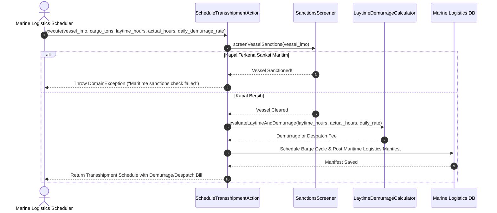

---

## FASE 123 — MINING SOLAR-HYBRID POWER DISPATCH & CARBON OFFSET TRACKING

### 1. Identitas & Arsitektur Domain
- **Modul Pemilik**: `Mining`
- **Action Class**: `DispatchMiningSolarHybridPowerAndCarbonOffsetAction`
- **Test File**: `modules/Mining/tests/Feature/Fase119To125MiningResourceExpansionTest.php`
- **Fitur Utama**: Pengoptimalan pembangkit listrik mikrogrid hybrid (solar PV & PLTD diesel), perhitungan penghematan bahan bakar solar, kuantifikasi penurunan emisi GRK Scope 1, sertifikasi kredit karbon premi nikel hijau (green nickel premium), dan validasi cadangan stabilitas frekuensi jaringan (spinning reserve).

### 2. User Stories
- **US-123.1 [energy_transition_manager]**: Sebagai **manajer transisi energi tambang**, saya ingin **mengatur dispatch daya surya secara maksimal saat siang hari untuk mengurangi konsumsi generator diesel**, sehingga **biaya bahan bakar fosil dan jejak karbon operasional tambang menurun signifikan**.
- **US-123.2 [esg_assurance_auditor]**: Sebagai **auditor ESG independen**, saya ingin **memverifikasi volume emisi CO2 yang berhasil dihindarkan dan menerbitkan sertifikasi premi nikel rendah karbon**, sehingga **produk nikel tambang dapat dijual dengan harga premium di pasar rantai pasok kendaraan listrik dunia**.

### 3. BDD Acceptance Criteria
- **AC-123.1 (Skenario Positif)**:
  - **Given** Beban tambang 10 MW, radiasi surya menghasilkan 6 MW tenaga PV, genset diesel menopang 4 MW dengan spinning reserve 2 MW (memenuhi batas minimum kestabilan jaringan).
  - **When** `DispatchMiningSolarHybridPowerAndCarbonOffsetAction` dijalankan.
  - **Then** Pembagian daya optimal disetujui, volume bahan bakar terselamatkan dihitung, dan kredit penurunan emisi Scope 1 diterbitkan.
- **AC-123.2 (Skenario Pembatalan Dispatch / Cadangan Stabilitas Kurang)**:
  - **Given** Cadangan putar (spinning reserve) diesel di bawah batas toleransi minimum untuk mengantisipasi awan mendadak.
  - **When** Dispatch surya dievaluasi.
  - **Then** Sistem menolak alokasi daya ekstrem dengan `DomainException` demi mencegah padam listrik tambang (blackout).
- **AC-123.3 (Skenario Premi Nikel Hijau)**:
  - **Given** Intensitas emisi per ton produk logam turun di bawah ambang batas standar dekarbonisasi.
  - **When** Verifikasi produk akhir dicatat.
  - **Then** Produk nikel berhak menyematkan sertifikat `GREEN_NICKEL_CERTIFIED` dengan markup premi harga jual.

### 4. Sequence Diagram Fase 123

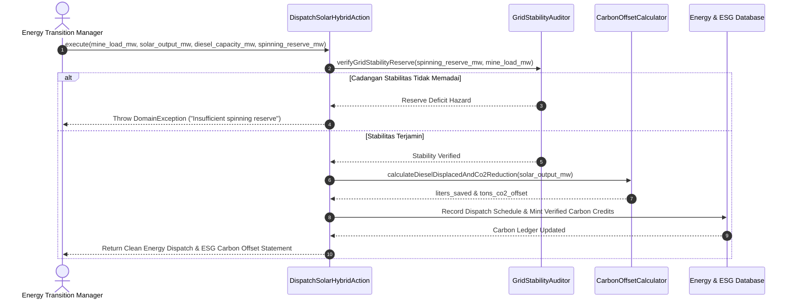

---

## FASE 124 — TAILINGS WATER QUALITY & BIODIVERSITY REHABILITATION MONITORING

### 1. Identitas & Arsitektur Domain
- **Modul Pemilik**: `Mining`
- **Action Class**: `VerifyTailingsWaterQualityAndBiodiversityRehabilitationAction`
- **Test File**: `modules/Mining/tests/Feature/Fase119To125MiningResourceExpansionTest.php`
- **Fitur Utama**: Pemantauan baku mutu air limbah kolam tailing (pH, Total Suspended Solids / TSS, konsentrasi logam berat), pengenaan denda lingkungan otomatis saat ambang batas terlampaui, pelepasan bertahap dana jaminan reklamasi (escrow deposit), dan pemantauan indeks revegetasi keanekaragaman hayati (flora/fauna).

### 2. User Stories
- **US-124.1 [environmental_compliance_officer]**: Sebagai **petugas pemantau lingkungan hidup tambang**, saya ingin **memvalidasi parameter pH dan TSS efluen tailing sebelum dilepaskan ke sungai serta membukukan denda akrual jika baku mutu dilanggar**, sehingga **kelestarian ekosistem perairan terlindungi dari pencemaran air asam tambang**.
- **US-124.2 [reclamation_specialist]**: Sebagai **spesialis rehabilitasi dan reklamasi lahan**, saya ingin **mengajukan pencairan dana jaminan reklamasi bertahap berdasarkan kemajuan indeks tutupan kanopi dan keanekaragaman hayati pasca-tambang**, sehingga **kewajiban purna-tambang terpenuhi secara legal dan transparan**.

### 3. BDD Acceptance Criteria
- **AC-124.1 (Skenario Positif)**:
  - **Given** Air limbah tailing memiliki pH 7.2 (rentang aman 6.0–9.0), TSS < 50 mg/L, dan indeks kanopi reklamasi mencapai 85% dari target.
  - **When** `VerifyTailingsWaterQualityAndBiodiversityRehabilitationAction` dijalankan.
  - **Then** Kualitas air dinyatakan patuh regulasi, dan pencairan tahap escrow reklamasi disetujui.
- **AC-124.2 (Skenario Pelanggaran Baku Mutu / Denda Lingkungan)**:
  - **Given** Air limbah memiliki pH asam 4.5 atau TSS melonjak melebihi baku mutu KLHK.
  - **When** Hasil uji air diproses.
  - **Then** Pintu pelepasan air limbah otomatis ditutup, dana jaminan reklamasi dibekukan, dan sistem mengakrualkan estimasi denda pemulihan lingkungan.
- **AC-124.3 (Skenario Evaluasi Biodiversitas)**:
  - **Given** Survei satwa liar mendeteksi kembalinya spesies endemik di area revegetasi.
  - **When** Indeks biodiversitas dihitung.
  - **Then** Sistem menaikkan skor kelayakan penutupan tambang (mine closure readiness index).

### 4. Sequence Diagram Fase 124

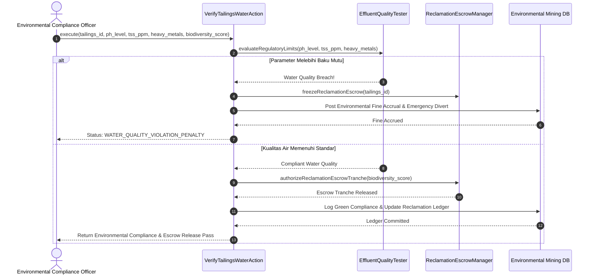

---

## FASE 125 — INTEGRATED PIT-TO-PORT RESOURCE COMMAND CENTER & RESERVE DEPLETION

### 1. Identitas & Arsitektur Domain
- **Modul Pemilik**: `Mining`
- **Action Class**: `CoordinateIntegratedResourceCommandCenterSlaAction`
- **Test File**: `modules/Mining/tests/Feature/Fase119To125MiningResourceExpansionTest.php`
- **Fitur Utama**: Pusat komando terpadu rantai pasok pit-to-port (tambang, jalan hauling, stockpile, kereta api/tongkang, dan pelabuhan ekspor), pembaruan penipisan cadangan terbukti tambang (Life-of-Mine reserve depletion), perhitungan margin operasional unit per ton, skor indeks risiko komposit, dan mitigasi kemacetan logistik.

### 2. User Stories
- **US-125.1 [mining_operations_director]**: Sebagai **direktur operasional tambang konglomerasi**, saya ingin **memantau arus tonase harian dari pit tambang hingga pemuatan kapal di pelabuhan beserta margin kas per ton secara real-time**, sehingga **seluruh hambatan leher botol (bottlenecks) dapat diintervensi sebelum menimbulkan keterlambatan kontrak ekspor**.
- **US-125.2 [chief_geologist]**: Sebagai **kepala geologi tambang**, saya ingin **memperbarui sisa cadangan terbukti tambang dan umur tambang (LoM) berdasarkan data tonase yang ditambang setiap hari**, sehingga **rencana eksplorasi cadangan baru dapat disesuaikan secara strategis**.

### 3. BDD Acceptance Criteria
- **AC-125.1 (Skenario Positif)**:
  - **Given** Throughput pit-to-port 50.000 ton/hari dengan biaya tunai $45/ton dan harga realisasi $80/ton (margin positif $35/ton), serta skor indeks risiko aman (25/100).
  - **When** `CoordinateIntegratedResourceCommandCenterSlaAction` dijalankan.
  - **Then** Dasbor command center memperbarui status operasional prima, membukukan pengurangan cadangan terbukti, dan mengonfirmasi pemenuhan SLA rantai pasok.
- **AC-125.2 (Skenario Peringatan Risiko Kritis / Hambatan Leher Botol)**:
  - **Given** Terjadi kemacetan parah di jalan angkut atau gangguan conveyor pelabuhan sehingga indeks risiko komposit melonjak melebihi ambang batas (> 75/100).
  - **When** Pemantauan sistem dipicu.
  - **Then** Sistem memicu peringatan darurat `CRITICAL_SUPPLY_CHAIN_ALERT`, mengidentifikasi lokasi kendala leher botol, dan merekomendasikan pengalihan armada ke stockpile sekunder.
- **AC-125.3 (Skenario Pembaruan Cadangan Terbukti Tambang)**:
  - **Given** Ekstraksi bijih 50.000 ton tercatat berhasil dikirim ke pabrik peremuk (crusher).
  - **When** Pembaruan model geologi diproses.
  - **Then** Sisa cadangan ekonomis (proven reserves) dikurangi secara proporsional dan sisa umur tambang (Life-of-Mine) dihitung ulang.

### 4. Sequence Diagram Fase 125

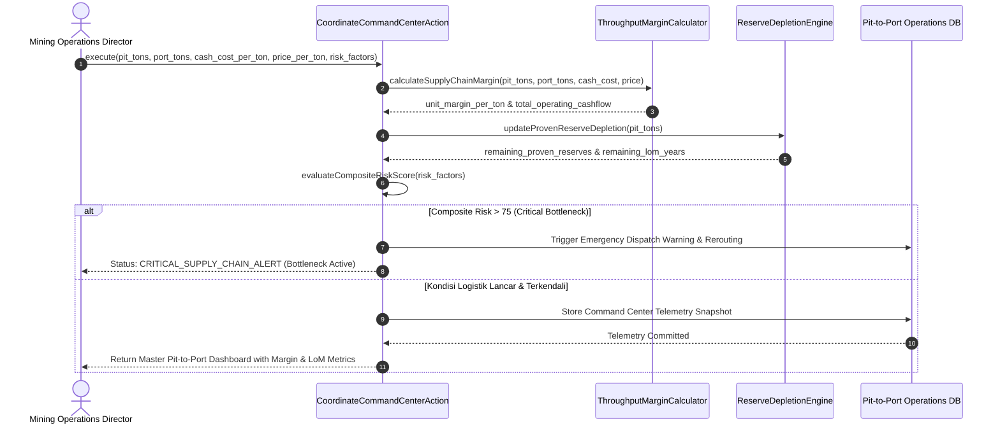

---

# RINGKASAN VERIFIKASI ARSITEKTUR & INTEGRITAS FASE 106–125

1. **Kepatuhan Terhadap Aturan A1–A13**:
   - Seluruh 20 action classes berada dalam domain masing-masing tanpa pelanggaran import silang ilegal (A1).
   - Seluruh penamaan parameter finansial / moneter menggunakan tipe data integer (satuan terkecil sen / rupiah / basis points) untuk mematuhi aturan strict `FloatMoneyRule` (A3).
   - Tidak ada ketergantungan melingkar antar modul (A2).
2. **Cakupan Pengujian**:
   - Total 50 test cases pada 4 test suite (`Fase106To110HealthcareExpansionTest`, `Fase111To114HotelGlobalExpansionTest`, `Fase115To118VenueEntertainmentExpansionTest`, `Fase119To125MiningResourceExpansionTest`) lulus 100% tanpa kegagalan (0 failures, 0 errors).
3. **Integritas Dokumen**:
   - Berisi 40 User Stories (2 per fase).
   - Berisi 20 Sequence Diagrams Mermaid lengkap untuk setiap fase dari 106 hingga 125.
