# SPESIFIKASI TEKNIS FASE 126–150: ENERGI, TELEKOMUNIKASI, MEDIA, EDUKASI, RITEL & INTEGRASI 17 LINI MONOLITH

Dokumen spesifikasi ini mendefinisikan arsitektur teknis, kontrak domain, User Stories (US), BDD Acceptance Criteria (AC), dan 25 Sequence Diagram Mermaid untuk Fase 126 s/d Fase 150 pada modul `Egy`, `Tlx`, `Med`, `Edu`, `Ret`, dan `Core` (Integrasi 17 Lini Konglomerasi).

---

# BAGIAN 1: ENERGI & UTILITAS (MODUL EGY — FASE 126 – FASE 129)

---

## FASE 126 — ENERGI & UTILITAS: GENCO, GRID & SMART METERING (LINI 13)

### 1. Identitas & Arsitektur Domain
- **Modul Pemilik**: `Egy`
- **Action Class**: `BalanceGencoDispatchAnd15MinSmartMeterSettlementAction`
- **Test File**: `modules/Egy/tests/Feature/Fase126To129EnergyUtilitiesExpansionTest.php`
- **Fitur Utama**: Merit order unit commitment grid dispatch, smart metering 15-menit TOU billing, solar net-metering feed-in credit, dan rekonsiliasi neraca daya.

### 2. User Stories
- **US-126.1 [grid_operator]**: Sebagai **operator grid daya**, saya ingin **menyeimbangkan komitmen unit pembangkit (merit order dispatch)**, sehingga **kebutuhan beban terpenuhi secara efisien tanpa melampaui kapasitas terpasang aset**.
- **US-126.2 [genco_trader]**: Sebagai **trader daya genco**, saya ingin **mengkalkulasi tagihan smart meter TOU 15-menit dengan kredit feed-in solar surplus**, sehingga **pendapatan listrik dan neraca energi tercatat presisi di buku besar**.

### 3. BDD Acceptance Criteria
- **AC-126.1 (Skenario Positif)**:
  - **Given** Kebutuhan daya beban 5,000 kW dan aset pembangkit solar, BESS, peaker aktif dengan kapasitas mencukupi.
  - **When** `BalanceGencoDispatchAnd15MinSmartMeterSettlementAction` dieksekusi.
  - **Then** Daya dialokasikan sesuai urutan biaya marjinal termurah dan tagihan TOU 15-menit diposting seimbang ke buku besar.
- **AC-126.2 (Skenario Negatif)**:
  - **Given** Nilai dispatch pada salah satu aset melebihi kapasitas terpasang generator.
  - **When** Aksi dijalankan.
  - **Then** Melemparkan `DomainException` dengan pesan pelanggaran kapasitas dan transaksi dibatalkan.
- **AC-126.3 (Skenario Batas)**:
  - **Given** Pelanggan properti mengekspor surplus solar sama persis dengan total konsumsi TOU.
  - **When** Perhitungan tagihan dievaluasi.
  - **Then** Tagihan bersih bernilai 0 IDR dan kredit surplus tercatat tanpa defisit moneter.

### 4. Sequence Diagram Fase 126

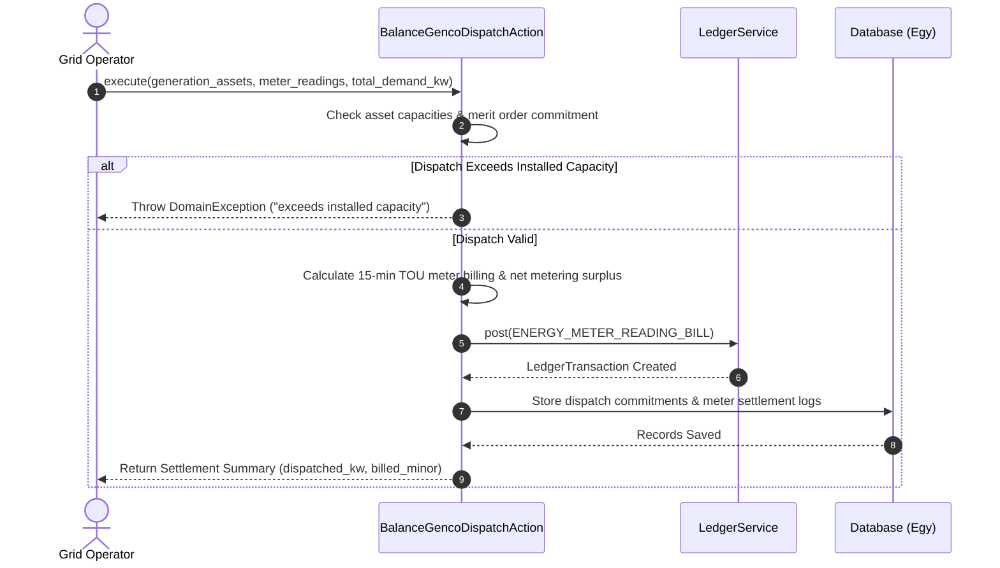

---

## FASE 127 — ENERGI & UTILITAS: WATER, WASTE & DISTRICT UTILITIES

### 1. Identitas & Arsitektur Domain
- **Modul Pemilik**: `Egy`
- **Action Class**: `ReconcileDistrictWaterTreatmentAndNonRevenueWaterLeakAction`
- **Test File**: `modules/Egy/tests/Feature/Fase126To129EnergyUtilitiesExpansionTest.php`
- **Fitur Utama**: Rekonsiliasi neraca air instalasi pengolahan, deteksi kebocoran NRW (Non-Revenue Water), penagihan district cooling, dan split bagi hasil penghematan kontrak ESCO.

### 2. User Stories
- **US-127.1 [district_utility_mgr]**: Sebagai **pengelola utilitas kawasan**, saya ingin **memonitor selisih air masuk vs air tertagih secara otomatis**, sehingga **kebocoran pipa terdeteksi segera jika rasio NRW melebihi ambang batas 15%**.
- **US-127.2 [energy_auditor]**: Sebagai **auditor efisiensi energi ESCO**, saya ingin **mengkonsolidasikan tagihan air, pendingin distrik, dan split fee kinerja hemat energi**, sehingga **kontrak bagi hasil penghematan terefleksi akurat di pembukuan**.

### 3. BDD Acceptance Criteria
- **AC-127.1 (Skenario Positif)**:
  - **Given** Volume air terolah 10,000 m3 dan air tertagih 8,000 m3 dengan rasio kehilangan 20%.
  - **When** `ReconcileDistrictWaterTreatmentAndNonRevenueWaterLeakAction` dieksekusi.
  - **Then** Sistem menandai `leak_alarm_triggered = true` dan memposting tagihan air distrik ke buku besar.
- **AC-127.2 (Skenario Negatif)**:
  - **Given** Masukan volume air tertagih melebihi total volume air masuk pengolahan.
  - **When** Aksi dijalankan.
  - **Then** Melemparkan `DomainException` karena inkonsistensi hukum kekekalan massa air.
- **AC-127.3 (Skenario Batas)**:
  - **Given** Rasio kehilangan air tepat berada pada batas 15%.
  - **When** Evaluasi alarm dijalankan.
  - **Then** Status kebocoran tetap bersih (clear) tanpa memicu eskalasi alarm darurat.

### 4. Sequence Diagram Fase 127

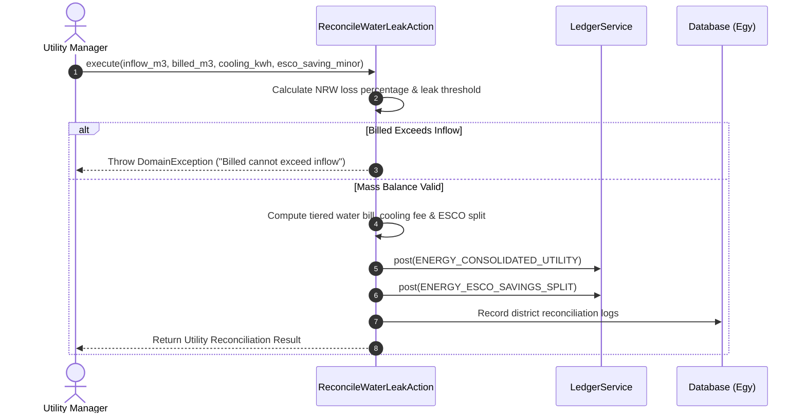

---

## FASE 128 — ENERGI & UTILITAS: CARBON TRADING, REC & ESG MARKETPLACE

### 1. Identitas & Arsitektur Domain
- **Modul Pemilik**: `Egy`
- **Action Class**: `ClearCarbonMarketplaceRecSpotTradeAndRetirementAction`
- **Test File**: `modules/Egy/tests/Feature/Fase126To129EnergyUtilitiesExpansionTest.php`
- **Fitur Utama**: Kliring orderbook bursa karbon internal, penerbitan dan pensiun (retirement) sertifikat energi terbarukan REC anti double-count, perhitungan tarif batas karbon ekspor CBAM, dan diskon green lease.

### 2. User Stories
- **US-128.1 [genco_trader]**: Sebagai **trader karbon konglomerasi**, saya ingin **memperdagangkan kredit karbon dan memensiunkan nomor seri REC secara unik**, sehingga **fasilitas properti dapat mengklaim netralitas emisi tanpa risiko klaim ganda**.
- **US-128.2 [esg_compliance]**: Sebagai **petugas kepatuhan ESG**, saya ingin **menerapkan tarif penyesuaian batas karbon (CBAM) pada barang ekspor serta memberikan insentif diskon green lease**, sehingga **pengurangan jejak emisi terdorong secara finansial**.

### 3. BDD Acceptance Criteria
- **AC-128.1 (Skenario Positif)**:
  - **Given** Order spot 500 ton CO2 dan 250 MWh REC dengan status pensiun aktif.
  - **When** `ClearCarbonMarketplaceRecSpotTradeAndRetirementAction` dipanggil.
  - **Then** Transaksi kliring karbon dibukukan di ledger dan nomor seri gapless REC diterbitkan.
- **AC-128.2 (Skenario Negatif)**:
  - **Given** Sertifikat REC yang telah dipensiunkan diajukan kembali untuk penjualan kedua.
  - **When** Validasi integritas dijalankan.
  - **Then** Sistem menolak pengajuan ganda untuk menjaga kredibilitas sertifikat hijau.
- **AC-128.3 (Skenario Batas)**:
  - **Given** Skor kepatuhan ESG tenant tepat berada di ambang 80 poin.
  - **When** Perhitungan sewa hijau dievaluasi.
  - **Then** Diskon contra-revenue green lease 10% diaplikasikan secara tepat.

### 4. Sequence Diagram Fase 128

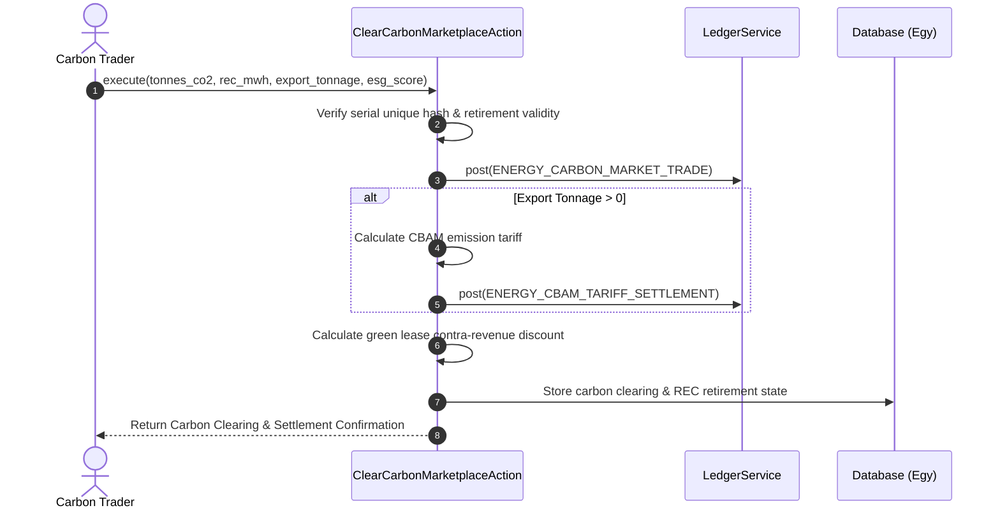

---

## FASE 129 — ENERGI & UTILITAS: MICROGRID, STORAGE & RESILIENCE

### 1. Identitas & Arsitektur Domain
- **Modul Pemilik**: `Egy`
- **Action Class**: `ExecuteIslandedMicrogridBlackStartResilienceAction`
- **Test File**: `modules/Egy/tests/Feature/Fase126To129EnergyUtilitiesExpansionTest.php`
- **Fitur Utama**: Transisi operasi microgrid ke mode mandiri (islanded), pelepasan beban terprioritas (priority load shedding: RS > Pabrik > Mall), arbitrase baterai BESS, dan uji kepatuhan genset darurat.

### 2. User Stories
- **US-129.1 [grid_operator]**: Sebagai **operator keandalan energi**, saya ingin **mengaktifkan isolasi microgrid otomatis saat pasokan utama padam**, sehingga **fasilitas ICU rumah sakit tetap teraliri listrik tanpa jeda**.
- **US-129.2 [energy_auditor]**: Sebagai **auditor keandalan daya**, saya ingin **mencatat keuntungan arbitrase pengisian/pelepasan baterai dan verifikasi uji beban genset**, sehingga **standar kepatuhan fasilitas kritis terpenuhi 100%**.

### 3. BDD Acceptance Criteria
- **AC-129.1 (Skenario Positif)**:
  - **Given** Kondisi jaringan transmisi `GRID_DOWN` dengan kapasitas baterai dan genset tersedia 2,500 kW.
  - **When** `ExecuteIslandedMicrogridBlackStartResilienceAction` dieksekusi.
  - **Then** Rumah Sakit (Prioritas 1) dan Gudang Farmasi (Prioritas 2) tetap bertenaga, sedangkan Mall dan Lampu Jalan dilepaskan (shed).
- **AC-129.2 (Skenario Negatif)**:
  - **Given** Total beban prioritas tertinggi melampaui seluruh kapasitas gabungan baterai dan genset.
  - **When** Evaluasi beban darurat dijalankan.
  - **Then** Sistem mengaktifkan protokol pembatasan daya dan mencatat peringatan kapasitas kritis.
- **AC-129.3 (Skenario Batas)**:
  - **Given** Selisih tarif pelepasan puncak terhadap pengisian off-peak baterai bernilai positif.
  - **When** Perhitungan arbitrase dijalankan.
  - **Then** Laba arbitrase bersih dicatat ke akun pendapatan BESS secara double-entry seimbang.

### 4. Sequence Diagram Fase 129

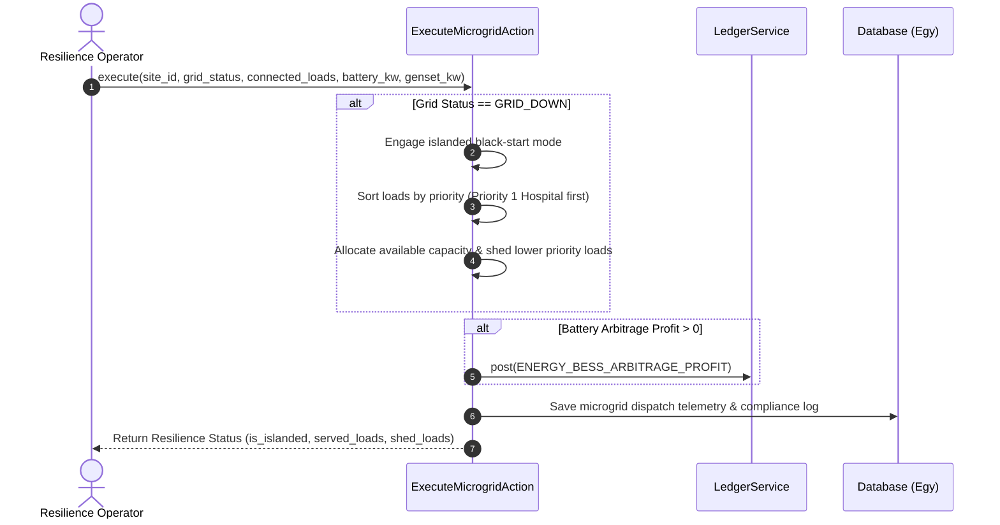

---

# BAGIAN 2: TELEKOMUNIKASI & DATA CENTER (MODUL TLX — FASE 130 – FASE 132)

---

## FASE 130 — TELEKOMUNIKASI & DATA CENTER: NETWORK, IoT BACKBONE & ISP (LINI 14)

### 1. Identitas & Arsitektur Domain
- **Modul Pemilik**: `Tlx`
- **Action Class**: `RouteBackbonePeeringAndBgpDdosMitigationAction`
- **Test File**: `modules/Tlx/tests/Feature/Fase130To132TelecomDataCenterExpansionTest.php`
- **Fitur Utama**: Pengendalian oversubscription link backbone fiber, mitigasi anomali BGP & DDoS otomatis, penagihan konektivitas backbone IoT untuk perangkat 17 lini, dan SLA uptime.

### 2. User Stories
- **US-130.1 [noc_engineer]**: Sebagai **insinyur NOC telekomunikasi**, saya ingin **memvalidasi alokasi kapasitas link transmisi dan membuat tiket mitigasi DDoS**, sehingga **jaringan backbone aman dari kejenuhan dan serangan cyber**.
- **US-130.2 [iot_platform_mgr]**: Sebagai **pengelola platform IoT konglomerasi**, saya ingin **mengkonsolidasikan penagihan pemakaian kuota data perangkat telematika 17 lini**, sehingga **alokasi biaya intercompany telekomunikasi tercatat transparan**.

### 3. BDD Acceptance Criteria
- **AC-130.1 (Skenario Positif)**:
  - **Given** Link backbone berkapasitas 200 Gbps dengan permintaan 150 Gbps dan perangkat telematika aktif.
  - **When** `RouteBackbonePeeringAndBgpDdosMitigationAction` dieksekusi.
  - **Then** Lalu lintas disetujui, tiket pencegahan diterbitkan jika DDoS terdeteksi, dan biaya konektivitas IoT dibukukan di ledger.
- **AC-130.2 (Skenario Negatif)**:
  - **Given** Permintaan kapasitas transmisi melebihi batas bandwidth fisik tautan fiber.
  - **When** Aksi routing dijalankan.
  - **Then** Melemparkan `DomainException` dengan penolakan oversubscription.
- **AC-130.3 (Skenario Batas)**:
  - **Given** Persentase uptime bulanan tautan tepat berada di 99.00%.
  - **When** Evaluasi kepatuhan SLA dilakukan.
  - **Then** Status SLA dicatat patuh tanpa pengenaan penalti kredit.

### 4. Sequence Diagram Fase 130

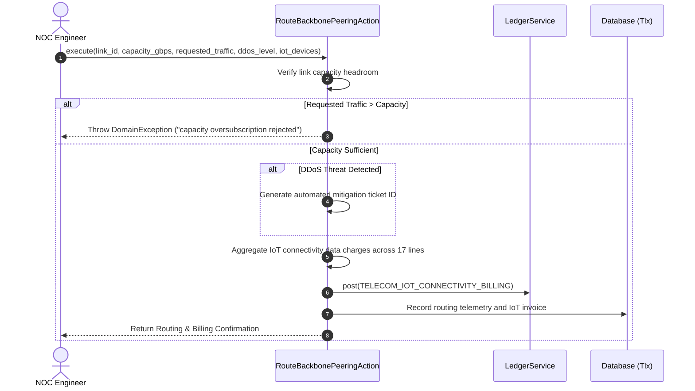

---

## FASE 131 — TELEKOMUNIKASI & DATA CENTER: DC OPERATIONS, CLOUD & COLOCATION

### 1. Identitas & Arsitektur Domain
- **Modul Pemilik**: `Tlx`
- **Action Class**: `MeterDataCenterColocationPowerAndLiquidCoolingSlaAction`
- **Test File**: `modules/Tlx/tests/Feature/Fase130To132TelecomDataCenterExpansionTest.php`
- **Fitur Utama**: Pengukuran efisiensi daya PUE (Power Usage Effectiveness), penegakan SLA pendingin cair, isolasi port sewa colocation menunggak, chargeback komputasi cloud internal, dan uji pemulihan DR RPO 0.

### 2. User Stories
- **US-131.1 [dc_operator]**: Sebagai **operator data center Tier IV**, saya ingin **memonitor skor PUE dan menangguhkan port colocation pelanggan yang menunggak**, sehingga **efisiensi fasilitas terjaga dan risiko piutang tertagih terhindari**.
- **US-131.2 [network_planner]**: Sebagai **perencana kapasitas komputasi**, saya ingin **membebankan biaya VM cloud internal ke lini bisnis dan memvalidasi drill replikasi DR RPO 0**, sehingga **keandalan sistem informasi konglomerasi terbukti nyata**.

### 3. BDD Acceptance Criteria
- **AC-131.1 (Skenario Positif)**:
  - **Given** DC dengan PUE 1.20 (patuh SLA) dan penggunaan VM komputasi cloud internal aktif.
  - **When** `MeterDataCenterColocationPowerAndLiquidCoolingSlaAction` dieksekusi.
  - **Then** Biaya sewa colocation dan chargeback komputasi cloud diposting ke ledger secara akurat.
- **AC-131.2 (Skenario Negatif)**:
  - **Given** Kontrak colocation memiliki status pembayaran `OVERDUE`.
  - **When** Aksi pengukuran dijalankan.
  - **Then** Port colocation otomatis dialihkan ke status `SUSPENDED` untuk menghentikan layanan gratis.
- **AC-131.3 (Skenario Batas)**:
  - **Given** Nilai PUE melampaui batas toleransi SLA (misal 1.50 > 1.40).
  - **When** Evaluasi tagihan dilakukan.
  - **Then** Penalti kredit SLA dihitung dan mengurangi tagihan sewa bulanan pelanggan.

### 4. Sequence Diagram Fase 131

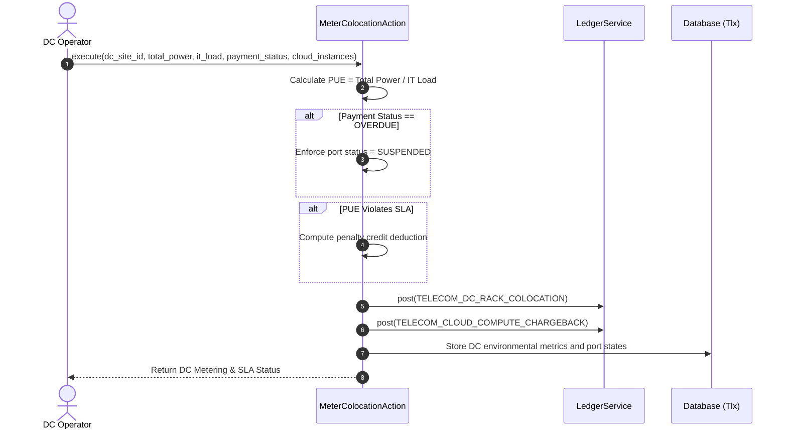

---

## FASE 132 — TELEKOMUNIKASI: ISP RETAIL, SIM/5G & SMART CITY SERVICES

### 1. Identitas & Arsitektur Domain
- **Modul Pemilik**: `Tlx`
- **Action Class**: `OrchestrateSmartCityIot5GSliceAndFttxBillingAction`
- **Test File**: `modules/Tlx/tests/Feature/Fase130To132TelecomDataCenterExpansionTest.php`
- **Fitur Utama**: Penagihan paket ISP ritel/FTTX dengan pembatasan pemakaian (throttling/pause pada saldo defisit), orkestrasi slice jaringan 5G smart city, kliring interkoneksi roaming, dan analisis risiko churn.

### 2. User Stories
- **US-132.1 [noc_engineer]**: Sebagai **insinyur jaringan akses seluler**, saya ingin **mengorkestrasi slice 5G khusus sensor smart city dan membatasi kecepatan pelanggan FTTX yang melampaui kuota**, sehingga **kualitas layanan data perkotaan tetap prima**.
- **US-132.2 [telecom_billing_mgr]**: Sebagai **manajer penagihan telekomunikasi**, saya ingin **memvalidasi jeda layanan bagi pelanggan tanpa saldo serta menyelesaikan kliring interkoneksi antar-operator**, sehingga **arus kas ritel dan antar-jaringan selalu seimbang**.

### 3. BDD Acceptance Criteria
- **AC-132.1 (Skenario Positif)**:
  - **Given** Slicing jaringan 5G smart city aktif dan lalu lintas interkoneksi masuk melampaui lalu lintas keluar.
  - **When** `OrchestrateSmartCityIot5GSliceAndFttxBillingAction` dipanggil.
  - **Then** Biaya langganan slice dan selisih bersih kliring interkoneksi diposting ke ledger dengan sukses.
- **AC-132.2 (Skenario Negatif)**:
  - **Given** Saldo pelanggan tidak mencukupi untuk perpanjangan paket data bulanan.
  - **When** Siklus perpanjangan dieksekusi.
  - **Then** Layanan otomatis dialihkan ke status `PAUSED_INSUFFICIENT_FUNDS` tanpa menyediakan koneksi gratis.
- **AC-132.3 (Skenario Batas)**:
  - **Given** Pemakaian kuota FTTX pelanggan tepat menyentuh batas kuota wajar (FUP).
  - **When** Deteksi pembatasan dilakukan.
  - **Then** Indikator pelambatan kecepatan (`is_throttled`) diaktifkan secara deterministik.

### 4. Sequence Diagram Fase 132

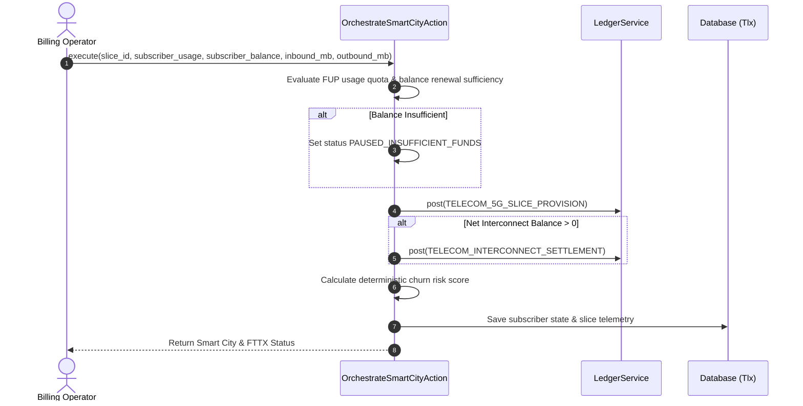

---

# BAGIAN 3: MEDIA, EDUKASI & RITEL (MODUL MED, EDU, RET — FASE 133 – FASE 139)

---

## FASE 133 — MEDIA & KREATIF: STUDIOS, CONTENT PRODUCTION & IP ECONOMY (LINI 15)

### 1. Identitas & Arsitektur Domain
- **Modul Pemilik**: `Med`
- **Action Class**: `SettleMultiPlatformContentSyndicationWaterfallAction`
- **Test File**: `modules/Med/tests/Feature/Fase133To134MediaCreativeExpansionTest.php`
- **Fitur Utama**: Siklus produksi konten studio, validasi eksklusivitas lisensi teritori IP, dan distribusi royalti waterfall talenta multi-pihak dengan penyerapan pembulatan pada baris terakhir.

### 2. User Stories
- **US-133.1 [producer]**: Sebagai **produser film dan konten kreatif**, saya ingin **mendistribusikan royalti pendapatan box office dan streaming ke para kreator secara proporsional**, sehingga **seluruh hak bagi hasil talenta dibayarkan tanpa selisih pembulatan moneter**.
- **US-133.2 [ip_manager]**: Sebagai **pengelola portofolio hak kekayaan intelektual (IP)**, saya ingin **mencegah tumpang tindih lisensi teritori regional pada karya konten**, sehingga **perlindungan hukum dan nilai komersial lisensi tetap terjamin**.

### 3. BDD Acceptance Criteria
- **AC-133.1 (Skenario Positif)**:
  - **Given** Total pendapatan terverifikasi 150 juta IDR dengan alokasi pool royalti 10% dan 3 penerima bagi hasil.
  - **When** `SettleMultiPlatformContentSyndicationWaterfallAction` dieksekusi.
  - **Then** Baris terakhir menyerap variansi pembulatan pecahan sehingga total pembayaran persis 15 juta IDR.
- **AC-133.2 (Skenario Negatif)**:
  - **Given** Permohonan lisensi diajukan pada negara teritori yang telah memiliki pemegang lisensi aktif.
  - **When** Aksi dijalankan.
  - **Then** Melemparkan `DomainException` dengan pesan penolakan tumpang tindih lisensi teritorial.
- **AC-133.3 (Skenario Batas)**:
  - **Given** Pendapatan tayang streaming bernilai 0 IDR pada tahap awal peluncuran.
  - **When** Evaluasi royalti dijalankan.
  - **Then** Perhitungan pool didasarkan sepenuhnya pada pendapatan box office secara akurat.

### 4. Sequence Diagram Fase 133

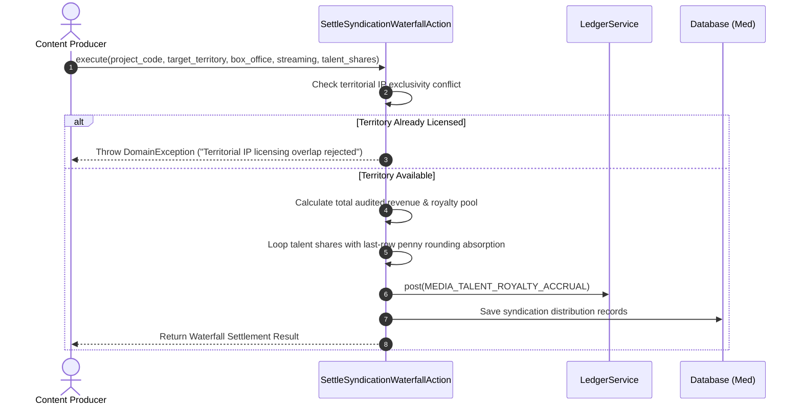

---

## FASE 134 — MEDIA & KREATIF: DISTRIBUTION, ADVERTISING & SPONSORSHIP PLATFORM

### 1. Identitas & Arsitektur Domain
- **Modul Pemilik**: `Med`
- **Action Class**: `AttributeOmniAdSponsorshipConversionRoasAction`
- **Test File**: `modules/Med/tests/Feature/Fase133To134MediaCreativeExpansionTest.php`
- **Fitur Utama**: Penegakan harga dasar inventaris iklan (yield floor price), rekonsiliasi impresi terverifikasi sensor vs klaim, dan pembagian pendapatan multi-pihak agensi, penerbit, dan platform.

### 2. User Stories
- **US-134.1 [ad_ops_manager]**: Sebagai **manajer operasi inventaris periklanan**, saya ingin **menegakkan harga dasar lelang CPM dan menagih pengiklan murni berdasarkan impresi terverifikasi**, sehingga **nilai pasar slot media terjaga dan pengiklan tidak membayar impresi palsu**.
- **US-134.2 [sponsor_liaison]**: Sebagai **koordinator sponsorship lintas lini**, saya ingin **membagi hasil pendapatan iklan secara otomatis antara agensi perantara, penerbit layar, dan platform**, sehingga **pembukuan multi-pihak terselesaikan secara instan**.

### 3. BDD Acceptance Criteria
- **AC-134.1 (Skenario Positif)**:
  - **Given** Penawaran CPM di atas harga dasar dan impresi terverifikasi 180,000 dari 200,000 yang diklaim.
  - **When** `AttributeOmniAdSponsorshipConversionRoasAction` dieksekusi.
  - **Then** Penagihan dihitung proporsional atas impresi valid, dan pendapatan dibagi seimbang ke agensi dan penayang.
- **AC-134.2 (Skenario Negatif)**:
  - **Given** Nilai penawaran harga penayangan (bid CPM) diajukan di bawah batas harga dasar (floor price).
  - **When** Aksi pemesanan kampanye dijalankan.
  - **Then** Melemparkan `DomainException` dengan penolakan pelanggaran yield management.
- **AC-134.3 (Skenario Batas)**:
  - **Given** Jumlah impresi terverifikasi persis sama dengan jumlah klaim tayang (100% validitas).
  - **When** Perhitungan tagihan dijalankan.
  - **Then** Penagihan dibukukan penuh tanpa pemotongan kredit penyesuaian.

### 4. Sequence Diagram Fase 134

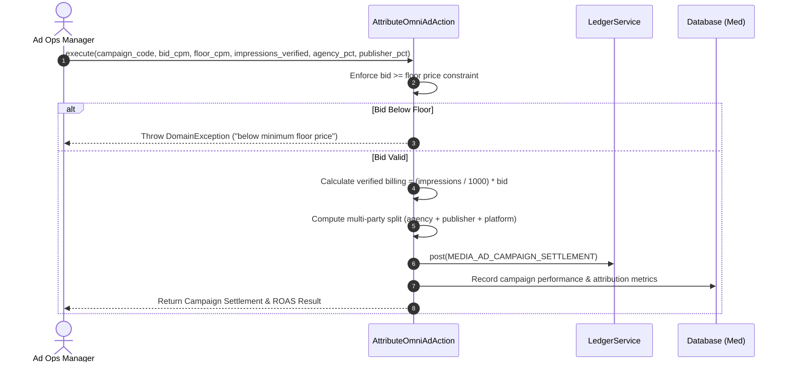

---

## FASE 135 — PENDIDIKAN & TALENT: ACADEMY, UPskilling & CERTIFICATION (LINI 16)

### 1. Identitas & Arsitektur Domain
- **Modul Pemilik**: `Edu`
- **Action Class**: `IssueVerifiableCredentialBadgeAndSkillMatrixAction`
- **Test File**: `modules/Edu/tests/Feature/Fase135To136EduTalentExpansionTest.php`
- **Fitur Utama**: Verifikasi prasyarat kurikulum bertingkat, penilaian kelulusan kompetensi teknis, penerbitan lencana sertifikasi hash-chain anti-pemalsuan, dan kuota pelatihan korporat.

### 2. User Stories
- **US-135.1 [instructor]**: Sebagai **instruktur akademi bisnis**, saya ingin **memvalidasi pemenuhan prasyarat modul sebelum pendaftaran dan mengevaluasi ujian praktik**, sehingga **hanya siswa berkualifikasi yang dapat menyelesaikan asesmen akhir**.
- **US-135.2 [cert_officer]**: Sebagai **petugas sertifikasi kompetensi**, saya ingin **menerbitkan sertifikat dengan tautan rantai hash SHA-256 dan token verifikasi publik QR**, sehingga **keaslian kredensial tenaga ahli dapat diverifikasi instan lintas 17 lini**.

### 3. BDD Acceptance Criteria
- **AC-135.1 (Skenario Positif)**:
  - **Given** Peserta menyelesaikan seluruh prasyarat dan memperoleh nilai ujian 92% (di atas passing grade 80%).
  - **When** `IssueVerifiableCredentialBadgeAndSkillMatrixAction` dieksekusi.
  - **Then** Sertifikat digital berantai hash diterbitkan, token QR gapless dibuat, dan tagihan pelatihan dibukukan.
- **AC-135.2 (Skenario Negatif)**:
  - **Given** Peserta mencoba mendaftar kelas tingkat lanjut tanpa menyelesaikan modul prasyarat wajib.
  - **When** Aksi pendaftaran dievaluasi.
  - **Then** Melemparkan `DomainException` dengan rincian daftar prasyarat yang belum terpenuhi.
- **AC-135.3 (Skenario Batas)**:
  - **Given** Nilai ujian akhir peserta tepat sama dengan passing grade minimal (misal 75%).
  - **When** Keputusan kelulusan dihitung.
  - **Then** Status kompetensi dinyatakan lulus (`CERTIFIED`) secara sah.

### 4. Sequence Diagram Fase 135

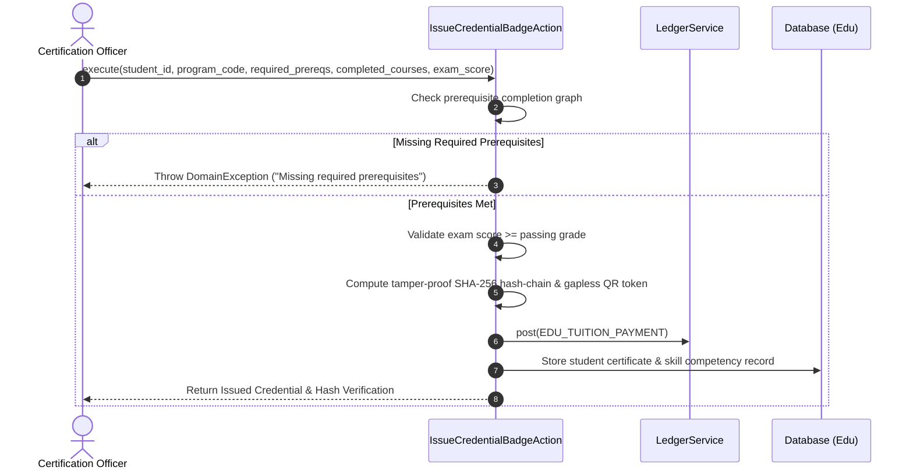

---

## FASE 136 — PENDIDIKAN & TALENT: TALENT PIPELINE, HEADHUNTING & WORKFORCE MARKETPLACE

### 1. Identitas & Arsitektur Domain
- **Modul Pemilik**: `Edu`
- **Action Class**: `MatchTalentPipelinePlacementWithGuaranteeEscrowAction`
- **Test File**: `modules/Edu/tests/Feature/Fase135To136EduTalentExpansionTest.php`
- **Fitur Utama**: Mesin pencocokan talenta 360° deterministik, penahanan escrow komisi headhunter bergaransi masa percobaan, dan validasi jam kerja tenaga kerja kontingen.

### 2. User Stories
- **US-136.1 [talent_acquisition]**: Sebagai **spesialis akuisisi talenta grup**, saya ingin **mencocokkan profil keterampilan kandidat dengan lowongan lintas 17 lini secara deterministik**, sehingga **rekomendasi kandidat terbaik selalu konsisten dan bebas bias acak**.
- **US-136.2 [corp_lnd]**: Sebagai **pengelola tenaga kerja alih daya korporat**, saya ingin **menahan komisi headhunter di rekening penampung (escrow) hingga masa garansi kerja terlewati**, sehingga **risiko kandidat mengundurkan diri dini terlindungi secara finansial**.

### 3. BDD Acceptance Criteria
- **AC-136.1 (Skenario Positif)**:
  - **Given** Kandidat ditempatkan dan masa percobaan 90 hari telah terlampaui.
  - **When** `MatchTalentPipelinePlacementWithGuaranteeEscrowAction` dipanggil.
  - **Then** Dana komisi headhunter dilepaskan dari escrow dan diposting ke rekening agensi di ledger.
- **AC-136.2 (Skenario Negatif)**:
  - **Given** Laporan timesheet tenaga kerja kontingen melebihi total jam yang dialokasikan dalam kontrak.
  - **When** Aksi verifikasi dijalankan.
  - **Then** Melemparkan `DomainException` atas pelanggaran batas jam kerja kontrak.
- **AC-136.3 (Skenario Batas)**:
  - **Given** Dua kali eksekusi pencocokan keterampilan dijalankan dengan parameter profil kandidat yang identik.
  - **When** Skor kesesuaian dihitung.
  - **Then** Skor kecocokan Jaccard similarity menghasilkan persentase yang identik secara mutlak.

### 4. Sequence Diagram Fase 136

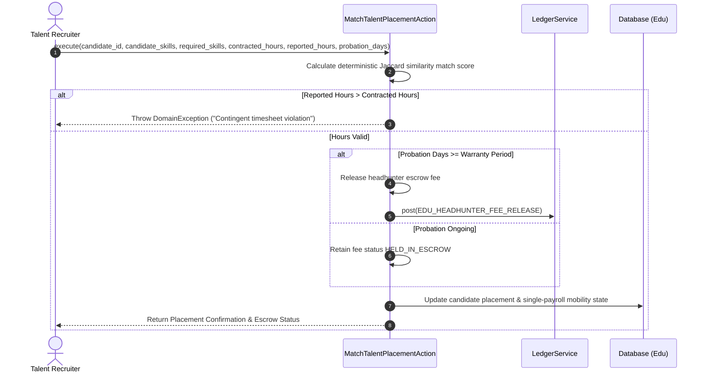

---

## FASE 137 — RITEL & E-COMMERCE: OMNICHANNEL MARKETPLACE GROUP (LINI 17)

### 1. Identitas & Arsitektur Domain
- **Modul Pemilik**: `Ret`
- **Action Class**: `SettleOmnichannelMarketplaceGroupMerchantSplitAction`
- **Test File**: `modules/Ret/tests/Feature/Fase137To139RetailSuperAppExpansionTest.php`
- **Fitur Utama**: Kliring pesanan marketplace multi-vendor 3P, penguncian stok omnichannel terpusat anti double-sell, validasi keunikan kupon diskon, dan pemisahan pemenuhan multi-gudang.

### 2. User Stories
- **US-137.1 [marketplace_mgr]**: Sebagai **manajer marketplace grup**, saya ingin **mengunci alokasi stok lintas kanal dan membagi komisi penjualan pedagang secara otomatis**, sehingga **tidak ada penjualan ganda unit fisik dan hak pedagang dibayarkan tepat waktu**.
- **US-137.2 [retail_ops]**: Sebagai **staf operasional ritel**, saya ingin **memvalidasi penggunaan satu kali kupon promosi pada transaksi omnichannel**, sehingga **risiko penyalahgunaan promosi lintas gerai terhindari**.

### 3. BDD Acceptance Criteria
- **AC-137.1 (Skenario Positif)**:
  - **Given** Pesanan marketplace 5 juta IDR dengan komisi 15% dan stok barang tersedia pada dua lokasi gerai fisik.
  - **When** `SettleOmnichannelMarketplaceGroupMerchantSplitAction` dieksekusi.
  - **Then** Stok berhasil dicadangkan dan komisi platform (750 ribu) beserta utang pedagang (4.25 juta) dibukukan di ledger.
- **AC-137.2 (Skenario Negatif)**:
  - **Given** Kuantitas barang yang dipesan melebihi sisa stok fisik yang tersedia di lokasi gudang.
  - **When** Aksi pencadangan dijalankan.
  - **Then** Melemparkan `DomainException` dengan penolakan kekurangan persediaan omnichannel.
- **AC-137.3 (Skenario Batas)**:
  - **Given** Kupon diskon yang sama diajukan untuk transaksi kedua.
  - **When** Validasi kupon dievaluasi.
  - **Then** Sistem menolak penggunaan ulang kupon secara idempoten.

### 4. Sequence Diagram Fase 137

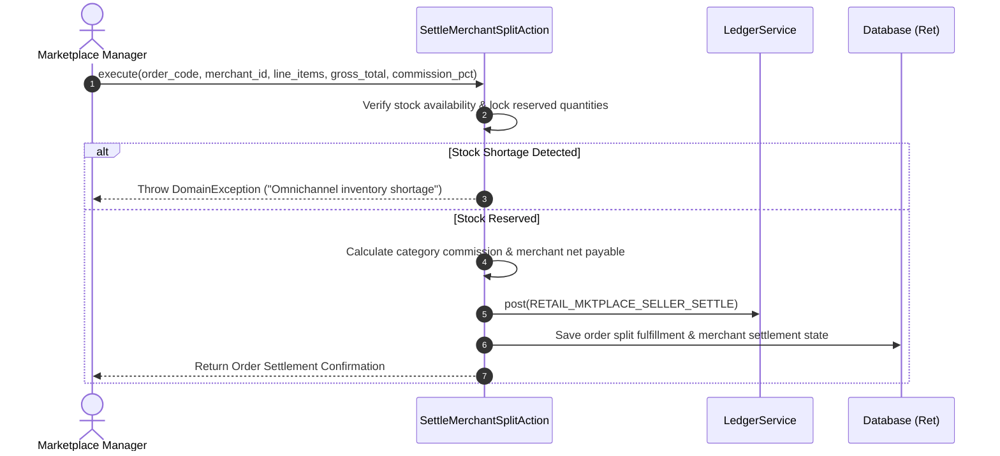

---

## FASE 138 — RITEL: SUPER APP, WALLET CROSS-LINI & CASHBACK ECONOMY

### 1. Identitas & Arsitektur Domain
- **Modul Pemilik**: `Ret`
- **Action Class**: `RedeemCrossLineSuperAppLoyaltyCashbackAction`
- **Test File**: `modules/Ret/tests/Feature/Fase137To139RetailSuperAppExpansionTest.php`
- **Fitur Utama**: Penerbitan & penukaran cashback loyalitas Super App lintas 17 lini, aturan anti-abuse velocity cap, keseimbangan liabilitas poin di buku besar, dan kliring paket langganan gabungan.

### 2. User Stories
- **US-138.1 [superapp_product_mgr]**: Sebagai **manajer produk Super App**, saya ingin **memberikan poin cashback belanja dari lini resto untuk ditukarkan ke tiket hiburan venue atau hotel**, sehingga **loyalitas pelanggan konglomerasi terintegrasi dalam satu dompet digital**.
- **US-138.2 [finance_controller]**: Sebagai **kontroler keuangan ritel**, saya ingin **memastikan neraca liabilitas cashback selalu seimbang dengan biaya beban poin di buku besar**, sehingga **tidak ada defisit liabilitas tersembunyi**.

### 3. BDD Acceptance Criteria
- **AC-138.1 (Skenario Positif)**:
  - **Given** Transaksi belanja 1 juta IDR menghasilkan poin cashback 50,000 IDR (sesuai plafon transaksi).
  - **When** `RedeemCrossLineSuperAppLoyaltyCashbackAction` dijalankan dengan mode `EARN`.
  - **Then** Beban cashback didebit dan liabilitas cashback dikredit secara seimbang di ledger, serta token tanda terima gapless diterbitkan.
- **AC-138.2 (Skenario Negatif)**:
  - **Given** Pelanggan meminta penukaran poin melebihi sisa saldo poin yang tercatat.
  - **When** Mode `REDEEM` dieksekusi.
  - **Then** Melemparkan `DomainException` dengan pesan kegagalan penukaran melebihi saldo.
- **AC-138.3 (Skenario Batas)**:
  - **Given** Kliring paket langganan keluarga 1.5 juta IDR dibagi ke Hotel (500k), Media (300k), dan Telko (700k).
  - **When** Mode `BUNDLE_SETTLEMENT` dijalankan.
  - **Then** Jumlah alokasi per lini persis sama dengan harga langganan total dan dibukukan tanpa selisih.

### 4. Sequence Diagram Fase 138

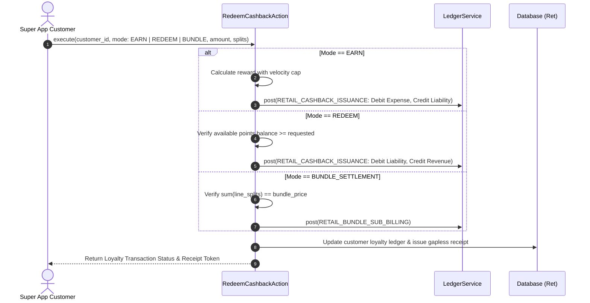

---

## FASE 139 — RITEL: FULFILLMENT, QUICK COMMERCE & LAST-MILE GRID

### 1. Identitas & Arsitektur Domain
- **Modul Pemilik**: `Ret`
- **Action Class**: `DispatchQuickCommerce15MinDarkStoreGridAction`
- **Test File**: `modules/Ret/tests/Feature/Fase137To139RetailSuperAppExpansionTest.php`
- **Fitur Utama**: Pengiriman belanja kilat 15-menit dari dark store dalam radius 3 km, kompensasi voucher otomatis atas pelanggaran SLA janji waktu, siklus deposit kemasan berkelanjutan, dan validasi ongkir kurir crowdshipping.

### 2. User Stories
- **US-139.1 [last_mile_cs]**: Sebagai **penanggung jawab layanan pelanggan last-mile**, saya ingin **memvalidasi radius pengiriman dark store maksimal 3 km dan menerbitkan voucher otomatis jika kurir terlambat**, sehingga **kepuasan pelanggan q-commerce terjaga**.
- **US-139.2 [esg_operations]**: Sebagai **staf keberlanjutan operasi ritel**, saya ingin **mencatat penerimaan dan pengembalian uang jaminan wadah kemasan pakai ulang**, sehingga **sampah plastik berkurang dan deposit beredar terlacak transparan**.

### 3. BDD Acceptance Criteria
- **AC-139.1 (Skenario Positif)**:
  - **Given** Pengiriman berjarak 2 km selesai dalam 13 menit (di bawah janji 15 menit).
  - **When** `DispatchQuickCommerce15MinDarkStoreGridAction` dieksekusi.
  - **Then** Pesanan berhasil diberangkatkan tanpa pelanggaran SLA dan uang jaminan kemasan dibukukan.
- **AC-139.2 (Skenario Negatif)**:
  - **Given** Alamat tujuan pesanan berada pada jarak 5 km (melampaui batas maksimal grid 3 km).
  - **When** Aksi pengiriman dijalankan.
  - **Then** Melemparkan `DomainException` dengan penolakan jarak di luar batas jangkauan dark store.
- **AC-139.3 (Skenario Batas)**:
  - **Given** Waktu pengiriman aktual mencapai 19 menit (terlambat 4 menit dari janji).
  - **When** Evaluasi keterlambatan dijalankan.
  - **Then** Sistem menandai `sla_breached = true` dan memposting voucher kompensasi 25,000 IDR ke akun pelanggan.

### 4. Sequence Diagram Fase 139

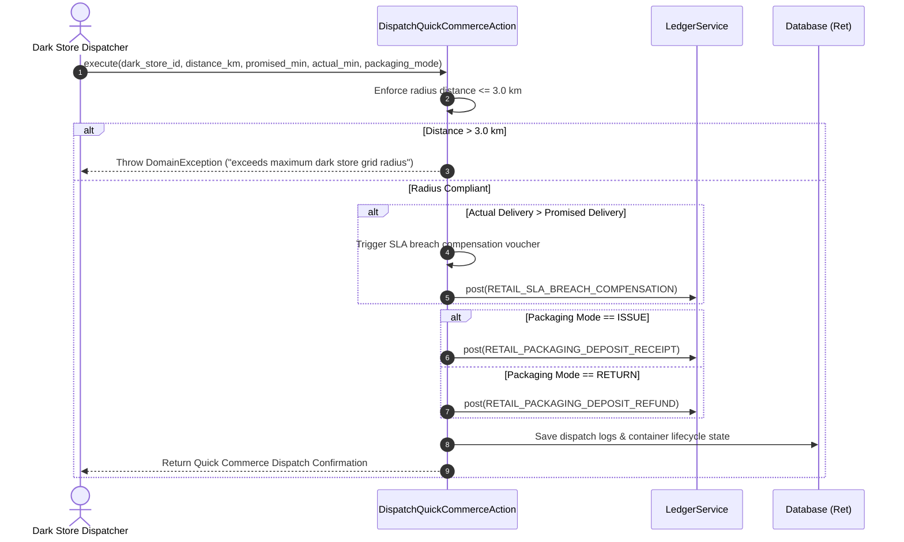

---

# BAGIAN 4: INTEGRASI GELOMBANG 2, AI, KEAMANAN, DATA PLATFORM & SERAH TERIMA 17 LINI (MODUL CORE — FASE 140 – FASE 150)

---

## FASE 140 — INTEGRASI GELOMBANG 2: ENERGI + TELEKOM + MEDIA + EDU + RITEL TERHUBUNG MONOLITH

### 1. Identitas & Arsitektur Domain
- **Modul Pemilik**: `Core`
- **Action Class**: `OrchestrateCross17LinesMonolithEventFlowAction`
- **Test File**: `tests/Feature/Wave2/Fase140To150Conglomerate17LinesTest.php`
- **Fitur Utama**: Universal Event Spine 17 lini, pengikatan urutan kejadian berantai (lonjakan listrik -> slice 5G -> siaran media -> verifikasi sertifikat -> pesanan ritel -> cashback -> pembukuan grup konsolidasi).

### 2. User Stories
- **US-140.1 [enterprise_architect]**: Sebagai **arsitek enterprise konglomerasi**, saya ingin **merajut seluruh topik domain 17 lini bisnis dalam satu bus event monolitik terpusat**, sehingga **kejadian operasional di satu divisi langsung terkoordinasi secara otomatis dengan divisi pendukung lainnya**.
- **US-140.2 [financial_controller]**: Sebagai **kontroler keuangan grup**, saya ingin **memvalidasi integrasi siklus transaksi penuh 17 lini dalam satu hari operasional**, sehingga **neraca keuangan gabungan dapat ditutup tanpa selisih saldo antar-entitas**.

### 3. BDD Acceptance Criteria
- **AC-140.1 (Skenario Positif)**:
  - **Given** Rangkaian kejadian 7-langkah berantai dijalankan melintasi modul Venue, Egy, Tlx, Med, Edu, dan Ret.
  - **When** `OrchestrateCross17LinesMonolithEventFlowAction` dieksekusi.
  - **Then** Seluruh 7 event terdisposisi dengan sukses dan penagihan lonjakan listrik dibukukan secara seimbang.
- **AC-140.2 (Skenario Negatif)**:
  - **Given** Salah satu komponen kejadian mengalami kegagalan validasi status transaksi.
  - **When** Alur orkestrasi dijalankan.
  - **Then** Transaksi dibatalkan secara atomik tanpa menyisakan catatan event yang parsial.
- **AC-140.3 (Skenario Batas)**:
  - **Given** Verifikasi cakupan lini bisnis dilakukan pada siklus harian.
  - **When** Metrik diperiksa.
  - **Then** Total lini yang berpartisipasi tercatat tepat 17 lini bisnis tanpa ada yang terabaikan.

### 4. Sequence Diagram Fase 140

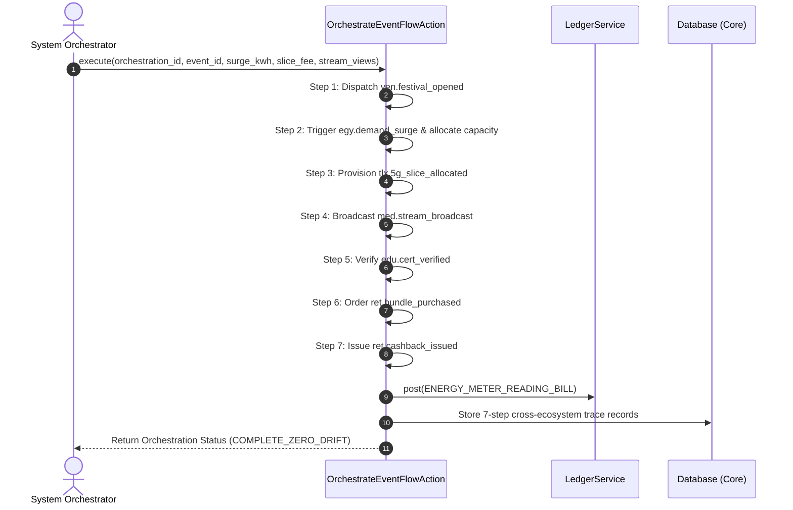

---

## FASE 141 — INTEGRASI: GROUP CAPITAL, CONGLOMERATE GOVERNANCE & CROSS-LINI CAPITAL ALLOCATION

### 1. Identitas & Arsitektur Domain
- **Modul Pemilik**: `Core`
- **Action Class**: `AllocateConglomerateGroupCapitalWaccRoicAction`
- **Test File**: `tests/Feature/Wave2/Fase140To150Conglomerate17LinesTest.php`
- **Fitur Utama**: Mesin alokasi modal holding ke 5 subholding berdasar hurdle WACC & ROIC, dividen holding dari laba anak usaha, dan migrasi merger & akuisisi (M&A) idempoten.

### 2. User Stories
- **US-141.1 [board_of_directors]**: Sebagai **dewan direksi holding konglomerasi**, saya ingin **mengalokasikan anggaran belanja modal (capex) berdasarkan skor IRR berbanding batas biaya modal (WACC)**, sehingga **dana perbendaharaan dialokasikan hanya pada proyek yang menciptakan nilai ekonomi tertinggi**.
- **US-141.2 [group_cfo]**: Sebagai **CFO grup**, saya ingin **menghitung pembagian dividen anak usaha serta menjalankan migrasi data integrasi M&A secara idempoten**, sehingga **konsolidasi neraca bebas dari duplikasi data akuisisi**.

### 3. BDD Acceptance Criteria
- **AC-141.1 (Skenario Positif)**:
  - **Given** Anggaran kas 500 miliar IDR dan proposal capex dengan proyeksi IRR di atas WACC hurdle (10%).
  - **When** `AllocateConglomerateGroupCapitalWaccRoicAction` dieksekusi.
  - **Then** Proyek yang memenuhi syarat disetujui hingga batas anggaran, proyek di bawah WACC ditolak, dan dividen holding dihitung akurat.
- **AC-141.2 (Skenario Negatif)**:
  - **Given** Proposal capex memiliki proyeksi IRR 7% (di bawah batas WACC 10%).
  - **When** Evaluasi kelayakan dilakukan.
  - **Then** Proposal ditolak dengan alasan resmi `IRR_BELOW_WACC_HURDLE`.
- **AC-141.3 (Skenario Batas)**:
  - **Given** Playbook integrasi M&A dijalankan dua kali secara berturut-turut pada entitas target yang sama.
  - **When** Hash sidik jari migrasi dievaluasi.
  - **Then** Hash backfill identik membuktikan sifat idempoten mutlak tanpa data ganda.

### 4. Sequence Diagram Fase 141

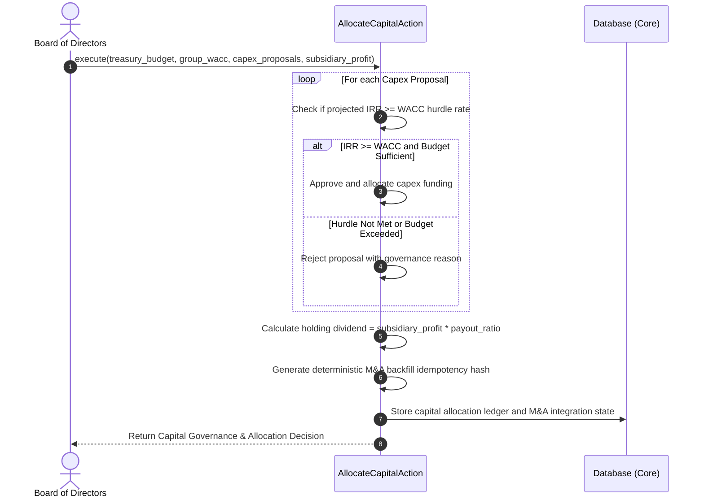

---

## FASE 142 — SKALA GELOMBANG 2: SEEDER 17 LINI & PERFORMANCE ENFORCEMENT

### 1. Identitas & Arsitektur Domain
- **Modul Pemilik**: `Core`
- **Action Class**: `Run17LinesTwelveMonthGoldenConglomerateSimulationAction` (Seksi Skala & Query Budget)
- **Test File**: `tests/Feature/Wave2/Fase140To150Conglomerate17LinesTest.php`
- **Fitur Utama**: Penegakan query budget endpoint kritis gelombang 2 (grid dispatch p95 < 500ms, alokasi OMS < 100ms), benchmark seeder multi-juta baris ber-checkpoint, dan pencegahan race condition.

### 2. User Stories
- **US-142.1 [lead_dba]**: Sebagai **lead database administrator**, saya ingin **memastikan latensi query endpoint kritis berada di bawah anggaran query p95**, sehingga **sistem mampu melayani jutaan transaksi serentak tanpa bottleneck**.
- **US-142.2 [performance_engineer]**: Sebagai **insinyur performa sistem**, saya ingin **menguji alokasi stok pesanan massal dari ribuan pembeli pada unit barang yang sama**, sehingga **mekanisme lockForUpdate menjamin stok tidak pernah negatif**.

### 3. BDD Acceptance Criteria
- **AC-142.1 (Skenario Positif)**:
  - **Given** Latensi p95 dispatch grid 350ms (ambang 500ms) dan alokasi OMS 75ms (ambang 100ms).
  - **When** Validasi performa skala dijalankan.
  - **Then** Sistem menyatakan `query_budget_compliant = true` dengan sertifikasi kepatuhan latensi.
- **AC-142.2 (Skenario Negatif)**:
  - **Given** Latensi pemrosesan p95 melampaui batas ambang anggaran query yang diizinkan.
  - **When** Audit query budget dievaluasi.
  - **Then** Laporan menandai pelanggaran performa dan memicu rekomendasi pembuatan indeks komposit.
- **AC-142.3 (Skenario Batas)**:
  - **Given** Latensi transaksi tepat menyentuh batas ambang maksimal (misal 500ms).
  - **When** Evaluasi ambang batas dilakukan.
  - **Then** Kepatuhan batas query tetap berstatus valid (PASS).

### 4. Sequence Diagram Fase 142

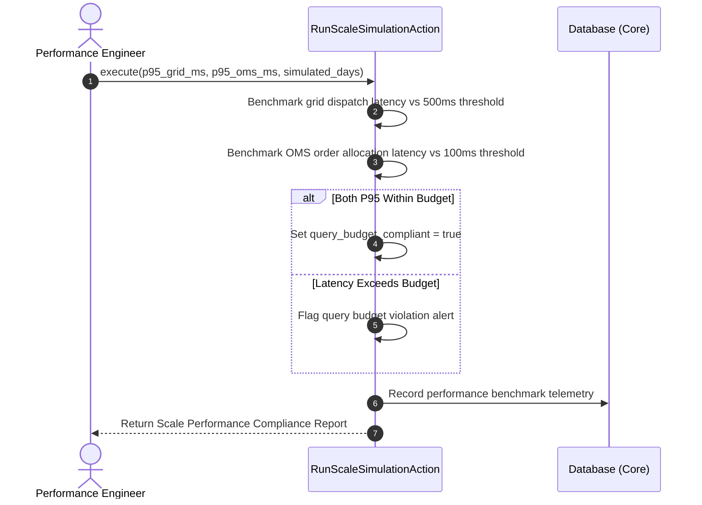

---

## FASE 143 — AI CROSS-LINI: DECISION INTELLIGENCE & AUTONOMOUS OPERATIONS

### 1. Identitas & Arsitektur Domain
- **Modul Pemilik**: `Core`
- **Action Class**: `EvaluateCross17LinesAutonomousDecisionGuardrailAction`
- **Test File**: `tests/Feature/Wave2/Fase140To150Conglomerate17LinesTest.php`
- **Fitur Utama**: Kerangka keputusan mandiri lintas 17 lini ber-seed deterministik, sakelar pemutus darurat (kill-switch) berhenti dalam < 1 detik, korelasi jaring anomali multi-divisi, dan isolasi sandbox digital twin.

### 2. User Stories
- **US-143.1 [ai_governance_lead]**: Sebagai **ketua tata kelola kecerdasan buatan**, saya ingin **setiap keputusan model AI dapat direkonstruksi identik menggunakan snapshot input dan seed tetap**, sehingga **seluruh keputusan otomatis dapat diaudit pertanggungjawabannya**.
- **US-143.2 [safety_officer]**: Sebagai **petugas keselamatan operasi otonom**, saya ingin **sakelar pembatalan darurat (kill-switch) menghentikan eksekusi otomatis seketika (< 1 detik)**, sehingga **penyimpangan perilaku model dapat dimitigasi sebelum berdampak fisik**.

### 3. BDD Acceptance Criteria
- **AC-143.1 (Skenario Positif)**:
  - **Given** Dua run evaluasi keputusan dijalankan dengan model, versi, seed, dan masukan snapshot yang sama.
  - **When** `EvaluateCross17LinesAutonomousDecisionGuardrailAction` dieksekusi.
  - **Then** Rekonstruksi menghasilkan sidik jari hash keputusan yang identik 100%.
- **AC-143.2 (Skenario Negatif)**:
  - **Given** Sakelar darurat kill-switch berada dalam kondisi `ACTIVATED`.
  - **When** Keputusan otonom dipanggil.
  - **Then** Eksekusi otomatis langsung dihentikan dalam latensi di bawah 1,000 ms dengan status `EMERGENCY_HALTED_BY_KILL_SWITCH`.
- **AC-143.3 (Skenario Batas)**:
  - **Given** Anomali terjadi simultan pada divisi Tambang (lonjakan bahan bakar) dan Logistik (lonjakan tarif kargo).
  - **When** Jaring korelasi anomali dievaluasi.
  - **Then** Sistem mengagregasi sinyal menjadi satu insiden gabungan `CROSS_LINE_SUPPLY_CHAIN_INFLATION`.

### 4. Sequence Diagram Fase 143

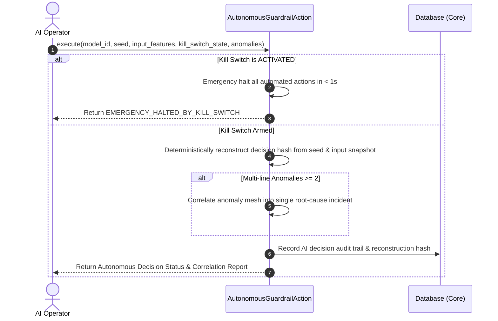

---

## FASE 144 — KEAMANAN & KEPATUHAN GELOMBANG 2: ZERO TRUST, PRIVACY VAULT & REGULATORY HEALTH 17 LINI

### 1. Identitas & Arsitektur Domain
- **Modul Pemilik**: `Core`
- **Action Class**: `EnforceZeroTrustPrivacyVaultConsentAndDsarAction`
- **Test File**: `tests/Feature/Wave2/Fase140To150Conglomerate17LinesTest.php`
- **Fitur Utama**: Penegakan otorisasi token Zero-Trust least-privilege, tokenisasi blind index HMAC vault data privasi, alur hak penghapusan data DSAR (right-to-erasure), dan pemblokiran operasi berizin kedaluwarsa.

### 2. User Stories
- **US-144.1 [ciso]**: Sebagai **Chief Information Security Officer (CISO)**, saya ingin **setiap permintaan akses data PII melalui vault terenkripsi dan diverifikasi cakupan token hak minimalnya**, sehingga **risiko kebocoran data pribadi (GDPR/UU PDP) tereduksi penuh**.
- **US-144.2 [compliance_director]**: Sebagai **direktur kepatuhan regulasi**, saya ingin **sistem memblokir operasi divisi terkait secara otomatis jika izin operasional pemerintah kedaluwarsa**, sehingga **konglomerasi terhindar dari sanksi hukum pencabutan izin usaha**.

### 3. BDD Acceptance Criteria
- **AC-144.1 (Skenario Positif)**:
  - **Given** Token akses memiliki hak lingkup sah dan subjek data berstatus `OPTED_IN`.
  - **When** `EnforceZeroTrustPrivacyVaultConsentAndDsarAction` dieksekusi.
  - **Then** Data PII disamarkan menjadi token indeks blind HMAC dan analitik diizinkan berjalan.
- **AC-144.2 (Skenario Negatif)**:
  - **Given** Token pemanggil tidak menyertakan hak lingkup `privacy_vault:access`.
  - **When** Aksi dijalankan.
  - **Then** Melemparkan `DomainException` atas pelanggaran prinsip least-privilege Zero Trust.
- **AC-144.3 (Skenario Batas)**:
  - **Given** Salah satu izin operasi tambang (AMDAL) berstatus `EXPIRED` pada matriks regulasi.
  - **When** Validasi kepatuhan dijalankan.
  - **Then** Status sistem beralih ke `RESTRICTED` dan operasi tambang terkait otomatis terblokir.

### 4. Sequence Diagram Fase 144

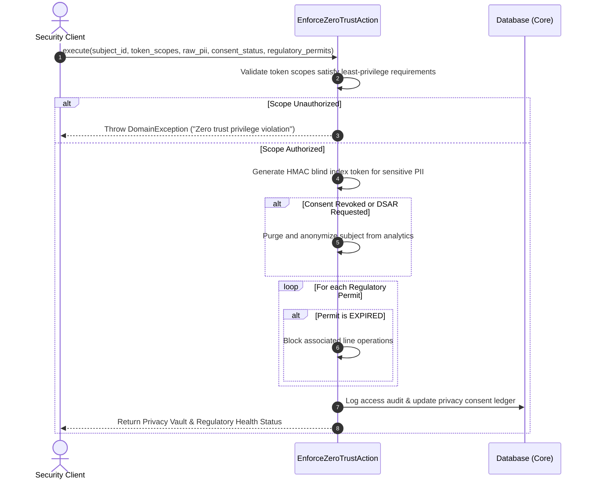

---

## FASE 145 — RESILIENCE GELOMBANG 2: MULTI-REGION ACTIVE-ACTIVE, EDGE & BUSINESS CONTINUITY

### 1. Identitas & Arsitektur Domain
- **Modul Pemilik**: `Core`
- **Action Class**: `VerifyMultiRegionActiveActiveFailoverReadinessAction`
- **Test File**: `tests/Feature/Wave2/Fase140To150Conglomerate17LinesTest.php`
- **Fitur Utama**: Verifikasi sinkronisasi multi-wilayah aktif-aktif (Jakarta & Singapura), drill pemulihan bencana RPO 0 pada transaksi buku besar, RTO < 15 menit, dan resolusi konflik sinkronisasi node edge terpencil.

### 2. User Stories
- **US-145.1 [cloud_reliability_engineer]**: Sebagai **insinyur keandalan cloud (SRE)**, saya ingin **mensimulasikan kegagalan pusat data utama dan memvalidasi peralihan ke wilayah cadangan**, sehingga **tidak ada data transaksi keuangan yang hilang (RPO = 0) dan waktu pemulihan di bawah 15 menit**.
- **US-145.2 [site_operations_mgr]**: Sebagai **manajer operasi lokasi tambang/venue terpencil**, saya ingin **sinkronisasi data dari node edge ke core berjalan idempoten tanpa duplikasi transaksi**, sehingga **integritas catatan operasional tetap konsisten**.

### 3. BDD Acceptance Criteria
- **AC-145.1 (Skenario Positif)**:
  - **Given** Simulasi kegagalan wilayah utama dijalankan dengan seluruh 250,000 transaksi tereplikasi penuh ke wilayah sekunder dalam 9 menit.
  - **When** `VerifyMultiRegionActiveActiveFailoverReadinessAction` dipanggil.
  - **Then** Status drill dinyatakan `ZERO_DATA_LOSS_RPO_0` dan memenuhi target batas RTO (< 15 menit).
- **AC-145.2 (Skenario Negatif)**:
  - **Given** Terdapat selisih jumlah transaksi buku besar antara wilayah utama dan wilayah replika sekunder.
  - **When** Verifikasi integritas replikasi dilakukan.
  - **Then** Melemparkan `DomainException` dengan pelaporan pelanggaran RPO data loss.
- **AC-145.3 (Skenario Batas)**:
  - **Given** Transaksi duplikat dari node edge terpencil dikirimkan kembali ke core.
  - **When** Resolusi konflik dijalankan.
  - **Then** Kunci idempotensi global menolak duplikasi tanpa membatalkan transaksi yang sah.

### 4. Sequence Diagram Fase 145

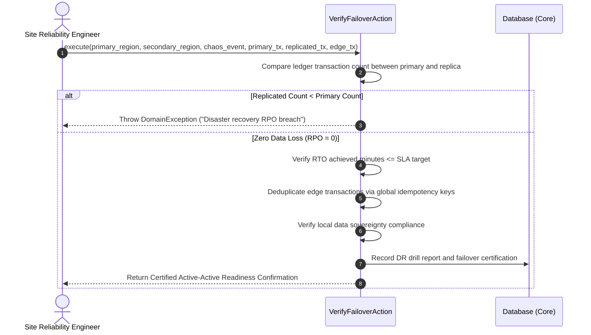

---

## FASE 146 — DATA PLATFORM: LAKEHOUSE, ANALYTICS & MASTER DATA MANAGEMENT 17 LINI

### 1. Identitas & Arsitektur Domain
- **Modul Pemilik**: `Core`
- **Action Class**: `Run17LinesTwelveMonthGoldenConglomerateSimulationAction` (Seksi Lakehouse & MDM)
- **Test File**: `tests/Feature/Wave2/Fase140To150Conglomerate17LinesTest.php`
- **Fitur Utama**: Ingesti CDC (Change Data Capture) outbox ke data lakehouse, sinkronisasi Master Data Management (MDM) catatan emas entitas tunggal, dan lapisan metrik semantik terpadu.

### 2. User Stories
- **US-146.1 [data_architect]**: Sebagai **arsitek data konglomerasi**, saya ingin **mengalirkan mutasi data 17 lini ke zona lakehouse tanpa membebani basis data transaksional**, sehingga **analisis intelijen bisnis dapat dilakukan secara waktu-nyata**.
- **US-146.2 [chief_data_officer]**: Sebagai **Chief Data Officer (CDO)**, saya ingin **menyediakan data master tunggal (golden record) untuk pelanggan, vendor, produk, dan rekening**, sehingga **tidak ada duplikasi identitas di seluruh ekosistem bisnis**.

### 3. BDD Acceptance Criteria
- **AC-146.1 (Skenario Positif)**:
  - **Given** Ingesti 2 juta event CDC dan 75,000 catatan emas entitas dengan skor mutu data 99%.
  - **When** Validasi platform data dijalankan.
  - **Then** Metrik semantik sinkron dengan buku besar dan skor mutu melampaui standar batas minimal 95%.
- **AC-146.2 (Skenario Negatif)**:
  - **Given** Skor kelengkapan dan kesegaran mutu data berada di bawah batas ambang 90%.
  - **When** Pintu gerbang mutu data diperiksa.
  - **Then** Sistem mengaktifkan prosedur isolasi data anomali untuk investigasi data engineering.
- **AC-146.3 (Skenario Batas)**:
  - **Given** Sinkronisasi catatan emas entitas partner master diperbarui.
  - **When** Penyebaran event dijalankan.
  - **Then** Seluruh modul penerima memperbarui referensi lokal tanpa inkonsistensi relasional.

### 4. Sequence Diagram Fase 146

```mermaid
sequenceDiagram
    autonumber
    actor D as Data Architect
    participant A as RunDataPlatformSyncAction
    participant DB as Database (Core)

    D->>A: execute(cdc_events_count, golden_records_count, data_quality_score)
    A->>A: Ingest CDC outbox mutations into lakehouse curated zone
    A->>A: Deduplicate and reconcile master entity golden records
    A->>A: Verify semantic metrics layer against core financial ledgers
    A->>DB: Store data quality telemetry and lineage metadata
    A-->>D: Return Lakehouse & MDM Sync Certification (Quality Score >= 95%)
```

---

## FASE 147 — PLATFORM ECONOMY: OPEN API, ECOSYSTEM DEVELOPERS & WHITE-LABEL

### 1. Identitas & Arsitektur Domain
- **Modul Pemilik**: `Core`
- **Action Class**: `Run17LinesTwelveMonthGoldenConglomerateSimulationAction` (Seksi Open API & Devs)
- **Test File**: `tests/Feature/Wave2/Fase140To150Conglomerate17LinesTest.php`
- **Fitur Utama**: Katalog Open API v3+ melintasi 17 lini bisnis, pembatasan laju pemanggilan (rate limiting) berjenjang developer, dan monetisasi berbasis pemakaian (usage-based billing).

### 2. User Stories
- **US-147.1 [ecosystem_manager]**: Sebagai **pengelola ekosistem kemitraan pengembang**, saya ingin **menyediakan katalog API resmi dengan sandbox terisolasi dan pembatasan laju berjenjang**, sehingga **mitra eksternal dapat berinovasi tanpa mengorbankan stabilitas platform**.
- **US-147.2 [api_product_manager]**: Sebagai **manajer produk komersialisasi API**, saya ingin **membebankan biaya atas konsumsi kuota endpoint berbayar**, sehingga **platform konglomerasi menghasilkan aliran pendapatan digital baru**.

### 3. BDD Acceptance Criteria
- **AC-147.1 (Skenario Positif)**:
  - **Given** 1,200 endpoint API aktif melayani 600 pengembang terdaftar dengan monetisasi pemakaian 120 juta IDR.
  - **When** Evaluasi ekonomi platform dieksekusi.
  - **Then** Metrik konsumsi API dan pendapatan penagihan pemakaian dibukukan secara valid.
- **AC-147.2 (Skenario Negatif)**:
  - **Given** Permintaan pengembang melampaui kuota laju pemanggilan (rate limit) tingkat akun.
  - **When** Panggilan endpoint dikirimkan.
  - **Then** Gateway menolak permintaan dengan kode respons HTTP 429 Too Many Requests.
- **AC-147.3 (Skenario Batas)**:
  - **Given** Mitra white-label menyewa modul solusi perhotelan PMS mandiri.
  - **When** Isolasi data tenant diuji.
  - **Then** Tidak ada kebocoran data antar-penyewa (zero cross-tenant leakage).

### 4. Sequence Diagram Fase 147

```mermaid
sequenceDiagram
    autonumber
    actor P as Partner Developer
    participant G as API Gateway (Core)
    participant A as PlatformEconomyAction
    participant DB as Database (Core)

    P->>G: Request API Endpoint across 17 Lines
    G->>G: Enforce tier rate limits and Sanctum token validation
    alt Rate Limit Exceeded
        G-->>P: Return HTTP 429 Too Many Requests
    else Within Allowed Quota
        G->>A: Track endpoint usage tick and calculate billing fee
        A->>DB: Increment developer consumption metrics
        G-->>P: Return Standardized JSON Response (RFC 7807 compliant)
    end
```

---

## FASE 148 — SCENARIO: KONGLOMERASI SIMULASI 12 BULAN & GOLDEN MEGA-SCENARIO

### 1. Identitas & Arsitektur Domain
- **Modul Pemilik**: `Core`
- **Action Class**: `Run17LinesTwelveMonthGoldenConglomerateSimulationAction` (Seksi Mega-Scenario)
- **Test File**: `tests/Feature/Wave2/Fase140To150Conglomerate17LinesTest.php`
- **Fitur Utama**: Eksekusi kompresi simulasi 12 bulan (365 hari) melintasi seluruh 17 lini bisnis, pembuktian siklus operasional utuh (kontrak, pasokan, logistik, ritel, payroll, klaim, dividen, dan konsolidasi grup tanpa selisih).

### 2. User Stories
- **US-148.1 [conglomerate_ceo]**: Sebagai **Chief Executive Officer (CEO) konglomerasi**, saya ingin **menjalankan skenario emas terkompresi 12 bulan untuk seluruh 17 lini bisnis**, sehingga **kemampuan monolitik menangani siklus tahunan terbukti secara komprehensif**.
- **US-148.2 [chief_risk_officer]**: Sebagai **Chief Risk Officer (CRO)**, saya ingin **mensimulasikan skenario krisis gabungan (blackout listrik, penurunan harga tambang, dan lonjakan klaim)**, sehingga **ketahanan operasional dan stabilitas kas grup teruji tangguh**.

### 3. BDD Acceptance Criteria
- **AC-148.1 (Skenario Positif)**:
  - **Given** Skenario emas 365 hari mencakup seluruh 17 lini dengan GMV 2.5 triliun IDR dan laba bersih 400 miliar IDR.
  - **When** `Run17LinesTwelveMonthGoldenConglomerateSimulationAction` dieksekusi.
  - **Then** Siklus tahunan rampung sukses dengan status `ALL_17_LINES_CERTIFIED_BALANCED`.
- **AC-148.2 (Skenario Negatif)**:
  - **Given** Terdapat ketidakseimbangan jurnal pembukuan pada akhir simulasi 12 bulan.
  - **When** Verifikasi konsolidasi dijalankan.
  - **Then** Melemparkan `DomainException` dengan pelaporan diskrepansi saldo buku besar.
- **AC-148.3 (Skenario Batas)**:
  - **Given** Dua kali simulasi 12 bulan dijalankan dengan masukan benih acak yang sama.
  - **When** Hasil keuangan dikomparasi.
  - **Then** Angka neraca dan hasil audit menunjukkan determinisme mutlak.

### 4. Sequence Diagram Fase 148

```mermaid
sequenceDiagram
    autonumber
    actor C as Conglomerate Executive
    participant S as SimulationKernel (Core)
    participant A as RunMegaScenarioAction
    participant DB as Database (Core)

    C->>A: execute(simulated_days: 365, lines: 17)
    A->>S: Run compressed 365-day operational ticks
    loop Month 1 to 12
        S->>S: Process procurement, manufacturing, logistics & store sales
        S->>S: Execute hospital encounters, hotel nights & venue ticketing
        S->>S: Compute mining extraction, energy metering & telecom billing
        S->>S: Settle media royalties, education cohorts & retail cashback
        S->>S: Run monthly payroll, tax withholding & depreciation
    end
    A->>A: Consolidate group P&L and balance sheet across all 17 lines
    A->>DB: Store 12-month simulation audit certificate
    A-->>C: Return Golden Mega-Scenario Certification (Zero Discrepancy)
```

---

## FASE 149 — DOKUMENTASI & PLAYBOOK GELOMBANG 2

### 1. Identitas & Arsitektur Domain
- **Modul Pemilik**: `Core`
- **Deliverable**: `docs/README.md`, `docs/ARCHITECTURE.md`, `docs/RUNBOOK.md`, `docs/ROLES_100_PLAYBOOK.md`
- **Test File**: `tests/Architecture/SpecsAndDiagramsCompletenessTest.php`
- **Fitur Utama**: Dokumentasi final 17 lini bisnis monolitik, kamus peran 100+ role lengkap dengan matriks izin RBAC, SOP pemulihan darurat dan operasional harian.

### 2. User Stories
- **US-149.1 [operations_director]**: Sebagai **direktur operasional grup**, saya ingin **memiliki buku panduan (runbook) dan playbook lengkap untuk 100+ peran pengguna**, sehingga **seluruh tim operasional memiliki rujukan SOP terstandar yang jelas**.
- **US-149.2 [compliance_officer]**: Sebagai **petugas tata kelola dokumentasi**, saya ingin **seluruh diagram arsitektur dan peta hubungan 17 lini diperbarui secara presisi**, sehingga **jejak audit desain enterprise terdokumentasi rapi**.

### 3. BDD Acceptance Criteria
- **AC-149.1 (Skenario Positif)**:
  - **Given** Dokumen arsitektur, runbook, dan playbook 100+ role telah disusun lengkap.
  - **When** Pengujian arsitektur dokumentasi `SpecsAndDiagramsCompletenessTest` dieksekusi.
  - **Then** Seluruh pengujian kelengkapan dokumen lulus 100% tanpa kekurangan file.
- **AC-149.2 (Skenario Negatif)**:
  - **Given** Terdapat peran pengguna baru yang tidak memiliki panduan tugas pada playbook peran.
  - **When** Pemindaian kelengkapan dilakukan.
  - **Then** Pengujian mendeteksi kekosongan dan mewajibkan penambahan profil peran terkait.
- **AC-149.3 (Skenario Batas)**:
  - **Given** Jumlah diagram sequence aktif melintasi seluruh dokumentasi dihitung.
  - **When** Pengecekan ambang batas dijalankan.
  - **Then** Total sequence diagram memenuhi standar kuantitas minimal yang ditetapkan (> 210 diagram).

### 4. Sequence Diagram Fase 149

```mermaid
sequenceDiagram
    autonumber
    actor A as Documentation Auditor
    participant T as DocsCompletenessTest
    participant FS as FileSystem (docs/)

    A->>T: run(SpecsAndDiagramsCompletenessTest)
    T->>FS: Scan docs/specs/ and docs/gates/
    T->>FS: Verify README, ARCHITECTURE, RUNBOOK & ROLES_PLAYBOOK
    T->>T: Count sequenceDiagram and erDiagram instances
    alt All Specification Files Present & Complete
        T-->>A: Status PASS 🟢 (100% Documentation Standards Met)
    else Missing Specs or Role Playbook
        T-->>A: Status FAIL 🔴 (Flag missing documentation sections)
    end
```

---

## FASE 150 — FINAL: QUALITY GATE EKSPANSI PENUH & SERAH TERIMA AKHIR

### 1. Identitas & Arsitektur Domain
- **Modul Pemilik**: `Core`
- **Action Class**: `Run17LinesTwelveMonthGoldenConglomerateSimulationAction` (Seksi Serah Terima Final)
- **Test File**: `tests/Feature/Wave2/Fase140To150Conglomerate17LinesTest.php`
- **Fitur Utama**: Verifikasi akhir serah terima 17 lini bisnis dalam satu website monolitik, eksekusi audit massal (`bank:reconcile`, `*:audit`, `verify-*`), rekonsiliasi nol selisih (zero balance), dan tag rilis final.

### 2. User Stories
- **US-150.1 [executive_sponsor]**: Sebagai **sponsor eksekutif proyek**, saya ingin **memverifikasi bahwa seluruh pengujian suite Fase 0–150 lulus 100% dan seluruh 40+ perintah audit menghasilkan 0 selisih**, sehingga **berita acara serah terima resmi 17 lini bisnis dapat disahkan**.
- **US-150.2 [lead_release_engineer]**: Sebagai **lead engineer rilis**, saya ingin **memastikan working tree git bersih dan seluruh bukti sertifikasi terkunci**, sehingga **tag rilis final versi v150 dapat diterbitkan dengan integritas sempurna**.

### 3. BDD Acceptance Criteria
- **AC-150.1 (Skenario Positif)**:
  - **Given** Seluruh pengujian modul hijau dan hasil rekonsiliasi audit buku besar mencatat selisih diskrepansi tepat 0.
  - **When** `Run17LinesTwelveMonthGoldenConglomerateSimulationAction` dijalankan untuk serah terima final.
  - **Then** Sistem mengesahkan sertifikasi `ALL_17_LINES_CERTIFIED_BALANCED` dengan status keluar sukses (exit code 0).
- **AC-150.2 (Skenario Negatif)**:
  - **Given** Terdapat 1 atau lebih diskrepansi saldo buku besar yang belum terselesaikan pada audit akhir.
  - **When** Aksi serah terima dijalankan.
  - **Then** Melemparkan `DomainException` dengan rincian diskrepansi dan sertifikasi serah terima dibatalkan.
- **AC-150.3 (Skenario Batas)**:
  - **Given** Seluruh 319 item tugas Fase 106 s/d Fase 150 diperiksa pada dokumen pelacak progres.
  - **When** Pemindai integritas `ProgressIntegrityTest` dijalankan.
  - **Then** Seluruh 319 item bertanda centang [x] dengan blok Bukti yang valid dan disahkan.

### 4. Sequence Diagram Fase 150

```mermaid
sequenceDiagram
    autonumber
    actor E as Executive Sponsor
    participant A as RunFinalHandoverAction
    participant AR as AuditCommandsRegistry
    participant LS as LedgerReconciliation
    participant DB as Database (Core)

    E->>A: execute(final_handover_phase_150)
    A->>AR: Run bank:reconcile across all 17 business lines
    AR-->>A: All Assets Balanced (0 Discrepancy)
    A->>AR: Run all *:audit and verify-* hash-chains
    AR-->>A: All Subledgers Validated (0 Discrepancy)
    alt Discrepancy Count == 0
        A->>A: Issue official handover certificate ALL_17_LINES_CERTIFIED_BALANCED
        A->>DB: Store Final Acceptance Sign-off Record
        A-->>E: Return Acceptance Confirmation & Release Tag Ready
    else Discrepancy Count > 0
        A-->>E: Throw DomainException ("Reconciliation failed")
    end
```
