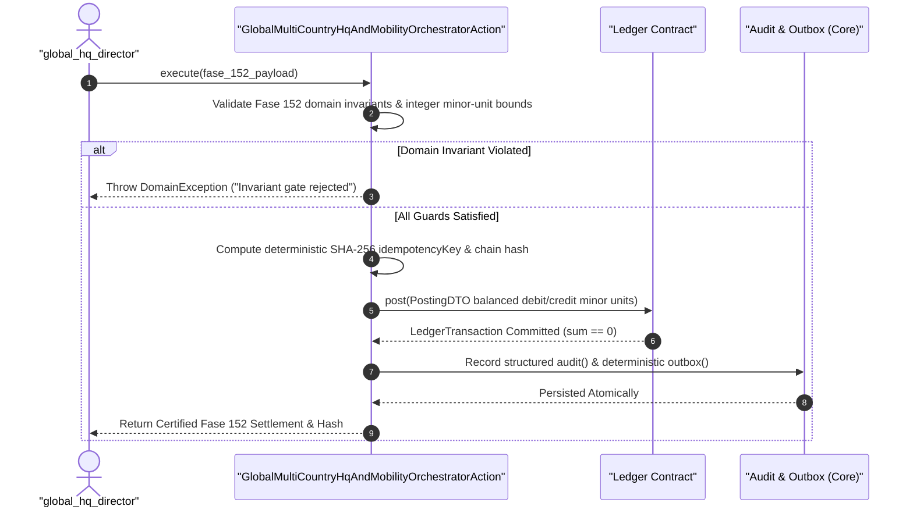
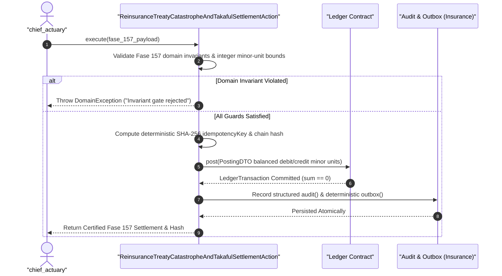
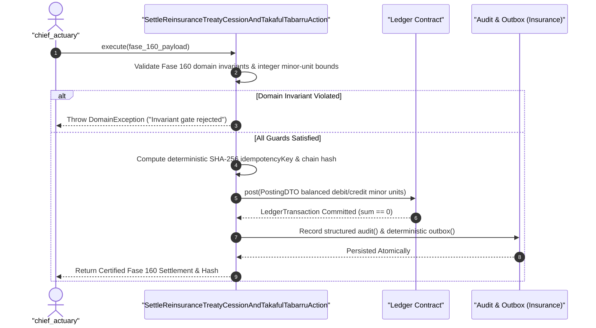
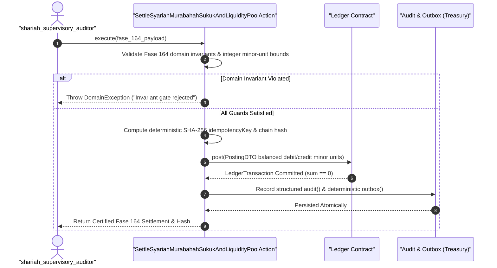
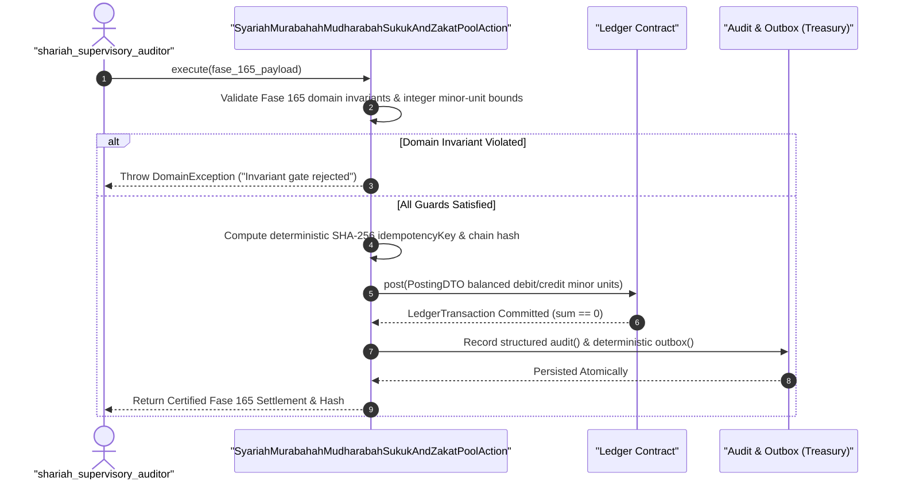
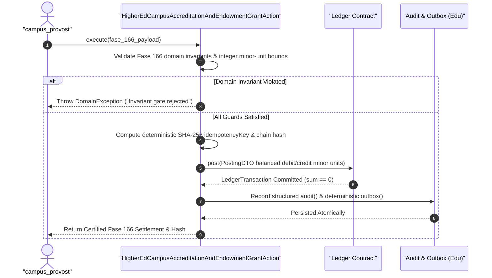
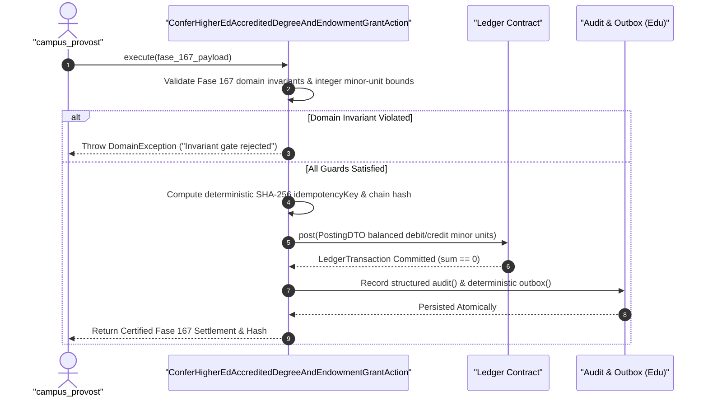
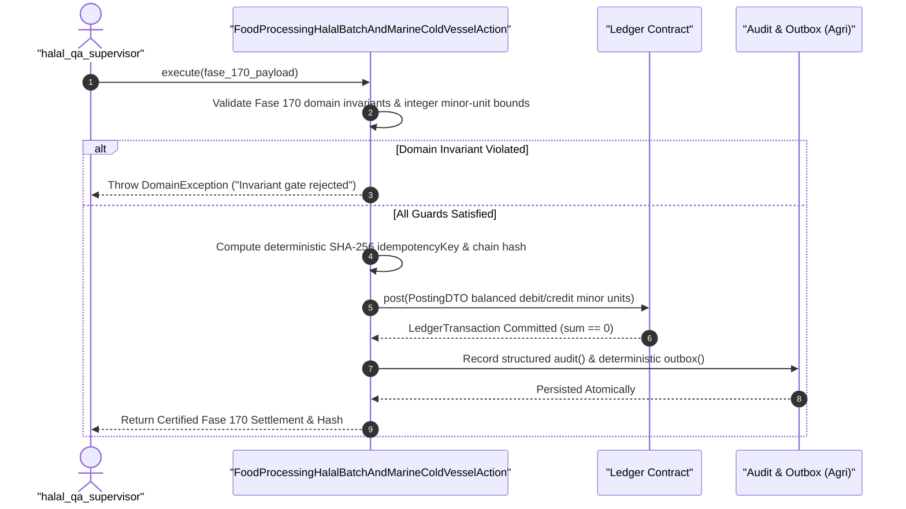

# SPESIFIKASI TEKNIS FASE 151–300: EKSPANSI KONGLOMERASI 30 LINI BISNIS ENTERPRISE, AI FRAUD MESH, GOVERNANCE & RELEASE 300

Dokumen spesifikasi induk Gelombang 3 ini mendefinisikan arsitektur domain, kontrak invarian moneter berbasis integer minor-unit, User Stories (`US-151.1` s/d `US-300.2`), BDD Acceptance Criteria (`Given / When / Then`), serta 150 Sequence Diagram Mermaid untuk Fase 151 s/d Fase 300 lintas 30 lini bisnis enterprise.

---

# BAGIAN 1: GLOBAL COMMAND, CROSS-BORDER MOBILITY & RESILIENCE (FASE 151–155)

---

## FASE 151 — GLOBAL COMMAND: OPERASI MULTI-NEGARA & REGIONAL HQ

### 1. Identitas & Arsitektur Domain
- **Modul Pemilik**: `Core`
- **Action Class**: `GlobalMultiCountryHqAndMobilityOrchestratorAction` (`modules/Core/Application/Wave3/GlobalMultiCountryHqAndMobilityOrchestratorAction.php`)
- **Test Suite**: `tests/Feature/Wave3/Fase151To200Wave3Lines18To30Test.php::test_fase_151_to_155_global_hq_shadow_payroll_tax_equalization_and_bcp_failover`
- **Fokus Deliverable**: Tabel grpregions (APAC, EMEA, Americas simulasi), grpregionalhqs (entitas hukum per wilayah, Fase 27.3 diperluas), grpcountryops (status operasi per negara: stu; serta Market entry playbook otomatis: checklist per negara (izin, pajak, tenaga kerja, data residency) → ApprovalEngine bertingkat → task force terbentuk (bounty Fase.

### 2. User Stories
- **US-151.1 [global_hq_director]**: Sebagai **global_hq_director**, saya ingin **menjalankan orkestrasi deterministik untuk Tabel grpregions (APAC, EMEA, Americas simulasi), grpregionalhqs (entitas hukum per wilayah, Fase 27.3 diperluas), grpcountryops (status operasi per negara: stu**, sehingga **seluruh invarian domain Fase 151 tercatat utuh dalam transaksi integer minor-unit dan rantai hash SHA-256**.
- **US-151.2 [global_mobility_lead]**: Sebagai **global_mobility_lead**, saya ingin **memverifikasi kepatuhan batas risiko dan rekonsiliasi buku besar pada Market entry playbook otomatis: checklist per negara (izin, pajak, tenaga kerja, data residency) → ApprovalEngine bertingkat → task force terbentuk (bounty Fase**, sehingga **setiap penyimpangan ditolak seketika dengan audit trail dan outbox idempoten**.

### 3. BDD Acceptance Criteria
- **AC-151.1 (Skenario Positif)**:
  - **Given** Parameter operasional Fase 151 valid, prasyarat kepatuhan terpenuhi, dan akun bagan buku besar tersedia.
  - **When** `GlobalMultiCountryHqAndMobilityOrchestratorAction::execute()` dijalankan di dalam transaksi atomik.
  - **Then** Perhitungan minor-unit menghasilkan jurnal seimbang (`sum(amount_minor) == 0`), rantai hash diperbarui, serta jejak audit dan outbox terekam deterministik.
- **AC-151.2 (Skenario Negatif)**:
  - **Given** Terdapat pelanggaran invarian bisnis, batas keamanan/regulasi, atau ketidakseimbangan kuantitas pada input Fase 151.
  - **When** `GlobalMultiCountryHqAndMobilityOrchestratorAction::execute()` dievaluasi.
  - **Then** Sistem melempar `DomainException` secara eksplisit dan membatalkan perubahan state maupun posting buku besar.
- **AC-151.3 (Skenario Batas & Idempotensi)**:
  - **Given** Nilai kuantitas/moneter berada tepat pada ambang batas regulasi dan payload dieksekusi ulang dengan kode referensi identik.
  - **When** Eksekusi ganda dilakukan pada `GlobalMultiCountryHqAndMobilityOrchestratorAction`.
  - **Then** Kunci idempotensi SHA-256 mencegah pendebitan ganda di `Ledger` dan menghasilkan hash verifikasi yang identik 100%.

### 4. Sequence Diagram Fase 151


---

## FASE 152 — GLOBAL: CROSS-BORDER PAYROLL, MOBILITY & IMMIGRATION COMPLIANCE

### 1. Identitas & Arsitektur Domain
- **Modul Pemilik**: `Core`
- **Action Class**: `GlobalMultiCountryHqAndMobilityOrchestratorAction` (`modules/Core/Application/Wave3/GlobalMultiCountryHqAndMobilityOrchestratorAction.php`)
- **Test Suite**: `tests/Feature/Wave3/Fase151To200Wave3Lines18To30Test.php::test_fase_151_to_155_global_hq_shadow_payroll_tax_equalization_and_bcp_failover`
- **Fokus Deliverable**: Global payroll engine: 30 negara simulasi (pajak, THR/13th month, BPJS-ekuivalen) → per-country rule table ber-versi → pay run paralel → consolidated cost ke en; serta Assignment contracts: expatriate (Fase 151.4) → kontrak penugasan (durasi, benefit, repatriation clause) → termination benefit terhitung → link ke Contract & HC.

### 2. User Stories
- **US-152.1 [global_hq_director]**: Sebagai **global_hq_director**, saya ingin **menjalankan orkestrasi deterministik untuk Global payroll engine: 30 negara simulasi (pajak, THR/13th month, BPJS-ekuivalen) → per-country rule table ber-versi → pay run paralel → consolidated cost ke en**, sehingga **seluruh invarian domain Fase 152 tercatat utuh dalam transaksi integer minor-unit dan rantai hash SHA-256**.
- **US-152.2 [global_mobility_lead]**: Sebagai **global_mobility_lead**, saya ingin **memverifikasi kepatuhan batas risiko dan rekonsiliasi buku besar pada Assignment contracts: expatriate (Fase 151.4) → kontrak penugasan (durasi, benefit, repatriation clause) → termination benefit terhitung → link ke Contract & HC**, sehingga **setiap penyimpangan ditolak seketika dengan audit trail dan outbox idempoten**.

### 3. BDD Acceptance Criteria
- **AC-152.1 (Skenario Positif)**:
  - **Given** Parameter operasional Fase 152 valid, prasyarat kepatuhan terpenuhi, dan akun bagan buku besar tersedia.
  - **When** `GlobalMultiCountryHqAndMobilityOrchestratorAction::execute()` dijalankan di dalam transaksi atomik.
  - **Then** Perhitungan minor-unit menghasilkan jurnal seimbang (`sum(amount_minor) == 0`), rantai hash diperbarui, serta jejak audit dan outbox terekam deterministik.
- **AC-152.2 (Skenario Negatif)**:
  - **Given** Terdapat pelanggaran invarian bisnis, batas keamanan/regulasi, atau ketidakseimbangan kuantitas pada input Fase 152.
  - **When** `GlobalMultiCountryHqAndMobilityOrchestratorAction::execute()` dievaluasi.
  - **Then** Sistem melempar `DomainException` secara eksplisit dan membatalkan perubahan state maupun posting buku besar.
- **AC-152.3 (Skenario Batas & Idempotensi)**:
  - **Given** Nilai kuantitas/moneter berada tepat pada ambang batas regulasi dan payload dieksekusi ulang dengan kode referensi identik.
  - **When** Eksekusi ganda dilakukan pada `GlobalMultiCountryHqAndMobilityOrchestratorAction`.
  - **Then** Kunci idempotensi SHA-256 mencegah pendebitan ganda di `Ledger` dan menghasilkan hash verifikasi yang identik 100%.

### 4. Sequence Diagram Fase 152



---

## FASE 153 — GLOBAL: SUPPLY CHAIN RESILIENCE & MULTI-SOURCING STRATEGY

### 1. Identitas & Arsitektur Domain
- **Modul Pemilik**: `Core`
- **Action Class**: `GlobalMultiCountryHqAndMobilityOrchestratorAction` (`modules/Core/Application/Wave3/GlobalMultiCountryHqAndMobilityOrchestratorAction.php`)
- **Test Suite**: `tests/Feature/Wave3/Fase151To200Wave3Lines18To30Test.php::test_fase_151_to_155_global_hq_shadow_payroll_tax_equalization_and_bcp_failover`
- **Fokus Deliverable**: Supplier multi-sourcing: setiap kritikal item wajib ≥ 2 pemasok lintas region (aturan konsentrasi, memperluas Fase 32.7) → auto-flag single source → rekomendasi; serta Geopolitical risk feed (simulasi): sanksi, blokade pelabuhan, tarif perang → blast radius (Fase 53.6) ke pesanan & produksi → alternatif routing otomatis (Fase.

### 2. User Stories
- **US-153.1 [global_hq_director]**: Sebagai **global_hq_director**, saya ingin **menjalankan orkestrasi deterministik untuk Supplier multi-sourcing: setiap kritikal item wajib ≥ 2 pemasok lintas region (aturan konsentrasi, memperluas Fase 32.7) → auto-flag single source → rekomendasi**, sehingga **seluruh invarian domain Fase 153 tercatat utuh dalam transaksi integer minor-unit dan rantai hash SHA-256**.
- **US-153.2 [global_mobility_lead]**: Sebagai **global_mobility_lead**, saya ingin **memverifikasi kepatuhan batas risiko dan rekonsiliasi buku besar pada Geopolitical risk feed (simulasi): sanksi, blokade pelabuhan, tarif perang → blast radius (Fase 53.6) ke pesanan & produksi → alternatif routing otomatis (Fase**, sehingga **setiap penyimpangan ditolak seketika dengan audit trail dan outbox idempoten**.

### 3. BDD Acceptance Criteria
- **AC-153.1 (Skenario Positif)**:
  - **Given** Parameter operasional Fase 153 valid, prasyarat kepatuhan terpenuhi, dan akun bagan buku besar tersedia.
  - **When** `GlobalMultiCountryHqAndMobilityOrchestratorAction::execute()` dijalankan di dalam transaksi atomik.
  - **Then** Perhitungan minor-unit menghasilkan jurnal seimbang (`sum(amount_minor) == 0`), rantai hash diperbarui, serta jejak audit dan outbox terekam deterministik.
- **AC-153.2 (Skenario Negatif)**:
  - **Given** Terdapat pelanggaran invarian bisnis, batas keamanan/regulasi, atau ketidakseimbangan kuantitas pada input Fase 153.
  - **When** `GlobalMultiCountryHqAndMobilityOrchestratorAction::execute()` dievaluasi.
  - **Then** Sistem melempar `DomainException` secara eksplisit dan membatalkan perubahan state maupun posting buku besar.
- **AC-153.3 (Skenario Batas & Idempotensi)**:
  - **Given** Nilai kuantitas/moneter berada tepat pada ambang batas regulasi dan payload dieksekusi ulang dengan kode referensi identik.
  - **When** Eksekusi ganda dilakukan pada `GlobalMultiCountryHqAndMobilityOrchestratorAction`.
  - **Then** Kunci idempotensi SHA-256 mencegah pendebitan ganda di `Ledger` dan menghasilkan hash verifikasi yang identik 100%.

### 4. Sequence Diagram Fase 153


---

## FASE 154 — GLOBAL: TALENT GLOBAL, IMMIGRANT WORKFORCE & ETHICAL SOURCING

### 1. Identitas & Arsitektur Domain
- **Modul Pemilik**: `Core`
- **Action Class**: `GlobalMultiCountryHqAndMobilityOrchestratorAction` (`modules/Core/Application/Wave3/GlobalMultiCountryHqAndMobilityOrchestratorAction.php`)
- **Test Suite**: `tests/Feature/Wave3/Fase151To200Wave3Lines18To30Test.php::test_fase_151_to_155_global_hq_shadow_payroll_tax_equalization_and_bcp_failover`
- **Fokus Deliverable**: Global talent pool (memperluas Fase 136.1): kandidat lintas negara → work authorization check → remote/on-site matching → kontrak global (multi-currency comp); serta Ethical sourcing & modern slavery check: audit rantai pasok hulu (tambang, perkebunan, garmen Fase 181) → kuesioner + dokumen + inspeksi lapangan → skor → pelan.

### 2. User Stories
- **US-154.1 [global_hq_director]**: Sebagai **global_hq_director**, saya ingin **menjalankan orkestrasi deterministik untuk Global talent pool (memperluas Fase 136.1): kandidat lintas negara → work authorization check → remote/on-site matching → kontrak global (multi-currency comp)**, sehingga **seluruh invarian domain Fase 154 tercatat utuh dalam transaksi integer minor-unit dan rantai hash SHA-256**.
- **US-154.2 [global_mobility_lead]**: Sebagai **global_mobility_lead**, saya ingin **memverifikasi kepatuhan batas risiko dan rekonsiliasi buku besar pada Ethical sourcing & modern slavery check: audit rantai pasok hulu (tambang, perkebunan, garmen Fase 181) → kuesioner + dokumen + inspeksi lapangan → skor → pelan**, sehingga **setiap penyimpangan ditolak seketika dengan audit trail dan outbox idempoten**.

### 3. BDD Acceptance Criteria
- **AC-154.1 (Skenario Positif)**:
  - **Given** Parameter operasional Fase 154 valid, prasyarat kepatuhan terpenuhi, dan akun bagan buku besar tersedia.
  - **When** `GlobalMultiCountryHqAndMobilityOrchestratorAction::execute()` dijalankan di dalam transaksi atomik.
  - **Then** Perhitungan minor-unit menghasilkan jurnal seimbang (`sum(amount_minor) == 0`), rantai hash diperbarui, serta jejak audit dan outbox terekam deterministik.
- **AC-154.2 (Skenario Negatif)**:
  - **Given** Terdapat pelanggaran invarian bisnis, batas keamanan/regulasi, atau ketidakseimbangan kuantitas pada input Fase 154.
  - **When** `GlobalMultiCountryHqAndMobilityOrchestratorAction::execute()` dievaluasi.
  - **Then** Sistem melempar `DomainException` secara eksplisit dan membatalkan perubahan state maupun posting buku besar.
- **AC-154.3 (Skenario Batas & Idempotensi)**:
  - **Given** Nilai kuantitas/moneter berada tepat pada ambang batas regulasi dan payload dieksekusi ulang dengan kode referensi identik.
  - **When** Eksekusi ganda dilakukan pada `GlobalMultiCountryHqAndMobilityOrchestratorAction`.
  - **Then** Kunci idempotensi SHA-256 mencegah pendebitan ganda di `Ledger` dan menghasilkan hash verifikasi yang identik 100%.

### 4. Sequence Diagram Fase 154


---

## FASE 155 — GLOBAL: PANDEMIC/PUBLIC HEALTH & BUSINESS CONTINUITY LINTAS NEGARA

### 1. Identitas & Arsitektur Domain
- **Modul Pemilik**: `Core`
- **Action Class**: `GlobalMultiCountryHqAndMobilityOrchestratorAction` (`modules/Core/Application/Wave3/GlobalMultiCountryHqAndMobilityOrchestratorAction.php`)
- **Test Suite**: `tests/Feature/Wave3/Fase151To200Wave3Lines18To30Test.php::test_fase_151_to_155_global_hq_shadow_payroll_tax_equalization_and_bcp_failover`
- **Fokus Deliverable**: Global health surveillance bridge (memperluas Fase 107.3): agregasi lintas negara → peta risiko per wilayah operasi → rekomendasi pembatasan operasional (venue; serta Crisis cost & insurance response: klaim asuransi bisnis (Fase 72 diperluas: BI interruption) → trigger dari deklarasi krisis → payout → dampak kas terukur.

### 2. User Stories
- **US-155.1 [global_hq_director]**: Sebagai **global_hq_director**, saya ingin **menjalankan orkestrasi deterministik untuk Global health surveillance bridge (memperluas Fase 107.3): agregasi lintas negara → peta risiko per wilayah operasi → rekomendasi pembatasan operasional (venue**, sehingga **seluruh invarian domain Fase 155 tercatat utuh dalam transaksi integer minor-unit dan rantai hash SHA-256**.
- **US-155.2 [global_mobility_lead]**: Sebagai **global_mobility_lead**, saya ingin **memverifikasi kepatuhan batas risiko dan rekonsiliasi buku besar pada Crisis cost & insurance response: klaim asuransi bisnis (Fase 72 diperluas: BI interruption) → trigger dari deklarasi krisis → payout → dampak kas terukur**, sehingga **setiap penyimpangan ditolak seketika dengan audit trail dan outbox idempoten**.

### 3. BDD Acceptance Criteria
- **AC-155.1 (Skenario Positif)**:
  - **Given** Parameter operasional Fase 155 valid, prasyarat kepatuhan terpenuhi, dan akun bagan buku besar tersedia.
  - **When** `GlobalMultiCountryHqAndMobilityOrchestratorAction::execute()` dijalankan di dalam transaksi atomik.
  - **Then** Perhitungan minor-unit menghasilkan jurnal seimbang (`sum(amount_minor) == 0`), rantai hash diperbarui, serta jejak audit dan outbox terekam deterministik.
- **AC-155.2 (Skenario Negatif)**:
  - **Given** Terdapat pelanggaran invarian bisnis, batas keamanan/regulasi, atau ketidakseimbangan kuantitas pada input Fase 155.
  - **When** `GlobalMultiCountryHqAndMobilityOrchestratorAction::execute()` dievaluasi.
  - **Then** Sistem melempar `DomainException` secara eksplisit dan membatalkan perubahan state maupun posting buku besar.
- **AC-155.3 (Skenario Batas & Idempotensi)**:
  - **Given** Nilai kuantitas/moneter berada tepat pada ambang batas regulasi dan payload dieksekusi ulang dengan kode referensi identik.
  - **When** Eksekusi ganda dilakukan pada `GlobalMultiCountryHqAndMobilityOrchestratorAction`.
  - **Then** Kunci idempotensi SHA-256 mencegah pendebitan ganda di `Ledger` dan menghasilkan hash verifikasi yang identik 100%.

### 4. Sequence Diagram Fase 155


---

# BAGIAN 2: LINI 18 — ASURANSI, REASURANSI, CAT MODELLING & TAKAFUL (FASE 156–160)

---

## FASE 156 — LINI 18: ASURANSI & REASURANSI PENUH (UNDERWRITING, ACTUARIAL, TREATY)

### 1. Identitas & Arsitektur Domain
- **Modul Pemilik**: `Insurance`
- **Action Class**: `ReinsuranceTreatyCatastropheAndTakafulSettlementAction` (`modules/Core/Application/Wave3/ReinsuranceTreatyCatastropheAndTakafulSettlementAction.php`)
- **Test Suite**: `tests/Feature/Wave3/Fase151To200Wave3Lines18To30Test.php::test_fase_156_to_160_reinsurance_quota_xol_waterfall_cat_trigger_and_takaful_surplus`
- **Fokus Deliverable**: Modul Ins (ins lanjutan dari 72): provider, MenuRegistry "Asuransi & Reasuransi", roles (underwriter, actuary, claimsadjuster, reinsurancemgr, brokeragent), pol; serta Underwriting engine: risk assessment (data telematik kendaraan Fase 68, gedung Fase 76, kesehatan Fase 87, tambang Fase 93) → rating engine (faktor risiko deter.

### 2. User Stories
- **US-156.1 [chief_actuary]**: Sebagai **chief_actuary**, saya ingin **menjalankan orkestrasi deterministik untuk Modul Ins (ins lanjutan dari 72): provider, MenuRegistry "Asuransi & Reasuransi", roles (underwriter, actuary, claimsadjuster, reinsurancemgr, brokeragent), pol**, sehingga **seluruh invarian domain Fase 156 tercatat utuh dalam transaksi integer minor-unit dan rantai hash SHA-256**.
- **US-156.2 [reinsurance_treaty_mgr]**: Sebagai **reinsurance_treaty_mgr**, saya ingin **memverifikasi kepatuhan batas risiko dan rekonsiliasi buku besar pada Underwriting engine: risk assessment (data telematik kendaraan Fase 68, gedung Fase 76, kesehatan Fase 87, tambang Fase 93) → rating engine (faktor risiko deter**, sehingga **setiap penyimpangan ditolak seketika dengan audit trail dan outbox idempoten**.

### 3. BDD Acceptance Criteria
- **AC-156.1 (Skenario Positif)**:
  - **Given** Parameter operasional Fase 156 valid, prasyarat kepatuhan terpenuhi, dan akun bagan buku besar tersedia.
  - **When** `ReinsuranceTreatyCatastropheAndTakafulSettlementAction::execute()` dijalankan di dalam transaksi atomik.
  - **Then** Perhitungan minor-unit menghasilkan jurnal seimbang (`sum(amount_minor) == 0`), rantai hash diperbarui, serta jejak audit dan outbox terekam deterministik.
- **AC-156.2 (Skenario Negatif)**:
  - **Given** Terdapat pelanggaran invarian bisnis, batas keamanan/regulasi, atau ketidakseimbangan kuantitas pada input Fase 156.
  - **When** `ReinsuranceTreatyCatastropheAndTakafulSettlementAction::execute()` dievaluasi.
  - **Then** Sistem melempar `DomainException` secara eksplisit dan membatalkan perubahan state maupun posting buku besar.
- **AC-156.3 (Skenario Batas & Idempotensi)**:
  - **Given** Nilai kuantitas/moneter berada tepat pada ambang batas regulasi dan payload dieksekusi ulang dengan kode referensi identik.
  - **When** Eksekusi ganda dilakukan pada `ReinsuranceTreatyCatastropheAndTakafulSettlementAction`.
  - **Then** Kunci idempotensi SHA-256 mencegah pendebitan ganda di `Ledger` dan menghasilkan hash verifikasi yang identik 100%.

### 4. Sequence Diagram Fase 156


---

## FASE 157 — LINI 18: REASURANSI, KAPITAL & CAT MODELLING

### 1. Identitas & Arsitektur Domain
- **Modul Pemilik**: `Insurance`
- **Action Class**: `ReinsuranceTreatyCatastropheAndTakafulSettlementAction` (`modules/Core/Application/Wave3/ReinsuranceTreatyCatastropheAndTakafulSettlementAction.php`)
- **Test Suite**: `tests/Feature/Wave3/Fase151To200Wave3Lines18To30Test.php::test_fase_156_to_160_reinsurance_quota_xol_waterfall_cat_trigger_and_takaful_surplus`
- **Fokus Deliverable**: Treaty & facultative reinsurance: kontrak proporsi (quota share), excess of loss, stop loss → otomatis mengalihkan bagian risiko ke reinsurer (Party) → settleme; serta Ceded/assumed premium ledger: jurnal reinsurance (ceded premium, commission, claims recoverable) → subledger terpisah → ins:reinsurance-audit = 0 selisih.

### 2. User Stories
- **US-157.1 [chief_actuary]**: Sebagai **chief_actuary**, saya ingin **menjalankan orkestrasi deterministik untuk Treaty & facultative reinsurance: kontrak proporsi (quota share), excess of loss, stop loss → otomatis mengalihkan bagian risiko ke reinsurer (Party) → settleme**, sehingga **seluruh invarian domain Fase 157 tercatat utuh dalam transaksi integer minor-unit dan rantai hash SHA-256**.
- **US-157.2 [reinsurance_treaty_mgr]**: Sebagai **reinsurance_treaty_mgr**, saya ingin **memverifikasi kepatuhan batas risiko dan rekonsiliasi buku besar pada Ceded/assumed premium ledger: jurnal reinsurance (ceded premium, commission, claims recoverable) → subledger terpisah → ins:reinsurance-audit = 0 selisih**, sehingga **setiap penyimpangan ditolak seketika dengan audit trail dan outbox idempoten**.

### 3. BDD Acceptance Criteria
- **AC-157.1 (Skenario Positif)**:
  - **Given** Parameter operasional Fase 157 valid, prasyarat kepatuhan terpenuhi, dan akun bagan buku besar tersedia.
  - **When** `ReinsuranceTreatyCatastropheAndTakafulSettlementAction::execute()` dijalankan di dalam transaksi atomik.
  - **Then** Perhitungan minor-unit menghasilkan jurnal seimbang (`sum(amount_minor) == 0`), rantai hash diperbarui, serta jejak audit dan outbox terekam deterministik.
- **AC-157.2 (Skenario Negatif)**:
  - **Given** Terdapat pelanggaran invarian bisnis, batas keamanan/regulasi, atau ketidakseimbangan kuantitas pada input Fase 157.
  - **When** `ReinsuranceTreatyCatastropheAndTakafulSettlementAction::execute()` dievaluasi.
  - **Then** Sistem melempar `DomainException` secara eksplisit dan membatalkan perubahan state maupun posting buku besar.
- **AC-157.3 (Skenario Batas & Idempotensi)**:
  - **Given** Nilai kuantitas/moneter berada tepat pada ambang batas regulasi dan payload dieksekusi ulang dengan kode referensi identik.
  - **When** Eksekusi ganda dilakukan pada `ReinsuranceTreatyCatastropheAndTakafulSettlementAction`.
  - **Then** Kunci idempotensi SHA-256 mencegah pendebitan ganda di `Ledger` dan menghasilkan hash verifikasi yang identik 100%.

### 4. Sequence Diagram Fase 157



---

## FASE 158 — LINI 18: INSURANCE EMBEDDED 30 LINI & BROKER MARKETPLACE

### 1. Identitas & Arsitektur Domain
- **Modul Pemilik**: `Insurance`
- **Action Class**: `SettleReinsuranceTreatyCessionAndTakafulTabarruAction` (`modules/Insurance/Application/Actions/SettleReinsuranceTreatyCessionAndTakafulTabarruAction.php`)
- **Test Suite**: `tests/Feature/Wave3/Fase151To200Wave3Lines18To30Test.php::test_fase_156_to_160_reinsurance_quota_xol_waterfall_cat_trigger_and_takaful_surplus`
- **Fokus Deliverable**: Embedded insurance matrix: satu katalog proteksi tertanam di seluruh lini — kredit HODL-to-Drive (Fase 5C), booking hotel (cancellation), tiket venue, pengirima; serta Parametric trigger otomatis (memperluas Fase 72.2): cuaca index (curah hujan < ambang → petani), batal event (Fase 113.3), bencana per region (Fase 157.4) → pay.

### 2. User Stories
- **US-158.1 [chief_actuary]**: Sebagai **chief_actuary**, saya ingin **menjalankan orkestrasi deterministik untuk Embedded insurance matrix: satu katalog proteksi tertanam di seluruh lini — kredit HODL-to-Drive (Fase 5C), booking hotel (cancellation), tiket venue, pengirima**, sehingga **seluruh invarian domain Fase 158 tercatat utuh dalam transaksi integer minor-unit dan rantai hash SHA-256**.
- **US-158.2 [reinsurance_treaty_mgr]**: Sebagai **reinsurance_treaty_mgr**, saya ingin **memverifikasi kepatuhan batas risiko dan rekonsiliasi buku besar pada Parametric trigger otomatis (memperluas Fase 72.2): cuaca index (curah hujan < ambang → petani), batal event (Fase 113.3), bencana per region (Fase 157.4) → pay**, sehingga **setiap penyimpangan ditolak seketika dengan audit trail dan outbox idempoten**.

### 3. BDD Acceptance Criteria
- **AC-158.1 (Skenario Positif)**:
  - **Given** Parameter operasional Fase 158 valid, prasyarat kepatuhan terpenuhi, dan akun bagan buku besar tersedia.
  - **When** `SettleReinsuranceTreatyCessionAndTakafulTabarruAction::execute()` dijalankan di dalam transaksi atomik.
  - **Then** Perhitungan minor-unit menghasilkan jurnal seimbang (`sum(amount_minor) == 0`), rantai hash diperbarui, serta jejak audit dan outbox terekam deterministik.
- **AC-158.2 (Skenario Negatif)**:
  - **Given** Terdapat pelanggaran invarian bisnis, batas keamanan/regulasi, atau ketidakseimbangan kuantitas pada input Fase 158.
  - **When** `SettleReinsuranceTreatyCessionAndTakafulTabarruAction::execute()` dievaluasi.
  - **Then** Sistem melempar `DomainException` secara eksplisit dan membatalkan perubahan state maupun posting buku besar.
- **AC-158.3 (Skenario Batas & Idempotensi)**:
  - **Given** Nilai kuantitas/moneter berada tepat pada ambang batas regulasi dan payload dieksekusi ulang dengan kode referensi identik.
  - **When** Eksekusi ganda dilakukan pada `SettleReinsuranceTreatyCessionAndTakafulTabarruAction`.
  - **Then** Kunci idempotensi SHA-256 mencegah pendebitan ganda di `Ledger` dan menghasilkan hash verifikasi yang identik 100%.

### 4. Sequence Diagram Fase 158


---

## FASE 159 — LINI 18: LIFE, HEALTH & WELLNESS INSURANCE ADVANCED

### 1. Identitas & Arsitektur Domain
- **Modul Pemilik**: `Insurance`
- **Action Class**: `ReinsuranceTreatyCatastropheAndTakafulSettlementAction` (`modules/Core/Application/Wave3/ReinsuranceTreatyCatastropheAndTakafulSettlementAction.php`)
- **Test Suite**: `tests/Feature/Wave3/Fase151To200Wave3Lines18To30Test.php::test_fase_156_to_160_reinsurance_quota_xol_waterfall_cat_trigger_and_takaful_surplus`
- **Fokus Deliverable**: Term life & saving plans: premi periodik → death benefit / maturity → underwriting medis (link ke RS Fase 87 data dengan consent) → beneficiary management (Part; serta Health insurance full: reimburse vs cashless di RS jaringan (Fase 88.2 diperluas) → e-claim real-time → cashless authorization ke RS (guarantee letter gapless).

### 2. User Stories
- **US-159.1 [chief_actuary]**: Sebagai **chief_actuary**, saya ingin **menjalankan orkestrasi deterministik untuk Term life & saving plans: premi periodik → death benefit / maturity → underwriting medis (link ke RS Fase 87 data dengan consent) → beneficiary management (Part**, sehingga **seluruh invarian domain Fase 159 tercatat utuh dalam transaksi integer minor-unit dan rantai hash SHA-256**.
- **US-159.2 [reinsurance_treaty_mgr]**: Sebagai **reinsurance_treaty_mgr**, saya ingin **memverifikasi kepatuhan batas risiko dan rekonsiliasi buku besar pada Health insurance full: reimburse vs cashless di RS jaringan (Fase 88.2 diperluas) → e-claim real-time → cashless authorization ke RS (guarantee letter gapless)**, sehingga **setiap penyimpangan ditolak seketika dengan audit trail dan outbox idempoten**.

### 3. BDD Acceptance Criteria
- **AC-159.1 (Skenario Positif)**:
  - **Given** Parameter operasional Fase 159 valid, prasyarat kepatuhan terpenuhi, dan akun bagan buku besar tersedia.
  - **When** `ReinsuranceTreatyCatastropheAndTakafulSettlementAction::execute()` dijalankan di dalam transaksi atomik.
  - **Then** Perhitungan minor-unit menghasilkan jurnal seimbang (`sum(amount_minor) == 0`), rantai hash diperbarui, serta jejak audit dan outbox terekam deterministik.
- **AC-159.2 (Skenario Negatif)**:
  - **Given** Terdapat pelanggaran invarian bisnis, batas keamanan/regulasi, atau ketidakseimbangan kuantitas pada input Fase 159.
  - **When** `ReinsuranceTreatyCatastropheAndTakafulSettlementAction::execute()` dievaluasi.
  - **Then** Sistem melempar `DomainException` secara eksplisit dan membatalkan perubahan state maupun posting buku besar.
- **AC-159.3 (Skenario Batas & Idempotensi)**:
  - **Given** Nilai kuantitas/moneter berada tepat pada ambang batas regulasi dan payload dieksekusi ulang dengan kode referensi identik.
  - **When** Eksekusi ganda dilakukan pada `ReinsuranceTreatyCatastropheAndTakafulSettlementAction`.
  - **Then** Kunci idempotensi SHA-256 mencegah pendebitan ganda di `Ledger` dan menghasilkan hash verifikasi yang identik 100%.

### 4. Sequence Diagram Fase 159


---

## FASE 160 — LINI 18: TAKAFUL, AGRI-INSURANCE & INSURANCE OPS COMMAND

### 1. Identitas & Arsitektur Domain
- **Modul Pemilik**: `Insurance`
- **Action Class**: `SettleReinsuranceTreatyCessionAndTakafulTabarruAction` (`modules/Insurance/Application/Actions/SettleReinsuranceTreatyCessionAndTakafulTabarruAction.php`)
- **Test Suite**: `tests/Feature/Wave3/Fase151To200Wave3Lines18To30Test.php::test_fase_156_to_160_reinsurance_quota_xol_waterfall_cat_trigger_and_takaful_surplus`
- **Fokus Deliverable**: Takaful window (jembatan ke Lini 19 Syariah): dana partisipasi (mutual), wakalah fee, contribution → klaim dari dana → surplus dibagi (hibah/retensi) → syariah; serta Agri insurance lanjutan (memperluas 156.5): parametric yield/curah hujan (link NDVI Fase 86) → payout ke petani plasma (Fase 62) → dikurangi otomatis dari cicil.

### 2. User Stories
- **US-160.1 [chief_actuary]**: Sebagai **chief_actuary**, saya ingin **menjalankan orkestrasi deterministik untuk Takaful window (jembatan ke Lini 19 Syariah): dana partisipasi (mutual), wakalah fee, contribution → klaim dari dana → surplus dibagi (hibah/retensi) → syariah**, sehingga **seluruh invarian domain Fase 160 tercatat utuh dalam transaksi integer minor-unit dan rantai hash SHA-256**.
- **US-160.2 [reinsurance_treaty_mgr]**: Sebagai **reinsurance_treaty_mgr**, saya ingin **memverifikasi kepatuhan batas risiko dan rekonsiliasi buku besar pada Agri insurance lanjutan (memperluas 156.5): parametric yield/curah hujan (link NDVI Fase 86) → payout ke petani plasma (Fase 62) → dikurangi otomatis dari cicil**, sehingga **setiap penyimpangan ditolak seketika dengan audit trail dan outbox idempoten**.

### 3. BDD Acceptance Criteria
- **AC-160.1 (Skenario Positif)**:
  - **Given** Parameter operasional Fase 160 valid, prasyarat kepatuhan terpenuhi, dan akun bagan buku besar tersedia.
  - **When** `SettleReinsuranceTreatyCessionAndTakafulTabarruAction::execute()` dijalankan di dalam transaksi atomik.
  - **Then** Perhitungan minor-unit menghasilkan jurnal seimbang (`sum(amount_minor) == 0`), rantai hash diperbarui, serta jejak audit dan outbox terekam deterministik.
- **AC-160.2 (Skenario Negatif)**:
  - **Given** Terdapat pelanggaran invarian bisnis, batas keamanan/regulasi, atau ketidakseimbangan kuantitas pada input Fase 160.
  - **When** `SettleReinsuranceTreatyCessionAndTakafulTabarruAction::execute()` dievaluasi.
  - **Then** Sistem melempar `DomainException` secara eksplisit dan membatalkan perubahan state maupun posting buku besar.
- **AC-160.3 (Skenario Batas & Idempotensi)**:
  - **Given** Nilai kuantitas/moneter berada tepat pada ambang batas regulasi dan payload dieksekusi ulang dengan kode referensi identik.
  - **When** Eksekusi ganda dilakukan pada `SettleReinsuranceTreatyCessionAndTakafulTabarruAction`.
  - **Then** Kunci idempotensi SHA-256 mencegah pendebitan ganda di `Ledger` dan menghasilkan hash verifikasi yang identik 100%.

### 4. Sequence Diagram Fase 160



---

# BAGIAN 3: LINI 19 — KEUANGAN SYARIAH, SUKUK, BMT & ZAKAT/WAKAF (FASE 161–165)

---

## FASE 161 — LINI 19: KEUANGAN SYARIAH (BANK SYARIAH, MURABAHAH, MUDHARABAH)

### 1. Identitas & Arsitektur Domain
- **Modul Pemilik**: `Treasury`
- **Action Class**: `SyariahMurabahahMudharabahSukukAndZakatPoolAction` (`modules/Core/Application/Wave3/SyariahMurabahahMudharabahSukukAndZakatPoolAction.php`)
- **Test Suite**: `tests/Feature/Wave3/Fase151To200Wave3Lines18To30Test.php::test_fase_161_to_165_syariah_murabahah_mudharabah_sukuk_charity_routing_and_zakat_pool`
- **Fokus Deliverable**: Modul Syariah (syb): provider, MenuRegistry "Keuangan Syariah", roles (syariahofficer, shariahboard, muamalahteller), policies, arch test; tabel sybproducts (mu; serta Accounting PSAK 102/103 simulasi: akun terpisah dari ledger konvensional (Fase 1) dengan sign khas (korporasi = akad), markup margin diakui gradual, akad wajib.

### 2. User Stories
- **US-161.1 [shariah_supervisory_auditor]**: Sebagai **shariah_supervisory_auditor**, saya ingin **menjalankan orkestrasi deterministik untuk Modul Syariah (syb): provider, MenuRegistry "Keuangan Syariah", roles (syariahofficer, shariahboard, muamalahteller), policies, arch test; tabel sybproducts (mu**, sehingga **seluruh invarian domain Fase 161 tercatat utuh dalam transaksi integer minor-unit dan rantai hash SHA-256**.
- **US-161.2 [islamic_treasury_dealer]**: Sebagai **islamic_treasury_dealer**, saya ingin **memverifikasi kepatuhan batas risiko dan rekonsiliasi buku besar pada Accounting PSAK 102/103 simulasi: akun terpisah dari ledger konvensional (Fase 1) dengan sign khas (korporasi = akad), markup margin diakui gradual, akad wajib**, sehingga **setiap penyimpangan ditolak seketika dengan audit trail dan outbox idempoten**.

### 3. BDD Acceptance Criteria
- **AC-161.1 (Skenario Positif)**:
  - **Given** Parameter operasional Fase 161 valid, prasyarat kepatuhan terpenuhi, dan akun bagan buku besar tersedia.
  - **When** `SyariahMurabahahMudharabahSukukAndZakatPoolAction::execute()` dijalankan di dalam transaksi atomik.
  - **Then** Perhitungan minor-unit menghasilkan jurnal seimbang (`sum(amount_minor) == 0`), rantai hash diperbarui, serta jejak audit dan outbox terekam deterministik.
- **AC-161.2 (Skenario Negatif)**:
  - **Given** Terdapat pelanggaran invarian bisnis, batas keamanan/regulasi, atau ketidakseimbangan kuantitas pada input Fase 161.
  - **When** `SyariahMurabahahMudharabahSukukAndZakatPoolAction::execute()` dievaluasi.
  - **Then** Sistem melempar `DomainException` secara eksplisit dan membatalkan perubahan state maupun posting buku besar.
- **AC-161.3 (Skenario Batas & Idempotensi)**:
  - **Given** Nilai kuantitas/moneter berada tepat pada ambang batas regulasi dan payload dieksekusi ulang dengan kode referensi identik.
  - **When** Eksekusi ganda dilakukan pada `SyariahMurabahahMudharabahSukukAndZakatPoolAction`.
  - **Then** Kunci idempotensi SHA-256 mencegah pendebitan ganda di `Ledger` dan menghasilkan hash verifikasi yang identik 100%.

### 4. Sequence Diagram Fase 161


---

## FASE 162 — LINI 19: SUKUK, IJARAH & WEALTH SYARIAH

### 1. Identitas & Arsitektur Domain
- **Modul Pemilik**: `Treasury`
- **Action Class**: `SettleSyariahMurabahahSukukAndLiquidityPoolAction` (`modules/Treasury/Application/Actions/SettleSyariahMurabahahSukukAndLiquidityPoolAction.php`)
- **Test Suite**: `tests/Feature/Wave3/Fase151To200Wave3Lines18To30Test.php::test_fase_161_to_165_syariah_murabahah_mudharabah_sukuk_charity_routing_and_zakat_pool`
- **Fokus Deliverable**: Sukuk issuance: aset riil/ushul maal (gedung, armada) → SPV simulasi → token sukuk (memperluas RWA Fase 71) → periodic distribution (sewa ijarah / bagi hasil) →; serta Ijarah & ijara muntahia bittamleek: sewa aset + opsi akhir jual (hak beli) → amortisasi sewa → transfer kepemilikan saat opsi dieksekusi → terhubung modul Contr.

### 2. User Stories
- **US-162.1 [shariah_supervisory_auditor]**: Sebagai **shariah_supervisory_auditor**, saya ingin **menjalankan orkestrasi deterministik untuk Sukuk issuance: aset riil/ushul maal (gedung, armada) → SPV simulasi → token sukuk (memperluas RWA Fase 71) → periodic distribution (sewa ijarah / bagi hasil) →**, sehingga **seluruh invarian domain Fase 162 tercatat utuh dalam transaksi integer minor-unit dan rantai hash SHA-256**.
- **US-162.2 [islamic_treasury_dealer]**: Sebagai **islamic_treasury_dealer**, saya ingin **memverifikasi kepatuhan batas risiko dan rekonsiliasi buku besar pada Ijarah & ijara muntahia bittamleek: sewa aset + opsi akhir jual (hak beli) → amortisasi sewa → transfer kepemilikan saat opsi dieksekusi → terhubung modul Contr**, sehingga **setiap penyimpangan ditolak seketika dengan audit trail dan outbox idempoten**.

### 3. BDD Acceptance Criteria
- **AC-162.1 (Skenario Positif)**:
  - **Given** Parameter operasional Fase 162 valid, prasyarat kepatuhan terpenuhi, dan akun bagan buku besar tersedia.
  - **When** `SettleSyariahMurabahahSukukAndLiquidityPoolAction::execute()` dijalankan di dalam transaksi atomik.
  - **Then** Perhitungan minor-unit menghasilkan jurnal seimbang (`sum(amount_minor) == 0`), rantai hash diperbarui, serta jejak audit dan outbox terekam deterministik.
- **AC-162.2 (Skenario Negatif)**:
  - **Given** Terdapat pelanggaran invarian bisnis, batas keamanan/regulasi, atau ketidakseimbangan kuantitas pada input Fase 162.
  - **When** `SettleSyariahMurabahahSukukAndLiquidityPoolAction::execute()` dievaluasi.
  - **Then** Sistem melempar `DomainException` secara eksplisit dan membatalkan perubahan state maupun posting buku besar.
- **AC-162.3 (Skenario Batas & Idempotensi)**:
  - **Given** Nilai kuantitas/moneter berada tepat pada ambang batas regulasi dan payload dieksekusi ulang dengan kode referensi identik.
  - **When** Eksekusi ganda dilakukan pada `SettleSyariahMurabahahSukukAndLiquidityPoolAction`.
  - **Then** Kunci idempotensi SHA-256 mencegah pendebitan ganda di `Ledger` dan menghasilkan hash verifikasi yang identik 100%.

### 4. Sequence Diagram Fase 162


---

## FASE 163 — LINI 19: MICROFINANCE, BMT & ECONOMIC EMPOWERMENT

### 1. Identitas & Arsitektur Domain
- **Modul Pemilik**: `Treasury`
- **Action Class**: `SyariahMurabahahMudharabahSukukAndZakatPoolAction` (`modules/Core/Application/Wave3/SyariahMurabahahMudharabahSukukAndZakatPoolAction.php`)
- **Test Suite**: `tests/Feature/Wave3/Fase151To200Wave3Lines18To30Test.php::test_fase_161_to_165_syariah_murabahah_mudharabah_sukuk_charity_routing_and_zakat_pool`
- **Fokus Deliverable**: BMT/koperasi simulasi: kelompok anggota → simpanan pokok/wajib/sukarela → pembiayaan mikro kelompok (musyarakah/qardh) → angsuran kolektif → denda ke kas amil; serta Gig worker financing (bridge ke Fase 85/136): riwayat penghasilan bounty/payout → skor → plafon mikro → angsuran auto-deduct saat payout masuk (waterfall) → def.

### 2. User Stories
- **US-163.1 [shariah_supervisory_auditor]**: Sebagai **shariah_supervisory_auditor**, saya ingin **menjalankan orkestrasi deterministik untuk BMT/koperasi simulasi: kelompok anggota → simpanan pokok/wajib/sukarela → pembiayaan mikro kelompok (musyarakah/qardh) → angsuran kolektif → denda ke kas amil**, sehingga **seluruh invarian domain Fase 163 tercatat utuh dalam transaksi integer minor-unit dan rantai hash SHA-256**.
- **US-163.2 [islamic_treasury_dealer]**: Sebagai **islamic_treasury_dealer**, saya ingin **memverifikasi kepatuhan batas risiko dan rekonsiliasi buku besar pada Gig worker financing (bridge ke Fase 85/136): riwayat penghasilan bounty/payout → skor → plafon mikro → angsuran auto-deduct saat payout masuk (waterfall) → def**, sehingga **setiap penyimpangan ditolak seketika dengan audit trail dan outbox idempoten**.

### 3. BDD Acceptance Criteria
- **AC-163.1 (Skenario Positif)**:
  - **Given** Parameter operasional Fase 163 valid, prasyarat kepatuhan terpenuhi, dan akun bagan buku besar tersedia.
  - **When** `SyariahMurabahahMudharabahSukukAndZakatPoolAction::execute()` dijalankan di dalam transaksi atomik.
  - **Then** Perhitungan minor-unit menghasilkan jurnal seimbang (`sum(amount_minor) == 0`), rantai hash diperbarui, serta jejak audit dan outbox terekam deterministik.
- **AC-163.2 (Skenario Negatif)**:
  - **Given** Terdapat pelanggaran invarian bisnis, batas keamanan/regulasi, atau ketidakseimbangan kuantitas pada input Fase 163.
  - **When** `SyariahMurabahahMudharabahSukukAndZakatPoolAction::execute()` dievaluasi.
  - **Then** Sistem melempar `DomainException` secara eksplisit dan membatalkan perubahan state maupun posting buku besar.
- **AC-163.3 (Skenario Batas & Idempotensi)**:
  - **Given** Nilai kuantitas/moneter berada tepat pada ambang batas regulasi dan payload dieksekusi ulang dengan kode referensi identik.
  - **When** Eksekusi ganda dilakukan pada `SyariahMurabahahMudharabahSukukAndZakatPoolAction`.
  - **Then** Kunci idempotensi SHA-256 mencegah pendebitan ganda di `Ledger` dan menghasilkan hash verifikasi yang identik 100%.

### 4. Sequence Diagram Fase 163


---

## FASE 164 — LINI 19: ISLAMIC TRADE FINANCE & CROSS-BORDER SYARIAH

### 1. Identitas & Arsitektur Domain
- **Modul Pemilik**: `Treasury`
- **Action Class**: `SettleSyariahMurabahahSukukAndLiquidityPoolAction` (`modules/Treasury/Application/Actions/SettleSyariahMurabahahSukukAndLiquidityPoolAction.php`)
- **Test Suite**: `tests/Feature/Wave3/Fase151To200Wave3Lines18To30Test.php::test_fase_161_to_165_syariah_murabahah_mudharabah_sukuk_charity_routing_and_zakat_pool`
- **Fokus Deliverable**: Islamic LC (istisna' + wakalah): LC syariah untuk impor (Fase 50.1 diperluas) → akad istisna' untuk produksi + wakalah bi jualah untuk distribusi → settlement v; serta Salam & parallel salam untuk komoditas agro (Fase 171): pembayaran di muka petani → pengiriman kemudian → hedge via parallel contract → meniru pola forward Fase.

### 2. User Stories
- **US-164.1 [shariah_supervisory_auditor]**: Sebagai **shariah_supervisory_auditor**, saya ingin **menjalankan orkestrasi deterministik untuk Islamic LC (istisna' + wakalah): LC syariah untuk impor (Fase 50.1 diperluas) → akad istisna' untuk produksi + wakalah bi jualah untuk distribusi → settlement v**, sehingga **seluruh invarian domain Fase 164 tercatat utuh dalam transaksi integer minor-unit dan rantai hash SHA-256**.
- **US-164.2 [islamic_treasury_dealer]**: Sebagai **islamic_treasury_dealer**, saya ingin **memverifikasi kepatuhan batas risiko dan rekonsiliasi buku besar pada Salam & parallel salam untuk komoditas agro (Fase 171): pembayaran di muka petani → pengiriman kemudian → hedge via parallel contract → meniru pola forward Fase**, sehingga **setiap penyimpangan ditolak seketika dengan audit trail dan outbox idempoten**.

### 3. BDD Acceptance Criteria
- **AC-164.1 (Skenario Positif)**:
  - **Given** Parameter operasional Fase 164 valid, prasyarat kepatuhan terpenuhi, dan akun bagan buku besar tersedia.
  - **When** `SettleSyariahMurabahahSukukAndLiquidityPoolAction::execute()` dijalankan di dalam transaksi atomik.
  - **Then** Perhitungan minor-unit menghasilkan jurnal seimbang (`sum(amount_minor) == 0`), rantai hash diperbarui, serta jejak audit dan outbox terekam deterministik.
- **AC-164.2 (Skenario Negatif)**:
  - **Given** Terdapat pelanggaran invarian bisnis, batas keamanan/regulasi, atau ketidakseimbangan kuantitas pada input Fase 164.
  - **When** `SettleSyariahMurabahahSukukAndLiquidityPoolAction::execute()` dievaluasi.
  - **Then** Sistem melempar `DomainException` secara eksplisit dan membatalkan perubahan state maupun posting buku besar.
- **AC-164.3 (Skenario Batas & Idempotensi)**:
  - **Given** Nilai kuantitas/moneter berada tepat pada ambang batas regulasi dan payload dieksekusi ulang dengan kode referensi identik.
  - **When** Eksekusi ganda dilakukan pada `SettleSyariahMurabahahSukukAndLiquidityPoolAction`.
  - **Then** Kunci idempotensi SHA-256 mencegah pendebitan ganda di `Ledger` dan menghasilkan hash verifikasi yang identik 100%.

### 4. Sequence Diagram Fase 164



---

## FASE 165 — LINI 19: SYARIAH OPERATIONS, COMPLIANCE & INTEGRATION 30 LINI

### 1. Identitas & Arsitektur Domain
- **Modul Pemilik**: `Treasury`
- **Action Class**: `SyariahMurabahahMudharabahSukukAndZakatPoolAction` (`modules/Core/Application/Wave3/SyariahMurabahahMudharabahSukukAndZakatPoolAction.php`)
- **Test Suite**: `tests/Feature/Wave3/Fase151To200Wave3Lines18To30Test.php::test_fase_161_to_165_syariah_murabahah_mudharabah_sukuk_charity_routing_and_zakat_pool`
- **Fokus Deliverable**: Syariah operations dashboard: portfolio pembiayaan, NPF (non-performing financing) ratio, bagi hasil pool, zakat terkumpul & terdistribusi, sukuk outstanding; serta NPF management: restructuring akad (reschedule tanpa tambahan margin ilegal), tagih, write-off dengan approval shariah board → recovery waterfall.

### 2. User Stories
- **US-165.1 [shariah_supervisory_auditor]**: Sebagai **shariah_supervisory_auditor**, saya ingin **menjalankan orkestrasi deterministik untuk Syariah operations dashboard: portfolio pembiayaan, NPF (non-performing financing) ratio, bagi hasil pool, zakat terkumpul & terdistribusi, sukuk outstanding**, sehingga **seluruh invarian domain Fase 165 tercatat utuh dalam transaksi integer minor-unit dan rantai hash SHA-256**.
- **US-165.2 [islamic_treasury_dealer]**: Sebagai **islamic_treasury_dealer**, saya ingin **memverifikasi kepatuhan batas risiko dan rekonsiliasi buku besar pada NPF management: restructuring akad (reschedule tanpa tambahan margin ilegal), tagih, write-off dengan approval shariah board → recovery waterfall**, sehingga **setiap penyimpangan ditolak seketika dengan audit trail dan outbox idempoten**.

### 3. BDD Acceptance Criteria
- **AC-165.1 (Skenario Positif)**:
  - **Given** Parameter operasional Fase 165 valid, prasyarat kepatuhan terpenuhi, dan akun bagan buku besar tersedia.
  - **When** `SyariahMurabahahMudharabahSukukAndZakatPoolAction::execute()` dijalankan di dalam transaksi atomik.
  - **Then** Perhitungan minor-unit menghasilkan jurnal seimbang (`sum(amount_minor) == 0`), rantai hash diperbarui, serta jejak audit dan outbox terekam deterministik.
- **AC-165.2 (Skenario Negatif)**:
  - **Given** Terdapat pelanggaran invarian bisnis, batas keamanan/regulasi, atau ketidakseimbangan kuantitas pada input Fase 165.
  - **When** `SyariahMurabahahMudharabahSukukAndZakatPoolAction::execute()` dievaluasi.
  - **Then** Sistem melempar `DomainException` secara eksplisit dan membatalkan perubahan state maupun posting buku besar.
- **AC-165.3 (Skenario Batas & Idempotensi)**:
  - **Given** Nilai kuantitas/moneter berada tepat pada ambang batas regulasi dan payload dieksekusi ulang dengan kode referensi identik.
  - **When** Eksekusi ganda dilakukan pada `SyariahMurabahahMudharabahSukukAndZakatPoolAction`.
  - **Then** Kunci idempotensi SHA-256 mencegah pendebitan ganda di `Ledger` dan menghasilkan hash verifikasi yang identik 100%.

### 4. Sequence Diagram Fase 165



---

# BAGIAN 4: LINI 20 — PENDIDIKAN TINGGI, KAMPUS & ENDOWMENT RISET (FASE 166–167)

---

## FASE 166 — LINI 20: PENDIDIKAN FORMAL & SEKOLAH (K-12, VOKASI, KAMPUS)

### 1. Identitas & Arsitektur Domain
- **Modul Pemilik**: `Edu`
- **Action Class**: `HigherEdCampusAccreditationAndEndowmentGrantAction` (`modules/Core/Application/Wave3/HigherEdCampusAccreditationAndEndowmentGrantAction.php`)
- **Test Suite**: `tests/Feature/Wave3/Fase151To200Wave3Lines18To30Test.php::test_fase_166_to_167_higher_ed_campus_sks_accreditation_endowment_and_diploma_hash`
- **Fokus Deliverable**: Modul Campus (camp): school/campus, academic years, terms, classes, cohorts, subjects, curricula, teachers, learners, guardians; multi-level governance & data s; serta Admission lifecycle: application → document verification → entrance assessment → offer → enrollment → tuition plan; scholarships/aid via approval, waitlist & ca.

### 2. User Stories
- **US-166.1 [campus_provost]**: Sebagai **campus_provost**, saya ingin **menjalankan orkestrasi deterministik untuk Modul Campus (camp): school/campus, academic years, terms, classes, cohorts, subjects, curricula, teachers, learners, guardians; multi-level governance & data s**, sehingga **seluruh invarian domain Fase 166 tercatat utuh dalam transaksi integer minor-unit dan rantai hash SHA-256**.
- **US-166.2 [endowment_steward]**: Sebagai **endowment_steward**, saya ingin **memverifikasi kepatuhan batas risiko dan rekonsiliasi buku besar pada Admission lifecycle: application → document verification → entrance assessment → offer → enrollment → tuition plan; scholarships/aid via approval, waitlist & ca**, sehingga **setiap penyimpangan ditolak seketika dengan audit trail dan outbox idempoten**.

### 3. BDD Acceptance Criteria
- **AC-166.1 (Skenario Positif)**:
  - **Given** Parameter operasional Fase 166 valid, prasyarat kepatuhan terpenuhi, dan akun bagan buku besar tersedia.
  - **When** `HigherEdCampusAccreditationAndEndowmentGrantAction::execute()` dijalankan di dalam transaksi atomik.
  - **Then** Perhitungan minor-unit menghasilkan jurnal seimbang (`sum(amount_minor) == 0`), rantai hash diperbarui, serta jejak audit dan outbox terekam deterministik.
- **AC-166.2 (Skenario Negatif)**:
  - **Given** Terdapat pelanggaran invarian bisnis, batas keamanan/regulasi, atau ketidakseimbangan kuantitas pada input Fase 166.
  - **When** `HigherEdCampusAccreditationAndEndowmentGrantAction::execute()` dievaluasi.
  - **Then** Sistem melempar `DomainException` secara eksplisit dan membatalkan perubahan state maupun posting buku besar.
- **AC-166.3 (Skenario Batas & Idempotensi)**:
  - **Given** Nilai kuantitas/moneter berada tepat pada ambang batas regulasi dan payload dieksekusi ulang dengan kode referensi identik.
  - **When** Eksekusi ganda dilakukan pada `HigherEdCampusAccreditationAndEndowmentGrantAction`.
  - **Then** Kunci idempotensi SHA-256 mencegah pendebitan ganda di `Ledger` dan menghasilkan hash verifikasi yang identik 100%.

### 4. Sequence Diagram Fase 166



---

## FASE 167 — LINI 20: LEARNING PLATFORM, DIGITAL CONTENT & CREDENTIALS

### 1. Identitas & Arsitektur Domain
- **Modul Pemilik**: `Edu`
- **Action Class**: `ConferHigherEdAccreditedDegreeAndEndowmentGrantAction` (`modules/Edu/Application/Actions/ConferHigherEdAccreditedDegreeAndEndowmentGrantAction.php`)
- **Test Suite**: `tests/Feature/Wave3/Fase151To200Wave3Lines18To30Test.php::test_fase_166_to_167_higher_ed_campus_sks_accreditation_endowment_and_diploma_hash`
- **Fokus Deliverable**: Learning management system: course versioning, enrollment, lessons, assignments, discussion, accessibility metadata, multilingual content; serta Assessment integrity: question bank versioning, randomized forms deterministic by seed, proctoring simulation, appeals, regrade audit trail.

### 2. User Stories
- **US-167.1 [campus_provost]**: Sebagai **campus_provost**, saya ingin **menjalankan orkestrasi deterministik untuk Learning management system: course versioning, enrollment, lessons, assignments, discussion, accessibility metadata, multilingual content**, sehingga **seluruh invarian domain Fase 167 tercatat utuh dalam transaksi integer minor-unit dan rantai hash SHA-256**.
- **US-167.2 [endowment_steward]**: Sebagai **endowment_steward**, saya ingin **memverifikasi kepatuhan batas risiko dan rekonsiliasi buku besar pada Assessment integrity: question bank versioning, randomized forms deterministic by seed, proctoring simulation, appeals, regrade audit trail**, sehingga **setiap penyimpangan ditolak seketika dengan audit trail dan outbox idempoten**.

### 3. BDD Acceptance Criteria
- **AC-167.1 (Skenario Positif)**:
  - **Given** Parameter operasional Fase 167 valid, prasyarat kepatuhan terpenuhi, dan akun bagan buku besar tersedia.
  - **When** `ConferHigherEdAccreditedDegreeAndEndowmentGrantAction::execute()` dijalankan di dalam transaksi atomik.
  - **Then** Perhitungan minor-unit menghasilkan jurnal seimbang (`sum(amount_minor) == 0`), rantai hash diperbarui, serta jejak audit dan outbox terekam deterministik.
- **AC-167.2 (Skenario Negatif)**:
  - **Given** Terdapat pelanggaran invarian bisnis, batas keamanan/regulasi, atau ketidakseimbangan kuantitas pada input Fase 167.
  - **When** `ConferHigherEdAccreditedDegreeAndEndowmentGrantAction::execute()` dievaluasi.
  - **Then** Sistem melempar `DomainException` secara eksplisit dan membatalkan perubahan state maupun posting buku besar.
- **AC-167.3 (Skenario Batas & Idempotensi)**:
  - **Given** Nilai kuantitas/moneter berada tepat pada ambang batas regulasi dan payload dieksekusi ulang dengan kode referensi identik.
  - **When** Eksekusi ganda dilakukan pada `ConferHigherEdAccreditedDegreeAndEndowmentGrantAction`.
  - **Then** Kunci idempotensi SHA-256 mencegah pendebitan ganda di `Ledger` dan menghasilkan hash verifikasi yang identik 100%.

### 4. Sequence Diagram Fase 167



---

# BAGIAN 5: LINI 21 & 22 — CPG HALAL FOOD PROCESSING & MARINE AQUACULTURE (FASE 168–171)

---

## FASE 168 — LINI 21: AGRI-PROCESSING, FOOD COMMODITIES & EXPORT GRADE

### 1. Identitas & Arsitektur Domain
- **Modul Pemilik**: `Agri`
- **Action Class**: `FoodProcessingHalalBatchAndMarineColdVesselAction` (`modules/Core/Application/Wave3/FoodProcessingHalalBatchAndMarineColdVesselAction.php`)
- **Test Suite**: `tests/Feature/Wave3/Fase151To200Wave3Lines18To30Test.php::test_fase_168_to_171_food_processing_halal_mass_balance_and_marine_tac_cold_chain`
- **Fokus Deliverable**: Modul FoodProcessing (food): collection, grading, mill/packing plants, food-safety plans, lots, yield, co-products, traceability to Agri Fase 62; serta Procurement contracts with farmer groups; forecast intake from NDVI/harvest estimates; capacity reservation; quality-based price & transparent deductions.

### 2. User Stories
- **US-168.1 [halal_qa_supervisor]**: Sebagai **halal_qa_supervisor**, saya ingin **menjalankan orkestrasi deterministik untuk Modul FoodProcessing (food): collection, grading, mill/packing plants, food-safety plans, lots, yield, co-products, traceability to Agri Fase 62**, sehingga **seluruh invarian domain Fase 168 tercatat utuh dalam transaksi integer minor-unit dan rantai hash SHA-256**.
- **US-168.2 [marine_fleet_captain]**: Sebagai **marine_fleet_captain**, saya ingin **memverifikasi kepatuhan batas risiko dan rekonsiliasi buku besar pada Procurement contracts with farmer groups; forecast intake from NDVI/harvest estimates; capacity reservation; quality-based price & transparent deductions**, sehingga **setiap penyimpangan ditolak seketika dengan audit trail dan outbox idempoten**.

### 3. BDD Acceptance Criteria
- **AC-168.1 (Skenario Positif)**:
  - **Given** Parameter operasional Fase 168 valid, prasyarat kepatuhan terpenuhi, dan akun bagan buku besar tersedia.
  - **When** `FoodProcessingHalalBatchAndMarineColdVesselAction::execute()` dijalankan di dalam transaksi atomik.
  - **Then** Perhitungan minor-unit menghasilkan jurnal seimbang (`sum(amount_minor) == 0`), rantai hash diperbarui, serta jejak audit dan outbox terekam deterministik.
- **AC-168.2 (Skenario Negatif)**:
  - **Given** Terdapat pelanggaran invarian bisnis, batas keamanan/regulasi, atau ketidakseimbangan kuantitas pada input Fase 168.
  - **When** `FoodProcessingHalalBatchAndMarineColdVesselAction::execute()` dievaluasi.
  - **Then** Sistem melempar `DomainException` secara eksplisit dan membatalkan perubahan state maupun posting buku besar.
- **AC-168.3 (Skenario Batas & Idempotensi)**:
  - **Given** Nilai kuantitas/moneter berada tepat pada ambang batas regulasi dan payload dieksekusi ulang dengan kode referensi identik.
  - **When** Eksekusi ganda dilakukan pada `FoodProcessingHalalBatchAndMarineColdVesselAction`.
  - **Then** Kunci idempotensi SHA-256 mencegah pendebitan ganda di `Ledger` dan menghasilkan hash verifikasi yang identik 100%.

### 4. Sequence Diagram Fase 168


---

## FASE 169 — LINI 21: FOOD BRAND, PRIVATE LABEL & NUTRITION PROGRAMS

### 1. Identitas & Arsitektur Domain
- **Modul Pemilik**: `Agri`
- **Action Class**: `CertifyHalalFoodMassBalanceAndAquacultureCatchAction` (`modules/Agri/Application/Actions/CertifyHalalFoodMassBalanceAndAquacultureCatchAction.php`)
- **Test Suite**: `tests/Feature/Wave3/Fase151To200Wave3Lines18To30Test.php::test_fase_168_to_171_food_processing_halal_mass_balance_and_marine_tac_cold_chain`
- **Fokus Deliverable**: Brand/product lifecycle: formulation via PLM, nutrition/allergen label versioning, packaging approvals, shelf-life validation, market launch gates; serta Private-label production for Resto/Retail/Hotel/Hospital: contract manufacturing, customer-owned materials, conversion cost, quality agreement.

### 2. User Stories
- **US-169.1 [halal_qa_supervisor]**: Sebagai **halal_qa_supervisor**, saya ingin **menjalankan orkestrasi deterministik untuk Brand/product lifecycle: formulation via PLM, nutrition/allergen label versioning, packaging approvals, shelf-life validation, market launch gates**, sehingga **seluruh invarian domain Fase 169 tercatat utuh dalam transaksi integer minor-unit dan rantai hash SHA-256**.
- **US-169.2 [marine_fleet_captain]**: Sebagai **marine_fleet_captain**, saya ingin **memverifikasi kepatuhan batas risiko dan rekonsiliasi buku besar pada Private-label production for Resto/Retail/Hotel/Hospital: contract manufacturing, customer-owned materials, conversion cost, quality agreement**, sehingga **setiap penyimpangan ditolak seketika dengan audit trail dan outbox idempoten**.

### 3. BDD Acceptance Criteria
- **AC-169.1 (Skenario Positif)**:
  - **Given** Parameter operasional Fase 169 valid, prasyarat kepatuhan terpenuhi, dan akun bagan buku besar tersedia.
  - **When** `CertifyHalalFoodMassBalanceAndAquacultureCatchAction::execute()` dijalankan di dalam transaksi atomik.
  - **Then** Perhitungan minor-unit menghasilkan jurnal seimbang (`sum(amount_minor) == 0`), rantai hash diperbarui, serta jejak audit dan outbox terekam deterministik.
- **AC-169.2 (Skenario Negatif)**:
  - **Given** Terdapat pelanggaran invarian bisnis, batas keamanan/regulasi, atau ketidakseimbangan kuantitas pada input Fase 169.
  - **When** `CertifyHalalFoodMassBalanceAndAquacultureCatchAction::execute()` dievaluasi.
  - **Then** Sistem melempar `DomainException` secara eksplisit dan membatalkan perubahan state maupun posting buku besar.
- **AC-169.3 (Skenario Batas & Idempotensi)**:
  - **Given** Nilai kuantitas/moneter berada tepat pada ambang batas regulasi dan payload dieksekusi ulang dengan kode referensi identik.
  - **When** Eksekusi ganda dilakukan pada `CertifyHalalFoodMassBalanceAndAquacultureCatchAction`.
  - **Then** Kunci idempotensi SHA-256 mencegah pendebitan ganda di `Ledger` dan menghasilkan hash verifikasi yang identik 100%.

### 4. Sequence Diagram Fase 169


---

## FASE 170 — LINI 22: PERIKANAN, AQUACULTURE & MARINE SUPPLY CHAIN

### 1. Identitas & Arsitektur Domain
- **Modul Pemilik**: `Agri`
- **Action Class**: `FoodProcessingHalalBatchAndMarineColdVesselAction` (`modules/Core/Application/Wave3/FoodProcessingHalalBatchAndMarineColdVesselAction.php`)
- **Test Suite**: `tests/Feature/Wave3/Fase151To200Wave3Lines18To30Test.php::test_fase_168_to_171_food_processing_halal_mass_balance_and_marine_tac_cold_chain`
- **Fokus Deliverable**: Modul MarineAgri (mar): farms/cages/vessels, species, stock cohorts, feed, growth sampling, mortality, harvest lots, water-quality sensors; serta Feed and seedling procurement, batch traceability, feeding plan, biomass estimate, harvest forecast linked to Agri/food processing.

### 2. User Stories
- **US-170.1 [halal_qa_supervisor]**: Sebagai **halal_qa_supervisor**, saya ingin **menjalankan orkestrasi deterministik untuk Modul MarineAgri (mar): farms/cages/vessels, species, stock cohorts, feed, growth sampling, mortality, harvest lots, water-quality sensors**, sehingga **seluruh invarian domain Fase 170 tercatat utuh dalam transaksi integer minor-unit dan rantai hash SHA-256**.
- **US-170.2 [marine_fleet_captain]**: Sebagai **marine_fleet_captain**, saya ingin **memverifikasi kepatuhan batas risiko dan rekonsiliasi buku besar pada Feed and seedling procurement, batch traceability, feeding plan, biomass estimate, harvest forecast linked to Agri/food processing**, sehingga **setiap penyimpangan ditolak seketika dengan audit trail dan outbox idempoten**.

### 3. BDD Acceptance Criteria
- **AC-170.1 (Skenario Positif)**:
  - **Given** Parameter operasional Fase 170 valid, prasyarat kepatuhan terpenuhi, dan akun bagan buku besar tersedia.
  - **When** `FoodProcessingHalalBatchAndMarineColdVesselAction::execute()` dijalankan di dalam transaksi atomik.
  - **Then** Perhitungan minor-unit menghasilkan jurnal seimbang (`sum(amount_minor) == 0`), rantai hash diperbarui, serta jejak audit dan outbox terekam deterministik.
- **AC-170.2 (Skenario Negatif)**:
  - **Given** Terdapat pelanggaran invarian bisnis, batas keamanan/regulasi, atau ketidakseimbangan kuantitas pada input Fase 170.
  - **When** `FoodProcessingHalalBatchAndMarineColdVesselAction::execute()` dievaluasi.
  - **Then** Sistem melempar `DomainException` secara eksplisit dan membatalkan perubahan state maupun posting buku besar.
- **AC-170.3 (Skenario Batas & Idempotensi)**:
  - **Given** Nilai kuantitas/moneter berada tepat pada ambang batas regulasi dan payload dieksekusi ulang dengan kode referensi identik.
  - **When** Eksekusi ganda dilakukan pada `FoodProcessingHalalBatchAndMarineColdVesselAction`.
  - **Then** Kunci idempotensi SHA-256 mencegah pendebitan ganda di `Ledger` dan menghasilkan hash verifikasi yang identik 100%.

### 4. Sequence Diagram Fase 170



---

## FASE 171 — LINI 22: AQUACULTURE EXPORT, SEAFOOD TRACEABILITY & BLUE ESG

### 1. Identitas & Arsitektur Domain
- **Modul Pemilik**: `Agri`
- **Action Class**: `CertifyHalalFoodMassBalanceAndAquacultureCatchAction` (`modules/Agri/Application/Actions/CertifyHalalFoodMassBalanceAndAquacultureCatchAction.php`)
- **Test Suite**: `tests/Feature/Wave3/Fase151To200Wave3Lines18To30Test.php::test_fase_168_to_171_food_processing_halal_mass_balance_and_marine_tac_cold_chain`
- **Fokus Deliverable**: End-to-end lot passport from hatchery/feed/farm/harvest/processing/container/buyer; immutable lineage and public verification with sensitive location redacted; serta Export documents (health certificate, origin, customs simulation), Trade Finance and multimodal Logistics integration.

### 2. User Stories
- **US-171.1 [halal_qa_supervisor]**: Sebagai **halal_qa_supervisor**, saya ingin **menjalankan orkestrasi deterministik untuk End-to-end lot passport from hatchery/feed/farm/harvest/processing/container/buyer; immutable lineage and public verification with sensitive location redacted**, sehingga **seluruh invarian domain Fase 171 tercatat utuh dalam transaksi integer minor-unit dan rantai hash SHA-256**.
- **US-171.2 [marine_fleet_captain]**: Sebagai **marine_fleet_captain**, saya ingin **memverifikasi kepatuhan batas risiko dan rekonsiliasi buku besar pada Export documents (health certificate, origin, customs simulation), Trade Finance and multimodal Logistics integration**, sehingga **setiap penyimpangan ditolak seketika dengan audit trail dan outbox idempoten**.

### 3. BDD Acceptance Criteria
- **AC-171.1 (Skenario Positif)**:
  - **Given** Parameter operasional Fase 171 valid, prasyarat kepatuhan terpenuhi, dan akun bagan buku besar tersedia.
  - **When** `CertifyHalalFoodMassBalanceAndAquacultureCatchAction::execute()` dijalankan di dalam transaksi atomik.
  - **Then** Perhitungan minor-unit menghasilkan jurnal seimbang (`sum(amount_minor) == 0`), rantai hash diperbarui, serta jejak audit dan outbox terekam deterministik.
- **AC-171.2 (Skenario Negatif)**:
  - **Given** Terdapat pelanggaran invarian bisnis, batas keamanan/regulasi, atau ketidakseimbangan kuantitas pada input Fase 171.
  - **When** `CertifyHalalFoodMassBalanceAndAquacultureCatchAction::execute()` dievaluasi.
  - **Then** Sistem melempar `DomainException` secara eksplisit dan membatalkan perubahan state maupun posting buku besar.
- **AC-171.3 (Skenario Batas & Idempotensi)**:
  - **Given** Nilai kuantitas/moneter berada tepat pada ambang batas regulasi dan payload dieksekusi ulang dengan kode referensi identik.
  - **When** Eksekusi ganda dilakukan pada `CertifyHalalFoodMassBalanceAndAquacultureCatchAction`.
  - **Then** Kunci idempotensi SHA-256 mencegah pendebitan ganda di `Ledger` dan menghasilkan hash verifikasi yang identik 100%.

### 4. Sequence Diagram Fase 171

```mermaid
sequenceDiagram
    autonumber
    actor R as "halal_qa_supervisor"
    participant A as "CertifyHalalFoodMassBalanceAndAquacultureCatchAction"
    participant L as "Ledger Contract"
    participant DB as "Audit & Outbox (Agri)"

    R->>A: execute(fase_171_payload)
    A->>A: Validate Fase 171 domain invariants & integer minor-unit bounds
    alt Domain Invariant Violated
        A-->>R: Throw DomainException ("Invariant gate rejected")
    else All Guards Satisfied
        A->>A: Compute deterministic SHA-256 idempotencyKey & chain hash
        A->>L: post(PostingDTO balanced debit/credit minor units)
        L-->>A: LedgerTransaction Committed (sum == 0)
        A->>DB: Record structured audit() & deterministic outbox()
        DB-->>A: Persisted Atomically
        A-->>R: Return Certified Fase 171 Settlement & Hash
    end
```

---

# BAGIAN 6: LINI 23 & 24 — KEHUTANAN SVLK, NATURE FINANCE & CIRCULAR EPR (FASE 172–174)

---

## FASE 172 — LINI 23: KEHUTANAN, TIMBER & RESTORATION VALUE CHAIN

### 1. Identitas & Arsitektur Domain
- **Modul Pemilik**: `Esg`
- **Action Class**: `ForestrySvlkChainOfCustodyAndCircularEprCreditAction` (`modules/Core/Application/Wave3/ForestrySvlkChainOfCustodyAndCircularEprCreditAction.php`)
- **Test Suite**: `tests/Feature/Wave3/Fase151To200Wave3Lines18To30Test.php::test_fase_172_to_175_forestry_svlk_aac_nature_finance_and_circular_epr_credits`
- **Fokus Deliverable**: Modul Forest (for): concessions/simulation plots, species, inventory, harvest plans, permits, restoration polygons, geospatial history; serta Sustainable harvest quota and chain-of-custody tickets from stump/plot → mill → finished timber → buyer; permit, volume and location checks.

### 2. User Stories
- **US-172.1 [forestry_svlk_auditor]**: Sebagai **forestry_svlk_auditor**, saya ingin **menjalankan orkestrasi deterministik untuk Modul Forest (for): concessions/simulation plots, species, inventory, harvest plans, permits, restoration polygons, geospatial history**, sehingga **seluruh invarian domain Fase 172 tercatat utuh dalam transaksi integer minor-unit dan rantai hash SHA-256**.
- **US-172.2 [circular_epr_manager]**: Sebagai **circular_epr_manager**, saya ingin **memverifikasi kepatuhan batas risiko dan rekonsiliasi buku besar pada Sustainable harvest quota and chain-of-custody tickets from stump/plot → mill → finished timber → buyer; permit, volume and location checks**, sehingga **setiap penyimpangan ditolak seketika dengan audit trail dan outbox idempoten**.

### 3. BDD Acceptance Criteria
- **AC-172.1 (Skenario Positif)**:
  - **Given** Parameter operasional Fase 172 valid, prasyarat kepatuhan terpenuhi, dan akun bagan buku besar tersedia.
  - **When** `ForestrySvlkChainOfCustodyAndCircularEprCreditAction::execute()` dijalankan di dalam transaksi atomik.
  - **Then** Perhitungan minor-unit menghasilkan jurnal seimbang (`sum(amount_minor) == 0`), rantai hash diperbarui, serta jejak audit dan outbox terekam deterministik.
- **AC-172.2 (Skenario Negatif)**:
  - **Given** Terdapat pelanggaran invarian bisnis, batas keamanan/regulasi, atau ketidakseimbangan kuantitas pada input Fase 172.
  - **When** `ForestrySvlkChainOfCustodyAndCircularEprCreditAction::execute()` dievaluasi.
  - **Then** Sistem melempar `DomainException` secara eksplisit dan membatalkan perubahan state maupun posting buku besar.
- **AC-172.3 (Skenario Batas & Idempotensi)**:
  - **Given** Nilai kuantitas/moneter berada tepat pada ambang batas regulasi dan payload dieksekusi ulang dengan kode referensi identik.
  - **When** Eksekusi ganda dilakukan pada `ForestrySvlkChainOfCustodyAndCircularEprCreditAction`.
  - **Then** Kunci idempotensi SHA-256 mencegah pendebitan ganda di `Ledger` dan menghasilkan hash verifikasi yang identik 100%.

### 4. Sequence Diagram Fase 172

```mermaid
sequenceDiagram
    autonumber
    actor R as "forestry_svlk_auditor"
    participant A as "ForestrySvlkChainOfCustodyAndCircularEprCreditAction"
    participant L as "Ledger Contract"
    participant DB as "Audit & Outbox (Esg)"

    R->>A: execute(fase_172_payload)
    A->>A: Validate Fase 172 domain invariants & integer minor-unit bounds
    alt Domain Invariant Violated
        A-->>R: Throw DomainException ("Invariant gate rejected")
    else All Guards Satisfied
        A->>A: Compute deterministic SHA-256 idempotencyKey & chain hash
        A->>L: post(PostingDTO balanced debit/credit minor units)
        L-->>A: LedgerTransaction Committed (sum == 0)
        A->>DB: Record structured audit() & deterministic outbox()
        DB-->>A: Persisted Atomically
        A-->>R: Return Certified Fase 172 Settlement & Hash
    end
```

---

## FASE 173 — LINI 23: NATURE FINANCE, BIODIVERSITY & ECOSYSTEM SERVICES

### 1. Identitas & Arsitektur Domain
- **Modul Pemilik**: `Esg`
- **Action Class**: `ForestrySvlkChainOfCustodyAndCircularEprCreditAction` (`modules/Core/Application/Wave3/ForestrySvlkChainOfCustodyAndCircularEprCreditAction.php`)
- **Test Suite**: `tests/Feature/Wave3/Fase151To200Wave3Lines18To30Test.php::test_fase_172_to_175_forestry_svlk_aac_nature_finance_and_circular_epr_credits`
- **Fokus Deliverable**: Ecosystem-service project registry (carbon, watershed, biodiversity) with baseline, methodology version, monitoring period and independent verifier; serta Credit issuance only after evidence/approval; unique serials prevent double counting; retirement/transfer ledger mirrors carbon Fase 60 controls.

### 2. User Stories
- **US-173.1 [forestry_svlk_auditor]**: Sebagai **forestry_svlk_auditor**, saya ingin **menjalankan orkestrasi deterministik untuk Ecosystem-service project registry (carbon, watershed, biodiversity) with baseline, methodology version, monitoring period and independent verifier**, sehingga **seluruh invarian domain Fase 173 tercatat utuh dalam transaksi integer minor-unit dan rantai hash SHA-256**.
- **US-173.2 [circular_epr_manager]**: Sebagai **circular_epr_manager**, saya ingin **memverifikasi kepatuhan batas risiko dan rekonsiliasi buku besar pada Credit issuance only after evidence/approval; unique serials prevent double counting; retirement/transfer ledger mirrors carbon Fase 60 controls**, sehingga **setiap penyimpangan ditolak seketika dengan audit trail dan outbox idempoten**.

### 3. BDD Acceptance Criteria
- **AC-173.1 (Skenario Positif)**:
  - **Given** Parameter operasional Fase 173 valid, prasyarat kepatuhan terpenuhi, dan akun bagan buku besar tersedia.
  - **When** `ForestrySvlkChainOfCustodyAndCircularEprCreditAction::execute()` dijalankan di dalam transaksi atomik.
  - **Then** Perhitungan minor-unit menghasilkan jurnal seimbang (`sum(amount_minor) == 0`), rantai hash diperbarui, serta jejak audit dan outbox terekam deterministik.
- **AC-173.2 (Skenario Negatif)**:
  - **Given** Terdapat pelanggaran invarian bisnis, batas keamanan/regulasi, atau ketidakseimbangan kuantitas pada input Fase 173.
  - **When** `ForestrySvlkChainOfCustodyAndCircularEprCreditAction::execute()` dievaluasi.
  - **Then** Sistem melempar `DomainException` secara eksplisit dan membatalkan perubahan state maupun posting buku besar.
- **AC-173.3 (Skenario Batas & Idempotensi)**:
  - **Given** Nilai kuantitas/moneter berada tepat pada ambang batas regulasi dan payload dieksekusi ulang dengan kode referensi identik.
  - **When** Eksekusi ganda dilakukan pada `ForestrySvlkChainOfCustodyAndCircularEprCreditAction`.
  - **Then** Kunci idempotensi SHA-256 mencegah pendebitan ganda di `Ledger` dan menghasilkan hash verifikasi yang identik 100%.

### 4. Sequence Diagram Fase 173

```mermaid
sequenceDiagram
    autonumber
    actor R as "forestry_svlk_auditor"
    participant A as "ForestrySvlkChainOfCustodyAndCircularEprCreditAction"
    participant L as "Ledger Contract"
    participant DB as "Audit & Outbox (Esg)"

    R->>A: execute(fase_173_payload)
    A->>A: Validate Fase 173 domain invariants & integer minor-unit bounds
    alt Domain Invariant Violated
        A-->>R: Throw DomainException ("Invariant gate rejected")
    else All Guards Satisfied
        A->>A: Compute deterministic SHA-256 idempotencyKey & chain hash
        A->>L: post(PostingDTO balanced debit/credit minor units)
        L-->>A: LedgerTransaction Committed (sum == 0)
        A->>DB: Record structured audit() & deterministic outbox()
        DB-->>A: Persisted Atomically
        A-->>R: Return Certified Fase 173 Settlement & Hash
    end
```

---

## FASE 174 — LINI 24: WASTE, RECYCLING & INDUSTRIAL CIRCULARITY MARKETPLACE

### 1. Identitas & Arsitektur Domain
- **Modul Pemilik**: `Esg`
- **Action Class**: `VerifyForestrySvlkCustodyAndCircularEprOffsetAction` (`modules/Esg/Application/Actions/VerifyForestrySvlkCustodyAndCircularEprOffsetAction.php`)
- **Test Suite**: `tests/Feature/Wave3/Fase151To200Wave3Lines18To30Test.php::test_fase_172_to_175_forestry_svlk_aac_nature_finance_and_circular_epr_credits`
- **Fokus Deliverable**: Modul Circular (cir): waste streams, by-product specifications, testing, permits, recycler facilities, manifests, weighbridge records; serta B2B marketplace matches seller by-product (manufacturing/mining/hotel/healthcare) to buyer input; price, quality, distance and compliance filters.

### 2. User Stories
- **US-174.1 [forestry_svlk_auditor]**: Sebagai **forestry_svlk_auditor**, saya ingin **menjalankan orkestrasi deterministik untuk Modul Circular (cir): waste streams, by-product specifications, testing, permits, recycler facilities, manifests, weighbridge records**, sehingga **seluruh invarian domain Fase 174 tercatat utuh dalam transaksi integer minor-unit dan rantai hash SHA-256**.
- **US-174.2 [circular_epr_manager]**: Sebagai **circular_epr_manager**, saya ingin **memverifikasi kepatuhan batas risiko dan rekonsiliasi buku besar pada B2B marketplace matches seller by-product (manufacturing/mining/hotel/healthcare) to buyer input; price, quality, distance and compliance filters**, sehingga **setiap penyimpangan ditolak seketika dengan audit trail dan outbox idempoten**.

### 3. BDD Acceptance Criteria
- **AC-174.1 (Skenario Positif)**:
  - **Given** Parameter operasional Fase 174 valid, prasyarat kepatuhan terpenuhi, dan akun bagan buku besar tersedia.
  - **When** `VerifyForestrySvlkCustodyAndCircularEprOffsetAction::execute()` dijalankan di dalam transaksi atomik.
  - **Then** Perhitungan minor-unit menghasilkan jurnal seimbang (`sum(amount_minor) == 0`), rantai hash diperbarui, serta jejak audit dan outbox terekam deterministik.
- **AC-174.2 (Skenario Negatif)**:
  - **Given** Terdapat pelanggaran invarian bisnis, batas keamanan/regulasi, atau ketidakseimbangan kuantitas pada input Fase 174.
  - **When** `VerifyForestrySvlkCustodyAndCircularEprOffsetAction::execute()` dievaluasi.
  - **Then** Sistem melempar `DomainException` secara eksplisit dan membatalkan perubahan state maupun posting buku besar.
- **AC-174.3 (Skenario Batas & Idempotensi)**:
  - **Given** Nilai kuantitas/moneter berada tepat pada ambang batas regulasi dan payload dieksekusi ulang dengan kode referensi identik.
  - **When** Eksekusi ganda dilakukan pada `VerifyForestrySvlkCustodyAndCircularEprOffsetAction`.
  - **Then** Kunci idempotensi SHA-256 mencegah pendebitan ganda di `Ledger` dan menghasilkan hash verifikasi yang identik 100%.

### 4. Sequence Diagram Fase 174

```mermaid
sequenceDiagram
    autonumber
    actor R as "forestry_svlk_auditor"
    participant A as "VerifyForestrySvlkCustodyAndCircularEprOffsetAction"
    participant L as "Ledger Contract"
    participant DB as "Audit & Outbox (Esg)"

    R->>A: execute(fase_174_payload)
    A->>A: Validate Fase 174 domain invariants & integer minor-unit bounds
    alt Domain Invariant Violated
        A-->>R: Throw DomainException ("Invariant gate rejected")
    else All Guards Satisfied
        A->>A: Compute deterministic SHA-256 idempotencyKey & chain hash
        A->>L: post(PostingDTO balanced debit/credit minor units)
        L-->>A: LedgerTransaction Committed (sum == 0)
        A->>DB: Record structured audit() & deterministic outbox()
        DB-->>A: Persisted Atomically
        A-->>R: Return Certified Fase 174 Settlement & Hash
    end
```

---

# BAGIAN 7: LINI 25 & 26 — PROFESSIONAL/LEGAL SERVICES & AVIATION MRO (FASE 175–179)

---

## FASE 175 — LINI 25: PROFESSIONAL SERVICES, CONSULTING & PROJECT MARKETPLACE

### 1. Identitas & Arsitektur Domain
- **Modul Pemilik**: `Partner`
- **Action Class**: `SettleProfessionalLegalTrustAndCoSellAffiliateAction` (`modules/Partner/Application/Actions/SettleProfessionalLegalTrustAndCoSellAffiliateAction.php`)
- **Test Suite**: `tests/Feature/Wave3/Fase151To200Wave3Lines18To30Test.php::test_fase_176_to_179_professional_legal_trust_wip_and_aviation_mro_airworthiness`
- **Fokus Deliverable**: Modul ProServices (psv): service catalog, firms/consultants, statements of work, milestones, timesheets, deliverables, acceptance and disputes; serta Procurement marketplace: RFP → proposals sealed → weighted evaluation → award approval → Contract → budget encumbrance → milestone payment.

### 2. User Stories
- **US-175.1 [managing_legal_partner]**: Sebagai **managing_legal_partner**, saya ingin **menjalankan orkestrasi deterministik untuk Modul ProServices (psv): service catalog, firms/consultants, statements of work, milestones, timesheets, deliverables, acceptance and disputes**, sehingga **seluruh invarian domain Fase 175 tercatat utuh dalam transaksi integer minor-unit dan rantai hash SHA-256**.
- **US-175.2 [trust_accounting_officer]**: Sebagai **trust_accounting_officer**, saya ingin **memverifikasi kepatuhan batas risiko dan rekonsiliasi buku besar pada Procurement marketplace: RFP → proposals sealed → weighted evaluation → award approval → Contract → budget encumbrance → milestone payment**, sehingga **setiap penyimpangan ditolak seketika dengan audit trail dan outbox idempoten**.

### 3. BDD Acceptance Criteria
- **AC-175.1 (Skenario Positif)**:
  - **Given** Parameter operasional Fase 175 valid, prasyarat kepatuhan terpenuhi, dan akun bagan buku besar tersedia.
  - **When** `SettleProfessionalLegalTrustAndCoSellAffiliateAction::execute()` dijalankan di dalam transaksi atomik.
  - **Then** Perhitungan minor-unit menghasilkan jurnal seimbang (`sum(amount_minor) == 0`), rantai hash diperbarui, serta jejak audit dan outbox terekam deterministik.
- **AC-175.2 (Skenario Negatif)**:
  - **Given** Terdapat pelanggaran invarian bisnis, batas keamanan/regulasi, atau ketidakseimbangan kuantitas pada input Fase 175.
  - **When** `SettleProfessionalLegalTrustAndCoSellAffiliateAction::execute()` dievaluasi.
  - **Then** Sistem melempar `DomainException` secara eksplisit dan membatalkan perubahan state maupun posting buku besar.
- **AC-175.3 (Skenario Batas & Idempotensi)**:
  - **Given** Nilai kuantitas/moneter berada tepat pada ambang batas regulasi dan payload dieksekusi ulang dengan kode referensi identik.
  - **When** Eksekusi ganda dilakukan pada `SettleProfessionalLegalTrustAndCoSellAffiliateAction`.
  - **Then** Kunci idempotensi SHA-256 mencegah pendebitan ganda di `Ledger` dan menghasilkan hash verifikasi yang identik 100%.

### 4. Sequence Diagram Fase 175

```mermaid
sequenceDiagram
    autonumber
    actor R as "managing_legal_partner"
    participant A as "SettleProfessionalLegalTrustAndCoSellAffiliateAction"
    participant L as "Ledger Contract"
    participant DB as "Audit & Outbox (Partner)"

    R->>A: execute(fase_175_payload)
    A->>A: Validate Fase 175 domain invariants & integer minor-unit bounds
    alt Domain Invariant Violated
        A-->>R: Throw DomainException ("Invariant gate rejected")
    else All Guards Satisfied
        A->>A: Compute deterministic SHA-256 idempotencyKey & chain hash
        A->>L: post(PostingDTO balanced debit/credit minor units)
        L-->>A: LedgerTransaction Committed (sum == 0)
        A->>DB: Record structured audit() & deterministic outbox()
        DB-->>A: Persisted Atomically
        A-->>R: Return Certified Fase 175 Settlement & Hash
    end
```

---

## FASE 176 — LINI 25: LEGAL OPERATIONS, DISPUTES & KNOWLEDGE MANAGEMENT

### 1. Identitas & Arsitektur Domain
- **Modul Pemilik**: `Partner`
- **Action Class**: `ProfessionalServicesTimeBillingAndAviationMroSlotAction` (`modules/Core/Application/Wave3/ProfessionalServicesTimeBillingAndAviationMroSlotAction.php`)
- **Test Suite**: `tests/Feature/Wave3/Fase151To200Wave3Lines18To30Test.php::test_fase_176_to_179_professional_legal_trust_wip_and_aviation_mro_airworthiness`
- **Fokus Deliverable**: Matter management: case, counterparties, deadlines, privilege classification, counsel, evidence store and retention policy; serta Dispute lifecycle: notice → negotiation → mediation/arbitration simulation → award → settlement/payment or appeal; connect Contract, Insurance and Treasury.

### 2. User Stories
- **US-176.1 [managing_legal_partner]**: Sebagai **managing_legal_partner**, saya ingin **menjalankan orkestrasi deterministik untuk Matter management: case, counterparties, deadlines, privilege classification, counsel, evidence store and retention policy**, sehingga **seluruh invarian domain Fase 176 tercatat utuh dalam transaksi integer minor-unit dan rantai hash SHA-256**.
- **US-176.2 [trust_accounting_officer]**: Sebagai **trust_accounting_officer**, saya ingin **memverifikasi kepatuhan batas risiko dan rekonsiliasi buku besar pada Dispute lifecycle: notice → negotiation → mediation/arbitration simulation → award → settlement/payment or appeal; connect Contract, Insurance and Treasury**, sehingga **setiap penyimpangan ditolak seketika dengan audit trail dan outbox idempoten**.

### 3. BDD Acceptance Criteria
- **AC-176.1 (Skenario Positif)**:
  - **Given** Parameter operasional Fase 176 valid, prasyarat kepatuhan terpenuhi, dan akun bagan buku besar tersedia.
  - **When** `ProfessionalServicesTimeBillingAndAviationMroSlotAction::execute()` dijalankan di dalam transaksi atomik.
  - **Then** Perhitungan minor-unit menghasilkan jurnal seimbang (`sum(amount_minor) == 0`), rantai hash diperbarui, serta jejak audit dan outbox terekam deterministik.
- **AC-176.2 (Skenario Negatif)**:
  - **Given** Terdapat pelanggaran invarian bisnis, batas keamanan/regulasi, atau ketidakseimbangan kuantitas pada input Fase 176.
  - **When** `ProfessionalServicesTimeBillingAndAviationMroSlotAction::execute()` dievaluasi.
  - **Then** Sistem melempar `DomainException` secara eksplisit dan membatalkan perubahan state maupun posting buku besar.
- **AC-176.3 (Skenario Batas & Idempotensi)**:
  - **Given** Nilai kuantitas/moneter berada tepat pada ambang batas regulasi dan payload dieksekusi ulang dengan kode referensi identik.
  - **When** Eksekusi ganda dilakukan pada `ProfessionalServicesTimeBillingAndAviationMroSlotAction`.
  - **Then** Kunci idempotensi SHA-256 mencegah pendebitan ganda di `Ledger` dan menghasilkan hash verifikasi yang identik 100%.

### 4. Sequence Diagram Fase 176

```mermaid
sequenceDiagram
    autonumber
    actor R as "managing_legal_partner"
    participant A as "ProfessionalServicesTimeBillingAndAviationMroSlotAction"
    participant L as "Ledger Contract"
    participant DB as "Audit & Outbox (Partner)"

    R->>A: execute(fase_176_payload)
    A->>A: Validate Fase 176 domain invariants & integer minor-unit bounds
    alt Domain Invariant Violated
        A-->>R: Throw DomainException ("Invariant gate rejected")
    else All Guards Satisfied
        A->>A: Compute deterministic SHA-256 idempotencyKey & chain hash
        A->>L: post(PostingDTO balanced debit/credit minor units)
        L-->>A: LedgerTransaction Committed (sum == 0)
        A->>DB: Record structured audit() & deterministic outbox()
        DB-->>A: Persisted Atomically
        A-->>R: Return Certified Fase 176 Settlement & Hash
    end
```

---

## FASE 177 — LINI 26: AVIATION, AIRPORT SERVICES & AIR CARGO

### 1. Identitas & Arsitektur Domain
- **Modul Pemilik**: `Logistics`
- **Action Class**: `ProfessionalServicesTimeBillingAndAviationMroSlotAction` (`modules/Core/Application/Wave3/ProfessionalServicesTimeBillingAndAviationMroSlotAction.php`)
- **Test Suite**: `tests/Feature/Wave3/Fase151To200Wave3Lines18To30Test.php::test_fase_176_to_179_professional_legal_trust_wip_and_aviation_mro_airworthiness`
- **Fokus Deliverable**: Modul Aviation (avi): aircraft, operators, airports, slots, routes, maintenance cycles, ground handling and cargo manifests; serta Passenger/charter booking simulation with capacity/time-lock, identity verification, baggage and refund rules; integrate Hotel/Travel/Payment.

### 2. User Stories
- **US-177.1 [aviation_mro_director]**: Sebagai **aviation_mro_director**, saya ingin **menjalankan orkestrasi deterministik untuk Modul Aviation (avi): aircraft, operators, airports, slots, routes, maintenance cycles, ground handling and cargo manifests**, sehingga **seluruh invarian domain Fase 177 tercatat utuh dalam transaksi integer minor-unit dan rantai hash SHA-256**.
- **US-177.2 [airline_dispatch_controller]**: Sebagai **airline_dispatch_controller**, saya ingin **memverifikasi kepatuhan batas risiko dan rekonsiliasi buku besar pada Passenger/charter booking simulation with capacity/time-lock, identity verification, baggage and refund rules; integrate Hotel/Travel/Payment**, sehingga **setiap penyimpangan ditolak seketika dengan audit trail dan outbox idempoten**.

### 3. BDD Acceptance Criteria
- **AC-177.1 (Skenario Positif)**:
  - **Given** Parameter operasional Fase 177 valid, prasyarat kepatuhan terpenuhi, dan akun bagan buku besar tersedia.
  - **When** `ProfessionalServicesTimeBillingAndAviationMroSlotAction::execute()` dijalankan di dalam transaksi atomik.
  - **Then** Perhitungan minor-unit menghasilkan jurnal seimbang (`sum(amount_minor) == 0`), rantai hash diperbarui, serta jejak audit dan outbox terekam deterministik.
- **AC-177.2 (Skenario Negatif)**:
  - **Given** Terdapat pelanggaran invarian bisnis, batas keamanan/regulasi, atau ketidakseimbangan kuantitas pada input Fase 177.
  - **When** `ProfessionalServicesTimeBillingAndAviationMroSlotAction::execute()` dievaluasi.
  - **Then** Sistem melempar `DomainException` secara eksplisit dan membatalkan perubahan state maupun posting buku besar.
- **AC-177.3 (Skenario Batas & Idempotensi)**:
  - **Given** Nilai kuantitas/moneter berada tepat pada ambang batas regulasi dan payload dieksekusi ulang dengan kode referensi identik.
  - **When** Eksekusi ganda dilakukan pada `ProfessionalServicesTimeBillingAndAviationMroSlotAction`.
  - **Then** Kunci idempotensi SHA-256 mencegah pendebitan ganda di `Ledger` dan menghasilkan hash verifikasi yang identik 100%.

### 4. Sequence Diagram Fase 177

```mermaid
sequenceDiagram
    autonumber
    actor R as "aviation_mro_director"
    participant A as "ProfessionalServicesTimeBillingAndAviationMroSlotAction"
    participant L as "Ledger Contract"
    participant DB as "Audit & Outbox (Logistics)"

    R->>A: execute(fase_177_payload)
    A->>A: Validate Fase 177 domain invariants & integer minor-unit bounds
    alt Domain Invariant Violated
        A-->>R: Throw DomainException ("Invariant gate rejected")
    else All Guards Satisfied
        A->>A: Compute deterministic SHA-256 idempotencyKey & chain hash
        A->>L: post(PostingDTO balanced debit/credit minor units)
        L-->>A: LedgerTransaction Committed (sum == 0)
        A->>DB: Record structured audit() & deterministic outbox()
        DB-->>A: Persisted Atomically
        A-->>R: Return Certified Fase 177 Settlement & Hash
    end
```

---

## FASE 178 — LINI 26: AIRLINE NETWORK, LOYALTY & REVENUE MANAGEMENT

### 1. Identitas & Arsitektur Domain
- **Modul Pemilik**: `Logistics`
- **Action Class**: `ProfessionalServicesTimeBillingAndAviationMroSlotAction` (`modules/Core/Application/Wave3/ProfessionalServicesTimeBillingAndAviationMroSlotAction.php`)
- **Test Suite**: `tests/Feature/Wave3/Fase151To200Wave3Lines18To30Test.php::test_fase_176_to_179_professional_legal_trust_wip_and_aviation_mro_airworthiness`
- **Fokus Deliverable**: Route network, schedule, fare classes, seat inventory, codeshare partner contracts and disruption handling (simulation); serta Yield management by demand/season/lead time with immutable quoted fare and contract/floor guardrails.

### 2. User Stories
- **US-178.1 [aviation_mro_director]**: Sebagai **aviation_mro_director**, saya ingin **menjalankan orkestrasi deterministik untuk Route network, schedule, fare classes, seat inventory, codeshare partner contracts and disruption handling (simulation)**, sehingga **seluruh invarian domain Fase 178 tercatat utuh dalam transaksi integer minor-unit dan rantai hash SHA-256**.
- **US-178.2 [airline_dispatch_controller]**: Sebagai **airline_dispatch_controller**, saya ingin **memverifikasi kepatuhan batas risiko dan rekonsiliasi buku besar pada Yield management by demand/season/lead time with immutable quoted fare and contract/floor guardrails**, sehingga **setiap penyimpangan ditolak seketika dengan audit trail dan outbox idempoten**.

### 3. BDD Acceptance Criteria
- **AC-178.1 (Skenario Positif)**:
  - **Given** Parameter operasional Fase 178 valid, prasyarat kepatuhan terpenuhi, dan akun bagan buku besar tersedia.
  - **When** `ProfessionalServicesTimeBillingAndAviationMroSlotAction::execute()` dijalankan di dalam transaksi atomik.
  - **Then** Perhitungan minor-unit menghasilkan jurnal seimbang (`sum(amount_minor) == 0`), rantai hash diperbarui, serta jejak audit dan outbox terekam deterministik.
- **AC-178.2 (Skenario Negatif)**:
  - **Given** Terdapat pelanggaran invarian bisnis, batas keamanan/regulasi, atau ketidakseimbangan kuantitas pada input Fase 178.
  - **When** `ProfessionalServicesTimeBillingAndAviationMroSlotAction::execute()` dievaluasi.
  - **Then** Sistem melempar `DomainException` secara eksplisit dan membatalkan perubahan state maupun posting buku besar.
- **AC-178.3 (Skenario Batas & Idempotensi)**:
  - **Given** Nilai kuantitas/moneter berada tepat pada ambang batas regulasi dan payload dieksekusi ulang dengan kode referensi identik.
  - **When** Eksekusi ganda dilakukan pada `ProfessionalServicesTimeBillingAndAviationMroSlotAction`.
  - **Then** Kunci idempotensi SHA-256 mencegah pendebitan ganda di `Ledger` dan menghasilkan hash verifikasi yang identik 100%.

### 4. Sequence Diagram Fase 178

```mermaid
sequenceDiagram
    autonumber
    actor R as "aviation_mro_director"
    participant A as "ProfessionalServicesTimeBillingAndAviationMroSlotAction"
    participant L as "Ledger Contract"
    participant DB as "Audit & Outbox (Logistics)"

    R->>A: execute(fase_178_payload)
    A->>A: Validate Fase 178 domain invariants & integer minor-unit bounds
    alt Domain Invariant Violated
        A-->>R: Throw DomainException ("Invariant gate rejected")
    else All Guards Satisfied
        A->>A: Compute deterministic SHA-256 idempotencyKey & chain hash
        A->>L: post(PostingDTO balanced debit/credit minor units)
        L-->>A: LedgerTransaction Committed (sum == 0)
        A->>DB: Record structured audit() & deterministic outbox()
        DB-->>A: Persisted Atomically
        A-->>R: Return Certified Fase 178 Settlement & Hash
    end
```

---

## FASE 179 — LINI 27: PORTS, MARINE TERMINALS & TRADE FACILITATION

### 1. Identitas & Arsitektur Domain
- **Modul Pemilik**: `Logistics`
- **Action Class**: `ProfessionalServicesTimeBillingAndAviationMroSlotAction` (`modules/Core/Application/Wave3/ProfessionalServicesTimeBillingAndAviationMroSlotAction.php`)
- **Test Suite**: `tests/Feature/Wave3/Fase151To200Wave3Lines18To30Test.php::test_fase_176_to_179_professional_legal_trust_wip_and_aviation_mro_airworthiness`
- **Fokus Deliverable**: Modul PortOps (prt): berth windows, vessel calls, cranes, yards, gate appointments, manifests and terminal charges; serta Port community workflow: carrier, customs, shipper, terminal and inspector share scoped event/status data via API/Event Spine.

### 2. User Stories
- **US-179.1 [aviation_mro_director]**: Sebagai **aviation_mro_director**, saya ingin **menjalankan orkestrasi deterministik untuk Modul PortOps (prt): berth windows, vessel calls, cranes, yards, gate appointments, manifests and terminal charges**, sehingga **seluruh invarian domain Fase 179 tercatat utuh dalam transaksi integer minor-unit dan rantai hash SHA-256**.
- **US-179.2 [airline_dispatch_controller]**: Sebagai **airline_dispatch_controller**, saya ingin **memverifikasi kepatuhan batas risiko dan rekonsiliasi buku besar pada Port community workflow: carrier, customs, shipper, terminal and inspector share scoped event/status data via API/Event Spine**, sehingga **setiap penyimpangan ditolak seketika dengan audit trail dan outbox idempoten**.

### 3. BDD Acceptance Criteria
- **AC-179.1 (Skenario Positif)**:
  - **Given** Parameter operasional Fase 179 valid, prasyarat kepatuhan terpenuhi, dan akun bagan buku besar tersedia.
  - **When** `ProfessionalServicesTimeBillingAndAviationMroSlotAction::execute()` dijalankan di dalam transaksi atomik.
  - **Then** Perhitungan minor-unit menghasilkan jurnal seimbang (`sum(amount_minor) == 0`), rantai hash diperbarui, serta jejak audit dan outbox terekam deterministik.
- **AC-179.2 (Skenario Negatif)**:
  - **Given** Terdapat pelanggaran invarian bisnis, batas keamanan/regulasi, atau ketidakseimbangan kuantitas pada input Fase 179.
  - **When** `ProfessionalServicesTimeBillingAndAviationMroSlotAction::execute()` dievaluasi.
  - **Then** Sistem melempar `DomainException` secara eksplisit dan membatalkan perubahan state maupun posting buku besar.
- **AC-179.3 (Skenario Batas & Idempotensi)**:
  - **Given** Nilai kuantitas/moneter berada tepat pada ambang batas regulasi dan payload dieksekusi ulang dengan kode referensi identik.
  - **When** Eksekusi ganda dilakukan pada `ProfessionalServicesTimeBillingAndAviationMroSlotAction`.
  - **Then** Kunci idempotensi SHA-256 mencegah pendebitan ganda di `Ledger` dan menghasilkan hash verifikasi yang identik 100%.

### 4. Sequence Diagram Fase 179

```mermaid
sequenceDiagram
    autonumber
    actor R as "aviation_mro_director"
    participant A as "ProfessionalServicesTimeBillingAndAviationMroSlotAction"
    participant L as "Ledger Contract"
    participant DB as "Audit & Outbox (Logistics)"

    R->>A: execute(fase_179_payload)
    A->>A: Validate Fase 179 domain invariants & integer minor-unit bounds
    alt Domain Invariant Violated
        A-->>R: Throw DomainException ("Invariant gate rejected")
    else All Guards Satisfied
        A->>A: Compute deterministic SHA-256 idempotencyKey & chain hash
        A->>L: post(PostingDTO balanced debit/credit minor units)
        L-->>A: LedgerTransaction Committed (sum == 0)
        A->>DB: Record structured audit() & deterministic outbox()
        DB-->>A: Persisted Atomically
        A-->>R: Return Certified Fase 179 Settlement & Hash
    end
```

---

# BAGIAN 8: LINI 27, 28 & 29A — CONTAINER PORT, OCEAN FLEET & FASHION RETAIL (FASE 180–183)

---

## FASE 180 — LINI 27: OCEAN FLEET, SHIP MANAGEMENT & MARINE SERVICES

### 1. Identitas & Arsitektur Domain
- **Modul Pemilik**: `Logistics`
- **Action Class**: `OrchestrateAviationMroAirworthinessAndPortBerthAction` (`modules/Logistics/Application/Actions/OrchestrateAviationMroAirworthinessAndPortBerthAction.php`)
- **Test Suite**: `tests/Feature/Wave3/Fase151To200Wave3Lines18To30Test.php::test_fase_180_to_183_container_port_laytime_cii_rating_and_fashion_otb_circular_takeback`
- **Fokus Deliverable**: Vessel asset register: class, dry-dock schedule, crew, fuel/emissions, maintenance, charter and voyage profitability; serta Voyage planning: port sequence, bunker simulation, weather risk feed, cargo compatibility, laytime and charter-party obligations.

### 2. User Stories
- **US-180.1 [port_terminal_master]**: Sebagai **port_terminal_master**, saya ingin **menjalankan orkestrasi deterministik untuk Vessel asset register: class, dry-dock schedule, crew, fuel/emissions, maintenance, charter and voyage profitability**, sehingga **seluruh invarian domain Fase 180 tercatat utuh dalam transaksi integer minor-unit dan rantai hash SHA-256**.
- **US-180.2 [vessel_charter_planner]**: Sebagai **vessel_charter_planner**, saya ingin **memverifikasi kepatuhan batas risiko dan rekonsiliasi buku besar pada Voyage planning: port sequence, bunker simulation, weather risk feed, cargo compatibility, laytime and charter-party obligations**, sehingga **setiap penyimpangan ditolak seketika dengan audit trail dan outbox idempoten**.

### 3. BDD Acceptance Criteria
- **AC-180.1 (Skenario Positif)**:
  - **Given** Parameter operasional Fase 180 valid, prasyarat kepatuhan terpenuhi, dan akun bagan buku besar tersedia.
  - **When** `OrchestrateAviationMroAirworthinessAndPortBerthAction::execute()` dijalankan di dalam transaksi atomik.
  - **Then** Perhitungan minor-unit menghasilkan jurnal seimbang (`sum(amount_minor) == 0`), rantai hash diperbarui, serta jejak audit dan outbox terekam deterministik.
- **AC-180.2 (Skenario Negatif)**:
  - **Given** Terdapat pelanggaran invarian bisnis, batas keamanan/regulasi, atau ketidakseimbangan kuantitas pada input Fase 180.
  - **When** `OrchestrateAviationMroAirworthinessAndPortBerthAction::execute()` dievaluasi.
  - **Then** Sistem melempar `DomainException` secara eksplisit dan membatalkan perubahan state maupun posting buku besar.
- **AC-180.3 (Skenario Batas & Idempotensi)**:
  - **Given** Nilai kuantitas/moneter berada tepat pada ambang batas regulasi dan payload dieksekusi ulang dengan kode referensi identik.
  - **When** Eksekusi ganda dilakukan pada `OrchestrateAviationMroAirworthinessAndPortBerthAction`.
  - **Then** Kunci idempotensi SHA-256 mencegah pendebitan ganda di `Ledger` dan menghasilkan hash verifikasi yang identik 100%.

### 4. Sequence Diagram Fase 180

```mermaid
sequenceDiagram
    autonumber
    actor R as "port_terminal_master"
    participant A as "OrchestrateAviationMroAirworthinessAndPortBerthAction"
    participant L as "Ledger Contract"
    participant DB as "Audit & Outbox (Logistics)"

    R->>A: execute(fase_180_payload)
    A->>A: Validate Fase 180 domain invariants & integer minor-unit bounds
    alt Domain Invariant Violated
        A-->>R: Throw DomainException ("Invariant gate rejected")
    else All Guards Satisfied
        A->>A: Compute deterministic SHA-256 idempotencyKey & chain hash
        A->>L: post(PostingDTO balanced debit/credit minor units)
        L-->>A: LedgerTransaction Committed (sum == 0)
        A->>DB: Record structured audit() & deterministic outbox()
        DB-->>A: Persisted Atomically
        A-->>R: Return Certified Fase 180 Settlement & Hash
    end
```

---

## FASE 181 — LINI 28: APPAREL, TEXTILE & FASHION SOURCING

### 1. Identitas & Arsitektur Domain
- **Modul Pemilik**: `Core`
- **Action Class**: `ContainerPortBerthCraneAndFashionAssortmentAction` (`modules/Core/Application/Wave3/ContainerPortBerthCraneAndFashionAssortmentAction.php`)
- **Test Suite**: `tests/Feature/Wave3/Fase151To200Wave3Lines18To30Test.php::test_fase_180_to_183_container_port_laytime_cii_rating_and_fashion_otb_circular_takeback`
- **Fokus Deliverable**: Modul Fashion (fsh): design collections, size/color matrix, BOM, seasonal buy plan, supplier factories, purchase commitments and sample approval; serta Ethical sourcing audit integrates Supplier ESG (Fase 154); factory capacity, labor standard evidence and corrective action gates before PO.

### 2. User Stories
- **US-181.1 [fashion_merchandising_vp]**: Sebagai **fashion_merchandising_vp**, saya ingin **menjalankan orkestrasi deterministik untuk Modul Fashion (fsh): design collections, size/color matrix, BOM, seasonal buy plan, supplier factories, purchase commitments and sample approval**, sehingga **seluruh invarian domain Fase 181 tercatat utuh dalam transaksi integer minor-unit dan rantai hash SHA-256**.
- **US-181.2 [circular_textile_steward]**: Sebagai **circular_textile_steward**, saya ingin **memverifikasi kepatuhan batas risiko dan rekonsiliasi buku besar pada Ethical sourcing audit integrates Supplier ESG (Fase 154); factory capacity, labor standard evidence and corrective action gates before PO**, sehingga **setiap penyimpangan ditolak seketika dengan audit trail dan outbox idempoten**.

### 3. BDD Acceptance Criteria
- **AC-181.1 (Skenario Positif)**:
  - **Given** Parameter operasional Fase 181 valid, prasyarat kepatuhan terpenuhi, dan akun bagan buku besar tersedia.
  - **When** `ContainerPortBerthCraneAndFashionAssortmentAction::execute()` dijalankan di dalam transaksi atomik.
  - **Then** Perhitungan minor-unit menghasilkan jurnal seimbang (`sum(amount_minor) == 0`), rantai hash diperbarui, serta jejak audit dan outbox terekam deterministik.
- **AC-181.2 (Skenario Negatif)**:
  - **Given** Terdapat pelanggaran invarian bisnis, batas keamanan/regulasi, atau ketidakseimbangan kuantitas pada input Fase 181.
  - **When** `ContainerPortBerthCraneAndFashionAssortmentAction::execute()` dievaluasi.
  - **Then** Sistem melempar `DomainException` secara eksplisit dan membatalkan perubahan state maupun posting buku besar.
- **AC-181.3 (Skenario Batas & Idempotensi)**:
  - **Given** Nilai kuantitas/moneter berada tepat pada ambang batas regulasi dan payload dieksekusi ulang dengan kode referensi identik.
  - **When** Eksekusi ganda dilakukan pada `ContainerPortBerthCraneAndFashionAssortmentAction`.
  - **Then** Kunci idempotensi SHA-256 mencegah pendebitan ganda di `Ledger` dan menghasilkan hash verifikasi yang identik 100%.

### 4. Sequence Diagram Fase 181

```mermaid
sequenceDiagram
    autonumber
    actor R as "fashion_merchandising_vp"
    participant A as "ContainerPortBerthCraneAndFashionAssortmentAction"
    participant L as "Ledger Contract"
    participant DB as "Audit & Outbox (Core)"

    R->>A: execute(fase_181_payload)
    A->>A: Validate Fase 181 domain invariants & integer minor-unit bounds
    alt Domain Invariant Violated
        A-->>R: Throw DomainException ("Invariant gate rejected")
    else All Guards Satisfied
        A->>A: Compute deterministic SHA-256 idempotencyKey & chain hash
        A->>L: post(PostingDTO balanced debit/credit minor units)
        L-->>A: LedgerTransaction Committed (sum == 0)
        A->>DB: Record structured audit() & deterministic outbox()
        DB-->>A: Persisted Atomically
        A-->>R: Return Certified Fase 181 Settlement & Hash
    end
```

---

## FASE 182 — LINI 28: FASHION RETAIL, PERSONALIZATION & CIRCULAR TEXTILES

### 1. Identitas & Arsitektur Domain
- **Modul Pemilik**: `Core`
- **Action Class**: `ContainerPortBerthCraneAndFashionAssortmentAction` (`modules/Core/Application/Wave3/ContainerPortBerthCraneAndFashionAssortmentAction.php`)
- **Test Suite**: `tests/Feature/Wave3/Fase151To200Wave3Lines18To30Test.php::test_fase_180_to_183_container_port_laytime_cii_rating_and_fashion_otb_circular_takeback`
- **Fokus Deliverable**: Omnichannel fashion store: inventory per size/color, fit/availability, reserve-in-store, click-and-collect, returns and exchange; serta Made-to-measure workflow: measurement consent, configurable design, production routing and delivery (C2M Fase 82 extended).

### 2. User Stories
- **US-182.1 [fashion_merchandising_vp]**: Sebagai **fashion_merchandising_vp**, saya ingin **menjalankan orkestrasi deterministik untuk Omnichannel fashion store: inventory per size/color, fit/availability, reserve-in-store, click-and-collect, returns and exchange**, sehingga **seluruh invarian domain Fase 182 tercatat utuh dalam transaksi integer minor-unit dan rantai hash SHA-256**.
- **US-182.2 [circular_textile_steward]**: Sebagai **circular_textile_steward**, saya ingin **memverifikasi kepatuhan batas risiko dan rekonsiliasi buku besar pada Made-to-measure workflow: measurement consent, configurable design, production routing and delivery (C2M Fase 82 extended)**, sehingga **setiap penyimpangan ditolak seketika dengan audit trail dan outbox idempoten**.

### 3. BDD Acceptance Criteria
- **AC-182.1 (Skenario Positif)**:
  - **Given** Parameter operasional Fase 182 valid, prasyarat kepatuhan terpenuhi, dan akun bagan buku besar tersedia.
  - **When** `ContainerPortBerthCraneAndFashionAssortmentAction::execute()` dijalankan di dalam transaksi atomik.
  - **Then** Perhitungan minor-unit menghasilkan jurnal seimbang (`sum(amount_minor) == 0`), rantai hash diperbarui, serta jejak audit dan outbox terekam deterministik.
- **AC-182.2 (Skenario Negatif)**:
  - **Given** Terdapat pelanggaran invarian bisnis, batas keamanan/regulasi, atau ketidakseimbangan kuantitas pada input Fase 182.
  - **When** `ContainerPortBerthCraneAndFashionAssortmentAction::execute()` dievaluasi.
  - **Then** Sistem melempar `DomainException` secara eksplisit dan membatalkan perubahan state maupun posting buku besar.
- **AC-182.3 (Skenario Batas & Idempotensi)**:
  - **Given** Nilai kuantitas/moneter berada tepat pada ambang batas regulasi dan payload dieksekusi ulang dengan kode referensi identik.
  - **When** Eksekusi ganda dilakukan pada `ContainerPortBerthCraneAndFashionAssortmentAction`.
  - **Then** Kunci idempotensi SHA-256 mencegah pendebitan ganda di `Ledger` dan menghasilkan hash verifikasi yang identik 100%.

### 4. Sequence Diagram Fase 182

```mermaid
sequenceDiagram
    autonumber
    actor R as "fashion_merchandising_vp"
    participant A as "ContainerPortBerthCraneAndFashionAssortmentAction"
    participant L as "Ledger Contract"
    participant DB as "Audit & Outbox (Core)"

    R->>A: execute(fase_182_payload)
    A->>A: Validate Fase 182 domain invariants & integer minor-unit bounds
    alt Domain Invariant Violated
        A-->>R: Throw DomainException ("Invariant gate rejected")
    else All Guards Satisfied
        A->>A: Compute deterministic SHA-256 idempotencyKey & chain hash
        A->>L: post(PostingDTO balanced debit/credit minor units)
        L-->>A: LedgerTransaction Committed (sum == 0)
        A->>DB: Record structured audit() & deterministic outbox()
        DB-->>A: Persisted Atomically
        A-->>R: Return Certified Fase 182 Settlement & Hash
    end
```

---

## FASE 183 — LINI 29: TELECOM MEDIA SERVICES, CONTENT CONNECTIVITY & DIGITAL ID

### 1. Identitas & Arsitektur Domain
- **Modul Pemilik**: `Core`
- **Action Class**: `ContainerPortBerthCraneAndFashionAssortmentAction` (`modules/Core/Application/Wave3/ContainerPortBerthCraneAndFashionAssortmentAction.php`)
- **Test Suite**: `tests/Feature/Wave3/Fase151To200Wave3Lines18To30Test.php::test_fase_180_to_183_container_port_laytime_cii_rating_and_fashion_otb_circular_takeback`
- **Fokus Deliverable**: Secure digital identity federation across 30 lines: consented SSO, scoped claims, revocation, session risk and audit (no shared credentials); serta Verified messaging/notification gateway for OTP, operational alerts and receipts with delivery state, retry and cost allocation.

### 2. User Stories
- **US-183.1 [fashion_merchandising_vp]**: Sebagai **fashion_merchandising_vp**, saya ingin **menjalankan orkestrasi deterministik untuk Secure digital identity federation across 30 lines: consented SSO, scoped claims, revocation, session risk and audit (no shared credentials)**, sehingga **seluruh invarian domain Fase 183 tercatat utuh dalam transaksi integer minor-unit dan rantai hash SHA-256**.
- **US-183.2 [circular_textile_steward]**: Sebagai **circular_textile_steward**, saya ingin **memverifikasi kepatuhan batas risiko dan rekonsiliasi buku besar pada Verified messaging/notification gateway for OTP, operational alerts and receipts with delivery state, retry and cost allocation**, sehingga **setiap penyimpangan ditolak seketika dengan audit trail dan outbox idempoten**.

### 3. BDD Acceptance Criteria
- **AC-183.1 (Skenario Positif)**:
  - **Given** Parameter operasional Fase 183 valid, prasyarat kepatuhan terpenuhi, dan akun bagan buku besar tersedia.
  - **When** `ContainerPortBerthCraneAndFashionAssortmentAction::execute()` dijalankan di dalam transaksi atomik.
  - **Then** Perhitungan minor-unit menghasilkan jurnal seimbang (`sum(amount_minor) == 0`), rantai hash diperbarui, serta jejak audit dan outbox terekam deterministik.
- **AC-183.2 (Skenario Negatif)**:
  - **Given** Terdapat pelanggaran invarian bisnis, batas keamanan/regulasi, atau ketidakseimbangan kuantitas pada input Fase 183.
  - **When** `ContainerPortBerthCraneAndFashionAssortmentAction::execute()` dievaluasi.
  - **Then** Sistem melempar `DomainException` secara eksplisit dan membatalkan perubahan state maupun posting buku besar.
- **AC-183.3 (Skenario Batas & Idempotensi)**:
  - **Given** Nilai kuantitas/moneter berada tepat pada ambang batas regulasi dan payload dieksekusi ulang dengan kode referensi identik.
  - **When** Eksekusi ganda dilakukan pada `ContainerPortBerthCraneAndFashionAssortmentAction`.
  - **Then** Kunci idempotensi SHA-256 mencegah pendebitan ganda di `Ledger` dan menghasilkan hash verifikasi yang identik 100%.

### 4. Sequence Diagram Fase 183

```mermaid
sequenceDiagram
    autonumber
    actor R as "fashion_merchandising_vp"
    participant A as "ContainerPortBerthCraneAndFashionAssortmentAction"
    participant L as "Ledger Contract"
    participant DB as "Audit & Outbox (Core)"

    R->>A: execute(fase_183_payload)
    A->>A: Validate Fase 183 domain invariants & integer minor-unit bounds
    alt Domain Invariant Violated
        A-->>R: Throw DomainException ("Invariant gate rejected")
    else All Guards Satisfied
        A->>A: Compute deterministic SHA-256 idempotencyKey & chain hash
        A->>L: post(PostingDTO balanced debit/credit minor units)
        L-->>A: LedgerTransaction Committed (sum == 0)
        A->>DB: Record structured audit() & deterministic outbox()
        DB-->>A: Persisted Atomically
        A-->>R: Return Certified Fase 183 Settlement & Hash
    end
```

---

# BAGIAN 9: LINI 29B & 30 — DIGITAL TRUST IDENTITY, SMART DISTRICT & 30-LINE FREEZE (FASE 184–186)

---

## FASE 184 — LINI 30: CITY OPERATIONS, SMART DISTRICTS & PUBLIC-PRIVATE SERVICES

### 1. Identitas & Arsitektur Domain
- **Modul Pemilik**: `Core`
- **Action Class**: `DigitalTrustVerifiableIdentityAndSmartDistrictGridAction` (`modules/Core/Application/Wave3/DigitalTrustVerifiableIdentityAndSmartDistrictGridAction.php`)
- **Test Suite**: `tests/Feature/Wave3/Fase151To200Wave3Lines18To30Test.php::test_fase_184_to_186_digital_trust_hmac_ekyc_smart_district_and_30_line_contract_freeze`
- **Fokus Deliverable**: Modul District (dst): districts, public assets, service requests, permits, utility networks, mobility/parking, emergency response interfaces; serta B2G service contracts: SLA, procurement, milestone acceptance, public billing and transparency reports; segregated public-sector tenant scope.

### 2. User Stories
- **US-184.1 [digital_trust_architect]**: Sebagai **digital_trust_architect**, saya ingin **menjalankan orkestrasi deterministik untuk Modul District (dst): districts, public assets, service requests, permits, utility networks, mobility/parking, emergency response interfaces**, sehingga **seluruh invarian domain Fase 184 tercatat utuh dalam transaksi integer minor-unit dan rantai hash SHA-256**.
- **US-184.2 [smart_district_commander]**: Sebagai **smart_district_commander**, saya ingin **memverifikasi kepatuhan batas risiko dan rekonsiliasi buku besar pada B2G service contracts: SLA, procurement, milestone acceptance, public billing and transparency reports; segregated public-sector tenant scope**, sehingga **setiap penyimpangan ditolak seketika dengan audit trail dan outbox idempoten**.

### 3. BDD Acceptance Criteria
- **AC-184.1 (Skenario Positif)**:
  - **Given** Parameter operasional Fase 184 valid, prasyarat kepatuhan terpenuhi, dan akun bagan buku besar tersedia.
  - **When** `DigitalTrustVerifiableIdentityAndSmartDistrictGridAction::execute()` dijalankan di dalam transaksi atomik.
  - **Then** Perhitungan minor-unit menghasilkan jurnal seimbang (`sum(amount_minor) == 0`), rantai hash diperbarui, serta jejak audit dan outbox terekam deterministik.
- **AC-184.2 (Skenario Negatif)**:
  - **Given** Terdapat pelanggaran invarian bisnis, batas keamanan/regulasi, atau ketidakseimbangan kuantitas pada input Fase 184.
  - **When** `DigitalTrustVerifiableIdentityAndSmartDistrictGridAction::execute()` dievaluasi.
  - **Then** Sistem melempar `DomainException` secara eksplisit dan membatalkan perubahan state maupun posting buku besar.
- **AC-184.3 (Skenario Batas & Idempotensi)**:
  - **Given** Nilai kuantitas/moneter berada tepat pada ambang batas regulasi dan payload dieksekusi ulang dengan kode referensi identik.
  - **When** Eksekusi ganda dilakukan pada `DigitalTrustVerifiableIdentityAndSmartDistrictGridAction`.
  - **Then** Kunci idempotensi SHA-256 mencegah pendebitan ganda di `Ledger` dan menghasilkan hash verifikasi yang identik 100%.

### 4. Sequence Diagram Fase 184

```mermaid
sequenceDiagram
    autonumber
    actor R as "digital_trust_architect"
    participant A as "DigitalTrustVerifiableIdentityAndSmartDistrictGridAction"
    participant L as "Ledger Contract"
    participant DB as "Audit & Outbox (Core)"

    R->>A: execute(fase_184_payload)
    A->>A: Validate Fase 184 domain invariants & integer minor-unit bounds
    alt Domain Invariant Violated
        A-->>R: Throw DomainException ("Invariant gate rejected")
    else All Guards Satisfied
        A->>A: Compute deterministic SHA-256 idempotencyKey & chain hash
        A->>L: post(PostingDTO balanced debit/credit minor units)
        L-->>A: LedgerTransaction Committed (sum == 0)
        A->>DB: Record structured audit() & deterministic outbox()
        DB-->>A: Persisted Atomically
        A-->>R: Return Certified Fase 184 Settlement & Hash
    end
```

---

## FASE 185 — 30-LINI DOMAIN MODEL, MASTER DATA & EVENT CONTRACT FREEZE

### 1. Identitas & Arsitektur Domain
- **Modul Pemilik**: `Core`
- **Action Class**: `DigitalTrustVerifiableIdentityAndSmartDistrictGridAction` (`modules/Core/Application/Wave3/DigitalTrustVerifiableIdentityAndSmartDistrictGridAction.php`)
- **Test Suite**: `tests/Feature/Wave3/Fase151To200Wave3Lines18To30Test.php::test_fase_184_to_186_digital_trust_hmac_ekyc_smart_district_and_30_line_contract_freeze`
- **Fokus Deliverable**: Inventory seluruh domain, contracts, events, identifiers, currencies, units, statuses and ownership; publish versioned canonical registry; serta Master data model: product, service, site, party, asset, account, unit-of-measure, geographic hierarchy and classification; backward-compatible adapters only.

### 2. User Stories
- **US-185.1 [digital_trust_architect]**: Sebagai **digital_trust_architect**, saya ingin **menjalankan orkestrasi deterministik untuk Inventory seluruh domain, contracts, events, identifiers, currencies, units, statuses and ownership; publish versioned canonical registry**, sehingga **seluruh invarian domain Fase 185 tercatat utuh dalam transaksi integer minor-unit dan rantai hash SHA-256**.
- **US-185.2 [smart_district_commander]**: Sebagai **smart_district_commander**, saya ingin **memverifikasi kepatuhan batas risiko dan rekonsiliasi buku besar pada Master data model: product, service, site, party, asset, account, unit-of-measure, geographic hierarchy and classification; backward-compatible adapters only**, sehingga **setiap penyimpangan ditolak seketika dengan audit trail dan outbox idempoten**.

### 3. BDD Acceptance Criteria
- **AC-185.1 (Skenario Positif)**:
  - **Given** Parameter operasional Fase 185 valid, prasyarat kepatuhan terpenuhi, dan akun bagan buku besar tersedia.
  - **When** `DigitalTrustVerifiableIdentityAndSmartDistrictGridAction::execute()` dijalankan di dalam transaksi atomik.
  - **Then** Perhitungan minor-unit menghasilkan jurnal seimbang (`sum(amount_minor) == 0`), rantai hash diperbarui, serta jejak audit dan outbox terekam deterministik.
- **AC-185.2 (Skenario Negatif)**:
  - **Given** Terdapat pelanggaran invarian bisnis, batas keamanan/regulasi, atau ketidakseimbangan kuantitas pada input Fase 185.
  - **When** `DigitalTrustVerifiableIdentityAndSmartDistrictGridAction::execute()` dievaluasi.
  - **Then** Sistem melempar `DomainException` secara eksplisit dan membatalkan perubahan state maupun posting buku besar.
- **AC-185.3 (Skenario Batas & Idempotensi)**:
  - **Given** Nilai kuantitas/moneter berada tepat pada ambang batas regulasi dan payload dieksekusi ulang dengan kode referensi identik.
  - **When** Eksekusi ganda dilakukan pada `DigitalTrustVerifiableIdentityAndSmartDistrictGridAction`.
  - **Then** Kunci idempotensi SHA-256 mencegah pendebitan ganda di `Ledger` dan menghasilkan hash verifikasi yang identik 100%.

### 4. Sequence Diagram Fase 185

```mermaid
sequenceDiagram
    autonumber
    actor R as "digital_trust_architect"
    participant A as "DigitalTrustVerifiableIdentityAndSmartDistrictGridAction"
    participant L as "Ledger Contract"
    participant DB as "Audit & Outbox (Core)"

    R->>A: execute(fase_185_payload)
    A->>A: Validate Fase 185 domain invariants & integer minor-unit bounds
    alt Domain Invariant Violated
        A-->>R: Throw DomainException ("Invariant gate rejected")
    else All Guards Satisfied
        A->>A: Compute deterministic SHA-256 idempotencyKey & chain hash
        A->>L: post(PostingDTO balanced debit/credit minor units)
        L-->>A: LedgerTransaction Committed (sum == 0)
        A->>DB: Record structured audit() & deterministic outbox()
        DB-->>A: Persisted Atomically
        A-->>R: Return Certified Fase 185 Settlement & Hash
    end
```

---

## FASE 186 — INTEGRASI 30 LINI A: END-TO-END VALUE CHAIN SIMULATION

### 1. Identitas & Arsitektur Domain
- **Modul Pemilik**: `Core`
- **Action Class**: `DigitalTrustVerifiableIdentityAndSmartDistrictGridAction` (`modules/Core/Application/Wave3/DigitalTrustVerifiableIdentityAndSmartDistrictGridAction.php`)
- **Test Suite**: `tests/Feature/Wave3/Fase151To200Wave3Lines18To30Test.php::test_fase_184_to_186_digital_trust_hmac_ekyc_smart_district_and_30_line_contract_freeze`
- **Fokus Deliverable**: Peta aliran nilai 30 lini: hulu (tambang, perikanan, hutan, agro) → manufaktur (pangan, tekstil, mineral) → energi/telekom infrastruktur → distribusi/ritel/AV →; serta Simulasi rantai penuh via Simulation Kernel: 90 hari kompresi menjalankan rantai utuh (pupuk → petani → food processing → resto → retail → pelanggan) dengan sel.

### 2. User Stories
- **US-186.1 [digital_trust_architect]**: Sebagai **digital_trust_architect**, saya ingin **menjalankan orkestrasi deterministik untuk Peta aliran nilai 30 lini: hulu (tambang, perikanan, hutan, agro) → manufaktur (pangan, tekstil, mineral) → energi/telekom infrastruktur → distribusi/ritel/AV →**, sehingga **seluruh invarian domain Fase 186 tercatat utuh dalam transaksi integer minor-unit dan rantai hash SHA-256**.
- **US-186.2 [smart_district_commander]**: Sebagai **smart_district_commander**, saya ingin **memverifikasi kepatuhan batas risiko dan rekonsiliasi buku besar pada Simulasi rantai penuh via Simulation Kernel: 90 hari kompresi menjalankan rantai utuh (pupuk → petani → food processing → resto → retail → pelanggan) dengan sel**, sehingga **setiap penyimpangan ditolak seketika dengan audit trail dan outbox idempoten**.

### 3. BDD Acceptance Criteria
- **AC-186.1 (Skenario Positif)**:
  - **Given** Parameter operasional Fase 186 valid, prasyarat kepatuhan terpenuhi, dan akun bagan buku besar tersedia.
  - **When** `DigitalTrustVerifiableIdentityAndSmartDistrictGridAction::execute()` dijalankan di dalam transaksi atomik.
  - **Then** Perhitungan minor-unit menghasilkan jurnal seimbang (`sum(amount_minor) == 0`), rantai hash diperbarui, serta jejak audit dan outbox terekam deterministik.
- **AC-186.2 (Skenario Negatif)**:
  - **Given** Terdapat pelanggaran invarian bisnis, batas keamanan/regulasi, atau ketidakseimbangan kuantitas pada input Fase 186.
  - **When** `DigitalTrustVerifiableIdentityAndSmartDistrictGridAction::execute()` dievaluasi.
  - **Then** Sistem melempar `DomainException` secara eksplisit dan membatalkan perubahan state maupun posting buku besar.
- **AC-186.3 (Skenario Batas & Idempotensi)**:
  - **Given** Nilai kuantitas/moneter berada tepat pada ambang batas regulasi dan payload dieksekusi ulang dengan kode referensi identik.
  - **When** Eksekusi ganda dilakukan pada `DigitalTrustVerifiableIdentityAndSmartDistrictGridAction`.
  - **Then** Kunci idempotensi SHA-256 mencegah pendebitan ganda di `Ledger` dan menghasilkan hash verifikasi yang identik 100%.

### 4. Sequence Diagram Fase 186

```mermaid
sequenceDiagram
    autonumber
    actor R as "digital_trust_architect"
    participant A as "DigitalTrustVerifiableIdentityAndSmartDistrictGridAction"
    participant L as "Ledger Contract"
    participant DB as "Audit & Outbox (Core)"

    R->>A: execute(fase_186_payload)
    A->>A: Validate Fase 186 domain invariants & integer minor-unit bounds
    alt Domain Invariant Violated
        A-->>R: Throw DomainException ("Invariant gate rejected")
    else All Guards Satisfied
        A->>A: Compute deterministic SHA-256 idempotencyKey & chain hash
        A->>L: post(PostingDTO balanced debit/credit minor units)
        L-->>A: LedgerTransaction Committed (sum == 0)
        A->>DB: Record structured audit() & deterministic outbox()
        DB-->>A: Persisted Atomically
        A-->>R: Return Certified Fase 186 Settlement & Hash
    end
```

---

# BAGIAN 10: INTEGRASI 30 LINI, SKALA ULTRA & AI FRAUD MESH (FASE 187–200)

---

## FASE 187 — INTEGRASI 30 LINI B: PAYMENT, SETTLEMENT & TREASURY UNIFICATION

### 1. Identitas & Arsitektur Domain
- **Modul Pemilik**: `Core`
- **Action Class**: `Enterprise30LinesMasterCommandAndRelease300HandoverAction` (`modules/Core/Application/Wave3/Enterprise30LinesMasterCommandAndRelease300HandoverAction.php`)
- **Test Suite**: `tests/Feature/Wave3/Fase151To200Wave3Lines18To30Test.php::test_fase_187_to_200_30_line_treasury_sod_scale_ai_guardrails_and_fraud_aml_mesh`
- **Fokus Deliverable**: Satu payment hub untuk 30 lini: wallet, kartu simulasi, QR, stablecoin, escrow, auto-debit, split settlement, settlement T+N per vertical; serta Settlement network internal: clearing harian antar entitas (intercompany AR/AP → netting → payment run) → mengurangi gross flow, fee internal tercatat.

### 2. User Stories
- **US-187.1 [conglomerate_platform_lead]**: Sebagai **conglomerate_platform_lead**, saya ingin **menjalankan orkestrasi deterministik untuk Satu payment hub untuk 30 lini: wallet, kartu simulasi, QR, stablecoin, escrow, auto-debit, split settlement, settlement T+N per vertical**, sehingga **seluruh invarian domain Fase 187 tercatat utuh dalam transaksi integer minor-unit dan rantai hash SHA-256**.
- **US-187.2 [ai_fraud_mesh_governor]**: Sebagai **ai_fraud_mesh_governor**, saya ingin **memverifikasi kepatuhan batas risiko dan rekonsiliasi buku besar pada Settlement network internal: clearing harian antar entitas (intercompany AR/AP → netting → payment run) → mengurangi gross flow, fee internal tercatat**, sehingga **setiap penyimpangan ditolak seketika dengan audit trail dan outbox idempoten**.

### 3. BDD Acceptance Criteria
- **AC-187.1 (Skenario Positif)**:
  - **Given** Parameter operasional Fase 187 valid, prasyarat kepatuhan terpenuhi, dan akun bagan buku besar tersedia.
  - **When** `Enterprise30LinesMasterCommandAndRelease300HandoverAction::execute()` dijalankan di dalam transaksi atomik.
  - **Then** Perhitungan minor-unit menghasilkan jurnal seimbang (`sum(amount_minor) == 0`), rantai hash diperbarui, serta jejak audit dan outbox terekam deterministik.
- **AC-187.2 (Skenario Negatif)**:
  - **Given** Terdapat pelanggaran invarian bisnis, batas keamanan/regulasi, atau ketidakseimbangan kuantitas pada input Fase 187.
  - **When** `Enterprise30LinesMasterCommandAndRelease300HandoverAction::execute()` dievaluasi.
  - **Then** Sistem melempar `DomainException` secara eksplisit dan membatalkan perubahan state maupun posting buku besar.
- **AC-187.3 (Skenario Batas & Idempotensi)**:
  - **Given** Nilai kuantitas/moneter berada tepat pada ambang batas regulasi dan payload dieksekusi ulang dengan kode referensi identik.
  - **When** Eksekusi ganda dilakukan pada `Enterprise30LinesMasterCommandAndRelease300HandoverAction`.
  - **Then** Kunci idempotensi SHA-256 mencegah pendebitan ganda di `Ledger` dan menghasilkan hash verifikasi yang identik 100%.

### 4. Sequence Diagram Fase 187

```mermaid
sequenceDiagram
    autonumber
    actor R as "conglomerate_platform_lead"
    participant A as "Enterprise30LinesMasterCommandAndRelease300HandoverAction"
    participant L as "Ledger Contract"
    participant DB as "Audit & Outbox (Core)"

    R->>A: execute(fase_187_payload)
    A->>A: Validate Fase 187 domain invariants & integer minor-unit bounds
    alt Domain Invariant Violated
        A-->>R: Throw DomainException ("Invariant gate rejected")
    else All Guards Satisfied
        A->>A: Compute deterministic SHA-256 idempotencyKey & chain hash
        A->>L: post(PostingDTO balanced debit/credit minor units)
        L-->>A: LedgerTransaction Committed (sum == 0)
        A->>DB: Record structured audit() & deterministic outbox()
        DB-->>A: Persisted Atomically
        A-->>R: Return Certified Fase 187 Settlement & Hash
    end
```

---

## FASE 188 — INTEGRASI 30 LINI C: IDENTITY, ACCESS & TENANCY 30 MODUL

### 1. Identitas & Arsitektur Domain
- **Modul Pemilik**: `Core`
- **Action Class**: `Enterprise30LinesMasterCommandAndRelease300HandoverAction` (`modules/Core/Application/Wave3/Enterprise30LinesMasterCommandAndRelease300HandoverAction.php`)
- **Test Suite**: `tests/Feature/Wave3/Fase151To200Wave3Lines18To30Test.php::test_fase_187_to_200_30_line_treasury_sod_scale_ai_guardrails_and_fraud_aml_mesh`
- **Fokus Deliverable**: RBAC + ABAC gabungan: role, permission, scope (entity/region/site/project/time) → evaluasi gabungan terpusat → matriks uji otomatis seluruh route × role × scope; serta Customer identity graph: satu pelanggan memiliki akun di hotel/RS/ritel/edukasi/AV → linkage dengan consent → tanpa cross-sell tanpa izin → shadow profile saat.

### 2. User Stories
- **US-188.1 [conglomerate_platform_lead]**: Sebagai **conglomerate_platform_lead**, saya ingin **menjalankan orkestrasi deterministik untuk RBAC + ABAC gabungan: role, permission, scope (entity/region/site/project/time) → evaluasi gabungan terpusat → matriks uji otomatis seluruh route × role × scope**, sehingga **seluruh invarian domain Fase 188 tercatat utuh dalam transaksi integer minor-unit dan rantai hash SHA-256**.
- **US-188.2 [ai_fraud_mesh_governor]**: Sebagai **ai_fraud_mesh_governor**, saya ingin **memverifikasi kepatuhan batas risiko dan rekonsiliasi buku besar pada Customer identity graph: satu pelanggan memiliki akun di hotel/RS/ritel/edukasi/AV → linkage dengan consent → tanpa cross-sell tanpa izin → shadow profile saat**, sehingga **setiap penyimpangan ditolak seketika dengan audit trail dan outbox idempoten**.

### 3. BDD Acceptance Criteria
- **AC-188.1 (Skenario Positif)**:
  - **Given** Parameter operasional Fase 188 valid, prasyarat kepatuhan terpenuhi, dan akun bagan buku besar tersedia.
  - **When** `Enterprise30LinesMasterCommandAndRelease300HandoverAction::execute()` dijalankan di dalam transaksi atomik.
  - **Then** Perhitungan minor-unit menghasilkan jurnal seimbang (`sum(amount_minor) == 0`), rantai hash diperbarui, serta jejak audit dan outbox terekam deterministik.
- **AC-188.2 (Skenario Negatif)**:
  - **Given** Terdapat pelanggaran invarian bisnis, batas keamanan/regulasi, atau ketidakseimbangan kuantitas pada input Fase 188.
  - **When** `Enterprise30LinesMasterCommandAndRelease300HandoverAction::execute()` dievaluasi.
  - **Then** Sistem melempar `DomainException` secara eksplisit dan membatalkan perubahan state maupun posting buku besar.
- **AC-188.3 (Skenario Batas & Idempotensi)**:
  - **Given** Nilai kuantitas/moneter berada tepat pada ambang batas regulasi dan payload dieksekusi ulang dengan kode referensi identik.
  - **When** Eksekusi ganda dilakukan pada `Enterprise30LinesMasterCommandAndRelease300HandoverAction`.
  - **Then** Kunci idempotensi SHA-256 mencegah pendebitan ganda di `Ledger` dan menghasilkan hash verifikasi yang identik 100%.

### 4. Sequence Diagram Fase 188

```mermaid
sequenceDiagram
    autonumber
    actor R as "conglomerate_platform_lead"
    participant A as "Enterprise30LinesMasterCommandAndRelease300HandoverAction"
    participant L as "Ledger Contract"
    participant DB as "Audit & Outbox (Core)"

    R->>A: execute(fase_188_payload)
    A->>A: Validate Fase 188 domain invariants & integer minor-unit bounds
    alt Domain Invariant Violated
        A-->>R: Throw DomainException ("Invariant gate rejected")
    else All Guards Satisfied
        A->>A: Compute deterministic SHA-256 idempotencyKey & chain hash
        A->>L: post(PostingDTO balanced debit/credit minor units)
        L-->>A: LedgerTransaction Committed (sum == 0)
        A->>DB: Record structured audit() & deterministic outbox()
        DB-->>A: Persisted Atomically
        A-->>R: Return Certified Fase 188 Settlement & Hash
    end
```

---

## FASE 189 — INTEGRASI 30 LINI D: DATA PRODUCT & ANALYTICS FEDERATION

### 1. Identitas & Arsitektur Domain
- **Modul Pemilik**: `Core`
- **Action Class**: `Enterprise30LinesMasterCommandAndRelease300HandoverAction` (`modules/Core/Application/Wave3/Enterprise30LinesMasterCommandAndRelease300HandoverAction.php`)
- **Test Suite**: `tests/Feature/Wave3/Fase151To200Wave3Lines18To30Test.php::test_fase_187_to_200_30_line_treasury_sod_scale_ai_guardrails_and_fraud_aml_mesh`
- **Fokus Deliverable**: Data product per lini (satu paket: schema, contract, SLA freshness, owner, access policy) → katalog pusat → konsumen dari lini lain lewat kontrak data; serta Federated metric store: definisi KPI (Fase 146.3) diperluas ke 30 lini → lineage otomatis ke voucher ledger → dashboard mana pun memakai definisi tunggal.

### 2. User Stories
- **US-189.1 [conglomerate_platform_lead]**: Sebagai **conglomerate_platform_lead**, saya ingin **menjalankan orkestrasi deterministik untuk Data product per lini (satu paket: schema, contract, SLA freshness, owner, access policy) → katalog pusat → konsumen dari lini lain lewat kontrak data**, sehingga **seluruh invarian domain Fase 189 tercatat utuh dalam transaksi integer minor-unit dan rantai hash SHA-256**.
- **US-189.2 [ai_fraud_mesh_governor]**: Sebagai **ai_fraud_mesh_governor**, saya ingin **memverifikasi kepatuhan batas risiko dan rekonsiliasi buku besar pada Federated metric store: definisi KPI (Fase 146.3) diperluas ke 30 lini → lineage otomatis ke voucher ledger → dashboard mana pun memakai definisi tunggal**, sehingga **setiap penyimpangan ditolak seketika dengan audit trail dan outbox idempoten**.

### 3. BDD Acceptance Criteria
- **AC-189.1 (Skenario Positif)**:
  - **Given** Parameter operasional Fase 189 valid, prasyarat kepatuhan terpenuhi, dan akun bagan buku besar tersedia.
  - **When** `Enterprise30LinesMasterCommandAndRelease300HandoverAction::execute()` dijalankan di dalam transaksi atomik.
  - **Then** Perhitungan minor-unit menghasilkan jurnal seimbang (`sum(amount_minor) == 0`), rantai hash diperbarui, serta jejak audit dan outbox terekam deterministik.
- **AC-189.2 (Skenario Negatif)**:
  - **Given** Terdapat pelanggaran invarian bisnis, batas keamanan/regulasi, atau ketidakseimbangan kuantitas pada input Fase 189.
  - **When** `Enterprise30LinesMasterCommandAndRelease300HandoverAction::execute()` dievaluasi.
  - **Then** Sistem melempar `DomainException` secara eksplisit dan membatalkan perubahan state maupun posting buku besar.
- **AC-189.3 (Skenario Batas & Idempotensi)**:
  - **Given** Nilai kuantitas/moneter berada tepat pada ambang batas regulasi dan payload dieksekusi ulang dengan kode referensi identik.
  - **When** Eksekusi ganda dilakukan pada `Enterprise30LinesMasterCommandAndRelease300HandoverAction`.
  - **Then** Kunci idempotensi SHA-256 mencegah pendebitan ganda di `Ledger` dan menghasilkan hash verifikasi yang identik 100%.

### 4. Sequence Diagram Fase 189

```mermaid
sequenceDiagram
    autonumber
    actor R as "conglomerate_platform_lead"
    participant A as "Enterprise30LinesMasterCommandAndRelease300HandoverAction"
    participant L as "Ledger Contract"
    participant DB as "Audit & Outbox (Core)"

    R->>A: execute(fase_189_payload)
    A->>A: Validate Fase 189 domain invariants & integer minor-unit bounds
    alt Domain Invariant Violated
        A-->>R: Throw DomainException ("Invariant gate rejected")
    else All Guards Satisfied
        A->>A: Compute deterministic SHA-256 idempotencyKey & chain hash
        A->>L: post(PostingDTO balanced debit/credit minor units)
        L-->>A: LedgerTransaction Committed (sum == 0)
        A->>DB: Record structured audit() & deterministic outbox()
        DB-->>A: Persisted Atomically
        A-->>R: Return Certified Fase 189 Settlement & Hash
    end
```

---

## FASE 190 — INTEGRASI 30 LINI E: GROUP COMMAND CENTER & DAILY OPERATIONS

### 1. Identitas & Arsitektur Domain
- **Modul Pemilik**: `Core`
- **Action Class**: `Enterprise30LinesMasterCommandAndRelease300HandoverAction` (`modules/Core/Application/Wave3/Enterprise30LinesMasterCommandAndRelease300HandoverAction.php`)
- **Test Suite**: `tests/Feature/Wave3/Fase151To200Wave3Lines18To30Test.php::test_fase_187_to_200_30_line_treasury_sod_scale_ai_guardrails_and_fraud_aml_mesh`
- **Fokus Deliverable**: Group daily cockpit: revenue/cash/order/fulfillment/staffing per lini real-time + alert lintas lini → satu layar C-suite & duty officer; serta Exception triage: alert terklasifikasi (money, safety, customer, compliance) → owner otomatis → SLA respons → eskalasi → closeout dengan bukti.

### 2. User Stories
- **US-190.1 [conglomerate_platform_lead]**: Sebagai **conglomerate_platform_lead**, saya ingin **menjalankan orkestrasi deterministik untuk Group daily cockpit: revenue/cash/order/fulfillment/staffing per lini real-time + alert lintas lini → satu layar C-suite & duty officer**, sehingga **seluruh invarian domain Fase 190 tercatat utuh dalam transaksi integer minor-unit dan rantai hash SHA-256**.
- **US-190.2 [ai_fraud_mesh_governor]**: Sebagai **ai_fraud_mesh_governor**, saya ingin **memverifikasi kepatuhan batas risiko dan rekonsiliasi buku besar pada Exception triage: alert terklasifikasi (money, safety, customer, compliance) → owner otomatis → SLA respons → eskalasi → closeout dengan bukti**, sehingga **setiap penyimpangan ditolak seketika dengan audit trail dan outbox idempoten**.

### 3. BDD Acceptance Criteria
- **AC-190.1 (Skenario Positif)**:
  - **Given** Parameter operasional Fase 190 valid, prasyarat kepatuhan terpenuhi, dan akun bagan buku besar tersedia.
  - **When** `Enterprise30LinesMasterCommandAndRelease300HandoverAction::execute()` dijalankan di dalam transaksi atomik.
  - **Then** Perhitungan minor-unit menghasilkan jurnal seimbang (`sum(amount_minor) == 0`), rantai hash diperbarui, serta jejak audit dan outbox terekam deterministik.
- **AC-190.2 (Skenario Negatif)**:
  - **Given** Terdapat pelanggaran invarian bisnis, batas keamanan/regulasi, atau ketidakseimbangan kuantitas pada input Fase 190.
  - **When** `Enterprise30LinesMasterCommandAndRelease300HandoverAction::execute()` dievaluasi.
  - **Then** Sistem melempar `DomainException` secara eksplisit dan membatalkan perubahan state maupun posting buku besar.
- **AC-190.3 (Skenario Batas & Idempotensi)**:
  - **Given** Nilai kuantitas/moneter berada tepat pada ambang batas regulasi dan payload dieksekusi ulang dengan kode referensi identik.
  - **When** Eksekusi ganda dilakukan pada `Enterprise30LinesMasterCommandAndRelease300HandoverAction`.
  - **Then** Kunci idempotensi SHA-256 mencegah pendebitan ganda di `Ledger` dan menghasilkan hash verifikasi yang identik 100%.

### 4. Sequence Diagram Fase 190

```mermaid
sequenceDiagram
    autonumber
    actor R as "conglomerate_platform_lead"
    participant A as "Enterprise30LinesMasterCommandAndRelease300HandoverAction"
    participant L as "Ledger Contract"
    participant DB as "Audit & Outbox (Core)"

    R->>A: execute(fase_190_payload)
    A->>A: Validate Fase 190 domain invariants & integer minor-unit bounds
    alt Domain Invariant Violated
        A-->>R: Throw DomainException ("Invariant gate rejected")
    else All Guards Satisfied
        A->>A: Compute deterministic SHA-256 idempotencyKey & chain hash
        A->>L: post(PostingDTO balanced debit/credit minor units)
        L-->>A: LedgerTransaction Committed (sum == 0)
        A->>DB: Record structured audit() & deterministic outbox()
        DB-->>A: Persisted Atomically
        A-->>R: Return Certified Fase 190 Settlement & Hash
    end
```

---

## FASE 191 — SKALA GELOMBANG 3: SEEDER 30 LINI ULTRA & BENCHMARK

### 1. Identitas & Arsitektur Domain
- **Modul Pemilik**: `Core`
- **Action Class**: `Enterprise30LinesMasterCommandAndRelease300HandoverAction` (`modules/Core/Application/Wave3/Enterprise30LinesMasterCommandAndRelease300HandoverAction.php`)
- **Test Suite**: `tests/Feature/Wave3/Fase151To200Wave3Lines18To30Test.php::test_fase_187_to_200_30_line_treasury_sod_scale_ai_guardrails_and_fraud_aml_mesh`
- **Fokus Deliverable**: ThirtyLinesUltraSeeder: dataset 12 bulan untuk 30 lini — termasuk asuransi (polis + klaim), syariah (akad + bagi hasil), pendidikan (sekolah + enrollment), seaf; serta Benchmark per domain: ingest telematik, billing batch, settlement, learning progress, insurance claims, port yard op → waktu & puncak memori tercatat.

### 2. User Stories
- **US-191.1 [conglomerate_platform_lead]**: Sebagai **conglomerate_platform_lead**, saya ingin **menjalankan orkestrasi deterministik untuk ThirtyLinesUltraSeeder: dataset 12 bulan untuk 30 lini — termasuk asuransi (polis + klaim), syariah (akad + bagi hasil), pendidikan (sekolah + enrollment), seaf**, sehingga **seluruh invarian domain Fase 191 tercatat utuh dalam transaksi integer minor-unit dan rantai hash SHA-256**.
- **US-191.2 [ai_fraud_mesh_governor]**: Sebagai **ai_fraud_mesh_governor**, saya ingin **memverifikasi kepatuhan batas risiko dan rekonsiliasi buku besar pada Benchmark per domain: ingest telematik, billing batch, settlement, learning progress, insurance claims, port yard op → waktu & puncak memori tercatat**, sehingga **setiap penyimpangan ditolak seketika dengan audit trail dan outbox idempoten**.

### 3. BDD Acceptance Criteria
- **AC-191.1 (Skenario Positif)**:
  - **Given** Parameter operasional Fase 191 valid, prasyarat kepatuhan terpenuhi, dan akun bagan buku besar tersedia.
  - **When** `Enterprise30LinesMasterCommandAndRelease300HandoverAction::execute()` dijalankan di dalam transaksi atomik.
  - **Then** Perhitungan minor-unit menghasilkan jurnal seimbang (`sum(amount_minor) == 0`), rantai hash diperbarui, serta jejak audit dan outbox terekam deterministik.
- **AC-191.2 (Skenario Negatif)**:
  - **Given** Terdapat pelanggaran invarian bisnis, batas keamanan/regulasi, atau ketidakseimbangan kuantitas pada input Fase 191.
  - **When** `Enterprise30LinesMasterCommandAndRelease300HandoverAction::execute()` dievaluasi.
  - **Then** Sistem melempar `DomainException` secara eksplisit dan membatalkan perubahan state maupun posting buku besar.
- **AC-191.3 (Skenario Batas & Idempotensi)**:
  - **Given** Nilai kuantitas/moneter berada tepat pada ambang batas regulasi dan payload dieksekusi ulang dengan kode referensi identik.
  - **When** Eksekusi ganda dilakukan pada `Enterprise30LinesMasterCommandAndRelease300HandoverAction`.
  - **Then** Kunci idempotensi SHA-256 mencegah pendebitan ganda di `Ledger` dan menghasilkan hash verifikasi yang identik 100%.

### 4. Sequence Diagram Fase 191

```mermaid
sequenceDiagram
    autonumber
    actor R as "conglomerate_platform_lead"
    participant A as "Enterprise30LinesMasterCommandAndRelease300HandoverAction"
    participant L as "Ledger Contract"
    participant DB as "Audit & Outbox (Core)"

    R->>A: execute(fase_191_payload)
    A->>A: Validate Fase 191 domain invariants & integer minor-unit bounds
    alt Domain Invariant Violated
        A-->>R: Throw DomainException ("Invariant gate rejected")
    else All Guards Satisfied
        A->>A: Compute deterministic SHA-256 idempotencyKey & chain hash
        A->>L: post(PostingDTO balanced debit/credit minor units)
        L-->>A: LedgerTransaction Committed (sum == 0)
        A->>DB: Record structured audit() & deterministic outbox()
        DB-->>A: Persisted Atomically
        A-->>R: Return Certified Fase 191 Settlement & Hash
    end
```

---

## FASE 192 — SKALA: PARTISI, ARSIP & QUERY BUDGET 30 LINI

### 1. Identitas & Arsitektur Domain
- **Modul Pemilik**: `Core`
- **Action Class**: `Enterprise30LinesMasterCommandAndRelease300HandoverAction` (`modules/Core/Application/Wave3/Enterprise30LinesMasterCommandAndRelease300HandoverAction.php`)
- **Test Suite**: `tests/Feature/Wave3/Fase151To200Wave3Lines18To30Test.php::test_fase_187_to_200_30_line_treasury_sod_scale_ai_guardrails_and_fraud_aml_mesh`
- **Fokus Deliverable**: Partisi time-based untuk tabel transaksional terbesar (telematik, meteran, order, booking, klaim, tiket) → strategi attach/detach per bulan; serta Cold archive & recall (memperluas Fase 55.8): data > 5 tahun → archive store dengan checksum → query berseleksi tetap bisa tarik → tidak membebani indeks aktif.

### 2. User Stories
- **US-192.1 [conglomerate_platform_lead]**: Sebagai **conglomerate_platform_lead**, saya ingin **menjalankan orkestrasi deterministik untuk Partisi time-based untuk tabel transaksional terbesar (telematik, meteran, order, booking, klaim, tiket) → strategi attach/detach per bulan**, sehingga **seluruh invarian domain Fase 192 tercatat utuh dalam transaksi integer minor-unit dan rantai hash SHA-256**.
- **US-192.2 [ai_fraud_mesh_governor]**: Sebagai **ai_fraud_mesh_governor**, saya ingin **memverifikasi kepatuhan batas risiko dan rekonsiliasi buku besar pada Cold archive & recall (memperluas Fase 55.8): data > 5 tahun → archive store dengan checksum → query berseleksi tetap bisa tarik → tidak membebani indeks aktif**, sehingga **setiap penyimpangan ditolak seketika dengan audit trail dan outbox idempoten**.

### 3. BDD Acceptance Criteria
- **AC-192.1 (Skenario Positif)**:
  - **Given** Parameter operasional Fase 192 valid, prasyarat kepatuhan terpenuhi, dan akun bagan buku besar tersedia.
  - **When** `Enterprise30LinesMasterCommandAndRelease300HandoverAction::execute()` dijalankan di dalam transaksi atomik.
  - **Then** Perhitungan minor-unit menghasilkan jurnal seimbang (`sum(amount_minor) == 0`), rantai hash diperbarui, serta jejak audit dan outbox terekam deterministik.
- **AC-192.2 (Skenario Negatif)**:
  - **Given** Terdapat pelanggaran invarian bisnis, batas keamanan/regulasi, atau ketidakseimbangan kuantitas pada input Fase 192.
  - **When** `Enterprise30LinesMasterCommandAndRelease300HandoverAction::execute()` dievaluasi.
  - **Then** Sistem melempar `DomainException` secara eksplisit dan membatalkan perubahan state maupun posting buku besar.
- **AC-192.3 (Skenario Batas & Idempotensi)**:
  - **Given** Nilai kuantitas/moneter berada tepat pada ambang batas regulasi dan payload dieksekusi ulang dengan kode referensi identik.
  - **When** Eksekusi ganda dilakukan pada `Enterprise30LinesMasterCommandAndRelease300HandoverAction`.
  - **Then** Kunci idempotensi SHA-256 mencegah pendebitan ganda di `Ledger` dan menghasilkan hash verifikasi yang identik 100%.

### 4. Sequence Diagram Fase 192

```mermaid
sequenceDiagram
    autonumber
    actor R as "conglomerate_platform_lead"
    participant A as "Enterprise30LinesMasterCommandAndRelease300HandoverAction"
    participant L as "Ledger Contract"
    participant DB as "Audit & Outbox (Core)"

    R->>A: execute(fase_192_payload)
    A->>A: Validate Fase 192 domain invariants & integer minor-unit bounds
    alt Domain Invariant Violated
        A-->>R: Throw DomainException ("Invariant gate rejected")
    else All Guards Satisfied
        A->>A: Compute deterministic SHA-256 idempotencyKey & chain hash
        A->>L: post(PostingDTO balanced debit/credit minor units)
        L-->>A: LedgerTransaction Committed (sum == 0)
        A->>DB: Record structured audit() & deterministic outbox()
        DB-->>A: Persisted Atomically
        A-->>R: Return Certified Fase 192 Settlement & Hash
    end
```

---

## FASE 193 — SKALA: CONCURRENCY, LOCKING & CONTENTION MANAGEMENT

### 1. Identitas & Arsitektur Domain
- **Modul Pemilik**: `Core`
- **Action Class**: `Enterprise30LinesMasterCommandAndRelease300HandoverAction` (`modules/Core/Application/Wave3/Enterprise30LinesMasterCommandAndRelease300HandoverAction.php`)
- **Test Suite**: `tests/Feature/Wave3/Fase151To200Wave3Lines18To30Test.php::test_fase_187_to_200_30_line_treasury_sod_scale_ai_guardrails_and_fraud_aml_mesh`
- **Fokus Deliverable**: Peta kontensi: akun ledger, seat/tiket/kamar, stok OMS, kapasitas armada, kuota kelas → lock order policy global (urutan ID selalu konsisten) → anti-deadlock; serta Optimistic concurrency untuk record non-uang (draft kontrak, jadwal) → version conflict → retry dengan pesan jelas.

### 2. User Stories
- **US-193.1 [conglomerate_platform_lead]**: Sebagai **conglomerate_platform_lead**, saya ingin **menjalankan orkestrasi deterministik untuk Peta kontensi: akun ledger, seat/tiket/kamar, stok OMS, kapasitas armada, kuota kelas → lock order policy global (urutan ID selalu konsisten) → anti-deadlock**, sehingga **seluruh invarian domain Fase 193 tercatat utuh dalam transaksi integer minor-unit dan rantai hash SHA-256**.
- **US-193.2 [ai_fraud_mesh_governor]**: Sebagai **ai_fraud_mesh_governor**, saya ingin **memverifikasi kepatuhan batas risiko dan rekonsiliasi buku besar pada Optimistic concurrency untuk record non-uang (draft kontrak, jadwal) → version conflict → retry dengan pesan jelas**, sehingga **setiap penyimpangan ditolak seketika dengan audit trail dan outbox idempoten**.

### 3. BDD Acceptance Criteria
- **AC-193.1 (Skenario Positif)**:
  - **Given** Parameter operasional Fase 193 valid, prasyarat kepatuhan terpenuhi, dan akun bagan buku besar tersedia.
  - **When** `Enterprise30LinesMasterCommandAndRelease300HandoverAction::execute()` dijalankan di dalam transaksi atomik.
  - **Then** Perhitungan minor-unit menghasilkan jurnal seimbang (`sum(amount_minor) == 0`), rantai hash diperbarui, serta jejak audit dan outbox terekam deterministik.
- **AC-193.2 (Skenario Negatif)**:
  - **Given** Terdapat pelanggaran invarian bisnis, batas keamanan/regulasi, atau ketidakseimbangan kuantitas pada input Fase 193.
  - **When** `Enterprise30LinesMasterCommandAndRelease300HandoverAction::execute()` dievaluasi.
  - **Then** Sistem melempar `DomainException` secara eksplisit dan membatalkan perubahan state maupun posting buku besar.
- **AC-193.3 (Skenario Batas & Idempotensi)**:
  - **Given** Nilai kuantitas/moneter berada tepat pada ambang batas regulasi dan payload dieksekusi ulang dengan kode referensi identik.
  - **When** Eksekusi ganda dilakukan pada `Enterprise30LinesMasterCommandAndRelease300HandoverAction`.
  - **Then** Kunci idempotensi SHA-256 mencegah pendebitan ganda di `Ledger` dan menghasilkan hash verifikasi yang identik 100%.

### 4. Sequence Diagram Fase 193

```mermaid
sequenceDiagram
    autonumber
    actor R as "conglomerate_platform_lead"
    participant A as "Enterprise30LinesMasterCommandAndRelease300HandoverAction"
    participant L as "Ledger Contract"
    participant DB as "Audit & Outbox (Core)"

    R->>A: execute(fase_193_payload)
    A->>A: Validate Fase 193 domain invariants & integer minor-unit bounds
    alt Domain Invariant Violated
        A-->>R: Throw DomainException ("Invariant gate rejected")
    else All Guards Satisfied
        A->>A: Compute deterministic SHA-256 idempotencyKey & chain hash
        A->>L: post(PostingDTO balanced debit/credit minor units)
        L-->>A: LedgerTransaction Committed (sum == 0)
        A->>DB: Record structured audit() & deterministic outbox()
        DB-->>A: Persisted Atomically
        A-->>R: Return Certified Fase 193 Settlement & Hash
    end
```

---

## FASE 194 — SKALA: SEARCH, DISCOVERY & GLOBAL NAVIGATION

### 1. Identitas & Arsitektur Domain
- **Modul Pemilik**: `Core`
- **Action Class**: `Enterprise30LinesMasterCommandAndRelease300HandoverAction` (`modules/Core/Application/Wave3/Enterprise30LinesMasterCommandAndRelease300HandoverAction.php`)
- **Test Suite**: `tests/Feature/Wave3/Fase151To200Wave3Lines18To30Test.php::test_fase_187_to_200_30_line_treasury_sod_scale_ai_guardrails_and_fraud_aml_mesh`
- **Fokus Deliverable**: Indeks pencarian global (produk, dokumen, pelanggan berizin, resi, kamar, program, kelas, aset, kontrak) → parsial, scope-aware (hanya hasil yang boleh dilihat; serta Search-as-you-type & global command palette diperluas (Ctrl+K Fase 16.6) → lintas 30 lini, peran menentukan hasil.

### 2. User Stories
- **US-194.1 [conglomerate_platform_lead]**: Sebagai **conglomerate_platform_lead**, saya ingin **menjalankan orkestrasi deterministik untuk Indeks pencarian global (produk, dokumen, pelanggan berizin, resi, kamar, program, kelas, aset, kontrak) → parsial, scope-aware (hanya hasil yang boleh dilihat**, sehingga **seluruh invarian domain Fase 194 tercatat utuh dalam transaksi integer minor-unit dan rantai hash SHA-256**.
- **US-194.2 [ai_fraud_mesh_governor]**: Sebagai **ai_fraud_mesh_governor**, saya ingin **memverifikasi kepatuhan batas risiko dan rekonsiliasi buku besar pada Search-as-you-type & global command palette diperluas (Ctrl+K Fase 16.6) → lintas 30 lini, peran menentukan hasil**, sehingga **setiap penyimpangan ditolak seketika dengan audit trail dan outbox idempoten**.

### 3. BDD Acceptance Criteria
- **AC-194.1 (Skenario Positif)**:
  - **Given** Parameter operasional Fase 194 valid, prasyarat kepatuhan terpenuhi, dan akun bagan buku besar tersedia.
  - **When** `Enterprise30LinesMasterCommandAndRelease300HandoverAction::execute()` dijalankan di dalam transaksi atomik.
  - **Then** Perhitungan minor-unit menghasilkan jurnal seimbang (`sum(amount_minor) == 0`), rantai hash diperbarui, serta jejak audit dan outbox terekam deterministik.
- **AC-194.2 (Skenario Negatif)**:
  - **Given** Terdapat pelanggaran invarian bisnis, batas keamanan/regulasi, atau ketidakseimbangan kuantitas pada input Fase 194.
  - **When** `Enterprise30LinesMasterCommandAndRelease300HandoverAction::execute()` dievaluasi.
  - **Then** Sistem melempar `DomainException` secara eksplisit dan membatalkan perubahan state maupun posting buku besar.
- **AC-194.3 (Skenario Batas & Idempotensi)**:
  - **Given** Nilai kuantitas/moneter berada tepat pada ambang batas regulasi dan payload dieksekusi ulang dengan kode referensi identik.
  - **When** Eksekusi ganda dilakukan pada `Enterprise30LinesMasterCommandAndRelease300HandoverAction`.
  - **Then** Kunci idempotensi SHA-256 mencegah pendebitan ganda di `Ledger` dan menghasilkan hash verifikasi yang identik 100%.

### 4. Sequence Diagram Fase 194

```mermaid
sequenceDiagram
    autonumber
    actor R as "conglomerate_platform_lead"
    participant A as "Enterprise30LinesMasterCommandAndRelease300HandoverAction"
    participant L as "Ledger Contract"
    participant DB as "Audit & Outbox (Core)"

    R->>A: execute(fase_194_payload)
    A->>A: Validate Fase 194 domain invariants & integer minor-unit bounds
    alt Domain Invariant Violated
        A-->>R: Throw DomainException ("Invariant gate rejected")
    else All Guards Satisfied
        A->>A: Compute deterministic SHA-256 idempotencyKey & chain hash
        A->>L: post(PostingDTO balanced debit/credit minor units)
        L-->>A: LedgerTransaction Committed (sum == 0)
        A->>DB: Record structured audit() & deterministic outbox()
        DB-->>A: Persisted Atomically
        A-->>R: Return Certified Fase 194 Settlement & Hash
    end
```

---

## FASE 195 — AI GELOMBANG 3: MODEL REGISTRY, EVALUATION & GUARDRAILS

### 1. Identitas & Arsitektur Domain
- **Modul Pemilik**: `Core`
- **Action Class**: `Enterprise30LinesMasterCommandAndRelease300HandoverAction` (`modules/Core/Application/Wave3/Enterprise30LinesMasterCommandAndRelease300HandoverAction.php`)
- **Test Suite**: `tests/Feature/Wave3/Fase151To200Wave3Lines18To30Test.php::test_fase_187_to_200_30_line_treasury_sod_scale_ai_guardrails_and_fraud_aml_mesh`
- **Fokus Deliverable**: Model registry pusat: setiap model/aturan punya versi, pemilik, data latih snapshot hash, metrik evaluasi, approval rilis, rollback pointer; serta Evaluation harness: benchmark internal per domain (forecast MAPE, klaim fraud AUC simulasi, match quality) → gate rilis: skor tak boleh turun > ambang.

### 2. User Stories
- **US-195.1 [conglomerate_platform_lead]**: Sebagai **conglomerate_platform_lead**, saya ingin **menjalankan orkestrasi deterministik untuk Model registry pusat: setiap model/aturan punya versi, pemilik, data latih snapshot hash, metrik evaluasi, approval rilis, rollback pointer**, sehingga **seluruh invarian domain Fase 195 tercatat utuh dalam transaksi integer minor-unit dan rantai hash SHA-256**.
- **US-195.2 [ai_fraud_mesh_governor]**: Sebagai **ai_fraud_mesh_governor**, saya ingin **memverifikasi kepatuhan batas risiko dan rekonsiliasi buku besar pada Evaluation harness: benchmark internal per domain (forecast MAPE, klaim fraud AUC simulasi, match quality) → gate rilis: skor tak boleh turun > ambang**, sehingga **setiap penyimpangan ditolak seketika dengan audit trail dan outbox idempoten**.

### 3. BDD Acceptance Criteria
- **AC-195.1 (Skenario Positif)**:
  - **Given** Parameter operasional Fase 195 valid, prasyarat kepatuhan terpenuhi, dan akun bagan buku besar tersedia.
  - **When** `Enterprise30LinesMasterCommandAndRelease300HandoverAction::execute()` dijalankan di dalam transaksi atomik.
  - **Then** Perhitungan minor-unit menghasilkan jurnal seimbang (`sum(amount_minor) == 0`), rantai hash diperbarui, serta jejak audit dan outbox terekam deterministik.
- **AC-195.2 (Skenario Negatif)**:
  - **Given** Terdapat pelanggaran invarian bisnis, batas keamanan/regulasi, atau ketidakseimbangan kuantitas pada input Fase 195.
  - **When** `Enterprise30LinesMasterCommandAndRelease300HandoverAction::execute()` dievaluasi.
  - **Then** Sistem melempar `DomainException` secara eksplisit dan membatalkan perubahan state maupun posting buku besar.
- **AC-195.3 (Skenario Batas & Idempotensi)**:
  - **Given** Nilai kuantitas/moneter berada tepat pada ambang batas regulasi dan payload dieksekusi ulang dengan kode referensi identik.
  - **When** Eksekusi ganda dilakukan pada `Enterprise30LinesMasterCommandAndRelease300HandoverAction`.
  - **Then** Kunci idempotensi SHA-256 mencegah pendebitan ganda di `Ledger` dan menghasilkan hash verifikasi yang identik 100%.

### 4. Sequence Diagram Fase 195

```mermaid
sequenceDiagram
    autonumber
    actor R as "conglomerate_platform_lead"
    participant A as "Enterprise30LinesMasterCommandAndRelease300HandoverAction"
    participant L as "Ledger Contract"
    participant DB as "Audit & Outbox (Core)"

    R->>A: execute(fase_195_payload)
    A->>A: Validate Fase 195 domain invariants & integer minor-unit bounds
    alt Domain Invariant Violated
        A-->>R: Throw DomainException ("Invariant gate rejected")
    else All Guards Satisfied
        A->>A: Compute deterministic SHA-256 idempotencyKey & chain hash
        A->>L: post(PostingDTO balanced debit/credit minor units)
        L-->>A: LedgerTransaction Committed (sum == 0)
        A->>DB: Record structured audit() & deterministic outbox()
        DB-->>A: Persisted Atomically
        A-->>R: Return Certified Fase 195 Settlement & Hash
    end
```

---

## FASE 196 — AI: AGENT ORCHESTRATION & HUMAN-IN-THE-LOOP

### 1. Identitas & Arsitektur Domain
- **Modul Pemilik**: `Core`
- **Action Class**: `Enterprise30LinesMasterCommandAndRelease300HandoverAction` (`modules/Core/Application/Wave3/Enterprise30LinesMasterCommandAndRelease300HandoverAction.php`)
- **Test Suite**: `tests/Feature/Wave3/Fase151To200Wave3Lines18To30Test.php::test_fase_187_to_200_30_line_treasury_sod_scale_ai_guardrails_and_fraud_aml_mesh`
- **Fokus Deliverable**: Agent runtime: setiap agen (bid Fase 84, claim Fase 72, ops Fase 143, concierge Fase 113.5) memakai kerangka sama — tool whitelist per peran, budget langkah, au; serta Human-in-the-loop queues: aksi berisiko (uang besar, medis, kontrak, pemilihan talent) → antrean review per role → approve/reject/edit dengan alasan → masuk aud.

### 2. User Stories
- **US-196.1 [conglomerate_platform_lead]**: Sebagai **conglomerate_platform_lead**, saya ingin **menjalankan orkestrasi deterministik untuk Agent runtime: setiap agen (bid Fase 84, claim Fase 72, ops Fase 143, concierge Fase 113.5) memakai kerangka sama — tool whitelist per peran, budget langkah, au**, sehingga **seluruh invarian domain Fase 196 tercatat utuh dalam transaksi integer minor-unit dan rantai hash SHA-256**.
- **US-196.2 [ai_fraud_mesh_governor]**: Sebagai **ai_fraud_mesh_governor**, saya ingin **memverifikasi kepatuhan batas risiko dan rekonsiliasi buku besar pada Human-in-the-loop queues: aksi berisiko (uang besar, medis, kontrak, pemilihan talent) → antrean review per role → approve/reject/edit dengan alasan → masuk aud**, sehingga **setiap penyimpangan ditolak seketika dengan audit trail dan outbox idempoten**.

### 3. BDD Acceptance Criteria
- **AC-196.1 (Skenario Positif)**:
  - **Given** Parameter operasional Fase 196 valid, prasyarat kepatuhan terpenuhi, dan akun bagan buku besar tersedia.
  - **When** `Enterprise30LinesMasterCommandAndRelease300HandoverAction::execute()` dijalankan di dalam transaksi atomik.
  - **Then** Perhitungan minor-unit menghasilkan jurnal seimbang (`sum(amount_minor) == 0`), rantai hash diperbarui, serta jejak audit dan outbox terekam deterministik.
- **AC-196.2 (Skenario Negatif)**:
  - **Given** Terdapat pelanggaran invarian bisnis, batas keamanan/regulasi, atau ketidakseimbangan kuantitas pada input Fase 196.
  - **When** `Enterprise30LinesMasterCommandAndRelease300HandoverAction::execute()` dievaluasi.
  - **Then** Sistem melempar `DomainException` secara eksplisit dan membatalkan perubahan state maupun posting buku besar.
- **AC-196.3 (Skenario Batas & Idempotensi)**:
  - **Given** Nilai kuantitas/moneter berada tepat pada ambang batas regulasi dan payload dieksekusi ulang dengan kode referensi identik.
  - **When** Eksekusi ganda dilakukan pada `Enterprise30LinesMasterCommandAndRelease300HandoverAction`.
  - **Then** Kunci idempotensi SHA-256 mencegah pendebitan ganda di `Ledger` dan menghasilkan hash verifikasi yang identik 100%.

### 4. Sequence Diagram Fase 196

```mermaid
sequenceDiagram
    autonumber
    actor R as "conglomerate_platform_lead"
    participant A as "Enterprise30LinesMasterCommandAndRelease300HandoverAction"
    participant L as "Ledger Contract"
    participant DB as "Audit & Outbox (Core)"

    R->>A: execute(fase_196_payload)
    A->>A: Validate Fase 196 domain invariants & integer minor-unit bounds
    alt Domain Invariant Violated
        A-->>R: Throw DomainException ("Invariant gate rejected")
    else All Guards Satisfied
        A->>A: Compute deterministic SHA-256 idempotencyKey & chain hash
        A->>L: post(PostingDTO balanced debit/credit minor units)
        L-->>A: LedgerTransaction Committed (sum == 0)
        A->>DB: Record structured audit() & deterministic outbox()
        DB-->>A: Persisted Atomically
        A-->>R: Return Certified Fase 196 Settlement & Hash
    end
```

---

## FASE 197 — AI: DECISION LOG, EXPLAINABILITY & MODEL AUDIT

### 1. Identitas & Arsitektur Domain
- **Modul Pemilik**: `Core`
- **Action Class**: `Enterprise30LinesMasterCommandAndRelease300HandoverAction` (`modules/Core/Application/Wave3/Enterprise30LinesMasterCommandAndRelease300HandoverAction.php`)
- **Test Suite**: `tests/Feature/Wave3/Fase151To200Wave3Lines18To30Test.php::test_fase_187_to_200_30_line_treasury_sod_scale_ai_guardrails_and_fraud_aml_mesh`
- **Fokus Deliverable**: Decision log: setiap keputusan otomatis menyimpan input snapshot, versi model, output, dan tindakan yang diambil → bisa di-replay identik (audit Fase 64.4 diper; serta Explainability view: alasan faktor utama (feature contribution simulasi) per keputusan penting → tersedia untuk reviewer & regulator simulasi.

### 2. User Stories
- **US-197.1 [conglomerate_platform_lead]**: Sebagai **conglomerate_platform_lead**, saya ingin **menjalankan orkestrasi deterministik untuk Decision log: setiap keputusan otomatis menyimpan input snapshot, versi model, output, dan tindakan yang diambil → bisa di-replay identik (audit Fase 64.4 diper**, sehingga **seluruh invarian domain Fase 197 tercatat utuh dalam transaksi integer minor-unit dan rantai hash SHA-256**.
- **US-197.2 [ai_fraud_mesh_governor]**: Sebagai **ai_fraud_mesh_governor**, saya ingin **memverifikasi kepatuhan batas risiko dan rekonsiliasi buku besar pada Explainability view: alasan faktor utama (feature contribution simulasi) per keputusan penting → tersedia untuk reviewer & regulator simulasi**, sehingga **setiap penyimpangan ditolak seketika dengan audit trail dan outbox idempoten**.

### 3. BDD Acceptance Criteria
- **AC-197.1 (Skenario Positif)**:
  - **Given** Parameter operasional Fase 197 valid, prasyarat kepatuhan terpenuhi, dan akun bagan buku besar tersedia.
  - **When** `Enterprise30LinesMasterCommandAndRelease300HandoverAction::execute()` dijalankan di dalam transaksi atomik.
  - **Then** Perhitungan minor-unit menghasilkan jurnal seimbang (`sum(amount_minor) == 0`), rantai hash diperbarui, serta jejak audit dan outbox terekam deterministik.
- **AC-197.2 (Skenario Negatif)**:
  - **Given** Terdapat pelanggaran invarian bisnis, batas keamanan/regulasi, atau ketidakseimbangan kuantitas pada input Fase 197.
  - **When** `Enterprise30LinesMasterCommandAndRelease300HandoverAction::execute()` dievaluasi.
  - **Then** Sistem melempar `DomainException` secara eksplisit dan membatalkan perubahan state maupun posting buku besar.
- **AC-197.3 (Skenario Batas & Idempotensi)**:
  - **Given** Nilai kuantitas/moneter berada tepat pada ambang batas regulasi dan payload dieksekusi ulang dengan kode referensi identik.
  - **When** Eksekusi ganda dilakukan pada `Enterprise30LinesMasterCommandAndRelease300HandoverAction`.
  - **Then** Kunci idempotensi SHA-256 mencegah pendebitan ganda di `Ledger` dan menghasilkan hash verifikasi yang identik 100%.

### 4. Sequence Diagram Fase 197

```mermaid
sequenceDiagram
    autonumber
    actor R as "conglomerate_platform_lead"
    participant A as "Enterprise30LinesMasterCommandAndRelease300HandoverAction"
    participant L as "Ledger Contract"
    participant DB as "Audit & Outbox (Core)"

    R->>A: execute(fase_197_payload)
    A->>A: Validate Fase 197 domain invariants & integer minor-unit bounds
    alt Domain Invariant Violated
        A-->>R: Throw DomainException ("Invariant gate rejected")
    else All Guards Satisfied
        A->>A: Compute deterministic SHA-256 idempotencyKey & chain hash
        A->>L: post(PostingDTO balanced debit/credit minor units)
        L-->>A: LedgerTransaction Committed (sum == 0)
        A->>DB: Record structured audit() & deterministic outbox()
        DB-->>A: Persisted Atomically
        A-->>R: Return Certified Fase 197 Settlement & Hash
    end
```

---

## FASE 198 — AI: GENERATIVE CONTENT, KNOWLEDGE ASSISTANT & SOP COPILOT

### 1. Identitas & Arsitektur Domain
- **Modul Pemilik**: `Core`
- **Action Class**: `Enterprise30LinesMasterCommandAndRelease300HandoverAction` (`modules/Core/Application/Wave3/Enterprise30LinesMasterCommandAndRelease300HandoverAction.php`)
- **Test Suite**: `tests/Feature/Wave3/Fase151To200Wave3Lines18To30Test.php::test_fase_187_to_200_30_line_treasury_sod_scale_ai_guardrails_and_fraud_aml_mesh`
- **Fokus Deliverable**: Knowledge assistant internal: menjawab dari dokumen terverifikasi saja (ARCHITECTURE, RUNBOOK, kontrak, kebijakan) → sitasi wajib ke sumber → tanpa sitasi = tid; serta SOP copilot: dari prosedur tertulis → checklist eksekusi terpandu → bukti langkah (foto, scan, tanda tangan) → audit kepatuhan SOP.

### 2. User Stories
- **US-198.1 [conglomerate_platform_lead]**: Sebagai **conglomerate_platform_lead**, saya ingin **menjalankan orkestrasi deterministik untuk Knowledge assistant internal: menjawab dari dokumen terverifikasi saja (ARCHITECTURE, RUNBOOK, kontrak, kebijakan) → sitasi wajib ke sumber → tanpa sitasi = tid**, sehingga **seluruh invarian domain Fase 198 tercatat utuh dalam transaksi integer minor-unit dan rantai hash SHA-256**.
- **US-198.2 [ai_fraud_mesh_governor]**: Sebagai **ai_fraud_mesh_governor**, saya ingin **memverifikasi kepatuhan batas risiko dan rekonsiliasi buku besar pada SOP copilot: dari prosedur tertulis → checklist eksekusi terpandu → bukti langkah (foto, scan, tanda tangan) → audit kepatuhan SOP**, sehingga **setiap penyimpangan ditolak seketika dengan audit trail dan outbox idempoten**.

### 3. BDD Acceptance Criteria
- **AC-198.1 (Skenario Positif)**:
  - **Given** Parameter operasional Fase 198 valid, prasyarat kepatuhan terpenuhi, dan akun bagan buku besar tersedia.
  - **When** `Enterprise30LinesMasterCommandAndRelease300HandoverAction::execute()` dijalankan di dalam transaksi atomik.
  - **Then** Perhitungan minor-unit menghasilkan jurnal seimbang (`sum(amount_minor) == 0`), rantai hash diperbarui, serta jejak audit dan outbox terekam deterministik.
- **AC-198.2 (Skenario Negatif)**:
  - **Given** Terdapat pelanggaran invarian bisnis, batas keamanan/regulasi, atau ketidakseimbangan kuantitas pada input Fase 198.
  - **When** `Enterprise30LinesMasterCommandAndRelease300HandoverAction::execute()` dievaluasi.
  - **Then** Sistem melempar `DomainException` secara eksplisit dan membatalkan perubahan state maupun posting buku besar.
- **AC-198.3 (Skenario Batas & Idempotensi)**:
  - **Given** Nilai kuantitas/moneter berada tepat pada ambang batas regulasi dan payload dieksekusi ulang dengan kode referensi identik.
  - **When** Eksekusi ganda dilakukan pada `Enterprise30LinesMasterCommandAndRelease300HandoverAction`.
  - **Then** Kunci idempotensi SHA-256 mencegah pendebitan ganda di `Ledger` dan menghasilkan hash verifikasi yang identik 100%.

### 4. Sequence Diagram Fase 198

```mermaid
sequenceDiagram
    autonumber
    actor R as "conglomerate_platform_lead"
    participant A as "Enterprise30LinesMasterCommandAndRelease300HandoverAction"
    participant L as "Ledger Contract"
    participant DB as "Audit & Outbox (Core)"

    R->>A: execute(fase_198_payload)
    A->>A: Validate Fase 198 domain invariants & integer minor-unit bounds
    alt Domain Invariant Violated
        A-->>R: Throw DomainException ("Invariant gate rejected")
    else All Guards Satisfied
        A->>A: Compute deterministic SHA-256 idempotencyKey & chain hash
        A->>L: post(PostingDTO balanced debit/credit minor units)
        L-->>A: LedgerTransaction Committed (sum == 0)
        A->>DB: Record structured audit() & deterministic outbox()
        DB-->>A: Persisted Atomically
        A-->>R: Return Certified Fase 198 Settlement & Hash
    end
```

---

## FASE 199 — AI: OPTIMIZATION ENGINE (ROUTING, SCHEDULING, ALLOCATION)

### 1. Identitas & Arsitektur Domain
- **Modul Pemilik**: `Core`
- **Action Class**: `Enterprise30LinesMasterCommandAndRelease300HandoverAction` (`modules/Core/Application/Wave3/Enterprise30LinesMasterCommandAndRelease300HandoverAction.php`)
- **Test Suite**: `tests/Feature/Wave3/Fase151To200Wave3Lines18To30Test.php::test_fase_187_to_200_30_line_treasury_sod_scale_ai_guardrails_and_fraud_aml_mesh`
- **Fokus Deliverable**: Optimizer terpusat: objective + constraints dideklarasikan per masalah (rute armada, jadwal shift, alokasi seat/kamar/kursi, kapasitas pabrik, portofolio invest; serta Constraint library: regulasi (jam kerja, kapasitas legal), kontrak (SLA, allotment), preferensi (service level) → solver wajib memuaskan hard constraint.

### 2. User Stories
- **US-199.1 [conglomerate_platform_lead]**: Sebagai **conglomerate_platform_lead**, saya ingin **menjalankan orkestrasi deterministik untuk Optimizer terpusat: objective + constraints dideklarasikan per masalah (rute armada, jadwal shift, alokasi seat/kamar/kursi, kapasitas pabrik, portofolio invest**, sehingga **seluruh invarian domain Fase 199 tercatat utuh dalam transaksi integer minor-unit dan rantai hash SHA-256**.
- **US-199.2 [ai_fraud_mesh_governor]**: Sebagai **ai_fraud_mesh_governor**, saya ingin **memverifikasi kepatuhan batas risiko dan rekonsiliasi buku besar pada Constraint library: regulasi (jam kerja, kapasitas legal), kontrak (SLA, allotment), preferensi (service level) → solver wajib memuaskan hard constraint**, sehingga **setiap penyimpangan ditolak seketika dengan audit trail dan outbox idempoten**.

### 3. BDD Acceptance Criteria
- **AC-199.1 (Skenario Positif)**:
  - **Given** Parameter operasional Fase 199 valid, prasyarat kepatuhan terpenuhi, dan akun bagan buku besar tersedia.
  - **When** `Enterprise30LinesMasterCommandAndRelease300HandoverAction::execute()` dijalankan di dalam transaksi atomik.
  - **Then** Perhitungan minor-unit menghasilkan jurnal seimbang (`sum(amount_minor) == 0`), rantai hash diperbarui, serta jejak audit dan outbox terekam deterministik.
- **AC-199.2 (Skenario Negatif)**:
  - **Given** Terdapat pelanggaran invarian bisnis, batas keamanan/regulasi, atau ketidakseimbangan kuantitas pada input Fase 199.
  - **When** `Enterprise30LinesMasterCommandAndRelease300HandoverAction::execute()` dievaluasi.
  - **Then** Sistem melempar `DomainException` secara eksplisit dan membatalkan perubahan state maupun posting buku besar.
- **AC-199.3 (Skenario Batas & Idempotensi)**:
  - **Given** Nilai kuantitas/moneter berada tepat pada ambang batas regulasi dan payload dieksekusi ulang dengan kode referensi identik.
  - **When** Eksekusi ganda dilakukan pada `Enterprise30LinesMasterCommandAndRelease300HandoverAction`.
  - **Then** Kunci idempotensi SHA-256 mencegah pendebitan ganda di `Ledger` dan menghasilkan hash verifikasi yang identik 100%.

### 4. Sequence Diagram Fase 199

```mermaid
sequenceDiagram
    autonumber
    actor R as "conglomerate_platform_lead"
    participant A as "Enterprise30LinesMasterCommandAndRelease300HandoverAction"
    participant L as "Ledger Contract"
    participant DB as "Audit & Outbox (Core)"

    R->>A: execute(fase_199_payload)
    A->>A: Validate Fase 199 domain invariants & integer minor-unit bounds
    alt Domain Invariant Violated
        A-->>R: Throw DomainException ("Invariant gate rejected")
    else All Guards Satisfied
        A->>A: Compute deterministic SHA-256 idempotencyKey & chain hash
        A->>L: post(PostingDTO balanced debit/credit minor units)
        L-->>A: LedgerTransaction Committed (sum == 0)
        A->>DB: Record structured audit() & deterministic outbox()
        DB-->>A: Persisted Atomically
        A-->>R: Return Certified Fase 199 Settlement & Hash
    end
```

---

## FASE 200 — AI: FRAUD, AML & ANOMALY DETECTION MESH 30 LINI

### 1. Identitas & Arsitektur Domain
- **Modul Pemilik**: `Core`
- **Action Class**: `Enterprise30LinesMasterCommandAndRelease300HandoverAction` (`modules/Core/Application/Wave3/Enterprise30LinesMasterCommandAndRelease300HandoverAction.php`)
- **Test Suite**: `tests/Feature/Wave3/Fase151To200Wave3Lines18To30Test.php::test_fase_187_to_200_30_line_treasury_sod_scale_ai_guardrails_and_fraud_aml_mesh`
- **Fokus Deliverable**: Signal mesh: gabung sinyal lintas lini (pembayaran mencurigakan, klaim beruntun, resale tiket, selisih timbangan, meteran dimanipulasi, retur berulang, komisi a; serta Case management: alert → case → bukti (link ke voucher/telematik/dokumen) → investigasi → keputusan (freeze/block/chargeback/flag regulator simulasi) → appeal.

### 2. User Stories
- **US-200.1 [conglomerate_platform_lead]**: Sebagai **conglomerate_platform_lead**, saya ingin **menjalankan orkestrasi deterministik untuk Signal mesh: gabung sinyal lintas lini (pembayaran mencurigakan, klaim beruntun, resale tiket, selisih timbangan, meteran dimanipulasi, retur berulang, komisi a**, sehingga **seluruh invarian domain Fase 200 tercatat utuh dalam transaksi integer minor-unit dan rantai hash SHA-256**.
- **US-200.2 [ai_fraud_mesh_governor]**: Sebagai **ai_fraud_mesh_governor**, saya ingin **memverifikasi kepatuhan batas risiko dan rekonsiliasi buku besar pada Case management: alert → case → bukti (link ke voucher/telematik/dokumen) → investigasi → keputusan (freeze/block/chargeback/flag regulator simulasi) → appeal**, sehingga **setiap penyimpangan ditolak seketika dengan audit trail dan outbox idempoten**.

### 3. BDD Acceptance Criteria
- **AC-200.1 (Skenario Positif)**:
  - **Given** Parameter operasional Fase 200 valid, prasyarat kepatuhan terpenuhi, dan akun bagan buku besar tersedia.
  - **When** `Enterprise30LinesMasterCommandAndRelease300HandoverAction::execute()` dijalankan di dalam transaksi atomik.
  - **Then** Perhitungan minor-unit menghasilkan jurnal seimbang (`sum(amount_minor) == 0`), rantai hash diperbarui, serta jejak audit dan outbox terekam deterministik.
- **AC-200.2 (Skenario Negatif)**:
  - **Given** Terdapat pelanggaran invarian bisnis, batas keamanan/regulasi, atau ketidakseimbangan kuantitas pada input Fase 200.
  - **When** `Enterprise30LinesMasterCommandAndRelease300HandoverAction::execute()` dievaluasi.
  - **Then** Sistem melempar `DomainException` secara eksplisit dan membatalkan perubahan state maupun posting buku besar.
- **AC-200.3 (Skenario Batas & Idempotensi)**:
  - **Given** Nilai kuantitas/moneter berada tepat pada ambang batas regulasi dan payload dieksekusi ulang dengan kode referensi identik.
  - **When** Eksekusi ganda dilakukan pada `Enterprise30LinesMasterCommandAndRelease300HandoverAction`.
  - **Then** Kunci idempotensi SHA-256 mencegah pendebitan ganda di `Ledger` dan menghasilkan hash verifikasi yang identik 100%.

### 4. Sequence Diagram Fase 200

```mermaid
sequenceDiagram
    autonumber
    actor R as "conglomerate_platform_lead"
    participant A as "Enterprise30LinesMasterCommandAndRelease300HandoverAction"
    participant L as "Ledger Contract"
    participant DB as "Audit & Outbox (Core)"

    R->>A: execute(fase_200_payload)
    A->>A: Validate Fase 200 domain invariants & integer minor-unit bounds
    alt Domain Invariant Violated
        A-->>R: Throw DomainException ("Invariant gate rejected")
    else All Guards Satisfied
        A->>A: Compute deterministic SHA-256 idempotencyKey & chain hash
        A->>L: post(PostingDTO balanced debit/credit minor units)
        L-->>A: LedgerTransaction Committed (sum == 0)
        A->>DB: Record structured audit() & deterministic outbox()
        DB-->>A: Persisted Atomically
        A-->>R: Return Certified Fase 200 Settlement & Hash
    end
```

---

# BAGIAN 11: FEDERATED S&OP, ERM, TAX PILLAR TWO & GROUP FINANCE (FASE 201–212)

---

## FASE 201 — AI: FORECASTING FEDERATION & S&OP 30 LINI

### 1. Identitas & Arsitektur Domain
- **Modul Pemilik**: `Core`
- **Action Class**: `Enterprise30LinesMasterCommandAndRelease300HandoverAction` (`modules/Core/Application/Wave3/Enterprise30LinesMasterCommandAndRelease300HandoverAction.php`)
- **Test Suite**: `tests/Feature/Wave3/Fase201To250Wave3EnterpriseScaleTest.php::test_fase_201_to_203_federated_sop_erm_framework_and_30_line_sod_control_testing`
- **Fokus Deliverable**: Registry forecast per domain (demand resto, room, tiket, listrik, bahan baku, talent, klaim) → model per domain dengan backtest → MAPE tercatat per model; serta Hierarki forecast: agregat nasional → region → entitas → SKU/unit → reconciliasi bottom-up/top-down (forecast konsisten di semua level).

### 2. User Stories
- **US-201.1 [chief_risk_officer]**: Sebagai **chief_risk_officer**, saya ingin **menjalankan orkestrasi deterministik untuk Registry forecast per domain (demand resto, room, tiket, listrik, bahan baku, talent, klaim) → model per domain dengan backtest → MAPE tercatat per model**, sehingga **seluruh invarian domain Fase 201 tercatat utuh dalam transaksi integer minor-unit dan rantai hash SHA-256**.
- **US-201.2 [internal_control_auditor]**: Sebagai **internal_control_auditor**, saya ingin **memverifikasi kepatuhan batas risiko dan rekonsiliasi buku besar pada Hierarki forecast: agregat nasional → region → entitas → SKU/unit → reconciliasi bottom-up/top-down (forecast konsisten di semua level)**, sehingga **setiap penyimpangan ditolak seketika dengan audit trail dan outbox idempoten**.

### 3. BDD Acceptance Criteria
- **AC-201.1 (Skenario Positif)**:
  - **Given** Parameter operasional Fase 201 valid, prasyarat kepatuhan terpenuhi, dan akun bagan buku besar tersedia.
  - **When** `Enterprise30LinesMasterCommandAndRelease300HandoverAction::execute()` dijalankan di dalam transaksi atomik.
  - **Then** Perhitungan minor-unit menghasilkan jurnal seimbang (`sum(amount_minor) == 0`), rantai hash diperbarui, serta jejak audit dan outbox terekam deterministik.
- **AC-201.2 (Skenario Negatif)**:
  - **Given** Terdapat pelanggaran invarian bisnis, batas keamanan/regulasi, atau ketidakseimbangan kuantitas pada input Fase 201.
  - **When** `Enterprise30LinesMasterCommandAndRelease300HandoverAction::execute()` dievaluasi.
  - **Then** Sistem melempar `DomainException` secara eksplisit dan membatalkan perubahan state maupun posting buku besar.
- **AC-201.3 (Skenario Batas & Idempotensi)**:
  - **Given** Nilai kuantitas/moneter berada tepat pada ambang batas regulasi dan payload dieksekusi ulang dengan kode referensi identik.
  - **When** Eksekusi ganda dilakukan pada `Enterprise30LinesMasterCommandAndRelease300HandoverAction`.
  - **Then** Kunci idempotensi SHA-256 mencegah pendebitan ganda di `Ledger` dan menghasilkan hash verifikasi yang identik 100%.

### 4. Sequence Diagram Fase 201

```mermaid
sequenceDiagram
    autonumber
    actor R as "chief_risk_officer"
    participant A as "Enterprise30LinesMasterCommandAndRelease300HandoverAction"
    participant L as "Ledger Contract"
    participant DB as "Audit & Outbox (Core)"

    R->>A: execute(fase_201_payload)
    A->>A: Validate Fase 201 domain invariants & integer minor-unit bounds
    alt Domain Invariant Violated
        A-->>R: Throw DomainException ("Invariant gate rejected")
    else All Guards Satisfied
        A->>A: Compute deterministic SHA-256 idempotencyKey & chain hash
        A->>L: post(PostingDTO balanced debit/credit minor units)
        L-->>A: LedgerTransaction Committed (sum == 0)
        A->>DB: Record structured audit() & deterministic outbox()
        DB-->>A: Persisted Atomically
        A-->>R: Return Certified Fase 201 Settlement & Hash
    end
```

---

## FASE 202 — RISIKO: ENTERPRISE RISK MANAGEMENT FRAMEWORK

### 1. Identitas & Arsitektur Domain
- **Modul Pemilik**: `Core`
- **Action Class**: `Enterprise30LinesMasterCommandAndRelease300HandoverAction` (`modules/Core/Application/Wave3/Enterprise30LinesMasterCommandAndRelease300HandoverAction.php`)
- **Test Suite**: `tests/Feature/Wave3/Fase201To250Wave3EnterpriseScaleTest.php::test_fase_201_to_203_federated_sop_erm_framework_and_30_line_sod_control_testing`
- **Fokus Deliverable**: Risk taxonomy 30 lini (strategis, operasional, keuangan, kepatuhan, teknologi, reputasi, lingkungan, sumber daya) → register risiko dengan pemilik, inherent sco; serta Risk assessment cycle: identifikasi → analisis (likelihood × impact finansial simulasi) → treatment (avoid/mitigate/transfer/accept) → monitoring → review berka.

### 2. User Stories
- **US-202.1 [chief_risk_officer]**: Sebagai **chief_risk_officer**, saya ingin **menjalankan orkestrasi deterministik untuk Risk taxonomy 30 lini (strategis, operasional, keuangan, kepatuhan, teknologi, reputasi, lingkungan, sumber daya) → register risiko dengan pemilik, inherent sco**, sehingga **seluruh invarian domain Fase 202 tercatat utuh dalam transaksi integer minor-unit dan rantai hash SHA-256**.
- **US-202.2 [internal_control_auditor]**: Sebagai **internal_control_auditor**, saya ingin **memverifikasi kepatuhan batas risiko dan rekonsiliasi buku besar pada Risk assessment cycle: identifikasi → analisis (likelihood × impact finansial simulasi) → treatment (avoid/mitigate/transfer/accept) → monitoring → review berka**, sehingga **setiap penyimpangan ditolak seketika dengan audit trail dan outbox idempoten**.

### 3. BDD Acceptance Criteria
- **AC-202.1 (Skenario Positif)**:
  - **Given** Parameter operasional Fase 202 valid, prasyarat kepatuhan terpenuhi, dan akun bagan buku besar tersedia.
  - **When** `Enterprise30LinesMasterCommandAndRelease300HandoverAction::execute()` dijalankan di dalam transaksi atomik.
  - **Then** Perhitungan minor-unit menghasilkan jurnal seimbang (`sum(amount_minor) == 0`), rantai hash diperbarui, serta jejak audit dan outbox terekam deterministik.
- **AC-202.2 (Skenario Negatif)**:
  - **Given** Terdapat pelanggaran invarian bisnis, batas keamanan/regulasi, atau ketidakseimbangan kuantitas pada input Fase 202.
  - **When** `Enterprise30LinesMasterCommandAndRelease300HandoverAction::execute()` dievaluasi.
  - **Then** Sistem melempar `DomainException` secara eksplisit dan membatalkan perubahan state maupun posting buku besar.
- **AC-202.3 (Skenario Batas & Idempotensi)**:
  - **Given** Nilai kuantitas/moneter berada tepat pada ambang batas regulasi dan payload dieksekusi ulang dengan kode referensi identik.
  - **When** Eksekusi ganda dilakukan pada `Enterprise30LinesMasterCommandAndRelease300HandoverAction`.
  - **Then** Kunci idempotensi SHA-256 mencegah pendebitan ganda di `Ledger` dan menghasilkan hash verifikasi yang identik 100%.

### 4. Sequence Diagram Fase 202

```mermaid
sequenceDiagram
    autonumber
    actor R as "chief_risk_officer"
    participant A as "Enterprise30LinesMasterCommandAndRelease300HandoverAction"
    participant L as "Ledger Contract"
    participant DB as "Audit & Outbox (Core)"

    R->>A: execute(fase_202_payload)
    A->>A: Validate Fase 202 domain invariants & integer minor-unit bounds
    alt Domain Invariant Violated
        A-->>R: Throw DomainException ("Invariant gate rejected")
    else All Guards Satisfied
        A->>A: Compute deterministic SHA-256 idempotencyKey & chain hash
        A->>L: post(PostingDTO balanced debit/credit minor units)
        L-->>A: LedgerTransaction Committed (sum == 0)
        A->>DB: Record structured audit() & deterministic outbox()
        DB-->>A: Persisted Atomically
        A-->>R: Return Certified Fase 202 Settlement & Hash
    end
```

---

## FASE 203 — RISIKO: INTERNAL CONTROL, SoD 30 LINI & CONTROL TESTING

### 1. Identitas & Arsitektur Domain
- **Modul Pemilik**: `Core`
- **Action Class**: `Enterprise30LinesMasterCommandAndRelease300HandoverAction` (`modules/Core/Application/Wave3/Enterprise30LinesMasterCommandAndRelease300HandoverAction.php`)
- **Test Suite**: `tests/Feature/Wave3/Fase201To250Wave3EnterpriseScaleTest.php::test_fase_201_to_203_federated_sop_erm_framework_and_30_line_sod_control_testing`
- **Fokus Deliverable**: Pemetaan kontrol per proses kritikal 30 lini (preventive/detective) → kontrol otomatis (system-enforced) vs manual (dengan bukti) → control matrix; serta SoD matrix diperluas ke seluruh lini (Fase 54.4): konflik role per domain → deteksi pengguna punya konflik → remediation (reassign/compensating control).

### 2. User Stories
- **US-203.1 [chief_risk_officer]**: Sebagai **chief_risk_officer**, saya ingin **menjalankan orkestrasi deterministik untuk Pemetaan kontrol per proses kritikal 30 lini (preventive/detective) → kontrol otomatis (system-enforced) vs manual (dengan bukti) → control matrix**, sehingga **seluruh invarian domain Fase 203 tercatat utuh dalam transaksi integer minor-unit dan rantai hash SHA-256**.
- **US-203.2 [internal_control_auditor]**: Sebagai **internal_control_auditor**, saya ingin **memverifikasi kepatuhan batas risiko dan rekonsiliasi buku besar pada SoD matrix diperluas ke seluruh lini (Fase 54.4): konflik role per domain → deteksi pengguna punya konflik → remediation (reassign/compensating control)**, sehingga **setiap penyimpangan ditolak seketika dengan audit trail dan outbox idempoten**.

### 3. BDD Acceptance Criteria
- **AC-203.1 (Skenario Positif)**:
  - **Given** Parameter operasional Fase 203 valid, prasyarat kepatuhan terpenuhi, dan akun bagan buku besar tersedia.
  - **When** `Enterprise30LinesMasterCommandAndRelease300HandoverAction::execute()` dijalankan di dalam transaksi atomik.
  - **Then** Perhitungan minor-unit menghasilkan jurnal seimbang (`sum(amount_minor) == 0`), rantai hash diperbarui, serta jejak audit dan outbox terekam deterministik.
- **AC-203.2 (Skenario Negatif)**:
  - **Given** Terdapat pelanggaran invarian bisnis, batas keamanan/regulasi, atau ketidakseimbangan kuantitas pada input Fase 203.
  - **When** `Enterprise30LinesMasterCommandAndRelease300HandoverAction::execute()` dievaluasi.
  - **Then** Sistem melempar `DomainException` secara eksplisit dan membatalkan perubahan state maupun posting buku besar.
- **AC-203.3 (Skenario Batas & Idempotensi)**:
  - **Given** Nilai kuantitas/moneter berada tepat pada ambang batas regulasi dan payload dieksekusi ulang dengan kode referensi identik.
  - **When** Eksekusi ganda dilakukan pada `Enterprise30LinesMasterCommandAndRelease300HandoverAction`.
  - **Then** Kunci idempotensi SHA-256 mencegah pendebitan ganda di `Ledger` dan menghasilkan hash verifikasi yang identik 100%.

### 4. Sequence Diagram Fase 203

```mermaid
sequenceDiagram
    autonumber
    actor R as "chief_risk_officer"
    participant A as "Enterprise30LinesMasterCommandAndRelease300HandoverAction"
    participant L as "Ledger Contract"
    participant DB as "Audit & Outbox (Core)"

    R->>A: execute(fase_203_payload)
    A->>A: Validate Fase 203 domain invariants & integer minor-unit bounds
    alt Domain Invariant Violated
        A-->>R: Throw DomainException ("Invariant gate rejected")
    else All Guards Satisfied
        A->>A: Compute deterministic SHA-256 idempotencyKey & chain hash
        A->>L: post(PostingDTO balanced debit/credit minor units)
        L-->>A: LedgerTransaction Committed (sum == 0)
        A->>DB: Record structured audit() & deterministic outbox()
        DB-->>A: Persisted Atomically
        A-->>R: Return Certified Fase 203 Settlement & Hash
    end
```

---

## FASE 204 — RISIKO: CYBER, DATA BREACH & OPERATIONAL RESILIENCE

### 1. Identitas & Arsitektur Domain
- **Modul Pemilik**: `Core`
- **Action Class**: `GlobalMultiCountryHqAndMobilityOrchestratorAction` (`modules/Core/Application/Wave3/GlobalMultiCountryHqAndMobilityOrchestratorAction.php`)
- **Test Suite**: `tests/Feature/Wave3/Fase201To250Wave3EnterpriseScaleTest.php::test_fase_204_to_206_cyber_resilience_third_party_risk_and_crisis_command_bcp`
- **Fokus Deliverable**: Asset & threat inventory: sistem, dependency, data kelas risiko → attack surface map → prioritas hardening; serta Vulnerability management: scan simulasi → temuan → severity SLA perbaikan → verifikasi close → aging report.

### 2. User Stories
- **US-204.1 [ciso_resilience_lead]**: Sebagai **ciso_resilience_lead**, saya ingin **menjalankan orkestrasi deterministik untuk Asset & threat inventory: sistem, dependency, data kelas risiko → attack surface map → prioritas hardening**, sehingga **seluruh invarian domain Fase 204 tercatat utuh dalam transaksi integer minor-unit dan rantai hash SHA-256**.
- **US-204.2 [bcp_crisis_commander]**: Sebagai **bcp_crisis_commander**, saya ingin **memverifikasi kepatuhan batas risiko dan rekonsiliasi buku besar pada Vulnerability management: scan simulasi → temuan → severity SLA perbaikan → verifikasi close → aging report**, sehingga **setiap penyimpangan ditolak seketika dengan audit trail dan outbox idempoten**.

### 3. BDD Acceptance Criteria
- **AC-204.1 (Skenario Positif)**:
  - **Given** Parameter operasional Fase 204 valid, prasyarat kepatuhan terpenuhi, dan akun bagan buku besar tersedia.
  - **When** `GlobalMultiCountryHqAndMobilityOrchestratorAction::execute()` dijalankan di dalam transaksi atomik.
  - **Then** Perhitungan minor-unit menghasilkan jurnal seimbang (`sum(amount_minor) == 0`), rantai hash diperbarui, serta jejak audit dan outbox terekam deterministik.
- **AC-204.2 (Skenario Negatif)**:
  - **Given** Terdapat pelanggaran invarian bisnis, batas keamanan/regulasi, atau ketidakseimbangan kuantitas pada input Fase 204.
  - **When** `GlobalMultiCountryHqAndMobilityOrchestratorAction::execute()` dievaluasi.
  - **Then** Sistem melempar `DomainException` secara eksplisit dan membatalkan perubahan state maupun posting buku besar.
- **AC-204.3 (Skenario Batas & Idempotensi)**:
  - **Given** Nilai kuantitas/moneter berada tepat pada ambang batas regulasi dan payload dieksekusi ulang dengan kode referensi identik.
  - **When** Eksekusi ganda dilakukan pada `GlobalMultiCountryHqAndMobilityOrchestratorAction`.
  - **Then** Kunci idempotensi SHA-256 mencegah pendebitan ganda di `Ledger` dan menghasilkan hash verifikasi yang identik 100%.

### 4. Sequence Diagram Fase 204

```mermaid
sequenceDiagram
    autonumber
    actor R as "ciso_resilience_lead"
    participant A as "GlobalMultiCountryHqAndMobilityOrchestratorAction"
    participant L as "Ledger Contract"
    participant DB as "Audit & Outbox (Core)"

    R->>A: execute(fase_204_payload)
    A->>A: Validate Fase 204 domain invariants & integer minor-unit bounds
    alt Domain Invariant Violated
        A-->>R: Throw DomainException ("Invariant gate rejected")
    else All Guards Satisfied
        A->>A: Compute deterministic SHA-256 idempotencyKey & chain hash
        A->>L: post(PostingDTO balanced debit/credit minor units)
        L-->>A: LedgerTransaction Committed (sum == 0)
        A->>DB: Record structured audit() & deterministic outbox()
        DB-->>A: Persisted Atomically
        A-->>R: Return Certified Fase 204 Settlement & Hash
    end
```

---

## FASE 205 — RISIKO: THIRD-PARTY & SUPPLY CHAIN RISK

### 1. Identitas & Arsitektur Domain
- **Modul Pemilik**: `Core`
- **Action Class**: `GlobalMultiCountryHqAndMobilityOrchestratorAction` (`modules/Core/Application/Wave3/GlobalMultiCountryHqAndMobilityOrchestratorAction.php`)
- **Test Suite**: `tests/Feature/Wave3/Fase201To250Wave3EnterpriseScaleTest.php::test_fase_204_to_206_cyber_resilience_third_party_risk_and_crisis_command_bcp`
- **Fokus Deliverable**: Vendor criticality tiering (50.000 pihak ketiga: pemasok, carrier, cloud, broker, outsourcer) → due diligence depth per tier → monitoring periodik; serta Fourth-party risk: dependency pemasok atas sub-vendor → konsentrasi terdeteksi (mis. semua butuh 1 penyedia logistik) → rekomendasi diversifikasi.

### 2. User Stories
- **US-205.1 [ciso_resilience_lead]**: Sebagai **ciso_resilience_lead**, saya ingin **menjalankan orkestrasi deterministik untuk Vendor criticality tiering (50.000 pihak ketiga: pemasok, carrier, cloud, broker, outsourcer) → due diligence depth per tier → monitoring periodik**, sehingga **seluruh invarian domain Fase 205 tercatat utuh dalam transaksi integer minor-unit dan rantai hash SHA-256**.
- **US-205.2 [bcp_crisis_commander]**: Sebagai **bcp_crisis_commander**, saya ingin **memverifikasi kepatuhan batas risiko dan rekonsiliasi buku besar pada Fourth-party risk: dependency pemasok atas sub-vendor → konsentrasi terdeteksi (mis. semua butuh 1 penyedia logistik) → rekomendasi diversifikasi**, sehingga **setiap penyimpangan ditolak seketika dengan audit trail dan outbox idempoten**.

### 3. BDD Acceptance Criteria
- **AC-205.1 (Skenario Positif)**:
  - **Given** Parameter operasional Fase 205 valid, prasyarat kepatuhan terpenuhi, dan akun bagan buku besar tersedia.
  - **When** `GlobalMultiCountryHqAndMobilityOrchestratorAction::execute()` dijalankan di dalam transaksi atomik.
  - **Then** Perhitungan minor-unit menghasilkan jurnal seimbang (`sum(amount_minor) == 0`), rantai hash diperbarui, serta jejak audit dan outbox terekam deterministik.
- **AC-205.2 (Skenario Negatif)**:
  - **Given** Terdapat pelanggaran invarian bisnis, batas keamanan/regulasi, atau ketidakseimbangan kuantitas pada input Fase 205.
  - **When** `GlobalMultiCountryHqAndMobilityOrchestratorAction::execute()` dievaluasi.
  - **Then** Sistem melempar `DomainException` secara eksplisit dan membatalkan perubahan state maupun posting buku besar.
- **AC-205.3 (Skenario Batas & Idempotensi)**:
  - **Given** Nilai kuantitas/moneter berada tepat pada ambang batas regulasi dan payload dieksekusi ulang dengan kode referensi identik.
  - **When** Eksekusi ganda dilakukan pada `GlobalMultiCountryHqAndMobilityOrchestratorAction`.
  - **Then** Kunci idempotensi SHA-256 mencegah pendebitan ganda di `Ledger` dan menghasilkan hash verifikasi yang identik 100%.

### 4. Sequence Diagram Fase 205

```mermaid
sequenceDiagram
    autonumber
    actor R as "ciso_resilience_lead"
    participant A as "GlobalMultiCountryHqAndMobilityOrchestratorAction"
    participant L as "Ledger Contract"
    participant DB as "Audit & Outbox (Core)"

    R->>A: execute(fase_205_payload)
    A->>A: Validate Fase 205 domain invariants & integer minor-unit bounds
    alt Domain Invariant Violated
        A-->>R: Throw DomainException ("Invariant gate rejected")
    else All Guards Satisfied
        A->>A: Compute deterministic SHA-256 idempotencyKey & chain hash
        A->>L: post(PostingDTO balanced debit/credit minor units)
        L-->>A: LedgerTransaction Committed (sum == 0)
        A->>DB: Record structured audit() & deterministic outbox()
        DB-->>A: Persisted Atomically
        A-->>R: Return Certified Fase 205 Settlement & Hash
    end
```

---

## FASE 206 — RISIKO: BUSINESS CONTINUITY 30 LINI & CRISIS COMMAND

### 1. Identitas & Arsitektur Domain
- **Modul Pemilik**: `Core`
- **Action Class**: `GlobalMultiCountryHqAndMobilityOrchestratorAction` (`modules/Core/Application/Wave3/GlobalMultiCountryHqAndMobilityOrchestratorAction.php`)
- **Test Suite**: `tests/Feature/Wave3/Fase201To250Wave3EnterpriseScaleTest.php::test_fase_204_to_206_cyber_resilience_third_party_risk_and_crisis_command_bcp`
- **Fokus Deliverable**: Business impact analysis per lini per negara: proses kritikal → RTO/RPO tier → dependency map (yang harus jalan agar yang lain jalan); serta Continuity plans: workarounds, alternate suppliers, alternate site, workforce redeployment (gig bridge Fase 85) → terhubung playbook per modul.

### 2. User Stories
- **US-206.1 [ciso_resilience_lead]**: Sebagai **ciso_resilience_lead**, saya ingin **menjalankan orkestrasi deterministik untuk Business impact analysis per lini per negara: proses kritikal → RTO/RPO tier → dependency map (yang harus jalan agar yang lain jalan)**, sehingga **seluruh invarian domain Fase 206 tercatat utuh dalam transaksi integer minor-unit dan rantai hash SHA-256**.
- **US-206.2 [bcp_crisis_commander]**: Sebagai **bcp_crisis_commander**, saya ingin **memverifikasi kepatuhan batas risiko dan rekonsiliasi buku besar pada Continuity plans: workarounds, alternate suppliers, alternate site, workforce redeployment (gig bridge Fase 85) → terhubung playbook per modul**, sehingga **setiap penyimpangan ditolak seketika dengan audit trail dan outbox idempoten**.

### 3. BDD Acceptance Criteria
- **AC-206.1 (Skenario Positif)**:
  - **Given** Parameter operasional Fase 206 valid, prasyarat kepatuhan terpenuhi, dan akun bagan buku besar tersedia.
  - **When** `GlobalMultiCountryHqAndMobilityOrchestratorAction::execute()` dijalankan di dalam transaksi atomik.
  - **Then** Perhitungan minor-unit menghasilkan jurnal seimbang (`sum(amount_minor) == 0`), rantai hash diperbarui, serta jejak audit dan outbox terekam deterministik.
- **AC-206.2 (Skenario Negatif)**:
  - **Given** Terdapat pelanggaran invarian bisnis, batas keamanan/regulasi, atau ketidakseimbangan kuantitas pada input Fase 206.
  - **When** `GlobalMultiCountryHqAndMobilityOrchestratorAction::execute()` dievaluasi.
  - **Then** Sistem melempar `DomainException` secara eksplisit dan membatalkan perubahan state maupun posting buku besar.
- **AC-206.3 (Skenario Batas & Idempotensi)**:
  - **Given** Nilai kuantitas/moneter berada tepat pada ambang batas regulasi dan payload dieksekusi ulang dengan kode referensi identik.
  - **When** Eksekusi ganda dilakukan pada `GlobalMultiCountryHqAndMobilityOrchestratorAction`.
  - **Then** Kunci idempotensi SHA-256 mencegah pendebitan ganda di `Ledger` dan menghasilkan hash verifikasi yang identik 100%.

### 4. Sequence Diagram Fase 206

```mermaid
sequenceDiagram
    autonumber
    actor R as "ciso_resilience_lead"
    participant A as "GlobalMultiCountryHqAndMobilityOrchestratorAction"
    participant L as "Ledger Contract"
    participant DB as "Audit & Outbox (Core)"

    R->>A: execute(fase_206_payload)
    A->>A: Validate Fase 206 domain invariants & integer minor-unit bounds
    alt Domain Invariant Violated
        A-->>R: Throw DomainException ("Invariant gate rejected")
    else All Guards Satisfied
        A->>A: Compute deterministic SHA-256 idempotencyKey & chain hash
        A->>L: post(PostingDTO balanced debit/credit minor units)
        L-->>A: LedgerTransaction Committed (sum == 0)
        A->>DB: Record structured audit() & deterministic outbox()
        DB-->>A: Persisted Atomically
        A-->>R: Return Certified Fase 206 Settlement & Hash
    end
```

---

## FASE 207 — RISIKO: REGULATORY INTELLIGENCE & POLICY LIFECYCLE

### 1. Identitas & Arsitektur Domain
- **Modul Pemilik**: `EnterpriseFinance`
- **Action Class**: `ExecuteGlobalTaxPillarTwoCloseAndCapitalGovernanceAction` (`modules/EnterpriseFinance/Application/Actions/ExecuteGlobalTaxPillarTwoCloseAndCapitalGovernanceAction.php`)
- **Test Suite**: `tests/Feature/Wave3/Fase201To250Wave3EnterpriseScaleTest.php::test_fase_207_to_208_regulatory_policy_lifecycle_and_oecd_pillar_two_15_percent_minimum_tax`
- **Fokus Deliverable**: Regulatory change feed (simulasi per yurisdiksi) → impact analysis per modul (apa yang berubah: tarif, batas, pelaporan) → tugas perubahan ke tim terkait; serta Policy & procedure lifecycle: draft → review hukum → approval → publish → training (Edu Fase 135) → acknowledgment karyawan → attestation → review periodik.

### 2. User Stories
- **US-207.1 [global_tax_director]**: Sebagai **global_tax_director**, saya ingin **menjalankan orkestrasi deterministik untuk Regulatory change feed (simulasi per yurisdiksi) → impact analysis per modul (apa yang berubah: tarif, batas, pelaporan) → tugas perubahan ke tim terkait**, sehingga **seluruh invarian domain Fase 207 tercatat utuh dalam transaksi integer minor-unit dan rantai hash SHA-256**.
- **US-207.2 [regulatory_policy_counsel]**: Sebagai **regulatory_policy_counsel**, saya ingin **memverifikasi kepatuhan batas risiko dan rekonsiliasi buku besar pada Policy & procedure lifecycle: draft → review hukum → approval → publish → training (Edu Fase 135) → acknowledgment karyawan → attestation → review periodik**, sehingga **setiap penyimpangan ditolak seketika dengan audit trail dan outbox idempoten**.

### 3. BDD Acceptance Criteria
- **AC-207.1 (Skenario Positif)**:
  - **Given** Parameter operasional Fase 207 valid, prasyarat kepatuhan terpenuhi, dan akun bagan buku besar tersedia.
  - **When** `ExecuteGlobalTaxPillarTwoCloseAndCapitalGovernanceAction::execute()` dijalankan di dalam transaksi atomik.
  - **Then** Perhitungan minor-unit menghasilkan jurnal seimbang (`sum(amount_minor) == 0`), rantai hash diperbarui, serta jejak audit dan outbox terekam deterministik.
- **AC-207.2 (Skenario Negatif)**:
  - **Given** Terdapat pelanggaran invarian bisnis, batas keamanan/regulasi, atau ketidakseimbangan kuantitas pada input Fase 207.
  - **When** `ExecuteGlobalTaxPillarTwoCloseAndCapitalGovernanceAction::execute()` dievaluasi.
  - **Then** Sistem melempar `DomainException` secara eksplisit dan membatalkan perubahan state maupun posting buku besar.
- **AC-207.3 (Skenario Batas & Idempotensi)**:
  - **Given** Nilai kuantitas/moneter berada tepat pada ambang batas regulasi dan payload dieksekusi ulang dengan kode referensi identik.
  - **When** Eksekusi ganda dilakukan pada `ExecuteGlobalTaxPillarTwoCloseAndCapitalGovernanceAction`.
  - **Then** Kunci idempotensi SHA-256 mencegah pendebitan ganda di `Ledger` dan menghasilkan hash verifikasi yang identik 100%.

### 4. Sequence Diagram Fase 207

```mermaid
sequenceDiagram
    autonumber
    actor R as "global_tax_director"
    participant A as "ExecuteGlobalTaxPillarTwoCloseAndCapitalGovernanceAction"
    participant L as "Ledger Contract"
    participant DB as "Audit & Outbox (EnterpriseFinance)"

    R->>A: execute(fase_207_payload)
    A->>A: Validate Fase 207 domain invariants & integer minor-unit bounds
    alt Domain Invariant Violated
        A-->>R: Throw DomainException ("Invariant gate rejected")
    else All Guards Satisfied
        A->>A: Compute deterministic SHA-256 idempotencyKey & chain hash
        A->>L: post(PostingDTO balanced debit/credit minor units)
        L-->>A: LedgerTransaction Committed (sum == 0)
        A->>DB: Record structured audit() & deterministic outbox()
        DB-->>A: Persisted Atomically
        A-->>R: Return Certified Fase 207 Settlement & Hash
    end
```

---

## FASE 208 — RISIKO: TAX, CUSTOMS & TRADE COMPLIANCE 30 LINI

### 1. Identitas & Arsitektur Domain
- **Modul Pemilik**: `EnterpriseFinance`
- **Action Class**: `ExecuteGlobalTaxPillarTwoCloseAndCapitalGovernanceAction` (`modules/EnterpriseFinance/Application/Actions/ExecuteGlobalTaxPillarTwoCloseAndCapitalGovernanceAction.php`)
- **Test Suite**: `tests/Feature/Wave3/Fase201To250Wave3EnterpriseScaleTest.php::test_fase_207_to_208_regulatory_policy_lifecycle_and_oecd_pillar_two_15_percent_minimum_tax`
- **Fokus Deliverable**: Consolidated indirect tax engine 30 lini: PPN per yurisdiksi, e-faktur simulasi, withholding (PPh 21/23/26/4(2)), transfer pricing documentation (Fase 52.2) lin; serta Customs compliance lanjut: classification QA (HS code review), valuation support, origin management, drawback/restitution, free trade zone (simulasi).

### 2. User Stories
- **US-208.1 [global_tax_director]**: Sebagai **global_tax_director**, saya ingin **menjalankan orkestrasi deterministik untuk Consolidated indirect tax engine 30 lini: PPN per yurisdiksi, e-faktur simulasi, withholding (PPh 21/23/26/4(2)), transfer pricing documentation (Fase 52.2) lin**, sehingga **seluruh invarian domain Fase 208 tercatat utuh dalam transaksi integer minor-unit dan rantai hash SHA-256**.
- **US-208.2 [regulatory_policy_counsel]**: Sebagai **regulatory_policy_counsel**, saya ingin **memverifikasi kepatuhan batas risiko dan rekonsiliasi buku besar pada Customs compliance lanjut: classification QA (HS code review), valuation support, origin management, drawback/restitution, free trade zone (simulasi)**, sehingga **setiap penyimpangan ditolak seketika dengan audit trail dan outbox idempoten**.

### 3. BDD Acceptance Criteria
- **AC-208.1 (Skenario Positif)**:
  - **Given** Parameter operasional Fase 208 valid, prasyarat kepatuhan terpenuhi, dan akun bagan buku besar tersedia.
  - **When** `ExecuteGlobalTaxPillarTwoCloseAndCapitalGovernanceAction::execute()` dijalankan di dalam transaksi atomik.
  - **Then** Perhitungan minor-unit menghasilkan jurnal seimbang (`sum(amount_minor) == 0`), rantai hash diperbarui, serta jejak audit dan outbox terekam deterministik.
- **AC-208.2 (Skenario Negatif)**:
  - **Given** Terdapat pelanggaran invarian bisnis, batas keamanan/regulasi, atau ketidakseimbangan kuantitas pada input Fase 208.
  - **When** `ExecuteGlobalTaxPillarTwoCloseAndCapitalGovernanceAction::execute()` dievaluasi.
  - **Then** Sistem melempar `DomainException` secara eksplisit dan membatalkan perubahan state maupun posting buku besar.
- **AC-208.3 (Skenario Batas & Idempotensi)**:
  - **Given** Nilai kuantitas/moneter berada tepat pada ambang batas regulasi dan payload dieksekusi ulang dengan kode referensi identik.
  - **When** Eksekusi ganda dilakukan pada `ExecuteGlobalTaxPillarTwoCloseAndCapitalGovernanceAction`.
  - **Then** Kunci idempotensi SHA-256 mencegah pendebitan ganda di `Ledger` dan menghasilkan hash verifikasi yang identik 100%.

### 4. Sequence Diagram Fase 208

```mermaid
sequenceDiagram
    autonumber
    actor R as "global_tax_director"
    participant A as "ExecuteGlobalTaxPillarTwoCloseAndCapitalGovernanceAction"
    participant L as "Ledger Contract"
    participant DB as "Audit & Outbox (EnterpriseFinance)"

    R->>A: execute(fase_208_payload)
    A->>A: Validate Fase 208 domain invariants & integer minor-unit bounds
    alt Domain Invariant Violated
        A-->>R: Throw DomainException ("Invariant gate rejected")
    else All Guards Satisfied
        A->>A: Compute deterministic SHA-256 idempotencyKey & chain hash
        A->>L: post(PostingDTO balanced debit/credit minor units)
        L-->>A: LedgerTransaction Committed (sum == 0)
        A->>DB: Record structured audit() & deterministic outbox()
        DB-->>A: Persisted Atomically
        A-->>R: Return Certified Fase 208 Settlement & Hash
    end
```

---

## FASE 209 — KEUANGAN: GROUP FINANCE OPERATIONS & CLOSE AGILITY

### 1. Identitas & Arsitektur Domain
- **Modul Pemilik**: `EnterpriseFinance`
- **Action Class**: `ExecuteGlobalTaxPillarTwoCloseAndCapitalGovernanceAction` (`modules/EnterpriseFinance/Application/Actions/ExecuteGlobalTaxPillarTwoCloseAndCapitalGovernanceAction.php`)
- **Test Suite**: `tests/Feature/Wave3/Fase201To250Wave3EnterpriseScaleTest.php::test_fase_209_to_212_group_fast_close_blocks_intercompany_mismatch_and_out_of_corridor_transfer_pricing`
- **Fokus Deliverable**: Continuous close: subledger reconciliation otomatis harian (bukan bulanan) → variance alert → adjust sebelum periode berakhir → lock period ketat (Fase 54.2); serta Journal automation: recurring, accrual, allocation, revaluation → template ber-versi → auto-post dengan parameter tercatat → review sampel berkala.

### 2. User Stories
- **US-209.1 [group_financial_controller]**: Sebagai **group_financial_controller**, saya ingin **menjalankan orkestrasi deterministik untuk Continuous close: subledger reconciliation otomatis harian (bukan bulanan) → variance alert → adjust sebelum periode berakhir → lock period ketat (Fase 54.2)**, sehingga **seluruh invarian domain Fase 209 tercatat utuh dalam transaksi integer minor-unit dan rantai hash SHA-256**.
- **US-209.2 [transfer_pricing_specialist]**: Sebagai **transfer_pricing_specialist**, saya ingin **memverifikasi kepatuhan batas risiko dan rekonsiliasi buku besar pada Journal automation: recurring, accrual, allocation, revaluation → template ber-versi → auto-post dengan parameter tercatat → review sampel berkala**, sehingga **setiap penyimpangan ditolak seketika dengan audit trail dan outbox idempoten**.

### 3. BDD Acceptance Criteria
- **AC-209.1 (Skenario Positif)**:
  - **Given** Parameter operasional Fase 209 valid, prasyarat kepatuhan terpenuhi, dan akun bagan buku besar tersedia.
  - **When** `ExecuteGlobalTaxPillarTwoCloseAndCapitalGovernanceAction::execute()` dijalankan di dalam transaksi atomik.
  - **Then** Perhitungan minor-unit menghasilkan jurnal seimbang (`sum(amount_minor) == 0`), rantai hash diperbarui, serta jejak audit dan outbox terekam deterministik.
- **AC-209.2 (Skenario Negatif)**:
  - **Given** Terdapat pelanggaran invarian bisnis, batas keamanan/regulasi, atau ketidakseimbangan kuantitas pada input Fase 209.
  - **When** `ExecuteGlobalTaxPillarTwoCloseAndCapitalGovernanceAction::execute()` dievaluasi.
  - **Then** Sistem melempar `DomainException` secara eksplisit dan membatalkan perubahan state maupun posting buku besar.
- **AC-209.3 (Skenario Batas & Idempotensi)**:
  - **Given** Nilai kuantitas/moneter berada tepat pada ambang batas regulasi dan payload dieksekusi ulang dengan kode referensi identik.
  - **When** Eksekusi ganda dilakukan pada `ExecuteGlobalTaxPillarTwoCloseAndCapitalGovernanceAction`.
  - **Then** Kunci idempotensi SHA-256 mencegah pendebitan ganda di `Ledger` dan menghasilkan hash verifikasi yang identik 100%.

### 4. Sequence Diagram Fase 209

```mermaid
sequenceDiagram
    autonumber
    actor R as "group_financial_controller"
    participant A as "ExecuteGlobalTaxPillarTwoCloseAndCapitalGovernanceAction"
    participant L as "Ledger Contract"
    participant DB as "Audit & Outbox (EnterpriseFinance)"

    R->>A: execute(fase_209_payload)
    A->>A: Validate Fase 209 domain invariants & integer minor-unit bounds
    alt Domain Invariant Violated
        A-->>R: Throw DomainException ("Invariant gate rejected")
    else All Guards Satisfied
        A->>A: Compute deterministic SHA-256 idempotencyKey & chain hash
        A->>L: post(PostingDTO balanced debit/credit minor units)
        L-->>A: LedgerTransaction Committed (sum == 0)
        A->>DB: Record structured audit() & deterministic outbox()
        DB-->>A: Persisted Atomically
        A-->>R: Return Certified Fase 209 Settlement & Hash
    end
```

---

## FASE 210 — KEUANGAN: CAPITAL MANAGEMENT & FUNDING STRATEGY

### 1. Identitas & Arsitektur Domain
- **Modul Pemilik**: `EnterpriseFinance`
- **Action Class**: `Enterprise30LinesMasterCommandAndRelease300HandoverAction` (`modules/Core/Application/Wave3/Enterprise30LinesMasterCommandAndRelease300HandoverAction.php`)
- **Test Suite**: `tests/Feature/Wave3/Fase201To250Wave3EnterpriseScaleTest.php::test_fase_210_to_211_capital_management_wacc_hurdle_approval_and_rejection`
- **Fokus Deliverable**: Capital structure model: debt/equity per entitas, covenant ratio (Fase 48.7) lintas 30 lini → headroom → early warning → opsi (refinancing, equity via RWA/sukuk; serta Funding pipeline: kebutuhan proyek (EPC, ekspansi) → sumber (kas, bank, sukuk, investor syndication Fase 118.3, ILS Fase 157.5) → biaya & tenor → keputusan Trea.

### 2. User Stories
- **US-210.1 [group_cfo]**: Sebagai **group_cfo**, saya ingin **menjalankan orkestrasi deterministik untuk Capital structure model: debt/equity per entitas, covenant ratio (Fase 48.7) lintas 30 lini → headroom → early warning → opsi (refinancing, equity via RWA/sukuk**, sehingga **seluruh invarian domain Fase 210 tercatat utuh dalam transaksi integer minor-unit dan rantai hash SHA-256**.
- **US-210.2 [investor_relations_head]**: Sebagai **investor_relations_head**, saya ingin **memverifikasi kepatuhan batas risiko dan rekonsiliasi buku besar pada Funding pipeline: kebutuhan proyek (EPC, ekspansi) → sumber (kas, bank, sukuk, investor syndication Fase 118.3, ILS Fase 157.5) → biaya & tenor → keputusan Trea**, sehingga **setiap penyimpangan ditolak seketika dengan audit trail dan outbox idempoten**.

### 3. BDD Acceptance Criteria
- **AC-210.1 (Skenario Positif)**:
  - **Given** Parameter operasional Fase 210 valid, prasyarat kepatuhan terpenuhi, dan akun bagan buku besar tersedia.
  - **When** `Enterprise30LinesMasterCommandAndRelease300HandoverAction::execute()` dijalankan di dalam transaksi atomik.
  - **Then** Perhitungan minor-unit menghasilkan jurnal seimbang (`sum(amount_minor) == 0`), rantai hash diperbarui, serta jejak audit dan outbox terekam deterministik.
- **AC-210.2 (Skenario Negatif)**:
  - **Given** Terdapat pelanggaran invarian bisnis, batas keamanan/regulasi, atau ketidakseimbangan kuantitas pada input Fase 210.
  - **When** `Enterprise30LinesMasterCommandAndRelease300HandoverAction::execute()` dievaluasi.
  - **Then** Sistem melempar `DomainException` secara eksplisit dan membatalkan perubahan state maupun posting buku besar.
- **AC-210.3 (Skenario Batas & Idempotensi)**:
  - **Given** Nilai kuantitas/moneter berada tepat pada ambang batas regulasi dan payload dieksekusi ulang dengan kode referensi identik.
  - **When** Eksekusi ganda dilakukan pada `Enterprise30LinesMasterCommandAndRelease300HandoverAction`.
  - **Then** Kunci idempotensi SHA-256 mencegah pendebitan ganda di `Ledger` dan menghasilkan hash verifikasi yang identik 100%.

### 4. Sequence Diagram Fase 210

```mermaid
sequenceDiagram
    autonumber
    actor R as "group_cfo"
    participant A as "Enterprise30LinesMasterCommandAndRelease300HandoverAction"
    participant L as "Ledger Contract"
    participant DB as "Audit & Outbox (EnterpriseFinance)"

    R->>A: execute(fase_210_payload)
    A->>A: Validate Fase 210 domain invariants & integer minor-unit bounds
    alt Domain Invariant Violated
        A-->>R: Throw DomainException ("Invariant gate rejected")
    else All Guards Satisfied
        A->>A: Compute deterministic SHA-256 idempotencyKey & chain hash
        A->>L: post(PostingDTO balanced debit/credit minor units)
        L-->>A: LedgerTransaction Committed (sum == 0)
        A->>DB: Record structured audit() & deterministic outbox()
        DB-->>A: Persisted Atomically
        A-->>R: Return Certified Fase 210 Settlement & Hash
    end
```

---

## FASE 211 — KEUANGAN: INVESTOR RELATIONS & MARKET DISCIPLINE

### 1. Identitas & Arsitektur Domain
- **Modul Pemilik**: `EnterpriseFinance`
- **Action Class**: `Enterprise30LinesMasterCommandAndRelease300HandoverAction` (`modules/Core/Application/Wave3/Enterprise30LinesMasterCommandAndRelease300HandoverAction.php`)
- **Test Suite**: `tests/Feature/Wave3/Fase201To250Wave3EnterpriseScaleTest.php::test_fase_210_to_211_capital_management_wacc_hurdle_approval_and_rejection`
- **Fokus Deliverable**: Earnings cycle: guidance (internal), actual vs guidance variance root-cause, press release draf (approval), investor FAQ knowledge base (Fase 198.1); serta KPI & non-GAAP reconciliation: setiap metrik non-standar punya bridge ke standar → konsistensi definisi (Fase 189.2) → auditor simulasi puas.

### 2. User Stories
- **US-211.1 [group_cfo]**: Sebagai **group_cfo**, saya ingin **menjalankan orkestrasi deterministik untuk Earnings cycle: guidance (internal), actual vs guidance variance root-cause, press release draf (approval), investor FAQ knowledge base (Fase 198.1)**, sehingga **seluruh invarian domain Fase 211 tercatat utuh dalam transaksi integer minor-unit dan rantai hash SHA-256**.
- **US-211.2 [investor_relations_head]**: Sebagai **investor_relations_head**, saya ingin **memverifikasi kepatuhan batas risiko dan rekonsiliasi buku besar pada KPI & non-GAAP reconciliation: setiap metrik non-standar punya bridge ke standar → konsistensi definisi (Fase 189.2) → auditor simulasi puas**, sehingga **setiap penyimpangan ditolak seketika dengan audit trail dan outbox idempoten**.

### 3. BDD Acceptance Criteria
- **AC-211.1 (Skenario Positif)**:
  - **Given** Parameter operasional Fase 211 valid, prasyarat kepatuhan terpenuhi, dan akun bagan buku besar tersedia.
  - **When** `Enterprise30LinesMasterCommandAndRelease300HandoverAction::execute()` dijalankan di dalam transaksi atomik.
  - **Then** Perhitungan minor-unit menghasilkan jurnal seimbang (`sum(amount_minor) == 0`), rantai hash diperbarui, serta jejak audit dan outbox terekam deterministik.
- **AC-211.2 (Skenario Negatif)**:
  - **Given** Terdapat pelanggaran invarian bisnis, batas keamanan/regulasi, atau ketidakseimbangan kuantitas pada input Fase 211.
  - **When** `Enterprise30LinesMasterCommandAndRelease300HandoverAction::execute()` dievaluasi.
  - **Then** Sistem melempar `DomainException` secara eksplisit dan membatalkan perubahan state maupun posting buku besar.
- **AC-211.3 (Skenario Batas & Idempotensi)**:
  - **Given** Nilai kuantitas/moneter berada tepat pada ambang batas regulasi dan payload dieksekusi ulang dengan kode referensi identik.
  - **When** Eksekusi ganda dilakukan pada `Enterprise30LinesMasterCommandAndRelease300HandoverAction`.
  - **Then** Kunci idempotensi SHA-256 mencegah pendebitan ganda di `Ledger` dan menghasilkan hash verifikasi yang identik 100%.

### 4. Sequence Diagram Fase 211

```mermaid
sequenceDiagram
    autonumber
    actor R as "group_cfo"
    participant A as "Enterprise30LinesMasterCommandAndRelease300HandoverAction"
    participant L as "Ledger Contract"
    participant DB as "Audit & Outbox (EnterpriseFinance)"

    R->>A: execute(fase_211_payload)
    A->>A: Validate Fase 211 domain invariants & integer minor-unit bounds
    alt Domain Invariant Violated
        A-->>R: Throw DomainException ("Invariant gate rejected")
    else All Guards Satisfied
        A->>A: Compute deterministic SHA-256 idempotencyKey & chain hash
        A->>L: post(PostingDTO balanced debit/credit minor units)
        L-->>A: LedgerTransaction Committed (sum == 0)
        A->>DB: Record structured audit() & deterministic outbox()
        DB-->>A: Persisted Atomically
        A-->>R: Return Certified Fase 211 Settlement & Hash
    end
```

---

## FASE 212 — KEUANGAN: PROFITABILITY, TRANSFER PRICING & COST INTELLIGENCE

### 1. Identitas & Arsitektur Domain
- **Modul Pemilik**: `EnterpriseFinance`
- **Action Class**: `ExecuteGlobalTaxPillarTwoCloseAndCapitalGovernanceAction` (`modules/EnterpriseFinance/Application/Actions/ExecuteGlobalTaxPillarTwoCloseAndCapitalGovernanceAction.php`)
- **Test Suite**: `tests/Feature/Wave3/Fase201To250Wave3EnterpriseScaleTest.php::test_fase_209_to_212_group_fast_close_blocks_intercompany_mismatch_and_out_of_corridor_transfer_pricing`
- **Fokus Deliverable**: Profitability hierarchy: entitas → lini → unit → produk/kanal/proyek → pelanggan/kontrak → channel profitability sejati (biaya layanan, fulfillment, akuisisi te; serta Full costing 30 lini: ABC (activity-based) untuk overhead kompleks → driver per aktivitas → biaya benar per objek → keputusan price/make/buy.

### 2. User Stories
- **US-212.1 [group_financial_controller]**: Sebagai **group_financial_controller**, saya ingin **menjalankan orkestrasi deterministik untuk Profitability hierarchy: entitas → lini → unit → produk/kanal/proyek → pelanggan/kontrak → channel profitability sejati (biaya layanan, fulfillment, akuisisi te**, sehingga **seluruh invarian domain Fase 212 tercatat utuh dalam transaksi integer minor-unit dan rantai hash SHA-256**.
- **US-212.2 [transfer_pricing_specialist]**: Sebagai **transfer_pricing_specialist**, saya ingin **memverifikasi kepatuhan batas risiko dan rekonsiliasi buku besar pada Full costing 30 lini: ABC (activity-based) untuk overhead kompleks → driver per aktivitas → biaya benar per objek → keputusan price/make/buy**, sehingga **setiap penyimpangan ditolak seketika dengan audit trail dan outbox idempoten**.

### 3. BDD Acceptance Criteria
- **AC-212.1 (Skenario Positif)**:
  - **Given** Parameter operasional Fase 212 valid, prasyarat kepatuhan terpenuhi, dan akun bagan buku besar tersedia.
  - **When** `ExecuteGlobalTaxPillarTwoCloseAndCapitalGovernanceAction::execute()` dijalankan di dalam transaksi atomik.
  - **Then** Perhitungan minor-unit menghasilkan jurnal seimbang (`sum(amount_minor) == 0`), rantai hash diperbarui, serta jejak audit dan outbox terekam deterministik.
- **AC-212.2 (Skenario Negatif)**:
  - **Given** Terdapat pelanggaran invarian bisnis, batas keamanan/regulasi, atau ketidakseimbangan kuantitas pada input Fase 212.
  - **When** `ExecuteGlobalTaxPillarTwoCloseAndCapitalGovernanceAction::execute()` dievaluasi.
  - **Then** Sistem melempar `DomainException` secara eksplisit dan membatalkan perubahan state maupun posting buku besar.
- **AC-212.3 (Skenario Batas & Idempotensi)**:
  - **Given** Nilai kuantitas/moneter berada tepat pada ambang batas regulasi dan payload dieksekusi ulang dengan kode referensi identik.
  - **When** Eksekusi ganda dilakukan pada `ExecuteGlobalTaxPillarTwoCloseAndCapitalGovernanceAction`.
  - **Then** Kunci idempotensi SHA-256 mencegah pendebitan ganda di `Ledger` dan menghasilkan hash verifikasi yang identik 100%.

### 4. Sequence Diagram Fase 212

```mermaid
sequenceDiagram
    autonumber
    actor R as "group_financial_controller"
    participant A as "ExecuteGlobalTaxPillarTwoCloseAndCapitalGovernanceAction"
    participant L as "Ledger Contract"
    participant DB as "Audit & Outbox (EnterpriseFinance)"

    R->>A: execute(fase_212_payload)
    A->>A: Validate Fase 212 domain invariants & integer minor-unit bounds
    alt Domain Invariant Violated
        A-->>R: Throw DomainException ("Invariant gate rejected")
    else All Guards Satisfied
        A->>A: Compute deterministic SHA-256 idempotencyKey & chain hash
        A->>L: post(PostingDTO balanced debit/credit minor units)
        L-->>A: LedgerTransaction Committed (sum == 0)
        A->>DB: Record structured audit() & deterministic outbox()
        DB-->>A: Persisted Atomically
        A-->>R: Return Certified Fase 212 Settlement & Hash
    end
```

---

# BAGIAN 12: OPERASI 30 LINI, CUSTOMER 360, SDM & KEBERLANJUTAN (FASE 213–233)

---

## FASE 213 — OPERASI: QUALITY MANAGEMENT SYSTEM 30 LINI

### 1. Identitas & Arsitektur Domain
- **Modul Pemilik**: `Logistics`
- **Action Class**: `ContainerPortBerthCraneAndFashionAssortmentAction` (`modules/Core/Application/Wave3/ContainerPortBerthCraneAndFashionAssortmentAction.php`)
- **Test Suite**: `tests/Feature/Wave3/Fase201To250Wave3EnterpriseScaleTest.php::test_fase_213_to_215_operations_qms_asset_reliability_and_30_line_wms_execution`
- **Fokus Deliverable**: QMS framework lintas lini: standar mutu per domain (medis JCI simulasi, food HACCP, manufacturing ISO 9001 simulasi, hotel star standard Fase 111.1, port ISPS); serta Nonconformance & CAPA unified: temuan → root cause (5-Why/fishbone terstruktur) → tindakan → verifikasi efektivitas → jadwal audit lanjutan.

### 2. User Stories
- **US-213.1 [vp_quality_operations]**: Sebagai **vp_quality_operations**, saya ingin **menjalankan orkestrasi deterministik untuk QMS framework lintas lini: standar mutu per domain (medis JCI simulasi, food HACCP, manufacturing ISO 9001 simulasi, hotel star standard Fase 111.1, port ISPS)**, sehingga **seluruh invarian domain Fase 213 tercatat utuh dalam transaksi integer minor-unit dan rantai hash SHA-256**.
- **US-213.2 [global_wms_network_lead]**: Sebagai **global_wms_network_lead**, saya ingin **memverifikasi kepatuhan batas risiko dan rekonsiliasi buku besar pada Nonconformance & CAPA unified: temuan → root cause (5-Why/fishbone terstruktur) → tindakan → verifikasi efektivitas → jadwal audit lanjutan**, sehingga **setiap penyimpangan ditolak seketika dengan audit trail dan outbox idempoten**.

### 3. BDD Acceptance Criteria
- **AC-213.1 (Skenario Positif)**:
  - **Given** Parameter operasional Fase 213 valid, prasyarat kepatuhan terpenuhi, dan akun bagan buku besar tersedia.
  - **When** `ContainerPortBerthCraneAndFashionAssortmentAction::execute()` dijalankan di dalam transaksi atomik.
  - **Then** Perhitungan minor-unit menghasilkan jurnal seimbang (`sum(amount_minor) == 0`), rantai hash diperbarui, serta jejak audit dan outbox terekam deterministik.
- **AC-213.2 (Skenario Negatif)**:
  - **Given** Terdapat pelanggaran invarian bisnis, batas keamanan/regulasi, atau ketidakseimbangan kuantitas pada input Fase 213.
  - **When** `ContainerPortBerthCraneAndFashionAssortmentAction::execute()` dievaluasi.
  - **Then** Sistem melempar `DomainException` secara eksplisit dan membatalkan perubahan state maupun posting buku besar.
- **AC-213.3 (Skenario Batas & Idempotensi)**:
  - **Given** Nilai kuantitas/moneter berada tepat pada ambang batas regulasi dan payload dieksekusi ulang dengan kode referensi identik.
  - **When** Eksekusi ganda dilakukan pada `ContainerPortBerthCraneAndFashionAssortmentAction`.
  - **Then** Kunci idempotensi SHA-256 mencegah pendebitan ganda di `Ledger` dan menghasilkan hash verifikasi yang identik 100%.

### 4. Sequence Diagram Fase 213

```mermaid
sequenceDiagram
    autonumber
    actor R as "vp_quality_operations"
    participant A as "ContainerPortBerthCraneAndFashionAssortmentAction"
    participant L as "Ledger Contract"
    participant DB as "Audit & Outbox (Logistics)"

    R->>A: execute(fase_213_payload)
    A->>A: Validate Fase 213 domain invariants & integer minor-unit bounds
    alt Domain Invariant Violated
        A-->>R: Throw DomainException ("Invariant gate rejected")
    else All Guards Satisfied
        A->>A: Compute deterministic SHA-256 idempotencyKey & chain hash
        A->>L: post(PostingDTO balanced debit/credit minor units)
        L-->>A: LedgerTransaction Committed (sum == 0)
        A->>DB: Record structured audit() & deterministic outbox()
        DB-->>A: Persisted Atomically
        A-->>R: Return Certified Fase 213 Settlement & Hash
    end
```

---

## FASE 214 — OPERASI: MAINTENANCE, RELIABILITY & ASSET PERFORMANCE 30 LINI

### 1. Identitas & Arsitektur Domain
- **Modul Pemilik**: `Logistics`
- **Action Class**: `ContainerPortBerthCraneAndFashionAssortmentAction` (`modules/Core/Application/Wave3/ContainerPortBerthCraneAndFashionAssortmentAction.php`)
- **Test Suite**: `tests/Feature/Wave3/Fase201To250Wave3EnterpriseScaleTest.php::test_fase_213_to_215_operations_qms_asset_reliability_and_30_line_wms_execution`
- **Fokus Deliverable**: Unified asset reliability: mesin pabrik, alat berat, armada, alat medis, gedung, kapal, pesawat, transformer → strategy per kelas (corrective/preventive/predict; serta Condition monitoring: sensor (vibration, thermography, oil, ultrasound simulasi) → health index → prediction → part ordering terhubung MRP (Fase 82.1).

### 2. User Stories
- **US-214.1 [vp_quality_operations]**: Sebagai **vp_quality_operations**, saya ingin **menjalankan orkestrasi deterministik untuk Unified asset reliability: mesin pabrik, alat berat, armada, alat medis, gedung, kapal, pesawat, transformer → strategy per kelas (corrective/preventive/predict**, sehingga **seluruh invarian domain Fase 214 tercatat utuh dalam transaksi integer minor-unit dan rantai hash SHA-256**.
- **US-214.2 [global_wms_network_lead]**: Sebagai **global_wms_network_lead**, saya ingin **memverifikasi kepatuhan batas risiko dan rekonsiliasi buku besar pada Condition monitoring: sensor (vibration, thermography, oil, ultrasound simulasi) → health index → prediction → part ordering terhubung MRP (Fase 82.1)**, sehingga **setiap penyimpangan ditolak seketika dengan audit trail dan outbox idempoten**.

### 3. BDD Acceptance Criteria
- **AC-214.1 (Skenario Positif)**:
  - **Given** Parameter operasional Fase 214 valid, prasyarat kepatuhan terpenuhi, dan akun bagan buku besar tersedia.
  - **When** `ContainerPortBerthCraneAndFashionAssortmentAction::execute()` dijalankan di dalam transaksi atomik.
  - **Then** Perhitungan minor-unit menghasilkan jurnal seimbang (`sum(amount_minor) == 0`), rantai hash diperbarui, serta jejak audit dan outbox terekam deterministik.
- **AC-214.2 (Skenario Negatif)**:
  - **Given** Terdapat pelanggaran invarian bisnis, batas keamanan/regulasi, atau ketidakseimbangan kuantitas pada input Fase 214.
  - **When** `ContainerPortBerthCraneAndFashionAssortmentAction::execute()` dievaluasi.
  - **Then** Sistem melempar `DomainException` secara eksplisit dan membatalkan perubahan state maupun posting buku besar.
- **AC-214.3 (Skenario Batas & Idempotensi)**:
  - **Given** Nilai kuantitas/moneter berada tepat pada ambang batas regulasi dan payload dieksekusi ulang dengan kode referensi identik.
  - **When** Eksekusi ganda dilakukan pada `ContainerPortBerthCraneAndFashionAssortmentAction`.
  - **Then** Kunci idempotensi SHA-256 mencegah pendebitan ganda di `Ledger` dan menghasilkan hash verifikasi yang identik 100%.

### 4. Sequence Diagram Fase 214

```mermaid
sequenceDiagram
    autonumber
    actor R as "vp_quality_operations"
    participant A as "ContainerPortBerthCraneAndFashionAssortmentAction"
    participant L as "Ledger Contract"
    participant DB as "Audit & Outbox (Logistics)"

    R->>A: execute(fase_214_payload)
    A->>A: Validate Fase 214 domain invariants & integer minor-unit bounds
    alt Domain Invariant Violated
        A-->>R: Throw DomainException ("Invariant gate rejected")
    else All Guards Satisfied
        A->>A: Compute deterministic SHA-256 idempotencyKey & chain hash
        A->>L: post(PostingDTO balanced debit/credit minor units)
        L-->>A: LedgerTransaction Committed (sum == 0)
        A->>DB: Record structured audit() & deterministic outbox()
        DB-->>A: Persisted Atomically
        A-->>R: Return Certified Fase 214 Settlement & Hash
    end
```

---

## FASE 215 — OPERASI: SUPPLY CHAIN EXECUTION & WAREHOUSE NETWORK 30 LINI

### 1. Identitas & Arsitektur Domain
- **Modul Pemilik**: `Logistics`
- **Action Class**: `ContainerPortBerthCraneAndFashionAssortmentAction` (`modules/Core/Application/Wave3/ContainerPortBerthCraneAndFashionAssortmentAction.php`)
- **Test Suite**: `tests/Feature/Wave3/Fase201To250Wave3EnterpriseScaleTest.php::test_fase_213_to_215_operations_qms_asset_reliability_and_30_line_wms_execution`
- **Fokus Deliverable**: Network design: lokasi DC/gudang/kitchen/dark store/port → service coverage vs cost → simulator optimasi lokasi (Fase 199.1) → rekomendasi capex; serta Multi-echelon execution: allocation & deployment otomatis (stok pusat → regional → forward) berdasar forecast (Fase 201) & safety stock (Fase 53.5) → in-transit.

### 2. User Stories
- **US-215.1 [vp_quality_operations]**: Sebagai **vp_quality_operations**, saya ingin **menjalankan orkestrasi deterministik untuk Network design: lokasi DC/gudang/kitchen/dark store/port → service coverage vs cost → simulator optimasi lokasi (Fase 199.1) → rekomendasi capex**, sehingga **seluruh invarian domain Fase 215 tercatat utuh dalam transaksi integer minor-unit dan rantai hash SHA-256**.
- **US-215.2 [global_wms_network_lead]**: Sebagai **global_wms_network_lead**, saya ingin **memverifikasi kepatuhan batas risiko dan rekonsiliasi buku besar pada Multi-echelon execution: allocation & deployment otomatis (stok pusat → regional → forward) berdasar forecast (Fase 201) & safety stock (Fase 53.5) → in-transit**, sehingga **setiap penyimpangan ditolak seketika dengan audit trail dan outbox idempoten**.

### 3. BDD Acceptance Criteria
- **AC-215.1 (Skenario Positif)**:
  - **Given** Parameter operasional Fase 215 valid, prasyarat kepatuhan terpenuhi, dan akun bagan buku besar tersedia.
  - **When** `ContainerPortBerthCraneAndFashionAssortmentAction::execute()` dijalankan di dalam transaksi atomik.
  - **Then** Perhitungan minor-unit menghasilkan jurnal seimbang (`sum(amount_minor) == 0`), rantai hash diperbarui, serta jejak audit dan outbox terekam deterministik.
- **AC-215.2 (Skenario Negatif)**:
  - **Given** Terdapat pelanggaran invarian bisnis, batas keamanan/regulasi, atau ketidakseimbangan kuantitas pada input Fase 215.
  - **When** `ContainerPortBerthCraneAndFashionAssortmentAction::execute()` dievaluasi.
  - **Then** Sistem melempar `DomainException` secara eksplisit dan membatalkan perubahan state maupun posting buku besar.
- **AC-215.3 (Skenario Batas & Idempotensi)**:
  - **Given** Nilai kuantitas/moneter berada tepat pada ambang batas regulasi dan payload dieksekusi ulang dengan kode referensi identik.
  - **When** Eksekusi ganda dilakukan pada `ContainerPortBerthCraneAndFashionAssortmentAction`.
  - **Then** Kunci idempotensi SHA-256 mencegah pendebitan ganda di `Ledger` dan menghasilkan hash verifikasi yang identik 100%.

### 4. Sequence Diagram Fase 215

```mermaid
sequenceDiagram
    autonumber
    actor R as "vp_quality_operations"
    participant A as "ContainerPortBerthCraneAndFashionAssortmentAction"
    participant L as "Ledger Contract"
    participant DB as "Audit & Outbox (Logistics)"

    R->>A: execute(fase_215_payload)
    A->>A: Validate Fase 215 domain invariants & integer minor-unit bounds
    alt Domain Invariant Violated
        A-->>R: Throw DomainException ("Invariant gate rejected")
    else All Guards Satisfied
        A->>A: Compute deterministic SHA-256 idempotencyKey & chain hash
        A->>L: post(PostingDTO balanced debit/credit minor units)
        L-->>A: LedgerTransaction Committed (sum == 0)
        A->>DB: Record structured audit() & deterministic outbox()
        DB-->>A: Persisted Atomically
        A-->>R: Return Certified Fase 215 Settlement & Hash
    end
```

---

## FASE 216 — OPERASI: FIELD SERVICE, WORKFORCE MOBILITY & SLA ENGINE

### 1. Identitas & Arsitektur Domain
- **Modul Pemilik**: `Core`
- **Action Class**: `DigitalTrustVerifiableIdentityAndSmartDistrictGridAction` (`modules/Core/Application/Wave3/DigitalTrustVerifiableIdentityAndSmartDistrictGridAction.php`)
- **Test Suite**: `tests/Feature/Wave3/Fase201To250Wave3EnterpriseScaleTest.php::test_fase_216_to_218_field_service_sla_portfolio_ppm_and_rnd_ip_transfer`
- **Fokus Deliverable**: Field service unification: teknisi (AutoServe, facility, media crew, medical equipment, network, mining maintenance) → skill & sertifikasi → scheduling → dispat; serta SLA engine terpusat: definisi SLA per kontrak/lini (response, resolution, uptime) → timer → breach detection → credit/penalty otomatis (Fase 47.7, 29.2) → lapor.

### 2. User Stories
- **US-216.1 [field_service_dispatcher]**: Sebagai **field_service_dispatcher**, saya ingin **menjalankan orkestrasi deterministik untuk Field service unification: teknisi (AutoServe, facility, media crew, medical equipment, network, mining maintenance) → skill & sertifikasi → scheduling → dispat**, sehingga **seluruh invarian domain Fase 216 tercatat utuh dalam transaksi integer minor-unit dan rantai hash SHA-256**.
- **US-216.2 [rnd_portfolio_director]**: Sebagai **rnd_portfolio_director**, saya ingin **memverifikasi kepatuhan batas risiko dan rekonsiliasi buku besar pada SLA engine terpusat: definisi SLA per kontrak/lini (response, resolution, uptime) → timer → breach detection → credit/penalty otomatis (Fase 47.7, 29.2) → lapor**, sehingga **setiap penyimpangan ditolak seketika dengan audit trail dan outbox idempoten**.

### 3. BDD Acceptance Criteria
- **AC-216.1 (Skenario Positif)**:
  - **Given** Parameter operasional Fase 216 valid, prasyarat kepatuhan terpenuhi, dan akun bagan buku besar tersedia.
  - **When** `DigitalTrustVerifiableIdentityAndSmartDistrictGridAction::execute()` dijalankan di dalam transaksi atomik.
  - **Then** Perhitungan minor-unit menghasilkan jurnal seimbang (`sum(amount_minor) == 0`), rantai hash diperbarui, serta jejak audit dan outbox terekam deterministik.
- **AC-216.2 (Skenario Negatif)**:
  - **Given** Terdapat pelanggaran invarian bisnis, batas keamanan/regulasi, atau ketidakseimbangan kuantitas pada input Fase 216.
  - **When** `DigitalTrustVerifiableIdentityAndSmartDistrictGridAction::execute()` dievaluasi.
  - **Then** Sistem melempar `DomainException` secara eksplisit dan membatalkan perubahan state maupun posting buku besar.
- **AC-216.3 (Skenario Batas & Idempotensi)**:
  - **Given** Nilai kuantitas/moneter berada tepat pada ambang batas regulasi dan payload dieksekusi ulang dengan kode referensi identik.
  - **When** Eksekusi ganda dilakukan pada `DigitalTrustVerifiableIdentityAndSmartDistrictGridAction`.
  - **Then** Kunci idempotensi SHA-256 mencegah pendebitan ganda di `Ledger` dan menghasilkan hash verifikasi yang identik 100%.

### 4. Sequence Diagram Fase 216

```mermaid
sequenceDiagram
    autonumber
    actor R as "field_service_dispatcher"
    participant A as "DigitalTrustVerifiableIdentityAndSmartDistrictGridAction"
    participant L as "Ledger Contract"
    participant DB as "Audit & Outbox (Core)"

    R->>A: execute(fase_216_payload)
    A->>A: Validate Fase 216 domain invariants & integer minor-unit bounds
    alt Domain Invariant Violated
        A-->>R: Throw DomainException ("Invariant gate rejected")
    else All Guards Satisfied
        A->>A: Compute deterministic SHA-256 idempotencyKey & chain hash
        A->>L: post(PostingDTO balanced debit/credit minor units)
        L-->>A: LedgerTransaction Committed (sum == 0)
        A->>DB: Record structured audit() & deterministic outbox()
        DB-->>A: Persisted Atomically
        A-->>R: Return Certified Fase 216 Settlement & Hash
    end
```

---

## FASE 217 — OPERASI: PROJECT & PORTFOLIO MANAGEMENT (EPC, MEDIA, TRANSFORMATION)

### 1. Identitas & Arsitektur Domain
- **Modul Pemilik**: `Core`
- **Action Class**: `DigitalTrustVerifiableIdentityAndSmartDistrictGridAction` (`modules/Core/Application/Wave3/DigitalTrustVerifiableIdentityAndSmartDistrictGridAction.php`)
- **Test Suite**: `tests/Feature/Wave3/Fase201To250Wave3EnterpriseScaleTest.php::test_fase_216_to_218_field_service_sla_portfolio_ppm_and_rnd_ip_transfer`
- **Fokus Deliverable**: PPM platform: proyek (konstruksi, event, media, implementasi sistem, kampanye) → WBS → resource → cost → schedule → risk → change → close; serta Gantt & critical path (deterministik) → dependency violation detection → leveling resource lintas lini (talent sharing Fase 97.1).

### 2. User Stories
- **US-217.1 [field_service_dispatcher]**: Sebagai **field_service_dispatcher**, saya ingin **menjalankan orkestrasi deterministik untuk PPM platform: proyek (konstruksi, event, media, implementasi sistem, kampanye) → WBS → resource → cost → schedule → risk → change → close**, sehingga **seluruh invarian domain Fase 217 tercatat utuh dalam transaksi integer minor-unit dan rantai hash SHA-256**.
- **US-217.2 [rnd_portfolio_director]**: Sebagai **rnd_portfolio_director**, saya ingin **memverifikasi kepatuhan batas risiko dan rekonsiliasi buku besar pada Gantt & critical path (deterministik) → dependency violation detection → leveling resource lintas lini (talent sharing Fase 97.1)**, sehingga **setiap penyimpangan ditolak seketika dengan audit trail dan outbox idempoten**.

### 3. BDD Acceptance Criteria
- **AC-217.1 (Skenario Positif)**:
  - **Given** Parameter operasional Fase 217 valid, prasyarat kepatuhan terpenuhi, dan akun bagan buku besar tersedia.
  - **When** `DigitalTrustVerifiableIdentityAndSmartDistrictGridAction::execute()` dijalankan di dalam transaksi atomik.
  - **Then** Perhitungan minor-unit menghasilkan jurnal seimbang (`sum(amount_minor) == 0`), rantai hash diperbarui, serta jejak audit dan outbox terekam deterministik.
- **AC-217.2 (Skenario Negatif)**:
  - **Given** Terdapat pelanggaran invarian bisnis, batas keamanan/regulasi, atau ketidakseimbangan kuantitas pada input Fase 217.
  - **When** `DigitalTrustVerifiableIdentityAndSmartDistrictGridAction::execute()` dievaluasi.
  - **Then** Sistem melempar `DomainException` secara eksplisit dan membatalkan perubahan state maupun posting buku besar.
- **AC-217.3 (Skenario Batas & Idempotensi)**:
  - **Given** Nilai kuantitas/moneter berada tepat pada ambang batas regulasi dan payload dieksekusi ulang dengan kode referensi identik.
  - **When** Eksekusi ganda dilakukan pada `DigitalTrustVerifiableIdentityAndSmartDistrictGridAction`.
  - **Then** Kunci idempotensi SHA-256 mencegah pendebitan ganda di `Ledger` dan menghasilkan hash verifikasi yang identik 100%.

### 4. Sequence Diagram Fase 217

```mermaid
sequenceDiagram
    autonumber
    actor R as "field_service_dispatcher"
    participant A as "DigitalTrustVerifiableIdentityAndSmartDistrictGridAction"
    participant L as "Ledger Contract"
    participant DB as "Audit & Outbox (Core)"

    R->>A: execute(fase_217_payload)
    A->>A: Validate Fase 217 domain invariants & integer minor-unit bounds
    alt Domain Invariant Violated
        A-->>R: Throw DomainException ("Invariant gate rejected")
    else All Guards Satisfied
        A->>A: Compute deterministic SHA-256 idempotencyKey & chain hash
        A->>L: post(PostingDTO balanced debit/credit minor units)
        L-->>A: LedgerTransaction Committed (sum == 0)
        A->>DB: Record structured audit() & deterministic outbox()
        DB-->>A: Persisted Atomically
        A-->>R: Return Certified Fase 217 Settlement & Hash
    end
```

---

## FASE 218 — OPERASI: INNOVATION R&D OPS, IP PORTFOLIO & TECH TRANSFER

### 1. Identitas & Arsitektur Domain
- **Modul Pemilik**: `Core`
- **Action Class**: `DigitalTrustVerifiableIdentityAndSmartDistrictGridAction` (`modules/Core/Application/Wave3/DigitalTrustVerifiableIdentityAndSmartDistrictGridAction.php`)
- **Test Suite**: `tests/Feature/Wave3/Fase201To250Wave3EnterpriseScaleTest.php::test_fase_216_to_218_field_service_sla_portfolio_ppm_and_rnd_ip_transfer`
- **Fokus Deliverable**: R&D portfolio (memperluas Fase 59): ide → hipotesis → eksperimen → hasil → stage gate → lab-to-plant transfer → benefit tracking → kill/scale decision; serta IP portfolio management: paten, merek, rahasia dagang, lisensi masuk/keluar → biaya, tenggat, territorial coverage → freedom-to-operate check sebelum launch.

### 2. User Stories
- **US-218.1 [field_service_dispatcher]**: Sebagai **field_service_dispatcher**, saya ingin **menjalankan orkestrasi deterministik untuk R&D portfolio (memperluas Fase 59): ide → hipotesis → eksperimen → hasil → stage gate → lab-to-plant transfer → benefit tracking → kill/scale decision**, sehingga **seluruh invarian domain Fase 218 tercatat utuh dalam transaksi integer minor-unit dan rantai hash SHA-256**.
- **US-218.2 [rnd_portfolio_director]**: Sebagai **rnd_portfolio_director**, saya ingin **memverifikasi kepatuhan batas risiko dan rekonsiliasi buku besar pada IP portfolio management: paten, merek, rahasia dagang, lisensi masuk/keluar → biaya, tenggat, territorial coverage → freedom-to-operate check sebelum launch**, sehingga **setiap penyimpangan ditolak seketika dengan audit trail dan outbox idempoten**.

### 3. BDD Acceptance Criteria
- **AC-218.1 (Skenario Positif)**:
  - **Given** Parameter operasional Fase 218 valid, prasyarat kepatuhan terpenuhi, dan akun bagan buku besar tersedia.
  - **When** `DigitalTrustVerifiableIdentityAndSmartDistrictGridAction::execute()` dijalankan di dalam transaksi atomik.
  - **Then** Perhitungan minor-unit menghasilkan jurnal seimbang (`sum(amount_minor) == 0`), rantai hash diperbarui, serta jejak audit dan outbox terekam deterministik.
- **AC-218.2 (Skenario Negatif)**:
  - **Given** Terdapat pelanggaran invarian bisnis, batas keamanan/regulasi, atau ketidakseimbangan kuantitas pada input Fase 218.
  - **When** `DigitalTrustVerifiableIdentityAndSmartDistrictGridAction::execute()` dievaluasi.
  - **Then** Sistem melempar `DomainException` secara eksplisit dan membatalkan perubahan state maupun posting buku besar.
- **AC-218.3 (Skenario Batas & Idempotensi)**:
  - **Given** Nilai kuantitas/moneter berada tepat pada ambang batas regulasi dan payload dieksekusi ulang dengan kode referensi identik.
  - **When** Eksekusi ganda dilakukan pada `DigitalTrustVerifiableIdentityAndSmartDistrictGridAction`.
  - **Then** Kunci idempotensi SHA-256 mencegah pendebitan ganda di `Ledger` dan menghasilkan hash verifikasi yang identik 100%.

### 4. Sequence Diagram Fase 218

```mermaid
sequenceDiagram
    autonumber
    actor R as "field_service_dispatcher"
    participant A as "DigitalTrustVerifiableIdentityAndSmartDistrictGridAction"
    participant L as "Ledger Contract"
    participant DB as "Audit & Outbox (Core)"

    R->>A: execute(fase_218_payload)
    A->>A: Validate Fase 218 domain invariants & integer minor-unit bounds
    alt Domain Invariant Violated
        A-->>R: Throw DomainException ("Invariant gate rejected")
    else All Guards Satisfied
        A->>A: Compute deterministic SHA-256 idempotencyKey & chain hash
        A->>L: post(PostingDTO balanced debit/credit minor units)
        L-->>A: LedgerTransaction Committed (sum == 0)
        A->>DB: Record structured audit() & deterministic outbox()
        DB-->>A: Persisted Atomically
        A-->>R: Return Certified Fase 218 Settlement & Hash
    end
```

---

## FASE 219 — PELANGGAN: UNIFIED CRM & CUSTOMER 360 (30 LINI)

### 1. Identitas & Arsitektur Domain
- **Modul Pemilik**: `Core`
- **Action Class**: `DigitalTrustVerifiableIdentityAndSmartDistrictGridAction` (`modules/Core/Application/Wave3/DigitalTrustVerifiableIdentityAndSmartDistrictGridAction.php`)
- **Test Suite**: `tests/Feature/Wave3/Fase201To250Wave3EnterpriseScaleTest.php::test_fase_219_to_222_customer_360_unified_crm_service_desk_subscription_and_attribution`
- **Fokus Deliverable**: Customer master & golden record: pencocokan (NIK/NPWP/email/telepon ter-encrypt) → merge reversible (Fase 27.5) → profil 360 (transaksi lintas lini dengan conse; serta B2C & B2B account hierarchy: individu, keluarga, perusahaan, tenant, member → contact roles → credit & contract terkait → pic lintas lini.

### 2. User Stories
- **US-219.1 [customer_360_steward]**: Sebagai **customer_360_steward**, saya ingin **menjalankan orkestrasi deterministik untuk Customer master & golden record: pencocokan (NIK/NPWP/email/telepon ter-encrypt) → merge reversible (Fase 27.5) → profil 360 (transaksi lintas lini dengan conse**, sehingga **seluruh invarian domain Fase 219 tercatat utuh dalam transaksi integer minor-unit dan rantai hash SHA-256**.
- **US-219.2 [service_desk_sla_lead]**: Sebagai **service_desk_sla_lead**, saya ingin **memverifikasi kepatuhan batas risiko dan rekonsiliasi buku besar pada B2C & B2B account hierarchy: individu, keluarga, perusahaan, tenant, member → contact roles → credit & contract terkait → pic lintas lini**, sehingga **setiap penyimpangan ditolak seketika dengan audit trail dan outbox idempoten**.

### 3. BDD Acceptance Criteria
- **AC-219.1 (Skenario Positif)**:
  - **Given** Parameter operasional Fase 219 valid, prasyarat kepatuhan terpenuhi, dan akun bagan buku besar tersedia.
  - **When** `DigitalTrustVerifiableIdentityAndSmartDistrictGridAction::execute()` dijalankan di dalam transaksi atomik.
  - **Then** Perhitungan minor-unit menghasilkan jurnal seimbang (`sum(amount_minor) == 0`), rantai hash diperbarui, serta jejak audit dan outbox terekam deterministik.
- **AC-219.2 (Skenario Negatif)**:
  - **Given** Terdapat pelanggaran invarian bisnis, batas keamanan/regulasi, atau ketidakseimbangan kuantitas pada input Fase 219.
  - **When** `DigitalTrustVerifiableIdentityAndSmartDistrictGridAction::execute()` dievaluasi.
  - **Then** Sistem melempar `DomainException` secara eksplisit dan membatalkan perubahan state maupun posting buku besar.
- **AC-219.3 (Skenario Batas & Idempotensi)**:
  - **Given** Nilai kuantitas/moneter berada tepat pada ambang batas regulasi dan payload dieksekusi ulang dengan kode referensi identik.
  - **When** Eksekusi ganda dilakukan pada `DigitalTrustVerifiableIdentityAndSmartDistrictGridAction`.
  - **Then** Kunci idempotensi SHA-256 mencegah pendebitan ganda di `Ledger` dan menghasilkan hash verifikasi yang identik 100%.

### 4. Sequence Diagram Fase 219

```mermaid
sequenceDiagram
    autonumber
    actor R as "customer_360_steward"
    participant A as "DigitalTrustVerifiableIdentityAndSmartDistrictGridAction"
    participant L as "Ledger Contract"
    participant DB as "Audit & Outbox (Core)"

    R->>A: execute(fase_219_payload)
    A->>A: Validate Fase 219 domain invariants & integer minor-unit bounds
    alt Domain Invariant Violated
        A-->>R: Throw DomainException ("Invariant gate rejected")
    else All Guards Satisfied
        A->>A: Compute deterministic SHA-256 idempotencyKey & chain hash
        A->>L: post(PostingDTO balanced debit/credit minor units)
        L-->>A: LedgerTransaction Committed (sum == 0)
        A->>DB: Record structured audit() & deterministic outbox()
        DB-->>A: Persisted Atomically
        A-->>R: Return Certified Fase 219 Settlement & Hash
    end
```

---

## FASE 220 — PELANGGAN: SERVICE DESK, CASE MANAGEMENT & LOYALTY UNIFICATION

### 1. Identitas & Arsitektur Domain
- **Modul Pemilik**: `Core`
- **Action Class**: `DigitalTrustVerifiableIdentityAndSmartDistrictGridAction` (`modules/Core/Application/Wave3/DigitalTrustVerifiableIdentityAndSmartDistrictGridAction.php`)
- **Test Suite**: `tests/Feature/Wave3/Fase201To250Wave3EnterpriseScaleTest.php::test_fase_219_to_222_customer_360_unified_crm_service_desk_subscription_and_attribution`
- **Fokus Deliverable**: Unified service desk: tiket multi-kanal (app, telepon simulasi, chat, email, walk-in) → routing skill-based → SLA → escalation → CSAT → root cause analytics; serta Case management lintas lini: satu kasus bisa menyentuh RS+hotel+logistik (mis. klaim perjalanan) → sub-case per lini → orkestrasi → solusi terpadu.

### 2. User Stories
- **US-220.1 [customer_360_steward]**: Sebagai **customer_360_steward**, saya ingin **menjalankan orkestrasi deterministik untuk Unified service desk: tiket multi-kanal (app, telepon simulasi, chat, email, walk-in) → routing skill-based → SLA → escalation → CSAT → root cause analytics**, sehingga **seluruh invarian domain Fase 220 tercatat utuh dalam transaksi integer minor-unit dan rantai hash SHA-256**.
- **US-220.2 [service_desk_sla_lead]**: Sebagai **service_desk_sla_lead**, saya ingin **memverifikasi kepatuhan batas risiko dan rekonsiliasi buku besar pada Case management lintas lini: satu kasus bisa menyentuh RS+hotel+logistik (mis. klaim perjalanan) → sub-case per lini → orkestrasi → solusi terpadu**, sehingga **setiap penyimpangan ditolak seketika dengan audit trail dan outbox idempoten**.

### 3. BDD Acceptance Criteria
- **AC-220.1 (Skenario Positif)**:
  - **Given** Parameter operasional Fase 220 valid, prasyarat kepatuhan terpenuhi, dan akun bagan buku besar tersedia.
  - **When** `DigitalTrustVerifiableIdentityAndSmartDistrictGridAction::execute()` dijalankan di dalam transaksi atomik.
  - **Then** Perhitungan minor-unit menghasilkan jurnal seimbang (`sum(amount_minor) == 0`), rantai hash diperbarui, serta jejak audit dan outbox terekam deterministik.
- **AC-220.2 (Skenario Negatif)**:
  - **Given** Terdapat pelanggaran invarian bisnis, batas keamanan/regulasi, atau ketidakseimbangan kuantitas pada input Fase 220.
  - **When** `DigitalTrustVerifiableIdentityAndSmartDistrictGridAction::execute()` dievaluasi.
  - **Then** Sistem melempar `DomainException` secara eksplisit dan membatalkan perubahan state maupun posting buku besar.
- **AC-220.3 (Skenario Batas & Idempotensi)**:
  - **Given** Nilai kuantitas/moneter berada tepat pada ambang batas regulasi dan payload dieksekusi ulang dengan kode referensi identik.
  - **When** Eksekusi ganda dilakukan pada `DigitalTrustVerifiableIdentityAndSmartDistrictGridAction`.
  - **Then** Kunci idempotensi SHA-256 mencegah pendebitan ganda di `Ledger` dan menghasilkan hash verifikasi yang identik 100%.

### 4. Sequence Diagram Fase 220

```mermaid
sequenceDiagram
    autonumber
    actor R as "customer_360_steward"
    participant A as "DigitalTrustVerifiableIdentityAndSmartDistrictGridAction"
    participant L as "Ledger Contract"
    participant DB as "Audit & Outbox (Core)"

    R->>A: execute(fase_220_payload)
    A->>A: Validate Fase 220 domain invariants & integer minor-unit bounds
    alt Domain Invariant Violated
        A-->>R: Throw DomainException ("Invariant gate rejected")
    else All Guards Satisfied
        A->>A: Compute deterministic SHA-256 idempotencyKey & chain hash
        A->>L: post(PostingDTO balanced debit/credit minor units)
        L-->>A: LedgerTransaction Committed (sum == 0)
        A->>DB: Record structured audit() & deterministic outbox()
        DB-->>A: Persisted Atomically
        A-->>R: Return Certified Fase 220 Settlement & Hash
    end
```

---

## FASE 221 — PELANGGAN: SUBSCRIPTION, BILLING LIFECYCLE & RETENTION

### 1. Identitas & Arsitektur Domain
- **Modul Pemilik**: `Core`
- **Action Class**: `DigitalTrustVerifiableIdentityAndSmartDistrictGridAction` (`modules/Core/Application/Wave3/DigitalTrustVerifiableIdentityAndSmartDistrictGridAction.php`)
- **Test Suite**: `tests/Feature/Wave3/Fase201To250Wave3EnterpriseScaleTest.php::test_fase_219_to_222_customer_360_unified_crm_service_desk_subscription_and_attribution`
- **Fokus Deliverable**: Subscription engine lintas lini: membership hotel, ISP, edukasi, cloud, asuransi berkala, langganan konten → plan/version/price grandfather/trial/pause/cancel/r; serta Billing lifecycle: invoice → dunning (reminder bertahap) → grace → suspend (layanan berhenti otomatis) → retry → collect → write-off approval → reactivation.

### 2. User Stories
- **US-221.1 [customer_360_steward]**: Sebagai **customer_360_steward**, saya ingin **menjalankan orkestrasi deterministik untuk Subscription engine lintas lini: membership hotel, ISP, edukasi, cloud, asuransi berkala, langganan konten → plan/version/price grandfather/trial/pause/cancel/r**, sehingga **seluruh invarian domain Fase 221 tercatat utuh dalam transaksi integer minor-unit dan rantai hash SHA-256**.
- **US-221.2 [service_desk_sla_lead]**: Sebagai **service_desk_sla_lead**, saya ingin **memverifikasi kepatuhan batas risiko dan rekonsiliasi buku besar pada Billing lifecycle: invoice → dunning (reminder bertahap) → grace → suspend (layanan berhenti otomatis) → retry → collect → write-off approval → reactivation**, sehingga **setiap penyimpangan ditolak seketika dengan audit trail dan outbox idempoten**.

### 3. BDD Acceptance Criteria
- **AC-221.1 (Skenario Positif)**:
  - **Given** Parameter operasional Fase 221 valid, prasyarat kepatuhan terpenuhi, dan akun bagan buku besar tersedia.
  - **When** `DigitalTrustVerifiableIdentityAndSmartDistrictGridAction::execute()` dijalankan di dalam transaksi atomik.
  - **Then** Perhitungan minor-unit menghasilkan jurnal seimbang (`sum(amount_minor) == 0`), rantai hash diperbarui, serta jejak audit dan outbox terekam deterministik.
- **AC-221.2 (Skenario Negatif)**:
  - **Given** Terdapat pelanggaran invarian bisnis, batas keamanan/regulasi, atau ketidakseimbangan kuantitas pada input Fase 221.
  - **When** `DigitalTrustVerifiableIdentityAndSmartDistrictGridAction::execute()` dievaluasi.
  - **Then** Sistem melempar `DomainException` secara eksplisit dan membatalkan perubahan state maupun posting buku besar.
- **AC-221.3 (Skenario Batas & Idempotensi)**:
  - **Given** Nilai kuantitas/moneter berada tepat pada ambang batas regulasi dan payload dieksekusi ulang dengan kode referensi identik.
  - **When** Eksekusi ganda dilakukan pada `DigitalTrustVerifiableIdentityAndSmartDistrictGridAction`.
  - **Then** Kunci idempotensi SHA-256 mencegah pendebitan ganda di `Ledger` dan menghasilkan hash verifikasi yang identik 100%.

### 4. Sequence Diagram Fase 221

```mermaid
sequenceDiagram
    autonumber
    actor R as "customer_360_steward"
    participant A as "DigitalTrustVerifiableIdentityAndSmartDistrictGridAction"
    participant L as "Ledger Contract"
    participant DB as "Audit & Outbox (Core)"

    R->>A: execute(fase_221_payload)
    A->>A: Validate Fase 221 domain invariants & integer minor-unit bounds
    alt Domain Invariant Violated
        A-->>R: Throw DomainException ("Invariant gate rejected")
    else All Guards Satisfied
        A->>A: Compute deterministic SHA-256 idempotencyKey & chain hash
        A->>L: post(PostingDTO balanced debit/credit minor units)
        L-->>A: LedgerTransaction Committed (sum == 0)
        A->>DB: Record structured audit() & deterministic outbox()
        DB-->>A: Persisted Atomically
        A-->>R: Return Certified Fase 221 Settlement & Hash
    end
```

---

## FASE 222 — PELANGGAN: MARKETING AUTOMATION & ATTRIBUTION

### 1. Identitas & Arsitektur Domain
- **Modul Pemilik**: `Core`
- **Action Class**: `DigitalTrustVerifiableIdentityAndSmartDistrictGridAction` (`modules/Core/Application/Wave3/DigitalTrustVerifiableIdentityAndSmartDistrictGridAction.php`)
- **Test Suite**: `tests/Feature/Wave3/Fase201To250Wave3EnterpriseScaleTest.php::test_fase_219_to_222_customer_360_unified_crm_service_desk_subscription_and_attribution`
- **Fokus Deliverable**: Segment engine: RFM, behavior, lifecycle, value tier → segment dinamis (update real-time) → membership campaign ke segmen; serta Campaign orchestration: journey builder (multi-step, kondisi, split) → eksekusi kanal (push, in-app, email simulasi) → frequency cap → opt-out dihormati.

### 2. User Stories
- **US-222.1 [customer_360_steward]**: Sebagai **customer_360_steward**, saya ingin **menjalankan orkestrasi deterministik untuk Segment engine: RFM, behavior, lifecycle, value tier → segment dinamis (update real-time) → membership campaign ke segmen**, sehingga **seluruh invarian domain Fase 222 tercatat utuh dalam transaksi integer minor-unit dan rantai hash SHA-256**.
- **US-222.2 [service_desk_sla_lead]**: Sebagai **service_desk_sla_lead**, saya ingin **memverifikasi kepatuhan batas risiko dan rekonsiliasi buku besar pada Campaign orchestration: journey builder (multi-step, kondisi, split) → eksekusi kanal (push, in-app, email simulasi) → frequency cap → opt-out dihormati**, sehingga **setiap penyimpangan ditolak seketika dengan audit trail dan outbox idempoten**.

### 3. BDD Acceptance Criteria
- **AC-222.1 (Skenario Positif)**:
  - **Given** Parameter operasional Fase 222 valid, prasyarat kepatuhan terpenuhi, dan akun bagan buku besar tersedia.
  - **When** `DigitalTrustVerifiableIdentityAndSmartDistrictGridAction::execute()` dijalankan di dalam transaksi atomik.
  - **Then** Perhitungan minor-unit menghasilkan jurnal seimbang (`sum(amount_minor) == 0`), rantai hash diperbarui, serta jejak audit dan outbox terekam deterministik.
- **AC-222.2 (Skenario Negatif)**:
  - **Given** Terdapat pelanggaran invarian bisnis, batas keamanan/regulasi, atau ketidakseimbangan kuantitas pada input Fase 222.
  - **When** `DigitalTrustVerifiableIdentityAndSmartDistrictGridAction::execute()` dievaluasi.
  - **Then** Sistem melempar `DomainException` secara eksplisit dan membatalkan perubahan state maupun posting buku besar.
- **AC-222.3 (Skenario Batas & Idempotensi)**:
  - **Given** Nilai kuantitas/moneter berada tepat pada ambang batas regulasi dan payload dieksekusi ulang dengan kode referensi identik.
  - **When** Eksekusi ganda dilakukan pada `DigitalTrustVerifiableIdentityAndSmartDistrictGridAction`.
  - **Then** Kunci idempotensi SHA-256 mencegah pendebitan ganda di `Ledger` dan menghasilkan hash verifikasi yang identik 100%.

### 4. Sequence Diagram Fase 222

```mermaid
sequenceDiagram
    autonumber
    actor R as "customer_360_steward"
    participant A as "DigitalTrustVerifiableIdentityAndSmartDistrictGridAction"
    participant L as "Ledger Contract"
    participant DB as "Audit & Outbox (Core)"

    R->>A: execute(fase_222_payload)
    A->>A: Validate Fase 222 domain invariants & integer minor-unit bounds
    alt Domain Invariant Violated
        A-->>R: Throw DomainException ("Invariant gate rejected")
    else All Guards Satisfied
        A->>A: Compute deterministic SHA-256 idempotencyKey & chain hash
        A->>L: post(PostingDTO balanced debit/credit minor units)
        L-->>A: LedgerTransaction Committed (sum == 0)
        A->>DB: Record structured audit() & deterministic outbox()
        DB-->>A: Persisted Atomically
        A-->>R: Return Certified Fase 222 Settlement & Hash
    end
```

---

## FASE 223 — SDM: ORGANIZATION DESIGN & WORKFORCE PLANNING 30 LINI

### 1. Identitas & Arsitektur Domain
- **Modul Pemilik**: `Core`
- **Action Class**: `GlobalMultiCountryHqAndMobilityOrchestratorAction` (`modules/Core/Application/Wave3/GlobalMultiCountryHqAndMobilityOrchestratorAction.php`)
- **Test Suite**: `tests/Feature/Wave3/Fase201To250Wave3EnterpriseScaleTest.php::test_fase_223_to_227_hcm_org_design_total_rewards_lifecycle_analytics_and_learning_cloud`
- **Fokus Deliverable**: Org design: struktur 30 lini lintas negara (Fase 58.1) → position management (jabatan, grade, reporting line, budget headcount) → perubahan org via approval → i; serta Workforce planning: demand per fungsi (dari S&OP & proyek Fase 201/217) → supply internal (skill, capacity, attrition forecast) → gap → build/buy/borrow/gig (Fa.

### 2. User Stories
- **US-223.1 [chief_people_officer]**: Sebagai **chief_people_officer**, saya ingin **menjalankan orkestrasi deterministik untuk Org design: struktur 30 lini lintas negara (Fase 58.1) → position management (jabatan, grade, reporting line, budget headcount) → perubahan org via approval → i**, sehingga **seluruh invarian domain Fase 223 tercatat utuh dalam transaksi integer minor-unit dan rantai hash SHA-256**.
- **US-223.2 [learning_cloud_dean]**: Sebagai **learning_cloud_dean**, saya ingin **memverifikasi kepatuhan batas risiko dan rekonsiliasi buku besar pada Workforce planning: demand per fungsi (dari S&OP & proyek Fase 201/217) → supply internal (skill, capacity, attrition forecast) → gap → build/buy/borrow/gig (Fa**, sehingga **setiap penyimpangan ditolak seketika dengan audit trail dan outbox idempoten**.

### 3. BDD Acceptance Criteria
- **AC-223.1 (Skenario Positif)**:
  - **Given** Parameter operasional Fase 223 valid, prasyarat kepatuhan terpenuhi, dan akun bagan buku besar tersedia.
  - **When** `GlobalMultiCountryHqAndMobilityOrchestratorAction::execute()` dijalankan di dalam transaksi atomik.
  - **Then** Perhitungan minor-unit menghasilkan jurnal seimbang (`sum(amount_minor) == 0`), rantai hash diperbarui, serta jejak audit dan outbox terekam deterministik.
- **AC-223.2 (Skenario Negatif)**:
  - **Given** Terdapat pelanggaran invarian bisnis, batas keamanan/regulasi, atau ketidakseimbangan kuantitas pada input Fase 223.
  - **When** `GlobalMultiCountryHqAndMobilityOrchestratorAction::execute()` dievaluasi.
  - **Then** Sistem melempar `DomainException` secara eksplisit dan membatalkan perubahan state maupun posting buku besar.
- **AC-223.3 (Skenario Batas & Idempotensi)**:
  - **Given** Nilai kuantitas/moneter berada tepat pada ambang batas regulasi dan payload dieksekusi ulang dengan kode referensi identik.
  - **When** Eksekusi ganda dilakukan pada `GlobalMultiCountryHqAndMobilityOrchestratorAction`.
  - **Then** Kunci idempotensi SHA-256 mencegah pendebitan ganda di `Ledger` dan menghasilkan hash verifikasi yang identik 100%.

### 4. Sequence Diagram Fase 223

```mermaid
sequenceDiagram
    autonumber
    actor R as "chief_people_officer"
    participant A as "GlobalMultiCountryHqAndMobilityOrchestratorAction"
    participant L as "Ledger Contract"
    participant DB as "Audit & Outbox (Core)"

    R->>A: execute(fase_223_payload)
    A->>A: Validate Fase 223 domain invariants & integer minor-unit bounds
    alt Domain Invariant Violated
        A-->>R: Throw DomainException ("Invariant gate rejected")
    else All Guards Satisfied
        A->>A: Compute deterministic SHA-256 idempotencyKey & chain hash
        A->>L: post(PostingDTO balanced debit/credit minor units)
        L-->>A: LedgerTransaction Committed (sum == 0)
        A->>DB: Record structured audit() & deterministic outbox()
        DB-->>A: Persisted Atomically
        A-->>R: Return Certified Fase 223 Settlement & Hash
    end
```

---

## FASE 224 — SDM: COMPENSATION, BENEFITS & TOTAL REWARDS

### 1. Identitas & Arsitektur Domain
- **Modul Pemilik**: `Core`
- **Action Class**: `GlobalMultiCountryHqAndMobilityOrchestratorAction` (`modules/Core/Application/Wave3/GlobalMultiCountryHqAndMobilityOrchestratorAction.php`)
- **Test Suite**: `tests/Feature/Wave3/Fase201To250Wave3EnterpriseScaleTest.php::test_fase_223_to_227_hcm_org_design_total_rewards_lifecycle_analytics_and_learning_cloud`
- **Fokus Deliverable**: Job architecture: job family, level, grade band (market data simulasi) → pay structure lintas negara (Fase 152.1) → compression/equity check; serta Variable pay: bonus kinerja (per entitas/lini/individu, scorecard) → payout saat capai → clawback saat restatement → komisi sales/agensi (bridge Fase 45).

### 2. User Stories
- **US-224.1 [chief_people_officer]**: Sebagai **chief_people_officer**, saya ingin **menjalankan orkestrasi deterministik untuk Job architecture: job family, level, grade band (market data simulasi) → pay structure lintas negara (Fase 152.1) → compression/equity check**, sehingga **seluruh invarian domain Fase 224 tercatat utuh dalam transaksi integer minor-unit dan rantai hash SHA-256**.
- **US-224.2 [learning_cloud_dean]**: Sebagai **learning_cloud_dean**, saya ingin **memverifikasi kepatuhan batas risiko dan rekonsiliasi buku besar pada Variable pay: bonus kinerja (per entitas/lini/individu, scorecard) → payout saat capai → clawback saat restatement → komisi sales/agensi (bridge Fase 45)**, sehingga **setiap penyimpangan ditolak seketika dengan audit trail dan outbox idempoten**.

### 3. BDD Acceptance Criteria
- **AC-224.1 (Skenario Positif)**:
  - **Given** Parameter operasional Fase 224 valid, prasyarat kepatuhan terpenuhi, dan akun bagan buku besar tersedia.
  - **When** `GlobalMultiCountryHqAndMobilityOrchestratorAction::execute()` dijalankan di dalam transaksi atomik.
  - **Then** Perhitungan minor-unit menghasilkan jurnal seimbang (`sum(amount_minor) == 0`), rantai hash diperbarui, serta jejak audit dan outbox terekam deterministik.
- **AC-224.2 (Skenario Negatif)**:
  - **Given** Terdapat pelanggaran invarian bisnis, batas keamanan/regulasi, atau ketidakseimbangan kuantitas pada input Fase 224.
  - **When** `GlobalMultiCountryHqAndMobilityOrchestratorAction::execute()` dievaluasi.
  - **Then** Sistem melempar `DomainException` secara eksplisit dan membatalkan perubahan state maupun posting buku besar.
- **AC-224.3 (Skenario Batas & Idempotensi)**:
  - **Given** Nilai kuantitas/moneter berada tepat pada ambang batas regulasi dan payload dieksekusi ulang dengan kode referensi identik.
  - **When** Eksekusi ganda dilakukan pada `GlobalMultiCountryHqAndMobilityOrchestratorAction`.
  - **Then** Kunci idempotensi SHA-256 mencegah pendebitan ganda di `Ledger` dan menghasilkan hash verifikasi yang identik 100%.

### 4. Sequence Diagram Fase 224

```mermaid
sequenceDiagram
    autonumber
    actor R as "chief_people_officer"
    participant A as "GlobalMultiCountryHqAndMobilityOrchestratorAction"
    participant L as "Ledger Contract"
    participant DB as "Audit & Outbox (Core)"

    R->>A: execute(fase_224_payload)
    A->>A: Validate Fase 224 domain invariants & integer minor-unit bounds
    alt Domain Invariant Violated
        A-->>R: Throw DomainException ("Invariant gate rejected")
    else All Guards Satisfied
        A->>A: Compute deterministic SHA-256 idempotencyKey & chain hash
        A->>L: post(PostingDTO balanced debit/credit minor units)
        L-->>A: LedgerTransaction Committed (sum == 0)
        A->>DB: Record structured audit() & deterministic outbox()
        DB-->>A: Persisted Atomically
        A-->>R: Return Certified Fase 224 Settlement & Hash
    end
```

---

## FASE 225 — SDM: TALENT ACQUISITION, ONBOARDING & OFFBOARDING LIFECYCLE

### 1. Identitas & Arsitektur Domain
- **Modul Pemilik**: `Core`
- **Action Class**: `GlobalMultiCountryHqAndMobilityOrchestratorAction` (`modules/Core/Application/Wave3/GlobalMultiCountryHqAndMobilityOrchestratorAction.php`)
- **Test Suite**: `tests/Feature/Wave3/Fase201To250Wave3EnterpriseScaleTest.php::test_fase_223_to_227_hcm_org_design_total_rewards_lifecycle_analytics_and_learning_cloud`
- **Fokus Deliverable**: Recruitment pipeline: requisition → sourcing (talent pool Fase 136.1) → screening otomatis (skill match, Fase 199) → interview → offer → background check → acce; serta Candidate experience & compliance: consent data pelamar → retensi data → anonymized reporting → anti-bias check pada screening (Fase 197.3).

### 2. User Stories
- **US-225.1 [chief_people_officer]**: Sebagai **chief_people_officer**, saya ingin **menjalankan orkestrasi deterministik untuk Recruitment pipeline: requisition → sourcing (talent pool Fase 136.1) → screening otomatis (skill match, Fase 199) → interview → offer → background check → acce**, sehingga **seluruh invarian domain Fase 225 tercatat utuh dalam transaksi integer minor-unit dan rantai hash SHA-256**.
- **US-225.2 [learning_cloud_dean]**: Sebagai **learning_cloud_dean**, saya ingin **memverifikasi kepatuhan batas risiko dan rekonsiliasi buku besar pada Candidate experience & compliance: consent data pelamar → retensi data → anonymized reporting → anti-bias check pada screening (Fase 197.3)**, sehingga **setiap penyimpangan ditolak seketika dengan audit trail dan outbox idempoten**.

### 3. BDD Acceptance Criteria
- **AC-225.1 (Skenario Positif)**:
  - **Given** Parameter operasional Fase 225 valid, prasyarat kepatuhan terpenuhi, dan akun bagan buku besar tersedia.
  - **When** `GlobalMultiCountryHqAndMobilityOrchestratorAction::execute()` dijalankan di dalam transaksi atomik.
  - **Then** Perhitungan minor-unit menghasilkan jurnal seimbang (`sum(amount_minor) == 0`), rantai hash diperbarui, serta jejak audit dan outbox terekam deterministik.
- **AC-225.2 (Skenario Negatif)**:
  - **Given** Terdapat pelanggaran invarian bisnis, batas keamanan/regulasi, atau ketidakseimbangan kuantitas pada input Fase 225.
  - **When** `GlobalMultiCountryHqAndMobilityOrchestratorAction::execute()` dievaluasi.
  - **Then** Sistem melempar `DomainException` secara eksplisit dan membatalkan perubahan state maupun posting buku besar.
- **AC-225.3 (Skenario Batas & Idempotensi)**:
  - **Given** Nilai kuantitas/moneter berada tepat pada ambang batas regulasi dan payload dieksekusi ulang dengan kode referensi identik.
  - **When** Eksekusi ganda dilakukan pada `GlobalMultiCountryHqAndMobilityOrchestratorAction`.
  - **Then** Kunci idempotensi SHA-256 mencegah pendebitan ganda di `Ledger` dan menghasilkan hash verifikasi yang identik 100%.

### 4. Sequence Diagram Fase 225

```mermaid
sequenceDiagram
    autonumber
    actor R as "chief_people_officer"
    participant A as "GlobalMultiCountryHqAndMobilityOrchestratorAction"
    participant L as "Ledger Contract"
    participant DB as "Audit & Outbox (Core)"

    R->>A: execute(fase_225_payload)
    A->>A: Validate Fase 225 domain invariants & integer minor-unit bounds
    alt Domain Invariant Violated
        A-->>R: Throw DomainException ("Invariant gate rejected")
    else All Guards Satisfied
        A->>A: Compute deterministic SHA-256 idempotencyKey & chain hash
        A->>L: post(PostingDTO balanced debit/credit minor units)
        L-->>A: LedgerTransaction Committed (sum == 0)
        A->>DB: Record structured audit() & deterministic outbox()
        DB-->>A: Persisted Atomically
        A-->>R: Return Certified Fase 225 Settlement & Hash
    end
```

---

## FASE 226 — SDM: PERFORMANCE, ENGAGEMENT & PEOPLE ANALYTICS

### 1. Identitas & Arsitektur Domain
- **Modul Pemilik**: `Core`
- **Action Class**: `GlobalMultiCountryHqAndMobilityOrchestratorAction` (`modules/Core/Application/Wave3/GlobalMultiCountryHqAndMobilityOrchestratorAction.php`)
- **Test Suite**: `tests/Feature/Wave3/Fase201To250Wave3EnterpriseScaleTest.php::test_fase_223_to_227_hcm_org_design_total_rewards_lifecycle_analytics_and_learning_cloud`
- **Fokus Deliverable**: Performance cycle: goal (OKR/KPI terhubung business plan) → check-in berkala → review (self/peer/manager) → calibration lintas divisi → rating → link ke bonus (; serta Engagement survey: pulse berkala → analisis driver → action plan per tim → follow-up effectiveness → attrition correlation.

### 2. User Stories
- **US-226.1 [chief_people_officer]**: Sebagai **chief_people_officer**, saya ingin **menjalankan orkestrasi deterministik untuk Performance cycle: goal (OKR/KPI terhubung business plan) → check-in berkala → review (self/peer/manager) → calibration lintas divisi → rating → link ke bonus (**, sehingga **seluruh invarian domain Fase 226 tercatat utuh dalam transaksi integer minor-unit dan rantai hash SHA-256**.
- **US-226.2 [learning_cloud_dean]**: Sebagai **learning_cloud_dean**, saya ingin **memverifikasi kepatuhan batas risiko dan rekonsiliasi buku besar pada Engagement survey: pulse berkala → analisis driver → action plan per tim → follow-up effectiveness → attrition correlation**, sehingga **setiap penyimpangan ditolak seketika dengan audit trail dan outbox idempoten**.

### 3. BDD Acceptance Criteria
- **AC-226.1 (Skenario Positif)**:
  - **Given** Parameter operasional Fase 226 valid, prasyarat kepatuhan terpenuhi, dan akun bagan buku besar tersedia.
  - **When** `GlobalMultiCountryHqAndMobilityOrchestratorAction::execute()` dijalankan di dalam transaksi atomik.
  - **Then** Perhitungan minor-unit menghasilkan jurnal seimbang (`sum(amount_minor) == 0`), rantai hash diperbarui, serta jejak audit dan outbox terekam deterministik.
- **AC-226.2 (Skenario Negatif)**:
  - **Given** Terdapat pelanggaran invarian bisnis, batas keamanan/regulasi, atau ketidakseimbangan kuantitas pada input Fase 226.
  - **When** `GlobalMultiCountryHqAndMobilityOrchestratorAction::execute()` dievaluasi.
  - **Then** Sistem melempar `DomainException` secara eksplisit dan membatalkan perubahan state maupun posting buku besar.
- **AC-226.3 (Skenario Batas & Idempotensi)**:
  - **Given** Nilai kuantitas/moneter berada tepat pada ambang batas regulasi dan payload dieksekusi ulang dengan kode referensi identik.
  - **When** Eksekusi ganda dilakukan pada `GlobalMultiCountryHqAndMobilityOrchestratorAction`.
  - **Then** Kunci idempotensi SHA-256 mencegah pendebitan ganda di `Ledger` dan menghasilkan hash verifikasi yang identik 100%.

### 4. Sequence Diagram Fase 226

```mermaid
sequenceDiagram
    autonumber
    actor R as "chief_people_officer"
    participant A as "GlobalMultiCountryHqAndMobilityOrchestratorAction"
    participant L as "Ledger Contract"
    participant DB as "Audit & Outbox (Core)"

    R->>A: execute(fase_226_payload)
    A->>A: Validate Fase 226 domain invariants & integer minor-unit bounds
    alt Domain Invariant Violated
        A-->>R: Throw DomainException ("Invariant gate rejected")
    else All Guards Satisfied
        A->>A: Compute deterministic SHA-256 idempotencyKey & chain hash
        A->>L: post(PostingDTO balanced debit/credit minor units)
        L-->>A: LedgerTransaction Committed (sum == 0)
        A->>DB: Record structured audit() & deterministic outbox()
        DB-->>A: Persisted Atomically
        A-->>R: Return Certified Fase 226 Settlement & Hash
    end
```

---

## FASE 227 — SDM: LEARNING CLOUD, ACADEMY SCALE & SKILL INTELLIGENCE

### 1. Identitas & Arsitektur Domain
- **Modul Pemilik**: `Edu`
- **Action Class**: `HigherEdCampusAccreditationAndEndowmentGrantAction` (`modules/Core/Application/Wave3/HigherEdCampusAccreditationAndEndowmentGrantAction.php`)
- **Test Suite**: `tests/Feature/Wave3/Fase201To250Wave3EnterpriseScaleTest.php::test_fase_223_to_227_hcm_org_design_total_rewards_lifecycle_analytics_and_learning_cloud`
- **Fokus Deliverable**: Learning cloud 30 lini: katalog gabungan (formal Fase 166, micro Fase 135, on-job, compliance) → rekomendasi per role & career path → learning hour tracking; serta Skill ontology & intelligence: skill graph (terhubung Fase 136.1) → gap analysis per unit → reskilling program → sertifikasi wajib (role kritikal) → dashboard k.

### 2. User Stories
- **US-227.1 [chief_people_officer]**: Sebagai **chief_people_officer**, saya ingin **menjalankan orkestrasi deterministik untuk Learning cloud 30 lini: katalog gabungan (formal Fase 166, micro Fase 135, on-job, compliance) → rekomendasi per role & career path → learning hour tracking**, sehingga **seluruh invarian domain Fase 227 tercatat utuh dalam transaksi integer minor-unit dan rantai hash SHA-256**.
- **US-227.2 [learning_cloud_dean]**: Sebagai **learning_cloud_dean**, saya ingin **memverifikasi kepatuhan batas risiko dan rekonsiliasi buku besar pada Skill ontology & intelligence: skill graph (terhubung Fase 136.1) → gap analysis per unit → reskilling program → sertifikasi wajib (role kritikal) → dashboard k**, sehingga **setiap penyimpangan ditolak seketika dengan audit trail dan outbox idempoten**.

### 3. BDD Acceptance Criteria
- **AC-227.1 (Skenario Positif)**:
  - **Given** Parameter operasional Fase 227 valid, prasyarat kepatuhan terpenuhi, dan akun bagan buku besar tersedia.
  - **When** `HigherEdCampusAccreditationAndEndowmentGrantAction::execute()` dijalankan di dalam transaksi atomik.
  - **Then** Perhitungan minor-unit menghasilkan jurnal seimbang (`sum(amount_minor) == 0`), rantai hash diperbarui, serta jejak audit dan outbox terekam deterministik.
- **AC-227.2 (Skenario Negatif)**:
  - **Given** Terdapat pelanggaran invarian bisnis, batas keamanan/regulasi, atau ketidakseimbangan kuantitas pada input Fase 227.
  - **When** `HigherEdCampusAccreditationAndEndowmentGrantAction::execute()` dievaluasi.
  - **Then** Sistem melempar `DomainException` secara eksplisit dan membatalkan perubahan state maupun posting buku besar.
- **AC-227.3 (Skenario Batas & Idempotensi)**:
  - **Given** Nilai kuantitas/moneter berada tepat pada ambang batas regulasi dan payload dieksekusi ulang dengan kode referensi identik.
  - **When** Eksekusi ganda dilakukan pada `HigherEdCampusAccreditationAndEndowmentGrantAction`.
  - **Then** Kunci idempotensi SHA-256 mencegah pendebitan ganda di `Ledger` dan menghasilkan hash verifikasi yang identik 100%.

### 4. Sequence Diagram Fase 227

```mermaid
sequenceDiagram
    autonumber
    actor R as "chief_people_officer"
    participant A as "HigherEdCampusAccreditationAndEndowmentGrantAction"
    participant L as "Ledger Contract"
    participant DB as "Audit & Outbox (Edu)"

    R->>A: execute(fase_227_payload)
    A->>A: Validate Fase 227 domain invariants & integer minor-unit bounds
    alt Domain Invariant Violated
        A-->>R: Throw DomainException ("Invariant gate rejected")
    else All Guards Satisfied
        A->>A: Compute deterministic SHA-256 idempotencyKey & chain hash
        A->>L: post(PostingDTO balanced debit/credit minor units)
        L-->>A: LedgerTransaction Committed (sum == 0)
        A->>DB: Record structured audit() & deterministic outbox()
        DB-->>A: Persisted Atomically
        A-->>R: Return Certified Fase 227 Settlement & Hash
    end
```

---

## FASE 228 — KEBERLANJUTAN: ESG DATA FABRIC & DOUBLE MATERIALITY

### 1. Identitas & Arsitektur Domain
- **Modul Pemilik**: `Esg`
- **Action Class**: `VerifyForestrySvlkCustodyAndCircularEprOffsetAction` (`modules/Esg/Application/Actions/VerifyForestrySvlkCustodyAndCircularEprOffsetAction.php`)
- **Test Suite**: `tests/Feature/Wave3/Fase201To250Wave3EnterpriseScaleTest.php::test_fase_228_to_230_sustainability_esg_double_materiality_climate_and_circular_nature`
- **Fokus Deliverable**: ESG data fabric: pengumpulan metrik E-S-G dari 30 lini (emisi Fase 60, air, limbah, energi, keragaman, safety Fase 120, governance) → quality score per metric →; serta Double materiality assessment: impact materiality (dampak lini ke dunia) + financial materiality (dampak dunia ke lini) → material topic per lini → scope lapora.

### 2. User Stories
- **US-228.1 [chief_sustainability_officer]**: Sebagai **chief_sustainability_officer**, saya ingin **menjalankan orkestrasi deterministik untuk ESG data fabric: pengumpulan metrik E-S-G dari 30 lini (emisi Fase 60, air, limbah, energi, keragaman, safety Fase 120, governance) → quality score per metric →**, sehingga **seluruh invarian domain Fase 228 tercatat utuh dalam transaksi integer minor-unit dan rantai hash SHA-256**.
- **US-228.2 [climate_transition_auditor]**: Sebagai **climate_transition_auditor**, saya ingin **memverifikasi kepatuhan batas risiko dan rekonsiliasi buku besar pada Double materiality assessment: impact materiality (dampak lini ke dunia) + financial materiality (dampak dunia ke lini) → material topic per lini → scope lapora**, sehingga **setiap penyimpangan ditolak seketika dengan audit trail dan outbox idempoten**.

### 3. BDD Acceptance Criteria
- **AC-228.1 (Skenario Positif)**:
  - **Given** Parameter operasional Fase 228 valid, prasyarat kepatuhan terpenuhi, dan akun bagan buku besar tersedia.
  - **When** `VerifyForestrySvlkCustodyAndCircularEprOffsetAction::execute()` dijalankan di dalam transaksi atomik.
  - **Then** Perhitungan minor-unit menghasilkan jurnal seimbang (`sum(amount_minor) == 0`), rantai hash diperbarui, serta jejak audit dan outbox terekam deterministik.
- **AC-228.2 (Skenario Negatif)**:
  - **Given** Terdapat pelanggaran invarian bisnis, batas keamanan/regulasi, atau ketidakseimbangan kuantitas pada input Fase 228.
  - **When** `VerifyForestrySvlkCustodyAndCircularEprOffsetAction::execute()` dievaluasi.
  - **Then** Sistem melempar `DomainException` secara eksplisit dan membatalkan perubahan state maupun posting buku besar.
- **AC-228.3 (Skenario Batas & Idempotensi)**:
  - **Given** Nilai kuantitas/moneter berada tepat pada ambang batas regulasi dan payload dieksekusi ulang dengan kode referensi identik.
  - **When** Eksekusi ganda dilakukan pada `VerifyForestrySvlkCustodyAndCircularEprOffsetAction`.
  - **Then** Kunci idempotensi SHA-256 mencegah pendebitan ganda di `Ledger` dan menghasilkan hash verifikasi yang identik 100%.

### 4. Sequence Diagram Fase 228

```mermaid
sequenceDiagram
    autonumber
    actor R as "chief_sustainability_officer"
    participant A as "VerifyForestrySvlkCustodyAndCircularEprOffsetAction"
    participant L as "Ledger Contract"
    participant DB as "Audit & Outbox (Esg)"

    R->>A: execute(fase_228_payload)
    A->>A: Validate Fase 228 domain invariants & integer minor-unit bounds
    alt Domain Invariant Violated
        A-->>R: Throw DomainException ("Invariant gate rejected")
    else All Guards Satisfied
        A->>A: Compute deterministic SHA-256 idempotencyKey & chain hash
        A->>L: post(PostingDTO balanced debit/credit minor units)
        L-->>A: LedgerTransaction Committed (sum == 0)
        A->>DB: Record structured audit() & deterministic outbox()
        DB-->>A: Persisted Atomically
        A-->>R: Return Certified Fase 228 Settlement & Hash
    end
```

---

## FASE 229 — KEBERLANJUTAN: CLIMATE, ENERGY TRANSITION & DECARBONIZATION ROADMAP

### 1. Identitas & Arsitektur Domain
- **Modul Pemilik**: `Esg`
- **Action Class**: `VerifyForestrySvlkCustodyAndCircularEprOffsetAction` (`modules/Esg/Application/Actions/VerifyForestrySvlkCustodyAndCircularEprOffsetAction.php`)
- **Test Suite**: `tests/Feature/Wave3/Fase201To250Wave3EnterpriseScaleTest.php::test_fase_228_to_230_sustainability_esg_double_materiality_climate_and_circular_nature`
- **Fokus Deliverable**: Net-zero roadmap per lini: baseline → target interim → levers (efisiensi, elektrifikasi, bahan hijau, offset) → capex & savings → tracking actual vs jalur; serta Energy transition portfolio: proyek solar/wind/biomass/storage (Fase 123/126) → IRR + carbon benefit → prioritization → funding (Fase 210.2).

### 2. User Stories
- **US-229.1 [chief_sustainability_officer]**: Sebagai **chief_sustainability_officer**, saya ingin **menjalankan orkestrasi deterministik untuk Net-zero roadmap per lini: baseline → target interim → levers (efisiensi, elektrifikasi, bahan hijau, offset) → capex & savings → tracking actual vs jalur**, sehingga **seluruh invarian domain Fase 229 tercatat utuh dalam transaksi integer minor-unit dan rantai hash SHA-256**.
- **US-229.2 [climate_transition_auditor]**: Sebagai **climate_transition_auditor**, saya ingin **memverifikasi kepatuhan batas risiko dan rekonsiliasi buku besar pada Energy transition portfolio: proyek solar/wind/biomass/storage (Fase 123/126) → IRR + carbon benefit → prioritization → funding (Fase 210.2)**, sehingga **setiap penyimpangan ditolak seketika dengan audit trail dan outbox idempoten**.

### 3. BDD Acceptance Criteria
- **AC-229.1 (Skenario Positif)**:
  - **Given** Parameter operasional Fase 229 valid, prasyarat kepatuhan terpenuhi, dan akun bagan buku besar tersedia.
  - **When** `VerifyForestrySvlkCustodyAndCircularEprOffsetAction::execute()` dijalankan di dalam transaksi atomik.
  - **Then** Perhitungan minor-unit menghasilkan jurnal seimbang (`sum(amount_minor) == 0`), rantai hash diperbarui, serta jejak audit dan outbox terekam deterministik.
- **AC-229.2 (Skenario Negatif)**:
  - **Given** Terdapat pelanggaran invarian bisnis, batas keamanan/regulasi, atau ketidakseimbangan kuantitas pada input Fase 229.
  - **When** `VerifyForestrySvlkCustodyAndCircularEprOffsetAction::execute()` dievaluasi.
  - **Then** Sistem melempar `DomainException` secara eksplisit dan membatalkan perubahan state maupun posting buku besar.
- **AC-229.3 (Skenario Batas & Idempotensi)**:
  - **Given** Nilai kuantitas/moneter berada tepat pada ambang batas regulasi dan payload dieksekusi ulang dengan kode referensi identik.
  - **When** Eksekusi ganda dilakukan pada `VerifyForestrySvlkCustodyAndCircularEprOffsetAction`.
  - **Then** Kunci idempotensi SHA-256 mencegah pendebitan ganda di `Ledger` dan menghasilkan hash verifikasi yang identik 100%.

### 4. Sequence Diagram Fase 229

```mermaid
sequenceDiagram
    autonumber
    actor R as "chief_sustainability_officer"
    participant A as "VerifyForestrySvlkCustodyAndCircularEprOffsetAction"
    participant L as "Ledger Contract"
    participant DB as "Audit & Outbox (Esg)"

    R->>A: execute(fase_229_payload)
    A->>A: Validate Fase 229 domain invariants & integer minor-unit bounds
    alt Domain Invariant Violated
        A-->>R: Throw DomainException ("Invariant gate rejected")
    else All Guards Satisfied
        A->>A: Compute deterministic SHA-256 idempotencyKey & chain hash
        A->>L: post(PostingDTO balanced debit/credit minor units)
        L-->>A: LedgerTransaction Committed (sum == 0)
        A->>DB: Record structured audit() & deterministic outbox()
        DB-->>A: Persisted Atomically
        A-->>R: Return Certified Fase 229 Settlement & Hash
    end
```

---

## FASE 230 — KEBERLANJUTAN: CIRCULARITY, WATER STRESS & NATURE POSITIVE SCALE

### 1. Identitas & Arsitektur Domain
- **Modul Pemilik**: `Esg`
- **Action Class**: `VerifyForestrySvlkCustodyAndCircularEprOffsetAction` (`modules/Esg/Application/Actions/VerifyForestrySvlkCustodyAndCircularEprOffsetAction.php`)
- **Test Suite**: `tests/Feature/Wave3/Fase201To250Wave3EnterpriseScaleTest.php::test_fase_228_to_230_sustainability_esg_double_materiality_climate_and_circular_nature`
- **Fokus Deliverable**: Circularity targets 30 lini: recycled content, waste diversion, product take-back, packaging reuse → per lini → pipeline inisiatif → tracking mass balance (Fase; serta Water stewardship: baseline per site → withdrawal/recycle/discharge → water-stressed area flag → reduction projects → quality compliance (Fase 124.2 scale).

### 2. User Stories
- **US-230.1 [chief_sustainability_officer]**: Sebagai **chief_sustainability_officer**, saya ingin **menjalankan orkestrasi deterministik untuk Circularity targets 30 lini: recycled content, waste diversion, product take-back, packaging reuse → per lini → pipeline inisiatif → tracking mass balance (Fase**, sehingga **seluruh invarian domain Fase 230 tercatat utuh dalam transaksi integer minor-unit dan rantai hash SHA-256**.
- **US-230.2 [climate_transition_auditor]**: Sebagai **climate_transition_auditor**, saya ingin **memverifikasi kepatuhan batas risiko dan rekonsiliasi buku besar pada Water stewardship: baseline per site → withdrawal/recycle/discharge → water-stressed area flag → reduction projects → quality compliance (Fase 124.2 scale)**, sehingga **setiap penyimpangan ditolak seketika dengan audit trail dan outbox idempoten**.

### 3. BDD Acceptance Criteria
- **AC-230.1 (Skenario Positif)**:
  - **Given** Parameter operasional Fase 230 valid, prasyarat kepatuhan terpenuhi, dan akun bagan buku besar tersedia.
  - **When** `VerifyForestrySvlkCustodyAndCircularEprOffsetAction::execute()` dijalankan di dalam transaksi atomik.
  - **Then** Perhitungan minor-unit menghasilkan jurnal seimbang (`sum(amount_minor) == 0`), rantai hash diperbarui, serta jejak audit dan outbox terekam deterministik.
- **AC-230.2 (Skenario Negatif)**:
  - **Given** Terdapat pelanggaran invarian bisnis, batas keamanan/regulasi, atau ketidakseimbangan kuantitas pada input Fase 230.
  - **When** `VerifyForestrySvlkCustodyAndCircularEprOffsetAction::execute()` dievaluasi.
  - **Then** Sistem melempar `DomainException` secara eksplisit dan membatalkan perubahan state maupun posting buku besar.
- **AC-230.3 (Skenario Batas & Idempotensi)**:
  - **Given** Nilai kuantitas/moneter berada tepat pada ambang batas regulasi dan payload dieksekusi ulang dengan kode referensi identik.
  - **When** Eksekusi ganda dilakukan pada `VerifyForestrySvlkCustodyAndCircularEprOffsetAction`.
  - **Then** Kunci idempotensi SHA-256 mencegah pendebitan ganda di `Ledger` dan menghasilkan hash verifikasi yang identik 100%.

### 4. Sequence Diagram Fase 230

```mermaid
sequenceDiagram
    autonumber
    actor R as "chief_sustainability_officer"
    participant A as "VerifyForestrySvlkCustodyAndCircularEprOffsetAction"
    participant L as "Ledger Contract"
    participant DB as "Audit & Outbox (Esg)"

    R->>A: execute(fase_230_payload)
    A->>A: Validate Fase 230 domain invariants & integer minor-unit bounds
    alt Domain Invariant Violated
        A-->>R: Throw DomainException ("Invariant gate rejected")
    else All Guards Satisfied
        A->>A: Compute deterministic SHA-256 idempotencyKey & chain hash
        A->>L: post(PostingDTO balanced debit/credit minor units)
        L-->>A: LedgerTransaction Committed (sum == 0)
        A->>DB: Record structured audit() & deterministic outbox()
        DB-->>A: Persisted Atomically
        A-->>R: Return Certified Fase 230 Settlement & Hash
    end
```

---

## FASE 231 — TATA KELOLA: BOARD, COMMITTEE & DELEGATION SYSTEM

### 1. Identitas & Arsitektur Domain
- **Modul Pemilik**: `Core`
- **Action Class**: `Enterprise30LinesMasterCommandAndRelease300HandoverAction` (`modules/Core/Application/Wave3/Enterprise30LinesMasterCommandAndRelease300HandoverAction.php`)
- **Test Suite**: `tests/Feature/Wave3/Fase201To250Wave3EnterpriseScaleTest.php::test_fase_231_to_233_board_delegation_whistleblowing_speakup_and_stakeholder_governance`
- **Fokus Deliverable**: Board composition & committees (audit, risk, nomrem/gov, sustainability, comp) → charter → meeting cycle → agenda & paper (dokumen 26.8) → minutes → decision re; serta Delegation of authority matrix (DoA): per jenis keputusan (capex, kontrak, hiring, pricing, disclosure) → level (direksi, komite, CEO, unit) → batas nilai → enf.

### 2. User Stories
- **US-231.1 [corporate_secretary]**: Sebagai **corporate_secretary**, saya ingin **menjalankan orkestrasi deterministik untuk Board composition & committees (audit, risk, nomrem/gov, sustainability, comp) → charter → meeting cycle → agenda & paper (dokumen 26.8) → minutes → decision re**, sehingga **seluruh invarian domain Fase 231 tercatat utuh dalam transaksi integer minor-unit dan rantai hash SHA-256**.
- **US-231.2 [ethics_ombudsman]**: Sebagai **ethics_ombudsman**, saya ingin **memverifikasi kepatuhan batas risiko dan rekonsiliasi buku besar pada Delegation of authority matrix (DoA): per jenis keputusan (capex, kontrak, hiring, pricing, disclosure) → level (direksi, komite, CEO, unit) → batas nilai → enf**, sehingga **setiap penyimpangan ditolak seketika dengan audit trail dan outbox idempoten**.

### 3. BDD Acceptance Criteria
- **AC-231.1 (Skenario Positif)**:
  - **Given** Parameter operasional Fase 231 valid, prasyarat kepatuhan terpenuhi, dan akun bagan buku besar tersedia.
  - **When** `Enterprise30LinesMasterCommandAndRelease300HandoverAction::execute()` dijalankan di dalam transaksi atomik.
  - **Then** Perhitungan minor-unit menghasilkan jurnal seimbang (`sum(amount_minor) == 0`), rantai hash diperbarui, serta jejak audit dan outbox terekam deterministik.
- **AC-231.2 (Skenario Negatif)**:
  - **Given** Terdapat pelanggaran invarian bisnis, batas keamanan/regulasi, atau ketidakseimbangan kuantitas pada input Fase 231.
  - **When** `Enterprise30LinesMasterCommandAndRelease300HandoverAction::execute()` dievaluasi.
  - **Then** Sistem melempar `DomainException` secara eksplisit dan membatalkan perubahan state maupun posting buku besar.
- **AC-231.3 (Skenario Batas & Idempotensi)**:
  - **Given** Nilai kuantitas/moneter berada tepat pada ambang batas regulasi dan payload dieksekusi ulang dengan kode referensi identik.
  - **When** Eksekusi ganda dilakukan pada `Enterprise30LinesMasterCommandAndRelease300HandoverAction`.
  - **Then** Kunci idempotensi SHA-256 mencegah pendebitan ganda di `Ledger` dan menghasilkan hash verifikasi yang identik 100%.

### 4. Sequence Diagram Fase 231

```mermaid
sequenceDiagram
    autonumber
    actor R as "corporate_secretary"
    participant A as "Enterprise30LinesMasterCommandAndRelease300HandoverAction"
    participant L as "Ledger Contract"
    participant DB as "Audit & Outbox (Core)"

    R->>A: execute(fase_231_payload)
    A->>A: Validate Fase 231 domain invariants & integer minor-unit bounds
    alt Domain Invariant Violated
        A-->>R: Throw DomainException ("Invariant gate rejected")
    else All Guards Satisfied
        A->>A: Compute deterministic SHA-256 idempotencyKey & chain hash
        A->>L: post(PostingDTO balanced debit/credit minor units)
        L-->>A: LedgerTransaction Committed (sum == 0)
        A->>DB: Record structured audit() & deterministic outbox()
        DB-->>A: Persisted Atomically
        A-->>R: Return Certified Fase 231 Settlement & Hash
    end
```

---

## FASE 232 — TATA KELOLA: ETHICS, WHISTLEBLOWING & SPEAK-UP CULTURE

### 1. Identitas & Arsitektur Domain
- **Modul Pemilik**: `Core`
- **Action Class**: `Enterprise30LinesMasterCommandAndRelease300HandoverAction` (`modules/Core/Application/Wave3/Enterprise30LinesMasterCommandAndRelease300HandoverAction.php`)
- **Test Suite**: `tests/Feature/Wave3/Fase201To250Wave3EnterpriseScaleTest.php::test_fase_231_to_233_board_delegation_whistleblowing_speakup_and_stakeholder_governance`
- **Fokus Deliverable**: Speak-up channel: laporan anonim (token pelapor opsional) → case terenkripsi → investigator assigned (four-eyes) → triage → investigation → outcome → feedback p; serta Anti-retaliation policy & monitoring: proteksi pelapor → perubahan treatment terdeteksi → investigasi terpisah → sanksi.

### 2. User Stories
- **US-232.1 [corporate_secretary]**: Sebagai **corporate_secretary**, saya ingin **menjalankan orkestrasi deterministik untuk Speak-up channel: laporan anonim (token pelapor opsional) → case terenkripsi → investigator assigned (four-eyes) → triage → investigation → outcome → feedback p**, sehingga **seluruh invarian domain Fase 232 tercatat utuh dalam transaksi integer minor-unit dan rantai hash SHA-256**.
- **US-232.2 [ethics_ombudsman]**: Sebagai **ethics_ombudsman**, saya ingin **memverifikasi kepatuhan batas risiko dan rekonsiliasi buku besar pada Anti-retaliation policy & monitoring: proteksi pelapor → perubahan treatment terdeteksi → investigasi terpisah → sanksi**, sehingga **setiap penyimpangan ditolak seketika dengan audit trail dan outbox idempoten**.

### 3. BDD Acceptance Criteria
- **AC-232.1 (Skenario Positif)**:
  - **Given** Parameter operasional Fase 232 valid, prasyarat kepatuhan terpenuhi, dan akun bagan buku besar tersedia.
  - **When** `Enterprise30LinesMasterCommandAndRelease300HandoverAction::execute()` dijalankan di dalam transaksi atomik.
  - **Then** Perhitungan minor-unit menghasilkan jurnal seimbang (`sum(amount_minor) == 0`), rantai hash diperbarui, serta jejak audit dan outbox terekam deterministik.
- **AC-232.2 (Skenario Negatif)**:
  - **Given** Terdapat pelanggaran invarian bisnis, batas keamanan/regulasi, atau ketidakseimbangan kuantitas pada input Fase 232.
  - **When** `Enterprise30LinesMasterCommandAndRelease300HandoverAction::execute()` dievaluasi.
  - **Then** Sistem melempar `DomainException` secara eksplisit dan membatalkan perubahan state maupun posting buku besar.
- **AC-232.3 (Skenario Batas & Idempotensi)**:
  - **Given** Nilai kuantitas/moneter berada tepat pada ambang batas regulasi dan payload dieksekusi ulang dengan kode referensi identik.
  - **When** Eksekusi ganda dilakukan pada `Enterprise30LinesMasterCommandAndRelease300HandoverAction`.
  - **Then** Kunci idempotensi SHA-256 mencegah pendebitan ganda di `Ledger` dan menghasilkan hash verifikasi yang identik 100%.

### 4. Sequence Diagram Fase 232

```mermaid
sequenceDiagram
    autonumber
    actor R as "corporate_secretary"
    participant A as "Enterprise30LinesMasterCommandAndRelease300HandoverAction"
    participant L as "Ledger Contract"
    participant DB as "Audit & Outbox (Core)"

    R->>A: execute(fase_232_payload)
    A->>A: Validate Fase 232 domain invariants & integer minor-unit bounds
    alt Domain Invariant Violated
        A-->>R: Throw DomainException ("Invariant gate rejected")
    else All Guards Satisfied
        A->>A: Compute deterministic SHA-256 idempotencyKey & chain hash
        A->>L: post(PostingDTO balanced debit/credit minor units)
        L-->>A: LedgerTransaction Committed (sum == 0)
        A->>DB: Record structured audit() & deterministic outbox()
        DB-->>A: Persisted Atomically
        A-->>R: Return Certified Fase 232 Settlement & Hash
    end
```

---

## FASE 233 — TATA KELOLA: ECO SYSTEM GOVERNANCE, DAO EVOLUTION & STAKEHOLDER VOTING

### 1. Identitas & Arsitektur Domain
- **Modul Pemilik**: `Core`
- **Action Class**: `Enterprise30LinesMasterCommandAndRelease300HandoverAction` (`modules/Core/Application/Wave3/Enterprise30LinesMasterCommandAndRelease300HandoverAction.php`)
- **Test Suite**: `tests/Feature/Wave3/Fase201To250Wave3EnterpriseScaleTest.php::test_fase_231_to_233_board_delegation_whistleblowing_speakup_and_stakeholder_governance`
- **Fokus Deliverable**: Governance model evolution (memperluas Fase 86): proposal classes (strategis, operasional, sosial, teknis) → kelas berbeda bobot pemilih & quorum → delegation (; serta Stakeholder assemblies: karyawan, mitra, franchisee, holder token, komunitas lokal (desa tambang Fase 124.3), pelanggan loyalty top tier → konsultasi non-bindin.

### 2. User Stories
- **US-233.1 [corporate_secretary]**: Sebagai **corporate_secretary**, saya ingin **menjalankan orkestrasi deterministik untuk Governance model evolution (memperluas Fase 86): proposal classes (strategis, operasional, sosial, teknis) → kelas berbeda bobot pemilih & quorum → delegation (**, sehingga **seluruh invarian domain Fase 233 tercatat utuh dalam transaksi integer minor-unit dan rantai hash SHA-256**.
- **US-233.2 [ethics_ombudsman]**: Sebagai **ethics_ombudsman**, saya ingin **memverifikasi kepatuhan batas risiko dan rekonsiliasi buku besar pada Stakeholder assemblies: karyawan, mitra, franchisee, holder token, komunitas lokal (desa tambang Fase 124.3), pelanggan loyalty top tier → konsultasi non-bindin**, sehingga **setiap penyimpangan ditolak seketika dengan audit trail dan outbox idempoten**.

### 3. BDD Acceptance Criteria
- **AC-233.1 (Skenario Positif)**:
  - **Given** Parameter operasional Fase 233 valid, prasyarat kepatuhan terpenuhi, dan akun bagan buku besar tersedia.
  - **When** `Enterprise30LinesMasterCommandAndRelease300HandoverAction::execute()` dijalankan di dalam transaksi atomik.
  - **Then** Perhitungan minor-unit menghasilkan jurnal seimbang (`sum(amount_minor) == 0`), rantai hash diperbarui, serta jejak audit dan outbox terekam deterministik.
- **AC-233.2 (Skenario Negatif)**:
  - **Given** Terdapat pelanggaran invarian bisnis, batas keamanan/regulasi, atau ketidakseimbangan kuantitas pada input Fase 233.
  - **When** `Enterprise30LinesMasterCommandAndRelease300HandoverAction::execute()` dievaluasi.
  - **Then** Sistem melempar `DomainException` secara eksplisit dan membatalkan perubahan state maupun posting buku besar.
- **AC-233.3 (Skenario Batas & Idempotensi)**:
  - **Given** Nilai kuantitas/moneter berada tepat pada ambang batas regulasi dan payload dieksekusi ulang dengan kode referensi identik.
  - **When** Eksekusi ganda dilakukan pada `Enterprise30LinesMasterCommandAndRelease300HandoverAction`.
  - **Then** Kunci idempotensi SHA-256 mencegah pendebitan ganda di `Ledger` dan menghasilkan hash verifikasi yang identik 100%.

### 4. Sequence Diagram Fase 233

```mermaid
sequenceDiagram
    autonumber
    actor R as "corporate_secretary"
    participant A as "Enterprise30LinesMasterCommandAndRelease300HandoverAction"
    participant L as "Ledger Contract"
    participant DB as "Audit & Outbox (Core)"

    R->>A: execute(fase_233_payload)
    A->>A: Validate Fase 233 domain invariants & integer minor-unit bounds
    alt Domain Invariant Violated
        A-->>R: Throw DomainException ("Invariant gate rejected")
    else All Guards Satisfied
        A->>A: Compute deterministic SHA-256 idempotencyKey & chain hash
        A->>L: post(PostingDTO balanced debit/credit minor units)
        L-->>A: LedgerTransaction Committed (sum == 0)
        A->>DB: Record structured audit() & deterministic outbox()
        DB-->>A: Persisted Atomically
        A-->>R: Return Certified Fase 233 Settlement & Hash
    end
```

---

# BAGIAN 13: INOVASI, PLATFORM DX, DESIGN SYSTEM, DATA & KOMERSIAL (FASE 234–250)

---

## FASE 234 — INOVASI: CORPORATE VENTURE, INCUBATION & ACCELERATION

### 1. Identitas & Arsitektur Domain
- **Modul Pemilik**: `Partner`
- **Action Class**: `SettleProfessionalLegalTrustAndCoSellAffiliateAction` (`modules/Partner/Application/Actions/SettleProfessionalLegalTrustAndCoSellAffiliateAction.php`)
- **Test Suite**: `tests/Feature/Wave3/Fase201To250Wave3EnterpriseScaleTest.php::test_fase_234_to_236_corporate_venture_internal_api_marketplace_and_experimentation_factory`
- **Fokus Deliverable**: Venture pipeline: ide internal/startup → due diligence ringan → opsi (build in-house, incubate, JV Fase 51.2, investasi token) → stage gate funding bertahap (se; serta Incubation platform: aset bersama (marketplace, data, logistik, payment) disediakan ke venture → usage metering → cost/revenue share → tata kelola terpisah tapi.

### 2. User Stories
- **US-234.1 [corporate_venture_partner]**: Sebagai **corporate_venture_partner**, saya ingin **menjalankan orkestrasi deterministik untuk Venture pipeline: ide internal/startup → due diligence ringan → opsi (build in-house, incubate, JV Fase 51.2, investasi token) → stage gate funding bertahap (se**, sehingga **seluruh invarian domain Fase 234 tercatat utuh dalam transaksi integer minor-unit dan rantai hash SHA-256**.
- **US-234.2 [api_product_manager]**: Sebagai **api_product_manager**, saya ingin **memverifikasi kepatuhan batas risiko dan rekonsiliasi buku besar pada Incubation platform: aset bersama (marketplace, data, logistik, payment) disediakan ke venture → usage metering → cost/revenue share → tata kelola terpisah tapi**, sehingga **setiap penyimpangan ditolak seketika dengan audit trail dan outbox idempoten**.

### 3. BDD Acceptance Criteria
- **AC-234.1 (Skenario Positif)**:
  - **Given** Parameter operasional Fase 234 valid, prasyarat kepatuhan terpenuhi, dan akun bagan buku besar tersedia.
  - **When** `SettleProfessionalLegalTrustAndCoSellAffiliateAction::execute()` dijalankan di dalam transaksi atomik.
  - **Then** Perhitungan minor-unit menghasilkan jurnal seimbang (`sum(amount_minor) == 0`), rantai hash diperbarui, serta jejak audit dan outbox terekam deterministik.
- **AC-234.2 (Skenario Negatif)**:
  - **Given** Terdapat pelanggaran invarian bisnis, batas keamanan/regulasi, atau ketidakseimbangan kuantitas pada input Fase 234.
  - **When** `SettleProfessionalLegalTrustAndCoSellAffiliateAction::execute()` dievaluasi.
  - **Then** Sistem melempar `DomainException` secara eksplisit dan membatalkan perubahan state maupun posting buku besar.
- **AC-234.3 (Skenario Batas & Idempotensi)**:
  - **Given** Nilai kuantitas/moneter berada tepat pada ambang batas regulasi dan payload dieksekusi ulang dengan kode referensi identik.
  - **When** Eksekusi ganda dilakukan pada `SettleProfessionalLegalTrustAndCoSellAffiliateAction`.
  - **Then** Kunci idempotensi SHA-256 mencegah pendebitan ganda di `Ledger` dan menghasilkan hash verifikasi yang identik 100%.

### 4. Sequence Diagram Fase 234

```mermaid
sequenceDiagram
    autonumber
    actor R as "corporate_venture_partner"
    participant A as "SettleProfessionalLegalTrustAndCoSellAffiliateAction"
    participant L as "Ledger Contract"
    participant DB as "Audit & Outbox (Partner)"

    R->>A: execute(fase_234_payload)
    A->>A: Validate Fase 234 domain invariants & integer minor-unit bounds
    alt Domain Invariant Violated
        A-->>R: Throw DomainException ("Invariant gate rejected")
    else All Guards Satisfied
        A->>A: Compute deterministic SHA-256 idempotencyKey & chain hash
        A->>L: post(PostingDTO balanced debit/credit minor units)
        L-->>A: LedgerTransaction Committed (sum == 0)
        A->>DB: Record structured audit() & deterministic outbox()
        DB-->>A: Persisted Atomically
        A-->>R: Return Certified Fase 234 Settlement & Hash
    end
```

---

## FASE 235 — INOVASI: MARKETPLACE OF CAPABILITIES & INTERNAL API PRODUCTS

### 1. Identitas & Arsitektur Domain
- **Modul Pemilik**: `Partner`
- **Action Class**: `SettleProfessionalLegalTrustAndCoSellAffiliateAction` (`modules/Partner/Application/Actions/SettleProfessionalLegalTrustAndCoSellAffiliateAction.php`)
- **Test Suite**: `tests/Feature/Wave3/Fase201To250Wave3EnterpriseScaleTest.php::test_fase_234_to_236_corporate_venture_internal_api_marketplace_and_experimentation_factory`
- **Fokus Deliverable**: Capability-as-a-product: kemampuan platform (payment, identity, logistics, data, AI, loyalty) dikatalogkan sebagai produk internal → unit cost → chargeback/flyw; serta Internal API marketplace: tim lini menemukan & memakai capability lain tanpa build ulang → usage metering → quality SLA → feedback → roadmap capability.

### 2. User Stories
- **US-235.1 [corporate_venture_partner]**: Sebagai **corporate_venture_partner**, saya ingin **menjalankan orkestrasi deterministik untuk Capability-as-a-product: kemampuan platform (payment, identity, logistics, data, AI, loyalty) dikatalogkan sebagai produk internal → unit cost → chargeback/flyw**, sehingga **seluruh invarian domain Fase 235 tercatat utuh dalam transaksi integer minor-unit dan rantai hash SHA-256**.
- **US-235.2 [api_product_manager]**: Sebagai **api_product_manager**, saya ingin **memverifikasi kepatuhan batas risiko dan rekonsiliasi buku besar pada Internal API marketplace: tim lini menemukan & memakai capability lain tanpa build ulang → usage metering → quality SLA → feedback → roadmap capability**, sehingga **setiap penyimpangan ditolak seketika dengan audit trail dan outbox idempoten**.

### 3. BDD Acceptance Criteria
- **AC-235.1 (Skenario Positif)**:
  - **Given** Parameter operasional Fase 235 valid, prasyarat kepatuhan terpenuhi, dan akun bagan buku besar tersedia.
  - **When** `SettleProfessionalLegalTrustAndCoSellAffiliateAction::execute()` dijalankan di dalam transaksi atomik.
  - **Then** Perhitungan minor-unit menghasilkan jurnal seimbang (`sum(amount_minor) == 0`), rantai hash diperbarui, serta jejak audit dan outbox terekam deterministik.
- **AC-235.2 (Skenario Negatif)**:
  - **Given** Terdapat pelanggaran invarian bisnis, batas keamanan/regulasi, atau ketidakseimbangan kuantitas pada input Fase 235.
  - **When** `SettleProfessionalLegalTrustAndCoSellAffiliateAction::execute()` dievaluasi.
  - **Then** Sistem melempar `DomainException` secara eksplisit dan membatalkan perubahan state maupun posting buku besar.
- **AC-235.3 (Skenario Batas & Idempotensi)**:
  - **Given** Nilai kuantitas/moneter berada tepat pada ambang batas regulasi dan payload dieksekusi ulang dengan kode referensi identik.
  - **When** Eksekusi ganda dilakukan pada `SettleProfessionalLegalTrustAndCoSellAffiliateAction`.
  - **Then** Kunci idempotensi SHA-256 mencegah pendebitan ganda di `Ledger` dan menghasilkan hash verifikasi yang identik 100%.

### 4. Sequence Diagram Fase 235

```mermaid
sequenceDiagram
    autonumber
    actor R as "corporate_venture_partner"
    participant A as "SettleProfessionalLegalTrustAndCoSellAffiliateAction"
    participant L as "Ledger Contract"
    participant DB as "Audit & Outbox (Partner)"

    R->>A: execute(fase_235_payload)
    A->>A: Validate Fase 235 domain invariants & integer minor-unit bounds
    alt Domain Invariant Violated
        A-->>R: Throw DomainException ("Invariant gate rejected")
    else All Guards Satisfied
        A->>A: Compute deterministic SHA-256 idempotencyKey & chain hash
        A->>L: post(PostingDTO balanced debit/credit minor units)
        L-->>A: LedgerTransaction Committed (sum == 0)
        A->>DB: Record structured audit() & deterministic outbox()
        DB-->>A: Persisted Atomically
        A-->>R: Return Certified Fase 235 Settlement & Hash
    end
```

---

## FASE 236 — INOVASI: DIGITAL PRODUCT FACTORY & EXPERIMENTATION

### 1. Identitas & Arsitektur Domain
- **Modul Pemilik**: `Partner`
- **Action Class**: `SettleProfessionalLegalTrustAndCoSellAffiliateAction` (`modules/Partner/Application/Actions/SettleProfessionalLegalTrustAndCoSellAffiliateAction.php`)
- **Test Suite**: `tests/Feature/Wave3/Fase201To250Wave3EnterpriseScaleTest.php::test_fase_234_to_236_corporate_venture_internal_api_marketplace_and_experimentation_factory`
- **Fokus Deliverable**: Product ops: discovery (customer problem → hypothesis) → experiment design → build increment → release → measure → iterate → sunset → terhubung PPM (Fase 217); serta Experimentation platform: A/B test deterministik (user bucketing by hash seed) → sample size & sequential test guard → metric terpisah dari noise → decision fra.

### 2. User Stories
- **US-236.1 [corporate_venture_partner]**: Sebagai **corporate_venture_partner**, saya ingin **menjalankan orkestrasi deterministik untuk Product ops: discovery (customer problem → hypothesis) → experiment design → build increment → release → measure → iterate → sunset → terhubung PPM (Fase 217)**, sehingga **seluruh invarian domain Fase 236 tercatat utuh dalam transaksi integer minor-unit dan rantai hash SHA-256**.
- **US-236.2 [api_product_manager]**: Sebagai **api_product_manager**, saya ingin **memverifikasi kepatuhan batas risiko dan rekonsiliasi buku besar pada Experimentation platform: A/B test deterministik (user bucketing by hash seed) → sample size & sequential test guard → metric terpisah dari noise → decision fra**, sehingga **setiap penyimpangan ditolak seketika dengan audit trail dan outbox idempoten**.

### 3. BDD Acceptance Criteria
- **AC-236.1 (Skenario Positif)**:
  - **Given** Parameter operasional Fase 236 valid, prasyarat kepatuhan terpenuhi, dan akun bagan buku besar tersedia.
  - **When** `SettleProfessionalLegalTrustAndCoSellAffiliateAction::execute()` dijalankan di dalam transaksi atomik.
  - **Then** Perhitungan minor-unit menghasilkan jurnal seimbang (`sum(amount_minor) == 0`), rantai hash diperbarui, serta jejak audit dan outbox terekam deterministik.
- **AC-236.2 (Skenario Negatif)**:
  - **Given** Terdapat pelanggaran invarian bisnis, batas keamanan/regulasi, atau ketidakseimbangan kuantitas pada input Fase 236.
  - **When** `SettleProfessionalLegalTrustAndCoSellAffiliateAction::execute()` dievaluasi.
  - **Then** Sistem melempar `DomainException` secara eksplisit dan membatalkan perubahan state maupun posting buku besar.
- **AC-236.3 (Skenario Batas & Idempotensi)**:
  - **Given** Nilai kuantitas/moneter berada tepat pada ambang batas regulasi dan payload dieksekusi ulang dengan kode referensi identik.
  - **When** Eksekusi ganda dilakukan pada `SettleProfessionalLegalTrustAndCoSellAffiliateAction`.
  - **Then** Kunci idempotensi SHA-256 mencegah pendebitan ganda di `Ledger` dan menghasilkan hash verifikasi yang identik 100%.

### 4. Sequence Diagram Fase 236

```mermaid
sequenceDiagram
    autonumber
    actor R as "corporate_venture_partner"
    participant A as "SettleProfessionalLegalTrustAndCoSellAffiliateAction"
    participant L as "Ledger Contract"
    participant DB as "Audit & Outbox (Partner)"

    R->>A: execute(fase_236_payload)
    A->>A: Validate Fase 236 domain invariants & integer minor-unit bounds
    alt Domain Invariant Violated
        A-->>R: Throw DomainException ("Invariant gate rejected")
    else All Guards Satisfied
        A->>A: Compute deterministic SHA-256 idempotencyKey & chain hash
        A->>L: post(PostingDTO balanced debit/credit minor units)
        L-->>A: LedgerTransaction Committed (sum == 0)
        A->>DB: Record structured audit() & deterministic outbox()
        DB-->>A: Persisted Atomically
        A-->>R: Return Certified Fase 236 Settlement & Hash
    end
```

---

## FASE 237 — PLATFORM: DEVELOPER EXPERIENCE, DX TOOLING & QUALITY AUTOMATION

### 1. Identitas & Arsitektur Domain
- **Modul Pemilik**: `Core`
- **Action Class**: `Enterprise30LinesMasterCommandAndRelease300HandoverAction` (`modules/Core/Application/Wave3/Enterprise30LinesMasterCommandAndRelease300HandoverAction.php`)
- **Test Suite**: `tests/Feature/Wave3/Fase201To250Wave3EnterpriseScaleTest.php::test_fase_237_to_239_dx_quality_release_train_safety_and_query_budget_cost_optimization`
- **Fokus Deliverable**: Developer portal: environment provisioning (sandbox/staging), seed data snapshot, docs otomatis dari code (OpenAPI, events), changelog → kontribusi lintas modul; serta Quality pipeline otomatis: lint → typecheck → unit → arch test → integration → security scan → performance smoke → deploy gate → setiap PR wajib hijau.

### 2. User Stories
- **US-237.1 [principal_platform_engineer]**: Sebagai **principal_platform_engineer**, saya ingin **menjalankan orkestrasi deterministik untuk Developer portal: environment provisioning (sandbox/staging), seed data snapshot, docs otomatis dari code (OpenAPI, events), changelog → kontribusi lintas modul**, sehingga **seluruh invarian domain Fase 237 tercatat utuh dalam transaksi integer minor-unit dan rantai hash SHA-256**.
- **US-237.2 [finops_release_captain]**: Sebagai **finops_release_captain**, saya ingin **memverifikasi kepatuhan batas risiko dan rekonsiliasi buku besar pada Quality pipeline otomatis: lint → typecheck → unit → arch test → integration → security scan → performance smoke → deploy gate → setiap PR wajib hijau**, sehingga **setiap penyimpangan ditolak seketika dengan audit trail dan outbox idempoten**.

### 3. BDD Acceptance Criteria
- **AC-237.1 (Skenario Positif)**:
  - **Given** Parameter operasional Fase 237 valid, prasyarat kepatuhan terpenuhi, dan akun bagan buku besar tersedia.
  - **When** `Enterprise30LinesMasterCommandAndRelease300HandoverAction::execute()` dijalankan di dalam transaksi atomik.
  - **Then** Perhitungan minor-unit menghasilkan jurnal seimbang (`sum(amount_minor) == 0`), rantai hash diperbarui, serta jejak audit dan outbox terekam deterministik.
- **AC-237.2 (Skenario Negatif)**:
  - **Given** Terdapat pelanggaran invarian bisnis, batas keamanan/regulasi, atau ketidakseimbangan kuantitas pada input Fase 237.
  - **When** `Enterprise30LinesMasterCommandAndRelease300HandoverAction::execute()` dievaluasi.
  - **Then** Sistem melempar `DomainException` secara eksplisit dan membatalkan perubahan state maupun posting buku besar.
- **AC-237.3 (Skenario Batas & Idempotensi)**:
  - **Given** Nilai kuantitas/moneter berada tepat pada ambang batas regulasi dan payload dieksekusi ulang dengan kode referensi identik.
  - **When** Eksekusi ganda dilakukan pada `Enterprise30LinesMasterCommandAndRelease300HandoverAction`.
  - **Then** Kunci idempotensi SHA-256 mencegah pendebitan ganda di `Ledger` dan menghasilkan hash verifikasi yang identik 100%.

### 4. Sequence Diagram Fase 237

```mermaid
sequenceDiagram
    autonumber
    actor R as "principal_platform_engineer"
    participant A as "Enterprise30LinesMasterCommandAndRelease300HandoverAction"
    participant L as "Ledger Contract"
    participant DB as "Audit & Outbox (Core)"

    R->>A: execute(fase_237_payload)
    A->>A: Validate Fase 237 domain invariants & integer minor-unit bounds
    alt Domain Invariant Violated
        A-->>R: Throw DomainException ("Invariant gate rejected")
    else All Guards Satisfied
        A->>A: Compute deterministic SHA-256 idempotencyKey & chain hash
        A->>L: post(PostingDTO balanced debit/credit minor units)
        L-->>A: LedgerTransaction Committed (sum == 0)
        A->>DB: Record structured audit() & deterministic outbox()
        DB-->>A: Persisted Atomically
        A-->>R: Return Certified Fase 237 Settlement & Hash
    end
```

---

## FASE 238 — PLATFORM: RELEASE TRAIN, CHANGE MANAGEMENT & DEPLOYMENT SAFETY

### 1. Identitas & Arsitektur Domain
- **Modul Pemilik**: `Core`
- **Action Class**: `Enterprise30LinesMasterCommandAndRelease300HandoverAction` (`modules/Core/Application/Wave3/Enterprise30LinesMasterCommandAndRelease300HandoverAction.php`)
- **Test Suite**: `tests/Feature/Wave3/Fase201To250Wave3EnterpriseScaleTest.php::test_fase_237_to_239_dx_quality_release_train_safety_and_query_budget_cost_optimization`
- **Fokus Deliverable**: Release train terjadwal (mis. mingguan) + hotfix path (approval terpisah) → release notes otomatis dari commit/flag → stakeholder notified; serta Change advisory: risk score per change (blast radius: money/PII/availability) → risk tinggi butuh CAB simulasi → rollback plan wajib → post-deploy verification.

### 2. User Stories
- **US-238.1 [principal_platform_engineer]**: Sebagai **principal_platform_engineer**, saya ingin **menjalankan orkestrasi deterministik untuk Release train terjadwal (mis. mingguan) + hotfix path (approval terpisah) → release notes otomatis dari commit/flag → stakeholder notified**, sehingga **seluruh invarian domain Fase 238 tercatat utuh dalam transaksi integer minor-unit dan rantai hash SHA-256**.
- **US-238.2 [finops_release_captain]**: Sebagai **finops_release_captain**, saya ingin **memverifikasi kepatuhan batas risiko dan rekonsiliasi buku besar pada Change advisory: risk score per change (blast radius: money/PII/availability) → risk tinggi butuh CAB simulasi → rollback plan wajib → post-deploy verification**, sehingga **setiap penyimpangan ditolak seketika dengan audit trail dan outbox idempoten**.

### 3. BDD Acceptance Criteria
- **AC-238.1 (Skenario Positif)**:
  - **Given** Parameter operasional Fase 238 valid, prasyarat kepatuhan terpenuhi, dan akun bagan buku besar tersedia.
  - **When** `Enterprise30LinesMasterCommandAndRelease300HandoverAction::execute()` dijalankan di dalam transaksi atomik.
  - **Then** Perhitungan minor-unit menghasilkan jurnal seimbang (`sum(amount_minor) == 0`), rantai hash diperbarui, serta jejak audit dan outbox terekam deterministik.
- **AC-238.2 (Skenario Negatif)**:
  - **Given** Terdapat pelanggaran invarian bisnis, batas keamanan/regulasi, atau ketidakseimbangan kuantitas pada input Fase 238.
  - **When** `Enterprise30LinesMasterCommandAndRelease300HandoverAction::execute()` dievaluasi.
  - **Then** Sistem melempar `DomainException` secara eksplisit dan membatalkan perubahan state maupun posting buku besar.
- **AC-238.3 (Skenario Batas & Idempotensi)**:
  - **Given** Nilai kuantitas/moneter berada tepat pada ambang batas regulasi dan payload dieksekusi ulang dengan kode referensi identik.
  - **When** Eksekusi ganda dilakukan pada `Enterprise30LinesMasterCommandAndRelease300HandoverAction`.
  - **Then** Kunci idempotensi SHA-256 mencegah pendebitan ganda di `Ledger` dan menghasilkan hash verifikasi yang identik 100%.

### 4. Sequence Diagram Fase 238

```mermaid
sequenceDiagram
    autonumber
    actor R as "principal_platform_engineer"
    participant A as "Enterprise30LinesMasterCommandAndRelease300HandoverAction"
    participant L as "Ledger Contract"
    participant DB as "Audit & Outbox (Core)"

    R->>A: execute(fase_238_payload)
    A->>A: Validate Fase 238 domain invariants & integer minor-unit bounds
    alt Domain Invariant Violated
        A-->>R: Throw DomainException ("Invariant gate rejected")
    else All Guards Satisfied
        A->>A: Compute deterministic SHA-256 idempotencyKey & chain hash
        A->>L: post(PostingDTO balanced debit/credit minor units)
        L-->>A: LedgerTransaction Committed (sum == 0)
        A->>DB: Record structured audit() & deterministic outbox()
        DB-->>A: Persisted Atomically
        A-->>R: Return Certified Fase 238 Settlement & Hash
    end
```

---

## FASE 239 — PLATFORM: PERFORMANCE ENGINEERING & COST OPTIMIZATION

### 1. Identitas & Arsitektur Domain
- **Modul Pemilik**: `Core`
- **Action Class**: `Enterprise30LinesMasterCommandAndRelease300HandoverAction` (`modules/Core/Application/Wave3/Enterprise30LinesMasterCommandAndRelease300HandoverAction.php`)
- **Test Suite**: `tests/Feature/Wave3/Fase201To250Wave3EnterpriseScaleTest.php::test_fase_237_to_239_dx_quality_release_train_safety_and_query_budget_cost_optimization`
- **Fokus Deliverable**: Performance observability per endpoint: p50/p95/p99, throughput, slow query, N+1 detection otomatis → regression gate CI (memperluas Fase 192.4); serta Cost-to-serve per modul & per transaksi (infra simulasi: compute, storage, queue) → trend → hotspots → optimasi (query, cache, partition) → saving terukur.

### 2. User Stories
- **US-239.1 [principal_platform_engineer]**: Sebagai **principal_platform_engineer**, saya ingin **menjalankan orkestrasi deterministik untuk Performance observability per endpoint: p50/p95/p99, throughput, slow query, N+1 detection otomatis → regression gate CI (memperluas Fase 192.4)**, sehingga **seluruh invarian domain Fase 239 tercatat utuh dalam transaksi integer minor-unit dan rantai hash SHA-256**.
- **US-239.2 [finops_release_captain]**: Sebagai **finops_release_captain**, saya ingin **memverifikasi kepatuhan batas risiko dan rekonsiliasi buku besar pada Cost-to-serve per modul & per transaksi (infra simulasi: compute, storage, queue) → trend → hotspots → optimasi (query, cache, partition) → saving terukur**, sehingga **setiap penyimpangan ditolak seketika dengan audit trail dan outbox idempoten**.

### 3. BDD Acceptance Criteria
- **AC-239.1 (Skenario Positif)**:
  - **Given** Parameter operasional Fase 239 valid, prasyarat kepatuhan terpenuhi, dan akun bagan buku besar tersedia.
  - **When** `Enterprise30LinesMasterCommandAndRelease300HandoverAction::execute()` dijalankan di dalam transaksi atomik.
  - **Then** Perhitungan minor-unit menghasilkan jurnal seimbang (`sum(amount_minor) == 0`), rantai hash diperbarui, serta jejak audit dan outbox terekam deterministik.
- **AC-239.2 (Skenario Negatif)**:
  - **Given** Terdapat pelanggaran invarian bisnis, batas keamanan/regulasi, atau ketidakseimbangan kuantitas pada input Fase 239.
  - **When** `Enterprise30LinesMasterCommandAndRelease300HandoverAction::execute()` dievaluasi.
  - **Then** Sistem melempar `DomainException` secara eksplisit dan membatalkan perubahan state maupun posting buku besar.
- **AC-239.3 (Skenario Batas & Idempotensi)**:
  - **Given** Nilai kuantitas/moneter berada tepat pada ambang batas regulasi dan payload dieksekusi ulang dengan kode referensi identik.
  - **When** Eksekusi ganda dilakukan pada `Enterprise30LinesMasterCommandAndRelease300HandoverAction`.
  - **Then** Kunci idempotensi SHA-256 mencegah pendebitan ganda di `Ledger` dan menghasilkan hash verifikasi yang identik 100%.

### 4. Sequence Diagram Fase 239

```mermaid
sequenceDiagram
    autonumber
    actor R as "principal_platform_engineer"
    participant A as "Enterprise30LinesMasterCommandAndRelease300HandoverAction"
    participant L as "Ledger Contract"
    participant DB as "Audit & Outbox (Core)"

    R->>A: execute(fase_239_payload)
    A->>A: Validate Fase 239 domain invariants & integer minor-unit bounds
    alt Domain Invariant Violated
        A-->>R: Throw DomainException ("Invariant gate rejected")
    else All Guards Satisfied
        A->>A: Compute deterministic SHA-256 idempotencyKey & chain hash
        A->>L: post(PostingDTO balanced debit/credit minor units)
        L-->>A: LedgerTransaction Committed (sum == 0)
        A->>DB: Record structured audit() & deterministic outbox()
        DB-->>A: Persisted Atomically
        A-->>R: Return Certified Fase 239 Settlement & Hash
    end
```

---

## FASE 240 — PLATFORM: EXPERIENCE DESIGN SYSTEM & ACCESSIBILITY

### 1. Identitas & Arsitektur Domain
- **Modul Pemilik**: `Core`
- **Action Class**: `Enterprise30LinesMasterCommandAndRelease300HandoverAction` (`modules/Core/Application/Wave3/Enterprise30LinesMasterCommandAndRelease300HandoverAction.php`)
- **Test Suite**: `tests/Feature/Wave3/Fase201To250Wave3EnterpriseScaleTest.php::test_fase_240_experience_design_system_blocks_wcag_aa_accessibility_violations`
- **Fokus Deliverable**: Design system lintas 30 lini: komponen, token warna/tipografi/spacing, pola (form, table, flow) → satu library → konsistensi visual & interaksi lintas modul; serta Accessibility standard (WCAG simulasi): keyboard navigation, contrast, screen reader labels → automated check CI → audit manual per rilis besar → remediation.

### 2. User Stories
- **US-240.1 [design_system_lead]**: Sebagai **design_system_lead**, saya ingin **menjalankan orkestrasi deterministik untuk Design system lintas 30 lini: komponen, token warna/tipografi/spacing, pola (form, table, flow) → satu library → konsistensi visual & interaksi lintas modul**, sehingga **seluruh invarian domain Fase 240 tercatat utuh dalam transaksi integer minor-unit dan rantai hash SHA-256**.
- **US-240.2 [accessibility_wcag_auditor]**: Sebagai **accessibility_wcag_auditor**, saya ingin **memverifikasi kepatuhan batas risiko dan rekonsiliasi buku besar pada Accessibility standard (WCAG simulasi): keyboard navigation, contrast, screen reader labels → automated check CI → audit manual per rilis besar → remediation**, sehingga **setiap penyimpangan ditolak seketika dengan audit trail dan outbox idempoten**.

### 3. BDD Acceptance Criteria
- **AC-240.1 (Skenario Positif)**:
  - **Given** Parameter operasional Fase 240 valid, prasyarat kepatuhan terpenuhi, dan akun bagan buku besar tersedia.
  - **When** `Enterprise30LinesMasterCommandAndRelease300HandoverAction::execute()` dijalankan di dalam transaksi atomik.
  - **Then** Perhitungan minor-unit menghasilkan jurnal seimbang (`sum(amount_minor) == 0`), rantai hash diperbarui, serta jejak audit dan outbox terekam deterministik.
- **AC-240.2 (Skenario Negatif)**:
  - **Given** Terdapat pelanggaran invarian bisnis, batas keamanan/regulasi, atau ketidakseimbangan kuantitas pada input Fase 240.
  - **When** `Enterprise30LinesMasterCommandAndRelease300HandoverAction::execute()` dievaluasi.
  - **Then** Sistem melempar `DomainException` secara eksplisit dan membatalkan perubahan state maupun posting buku besar.
- **AC-240.3 (Skenario Batas & Idempotensi)**:
  - **Given** Nilai kuantitas/moneter berada tepat pada ambang batas regulasi dan payload dieksekusi ulang dengan kode referensi identik.
  - **When** Eksekusi ganda dilakukan pada `Enterprise30LinesMasterCommandAndRelease300HandoverAction`.
  - **Then** Kunci idempotensi SHA-256 mencegah pendebitan ganda di `Ledger` dan menghasilkan hash verifikasi yang identik 100%.

### 4. Sequence Diagram Fase 240

```mermaid
sequenceDiagram
    autonumber
    actor R as "design_system_lead"
    participant A as "Enterprise30LinesMasterCommandAndRelease300HandoverAction"
    participant L as "Ledger Contract"
    participant DB as "Audit & Outbox (Core)"

    R->>A: execute(fase_240_payload)
    A->>A: Validate Fase 240 domain invariants & integer minor-unit bounds
    alt Domain Invariant Violated
        A-->>R: Throw DomainException ("Invariant gate rejected")
    else All Guards Satisfied
        A->>A: Compute deterministic SHA-256 idempotencyKey & chain hash
        A->>L: post(PostingDTO balanced debit/credit minor units)
        L-->>A: LedgerTransaction Committed (sum == 0)
        A->>DB: Record structured audit() & deterministic outbox()
        DB-->>A: Persisted Atomically
        A-->>R: Return Certified Fase 240 Settlement & Hash
    end
```

---

## FASE 241 — DATA: DATA GOVERNANCE, QUALITY & LINEAGE 30 LINI

### 1. Identitas & Arsitektur Domain
- **Modul Pemilik**: `Core`
- **Action Class**: `DigitalTrustVerifiableIdentityAndSmartDistrictGridAction` (`modules/Core/Application/Wave3/DigitalTrustVerifiableIdentityAndSmartDistrictGridAction.php`)
- **Test Suite**: `tests/Feature/Wave3/Fase201To250Wave3EnterpriseScaleTest.php::test_fase_241_to_244_data_governance_lineage_realtime_cdc_graph_and_monetization`
- **Fokus Deliverable**: Data governance council & stewardship: per domain (produk, pelanggan, finansial, medis, energi, komoditas) → data owner → policy (definisi, kualitas, retensi, a; serta Data quality rules registry: completeness, timeliness, validity, consistency, uniqueness → runtime checks → DQ score per domain → bad data quarantine + owner ti.

### 2. User Stories
- **US-241.1 [chief_data_steward]**: Sebagai **chief_data_steward**, saya ingin **menjalankan orkestrasi deterministik untuk Data governance council & stewardship: per domain (produk, pelanggan, finansial, medis, energi, komoditas) → data owner → policy (definisi, kualitas, retensi, a**, sehingga **seluruh invarian domain Fase 241 tercatat utuh dalam transaksi integer minor-unit dan rantai hash SHA-256**.
- **US-241.2 [streaming_cdc_architect]**: Sebagai **streaming_cdc_architect**, saya ingin **memverifikasi kepatuhan batas risiko dan rekonsiliasi buku besar pada Data quality rules registry: completeness, timeliness, validity, consistency, uniqueness → runtime checks → DQ score per domain → bad data quarantine + owner ti**, sehingga **setiap penyimpangan ditolak seketika dengan audit trail dan outbox idempoten**.

### 3. BDD Acceptance Criteria
- **AC-241.1 (Skenario Positif)**:
  - **Given** Parameter operasional Fase 241 valid, prasyarat kepatuhan terpenuhi, dan akun bagan buku besar tersedia.
  - **When** `DigitalTrustVerifiableIdentityAndSmartDistrictGridAction::execute()` dijalankan di dalam transaksi atomik.
  - **Then** Perhitungan minor-unit menghasilkan jurnal seimbang (`sum(amount_minor) == 0`), rantai hash diperbarui, serta jejak audit dan outbox terekam deterministik.
- **AC-241.2 (Skenario Negatif)**:
  - **Given** Terdapat pelanggaran invarian bisnis, batas keamanan/regulasi, atau ketidakseimbangan kuantitas pada input Fase 241.
  - **When** `DigitalTrustVerifiableIdentityAndSmartDistrictGridAction::execute()` dievaluasi.
  - **Then** Sistem melempar `DomainException` secara eksplisit dan membatalkan perubahan state maupun posting buku besar.
- **AC-241.3 (Skenario Batas & Idempotensi)**:
  - **Given** Nilai kuantitas/moneter berada tepat pada ambang batas regulasi dan payload dieksekusi ulang dengan kode referensi identik.
  - **When** Eksekusi ganda dilakukan pada `DigitalTrustVerifiableIdentityAndSmartDistrictGridAction`.
  - **Then** Kunci idempotensi SHA-256 mencegah pendebitan ganda di `Ledger` dan menghasilkan hash verifikasi yang identik 100%.

### 4. Sequence Diagram Fase 241

```mermaid
sequenceDiagram
    autonumber
    actor R as "chief_data_steward"
    participant A as "DigitalTrustVerifiableIdentityAndSmartDistrictGridAction"
    participant L as "Ledger Contract"
    participant DB as "Audit & Outbox (Core)"

    R->>A: execute(fase_241_payload)
    A->>A: Validate Fase 241 domain invariants & integer minor-unit bounds
    alt Domain Invariant Violated
        A-->>R: Throw DomainException ("Invariant gate rejected")
    else All Guards Satisfied
        A->>A: Compute deterministic SHA-256 idempotencyKey & chain hash
        A->>L: post(PostingDTO balanced debit/credit minor units)
        L-->>A: LedgerTransaction Committed (sum == 0)
        A->>DB: Record structured audit() & deterministic outbox()
        DB-->>A: Persisted Atomically
        A-->>R: Return Certified Fase 241 Settlement & Hash
    end
```

---

## FASE 242 — DATA: REAL-TIME PIPELINE, STREAM PROCESSING & CDC 30 LINI

### 1. Identitas & Arsitektur Domain
- **Modul Pemilik**: `Core`
- **Action Class**: `DigitalTrustVerifiableIdentityAndSmartDistrictGridAction` (`modules/Core/Application/Wave3/DigitalTrustVerifiableIdentityAndSmartDistrictGridAction.php`)
- **Test Suite**: `tests/Feature/Wave3/Fase201To250Wave3EnterpriseScaleTest.php::test_fase_241_to_244_data_governance_lineage_realtime_cdc_graph_and_monetization`
- **Fokus Deliverable**: CDC dari seluruh modul (via outbox Fase 26.7) → stream processing (window aggregation, enrichment) → real-time store untuk operational dashboards (Fase 190); serta Stream quality: exactly-once semantics (idempotent consumer), ordering per key, late data handling → metrics: lag, drop rate → SLA per consumer.

### 2. User Stories
- **US-242.1 [chief_data_steward]**: Sebagai **chief_data_steward**, saya ingin **menjalankan orkestrasi deterministik untuk CDC dari seluruh modul (via outbox Fase 26.7) → stream processing (window aggregation, enrichment) → real-time store untuk operational dashboards (Fase 190)**, sehingga **seluruh invarian domain Fase 242 tercatat utuh dalam transaksi integer minor-unit dan rantai hash SHA-256**.
- **US-242.2 [streaming_cdc_architect]**: Sebagai **streaming_cdc_architect**, saya ingin **memverifikasi kepatuhan batas risiko dan rekonsiliasi buku besar pada Stream quality: exactly-once semantics (idempotent consumer), ordering per key, late data handling → metrics: lag, drop rate → SLA per consumer**, sehingga **setiap penyimpangan ditolak seketika dengan audit trail dan outbox idempoten**.

### 3. BDD Acceptance Criteria
- **AC-242.1 (Skenario Positif)**:
  - **Given** Parameter operasional Fase 242 valid, prasyarat kepatuhan terpenuhi, dan akun bagan buku besar tersedia.
  - **When** `DigitalTrustVerifiableIdentityAndSmartDistrictGridAction::execute()` dijalankan di dalam transaksi atomik.
  - **Then** Perhitungan minor-unit menghasilkan jurnal seimbang (`sum(amount_minor) == 0`), rantai hash diperbarui, serta jejak audit dan outbox terekam deterministik.
- **AC-242.2 (Skenario Negatif)**:
  - **Given** Terdapat pelanggaran invarian bisnis, batas keamanan/regulasi, atau ketidakseimbangan kuantitas pada input Fase 242.
  - **When** `DigitalTrustVerifiableIdentityAndSmartDistrictGridAction::execute()` dievaluasi.
  - **Then** Sistem melempar `DomainException` secara eksplisit dan membatalkan perubahan state maupun posting buku besar.
- **AC-242.3 (Skenario Batas & Idempotensi)**:
  - **Given** Nilai kuantitas/moneter berada tepat pada ambang batas regulasi dan payload dieksekusi ulang dengan kode referensi identik.
  - **When** Eksekusi ganda dilakukan pada `DigitalTrustVerifiableIdentityAndSmartDistrictGridAction`.
  - **Then** Kunci idempotensi SHA-256 mencegah pendebitan ganda di `Ledger` dan menghasilkan hash verifikasi yang identik 100%.

### 4. Sequence Diagram Fase 242

```mermaid
sequenceDiagram
    autonumber
    actor R as "chief_data_steward"
    participant A as "DigitalTrustVerifiableIdentityAndSmartDistrictGridAction"
    participant L as "Ledger Contract"
    participant DB as "Audit & Outbox (Core)"

    R->>A: execute(fase_242_payload)
    A->>A: Validate Fase 242 domain invariants & integer minor-unit bounds
    alt Domain Invariant Violated
        A-->>R: Throw DomainException ("Invariant gate rejected")
    else All Guards Satisfied
        A->>A: Compute deterministic SHA-256 idempotencyKey & chain hash
        A->>L: post(PostingDTO balanced debit/credit minor units)
        L-->>A: LedgerTransaction Committed (sum == 0)
        A->>DB: Record structured audit() & deterministic outbox()
        DB-->>A: Persisted Atomically
        A-->>R: Return Certified Fase 242 Settlement & Hash
    end
```

---

## FASE 243 — DATA: ADVANCED ANALYTICS, GRAPH & OPTIMIZATION RESEARCH

### 1. Identitas & Arsitektur Domain
- **Modul Pemilik**: `Core`
- **Action Class**: `DigitalTrustVerifiableIdentityAndSmartDistrictGridAction` (`modules/Core/Application/Wave3/DigitalTrustVerifiableIdentityAndSmartDistrictGridAction.php`)
- **Test Suite**: `tests/Feature/Wave3/Fase201To250Wave3EnterpriseScaleTest.php::test_fase_241_to_244_data_governance_lineage_realtime_cdc_graph_and_monetization`
- **Fokus Deliverable**: Graph analytics: jaringan (supply chain, distribusi, franchise, ownership, payment flow) → centrality, konsentrasi risiko, deteksi pola mencurigakan (money flow; serta Simulation & digital twin at scale (memperluas Fase 143.3): Monte Carlo simulasi risiko (weather, demand, outage) → distribusi hasil → VaR-like metrik per lini.

### 2. User Stories
- **US-243.1 [chief_data_steward]**: Sebagai **chief_data_steward**, saya ingin **menjalankan orkestrasi deterministik untuk Graph analytics: jaringan (supply chain, distribusi, franchise, ownership, payment flow) → centrality, konsentrasi risiko, deteksi pola mencurigakan (money flow**, sehingga **seluruh invarian domain Fase 243 tercatat utuh dalam transaksi integer minor-unit dan rantai hash SHA-256**.
- **US-243.2 [streaming_cdc_architect]**: Sebagai **streaming_cdc_architect**, saya ingin **memverifikasi kepatuhan batas risiko dan rekonsiliasi buku besar pada Simulation & digital twin at scale (memperluas Fase 143.3): Monte Carlo simulasi risiko (weather, demand, outage) → distribusi hasil → VaR-like metrik per lini**, sehingga **setiap penyimpangan ditolak seketika dengan audit trail dan outbox idempoten**.

### 3. BDD Acceptance Criteria
- **AC-243.1 (Skenario Positif)**:
  - **Given** Parameter operasional Fase 243 valid, prasyarat kepatuhan terpenuhi, dan akun bagan buku besar tersedia.
  - **When** `DigitalTrustVerifiableIdentityAndSmartDistrictGridAction::execute()` dijalankan di dalam transaksi atomik.
  - **Then** Perhitungan minor-unit menghasilkan jurnal seimbang (`sum(amount_minor) == 0`), rantai hash diperbarui, serta jejak audit dan outbox terekam deterministik.
- **AC-243.2 (Skenario Negatif)**:
  - **Given** Terdapat pelanggaran invarian bisnis, batas keamanan/regulasi, atau ketidakseimbangan kuantitas pada input Fase 243.
  - **When** `DigitalTrustVerifiableIdentityAndSmartDistrictGridAction::execute()` dievaluasi.
  - **Then** Sistem melempar `DomainException` secara eksplisit dan membatalkan perubahan state maupun posting buku besar.
- **AC-243.3 (Skenario Batas & Idempotensi)**:
  - **Given** Nilai kuantitas/moneter berada tepat pada ambang batas regulasi dan payload dieksekusi ulang dengan kode referensi identik.
  - **When** Eksekusi ganda dilakukan pada `DigitalTrustVerifiableIdentityAndSmartDistrictGridAction`.
  - **Then** Kunci idempotensi SHA-256 mencegah pendebitan ganda di `Ledger` dan menghasilkan hash verifikasi yang identik 100%.

### 4. Sequence Diagram Fase 243

```mermaid
sequenceDiagram
    autonumber
    actor R as "chief_data_steward"
    participant A as "DigitalTrustVerifiableIdentityAndSmartDistrictGridAction"
    participant L as "Ledger Contract"
    participant DB as "Audit & Outbox (Core)"

    R->>A: execute(fase_243_payload)
    A->>A: Validate Fase 243 domain invariants & integer minor-unit bounds
    alt Domain Invariant Violated
        A-->>R: Throw DomainException ("Invariant gate rejected")
    else All Guards Satisfied
        A->>A: Compute deterministic SHA-256 idempotencyKey & chain hash
        A->>L: post(PostingDTO balanced debit/credit minor units)
        L-->>A: LedgerTransaction Committed (sum == 0)
        A->>DB: Record structured audit() & deterministic outbox()
        DB-->>A: Persisted Atomically
        A-->>R: Return Certified Fase 243 Settlement & Hash
    end
```

---

## FASE 244 — DATA: DATA PRODUCTS, SHARING & EXTERNAL MONETIZATION

### 1. Identitas & Arsitektur Domain
- **Modul Pemilik**: `Core`
- **Action Class**: `DigitalTrustVerifiableIdentityAndSmartDistrictGridAction` (`modules/Core/Application/Wave3/DigitalTrustVerifiableIdentityAndSmartDistrictGridAction.php`)
- **Test Suite**: `tests/Feature/Wave3/Fase201To250Wave3EnterpriseScaleTest.php::test_fase_241_to_244_data_governance_lineage_realtime_cdc_graph_and_monetization`
- **Fokus Deliverable**: Data products eksternal: agregat pasar (harga komoditas, indeks footfall, benchmark industri simulasi) → subscription → API (Fase 147) → privacy kohort check wa; serta Data sharing agreements: mitra (kontrak Fase 28) → field-level scope → audit trail pemakaian → retention & deletion → compliance (consent & regulation bridge Fa.

### 2. User Stories
- **US-244.1 [chief_data_steward]**: Sebagai **chief_data_steward**, saya ingin **menjalankan orkestrasi deterministik untuk Data products eksternal: agregat pasar (harga komoditas, indeks footfall, benchmark industri simulasi) → subscription → API (Fase 147) → privacy kohort check wa**, sehingga **seluruh invarian domain Fase 244 tercatat utuh dalam transaksi integer minor-unit dan rantai hash SHA-256**.
- **US-244.2 [streaming_cdc_architect]**: Sebagai **streaming_cdc_architect**, saya ingin **memverifikasi kepatuhan batas risiko dan rekonsiliasi buku besar pada Data sharing agreements: mitra (kontrak Fase 28) → field-level scope → audit trail pemakaian → retention & deletion → compliance (consent & regulation bridge Fa**, sehingga **setiap penyimpangan ditolak seketika dengan audit trail dan outbox idempoten**.

### 3. BDD Acceptance Criteria
- **AC-244.1 (Skenario Positif)**:
  - **Given** Parameter operasional Fase 244 valid, prasyarat kepatuhan terpenuhi, dan akun bagan buku besar tersedia.
  - **When** `DigitalTrustVerifiableIdentityAndSmartDistrictGridAction::execute()` dijalankan di dalam transaksi atomik.
  - **Then** Perhitungan minor-unit menghasilkan jurnal seimbang (`sum(amount_minor) == 0`), rantai hash diperbarui, serta jejak audit dan outbox terekam deterministik.
- **AC-244.2 (Skenario Negatif)**:
  - **Given** Terdapat pelanggaran invarian bisnis, batas keamanan/regulasi, atau ketidakseimbangan kuantitas pada input Fase 244.
  - **When** `DigitalTrustVerifiableIdentityAndSmartDistrictGridAction::execute()` dievaluasi.
  - **Then** Sistem melempar `DomainException` secara eksplisit dan membatalkan perubahan state maupun posting buku besar.
- **AC-244.3 (Skenario Batas & Idempotensi)**:
  - **Given** Nilai kuantitas/moneter berada tepat pada ambang batas regulasi dan payload dieksekusi ulang dengan kode referensi identik.
  - **When** Eksekusi ganda dilakukan pada `DigitalTrustVerifiableIdentityAndSmartDistrictGridAction`.
  - **Then** Kunci idempotensi SHA-256 mencegah pendebitan ganda di `Ledger` dan menghasilkan hash verifikasi yang identik 100%.

### 4. Sequence Diagram Fase 244

```mermaid
sequenceDiagram
    autonumber
    actor R as "chief_data_steward"
    participant A as "DigitalTrustVerifiableIdentityAndSmartDistrictGridAction"
    participant L as "Ledger Contract"
    participant DB as "Audit & Outbox (Core)"

    R->>A: execute(fase_244_payload)
    A->>A: Validate Fase 244 domain invariants & integer minor-unit bounds
    alt Domain Invariant Violated
        A-->>R: Throw DomainException ("Invariant gate rejected")
    else All Guards Satisfied
        A->>A: Compute deterministic SHA-256 idempotencyKey & chain hash
        A->>L: post(PostingDTO balanced debit/credit minor units)
        L-->>A: LedgerTransaction Committed (sum == 0)
        A->>DB: Record structured audit() & deterministic outbox()
        DB-->>A: Persisted Atomically
        A-->>R: Return Certified Fase 244 Settlement & Hash
    end
```

---

## FASE 245 — KOMERSIAL: PRICING SCIENCE & REVENUE OPTIMIZATION 30 LINI

### 1. Identitas & Arsitektur Domain
- **Modul Pemilik**: `Core`
- **Action Class**: `Enterprise30LinesMasterCommandAndRelease300HandoverAction` (`modules/Core/Application/Wave3/Enterprise30LinesMasterCommandAndRelease300HandoverAction.php`)
- **Test Suite**: `tests/Feature/Wave3/Fase201To250Wave3EnterpriseScaleTest.php::test_fase_245_to_247_pricing_science_sales_pipeline_and_kam_partnership_revenue`
- **Fokus Deliverable**: Pricing architecture unified: cost-plus, value-based, dynamic (Fase 81), contract, promo (Fase 44), tariff public (utilitas, parkir, port) → framework per domai; serta Elasticity & willingness-to-pay research: data historis + experiment → curve per segmen → price ladders → revenue lift terukur.

### 2. User Stories
- **US-245.1 [chief_commercial_officer]**: Sebagai **chief_commercial_officer**, saya ingin **menjalankan orkestrasi deterministik untuk Pricing architecture unified: cost-plus, value-based, dynamic (Fase 81), contract, promo (Fase 44), tariff public (utilitas, parkir, port) → framework per domai**, sehingga **seluruh invarian domain Fase 245 tercatat utuh dalam transaksi integer minor-unit dan rantai hash SHA-256**.
- **US-245.2 [key_account_cosell_director]**: Sebagai **key_account_cosell_director**, saya ingin **memverifikasi kepatuhan batas risiko dan rekonsiliasi buku besar pada Elasticity & willingness-to-pay research: data historis + experiment → curve per segmen → price ladders → revenue lift terukur**, sehingga **setiap penyimpangan ditolak seketika dengan audit trail dan outbox idempoten**.

### 3. BDD Acceptance Criteria
- **AC-245.1 (Skenario Positif)**:
  - **Given** Parameter operasional Fase 245 valid, prasyarat kepatuhan terpenuhi, dan akun bagan buku besar tersedia.
  - **When** `Enterprise30LinesMasterCommandAndRelease300HandoverAction::execute()` dijalankan di dalam transaksi atomik.
  - **Then** Perhitungan minor-unit menghasilkan jurnal seimbang (`sum(amount_minor) == 0`), rantai hash diperbarui, serta jejak audit dan outbox terekam deterministik.
- **AC-245.2 (Skenario Negatif)**:
  - **Given** Terdapat pelanggaran invarian bisnis, batas keamanan/regulasi, atau ketidakseimbangan kuantitas pada input Fase 245.
  - **When** `Enterprise30LinesMasterCommandAndRelease300HandoverAction::execute()` dievaluasi.
  - **Then** Sistem melempar `DomainException` secara eksplisit dan membatalkan perubahan state maupun posting buku besar.
- **AC-245.3 (Skenario Batas & Idempotensi)**:
  - **Given** Nilai kuantitas/moneter berada tepat pada ambang batas regulasi dan payload dieksekusi ulang dengan kode referensi identik.
  - **When** Eksekusi ganda dilakukan pada `Enterprise30LinesMasterCommandAndRelease300HandoverAction`.
  - **Then** Kunci idempotensi SHA-256 mencegah pendebitan ganda di `Ledger` dan menghasilkan hash verifikasi yang identik 100%.

### 4. Sequence Diagram Fase 245

```mermaid
sequenceDiagram
    autonumber
    actor R as "chief_commercial_officer"
    participant A as "Enterprise30LinesMasterCommandAndRelease300HandoverAction"
    participant L as "Ledger Contract"
    participant DB as "Audit & Outbox (Core)"

    R->>A: execute(fase_245_payload)
    A->>A: Validate Fase 245 domain invariants & integer minor-unit bounds
    alt Domain Invariant Violated
        A-->>R: Throw DomainException ("Invariant gate rejected")
    else All Guards Satisfied
        A->>A: Compute deterministic SHA-256 idempotencyKey & chain hash
        A->>L: post(PostingDTO balanced debit/credit minor units)
        L-->>A: LedgerTransaction Committed (sum == 0)
        A->>DB: Record structured audit() & deterministic outbox()
        DB-->>A: Persisted Atomically
        A-->>R: Return Certified Fase 245 Settlement & Hash
    end
```

---

## FASE 246 — KOMERSIAL: SALES FORCE EXCELLENCE & PIPELINE 30 LINI

### 1. Identitas & Arsitektur Domain
- **Modul Pemilik**: `Core`
- **Action Class**: `Enterprise30LinesMasterCommandAndRelease300HandoverAction` (`modules/Core/Application/Wave3/Enterprise30LinesMasterCommandAndRelease300HandoverAction.php`)
- **Test Suite**: `tests/Feature/Wave3/Fase201To250Wave3EnterpriseScaleTest.php::test_fase_245_to_247_pricing_science_sales_pipeline_and_kam_partnership_revenue`
- **Fokus Deliverable**: Sales process unified (B2B lini: asuransi, hotel corporate, MICE, PPA, colo, telekom enterprise, proyek EPC, jasa) → stage definitions → exit criteria → forecas; serta Account planning: strategic account map (multi-stakeholder), whitespace analysis, coverage model → activity plan → progress review.

### 2. User Stories
- **US-246.1 [chief_commercial_officer]**: Sebagai **chief_commercial_officer**, saya ingin **menjalankan orkestrasi deterministik untuk Sales process unified (B2B lini: asuransi, hotel corporate, MICE, PPA, colo, telekom enterprise, proyek EPC, jasa) → stage definitions → exit criteria → forecas**, sehingga **seluruh invarian domain Fase 246 tercatat utuh dalam transaksi integer minor-unit dan rantai hash SHA-256**.
- **US-246.2 [key_account_cosell_director]**: Sebagai **key_account_cosell_director**, saya ingin **memverifikasi kepatuhan batas risiko dan rekonsiliasi buku besar pada Account planning: strategic account map (multi-stakeholder), whitespace analysis, coverage model → activity plan → progress review**, sehingga **setiap penyimpangan ditolak seketika dengan audit trail dan outbox idempoten**.

### 3. BDD Acceptance Criteria
- **AC-246.1 (Skenario Positif)**:
  - **Given** Parameter operasional Fase 246 valid, prasyarat kepatuhan terpenuhi, dan akun bagan buku besar tersedia.
  - **When** `Enterprise30LinesMasterCommandAndRelease300HandoverAction::execute()` dijalankan di dalam transaksi atomik.
  - **Then** Perhitungan minor-unit menghasilkan jurnal seimbang (`sum(amount_minor) == 0`), rantai hash diperbarui, serta jejak audit dan outbox terekam deterministik.
- **AC-246.2 (Skenario Negatif)**:
  - **Given** Terdapat pelanggaran invarian bisnis, batas keamanan/regulasi, atau ketidakseimbangan kuantitas pada input Fase 246.
  - **When** `Enterprise30LinesMasterCommandAndRelease300HandoverAction::execute()` dievaluasi.
  - **Then** Sistem melempar `DomainException` secara eksplisit dan membatalkan perubahan state maupun posting buku besar.
- **AC-246.3 (Skenario Batas & Idempotensi)**:
  - **Given** Nilai kuantitas/moneter berada tepat pada ambang batas regulasi dan payload dieksekusi ulang dengan kode referensi identik.
  - **When** Eksekusi ganda dilakukan pada `Enterprise30LinesMasterCommandAndRelease300HandoverAction`.
  - **Then** Kunci idempotensi SHA-256 mencegah pendebitan ganda di `Ledger` dan menghasilkan hash verifikasi yang identik 100%.

### 4. Sequence Diagram Fase 246

```mermaid
sequenceDiagram
    autonumber
    actor R as "chief_commercial_officer"
    participant A as "Enterprise30LinesMasterCommandAndRelease300HandoverAction"
    participant L as "Ledger Contract"
    participant DB as "Audit & Outbox (Core)"

    R->>A: execute(fase_246_payload)
    A->>A: Validate Fase 246 domain invariants & integer minor-unit bounds
    alt Domain Invariant Violated
        A-->>R: Throw DomainException ("Invariant gate rejected")
    else All Guards Satisfied
        A->>A: Compute deterministic SHA-256 idempotencyKey & chain hash
        A->>L: post(PostingDTO balanced debit/credit minor units)
        L-->>A: LedgerTransaction Committed (sum == 0)
        A->>DB: Record structured audit() & deterministic outbox()
        DB-->>A: Persisted Atomically
        A-->>R: Return Certified Fase 246 Settlement & Hash
    end
```

---

## FASE 247 — KOMERSIAL: KEY ACCOUNT MANAGEMENT & PARTNERSHIP REVENUE

### 1. Identitas & Arsitektur Domain
- **Modul Pemilik**: `Core`
- **Action Class**: `Enterprise30LinesMasterCommandAndRelease300HandoverAction` (`modules/Core/Application/Wave3/Enterprise30LinesMasterCommandAndRelease300HandoverAction.php`)
- **Test Suite**: `tests/Feature/Wave3/Fase201To250Wave3EnterpriseScaleTest.php::test_fase_245_to_247_pricing_science_sales_pipeline_and_kam_partnership_revenue`
- **Fokus Deliverable**: KAM workspace: akun besar (kontrak multi-lini: grup hotel eksternal, operator telko, retailer, pemerintah simulasi) → cross-lini solution → deal room kolaborati; serta Solution bundling engine: komponen dari lini berbeda → harga paket (tetap floor guardrail) → margin per komponen → settlement internal saat kontrak jalan.

### 2. User Stories
- **US-247.1 [chief_commercial_officer]**: Sebagai **chief_commercial_officer**, saya ingin **menjalankan orkestrasi deterministik untuk KAM workspace: akun besar (kontrak multi-lini: grup hotel eksternal, operator telko, retailer, pemerintah simulasi) → cross-lini solution → deal room kolaborati**, sehingga **seluruh invarian domain Fase 247 tercatat utuh dalam transaksi integer minor-unit dan rantai hash SHA-256**.
- **US-247.2 [key_account_cosell_director]**: Sebagai **key_account_cosell_director**, saya ingin **memverifikasi kepatuhan batas risiko dan rekonsiliasi buku besar pada Solution bundling engine: komponen dari lini berbeda → harga paket (tetap floor guardrail) → margin per komponen → settlement internal saat kontrak jalan**, sehingga **setiap penyimpangan ditolak seketika dengan audit trail dan outbox idempoten**.

### 3. BDD Acceptance Criteria
- **AC-247.1 (Skenario Positif)**:
  - **Given** Parameter operasional Fase 247 valid, prasyarat kepatuhan terpenuhi, dan akun bagan buku besar tersedia.
  - **When** `Enterprise30LinesMasterCommandAndRelease300HandoverAction::execute()` dijalankan di dalam transaksi atomik.
  - **Then** Perhitungan minor-unit menghasilkan jurnal seimbang (`sum(amount_minor) == 0`), rantai hash diperbarui, serta jejak audit dan outbox terekam deterministik.
- **AC-247.2 (Skenario Negatif)**:
  - **Given** Terdapat pelanggaran invarian bisnis, batas keamanan/regulasi, atau ketidakseimbangan kuantitas pada input Fase 247.
  - **When** `Enterprise30LinesMasterCommandAndRelease300HandoverAction::execute()` dievaluasi.
  - **Then** Sistem melempar `DomainException` secara eksplisit dan membatalkan perubahan state maupun posting buku besar.
- **AC-247.3 (Skenario Batas & Idempotensi)**:
  - **Given** Nilai kuantitas/moneter berada tepat pada ambang batas regulasi dan payload dieksekusi ulang dengan kode referensi identik.
  - **When** Eksekusi ganda dilakukan pada `Enterprise30LinesMasterCommandAndRelease300HandoverAction`.
  - **Then** Kunci idempotensi SHA-256 mencegah pendebitan ganda di `Ledger` dan menghasilkan hash verifikasi yang identik 100%.

### 4. Sequence Diagram Fase 247

```mermaid
sequenceDiagram
    autonumber
    actor R as "chief_commercial_officer"
    participant A as "Enterprise30LinesMasterCommandAndRelease300HandoverAction"
    participant L as "Ledger Contract"
    participant DB as "Audit & Outbox (Core)"

    R->>A: execute(fase_247_payload)
    A->>A: Validate Fase 247 domain invariants & integer minor-unit bounds
    alt Domain Invariant Violated
        A-->>R: Throw DomainException ("Invariant gate rejected")
    else All Guards Satisfied
        A->>A: Compute deterministic SHA-256 idempotencyKey & chain hash
        A->>L: post(PostingDTO balanced debit/credit minor units)
        L-->>A: LedgerTransaction Committed (sum == 0)
        A->>DB: Record structured audit() & deterministic outbox()
        DB-->>A: Persisted Atomically
        A-->>R: Return Certified Fase 247 Settlement & Hash
    end
```

---

## FASE 248 — KOMERSIAL: TENDER & BID MANAGEMENT SCALE 30 LINI

### 1. Identitas & Arsitektur Domain
- **Modul Pemilik**: `Core`
- **Action Class**: `Enterprise30LinesMasterCommandAndRelease300HandoverAction` (`modules/Core/Application/Wave3/Enterprise30LinesMasterCommandAndRelease300HandoverAction.php`)
- **Test Suite**: `tests/Feature/Wave3/Fase201To250Wave3EnterpriseScaleTest.php::test_fase_248_to_249_tender_bid_management_scale_and_cpq_quote_to_cash_idempotency`
- **Fokus Deliverable**: Bid desk enterprise: lelang dari pelanggan B2B/B2G lintas lini (supply produk, sewa, jasa, PPA, project) → qualification (bid/no-bid scoring) → resource assignm; serta Bid cost accounting: biaya persiapan (engineering, legal, riset) → capitalize vs expense kebijakan → ROI bid terukur (win rate × contract value vs cost).

### 2. User Stories
- **US-248.1 [enterprise_bid_desk_lead]**: Sebagai **enterprise_bid_desk_lead**, saya ingin **menjalankan orkestrasi deterministik untuk Bid desk enterprise: lelang dari pelanggan B2B/B2G lintas lini (supply produk, sewa, jasa, PPA, project) → qualification (bid/no-bid scoring) → resource assignm**, sehingga **seluruh invarian domain Fase 248 tercatat utuh dalam transaksi integer minor-unit dan rantai hash SHA-256**.
- **US-248.2 [cpq_revenue_ops_mgr]**: Sebagai **cpq_revenue_ops_mgr**, saya ingin **memverifikasi kepatuhan batas risiko dan rekonsiliasi buku besar pada Bid cost accounting: biaya persiapan (engineering, legal, riset) → capitalize vs expense kebijakan → ROI bid terukur (win rate × contract value vs cost)**, sehingga **setiap penyimpangan ditolak seketika dengan audit trail dan outbox idempoten**.

### 3. BDD Acceptance Criteria
- **AC-248.1 (Skenario Positif)**:
  - **Given** Parameter operasional Fase 248 valid, prasyarat kepatuhan terpenuhi, dan akun bagan buku besar tersedia.
  - **When** `Enterprise30LinesMasterCommandAndRelease300HandoverAction::execute()` dijalankan di dalam transaksi atomik.
  - **Then** Perhitungan minor-unit menghasilkan jurnal seimbang (`sum(amount_minor) == 0`), rantai hash diperbarui, serta jejak audit dan outbox terekam deterministik.
- **AC-248.2 (Skenario Negatif)**:
  - **Given** Terdapat pelanggaran invarian bisnis, batas keamanan/regulasi, atau ketidakseimbangan kuantitas pada input Fase 248.
  - **When** `Enterprise30LinesMasterCommandAndRelease300HandoverAction::execute()` dievaluasi.
  - **Then** Sistem melempar `DomainException` secara eksplisit dan membatalkan perubahan state maupun posting buku besar.
- **AC-248.3 (Skenario Batas & Idempotensi)**:
  - **Given** Nilai kuantitas/moneter berada tepat pada ambang batas regulasi dan payload dieksekusi ulang dengan kode referensi identik.
  - **When** Eksekusi ganda dilakukan pada `Enterprise30LinesMasterCommandAndRelease300HandoverAction`.
  - **Then** Kunci idempotensi SHA-256 mencegah pendebitan ganda di `Ledger` dan menghasilkan hash verifikasi yang identik 100%.

### 4. Sequence Diagram Fase 248

```mermaid
sequenceDiagram
    autonumber
    actor R as "enterprise_bid_desk_lead"
    participant A as "Enterprise30LinesMasterCommandAndRelease300HandoverAction"
    participant L as "Ledger Contract"
    participant DB as "Audit & Outbox (Core)"

    R->>A: execute(fase_248_payload)
    A->>A: Validate Fase 248 domain invariants & integer minor-unit bounds
    alt Domain Invariant Violated
        A-->>R: Throw DomainException ("Invariant gate rejected")
    else All Guards Satisfied
        A->>A: Compute deterministic SHA-256 idempotencyKey & chain hash
        A->>L: post(PostingDTO balanced debit/credit minor units)
        L-->>A: LedgerTransaction Committed (sum == 0)
        A->>DB: Record structured audit() & deterministic outbox()
        DB-->>A: Persisted Atomically
        A-->>R: Return Certified Fase 248 Settlement & Hash
    end
```

---

## FASE 249 — KOMERSIAL: CATALOG, CONFIGURATION & QUOTE-TO-CASH 30 LINI

### 1. Identitas & Arsitektur Domain
- **Modul Pemilik**: `Core`
- **Action Class**: `Enterprise30LinesMasterCommandAndRelease300HandoverAction` (`modules/Core/Application/Wave3/Enterprise30LinesMasterCommandAndRelease300HandoverAction.php`)
- **Test Suite**: `tests/Feature/Wave3/Fase201To250Wave3EnterpriseScaleTest.php::test_fase_248_to_249_tender_bid_management_scale_and_cpq_quote_to_cash_idempotency`
- **Fokus Deliverable**: Unified CPQ: product/service catalog lintas lini (complex: bundel asuransi, paket hotel+event, kontrak telko, solusi EPC) → configurator valid → pricing → quote; serta Quote lifecycle: versioning, expiry (timelock Fase 21.4), conversion rate analytics → konversi quote → order dihitung → bottleneck analysis.

### 2. User Stories
- **US-249.1 [enterprise_bid_desk_lead]**: Sebagai **enterprise_bid_desk_lead**, saya ingin **menjalankan orkestrasi deterministik untuk Unified CPQ: product/service catalog lintas lini (complex: bundel asuransi, paket hotel+event, kontrak telko, solusi EPC) → configurator valid → pricing → quote**, sehingga **seluruh invarian domain Fase 249 tercatat utuh dalam transaksi integer minor-unit dan rantai hash SHA-256**.
- **US-249.2 [cpq_revenue_ops_mgr]**: Sebagai **cpq_revenue_ops_mgr**, saya ingin **memverifikasi kepatuhan batas risiko dan rekonsiliasi buku besar pada Quote lifecycle: versioning, expiry (timelock Fase 21.4), conversion rate analytics → konversi quote → order dihitung → bottleneck analysis**, sehingga **setiap penyimpangan ditolak seketika dengan audit trail dan outbox idempoten**.

### 3. BDD Acceptance Criteria
- **AC-249.1 (Skenario Positif)**:
  - **Given** Parameter operasional Fase 249 valid, prasyarat kepatuhan terpenuhi, dan akun bagan buku besar tersedia.
  - **When** `Enterprise30LinesMasterCommandAndRelease300HandoverAction::execute()` dijalankan di dalam transaksi atomik.
  - **Then** Perhitungan minor-unit menghasilkan jurnal seimbang (`sum(amount_minor) == 0`), rantai hash diperbarui, serta jejak audit dan outbox terekam deterministik.
- **AC-249.2 (Skenario Negatif)**:
  - **Given** Terdapat pelanggaran invarian bisnis, batas keamanan/regulasi, atau ketidakseimbangan kuantitas pada input Fase 249.
  - **When** `Enterprise30LinesMasterCommandAndRelease300HandoverAction::execute()` dievaluasi.
  - **Then** Sistem melempar `DomainException` secara eksplisit dan membatalkan perubahan state maupun posting buku besar.
- **AC-249.3 (Skenario Batas & Idempotensi)**:
  - **Given** Nilai kuantitas/moneter berada tepat pada ambang batas regulasi dan payload dieksekusi ulang dengan kode referensi identik.
  - **When** Eksekusi ganda dilakukan pada `Enterprise30LinesMasterCommandAndRelease300HandoverAction`.
  - **Then** Kunci idempotensi SHA-256 mencegah pendebitan ganda di `Ledger` dan menghasilkan hash verifikasi yang identik 100%.

### 4. Sequence Diagram Fase 249

```mermaid
sequenceDiagram
    autonumber
    actor R as "enterprise_bid_desk_lead"
    participant A as "Enterprise30LinesMasterCommandAndRelease300HandoverAction"
    participant L as "Ledger Contract"
    participant DB as "Audit & Outbox (Core)"

    R->>A: execute(fase_249_payload)
    A->>A: Validate Fase 249 domain invariants & integer minor-unit bounds
    alt Domain Invariant Violated
        A-->>R: Throw DomainException ("Invariant gate rejected")
    else All Guards Satisfied
        A->>A: Compute deterministic SHA-256 idempotencyKey & chain hash
        A->>L: post(PostingDTO balanced debit/credit minor units)
        L-->>A: LedgerTransaction Committed (sum == 0)
        A->>DB: Record structured audit() & deterministic outbox()
        DB-->>A: Persisted Atomically
        A-->>R: Return Certified Fase 249 Settlement & Hash
    end
```

---

## FASE 250 — PELANGGAN: CX METRICS, VOICE OF CUSTOMER & EXPERIENCE ORCHESTRATION

### 1. Identitas & Arsitektur Domain
- **Modul Pemilik**: `Core`
- **Action Class**: `DigitalTrustVerifiableIdentityAndSmartDistrictGridAction` (`modules/Core/Application/Wave3/DigitalTrustVerifiableIdentityAndSmartDistrictGridAction.php`)
- **Test Suite**: `tests/Feature/Wave3/Fase201To250Wave3EnterpriseScaleTest.php::test_fase_250_customer_experience_voc_and_ekyc_anti_spoofing_boundary`
- **Fokus Deliverable**: VoC aggregation: survey (post-interaction, NPS periodik), review publik simulasi, komplain, social listening simulasi → sentimen & tema terklasifikasi → closed-; serta CX journey mapping digital: journey utama (buy, stay, heal, learn, entertain) → instrumentasi step-level → drop-off detection → improvement backlog → impact mea.

### 2. User Stories
- **US-250.1 [vp_customer_experience]**: Sebagai **vp_customer_experience**, saya ingin **menjalankan orkestrasi deterministik untuk VoC aggregation: survey (post-interaction, NPS periodik), review publik simulasi, komplain, social listening simulasi → sentimen & tema terklasifikasi → closed-**, sehingga **seluruh invarian domain Fase 250 tercatat utuh dalam transaksi integer minor-unit dan rantai hash SHA-256**.
- **US-250.2 [voc_journey_orchestrator]**: Sebagai **voc_journey_orchestrator**, saya ingin **memverifikasi kepatuhan batas risiko dan rekonsiliasi buku besar pada CX journey mapping digital: journey utama (buy, stay, heal, learn, entertain) → instrumentasi step-level → drop-off detection → improvement backlog → impact mea**, sehingga **setiap penyimpangan ditolak seketika dengan audit trail dan outbox idempoten**.

### 3. BDD Acceptance Criteria
- **AC-250.1 (Skenario Positif)**:
  - **Given** Parameter operasional Fase 250 valid, prasyarat kepatuhan terpenuhi, dan akun bagan buku besar tersedia.
  - **When** `DigitalTrustVerifiableIdentityAndSmartDistrictGridAction::execute()` dijalankan di dalam transaksi atomik.
  - **Then** Perhitungan minor-unit menghasilkan jurnal seimbang (`sum(amount_minor) == 0`), rantai hash diperbarui, serta jejak audit dan outbox terekam deterministik.
- **AC-250.2 (Skenario Negatif)**:
  - **Given** Terdapat pelanggaran invarian bisnis, batas keamanan/regulasi, atau ketidakseimbangan kuantitas pada input Fase 250.
  - **When** `DigitalTrustVerifiableIdentityAndSmartDistrictGridAction::execute()` dievaluasi.
  - **Then** Sistem melempar `DomainException` secara eksplisit dan membatalkan perubahan state maupun posting buku besar.
- **AC-250.3 (Skenario Batas & Idempotensi)**:
  - **Given** Nilai kuantitas/moneter berada tepat pada ambang batas regulasi dan payload dieksekusi ulang dengan kode referensi identik.
  - **When** Eksekusi ganda dilakukan pada `DigitalTrustVerifiableIdentityAndSmartDistrictGridAction`.
  - **Then** Kunci idempotensi SHA-256 mencegah pendebitan ganda di `Ledger` dan menghasilkan hash verifikasi yang identik 100%.

### 4. Sequence Diagram Fase 250

```mermaid
sequenceDiagram
    autonumber
    actor R as "vp_customer_experience"
    participant A as "DigitalTrustVerifiableIdentityAndSmartDistrictGridAction"
    participant L as "Ledger Contract"
    participant DB as "Audit & Outbox (Core)"

    R->>A: execute(fase_250_payload)
    A->>A: Validate Fase 250 domain invariants & integer minor-unit bounds
    alt Domain Invariant Violated
        A-->>R: Throw DomainException ("Invariant gate rejected")
    else All Guards Satisfied
        A->>A: Compute deterministic SHA-256 idempotencyKey & chain hash
        A->>L: post(PostingDTO balanced debit/credit minor units)
        L-->>A: LedgerTransaction Committed (sum == 0)
        A->>DB: Record structured audit() & deterministic outbox()
        DB-->>A: Persisted Atomically
        A-->>R: Return Certified Fase 250 Settlement & Hash
    end
```

---

# BAGIAN 14: INTEGRASI AKHIR 30 LINI, EKOSISTEM MITRA & AUTONOMOUS AI L4 (FASE 251–275)

---

## FASE 251 — INTEGRASI AKHIR A: END-TO-END SUPPLY CHAIN 30 LINI (PLAN-DELIVER)

### 1. Identitas & Arsitektur Domain
- **Modul Pemilik**: `Core`
- **Action Class**: `Enterprise30LinesMasterCommandAndRelease300HandoverAction` (`modules/Core/Application/Wave3/Enterprise30LinesMasterCommandAndRelease300HandoverAction.php`)
- **Test Suite**: `tests/Feature/Wave3/Fase251To300Wave3GovernanceAndReleaseTest.php::test_fase_251_to_255_end_to_end_30_lines_supply_finance_risk_talent_and_golden_mega_audit`
- **Fokus Deliverable**: Plan-to-serve unification: S&OP (Fase 201) → planning jaringan (Fase 215) → procurement (Fase 33/82) → make (Fase 36-38) → move (Fase 22/80/177/179) → store (Fa; serta Control tower eksekutif 30 lini: status chain live, disruption feed (Fase 53.6) → blast radius → rencana mitigasi → eksekusi via optimizer (Fase 199) → hasil te.

### 2. User Stories
- **US-251.1 [group_coo_30_lines]**: Sebagai **group_coo_30_lines**, saya ingin **menjalankan orkestrasi deterministik untuk Plan-to-serve unification: S&OP (Fase 201) → planning jaringan (Fase 215) → procurement (Fase 33/82) → make (Fase 36-38) → move (Fase 22/80/177/179) → store (Fa**, sehingga **seluruh invarian domain Fase 251 tercatat utuh dalam transaksi integer minor-unit dan rantai hash SHA-256**.
- **US-251.2 [chief_audit_executive]**: Sebagai **chief_audit_executive**, saya ingin **memverifikasi kepatuhan batas risiko dan rekonsiliasi buku besar pada Control tower eksekutif 30 lini: status chain live, disruption feed (Fase 53.6) → blast radius → rencana mitigasi → eksekusi via optimizer (Fase 199) → hasil te**, sehingga **setiap penyimpangan ditolak seketika dengan audit trail dan outbox idempoten**.

### 3. BDD Acceptance Criteria
- **AC-251.1 (Skenario Positif)**:
  - **Given** Parameter operasional Fase 251 valid, prasyarat kepatuhan terpenuhi, dan akun bagan buku besar tersedia.
  - **When** `Enterprise30LinesMasterCommandAndRelease300HandoverAction::execute()` dijalankan di dalam transaksi atomik.
  - **Then** Perhitungan minor-unit menghasilkan jurnal seimbang (`sum(amount_minor) == 0`), rantai hash diperbarui, serta jejak audit dan outbox terekam deterministik.
- **AC-251.2 (Skenario Negatif)**:
  - **Given** Terdapat pelanggaran invarian bisnis, batas keamanan/regulasi, atau ketidakseimbangan kuantitas pada input Fase 251.
  - **When** `Enterprise30LinesMasterCommandAndRelease300HandoverAction::execute()` dievaluasi.
  - **Then** Sistem melempar `DomainException` secara eksplisit dan membatalkan perubahan state maupun posting buku besar.
- **AC-251.3 (Skenario Batas & Idempotensi)**:
  - **Given** Nilai kuantitas/moneter berada tepat pada ambang batas regulasi dan payload dieksekusi ulang dengan kode referensi identik.
  - **When** Eksekusi ganda dilakukan pada `Enterprise30LinesMasterCommandAndRelease300HandoverAction`.
  - **Then** Kunci idempotensi SHA-256 mencegah pendebitan ganda di `Ledger` dan menghasilkan hash verifikasi yang identik 100%.

### 4. Sequence Diagram Fase 251

```mermaid
sequenceDiagram
    autonumber
    actor R as "group_coo_30_lines"
    participant A as "Enterprise30LinesMasterCommandAndRelease300HandoverAction"
    participant L as "Ledger Contract"
    participant DB as "Audit & Outbox (Core)"

    R->>A: execute(fase_251_payload)
    A->>A: Validate Fase 251 domain invariants & integer minor-unit bounds
    alt Domain Invariant Violated
        A-->>R: Throw DomainException ("Invariant gate rejected")
    else All Guards Satisfied
        A->>A: Compute deterministic SHA-256 idempotencyKey & chain hash
        A->>L: post(PostingDTO balanced debit/credit minor units)
        L-->>A: LedgerTransaction Committed (sum == 0)
        A->>DB: Record structured audit() & deterministic outbox()
        DB-->>A: Persisted Atomically
        A-->>R: Return Certified Fase 251 Settlement & Hash
    end
```

---

## FASE 252 — INTEGRASI AKHIR B: END-TO-END FINANCE 30 LINI (PLAN-FUND-REPORT)

### 1. Identitas & Arsitektur Domain
- **Modul Pemilik**: `Core`
- **Action Class**: `Enterprise30LinesMasterCommandAndRelease300HandoverAction` (`modules/Core/Application/Wave3/Enterprise30LinesMasterCommandAndRelease300HandoverAction.php`)
- **Test Suite**: `tests/Feature/Wave3/Fase251To300Wave3GovernanceAndReleaseTest.php::test_fase_251_to_255_end_to_end_30_lines_supply_finance_risk_talent_and_golden_mega_audit`
- **Fokus Deliverable**: Finance process unification: plan (budget Fase 54.1) → fund (Treasury Fase 187/210) → transact (AP/AR/payroll/billing 30 lini) → close (Fase 209) → control (Fas; serta Statutory + management + ESG reporting dari satu ledger truth (tanpa angka berbeda antar laporan) → reconciliation otomatis antar output.

### 2. User Stories
- **US-252.1 [group_coo_30_lines]**: Sebagai **group_coo_30_lines**, saya ingin **menjalankan orkestrasi deterministik untuk Finance process unification: plan (budget Fase 54.1) → fund (Treasury Fase 187/210) → transact (AP/AR/payroll/billing 30 lini) → close (Fase 209) → control (Fas**, sehingga **seluruh invarian domain Fase 252 tercatat utuh dalam transaksi integer minor-unit dan rantai hash SHA-256**.
- **US-252.2 [chief_audit_executive]**: Sebagai **chief_audit_executive**, saya ingin **memverifikasi kepatuhan batas risiko dan rekonsiliasi buku besar pada Statutory + management + ESG reporting dari satu ledger truth (tanpa angka berbeda antar laporan) → reconciliation otomatis antar output**, sehingga **setiap penyimpangan ditolak seketika dengan audit trail dan outbox idempoten**.

### 3. BDD Acceptance Criteria
- **AC-252.1 (Skenario Positif)**:
  - **Given** Parameter operasional Fase 252 valid, prasyarat kepatuhan terpenuhi, dan akun bagan buku besar tersedia.
  - **When** `Enterprise30LinesMasterCommandAndRelease300HandoverAction::execute()` dijalankan di dalam transaksi atomik.
  - **Then** Perhitungan minor-unit menghasilkan jurnal seimbang (`sum(amount_minor) == 0`), rantai hash diperbarui, serta jejak audit dan outbox terekam deterministik.
- **AC-252.2 (Skenario Negatif)**:
  - **Given** Terdapat pelanggaran invarian bisnis, batas keamanan/regulasi, atau ketidakseimbangan kuantitas pada input Fase 252.
  - **When** `Enterprise30LinesMasterCommandAndRelease300HandoverAction::execute()` dievaluasi.
  - **Then** Sistem melempar `DomainException` secara eksplisit dan membatalkan perubahan state maupun posting buku besar.
- **AC-252.3 (Skenario Batas & Idempotensi)**:
  - **Given** Nilai kuantitas/moneter berada tepat pada ambang batas regulasi dan payload dieksekusi ulang dengan kode referensi identik.
  - **When** Eksekusi ganda dilakukan pada `Enterprise30LinesMasterCommandAndRelease300HandoverAction`.
  - **Then** Kunci idempotensi SHA-256 mencegah pendebitan ganda di `Ledger` dan menghasilkan hash verifikasi yang identik 100%.

### 4. Sequence Diagram Fase 252

```mermaid
sequenceDiagram
    autonumber
    actor R as "group_coo_30_lines"
    participant A as "Enterprise30LinesMasterCommandAndRelease300HandoverAction"
    participant L as "Ledger Contract"
    participant DB as "Audit & Outbox (Core)"

    R->>A: execute(fase_252_payload)
    A->>A: Validate Fase 252 domain invariants & integer minor-unit bounds
    alt Domain Invariant Violated
        A-->>R: Throw DomainException ("Invariant gate rejected")
    else All Guards Satisfied
        A->>A: Compute deterministic SHA-256 idempotencyKey & chain hash
        A->>L: post(PostingDTO balanced debit/credit minor units)
        L-->>A: LedgerTransaction Committed (sum == 0)
        A->>DB: Record structured audit() & deterministic outbox()
        DB-->>A: Persisted Atomically
        A-->>R: Return Certified Fase 252 Settlement & Hash
    end
```

---

## FASE 253 — INTEGRASI AKHIR C: END-TO-END RISK 30 LINI (IDENTIFY-CONTROL-REPORT)

### 1. Identitas & Arsitektur Domain
- **Modul Pemilik**: `Core`
- **Action Class**: `Enterprise30LinesMasterCommandAndRelease300HandoverAction` (`modules/Core/Application/Wave3/Enterprise30LinesMasterCommandAndRelease300HandoverAction.php`)
- **Test Suite**: `tests/Feature/Wave3/Fase251To300Wave3GovernanceAndReleaseTest.php::test_fase_251_to_255_end_to_end_30_lines_supply_finance_risk_talent_and_golden_mega_audit`
- **Fokus Deliverable**: Risk process unification: identify (register Fase 202) → assess (scoring) → treat (control Fase 203) → monitor (KRI) → incident bridge (Fase 204/206) → report (; serta Aggregate risk view: korelasi risiko lintas lini (mis. komoditas + FX + kredit pelanggan) → concentration & tail risk (simulasi MC Fase 243.2) → capital implica.

### 2. User Stories
- **US-253.1 [group_coo_30_lines]**: Sebagai **group_coo_30_lines**, saya ingin **menjalankan orkestrasi deterministik untuk Risk process unification: identify (register Fase 202) → assess (scoring) → treat (control Fase 203) → monitor (KRI) → incident bridge (Fase 204/206) → report (**, sehingga **seluruh invarian domain Fase 253 tercatat utuh dalam transaksi integer minor-unit dan rantai hash SHA-256**.
- **US-253.2 [chief_audit_executive]**: Sebagai **chief_audit_executive**, saya ingin **memverifikasi kepatuhan batas risiko dan rekonsiliasi buku besar pada Aggregate risk view: korelasi risiko lintas lini (mis. komoditas + FX + kredit pelanggan) → concentration & tail risk (simulasi MC Fase 243.2) → capital implica**, sehingga **setiap penyimpangan ditolak seketika dengan audit trail dan outbox idempoten**.

### 3. BDD Acceptance Criteria
- **AC-253.1 (Skenario Positif)**:
  - **Given** Parameter operasional Fase 253 valid, prasyarat kepatuhan terpenuhi, dan akun bagan buku besar tersedia.
  - **When** `Enterprise30LinesMasterCommandAndRelease300HandoverAction::execute()` dijalankan di dalam transaksi atomik.
  - **Then** Perhitungan minor-unit menghasilkan jurnal seimbang (`sum(amount_minor) == 0`), rantai hash diperbarui, serta jejak audit dan outbox terekam deterministik.
- **AC-253.2 (Skenario Negatif)**:
  - **Given** Terdapat pelanggaran invarian bisnis, batas keamanan/regulasi, atau ketidakseimbangan kuantitas pada input Fase 253.
  - **When** `Enterprise30LinesMasterCommandAndRelease300HandoverAction::execute()` dievaluasi.
  - **Then** Sistem melempar `DomainException` secara eksplisit dan membatalkan perubahan state maupun posting buku besar.
- **AC-253.3 (Skenario Batas & Idempotensi)**:
  - **Given** Nilai kuantitas/moneter berada tepat pada ambang batas regulasi dan payload dieksekusi ulang dengan kode referensi identik.
  - **When** Eksekusi ganda dilakukan pada `Enterprise30LinesMasterCommandAndRelease300HandoverAction`.
  - **Then** Kunci idempotensi SHA-256 mencegah pendebitan ganda di `Ledger` dan menghasilkan hash verifikasi yang identik 100%.

### 4. Sequence Diagram Fase 253

```mermaid
sequenceDiagram
    autonumber
    actor R as "group_coo_30_lines"
    participant A as "Enterprise30LinesMasterCommandAndRelease300HandoverAction"
    participant L as "Ledger Contract"
    participant DB as "Audit & Outbox (Core)"

    R->>A: execute(fase_253_payload)
    A->>A: Validate Fase 253 domain invariants & integer minor-unit bounds
    alt Domain Invariant Violated
        A-->>R: Throw DomainException ("Invariant gate rejected")
    else All Guards Satisfied
        A->>A: Compute deterministic SHA-256 idempotencyKey & chain hash
        A->>L: post(PostingDTO balanced debit/credit minor units)
        L-->>A: LedgerTransaction Committed (sum == 0)
        A->>DB: Record structured audit() & deterministic outbox()
        DB-->>A: Persisted Atomically
        A-->>R: Return Certified Fase 253 Settlement & Hash
    end
```

---

## FASE 254 — INTEGRASI AKHIR D: END-TO-END TALENT 30 LINI (PLAN-ATOMIC-DEVELOP-RETAIN)

### 1. Identitas & Arsitektur Domain
- **Modul Pemilik**: `Core`
- **Action Class**: `Enterprise30LinesMasterCommandAndRelease300HandoverAction` (`modules/Core/Application/Wave3/Enterprise30LinesMasterCommandAndRelease300HandoverAction.php`)
- **Test Suite**: `tests/Feature/Wave3/Fase251To300Wave3GovernanceAndReleaseTest.php::test_fase_251_to_255_end_to_end_30_lines_supply_finance_risk_talent_and_golden_mega_audit`
- **Fokus Deliverable**: Talent process unification: plan (workforce Fase 223) → attract (Fase 225) → select → develop (Fase 227) → deploy (gig Fase 85, mobility Fase 152) → perform (Fa; serta Skills-based organization: posisi didesain dari skill graph (Fase 227.2) → staffing (internal marketplace first) → gap → learning → deploy → productivity teruku.

### 2. User Stories
- **US-254.1 [group_coo_30_lines]**: Sebagai **group_coo_30_lines**, saya ingin **menjalankan orkestrasi deterministik untuk Talent process unification: plan (workforce Fase 223) → attract (Fase 225) → select → develop (Fase 227) → deploy (gig Fase 85, mobility Fase 152) → perform (Fa**, sehingga **seluruh invarian domain Fase 254 tercatat utuh dalam transaksi integer minor-unit dan rantai hash SHA-256**.
- **US-254.2 [chief_audit_executive]**: Sebagai **chief_audit_executive**, saya ingin **memverifikasi kepatuhan batas risiko dan rekonsiliasi buku besar pada Skills-based organization: posisi didesain dari skill graph (Fase 227.2) → staffing (internal marketplace first) → gap → learning → deploy → productivity teruku**, sehingga **setiap penyimpangan ditolak seketika dengan audit trail dan outbox idempoten**.

### 3. BDD Acceptance Criteria
- **AC-254.1 (Skenario Positif)**:
  - **Given** Parameter operasional Fase 254 valid, prasyarat kepatuhan terpenuhi, dan akun bagan buku besar tersedia.
  - **When** `Enterprise30LinesMasterCommandAndRelease300HandoverAction::execute()` dijalankan di dalam transaksi atomik.
  - **Then** Perhitungan minor-unit menghasilkan jurnal seimbang (`sum(amount_minor) == 0`), rantai hash diperbarui, serta jejak audit dan outbox terekam deterministik.
- **AC-254.2 (Skenario Negatif)**:
  - **Given** Terdapat pelanggaran invarian bisnis, batas keamanan/regulasi, atau ketidakseimbangan kuantitas pada input Fase 254.
  - **When** `Enterprise30LinesMasterCommandAndRelease300HandoverAction::execute()` dievaluasi.
  - **Then** Sistem melempar `DomainException` secara eksplisit dan membatalkan perubahan state maupun posting buku besar.
- **AC-254.3 (Skenario Batas & Idempotensi)**:
  - **Given** Nilai kuantitas/moneter berada tepat pada ambang batas regulasi dan payload dieksekusi ulang dengan kode referensi identik.
  - **When** Eksekusi ganda dilakukan pada `Enterprise30LinesMasterCommandAndRelease300HandoverAction`.
  - **Then** Kunci idempotensi SHA-256 mencegah pendebitan ganda di `Ledger` dan menghasilkan hash verifikasi yang identik 100%.

### 4. Sequence Diagram Fase 254

```mermaid
sequenceDiagram
    autonumber
    actor R as "group_coo_30_lines"
    participant A as "Enterprise30LinesMasterCommandAndRelease300HandoverAction"
    participant L as "Ledger Contract"
    participant DB as "Audit & Outbox (Core)"

    R->>A: execute(fase_254_payload)
    A->>A: Validate Fase 254 domain invariants & integer minor-unit bounds
    alt Domain Invariant Violated
        A-->>R: Throw DomainException ("Invariant gate rejected")
    else All Guards Satisfied
        A->>A: Compute deterministic SHA-256 idempotencyKey & chain hash
        A->>L: post(PostingDTO balanced debit/credit minor units)
        L-->>A: LedgerTransaction Committed (sum == 0)
        A->>DB: Record structured audit() & deterministic outbox()
        DB-->>A: Persisted Atomically
        A-->>R: Return Certified Fase 254 Settlement & Hash
    end
```

---

## FASE 255 — INTEGRASI AKHIR E: GOLDEN SCENARIO 30 LINI + MEGA AUDIT

### 1. Identitas & Arsitektur Domain
- **Modul Pemilik**: `Core`
- **Action Class**: `Enterprise30LinesMasterCommandAndRelease300HandoverAction` (`modules/Core/Application/Wave3/Enterprise30LinesMasterCommandAndRelease300HandoverAction.php`)
- **Test Suite**: `tests/Feature/Wave3/Fase251To300Wave3GovernanceAndReleaseTest.php::test_fase_251_to_255_end_to_end_30_lines_supply_finance_risk_talent_and_golden_mega_audit`
- **Fokus Deliverable**: Golden scenario 30 lini: satu skenario otomatis 180 hari simulasi merangkai seluruh rantai: tambang → smelter → baterai → EV dijual → dikirim → diisi → hotel+ve; serta Verifikasi masal: seluruh :audit (target 80+ perintah) serentak 0 selisih di akhir simulasi; seluruh verify- hash-chain valid; seluruh reconcile multi-aset = 0.

### 2. User Stories
- **US-255.1 [group_coo_30_lines]**: Sebagai **group_coo_30_lines**, saya ingin **menjalankan orkestrasi deterministik untuk Golden scenario 30 lini: satu skenario otomatis 180 hari simulasi merangkai seluruh rantai: tambang → smelter → baterai → EV dijual → dikirim → diisi → hotel+ve**, sehingga **seluruh invarian domain Fase 255 tercatat utuh dalam transaksi integer minor-unit dan rantai hash SHA-256**.
- **US-255.2 [chief_audit_executive]**: Sebagai **chief_audit_executive**, saya ingin **memverifikasi kepatuhan batas risiko dan rekonsiliasi buku besar pada Verifikasi masal: seluruh :audit (target 80+ perintah) serentak 0 selisih di akhir simulasi; seluruh verify- hash-chain valid; seluruh reconcile multi-aset = 0**, sehingga **setiap penyimpangan ditolak seketika dengan audit trail dan outbox idempoten**.

### 3. BDD Acceptance Criteria
- **AC-255.1 (Skenario Positif)**:
  - **Given** Parameter operasional Fase 255 valid, prasyarat kepatuhan terpenuhi, dan akun bagan buku besar tersedia.
  - **When** `Enterprise30LinesMasterCommandAndRelease300HandoverAction::execute()` dijalankan di dalam transaksi atomik.
  - **Then** Perhitungan minor-unit menghasilkan jurnal seimbang (`sum(amount_minor) == 0`), rantai hash diperbarui, serta jejak audit dan outbox terekam deterministik.
- **AC-255.2 (Skenario Negatif)**:
  - **Given** Terdapat pelanggaran invarian bisnis, batas keamanan/regulasi, atau ketidakseimbangan kuantitas pada input Fase 255.
  - **When** `Enterprise30LinesMasterCommandAndRelease300HandoverAction::execute()` dievaluasi.
  - **Then** Sistem melempar `DomainException` secara eksplisit dan membatalkan perubahan state maupun posting buku besar.
- **AC-255.3 (Skenario Batas & Idempotensi)**:
  - **Given** Nilai kuantitas/moneter berada tepat pada ambang batas regulasi dan payload dieksekusi ulang dengan kode referensi identik.
  - **When** Eksekusi ganda dilakukan pada `Enterprise30LinesMasterCommandAndRelease300HandoverAction`.
  - **Then** Kunci idempotensi SHA-256 mencegah pendebitan ganda di `Ledger` dan menghasilkan hash verifikasi yang identik 100%.

### 4. Sequence Diagram Fase 255

```mermaid
sequenceDiagram
    autonumber
    actor R as "group_coo_30_lines"
    participant A as "Enterprise30LinesMasterCommandAndRelease300HandoverAction"
    participant L as "Ledger Contract"
    participant DB as "Audit & Outbox (Core)"

    R->>A: execute(fase_255_payload)
    A->>A: Validate Fase 255 domain invariants & integer minor-unit bounds
    alt Domain Invariant Violated
        A-->>R: Throw DomainException ("Invariant gate rejected")
    else All Guards Satisfied
        A->>A: Compute deterministic SHA-256 idempotencyKey & chain hash
        A->>L: post(PostingDTO balanced debit/credit minor units)
        L-->>A: LedgerTransaction Committed (sum == 0)
        A->>DB: Record structured audit() & deterministic outbox()
        DB-->>A: Persisted Atomically
        A-->>R: Return Certified Fase 255 Settlement & Hash
    end
```

---

## FASE 256 — PLATFORM: OBSERVABILITY & SLO ECONOMY 30 LINI

### 1. Identitas & Arsitektur Domain
- **Modul Pemilik**: `Core`
- **Action Class**: `Enterprise30LinesMasterCommandAndRelease300HandoverAction` (`modules/Core/Application/Wave3/Enterprise30LinesMasterCommandAndRelease300HandoverAction.php`)
- **Test Suite**: `tests/Feature/Wave3/Fase251To300Wave3GovernanceAndReleaseTest.php::test_fase_256_to_259_observability_slo_error_budget_freeze_cqrs_edge_and_knowledge_graph`
- **Fokus Deliverable**: SLO/SLI per layanan kritikal (payment, booking, claim, dispatch, billing): error budget → burn rate → alert → postmortem wajib saat budget habis; serta Unified observability plane: logs, metrics, traces, audit trail (Fase 26.6) dalam satu korrelasi → drill dari insiden bisnis ke kode dalam hitungan detik.

### 2. User Stories
- **US-256.1 [sre_slo_governor]**: Sebagai **sre_slo_governor**, saya ingin **menjalankan orkestrasi deterministik untuk SLO/SLI per layanan kritikal (payment, booking, claim, dispatch, billing): error budget → burn rate → alert → postmortem wajib saat budget habis**, sehingga **seluruh invarian domain Fase 256 tercatat utuh dalam transaksi integer minor-unit dan rantai hash SHA-256**.
- **US-256.2 [distributed_data_architect]**: Sebagai **distributed_data_architect**, saya ingin **memverifikasi kepatuhan batas risiko dan rekonsiliasi buku besar pada Unified observability plane: logs, metrics, traces, audit trail (Fase 26.6) dalam satu korrelasi → drill dari insiden bisnis ke kode dalam hitungan detik**, sehingga **setiap penyimpangan ditolak seketika dengan audit trail dan outbox idempoten**.

### 3. BDD Acceptance Criteria
- **AC-256.1 (Skenario Positif)**:
  - **Given** Parameter operasional Fase 256 valid, prasyarat kepatuhan terpenuhi, dan akun bagan buku besar tersedia.
  - **When** `Enterprise30LinesMasterCommandAndRelease300HandoverAction::execute()` dijalankan di dalam transaksi atomik.
  - **Then** Perhitungan minor-unit menghasilkan jurnal seimbang (`sum(amount_minor) == 0`), rantai hash diperbarui, serta jejak audit dan outbox terekam deterministik.
- **AC-256.2 (Skenario Negatif)**:
  - **Given** Terdapat pelanggaran invarian bisnis, batas keamanan/regulasi, atau ketidakseimbangan kuantitas pada input Fase 256.
  - **When** `Enterprise30LinesMasterCommandAndRelease300HandoverAction::execute()` dievaluasi.
  - **Then** Sistem melempar `DomainException` secara eksplisit dan membatalkan perubahan state maupun posting buku besar.
- **AC-256.3 (Skenario Batas & Idempotensi)**:
  - **Given** Nilai kuantitas/moneter berada tepat pada ambang batas regulasi dan payload dieksekusi ulang dengan kode referensi identik.
  - **When** Eksekusi ganda dilakukan pada `Enterprise30LinesMasterCommandAndRelease300HandoverAction`.
  - **Then** Kunci idempotensi SHA-256 mencegah pendebitan ganda di `Ledger` dan menghasilkan hash verifikasi yang identik 100%.

### 4. Sequence Diagram Fase 256

```mermaid
sequenceDiagram
    autonumber
    actor R as "sre_slo_governor"
    participant A as "Enterprise30LinesMasterCommandAndRelease300HandoverAction"
    participant L as "Ledger Contract"
    participant DB as "Audit & Outbox (Core)"

    R->>A: execute(fase_256_payload)
    A->>A: Validate Fase 256 domain invariants & integer minor-unit bounds
    alt Domain Invariant Violated
        A-->>R: Throw DomainException ("Invariant gate rejected")
    else All Guards Satisfied
        A->>A: Compute deterministic SHA-256 idempotencyKey & chain hash
        A->>L: post(PostingDTO balanced debit/credit minor units)
        L-->>A: LedgerTransaction Committed (sum == 0)
        A->>DB: Record structured audit() & deterministic outbox()
        DB-->>A: Persisted Atomically
        A-->>R: Return Certified Fase 256 Settlement & Hash
    end
```

---

## FASE 257 — PLATFORM: EVENT-DRIVEN ARCHITECTURE MATURITY & CQRS

### 1. Identitas & Arsitektur Domain
- **Modul Pemilik**: `Core`
- **Action Class**: `Enterprise30LinesMasterCommandAndRelease300HandoverAction` (`modules/Core/Application/Wave3/Enterprise30LinesMasterCommandAndRelease300HandoverAction.php`)
- **Test Suite**: `tests/Feature/Wave3/Fase251To300Wave3GovernanceAndReleaseTest.php::test_fase_256_to_259_observability_slo_error_budget_freeze_cqrs_edge_and_knowledge_graph`
- **Fokus Deliverable**: CQRS untuk domain berat (booking, inventory, portfolio, control tower): read model terpisah → projection idempoten → rebuild dari event → konsistensi terverifik; serta Saga orchestration lintas modul: transaksi bisnis panjang (bundle travel, supply chain, M&A integration) → orchestrator + compensation action → state terlihat k.

### 2. User Stories
- **US-257.1 [sre_slo_governor]**: Sebagai **sre_slo_governor**, saya ingin **menjalankan orkestrasi deterministik untuk CQRS untuk domain berat (booking, inventory, portfolio, control tower): read model terpisah → projection idempoten → rebuild dari event → konsistensi terverifik**, sehingga **seluruh invarian domain Fase 257 tercatat utuh dalam transaksi integer minor-unit dan rantai hash SHA-256**.
- **US-257.2 [distributed_data_architect]**: Sebagai **distributed_data_architect**, saya ingin **memverifikasi kepatuhan batas risiko dan rekonsiliasi buku besar pada Saga orchestration lintas modul: transaksi bisnis panjang (bundle travel, supply chain, M&A integration) → orchestrator + compensation action → state terlihat k**, sehingga **setiap penyimpangan ditolak seketika dengan audit trail dan outbox idempoten**.

### 3. BDD Acceptance Criteria
- **AC-257.1 (Skenario Positif)**:
  - **Given** Parameter operasional Fase 257 valid, prasyarat kepatuhan terpenuhi, dan akun bagan buku besar tersedia.
  - **When** `Enterprise30LinesMasterCommandAndRelease300HandoverAction::execute()` dijalankan di dalam transaksi atomik.
  - **Then** Perhitungan minor-unit menghasilkan jurnal seimbang (`sum(amount_minor) == 0`), rantai hash diperbarui, serta jejak audit dan outbox terekam deterministik.
- **AC-257.2 (Skenario Negatif)**:
  - **Given** Terdapat pelanggaran invarian bisnis, batas keamanan/regulasi, atau ketidakseimbangan kuantitas pada input Fase 257.
  - **When** `Enterprise30LinesMasterCommandAndRelease300HandoverAction::execute()` dievaluasi.
  - **Then** Sistem melempar `DomainException` secara eksplisit dan membatalkan perubahan state maupun posting buku besar.
- **AC-257.3 (Skenario Batas & Idempotensi)**:
  - **Given** Nilai kuantitas/moneter berada tepat pada ambang batas regulasi dan payload dieksekusi ulang dengan kode referensi identik.
  - **When** Eksekusi ganda dilakukan pada `Enterprise30LinesMasterCommandAndRelease300HandoverAction`.
  - **Then** Kunci idempotensi SHA-256 mencegah pendebitan ganda di `Ledger` dan menghasilkan hash verifikasi yang identik 100%.

### 4. Sequence Diagram Fase 257

```mermaid
sequenceDiagram
    autonumber
    actor R as "sre_slo_governor"
    participant A as "Enterprise30LinesMasterCommandAndRelease300HandoverAction"
    participant L as "Ledger Contract"
    participant DB as "Audit & Outbox (Core)"

    R->>A: execute(fase_257_payload)
    A->>A: Validate Fase 257 domain invariants & integer minor-unit bounds
    alt Domain Invariant Violated
        A-->>R: Throw DomainException ("Invariant gate rejected")
    else All Guards Satisfied
        A->>A: Compute deterministic SHA-256 idempotencyKey & chain hash
        A->>L: post(PostingDTO balanced debit/credit minor units)
        L-->>A: LedgerTransaction Committed (sum == 0)
        A->>DB: Record structured audit() & deterministic outbox()
        DB-->>A: Persisted Atomically
        A-->>R: Return Certified Fase 257 Settlement & Hash
    end
```

---

## FASE 258 — PLATFORM: MULTI-REGION DATA ARCHITECTURE & EDGE PATTERNS

### 1. Identitas & Arsitektur Domain
- **Modul Pemilik**: `Core`
- **Action Class**: `Enterprise30LinesMasterCommandAndRelease300HandoverAction` (`modules/Core/Application/Wave3/Enterprise30LinesMasterCommandAndRelease300HandoverAction.php`)
- **Test Suite**: `tests/Feature/Wave3/Fase251To300Wave3GovernanceAndReleaseTest.php::test_fase_256_to_259_observability_slo_error_budget_freeze_cqrs_edge_and_knowledge_graph`
- **Fokus Deliverable**: Topologi data multi-region (memperluas Fase 145.1): primary per domain (komoditas internasional di SG, operasi domestik di Jakarta) → replicasi → conflict polic; serta Edge patterns per lini venue/tambang/kapal (Fase 145.2) → sync protocol formal: op selection, tombstone, version vector simulasi → convergence test.

### 2. User Stories
- **US-258.1 [sre_slo_governor]**: Sebagai **sre_slo_governor**, saya ingin **menjalankan orkestrasi deterministik untuk Topologi data multi-region (memperluas Fase 145.1): primary per domain (komoditas internasional di SG, operasi domestik di Jakarta) → replicasi → conflict polic**, sehingga **seluruh invarian domain Fase 258 tercatat utuh dalam transaksi integer minor-unit dan rantai hash SHA-256**.
- **US-258.2 [distributed_data_architect]**: Sebagai **distributed_data_architect**, saya ingin **memverifikasi kepatuhan batas risiko dan rekonsiliasi buku besar pada Edge patterns per lini venue/tambang/kapal (Fase 145.2) → sync protocol formal: op selection, tombstone, version vector simulasi → convergence test**, sehingga **setiap penyimpangan ditolak seketika dengan audit trail dan outbox idempoten**.

### 3. BDD Acceptance Criteria
- **AC-258.1 (Skenario Positif)**:
  - **Given** Parameter operasional Fase 258 valid, prasyarat kepatuhan terpenuhi, dan akun bagan buku besar tersedia.
  - **When** `Enterprise30LinesMasterCommandAndRelease300HandoverAction::execute()` dijalankan di dalam transaksi atomik.
  - **Then** Perhitungan minor-unit menghasilkan jurnal seimbang (`sum(amount_minor) == 0`), rantai hash diperbarui, serta jejak audit dan outbox terekam deterministik.
- **AC-258.2 (Skenario Negatif)**:
  - **Given** Terdapat pelanggaran invarian bisnis, batas keamanan/regulasi, atau ketidakseimbangan kuantitas pada input Fase 258.
  - **When** `Enterprise30LinesMasterCommandAndRelease300HandoverAction::execute()` dievaluasi.
  - **Then** Sistem melempar `DomainException` secara eksplisit dan membatalkan perubahan state maupun posting buku besar.
- **AC-258.3 (Skenario Batas & Idempotensi)**:
  - **Given** Nilai kuantitas/moneter berada tepat pada ambang batas regulasi dan payload dieksekusi ulang dengan kode referensi identik.
  - **When** Eksekusi ganda dilakukan pada `Enterprise30LinesMasterCommandAndRelease300HandoverAction`.
  - **Then** Kunci idempotensi SHA-256 mencegah pendebitan ganda di `Ledger` dan menghasilkan hash verifikasi yang identik 100%.

### 4. Sequence Diagram Fase 258

```mermaid
sequenceDiagram
    autonumber
    actor R as "sre_slo_governor"
    participant A as "Enterprise30LinesMasterCommandAndRelease300HandoverAction"
    participant L as "Ledger Contract"
    participant DB as "Audit & Outbox (Core)"

    R->>A: execute(fase_258_payload)
    A->>A: Validate Fase 258 domain invariants & integer minor-unit bounds
    alt Domain Invariant Violated
        A-->>R: Throw DomainException ("Invariant gate rejected")
    else All Guards Satisfied
        A->>A: Compute deterministic SHA-256 idempotencyKey & chain hash
        A->>L: post(PostingDTO balanced debit/credit minor units)
        L-->>A: LedgerTransaction Committed (sum == 0)
        A->>DB: Record structured audit() & deterministic outbox()
        DB-->>A: Persisted Atomically
        A-->>R: Return Certified Fase 258 Settlement & Hash
    end
```

---

## FASE 259 — PLATFORM: ENTERPRISE SEARCH & KNOWLEDGE GRAPH

### 1. Identitas & Arsitektur Domain
- **Modul Pemilik**: `Core`
- **Action Class**: `Enterprise30LinesMasterCommandAndRelease300HandoverAction` (`modules/Core/Application/Wave3/Enterprise30LinesMasterCommandAndRelease300HandoverAction.php`)
- **Test Suite**: `tests/Feature/Wave3/Fase251To300Wave3GovernanceAndReleaseTest.php::test_fase_256_to_259_observability_slo_error_budget_freeze_cqrs_edge_and_knowledge_graph`
- **Fokus Deliverable**: Knowledge graph lintas entitas: hubungan (pelanggan ↔ kontrak ↔ aset ↔ proyek ↔ risiko ↔ pihak) → traversal query terkontrol akses → insight graph (mis. eksposu; serta Semantic search 30 lini: intent → entity resolution → hasil terkaya (dokumen + record + orang + produk) → permission-aware ranking.

### 2. User Stories
- **US-259.1 [sre_slo_governor]**: Sebagai **sre_slo_governor**, saya ingin **menjalankan orkestrasi deterministik untuk Knowledge graph lintas entitas: hubungan (pelanggan ↔ kontrak ↔ aset ↔ proyek ↔ risiko ↔ pihak) → traversal query terkontrol akses → insight graph (mis. eksposu**, sehingga **seluruh invarian domain Fase 259 tercatat utuh dalam transaksi integer minor-unit dan rantai hash SHA-256**.
- **US-259.2 [distributed_data_architect]**: Sebagai **distributed_data_architect**, saya ingin **memverifikasi kepatuhan batas risiko dan rekonsiliasi buku besar pada Semantic search 30 lini: intent → entity resolution → hasil terkaya (dokumen + record + orang + produk) → permission-aware ranking**, sehingga **setiap penyimpangan ditolak seketika dengan audit trail dan outbox idempoten**.

### 3. BDD Acceptance Criteria
- **AC-259.1 (Skenario Positif)**:
  - **Given** Parameter operasional Fase 259 valid, prasyarat kepatuhan terpenuhi, dan akun bagan buku besar tersedia.
  - **When** `Enterprise30LinesMasterCommandAndRelease300HandoverAction::execute()` dijalankan di dalam transaksi atomik.
  - **Then** Perhitungan minor-unit menghasilkan jurnal seimbang (`sum(amount_minor) == 0`), rantai hash diperbarui, serta jejak audit dan outbox terekam deterministik.
- **AC-259.2 (Skenario Negatif)**:
  - **Given** Terdapat pelanggaran invarian bisnis, batas keamanan/regulasi, atau ketidakseimbangan kuantitas pada input Fase 259.
  - **When** `Enterprise30LinesMasterCommandAndRelease300HandoverAction::execute()` dievaluasi.
  - **Then** Sistem melempar `DomainException` secara eksplisit dan membatalkan perubahan state maupun posting buku besar.
- **AC-259.3 (Skenario Batas & Idempotensi)**:
  - **Given** Nilai kuantitas/moneter berada tepat pada ambang batas regulasi dan payload dieksekusi ulang dengan kode referensi identik.
  - **When** Eksekusi ganda dilakukan pada `Enterprise30LinesMasterCommandAndRelease300HandoverAction`.
  - **Then** Kunci idempotensi SHA-256 mencegah pendebitan ganda di `Ledger` dan menghasilkan hash verifikasi yang identik 100%.

### 4. Sequence Diagram Fase 259

```mermaid
sequenceDiagram
    autonumber
    actor R as "sre_slo_governor"
    participant A as "Enterprise30LinesMasterCommandAndRelease300HandoverAction"
    participant L as "Ledger Contract"
    participant DB as "Audit & Outbox (Core)"

    R->>A: execute(fase_259_payload)
    A->>A: Validate Fase 259 domain invariants & integer minor-unit bounds
    alt Domain Invariant Violated
        A-->>R: Throw DomainException ("Invariant gate rejected")
    else All Guards Satisfied
        A->>A: Compute deterministic SHA-256 idempotencyKey & chain hash
        A->>L: post(PostingDTO balanced debit/credit minor units)
        L-->>A: LedgerTransaction Committed (sum == 0)
        A->>DB: Record structured audit() & deterministic outbox()
        DB-->>A: Persisted Atomically
        A-->>R: Return Certified Fase 259 Settlement & Hash
    end
```

---

## FASE 260 — EKOSISTEM: PARTNER API, CO-SELL & AFFILIATE NETWORK SCALE

### 1. Identitas & Arsitektur Domain
- **Modul Pemilik**: `Partner`
- **Action Class**: `SettleProfessionalLegalTrustAndCoSellAffiliateAction` (`modules/Partner/Application/Actions/SettleProfessionalLegalTrustAndCoSellAffiliateAction.php`)
- **Test Suite**: `tests/Feature/Wave3/Fase251To300Wave3GovernanceAndReleaseTest.php::test_fase_260_to_262_partner_cosell_supplier_finance_and_distributor_collaboration`
- **Fokus Deliverable**: Partner tiering & benefits: bronze/silver/gold/platinum → rate card, support SLA, sandbox, co-marketing fund → upgrade criteria otomatis; serta Co-sell motion: partner register deal → attribution rule (Fase 45.4) → shared pipeline → revenue share settlement (Fase 47.4) → payout statement.

### 2. User Stories
- **US-260.1 [partner_ecosystem_vp]**: Sebagai **partner_ecosystem_vp**, saya ingin **menjalankan orkestrasi deterministik untuk Partner tiering & benefits: bronze/silver/gold/platinum → rate card, support SLA, sandbox, co-marketing fund → upgrade criteria otomatis**, sehingga **seluruh invarian domain Fase 260 tercatat utuh dalam transaksi integer minor-unit dan rantai hash SHA-256**.
- **US-260.2 [scf_channel_finance_lead]**: Sebagai **scf_channel_finance_lead**, saya ingin **memverifikasi kepatuhan batas risiko dan rekonsiliasi buku besar pada Co-sell motion: partner register deal → attribution rule (Fase 45.4) → shared pipeline → revenue share settlement (Fase 47.4) → payout statement**, sehingga **setiap penyimpangan ditolak seketika dengan audit trail dan outbox idempoten**.

### 3. BDD Acceptance Criteria
- **AC-260.1 (Skenario Positif)**:
  - **Given** Parameter operasional Fase 260 valid, prasyarat kepatuhan terpenuhi, dan akun bagan buku besar tersedia.
  - **When** `SettleProfessionalLegalTrustAndCoSellAffiliateAction::execute()` dijalankan di dalam transaksi atomik.
  - **Then** Perhitungan minor-unit menghasilkan jurnal seimbang (`sum(amount_minor) == 0`), rantai hash diperbarui, serta jejak audit dan outbox terekam deterministik.
- **AC-260.2 (Skenario Negatif)**:
  - **Given** Terdapat pelanggaran invarian bisnis, batas keamanan/regulasi, atau ketidakseimbangan kuantitas pada input Fase 260.
  - **When** `SettleProfessionalLegalTrustAndCoSellAffiliateAction::execute()` dievaluasi.
  - **Then** Sistem melempar `DomainException` secara eksplisit dan membatalkan perubahan state maupun posting buku besar.
- **AC-260.3 (Skenario Batas & Idempotensi)**:
  - **Given** Nilai kuantitas/moneter berada tepat pada ambang batas regulasi dan payload dieksekusi ulang dengan kode referensi identik.
  - **When** Eksekusi ganda dilakukan pada `SettleProfessionalLegalTrustAndCoSellAffiliateAction`.
  - **Then** Kunci idempotensi SHA-256 mencegah pendebitan ganda di `Ledger` dan menghasilkan hash verifikasi yang identik 100%.

### 4. Sequence Diagram Fase 260

```mermaid
sequenceDiagram
    autonumber
    actor R as "partner_ecosystem_vp"
    participant A as "SettleProfessionalLegalTrustAndCoSellAffiliateAction"
    participant L as "Ledger Contract"
    participant DB as "Audit & Outbox (Partner)"

    R->>A: execute(fase_260_payload)
    A->>A: Validate Fase 260 domain invariants & integer minor-unit bounds
    alt Domain Invariant Violated
        A-->>R: Throw DomainException ("Invariant gate rejected")
    else All Guards Satisfied
        A->>A: Compute deterministic SHA-256 idempotencyKey & chain hash
        A->>L: post(PostingDTO balanced debit/credit minor units)
        L-->>A: LedgerTransaction Committed (sum == 0)
        A->>DB: Record structured audit() & deterministic outbox()
        DB-->>A: Persisted Atomically
        A-->>R: Return Certified Fase 260 Settlement & Hash
    end
```

---

## FASE 261 — EKOSISTEM: SUPPLIER FINANCE & COLLABORATIVE PLANNING SCALE

### 1. Identitas & Arsitektur Domain
- **Modul Pemilik**: `Partner`
- **Action Class**: `SettleProfessionalLegalTrustAndCoSellAffiliateAction` (`modules/Partner/Application/Actions/SettleProfessionalLegalTrustAndCoSellAffiliateAction.php`)
- **Test Suite**: `tests/Feature/Wave3/Fase251To300Wave3GovernanceAndReleaseTest.php::test_fase_260_to_262_partner_cosell_supplier_finance_and_distributor_collaboration`
- **Fokus Deliverable**: Supplier portal v2: forecast sharing (rolling 12 bulan) → capacity confirmation → ASN automation (Fase 55.3 bridge) → scorecard live; serta Supply chain finance scale (memperluas Fase 50.5): early payment dari investor pool (tokenized SCF Fase 71) → discount curve → supplier cash conversion terukur.

### 2. User Stories
- **US-261.1 [partner_ecosystem_vp]**: Sebagai **partner_ecosystem_vp**, saya ingin **menjalankan orkestrasi deterministik untuk Supplier portal v2: forecast sharing (rolling 12 bulan) → capacity confirmation → ASN automation (Fase 55.3 bridge) → scorecard live**, sehingga **seluruh invarian domain Fase 261 tercatat utuh dalam transaksi integer minor-unit dan rantai hash SHA-256**.
- **US-261.2 [scf_channel_finance_lead]**: Sebagai **scf_channel_finance_lead**, saya ingin **memverifikasi kepatuhan batas risiko dan rekonsiliasi buku besar pada Supply chain finance scale (memperluas Fase 50.5): early payment dari investor pool (tokenized SCF Fase 71) → discount curve → supplier cash conversion terukur**, sehingga **setiap penyimpangan ditolak seketika dengan audit trail dan outbox idempoten**.

### 3. BDD Acceptance Criteria
- **AC-261.1 (Skenario Positif)**:
  - **Given** Parameter operasional Fase 261 valid, prasyarat kepatuhan terpenuhi, dan akun bagan buku besar tersedia.
  - **When** `SettleProfessionalLegalTrustAndCoSellAffiliateAction::execute()` dijalankan di dalam transaksi atomik.
  - **Then** Perhitungan minor-unit menghasilkan jurnal seimbang (`sum(amount_minor) == 0`), rantai hash diperbarui, serta jejak audit dan outbox terekam deterministik.
- **AC-261.2 (Skenario Negatif)**:
  - **Given** Terdapat pelanggaran invarian bisnis, batas keamanan/regulasi, atau ketidakseimbangan kuantitas pada input Fase 261.
  - **When** `SettleProfessionalLegalTrustAndCoSellAffiliateAction::execute()` dievaluasi.
  - **Then** Sistem melempar `DomainException` secara eksplisit dan membatalkan perubahan state maupun posting buku besar.
- **AC-261.3 (Skenario Batas & Idempotensi)**:
  - **Given** Nilai kuantitas/moneter berada tepat pada ambang batas regulasi dan payload dieksekusi ulang dengan kode referensi identik.
  - **When** Eksekusi ganda dilakukan pada `SettleProfessionalLegalTrustAndCoSellAffiliateAction`.
  - **Then** Kunci idempotensi SHA-256 mencegah pendebitan ganda di `Ledger` dan menghasilkan hash verifikasi yang identik 100%.

### 4. Sequence Diagram Fase 261

```mermaid
sequenceDiagram
    autonumber
    actor R as "partner_ecosystem_vp"
    participant A as "SettleProfessionalLegalTrustAndCoSellAffiliateAction"
    participant L as "Ledger Contract"
    participant DB as "Audit & Outbox (Partner)"

    R->>A: execute(fase_261_payload)
    A->>A: Validate Fase 261 domain invariants & integer minor-unit bounds
    alt Domain Invariant Violated
        A-->>R: Throw DomainException ("Invariant gate rejected")
    else All Guards Satisfied
        A->>A: Compute deterministic SHA-256 idempotencyKey & chain hash
        A->>L: post(PostingDTO balanced debit/credit minor units)
        L-->>A: LedgerTransaction Committed (sum == 0)
        A->>DB: Record structured audit() & deterministic outbox()
        DB-->>A: Persisted Atomically
        A-->>R: Return Certified Fase 261 Settlement & Hash
    end
```

---

## FASE 262 — EKOSISTEM: DISTRIBUTOR & RETAILER COLLABORATION 30 LINI

### 1. Identitas & Arsitektur Domain
- **Modul Pemilik**: `Partner`
- **Action Class**: `SettleProfessionalLegalTrustAndCoSellAffiliateAction` (`modules/Partner/Application/Actions/SettleProfessionalLegalTrustAndCoSellAffiliateAction.php`)
- **Test Suite**: `tests/Feature/Wave3/Fase251To300Wave3GovernanceAndReleaseTest.php::test_fase_260_to_262_partner_cosell_supplier_finance_and_distributor_collaboration`
- **Fokus Deliverable**: Joint business planning digital: target bersama per produk/wilayah → aktivitas → review → settlement insentif (bridge Fase 43.6); serta Sell-out data feed otomatis (POS retailer via API Fase 147) → data quality scoring → forecast akurasi naik → stock accuracy incentive.

### 2. User Stories
- **US-262.1 [partner_ecosystem_vp]**: Sebagai **partner_ecosystem_vp**, saya ingin **menjalankan orkestrasi deterministik untuk Joint business planning digital: target bersama per produk/wilayah → aktivitas → review → settlement insentif (bridge Fase 43.6)**, sehingga **seluruh invarian domain Fase 262 tercatat utuh dalam transaksi integer minor-unit dan rantai hash SHA-256**.
- **US-262.2 [scf_channel_finance_lead]**: Sebagai **scf_channel_finance_lead**, saya ingin **memverifikasi kepatuhan batas risiko dan rekonsiliasi buku besar pada Sell-out data feed otomatis (POS retailer via API Fase 147) → data quality scoring → forecast akurasi naik → stock accuracy incentive**, sehingga **setiap penyimpangan ditolak seketika dengan audit trail dan outbox idempoten**.

### 3. BDD Acceptance Criteria
- **AC-262.1 (Skenario Positif)**:
  - **Given** Parameter operasional Fase 262 valid, prasyarat kepatuhan terpenuhi, dan akun bagan buku besar tersedia.
  - **When** `SettleProfessionalLegalTrustAndCoSellAffiliateAction::execute()` dijalankan di dalam transaksi atomik.
  - **Then** Perhitungan minor-unit menghasilkan jurnal seimbang (`sum(amount_minor) == 0`), rantai hash diperbarui, serta jejak audit dan outbox terekam deterministik.
- **AC-262.2 (Skenario Negatif)**:
  - **Given** Terdapat pelanggaran invarian bisnis, batas keamanan/regulasi, atau ketidakseimbangan kuantitas pada input Fase 262.
  - **When** `SettleProfessionalLegalTrustAndCoSellAffiliateAction::execute()` dievaluasi.
  - **Then** Sistem melempar `DomainException` secara eksplisit dan membatalkan perubahan state maupun posting buku besar.
- **AC-262.3 (Skenario Batas & Idempotensi)**:
  - **Given** Nilai kuantitas/moneter berada tepat pada ambang batas regulasi dan payload dieksekusi ulang dengan kode referensi identik.
  - **When** Eksekusi ganda dilakukan pada `SettleProfessionalLegalTrustAndCoSellAffiliateAction`.
  - **Then** Kunci idempotensi SHA-256 mencegah pendebitan ganda di `Ledger` dan menghasilkan hash verifikasi yang identik 100%.

### 4. Sequence Diagram Fase 262

```mermaid
sequenceDiagram
    autonumber
    actor R as "partner_ecosystem_vp"
    participant A as "SettleProfessionalLegalTrustAndCoSellAffiliateAction"
    participant L as "Ledger Contract"
    participant DB as "Audit & Outbox (Partner)"

    R->>A: execute(fase_262_payload)
    A->>A: Validate Fase 262 domain invariants & integer minor-unit bounds
    alt Domain Invariant Violated
        A-->>R: Throw DomainException ("Invariant gate rejected")
    else All Guards Satisfied
        A->>A: Compute deterministic SHA-256 idempotencyKey & chain hash
        A->>L: post(PostingDTO balanced debit/credit minor units)
        L-->>A: LedgerTransaction Committed (sum == 0)
        A->>DB: Record structured audit() & deterministic outbox()
        DB-->>A: Persisted Atomically
        A-->>R: Return Certified Fase 262 Settlement & Hash
    end
```

---

## FASE 263 — EKOSISTEM: GOVERNMENT & REGULATORY DIGITAL SERVICES

### 1. Identitas & Arsitektur Domain
- **Modul Pemilik**: `Insurance`
- **Action Class**: `SettleReinsuranceTreatyCessionAndTakafulTabarruAction` (`modules/Insurance/Application/Actions/SettleReinsuranceTreatyCessionAndTakafulTabarruAction.php`)
- **Test Suite**: `tests/Feature/Wave3/Fase251To300Wave3GovernanceAndReleaseTest.php::test_fase_263_to_265_govtech_regulatory_insurtech_fintech_and_academic_research_network`
- **Fokus Deliverable**: e-Gov integration gateway: pelaporan elektronik per regulasi (pajak, ketenagakerjaan, lingkungan, keselamatan) → template resmi simulasi → submit → acknowledgem; serta License & permit lifecycle per lini (Fase 144.3 → operasional): perpanjangan otomatis, dokumen, biaya, blocking rule bila kedaluwarsa.

### 2. User Stories
- **US-263.1 [regulatory_gateway_officer]**: Sebagai **regulatory_gateway_officer**, saya ingin **menjalankan orkestrasi deterministik untuk e-Gov integration gateway: pelaporan elektronik per regulasi (pajak, ketenagakerjaan, lingkungan, keselamatan) → template resmi simulasi → submit → acknowledgem**, sehingga **seluruh invarian domain Fase 263 tercatat utuh dalam transaksi integer minor-unit dan rantai hash SHA-256**.
- **US-263.2 [academic_consortium_chair]**: Sebagai **academic_consortium_chair**, saya ingin **memverifikasi kepatuhan batas risiko dan rekonsiliasi buku besar pada License & permit lifecycle per lini (Fase 144.3 → operasional): perpanjangan otomatis, dokumen, biaya, blocking rule bila kedaluwarsa**, sehingga **setiap penyimpangan ditolak seketika dengan audit trail dan outbox idempoten**.

### 3. BDD Acceptance Criteria
- **AC-263.1 (Skenario Positif)**:
  - **Given** Parameter operasional Fase 263 valid, prasyarat kepatuhan terpenuhi, dan akun bagan buku besar tersedia.
  - **When** `SettleReinsuranceTreatyCessionAndTakafulTabarruAction::execute()` dijalankan di dalam transaksi atomik.
  - **Then** Perhitungan minor-unit menghasilkan jurnal seimbang (`sum(amount_minor) == 0`), rantai hash diperbarui, serta jejak audit dan outbox terekam deterministik.
- **AC-263.2 (Skenario Negatif)**:
  - **Given** Terdapat pelanggaran invarian bisnis, batas keamanan/regulasi, atau ketidakseimbangan kuantitas pada input Fase 263.
  - **When** `SettleReinsuranceTreatyCessionAndTakafulTabarruAction::execute()` dievaluasi.
  - **Then** Sistem melempar `DomainException` secara eksplisit dan membatalkan perubahan state maupun posting buku besar.
- **AC-263.3 (Skenario Batas & Idempotensi)**:
  - **Given** Nilai kuantitas/moneter berada tepat pada ambang batas regulasi dan payload dieksekusi ulang dengan kode referensi identik.
  - **When** Eksekusi ganda dilakukan pada `SettleReinsuranceTreatyCessionAndTakafulTabarruAction`.
  - **Then** Kunci idempotensi SHA-256 mencegah pendebitan ganda di `Ledger` dan menghasilkan hash verifikasi yang identik 100%.

### 4. Sequence Diagram Fase 263

```mermaid
sequenceDiagram
    autonumber
    actor R as "regulatory_gateway_officer"
    participant A as "SettleReinsuranceTreatyCessionAndTakafulTabarruAction"
    participant L as "Ledger Contract"
    participant DB as "Audit & Outbox (Insurance)"

    R->>A: execute(fase_263_payload)
    A->>A: Validate Fase 263 domain invariants & integer minor-unit bounds
    alt Domain Invariant Violated
        A-->>R: Throw DomainException ("Invariant gate rejected")
    else All Guards Satisfied
        A->>A: Compute deterministic SHA-256 idempotencyKey & chain hash
        A->>L: post(PostingDTO balanced debit/credit minor units)
        L-->>A: LedgerTransaction Committed (sum == 0)
        A->>DB: Record structured audit() & deterministic outbox()
        DB-->>A: Persisted Atomically
        A-->>R: Return Certified Fase 263 Settlement & Hash
    end
```

---

## FASE 264 — EKOSISTEM: INSURTECH & FINTECH PARTNER INTEGRATION

### 1. Identitas & Arsitektur Domain
- **Modul Pemilik**: `Insurance`
- **Action Class**: `SettleReinsuranceTreatyCessionAndTakafulTabarruAction` (`modules/Insurance/Application/Actions/SettleReinsuranceTreatyCessionAndTakafulTabarruAction.php`)
- **Test Suite**: `tests/Feature/Wave3/Fase251To300Wave3GovernanceAndReleaseTest.php::test_fase_263_to_265_govtech_regulatory_insurtech_fintech_and_academic_research_network`
- **Fokus Deliverable**: Partner gateway fintech (payment aggregator, e-wallet, bank simulasi) → routing terbaik per negara (cost/success rate) → failover → settlement reconciliation ha; serta Insurance partner markets: placement ke reinsurer/market external (Fase 157) → API submission → status → billing → regulatory reporting.

### 2. User Stories
- **US-264.1 [regulatory_gateway_officer]**: Sebagai **regulatory_gateway_officer**, saya ingin **menjalankan orkestrasi deterministik untuk Partner gateway fintech (payment aggregator, e-wallet, bank simulasi) → routing terbaik per negara (cost/success rate) → failover → settlement reconciliation ha**, sehingga **seluruh invarian domain Fase 264 tercatat utuh dalam transaksi integer minor-unit dan rantai hash SHA-256**.
- **US-264.2 [academic_consortium_chair]**: Sebagai **academic_consortium_chair**, saya ingin **memverifikasi kepatuhan batas risiko dan rekonsiliasi buku besar pada Insurance partner markets: placement ke reinsurer/market external (Fase 157) → API submission → status → billing → regulatory reporting**, sehingga **setiap penyimpangan ditolak seketika dengan audit trail dan outbox idempoten**.

### 3. BDD Acceptance Criteria
- **AC-264.1 (Skenario Positif)**:
  - **Given** Parameter operasional Fase 264 valid, prasyarat kepatuhan terpenuhi, dan akun bagan buku besar tersedia.
  - **When** `SettleReinsuranceTreatyCessionAndTakafulTabarruAction::execute()` dijalankan di dalam transaksi atomik.
  - **Then** Perhitungan minor-unit menghasilkan jurnal seimbang (`sum(amount_minor) == 0`), rantai hash diperbarui, serta jejak audit dan outbox terekam deterministik.
- **AC-264.2 (Skenario Negatif)**:
  - **Given** Terdapat pelanggaran invarian bisnis, batas keamanan/regulasi, atau ketidakseimbangan kuantitas pada input Fase 264.
  - **When** `SettleReinsuranceTreatyCessionAndTakafulTabarruAction::execute()` dievaluasi.
  - **Then** Sistem melempar `DomainException` secara eksplisit dan membatalkan perubahan state maupun posting buku besar.
- **AC-264.3 (Skenario Batas & Idempotensi)**:
  - **Given** Nilai kuantitas/moneter berada tepat pada ambang batas regulasi dan payload dieksekusi ulang dengan kode referensi identik.
  - **When** Eksekusi ganda dilakukan pada `SettleReinsuranceTreatyCessionAndTakafulTabarruAction`.
  - **Then** Kunci idempotensi SHA-256 mencegah pendebitan ganda di `Ledger` dan menghasilkan hash verifikasi yang identik 100%.

### 4. Sequence Diagram Fase 264

```mermaid
sequenceDiagram
    autonumber
    actor R as "regulatory_gateway_officer"
    participant A as "SettleReinsuranceTreatyCessionAndTakafulTabarruAction"
    participant L as "Ledger Contract"
    participant DB as "Audit & Outbox (Insurance)"

    R->>A: execute(fase_264_payload)
    A->>A: Validate Fase 264 domain invariants & integer minor-unit bounds
    alt Domain Invariant Violated
        A-->>R: Throw DomainException ("Invariant gate rejected")
    else All Guards Satisfied
        A->>A: Compute deterministic SHA-256 idempotencyKey & chain hash
        A->>L: post(PostingDTO balanced debit/credit minor units)
        L-->>A: LedgerTransaction Committed (sum == 0)
        A->>DB: Record structured audit() & deterministic outbox()
        DB-->>A: Persisted Atomically
        A-->>R: Return Certified Fase 264 Settlement & Hash
    end
```

---

## FASE 265 — EKOSISTEM: ACADEMIC & INDUSTRY RESEARCH NETWORK

### 1. Identitas & Arsitektur Domain
- **Modul Pemilik**: `Edu`
- **Action Class**: `ConferHigherEdAccreditedDegreeAndEndowmentGrantAction` (`modules/Edu/Application/Actions/ConferHigherEdAccreditedDegreeAndEndowmentGrantAction.php`)
- **Test Suite**: `tests/Feature/Wave3/Fase251To300Wave3GovernanceAndReleaseTest.php::test_fase_263_to_265_govtech_regulatory_insurtech_fintech_and_academic_research_network`
- **Fokus Deliverable**: Riset bersama universitas/institusi (Fase 106 bridge + Fase 218): proposal → ethics & IP agreement → funding tranche → data sandbox (Fase 244.3) → output (publi; serta Talent dual-track: akademisi jadi affiliate researcher (kontrak jasa) → mahasiswa magang (Edu Fase 166) → penyerapan alumni (Fase 136).

### 2. User Stories
- **US-265.1 [regulatory_gateway_officer]**: Sebagai **regulatory_gateway_officer**, saya ingin **menjalankan orkestrasi deterministik untuk Riset bersama universitas/institusi (Fase 106 bridge + Fase 218): proposal → ethics & IP agreement → funding tranche → data sandbox (Fase 244.3) → output (publi**, sehingga **seluruh invarian domain Fase 265 tercatat utuh dalam transaksi integer minor-unit dan rantai hash SHA-256**.
- **US-265.2 [academic_consortium_chair]**: Sebagai **academic_consortium_chair**, saya ingin **memverifikasi kepatuhan batas risiko dan rekonsiliasi buku besar pada Talent dual-track: akademisi jadi affiliate researcher (kontrak jasa) → mahasiswa magang (Edu Fase 166) → penyerapan alumni (Fase 136)**, sehingga **setiap penyimpangan ditolak seketika dengan audit trail dan outbox idempoten**.

### 3. BDD Acceptance Criteria
- **AC-265.1 (Skenario Positif)**:
  - **Given** Parameter operasional Fase 265 valid, prasyarat kepatuhan terpenuhi, dan akun bagan buku besar tersedia.
  - **When** `ConferHigherEdAccreditedDegreeAndEndowmentGrantAction::execute()` dijalankan di dalam transaksi atomik.
  - **Then** Perhitungan minor-unit menghasilkan jurnal seimbang (`sum(amount_minor) == 0`), rantai hash diperbarui, serta jejak audit dan outbox terekam deterministik.
- **AC-265.2 (Skenario Negatif)**:
  - **Given** Terdapat pelanggaran invarian bisnis, batas keamanan/regulasi, atau ketidakseimbangan kuantitas pada input Fase 265.
  - **When** `ConferHigherEdAccreditedDegreeAndEndowmentGrantAction::execute()` dievaluasi.
  - **Then** Sistem melempar `DomainException` secara eksplisit dan membatalkan perubahan state maupun posting buku besar.
- **AC-265.3 (Skenario Batas & Idempotensi)**:
  - **Given** Nilai kuantitas/moneter berada tepat pada ambang batas regulasi dan payload dieksekusi ulang dengan kode referensi identik.
  - **When** Eksekusi ganda dilakukan pada `ConferHigherEdAccreditedDegreeAndEndowmentGrantAction`.
  - **Then** Kunci idempotensi SHA-256 mencegah pendebitan ganda di `Ledger` dan menghasilkan hash verifikasi yang identik 100%.

### 4. Sequence Diagram Fase 265

```mermaid
sequenceDiagram
    autonumber
    actor R as "regulatory_gateway_officer"
    participant A as "ConferHigherEdAccreditedDegreeAndEndowmentGrantAction"
    participant L as "Ledger Contract"
    participant DB as "Audit & Outbox (Edu)"

    R->>A: execute(fase_265_payload)
    A->>A: Validate Fase 265 domain invariants & integer minor-unit bounds
    alt Domain Invariant Violated
        A-->>R: Throw DomainException ("Invariant gate rejected")
    else All Guards Satisfied
        A->>A: Compute deterministic SHA-256 idempotencyKey & chain hash
        A->>L: post(PostingDTO balanced debit/credit minor units)
        L-->>A: LedgerTransaction Committed (sum == 0)
        A->>DB: Record structured audit() & deterministic outbox()
        DB-->>A: Persisted Atomically
        A-->>R: Return Certified Fase 265 Settlement & Hash
    end
```

---

## FASE 266 — DATA: DECISION INTELLIGENCE PLATFORM

### 1. Identitas & Arsitektur Domain
- **Modul Pemilik**: `Core`
- **Action Class**: `Enterprise30LinesMasterCommandAndRelease300HandoverAction` (`modules/Core/Application/Wave3/Enterprise30LinesMasterCommandAndRelease300HandoverAction.php`)
- **Test Suite**: `tests/Feature/Wave3/Fase251To300Wave3GovernanceAndReleaseTest.php::test_fase_266_to_270_decision_intelligence_data_mesh_and_autonomous_level4_hitl_guardrail`
- **Fokus Deliverable**: Decision catalog: keputusan kritikal per lini (pricing, allocation, staffing, capital, risk) → owner → data & model dipakai → outcome terukur → review cycle; serta Decision quality scoring: konsistensi, outcome vs prediksi, bias terdeteksi → training manager (Fase 226.4) → perbaikan budaya keputusan.

### 2. User Stories
- **US-266.1 [chief_ai_ethics_officer]**: Sebagai **chief_ai_ethics_officer**, saya ingin **menjalankan orkestrasi deterministik untuk Decision catalog: keputusan kritikal per lini (pricing, allocation, staffing, capital, risk) → owner → data & model dipakai → outcome terukur → review cycle**, sehingga **seluruh invarian domain Fase 266 tercatat utuh dalam transaksi integer minor-unit dan rantai hash SHA-256**.
- **US-266.2 [data_mesh_federation_lead]**: Sebagai **data_mesh_federation_lead**, saya ingin **memverifikasi kepatuhan batas risiko dan rekonsiliasi buku besar pada Decision quality scoring: konsistensi, outcome vs prediksi, bias terdeteksi → training manager (Fase 226.4) → perbaikan budaya keputusan**, sehingga **setiap penyimpangan ditolak seketika dengan audit trail dan outbox idempoten**.

### 3. BDD Acceptance Criteria
- **AC-266.1 (Skenario Positif)**:
  - **Given** Parameter operasional Fase 266 valid, prasyarat kepatuhan terpenuhi, dan akun bagan buku besar tersedia.
  - **When** `Enterprise30LinesMasterCommandAndRelease300HandoverAction::execute()` dijalankan di dalam transaksi atomik.
  - **Then** Perhitungan minor-unit menghasilkan jurnal seimbang (`sum(amount_minor) == 0`), rantai hash diperbarui, serta jejak audit dan outbox terekam deterministik.
- **AC-266.2 (Skenario Negatif)**:
  - **Given** Terdapat pelanggaran invarian bisnis, batas keamanan/regulasi, atau ketidakseimbangan kuantitas pada input Fase 266.
  - **When** `Enterprise30LinesMasterCommandAndRelease300HandoverAction::execute()` dievaluasi.
  - **Then** Sistem melempar `DomainException` secara eksplisit dan membatalkan perubahan state maupun posting buku besar.
- **AC-266.3 (Skenario Batas & Idempotensi)**:
  - **Given** Nilai kuantitas/moneter berada tepat pada ambang batas regulasi dan payload dieksekusi ulang dengan kode referensi identik.
  - **When** Eksekusi ganda dilakukan pada `Enterprise30LinesMasterCommandAndRelease300HandoverAction`.
  - **Then** Kunci idempotensi SHA-256 mencegah pendebitan ganda di `Ledger` dan menghasilkan hash verifikasi yang identik 100%.

### 4. Sequence Diagram Fase 266

```mermaid
sequenceDiagram
    autonumber
    actor R as "chief_ai_ethics_officer"
    participant A as "Enterprise30LinesMasterCommandAndRelease300HandoverAction"
    participant L as "Ledger Contract"
    participant DB as "Audit & Outbox (Core)"

    R->>A: execute(fase_266_payload)
    A->>A: Validate Fase 266 domain invariants & integer minor-unit bounds
    alt Domain Invariant Violated
        A-->>R: Throw DomainException ("Invariant gate rejected")
    else All Guards Satisfied
        A->>A: Compute deterministic SHA-256 idempotencyKey & chain hash
        A->>L: post(PostingDTO balanced debit/credit minor units)
        L-->>A: LedgerTransaction Committed (sum == 0)
        A->>DB: Record structured audit() & deterministic outbox()
        DB-->>A: Persisted Atomically
        A-->>R: Return Certified Fase 266 Settlement & Hash
    end
```

---

## FASE 267 — DATA: DATA MESH FEDERATED GOVERNANCE (30 DOMAIN PRODUCT)

### 1. Identitas & Arsitektur Domain
- **Modul Pemilik**: `Core`
- **Action Class**: `Enterprise30LinesMasterCommandAndRelease300HandoverAction` (`modules/Core/Application/Wave3/Enterprise30LinesMasterCommandAndRelease300HandoverAction.php`)
- **Test Suite**: `tests/Feature/Wave3/Fase251To300Wave3GovernanceAndReleaseTest.php::test_fase_266_to_270_decision_intelligence_data_mesh_and_autonomous_level4_hitl_guardrail`
- **Fokus Deliverable**: Domain-owned data products (Fase 189.1) dengan federated computational policy: setiap domain menjalankan policy engine sendiri (akses, quality, schema) → platfo; serta Self-serve data platform: domain dapat publish product sendiri (template, CI policy, virtualisasi) → time-to-data product turun → metric terukur.

### 2. User Stories
- **US-267.1 [chief_ai_ethics_officer]**: Sebagai **chief_ai_ethics_officer**, saya ingin **menjalankan orkestrasi deterministik untuk Domain-owned data products (Fase 189.1) dengan federated computational policy: setiap domain menjalankan policy engine sendiri (akses, quality, schema) → platfo**, sehingga **seluruh invarian domain Fase 267 tercatat utuh dalam transaksi integer minor-unit dan rantai hash SHA-256**.
- **US-267.2 [data_mesh_federation_lead]**: Sebagai **data_mesh_federation_lead**, saya ingin **memverifikasi kepatuhan batas risiko dan rekonsiliasi buku besar pada Self-serve data platform: domain dapat publish product sendiri (template, CI policy, virtualisasi) → time-to-data product turun → metric terukur**, sehingga **setiap penyimpangan ditolak seketika dengan audit trail dan outbox idempoten**.

### 3. BDD Acceptance Criteria
- **AC-267.1 (Skenario Positif)**:
  - **Given** Parameter operasional Fase 267 valid, prasyarat kepatuhan terpenuhi, dan akun bagan buku besar tersedia.
  - **When** `Enterprise30LinesMasterCommandAndRelease300HandoverAction::execute()` dijalankan di dalam transaksi atomik.
  - **Then** Perhitungan minor-unit menghasilkan jurnal seimbang (`sum(amount_minor) == 0`), rantai hash diperbarui, serta jejak audit dan outbox terekam deterministik.
- **AC-267.2 (Skenario Negatif)**:
  - **Given** Terdapat pelanggaran invarian bisnis, batas keamanan/regulasi, atau ketidakseimbangan kuantitas pada input Fase 267.
  - **When** `Enterprise30LinesMasterCommandAndRelease300HandoverAction::execute()` dievaluasi.
  - **Then** Sistem melempar `DomainException` secara eksplisit dan membatalkan perubahan state maupun posting buku besar.
- **AC-267.3 (Skenario Batas & Idempotensi)**:
  - **Given** Nilai kuantitas/moneter berada tepat pada ambang batas regulasi dan payload dieksekusi ulang dengan kode referensi identik.
  - **When** Eksekusi ganda dilakukan pada `Enterprise30LinesMasterCommandAndRelease300HandoverAction`.
  - **Then** Kunci idempotensi SHA-256 mencegah pendebitan ganda di `Ledger` dan menghasilkan hash verifikasi yang identik 100%.

### 4. Sequence Diagram Fase 267

```mermaid
sequenceDiagram
    autonumber
    actor R as "chief_ai_ethics_officer"
    participant A as "Enterprise30LinesMasterCommandAndRelease300HandoverAction"
    participant L as "Ledger Contract"
    participant DB as "Audit & Outbox (Core)"

    R->>A: execute(fase_267_payload)
    A->>A: Validate Fase 267 domain invariants & integer minor-unit bounds
    alt Domain Invariant Violated
        A-->>R: Throw DomainException ("Invariant gate rejected")
    else All Guards Satisfied
        A->>A: Compute deterministic SHA-256 idempotencyKey & chain hash
        A->>L: post(PostingDTO balanced debit/credit minor units)
        L-->>A: LedgerTransaction Committed (sum == 0)
        A->>DB: Record structured audit() & deterministic outbox()
        DB-->>A: Persisted Atomically
        A-->>R: Return Certified Fase 267 Settlement & Hash
    end
```

---

## FASE 268 — AI: AUTONOMOUS ENTERPRISE LADDER LEVEL 4

### 1. Identitas & Arsitektur Domain
- **Modul Pemilik**: `Core`
- **Action Class**: `Enterprise30LinesMasterCommandAndRelease300HandoverAction` (`modules/Core/Application/Wave3/Enterprise30LinesMasterCommandAndRelease300HandoverAction.php`)
- **Test Suite**: `tests/Feature/Wave3/Fase251To300Wave3GovernanceAndReleaseTest.php::test_fase_266_to_270_decision_intelligence_data_mesh_and_autonomous_level4_hitl_guardrail`
- **Fokus Deliverable**: Formalisasi 4 level otonomi (Fase 143.2) per proses: level 4 (full autonomous + human audit sampling) hanya untuk proses berisiko rendah & terukur → daftar pros; serta Self-healing operations: anomaly → diagnosis (runbook terstruktur Fase 198.2) → remediation otomatis (restart, scale, failover) → post-incident report → tanpa d.

### 2. User Stories
- **US-268.1 [chief_ai_ethics_officer]**: Sebagai **chief_ai_ethics_officer**, saya ingin **menjalankan orkestrasi deterministik untuk Formalisasi 4 level otonomi (Fase 143.2) per proses: level 4 (full autonomous + human audit sampling) hanya untuk proses berisiko rendah & terukur → daftar pros**, sehingga **seluruh invarian domain Fase 268 tercatat utuh dalam transaksi integer minor-unit dan rantai hash SHA-256**.
- **US-268.2 [data_mesh_federation_lead]**: Sebagai **data_mesh_federation_lead**, saya ingin **memverifikasi kepatuhan batas risiko dan rekonsiliasi buku besar pada Self-healing operations: anomaly → diagnosis (runbook terstruktur Fase 198.2) → remediation otomatis (restart, scale, failover) → post-incident report → tanpa d**, sehingga **setiap penyimpangan ditolak seketika dengan audit trail dan outbox idempoten**.

### 3. BDD Acceptance Criteria
- **AC-268.1 (Skenario Positif)**:
  - **Given** Parameter operasional Fase 268 valid, prasyarat kepatuhan terpenuhi, dan akun bagan buku besar tersedia.
  - **When** `Enterprise30LinesMasterCommandAndRelease300HandoverAction::execute()` dijalankan di dalam transaksi atomik.
  - **Then** Perhitungan minor-unit menghasilkan jurnal seimbang (`sum(amount_minor) == 0`), rantai hash diperbarui, serta jejak audit dan outbox terekam deterministik.
- **AC-268.2 (Skenario Negatif)**:
  - **Given** Terdapat pelanggaran invarian bisnis, batas keamanan/regulasi, atau ketidakseimbangan kuantitas pada input Fase 268.
  - **When** `Enterprise30LinesMasterCommandAndRelease300HandoverAction::execute()` dievaluasi.
  - **Then** Sistem melempar `DomainException` secara eksplisit dan membatalkan perubahan state maupun posting buku besar.
- **AC-268.3 (Skenario Batas & Idempotensi)**:
  - **Given** Nilai kuantitas/moneter berada tepat pada ambang batas regulasi dan payload dieksekusi ulang dengan kode referensi identik.
  - **When** Eksekusi ganda dilakukan pada `Enterprise30LinesMasterCommandAndRelease300HandoverAction`.
  - **Then** Kunci idempotensi SHA-256 mencegah pendebitan ganda di `Ledger` dan menghasilkan hash verifikasi yang identik 100%.

### 4. Sequence Diagram Fase 268

```mermaid
sequenceDiagram
    autonumber
    actor R as "chief_ai_ethics_officer"
    participant A as "Enterprise30LinesMasterCommandAndRelease300HandoverAction"
    participant L as "Ledger Contract"
    participant DB as "Audit & Outbox (Core)"

    R->>A: execute(fase_268_payload)
    A->>A: Validate Fase 268 domain invariants & integer minor-unit bounds
    alt Domain Invariant Violated
        A-->>R: Throw DomainException ("Invariant gate rejected")
    else All Guards Satisfied
        A->>A: Compute deterministic SHA-256 idempotencyKey & chain hash
        A->>L: post(PostingDTO balanced debit/credit minor units)
        L-->>A: LedgerTransaction Committed (sum == 0)
        A->>DB: Record structured audit() & deterministic outbox()
        DB-->>A: Persisted Atomically
        A-->>R: Return Certified Fase 268 Settlement & Hash
    end
```

---

## FASE 269 — AI: SIMULATION ECONOMY & SYNTHETIC DATA FACTORY

### 1. Identitas & Arsitektur Domain
- **Modul Pemilik**: `Core`
- **Action Class**: `Enterprise30LinesMasterCommandAndRelease300HandoverAction` (`modules/Core/Application/Wave3/Enterprise30LinesMasterCommandAndRelease300HandoverAction.php`)
- **Test Suite**: `tests/Feature/Wave3/Fase251To300Wave3GovernanceAndReleaseTest.php::test_fase_266_to_270_decision_intelligence_data_mesh_and_autonomous_level4_hitl_guardrail`
- **Fokus Deliverable**: Synthetic data generator per domain (transaksi, sensor, perilaku) → ber-seed, privacy-safe (tak mem-copy PII asli) → dipakai test/training/analisis → quality ch; serta Simulation marketplace internal: tim pakai simulator (demand, grid, port, mine, health) → cost per run → result registry → hindari duplikasi riset.

### 2. User Stories
- **US-269.1 [chief_ai_ethics_officer]**: Sebagai **chief_ai_ethics_officer**, saya ingin **menjalankan orkestrasi deterministik untuk Synthetic data generator per domain (transaksi, sensor, perilaku) → ber-seed, privacy-safe (tak mem-copy PII asli) → dipakai test/training/analisis → quality ch**, sehingga **seluruh invarian domain Fase 269 tercatat utuh dalam transaksi integer minor-unit dan rantai hash SHA-256**.
- **US-269.2 [data_mesh_federation_lead]**: Sebagai **data_mesh_federation_lead**, saya ingin **memverifikasi kepatuhan batas risiko dan rekonsiliasi buku besar pada Simulation marketplace internal: tim pakai simulator (demand, grid, port, mine, health) → cost per run → result registry → hindari duplikasi riset**, sehingga **setiap penyimpangan ditolak seketika dengan audit trail dan outbox idempoten**.

### 3. BDD Acceptance Criteria
- **AC-269.1 (Skenario Positif)**:
  - **Given** Parameter operasional Fase 269 valid, prasyarat kepatuhan terpenuhi, dan akun bagan buku besar tersedia.
  - **When** `Enterprise30LinesMasterCommandAndRelease300HandoverAction::execute()` dijalankan di dalam transaksi atomik.
  - **Then** Perhitungan minor-unit menghasilkan jurnal seimbang (`sum(amount_minor) == 0`), rantai hash diperbarui, serta jejak audit dan outbox terekam deterministik.
- **AC-269.2 (Skenario Negatif)**:
  - **Given** Terdapat pelanggaran invarian bisnis, batas keamanan/regulasi, atau ketidakseimbangan kuantitas pada input Fase 269.
  - **When** `Enterprise30LinesMasterCommandAndRelease300HandoverAction::execute()` dievaluasi.
  - **Then** Sistem melempar `DomainException` secara eksplisit dan membatalkan perubahan state maupun posting buku besar.
- **AC-269.3 (Skenario Batas & Idempotensi)**:
  - **Given** Nilai kuantitas/moneter berada tepat pada ambang batas regulasi dan payload dieksekusi ulang dengan kode referensi identik.
  - **When** Eksekusi ganda dilakukan pada `Enterprise30LinesMasterCommandAndRelease300HandoverAction`.
  - **Then** Kunci idempotensi SHA-256 mencegah pendebitan ganda di `Ledger` dan menghasilkan hash verifikasi yang identik 100%.

### 4. Sequence Diagram Fase 269

```mermaid
sequenceDiagram
    autonumber
    actor R as "chief_ai_ethics_officer"
    participant A as "Enterprise30LinesMasterCommandAndRelease300HandoverAction"
    participant L as "Ledger Contract"
    participant DB as "Audit & Outbox (Core)"

    R->>A: execute(fase_269_payload)
    A->>A: Validate Fase 269 domain invariants & integer minor-unit bounds
    alt Domain Invariant Violated
        A-->>R: Throw DomainException ("Invariant gate rejected")
    else All Guards Satisfied
        A->>A: Compute deterministic SHA-256 idempotencyKey & chain hash
        A->>L: post(PostingDTO balanced debit/credit minor units)
        L-->>A: LedgerTransaction Committed (sum == 0)
        A->>DB: Record structured audit() & deterministic outbox()
        DB-->>A: Persisted Atomically
        A-->>R: Return Certified Fase 269 Settlement & Hash
    end
```

---

## FASE 270 — AI: HUMAN-AI COLLABORATION WORKFLOWS 30 LINI

### 1. Identitas & Arsitektur Domain
- **Modul Pemilik**: `Core`
- **Action Class**: `Enterprise30LinesMasterCommandAndRelease300HandoverAction` (`modules/Core/Application/Wave3/Enterprise30LinesMasterCommandAndRelease300HandoverAction.php`)
- **Test Suite**: `tests/Feature/Wave3/Fase251To300Wave3GovernanceAndReleaseTest.php::test_fase_266_to_270_decision_intelligence_data_mesh_and_autonomous_level4_hitl_guardrail`
- **Fokus Deliverable**: Copilot per peran: dokter (suggestion diagnosis Fase 198 bridge), mekanik (diagnosis), dispatcher (rekomendasi rute), kasir (upsell), auditor (sampling suggesti; serta Skill augmentation loop: review keputusan AI oleh manusia → disagreement rate per role/model → training material → model improvement proposal (Fase 195.4).

### 2. User Stories
- **US-270.1 [chief_ai_ethics_officer]**: Sebagai **chief_ai_ethics_officer**, saya ingin **menjalankan orkestrasi deterministik untuk Copilot per peran: dokter (suggestion diagnosis Fase 198 bridge), mekanik (diagnosis), dispatcher (rekomendasi rute), kasir (upsell), auditor (sampling suggesti**, sehingga **seluruh invarian domain Fase 270 tercatat utuh dalam transaksi integer minor-unit dan rantai hash SHA-256**.
- **US-270.2 [data_mesh_federation_lead]**: Sebagai **data_mesh_federation_lead**, saya ingin **memverifikasi kepatuhan batas risiko dan rekonsiliasi buku besar pada Skill augmentation loop: review keputusan AI oleh manusia → disagreement rate per role/model → training material → model improvement proposal (Fase 195.4)**, sehingga **setiap penyimpangan ditolak seketika dengan audit trail dan outbox idempoten**.

### 3. BDD Acceptance Criteria
- **AC-270.1 (Skenario Positif)**:
  - **Given** Parameter operasional Fase 270 valid, prasyarat kepatuhan terpenuhi, dan akun bagan buku besar tersedia.
  - **When** `Enterprise30LinesMasterCommandAndRelease300HandoverAction::execute()` dijalankan di dalam transaksi atomik.
  - **Then** Perhitungan minor-unit menghasilkan jurnal seimbang (`sum(amount_minor) == 0`), rantai hash diperbarui, serta jejak audit dan outbox terekam deterministik.
- **AC-270.2 (Skenario Negatif)**:
  - **Given** Terdapat pelanggaran invarian bisnis, batas keamanan/regulasi, atau ketidakseimbangan kuantitas pada input Fase 270.
  - **When** `Enterprise30LinesMasterCommandAndRelease300HandoverAction::execute()` dievaluasi.
  - **Then** Sistem melempar `DomainException` secara eksplisit dan membatalkan perubahan state maupun posting buku besar.
- **AC-270.3 (Skenario Batas & Idempotensi)**:
  - **Given** Nilai kuantitas/moneter berada tepat pada ambang batas regulasi dan payload dieksekusi ulang dengan kode referensi identik.
  - **When** Eksekusi ganda dilakukan pada `Enterprise30LinesMasterCommandAndRelease300HandoverAction`.
  - **Then** Kunci idempotensi SHA-256 mencegah pendebitan ganda di `Ledger` dan menghasilkan hash verifikasi yang identik 100%.

### 4. Sequence Diagram Fase 270

```mermaid
sequenceDiagram
    autonumber
    actor R as "chief_ai_ethics_officer"
    participant A as "Enterprise30LinesMasterCommandAndRelease300HandoverAction"
    participant L as "Ledger Contract"
    participant DB as "Audit & Outbox (Core)"

    R->>A: execute(fase_270_payload)
    A->>A: Validate Fase 270 domain invariants & integer minor-unit bounds
    alt Domain Invariant Violated
        A-->>R: Throw DomainException ("Invariant gate rejected")
    else All Guards Satisfied
        A->>A: Compute deterministic SHA-256 idempotencyKey & chain hash
        A->>L: post(PostingDTO balanced debit/credit minor units)
        L-->>A: LedgerTransaction Committed (sum == 0)
        A->>DB: Record structured audit() & deterministic outbox()
        DB-->>A: Persisted Atomically
        A-->>R: Return Certified Fase 270 Settlement & Hash
    end
```

---

## FASE 271 — KEUANGAN: INNOVATIVE CAPITAL MARKETS & DIGITAL SECURITIES

### 1. Identitas & Arsitektur Domain
- **Modul Pemilik**: `Treasury`
- **Action Class**: `SettleSyariahMurabahahSukukAndLiquidityPoolAction` (`modules/Treasury/Application/Actions/SettleSyariahMurabahahSukukAndLiquidityPoolAction.php`)
- **Test Suite**: `tests/Feature/Wave3/Fase251To300Wave3GovernanceAndReleaseTest.php::test_fase_271_to_272_capital_markets_digital_securities_and_institutional_treasury_pool`
- **Fokus Deliverable**: Digital securities desk: penerbitan token ekuitas/utang (simulasi PSAK, Fase 162/71) → bookbuilding → allocation → secondary trading terbatas → corporate action; serta Investor onboarding digital: KYC/AML tiered (Fase 27.2 + 200.3) → suitability check → subscription → custody entry (wallet institutional) → statement berkala.

### 2. User Stories
- **US-271.1 [capital_markets_treasurer]**: Sebagai **capital_markets_treasurer**, saya ingin **menjalankan orkestrasi deterministik untuk Digital securities desk: penerbitan token ekuitas/utang (simulasi PSAK, Fase 162/71) → bookbuilding → allocation → secondary trading terbatas → corporate action**, sehingga **seluruh invarian domain Fase 271 tercatat utuh dalam transaksi integer minor-unit dan rantai hash SHA-256**.
- **US-271.2 [digital_assets_custodian]**: Sebagai **digital_assets_custodian**, saya ingin **memverifikasi kepatuhan batas risiko dan rekonsiliasi buku besar pada Investor onboarding digital: KYC/AML tiered (Fase 27.2 + 200.3) → suitability check → subscription → custody entry (wallet institutional) → statement berkala**, sehingga **setiap penyimpangan ditolak seketika dengan audit trail dan outbox idempoten**.

### 3. BDD Acceptance Criteria
- **AC-271.1 (Skenario Positif)**:
  - **Given** Parameter operasional Fase 271 valid, prasyarat kepatuhan terpenuhi, dan akun bagan buku besar tersedia.
  - **When** `SettleSyariahMurabahahSukukAndLiquidityPoolAction::execute()` dijalankan di dalam transaksi atomik.
  - **Then** Perhitungan minor-unit menghasilkan jurnal seimbang (`sum(amount_minor) == 0`), rantai hash diperbarui, serta jejak audit dan outbox terekam deterministik.
- **AC-271.2 (Skenario Negatif)**:
  - **Given** Terdapat pelanggaran invarian bisnis, batas keamanan/regulasi, atau ketidakseimbangan kuantitas pada input Fase 271.
  - **When** `SettleSyariahMurabahahSukukAndLiquidityPoolAction::execute()` dievaluasi.
  - **Then** Sistem melempar `DomainException` secara eksplisit dan membatalkan perubahan state maupun posting buku besar.
- **AC-271.3 (Skenario Batas & Idempotensi)**:
  - **Given** Nilai kuantitas/moneter berada tepat pada ambang batas regulasi dan payload dieksekusi ulang dengan kode referensi identik.
  - **When** Eksekusi ganda dilakukan pada `SettleSyariahMurabahahSukukAndLiquidityPoolAction`.
  - **Then** Kunci idempotensi SHA-256 mencegah pendebitan ganda di `Ledger` dan menghasilkan hash verifikasi yang identik 100%.

### 4. Sequence Diagram Fase 271

```mermaid
sequenceDiagram
    autonumber
    actor R as "capital_markets_treasurer"
    participant A as "SettleSyariahMurabahahSukukAndLiquidityPoolAction"
    participant L as "Ledger Contract"
    participant DB as "Audit & Outbox (Treasury)"

    R->>A: execute(fase_271_payload)
    A->>A: Validate Fase 271 domain invariants & integer minor-unit bounds
    alt Domain Invariant Violated
        A-->>R: Throw DomainException ("Invariant gate rejected")
    else All Guards Satisfied
        A->>A: Compute deterministic SHA-256 idempotencyKey & chain hash
        A->>L: post(PostingDTO balanced debit/credit minor units)
        L-->>A: LedgerTransaction Committed (sum == 0)
        A->>DB: Record structured audit() & deterministic outbox()
        DB-->>A: Persisted Atomically
        A-->>R: Return Certified Fase 271 Settlement & Hash
    end
```

---

## FASE 272 — KEUANGAN: CRYPTO NATIVE OPERATIONS & DEFI SIMULATION

### 1. Identitas & Arsitektur Domain
- **Modul Pemilik**: `Treasury`
- **Action Class**: `SettleSyariahMurabahahSukukAndLiquidityPoolAction` (`modules/Treasury/Application/Actions/SettleSyariahMurabahahSukukAndLiquidityPoolAction.php`)
- **Test Suite**: `tests/Feature/Wave3/Fase251To300Wave3GovernanceAndReleaseTest.php::test_fase_271_to_272_capital_markets_digital_securities_and_institutional_treasury_pool`
- **Fokus Deliverable**: Treasury on-chain (simulasi): stablecoin/vault management → multi-sig approval (m-of-n role) → policy engine (limit harian, allowlist destination) → cold/hot wa; serta DeFi pool simulasi: liquidity pool internal (token komoditas/poin) → AMM constant-product sederhana → fee → impermanent loss tercatat → risk limit.

### 2. User Stories
- **US-272.1 [capital_markets_treasurer]**: Sebagai **capital_markets_treasurer**, saya ingin **menjalankan orkestrasi deterministik untuk Treasury on-chain (simulasi): stablecoin/vault management → multi-sig approval (m-of-n role) → policy engine (limit harian, allowlist destination) → cold/hot wa**, sehingga **seluruh invarian domain Fase 272 tercatat utuh dalam transaksi integer minor-unit dan rantai hash SHA-256**.
- **US-272.2 [digital_assets_custodian]**: Sebagai **digital_assets_custodian**, saya ingin **memverifikasi kepatuhan batas risiko dan rekonsiliasi buku besar pada DeFi pool simulasi: liquidity pool internal (token komoditas/poin) → AMM constant-product sederhana → fee → impermanent loss tercatat → risk limit**, sehingga **setiap penyimpangan ditolak seketika dengan audit trail dan outbox idempoten**.

### 3. BDD Acceptance Criteria
- **AC-272.1 (Skenario Positif)**:
  - **Given** Parameter operasional Fase 272 valid, prasyarat kepatuhan terpenuhi, dan akun bagan buku besar tersedia.
  - **When** `SettleSyariahMurabahahSukukAndLiquidityPoolAction::execute()` dijalankan di dalam transaksi atomik.
  - **Then** Perhitungan minor-unit menghasilkan jurnal seimbang (`sum(amount_minor) == 0`), rantai hash diperbarui, serta jejak audit dan outbox terekam deterministik.
- **AC-272.2 (Skenario Negatif)**:
  - **Given** Terdapat pelanggaran invarian bisnis, batas keamanan/regulasi, atau ketidakseimbangan kuantitas pada input Fase 272.
  - **When** `SettleSyariahMurabahahSukukAndLiquidityPoolAction::execute()` dievaluasi.
  - **Then** Sistem melempar `DomainException` secara eksplisit dan membatalkan perubahan state maupun posting buku besar.
- **AC-272.3 (Skenario Batas & Idempotensi)**:
  - **Given** Nilai kuantitas/moneter berada tepat pada ambang batas regulasi dan payload dieksekusi ulang dengan kode referensi identik.
  - **When** Eksekusi ganda dilakukan pada `SettleSyariahMurabahahSukukAndLiquidityPoolAction`.
  - **Then** Kunci idempotensi SHA-256 mencegah pendebitan ganda di `Ledger` dan menghasilkan hash verifikasi yang identik 100%.

### 4. Sequence Diagram Fase 272

```mermaid
sequenceDiagram
    autonumber
    actor R as "capital_markets_treasurer"
    participant A as "SettleSyariahMurabahahSukukAndLiquidityPoolAction"
    participant L as "Ledger Contract"
    participant DB as "Audit & Outbox (Treasury)"

    R->>A: execute(fase_272_payload)
    A->>A: Validate Fase 272 domain invariants & integer minor-unit bounds
    alt Domain Invariant Violated
        A-->>R: Throw DomainException ("Invariant gate rejected")
    else All Guards Satisfied
        A->>A: Compute deterministic SHA-256 idempotencyKey & chain hash
        A->>L: post(PostingDTO balanced debit/credit minor units)
        L-->>A: LedgerTransaction Committed (sum == 0)
        A->>DB: Record structured audit() & deterministic outbox()
        DB-->>A: Persisted Atomically
        A-->>R: Return Certified Fase 272 Settlement & Hash
    end
```

---

## FASE 273 — KEUANGAN: FINANCIAL CRIME & SANCTIONS AT GLOBAL SCALE

### 1. Identitas & Arsitektur Domain
- **Modul Pemilik**: `Core`
- **Action Class**: `Enterprise30LinesMasterCommandAndRelease300HandoverAction` (`modules/Core/Application/Wave3/Enterprise30LinesMasterCommandAndRelease300HandoverAction.php`)
- **Test Suite**: `tests/Feature/Wave3/Fase251To300Wave3GovernanceAndReleaseTest.php::test_fase_273_to_275_global_fincrime_sanctions_corporate_tax_and_liquidity_command`
- **Fokus Deliverable**: Sanctions graph screening: screening entitas baru + re-screen berkala + ownership chain (UBO) → hit confidence → escalation → blocking operational (transaksi &; serta Trade-based AML lanjut (Fase 208.4): pricing anomaly vs indeks, circular trade, dual-use goods check (Fase 49.8) → case → reporting.

### 2. User Stories
- **US-273.1 [global_aml_mlro]**: Sebagai **global_aml_mlro**, saya ingin **menjalankan orkestrasi deterministik untuk Sanctions graph screening: screening entitas baru + re-screen berkala + ownership chain (UBO) → hit confidence → escalation → blocking operational (transaksi &**, sehingga **seluruh invarian domain Fase 273 tercatat utuh dalam transaksi integer minor-unit dan rantai hash SHA-256**.
- **US-273.2 [group_liquidity_treasurer]**: Sebagai **group_liquidity_treasurer**, saya ingin **memverifikasi kepatuhan batas risiko dan rekonsiliasi buku besar pada Trade-based AML lanjut (Fase 208.4): pricing anomaly vs indeks, circular trade, dual-use goods check (Fase 49.8) → case → reporting**, sehingga **setiap penyimpangan ditolak seketika dengan audit trail dan outbox idempoten**.

### 3. BDD Acceptance Criteria
- **AC-273.1 (Skenario Positif)**:
  - **Given** Parameter operasional Fase 273 valid, prasyarat kepatuhan terpenuhi, dan akun bagan buku besar tersedia.
  - **When** `Enterprise30LinesMasterCommandAndRelease300HandoverAction::execute()` dijalankan di dalam transaksi atomik.
  - **Then** Perhitungan minor-unit menghasilkan jurnal seimbang (`sum(amount_minor) == 0`), rantai hash diperbarui, serta jejak audit dan outbox terekam deterministik.
- **AC-273.2 (Skenario Negatif)**:
  - **Given** Terdapat pelanggaran invarian bisnis, batas keamanan/regulasi, atau ketidakseimbangan kuantitas pada input Fase 273.
  - **When** `Enterprise30LinesMasterCommandAndRelease300HandoverAction::execute()` dievaluasi.
  - **Then** Sistem melempar `DomainException` secara eksplisit dan membatalkan perubahan state maupun posting buku besar.
- **AC-273.3 (Skenario Batas & Idempotensi)**:
  - **Given** Nilai kuantitas/moneter berada tepat pada ambang batas regulasi dan payload dieksekusi ulang dengan kode referensi identik.
  - **When** Eksekusi ganda dilakukan pada `Enterprise30LinesMasterCommandAndRelease300HandoverAction`.
  - **Then** Kunci idempotensi SHA-256 mencegah pendebitan ganda di `Ledger` dan menghasilkan hash verifikasi yang identik 100%.

### 4. Sequence Diagram Fase 273

```mermaid
sequenceDiagram
    autonumber
    actor R as "global_aml_mlro"
    participant A as "Enterprise30LinesMasterCommandAndRelease300HandoverAction"
    participant L as "Ledger Contract"
    participant DB as "Audit & Outbox (Core)"

    R->>A: execute(fase_273_payload)
    A->>A: Validate Fase 273 domain invariants & integer minor-unit bounds
    alt Domain Invariant Violated
        A-->>R: Throw DomainException ("Invariant gate rejected")
    else All Guards Satisfied
        A->>A: Compute deterministic SHA-256 idempotencyKey & chain hash
        A->>L: post(PostingDTO balanced debit/credit minor units)
        L-->>A: LedgerTransaction Committed (sum == 0)
        A->>DB: Record structured audit() & deterministic outbox()
        DB-->>A: Persisted Atomically
        A-->>R: Return Certified Fase 273 Settlement & Hash
    end
```

---

## FASE 274 — KEUANGAN: CORPORATE TAX ENGINE GLOBAL SCALE

### 1. Identitas & Arsitektur Domain
- **Modul Pemilik**: `EnterpriseFinance`
- **Action Class**: `ExecuteGlobalTaxPillarTwoCloseAndCapitalGovernanceAction` (`modules/EnterpriseFinance/Application/Actions/ExecuteGlobalTaxPillarTwoCloseAndCapitalGovernanceAction.php`)
- **Test Suite**: `tests/Feature/Wave3/Fase251To300Wave3GovernanceAndReleaseTest.php::test_fase_273_to_275_global_fincrime_sanctions_corporate_tax_and_liquidity_command`
- **Fokus Deliverable**: Tax engine 30 negara: indirect tax, withholding, transfer pricing (Fase 52.2), Pillar Two simulasi (top-up tax global minimum) → provision otomatis → review tax; serta Tax data lineage: setiap angka pajak → sumber voucher → evidence pack → audit trail (bridge Fase 54.7) → perubahan aturan (Fase 207.1) → recompute.

### 2. User Stories
- **US-274.1 [global_aml_mlro]**: Sebagai **global_aml_mlro**, saya ingin **menjalankan orkestrasi deterministik untuk Tax engine 30 negara: indirect tax, withholding, transfer pricing (Fase 52.2), Pillar Two simulasi (top-up tax global minimum) → provision otomatis → review tax**, sehingga **seluruh invarian domain Fase 274 tercatat utuh dalam transaksi integer minor-unit dan rantai hash SHA-256**.
- **US-274.2 [group_liquidity_treasurer]**: Sebagai **group_liquidity_treasurer**, saya ingin **memverifikasi kepatuhan batas risiko dan rekonsiliasi buku besar pada Tax data lineage: setiap angka pajak → sumber voucher → evidence pack → audit trail (bridge Fase 54.7) → perubahan aturan (Fase 207.1) → recompute**, sehingga **setiap penyimpangan ditolak seketika dengan audit trail dan outbox idempoten**.

### 3. BDD Acceptance Criteria
- **AC-274.1 (Skenario Positif)**:
  - **Given** Parameter operasional Fase 274 valid, prasyarat kepatuhan terpenuhi, dan akun bagan buku besar tersedia.
  - **When** `ExecuteGlobalTaxPillarTwoCloseAndCapitalGovernanceAction::execute()` dijalankan di dalam transaksi atomik.
  - **Then** Perhitungan minor-unit menghasilkan jurnal seimbang (`sum(amount_minor) == 0`), rantai hash diperbarui, serta jejak audit dan outbox terekam deterministik.
- **AC-274.2 (Skenario Negatif)**:
  - **Given** Terdapat pelanggaran invarian bisnis, batas keamanan/regulasi, atau ketidakseimbangan kuantitas pada input Fase 274.
  - **When** `ExecuteGlobalTaxPillarTwoCloseAndCapitalGovernanceAction::execute()` dievaluasi.
  - **Then** Sistem melempar `DomainException` secara eksplisit dan membatalkan perubahan state maupun posting buku besar.
- **AC-274.3 (Skenario Batas & Idempotensi)**:
  - **Given** Nilai kuantitas/moneter berada tepat pada ambang batas regulasi dan payload dieksekusi ulang dengan kode referensi identik.
  - **When** Eksekusi ganda dilakukan pada `ExecuteGlobalTaxPillarTwoCloseAndCapitalGovernanceAction`.
  - **Then** Kunci idempotensi SHA-256 mencegah pendebitan ganda di `Ledger` dan menghasilkan hash verifikasi yang identik 100%.

### 4. Sequence Diagram Fase 274

```mermaid
sequenceDiagram
    autonumber
    actor R as "global_aml_mlro"
    participant A as "ExecuteGlobalTaxPillarTwoCloseAndCapitalGovernanceAction"
    participant L as "Ledger Contract"
    participant DB as "Audit & Outbox (EnterpriseFinance)"

    R->>A: execute(fase_274_payload)
    A->>A: Validate Fase 274 domain invariants & integer minor-unit bounds
    alt Domain Invariant Violated
        A-->>R: Throw DomainException ("Invariant gate rejected")
    else All Guards Satisfied
        A->>A: Compute deterministic SHA-256 idempotencyKey & chain hash
        A->>L: post(PostingDTO balanced debit/credit minor units)
        L-->>A: LedgerTransaction Committed (sum == 0)
        A->>DB: Record structured audit() & deterministic outbox()
        DB-->>A: Persisted Atomically
        A-->>R: Return Certified Fase 274 Settlement & Hash
    end
```

---

## FASE 275 — KEUANGAN: CASH FORECASTING & LIQUIDITY AT COMMAND

### 1. Identitas & Arsitektur Domain
- **Modul Pemilik**: `Core`
- **Action Class**: `Enterprise30LinesMasterCommandAndRelease300HandoverAction` (`modules/Core/Application/Wave3/Enterprise30LinesMasterCommandAndRelease300HandoverAction.php`)
- **Test Suite**: `tests/Feature/Wave3/Fase251To300Wave3GovernanceAndReleaseTest.php::test_fase_273_to_275_global_fincrime_sanctions_corporate_tax_and_liquidity_command`
- **Fokus Deliverable**: 13-minggu rolling forecast (Fase 48.5) diperluas 30 lini + scenario engine (best/base/worst) → accuracy tracking → bias correction otomatis; serta Intraday cash position: real-time balance semua rekening & escrow → projected EOD → sweep decisions (Fase 187.4) → funding actions.

### 2. User Stories
- **US-275.1 [global_aml_mlro]**: Sebagai **global_aml_mlro**, saya ingin **menjalankan orkestrasi deterministik untuk 13-minggu rolling forecast (Fase 48.5) diperluas 30 lini + scenario engine (best/base/worst) → accuracy tracking → bias correction otomatis**, sehingga **seluruh invarian domain Fase 275 tercatat utuh dalam transaksi integer minor-unit dan rantai hash SHA-256**.
- **US-275.2 [group_liquidity_treasurer]**: Sebagai **group_liquidity_treasurer**, saya ingin **memverifikasi kepatuhan batas risiko dan rekonsiliasi buku besar pada Intraday cash position: real-time balance semua rekening & escrow → projected EOD → sweep decisions (Fase 187.4) → funding actions**, sehingga **setiap penyimpangan ditolak seketika dengan audit trail dan outbox idempoten**.

### 3. BDD Acceptance Criteria
- **AC-275.1 (Skenario Positif)**:
  - **Given** Parameter operasional Fase 275 valid, prasyarat kepatuhan terpenuhi, dan akun bagan buku besar tersedia.
  - **When** `Enterprise30LinesMasterCommandAndRelease300HandoverAction::execute()` dijalankan di dalam transaksi atomik.
  - **Then** Perhitungan minor-unit menghasilkan jurnal seimbang (`sum(amount_minor) == 0`), rantai hash diperbarui, serta jejak audit dan outbox terekam deterministik.
- **AC-275.2 (Skenario Negatif)**:
  - **Given** Terdapat pelanggaran invarian bisnis, batas keamanan/regulasi, atau ketidakseimbangan kuantitas pada input Fase 275.
  - **When** `Enterprise30LinesMasterCommandAndRelease300HandoverAction::execute()` dievaluasi.
  - **Then** Sistem melempar `DomainException` secara eksplisit dan membatalkan perubahan state maupun posting buku besar.
- **AC-275.3 (Skenario Batas & Idempotensi)**:
  - **Given** Nilai kuantitas/moneter berada tepat pada ambang batas regulasi dan payload dieksekusi ulang dengan kode referensi identik.
  - **When** Eksekusi ganda dilakukan pada `Enterprise30LinesMasterCommandAndRelease300HandoverAction`.
  - **Then** Kunci idempotensi SHA-256 mencegah pendebitan ganda di `Ledger` dan menghasilkan hash verifikasi yang identik 100%.

### 4. Sequence Diagram Fase 275

```mermaid
sequenceDiagram
    autonumber
    actor R as "global_aml_mlro"
    participant A as "Enterprise30LinesMasterCommandAndRelease300HandoverAction"
    participant L as "Ledger Contract"
    participant DB as "Audit & Outbox (Core)"

    R->>A: execute(fase_275_payload)
    A->>A: Validate Fase 275 domain invariants & integer minor-unit bounds
    alt Domain Invariant Violated
        A-->>R: Throw DomainException ("Invariant gate rejected")
    else All Guards Satisfied
        A->>A: Compute deterministic SHA-256 idempotencyKey & chain hash
        A->>L: post(PostingDTO balanced debit/credit minor units)
        L-->>A: LedgerTransaction Committed (sum == 0)
        A->>DB: Record structured audit() & deterministic outbox()
        DB-->>A: Persisted Atomically
        A-->>R: Return Certified Fase 275 Settlement & Hash
    end
```

---

# BAGIAN 15: OPERATIONAL EXCELLENCE, ESG STEWARDSHIP, POLICY ENGINE & RELEASE 300 (FASE 276–300)

---

## FASE 276 — OPERASI: OPERATIONS EXCELLENCE (LEAN, SIX SIGMA, CI)

### 1. Identitas & Arsitektur Domain
- **Modul Pemilik**: `Logistics`
- **Action Class**: `OrchestrateAviationMroAirworthinessAndPortBerthAction` (`modules/Logistics/Application/Actions/OrchestrateAviationMroAirworthinessAndPortBerthAction.php`)
- **Test Suite**: `tests/Feature/Wave3/Fase251To300Wave3GovernanceAndReleaseTest.php::test_fase_276_to_280_lean_six_sigma_aps_fleet_warehouse_robotics_and_hospitality_ops`
- **Fokus Deliverable**: CI pipeline terpusat: improvement idea → DMAIC project (define, measure, analyze, improve, control) → owner → baseline → target → hasil terverifikasi finansial; serta Operational KPI tree per lini: dari strategi → OKR → process KPI → dashboard → review cadence (memperluas Fase 231) → KPI hijau/merah objective.

### 2. User Stories
- **US-276.1 [lean_master_black_belt]**: Sebagai **lean_master_black_belt**, saya ingin **menjalankan orkestrasi deterministik untuk CI pipeline terpusat: improvement idea → DMAIC project (define, measure, analyze, improve, control) → owner → baseline → target → hasil terverifikasi finansial**, sehingga **seluruh invarian domain Fase 276 tercatat utuh dalam transaksi integer minor-unit dan rantai hash SHA-256**.
- **US-276.2 [automation_robotics_director]**: Sebagai **automation_robotics_director**, saya ingin **memverifikasi kepatuhan batas risiko dan rekonsiliasi buku besar pada Operational KPI tree per lini: dari strategi → OKR → process KPI → dashboard → review cadence (memperluas Fase 231) → KPI hijau/merah objective**, sehingga **setiap penyimpangan ditolak seketika dengan audit trail dan outbox idempoten**.

### 3. BDD Acceptance Criteria
- **AC-276.1 (Skenario Positif)**:
  - **Given** Parameter operasional Fase 276 valid, prasyarat kepatuhan terpenuhi, dan akun bagan buku besar tersedia.
  - **When** `OrchestrateAviationMroAirworthinessAndPortBerthAction::execute()` dijalankan di dalam transaksi atomik.
  - **Then** Perhitungan minor-unit menghasilkan jurnal seimbang (`sum(amount_minor) == 0`), rantai hash diperbarui, serta jejak audit dan outbox terekam deterministik.
- **AC-276.2 (Skenario Negatif)**:
  - **Given** Terdapat pelanggaran invarian bisnis, batas keamanan/regulasi, atau ketidakseimbangan kuantitas pada input Fase 276.
  - **When** `OrchestrateAviationMroAirworthinessAndPortBerthAction::execute()` dievaluasi.
  - **Then** Sistem melempar `DomainException` secara eksplisit dan membatalkan perubahan state maupun posting buku besar.
- **AC-276.3 (Skenario Batas & Idempotensi)**:
  - **Given** Nilai kuantitas/moneter berada tepat pada ambang batas regulasi dan payload dieksekusi ulang dengan kode referensi identik.
  - **When** Eksekusi ganda dilakukan pada `OrchestrateAviationMroAirworthinessAndPortBerthAction`.
  - **Then** Kunci idempotensi SHA-256 mencegah pendebitan ganda di `Ledger` dan menghasilkan hash verifikasi yang identik 100%.

### 4. Sequence Diagram Fase 276

```mermaid
sequenceDiagram
    autonumber
    actor R as "lean_master_black_belt"
    participant A as "OrchestrateAviationMroAirworthinessAndPortBerthAction"
    participant L as "Ledger Contract"
    participant DB as "Audit & Outbox (Logistics)"

    R->>A: execute(fase_276_payload)
    A->>A: Validate Fase 276 domain invariants & integer minor-unit bounds
    alt Domain Invariant Violated
        A-->>R: Throw DomainException ("Invariant gate rejected")
    else All Guards Satisfied
        A->>A: Compute deterministic SHA-256 idempotencyKey & chain hash
        A->>L: post(PostingDTO balanced debit/credit minor units)
        L-->>A: LedgerTransaction Committed (sum == 0)
        A->>DB: Record structured audit() & deterministic outbox()
        DB-->>A: Persisted Atomically
        A-->>R: Return Certified Fase 276 Settlement & Hash
    end
```

---

## FASE 277 — OPERASI: PLANNING & SCHEDULING UNIFICATION (AP, CRP, WORKFORCE)

### 1. Identitas & Arsitektur Domain
- **Modul Pemilik**: `Logistics`
- **Action Class**: `OrchestrateAviationMroAirworthinessAndPortBerthAction` (`modules/Logistics/Application/Actions/OrchestrateAviationMroAirworthinessAndPortBerthAction.php`)
- **Test Suite**: `tests/Feature/Wave3/Fase251To300Wave3GovernanceAndReleaseTest.php::test_fase_276_to_280_lean_six_sigma_aps_fleet_warehouse_robotics_and_hospitality_ops`
- **Fokus Deliverable**: Unified planning stack: demand (Fase 201) → supply network (Fase 215) → capacity (Fase 36.4 generalized) → workforce (Fase 223.2) → financial plan (Fase 54.1) →; serta Finite scheduling lintas sumber daya (mesin, orang, ruang, kapal, seat): constraint solver (Fase 199) → schedule → shop-floor execution feedback → reschedule tr.

### 2. User Stories
- **US-277.1 [lean_master_black_belt]**: Sebagai **lean_master_black_belt**, saya ingin **menjalankan orkestrasi deterministik untuk Unified planning stack: demand (Fase 201) → supply network (Fase 215) → capacity (Fase 36.4 generalized) → workforce (Fase 223.2) → financial plan (Fase 54.1) →**, sehingga **seluruh invarian domain Fase 277 tercatat utuh dalam transaksi integer minor-unit dan rantai hash SHA-256**.
- **US-277.2 [automation_robotics_director]**: Sebagai **automation_robotics_director**, saya ingin **memverifikasi kepatuhan batas risiko dan rekonsiliasi buku besar pada Finite scheduling lintas sumber daya (mesin, orang, ruang, kapal, seat): constraint solver (Fase 199) → schedule → shop-floor execution feedback → reschedule tr**, sehingga **setiap penyimpangan ditolak seketika dengan audit trail dan outbox idempoten**.

### 3. BDD Acceptance Criteria
- **AC-277.1 (Skenario Positif)**:
  - **Given** Parameter operasional Fase 277 valid, prasyarat kepatuhan terpenuhi, dan akun bagan buku besar tersedia.
  - **When** `OrchestrateAviationMroAirworthinessAndPortBerthAction::execute()` dijalankan di dalam transaksi atomik.
  - **Then** Perhitungan minor-unit menghasilkan jurnal seimbang (`sum(amount_minor) == 0`), rantai hash diperbarui, serta jejak audit dan outbox terekam deterministik.
- **AC-277.2 (Skenario Negatif)**:
  - **Given** Terdapat pelanggaran invarian bisnis, batas keamanan/regulasi, atau ketidakseimbangan kuantitas pada input Fase 277.
  - **When** `OrchestrateAviationMroAirworthinessAndPortBerthAction::execute()` dievaluasi.
  - **Then** Sistem melempar `DomainException` secara eksplisit dan membatalkan perubahan state maupun posting buku besar.
- **AC-277.3 (Skenario Batas & Idempotensi)**:
  - **Given** Nilai kuantitas/moneter berada tepat pada ambang batas regulasi dan payload dieksekusi ulang dengan kode referensi identik.
  - **When** Eksekusi ganda dilakukan pada `OrchestrateAviationMroAirworthinessAndPortBerthAction`.
  - **Then** Kunci idempotensi SHA-256 mencegah pendebitan ganda di `Ledger` dan menghasilkan hash verifikasi yang identik 100%.

### 4. Sequence Diagram Fase 277

```mermaid
sequenceDiagram
    autonumber
    actor R as "lean_master_black_belt"
    participant A as "OrchestrateAviationMroAirworthinessAndPortBerthAction"
    participant L as "Ledger Contract"
    participant DB as "Audit & Outbox (Logistics)"

    R->>A: execute(fase_277_payload)
    A->>A: Validate Fase 277 domain invariants & integer minor-unit bounds
    alt Domain Invariant Violated
        A-->>R: Throw DomainException ("Invariant gate rejected")
    else All Guards Satisfied
        A->>A: Compute deterministic SHA-256 idempotencyKey & chain hash
        A->>L: post(PostingDTO balanced debit/credit minor units)
        L-->>A: LedgerTransaction Committed (sum == 0)
        A->>DB: Record structured audit() & deterministic outbox()
        DB-->>A: Persisted Atomically
        A-->>R: Return Certified Fase 277 Settlement & Hash
    end
```

---

## FASE 278 — OPERASI: FLEET & ASSET UTILIZATION OPTIMIZATION 30 LINI

### 1. Identitas & Arsitektur Domain
- **Modul Pemilik**: `Logistics`
- **Action Class**: `OrchestrateAviationMroAirworthinessAndPortBerthAction` (`modules/Logistics/Application/Actions/OrchestrateAviationMroAirworthinessAndPortBerthAction.php`)
- **Test Suite**: `tests/Feature/Wave3/Fase251To300Wave3GovernanceAndReleaseTest.php::test_fase_276_to_280_lean_six_sigma_aps_fleet_warehouse_robotics_and_hospitality_ops`
- **Fokus Deliverable**: Asset utilization framework: semua aset bergerak & stasioner (truk, kapal, pesawat, alat berat, CT scanner, kapasitas pabrik, kamar, seat, crane) → utilization,; serta Allocation optimizer (memperluas Fase 199): assignment asset ↔ demand (kontrak, order, booking) → revenue maximize dgn constraint maintenance & crew.

### 2. User Stories
- **US-278.1 [lean_master_black_belt]**: Sebagai **lean_master_black_belt**, saya ingin **menjalankan orkestrasi deterministik untuk Asset utilization framework: semua aset bergerak & stasioner (truk, kapal, pesawat, alat berat, CT scanner, kapasitas pabrik, kamar, seat, crane) → utilization,**, sehingga **seluruh invarian domain Fase 278 tercatat utuh dalam transaksi integer minor-unit dan rantai hash SHA-256**.
- **US-278.2 [automation_robotics_director]**: Sebagai **automation_robotics_director**, saya ingin **memverifikasi kepatuhan batas risiko dan rekonsiliasi buku besar pada Allocation optimizer (memperluas Fase 199): assignment asset ↔ demand (kontrak, order, booking) → revenue maximize dgn constraint maintenance & crew**, sehingga **setiap penyimpangan ditolak seketika dengan audit trail dan outbox idempoten**.

### 3. BDD Acceptance Criteria
- **AC-278.1 (Skenario Positif)**:
  - **Given** Parameter operasional Fase 278 valid, prasyarat kepatuhan terpenuhi, dan akun bagan buku besar tersedia.
  - **When** `OrchestrateAviationMroAirworthinessAndPortBerthAction::execute()` dijalankan di dalam transaksi atomik.
  - **Then** Perhitungan minor-unit menghasilkan jurnal seimbang (`sum(amount_minor) == 0`), rantai hash diperbarui, serta jejak audit dan outbox terekam deterministik.
- **AC-278.2 (Skenario Negatif)**:
  - **Given** Terdapat pelanggaran invarian bisnis, batas keamanan/regulasi, atau ketidakseimbangan kuantitas pada input Fase 278.
  - **When** `OrchestrateAviationMroAirworthinessAndPortBerthAction::execute()` dievaluasi.
  - **Then** Sistem melempar `DomainException` secara eksplisit dan membatalkan perubahan state maupun posting buku besar.
- **AC-278.3 (Skenario Batas & Idempotensi)**:
  - **Given** Nilai kuantitas/moneter berada tepat pada ambang batas regulasi dan payload dieksekusi ulang dengan kode referensi identik.
  - **When** Eksekusi ganda dilakukan pada `OrchestrateAviationMroAirworthinessAndPortBerthAction`.
  - **Then** Kunci idempotensi SHA-256 mencegah pendebitan ganda di `Ledger` dan menghasilkan hash verifikasi yang identik 100%.

### 4. Sequence Diagram Fase 278

```mermaid
sequenceDiagram
    autonumber
    actor R as "lean_master_black_belt"
    participant A as "OrchestrateAviationMroAirworthinessAndPortBerthAction"
    participant L as "Ledger Contract"
    participant DB as "Audit & Outbox (Logistics)"

    R->>A: execute(fase_278_payload)
    A->>A: Validate Fase 278 domain invariants & integer minor-unit bounds
    alt Domain Invariant Violated
        A-->>R: Throw DomainException ("Invariant gate rejected")
    else All Guards Satisfied
        A->>A: Compute deterministic SHA-256 idempotencyKey & chain hash
        A->>L: post(PostingDTO balanced debit/credit minor units)
        L-->>A: LedgerTransaction Committed (sum == 0)
        A->>DB: Record structured audit() & deterministic outbox()
        DB-->>A: Persisted Atomically
        A-->>R: Return Certified Fase 278 Settlement & Hash
    end
```

---

## FASE 279 — OPERASI: WAREHOUSE AUTOMATION & ROBOTICS SIMULATION

### 1. Identitas & Arsitektur Domain
- **Modul Pemilik**: `Logistics`
- **Action Class**: `OrchestrateAviationMroAirworthinessAndPortBerthAction` (`modules/Logistics/Application/Actions/OrchestrateAviationMroAirworthinessAndPortBerthAction.php`)
- **Test Suite**: `tests/Feature/Wave3/Fase251To300Wave3GovernanceAndReleaseTest.php::test_fase_276_to_280_lean_six_sigma_aps_fleet_warehouse_robotics_and_hospitality_ops`
- **Fokus Deliverable**: Automation planning: per DC → pick method (man, AMR simulasi, conveyor) → kapasitas → biaya → ROI → phased implementation; serta Robot fleet management (simulasi): task allocation, traffic (zone reservation anti-tabrakan), charging schedule, failure → fallback manual → throughput KPI.

### 2. User Stories
- **US-279.1 [lean_master_black_belt]**: Sebagai **lean_master_black_belt**, saya ingin **menjalankan orkestrasi deterministik untuk Automation planning: per DC → pick method (man, AMR simulasi, conveyor) → kapasitas → biaya → ROI → phased implementation**, sehingga **seluruh invarian domain Fase 279 tercatat utuh dalam transaksi integer minor-unit dan rantai hash SHA-256**.
- **US-279.2 [automation_robotics_director]**: Sebagai **automation_robotics_director**, saya ingin **memverifikasi kepatuhan batas risiko dan rekonsiliasi buku besar pada Robot fleet management (simulasi): task allocation, traffic (zone reservation anti-tabrakan), charging schedule, failure → fallback manual → throughput KPI**, sehingga **setiap penyimpangan ditolak seketika dengan audit trail dan outbox idempoten**.

### 3. BDD Acceptance Criteria
- **AC-279.1 (Skenario Positif)**:
  - **Given** Parameter operasional Fase 279 valid, prasyarat kepatuhan terpenuhi, dan akun bagan buku besar tersedia.
  - **When** `OrchestrateAviationMroAirworthinessAndPortBerthAction::execute()` dijalankan di dalam transaksi atomik.
  - **Then** Perhitungan minor-unit menghasilkan jurnal seimbang (`sum(amount_minor) == 0`), rantai hash diperbarui, serta jejak audit dan outbox terekam deterministik.
- **AC-279.2 (Skenario Negatif)**:
  - **Given** Terdapat pelanggaran invarian bisnis, batas keamanan/regulasi, atau ketidakseimbangan kuantitas pada input Fase 279.
  - **When** `OrchestrateAviationMroAirworthinessAndPortBerthAction::execute()` dievaluasi.
  - **Then** Sistem melempar `DomainException` secara eksplisit dan membatalkan perubahan state maupun posting buku besar.
- **AC-279.3 (Skenario Batas & Idempotensi)**:
  - **Given** Nilai kuantitas/moneter berada tepat pada ambang batas regulasi dan payload dieksekusi ulang dengan kode referensi identik.
  - **When** Eksekusi ganda dilakukan pada `OrchestrateAviationMroAirworthinessAndPortBerthAction`.
  - **Then** Kunci idempotensi SHA-256 mencegah pendebitan ganda di `Ledger` dan menghasilkan hash verifikasi yang identik 100%.

### 4. Sequence Diagram Fase 279

```mermaid
sequenceDiagram
    autonumber
    actor R as "lean_master_black_belt"
    participant A as "OrchestrateAviationMroAirworthinessAndPortBerthAction"
    participant L as "Ledger Contract"
    participant DB as "Audit & Outbox (Logistics)"

    R->>A: execute(fase_279_payload)
    A->>A: Validate Fase 279 domain invariants & integer minor-unit bounds
    alt Domain Invariant Violated
        A-->>R: Throw DomainException ("Invariant gate rejected")
    else All Guards Satisfied
        A->>A: Compute deterministic SHA-256 idempotencyKey & chain hash
        A->>L: post(PostingDTO balanced debit/credit minor units)
        L-->>A: LedgerTransaction Committed (sum == 0)
        A->>DB: Record structured audit() & deterministic outbox()
        DB-->>A: Persisted Atomically
        A-->>R: Return Certified Fase 279 Settlement & Hash
    end
```

---

## FASE 280 — OPERASI: FOOD SERVICE, HOSPITALITY & VENUE OPERATIONS PLAYBOOK SCALE

### 1. Identitas & Arsitektur Domain
- **Modul Pemilik**: `Logistics`
- **Action Class**: `OrchestrateAviationMroAirworthinessAndPortBerthAction` (`modules/Logistics/Application/Actions/OrchestrateAviationMroAirworthinessAndPortBerthAction.php`)
- **Test Suite**: `tests/Feature/Wave3/Fase251To300Wave3GovernanceAndReleaseTest.php::test_fase_276_to_280_lean_six_sigma_aps_fleet_warehouse_robotics_and_hospitality_ops`
- **Fokus Deliverable**: Multi-outlet operations bible: SOP lintas 5.000 outlet resto, 5.000 hotel, 1.000 venue (service sequence, opening/closing, crisis) → versioned → training attest; serta Shift playbook engine: demand forecast (Fase 75.1/201) → staffing plan → task board per shift → completion evidence → variance report.

### 2. User Stories
- **US-280.1 [lean_master_black_belt]**: Sebagai **lean_master_black_belt**, saya ingin **menjalankan orkestrasi deterministik untuk Multi-outlet operations bible: SOP lintas 5.000 outlet resto, 5.000 hotel, 1.000 venue (service sequence, opening/closing, crisis) → versioned → training attest**, sehingga **seluruh invarian domain Fase 280 tercatat utuh dalam transaksi integer minor-unit dan rantai hash SHA-256**.
- **US-280.2 [automation_robotics_director]**: Sebagai **automation_robotics_director**, saya ingin **memverifikasi kepatuhan batas risiko dan rekonsiliasi buku besar pada Shift playbook engine: demand forecast (Fase 75.1/201) → staffing plan → task board per shift → completion evidence → variance report**, sehingga **setiap penyimpangan ditolak seketika dengan audit trail dan outbox idempoten**.

### 3. BDD Acceptance Criteria
- **AC-280.1 (Skenario Positif)**:
  - **Given** Parameter operasional Fase 280 valid, prasyarat kepatuhan terpenuhi, dan akun bagan buku besar tersedia.
  - **When** `OrchestrateAviationMroAirworthinessAndPortBerthAction::execute()` dijalankan di dalam transaksi atomik.
  - **Then** Perhitungan minor-unit menghasilkan jurnal seimbang (`sum(amount_minor) == 0`), rantai hash diperbarui, serta jejak audit dan outbox terekam deterministik.
- **AC-280.2 (Skenario Negatif)**:
  - **Given** Terdapat pelanggaran invarian bisnis, batas keamanan/regulasi, atau ketidakseimbangan kuantitas pada input Fase 280.
  - **When** `OrchestrateAviationMroAirworthinessAndPortBerthAction::execute()` dievaluasi.
  - **Then** Sistem melempar `DomainException` secara eksplisit dan membatalkan perubahan state maupun posting buku besar.
- **AC-280.3 (Skenario Batas & Idempotensi)**:
  - **Given** Nilai kuantitas/moneter berada tepat pada ambang batas regulasi dan payload dieksekusi ulang dengan kode referensi identik.
  - **When** Eksekusi ganda dilakukan pada `OrchestrateAviationMroAirworthinessAndPortBerthAction`.
  - **Then** Kunci idempotensi SHA-256 mencegah pendebitan ganda di `Ledger` dan menghasilkan hash verifikasi yang identik 100%.

### 4. Sequence Diagram Fase 280

```mermaid
sequenceDiagram
    autonumber
    actor R as "lean_master_black_belt"
    participant A as "OrchestrateAviationMroAirworthinessAndPortBerthAction"
    participant L as "Ledger Contract"
    participant DB as "Audit & Outbox (Logistics)"

    R->>A: execute(fase_280_payload)
    A->>A: Validate Fase 280 domain invariants & integer minor-unit bounds
    alt Domain Invariant Violated
        A-->>R: Throw DomainException ("Invariant gate rejected")
    else All Guards Satisfied
        A->>A: Compute deterministic SHA-256 idempotencyKey & chain hash
        A->>L: post(PostingDTO balanced debit/credit minor units)
        L-->>A: LedgerTransaction Committed (sum == 0)
        A->>DB: Record structured audit() & deterministic outbox()
        DB-->>A: Persisted Atomically
        A-->>R: Return Certified Fase 280 Settlement & Hash
    end
```

---

## FASE 281 — PELANGGAN: OMNI-CHANNEL SERVICE CONSISTENCY & SLA

### 1. Identitas & Arsitektur Domain
- **Modul Pemilik**: `Core`
- **Action Class**: `ContainerPortBerthCraneAndFashionAssortmentAction` (`modules/Core/Application/Wave3/ContainerPortBerthCraneAndFashionAssortmentAction.php`)
- **Test Suite**: `tests/Feature/Wave3/Fase251To300Wave3GovernanceAndReleaseTest.php::test_fase_281_to_285_omnichannel_sla_social_commerce_coalition_loyalty_and_ehs_wellness`
- **Fokus Deliverable**: Service level framework per segment (consumer, SMB, enterprise, government): janji layanan (respons time, resolusi, uptime) → kontrak/kebijakan → measurement →; serta Channel parity: jawaban & harga konsisten lintas chat, app, store, call simulasi → knowledge base tunggal (Fase 198.1) → divergensi terdeteksi → correction.

### 2. User Stories
- **US-281.1 [omnichannel_cx_director]**: Sebagai **omnichannel_cx_director**, saya ingin **menjalankan orkestrasi deterministik untuk Service level framework per segment (consumer, SMB, enterprise, government): janji layanan (respons time, resolusi, uptime) → kontrak/kebijakan → measurement →**, sehingga **seluruh invarian domain Fase 281 tercatat utuh dalam transaksi integer minor-unit dan rantai hash SHA-256**.
- **US-281.2 [occupational_ehs_physician]**: Sebagai **occupational_ehs_physician**, saya ingin **memverifikasi kepatuhan batas risiko dan rekonsiliasi buku besar pada Channel parity: jawaban & harga konsisten lintas chat, app, store, call simulasi → knowledge base tunggal (Fase 198.1) → divergensi terdeteksi → correction**, sehingga **setiap penyimpangan ditolak seketika dengan audit trail dan outbox idempoten**.

### 3. BDD Acceptance Criteria
- **AC-281.1 (Skenario Positif)**:
  - **Given** Parameter operasional Fase 281 valid, prasyarat kepatuhan terpenuhi, dan akun bagan buku besar tersedia.
  - **When** `ContainerPortBerthCraneAndFashionAssortmentAction::execute()` dijalankan di dalam transaksi atomik.
  - **Then** Perhitungan minor-unit menghasilkan jurnal seimbang (`sum(amount_minor) == 0`), rantai hash diperbarui, serta jejak audit dan outbox terekam deterministik.
- **AC-281.2 (Skenario Negatif)**:
  - **Given** Terdapat pelanggaran invarian bisnis, batas keamanan/regulasi, atau ketidakseimbangan kuantitas pada input Fase 281.
  - **When** `ContainerPortBerthCraneAndFashionAssortmentAction::execute()` dievaluasi.
  - **Then** Sistem melempar `DomainException` secara eksplisit dan membatalkan perubahan state maupun posting buku besar.
- **AC-281.3 (Skenario Batas & Idempotensi)**:
  - **Given** Nilai kuantitas/moneter berada tepat pada ambang batas regulasi dan payload dieksekusi ulang dengan kode referensi identik.
  - **When** Eksekusi ganda dilakukan pada `ContainerPortBerthCraneAndFashionAssortmentAction`.
  - **Then** Kunci idempotensi SHA-256 mencegah pendebitan ganda di `Ledger` dan menghasilkan hash verifikasi yang identik 100%.

### 4. Sequence Diagram Fase 281

```mermaid
sequenceDiagram
    autonumber
    actor R as "omnichannel_cx_director"
    participant A as "ContainerPortBerthCraneAndFashionAssortmentAction"
    participant L as "Ledger Contract"
    participant DB as "Audit & Outbox (Core)"

    R->>A: execute(fase_281_payload)
    A->>A: Validate Fase 281 domain invariants & integer minor-unit bounds
    alt Domain Invariant Violated
        A-->>R: Throw DomainException ("Invariant gate rejected")
    else All Guards Satisfied
        A->>A: Compute deterministic SHA-256 idempotencyKey & chain hash
        A->>L: post(PostingDTO balanced debit/credit minor units)
        L-->>A: LedgerTransaction Committed (sum == 0)
        A->>DB: Record structured audit() & deterministic outbox()
        DB-->>A: Persisted Atomically
        A-->>R: Return Certified Fase 281 Settlement & Hash
    end
```

---

## FASE 282 — PELANGGAN: COMMUNITY, UGC & SOCIAL COMMERCE

### 1. Identitas & Arsitektur Domain
- **Modul Pemilik**: `Core`
- **Action Class**: `ContainerPortBerthCraneAndFashionAssortmentAction` (`modules/Core/Application/Wave3/ContainerPortBerthCraneAndFashionAssortmentAction.php`)
- **Test Suite**: `tests/Feature/Wave3/Fase251To300Wave3GovernanceAndReleaseTest.php::test_fase_281_to_285_omnichannel_sla_social_commerce_coalition_loyalty_and_ehs_wellness`
- **Fokus Deliverable**: Community platform per lini (review, forum, Q&A) → moderation pipeline (auto + human) → guideline → escalation pelanggaran → trust score kontributor; serta UGC commerce: review terverifikasi pembelian → influence ranking → UGC-terkait penjualan teratribusi (Fase 222.4) → insentif kreator (poin ledger).

### 2. User Stories
- **US-282.1 [omnichannel_cx_director]**: Sebagai **omnichannel_cx_director**, saya ingin **menjalankan orkestrasi deterministik untuk Community platform per lini (review, forum, Q&A) → moderation pipeline (auto + human) → guideline → escalation pelanggaran → trust score kontributor**, sehingga **seluruh invarian domain Fase 282 tercatat utuh dalam transaksi integer minor-unit dan rantai hash SHA-256**.
- **US-282.2 [occupational_ehs_physician]**: Sebagai **occupational_ehs_physician**, saya ingin **memverifikasi kepatuhan batas risiko dan rekonsiliasi buku besar pada UGC commerce: review terverifikasi pembelian → influence ranking → UGC-terkait penjualan teratribusi (Fase 222.4) → insentif kreator (poin ledger)**, sehingga **setiap penyimpangan ditolak seketika dengan audit trail dan outbox idempoten**.

### 3. BDD Acceptance Criteria
- **AC-282.1 (Skenario Positif)**:
  - **Given** Parameter operasional Fase 282 valid, prasyarat kepatuhan terpenuhi, dan akun bagan buku besar tersedia.
  - **When** `ContainerPortBerthCraneAndFashionAssortmentAction::execute()` dijalankan di dalam transaksi atomik.
  - **Then** Perhitungan minor-unit menghasilkan jurnal seimbang (`sum(amount_minor) == 0`), rantai hash diperbarui, serta jejak audit dan outbox terekam deterministik.
- **AC-282.2 (Skenario Negatif)**:
  - **Given** Terdapat pelanggaran invarian bisnis, batas keamanan/regulasi, atau ketidakseimbangan kuantitas pada input Fase 282.
  - **When** `ContainerPortBerthCraneAndFashionAssortmentAction::execute()` dievaluasi.
  - **Then** Sistem melempar `DomainException` secara eksplisit dan membatalkan perubahan state maupun posting buku besar.
- **AC-282.3 (Skenario Batas & Idempotensi)**:
  - **Given** Nilai kuantitas/moneter berada tepat pada ambang batas regulasi dan payload dieksekusi ulang dengan kode referensi identik.
  - **When** Eksekusi ganda dilakukan pada `ContainerPortBerthCraneAndFashionAssortmentAction`.
  - **Then** Kunci idempotensi SHA-256 mencegah pendebitan ganda di `Ledger` dan menghasilkan hash verifikasi yang identik 100%.

### 4. Sequence Diagram Fase 282

```mermaid
sequenceDiagram
    autonumber
    actor R as "omnichannel_cx_director"
    participant A as "ContainerPortBerthCraneAndFashionAssortmentAction"
    participant L as "Ledger Contract"
    participant DB as "Audit & Outbox (Core)"

    R->>A: execute(fase_282_payload)
    A->>A: Validate Fase 282 domain invariants & integer minor-unit bounds
    alt Domain Invariant Violated
        A-->>R: Throw DomainException ("Invariant gate rejected")
    else All Guards Satisfied
        A->>A: Compute deterministic SHA-256 idempotencyKey & chain hash
        A->>L: post(PostingDTO balanced debit/credit minor units)
        L-->>A: LedgerTransaction Committed (sum == 0)
        A->>DB: Record structured audit() & deterministic outbox()
        DB-->>A: Persisted Atomically
        A-->>R: Return Certified Fase 282 Settlement & Hash
    end
```

---

## FASE 283 — PELANGGAN: LOYALTY ECONOMY ADVANCED (COALITION, BREAKAGE, PARTNERS)

### 1. Identitas & Arsitektur Domain
- **Modul Pemilik**: `Core`
- **Action Class**: `ContainerPortBerthCraneAndFashionAssortmentAction` (`modules/Core/Application/Wave3/ContainerPortBerthCraneAndFashionAssortmentAction.php`)
- **Test Suite**: `tests/Feature/Wave3/Fase251To300Wave3GovernanceAndReleaseTest.php::test_fase_281_to_285_omnichannel_sla_social_commerce_coalition_loyalty_and_ehs_wellness`
- **Fokus Deliverable**: Coalition loyalty lintas industri (maskapai, hotel, retail, asuransi, telko simulasi): earning rules per partner → interchange fee model → settlement multi-issu; serta Breakage economics: forecast redemption curve → breakage revenue akui konservatif (simulasi) → reversal bila deviasi → audit khusus loyalty.

### 2. User Stories
- **US-283.1 [omnichannel_cx_director]**: Sebagai **omnichannel_cx_director**, saya ingin **menjalankan orkestrasi deterministik untuk Coalition loyalty lintas industri (maskapai, hotel, retail, asuransi, telko simulasi): earning rules per partner → interchange fee model → settlement multi-issu**, sehingga **seluruh invarian domain Fase 283 tercatat utuh dalam transaksi integer minor-unit dan rantai hash SHA-256**.
- **US-283.2 [occupational_ehs_physician]**: Sebagai **occupational_ehs_physician**, saya ingin **memverifikasi kepatuhan batas risiko dan rekonsiliasi buku besar pada Breakage economics: forecast redemption curve → breakage revenue akui konservatif (simulasi) → reversal bila deviasi → audit khusus loyalty**, sehingga **setiap penyimpangan ditolak seketika dengan audit trail dan outbox idempoten**.

### 3. BDD Acceptance Criteria
- **AC-283.1 (Skenario Positif)**:
  - **Given** Parameter operasional Fase 283 valid, prasyarat kepatuhan terpenuhi, dan akun bagan buku besar tersedia.
  - **When** `ContainerPortBerthCraneAndFashionAssortmentAction::execute()` dijalankan di dalam transaksi atomik.
  - **Then** Perhitungan minor-unit menghasilkan jurnal seimbang (`sum(amount_minor) == 0`), rantai hash diperbarui, serta jejak audit dan outbox terekam deterministik.
- **AC-283.2 (Skenario Negatif)**:
  - **Given** Terdapat pelanggaran invarian bisnis, batas keamanan/regulasi, atau ketidakseimbangan kuantitas pada input Fase 283.
  - **When** `ContainerPortBerthCraneAndFashionAssortmentAction::execute()` dievaluasi.
  - **Then** Sistem melempar `DomainException` secara eksplisit dan membatalkan perubahan state maupun posting buku besar.
- **AC-283.3 (Skenario Batas & Idempotensi)**:
  - **Given** Nilai kuantitas/moneter berada tepat pada ambang batas regulasi dan payload dieksekusi ulang dengan kode referensi identik.
  - **When** Eksekusi ganda dilakukan pada `ContainerPortBerthCraneAndFashionAssortmentAction`.
  - **Then** Kunci idempotensi SHA-256 mencegah pendebitan ganda di `Ledger` dan menghasilkan hash verifikasi yang identik 100%.

### 4. Sequence Diagram Fase 283

```mermaid
sequenceDiagram
    autonumber
    actor R as "omnichannel_cx_director"
    participant A as "ContainerPortBerthCraneAndFashionAssortmentAction"
    participant L as "Ledger Contract"
    participant DB as "Audit & Outbox (Core)"

    R->>A: execute(fase_283_payload)
    A->>A: Validate Fase 283 domain invariants & integer minor-unit bounds
    alt Domain Invariant Violated
        A-->>R: Throw DomainException ("Invariant gate rejected")
    else All Guards Satisfied
        A->>A: Compute deterministic SHA-256 idempotencyKey & chain hash
        A->>L: post(PostingDTO balanced debit/credit minor units)
        L-->>A: LedgerTransaction Committed (sum == 0)
        A->>DB: Record structured audit() & deterministic outbox()
        DB-->>A: Persisted Atomically
        A-->>R: Return Certified Fase 283 Settlement & Hash
    end
```

---

## FASE 284 — SDM: ORG HEALTH & CULTURE MEASUREMENT

### 1. Identitas & Arsitektur Domain
- **Modul Pemilik**: `Core`
- **Action Class**: `ContainerPortBerthCraneAndFashionAssortmentAction` (`modules/Core/Application/Wave3/ContainerPortBerthCraneAndFashionAssortmentAction.php`)
- **Test Suite**: `tests/Feature/Wave3/Fase251To300Wave3GovernanceAndReleaseTest.php::test_fase_281_to_285_omnichannel_sla_social_commerce_coalition_loyalty_and_ehs_wellness`
- **Fokus Deliverable**: Culture & values framework: perilaku yang diharapkan per level → assessment (360 simulasi) → gap → development → link promosi (Fase 226.4); serta Org network analysis: komunikasi/kolaborasi graph (meeting, project, comms metadata anonymized) → silo terdeteksi → interlock intervention → re-measure.

### 2. User Stories
- **US-284.1 [omnichannel_cx_director]**: Sebagai **omnichannel_cx_director**, saya ingin **menjalankan orkestrasi deterministik untuk Culture & values framework: perilaku yang diharapkan per level → assessment (360 simulasi) → gap → development → link promosi (Fase 226.4)**, sehingga **seluruh invarian domain Fase 284 tercatat utuh dalam transaksi integer minor-unit dan rantai hash SHA-256**.
- **US-284.2 [occupational_ehs_physician]**: Sebagai **occupational_ehs_physician**, saya ingin **memverifikasi kepatuhan batas risiko dan rekonsiliasi buku besar pada Org network analysis: komunikasi/kolaborasi graph (meeting, project, comms metadata anonymized) → silo terdeteksi → interlock intervention → re-measure**, sehingga **setiap penyimpangan ditolak seketika dengan audit trail dan outbox idempoten**.

### 3. BDD Acceptance Criteria
- **AC-284.1 (Skenario Positif)**:
  - **Given** Parameter operasional Fase 284 valid, prasyarat kepatuhan terpenuhi, dan akun bagan buku besar tersedia.
  - **When** `ContainerPortBerthCraneAndFashionAssortmentAction::execute()` dijalankan di dalam transaksi atomik.
  - **Then** Perhitungan minor-unit menghasilkan jurnal seimbang (`sum(amount_minor) == 0`), rantai hash diperbarui, serta jejak audit dan outbox terekam deterministik.
- **AC-284.2 (Skenario Negatif)**:
  - **Given** Terdapat pelanggaran invarian bisnis, batas keamanan/regulasi, atau ketidakseimbangan kuantitas pada input Fase 284.
  - **When** `ContainerPortBerthCraneAndFashionAssortmentAction::execute()` dievaluasi.
  - **Then** Sistem melempar `DomainException` secara eksplisit dan membatalkan perubahan state maupun posting buku besar.
- **AC-284.3 (Skenario Batas & Idempotensi)**:
  - **Given** Nilai kuantitas/moneter berada tepat pada ambang batas regulasi dan payload dieksekusi ulang dengan kode referensi identik.
  - **When** Eksekusi ganda dilakukan pada `ContainerPortBerthCraneAndFashionAssortmentAction`.
  - **Then** Kunci idempotensi SHA-256 mencegah pendebitan ganda di `Ledger` dan menghasilkan hash verifikasi yang identik 100%.

### 4. Sequence Diagram Fase 284

```mermaid
sequenceDiagram
    autonumber
    actor R as "omnichannel_cx_director"
    participant A as "ContainerPortBerthCraneAndFashionAssortmentAction"
    participant L as "Ledger Contract"
    participant DB as "Audit & Outbox (Core)"

    R->>A: execute(fase_284_payload)
    A->>A: Validate Fase 284 domain invariants & integer minor-unit bounds
    alt Domain Invariant Violated
        A-->>R: Throw DomainException ("Invariant gate rejected")
    else All Guards Satisfied
        A->>A: Compute deterministic SHA-256 idempotencyKey & chain hash
        A->>L: post(PostingDTO balanced debit/credit minor units)
        L-->>A: LedgerTransaction Committed (sum == 0)
        A->>DB: Record structured audit() & deterministic outbox()
        DB-->>A: Persisted Atomically
        A-->>R: Return Certified Fase 284 Settlement & Hash
    end
```

---

## FASE 285 — SDM: WELLNESS, OCCUPATIONAL HEALTH & EMPLOYEE ASSISTANCE

### 1. Identitas & Arsitektur Domain
- **Modul Pemilik**: `Core`
- **Action Class**: `ContainerPortBerthCraneAndFashionAssortmentAction` (`modules/Core/Application/Wave3/ContainerPortBerthCraneAndFashionAssortmentAction.php`)
- **Test Suite**: `tests/Feature/Wave3/Fase251To300Wave3GovernanceAndReleaseTest.php::test_fase_281_to_285_omnichannel_sla_social_commerce_coalition_loyalty_and_ehs_wellness`
- **Fokus Deliverable**: Occupational health surveillance: pemeriksaan berkala (terutama tambang Fase 94, pabrik, radiologi RS) → hasil medis ter-encrypt terpisah (vault Fase 144.2) → f; serta EAP (Employee Assistance): konseling anonim → referral (link RS/telemedicine Fase 104) → utilization agregat tanpa identitas → program perbaikan workplace.

### 2. User Stories
- **US-285.1 [omnichannel_cx_director]**: Sebagai **omnichannel_cx_director**, saya ingin **menjalankan orkestrasi deterministik untuk Occupational health surveillance: pemeriksaan berkala (terutama tambang Fase 94, pabrik, radiologi RS) → hasil medis ter-encrypt terpisah (vault Fase 144.2) → f**, sehingga **seluruh invarian domain Fase 285 tercatat utuh dalam transaksi integer minor-unit dan rantai hash SHA-256**.
- **US-285.2 [occupational_ehs_physician]**: Sebagai **occupational_ehs_physician**, saya ingin **memverifikasi kepatuhan batas risiko dan rekonsiliasi buku besar pada EAP (Employee Assistance): konseling anonim → referral (link RS/telemedicine Fase 104) → utilization agregat tanpa identitas → program perbaikan workplace**, sehingga **setiap penyimpangan ditolak seketika dengan audit trail dan outbox idempoten**.

### 3. BDD Acceptance Criteria
- **AC-285.1 (Skenario Positif)**:
  - **Given** Parameter operasional Fase 285 valid, prasyarat kepatuhan terpenuhi, dan akun bagan buku besar tersedia.
  - **When** `ContainerPortBerthCraneAndFashionAssortmentAction::execute()` dijalankan di dalam transaksi atomik.
  - **Then** Perhitungan minor-unit menghasilkan jurnal seimbang (`sum(amount_minor) == 0`), rantai hash diperbarui, serta jejak audit dan outbox terekam deterministik.
- **AC-285.2 (Skenario Negatif)**:
  - **Given** Terdapat pelanggaran invarian bisnis, batas keamanan/regulasi, atau ketidakseimbangan kuantitas pada input Fase 285.
  - **When** `ContainerPortBerthCraneAndFashionAssortmentAction::execute()` dievaluasi.
  - **Then** Sistem melempar `DomainException` secara eksplisit dan membatalkan perubahan state maupun posting buku besar.
- **AC-285.3 (Skenario Batas & Idempotensi)**:
  - **Given** Nilai kuantitas/moneter berada tepat pada ambang batas regulasi dan payload dieksekusi ulang dengan kode referensi identik.
  - **When** Eksekusi ganda dilakukan pada `ContainerPortBerthCraneAndFashionAssortmentAction`.
  - **Then** Kunci idempotensi SHA-256 mencegah pendebitan ganda di `Ledger` dan menghasilkan hash verifikasi yang identik 100%.

### 4. Sequence Diagram Fase 285

```mermaid
sequenceDiagram
    autonumber
    actor R as "omnichannel_cx_director"
    participant A as "ContainerPortBerthCraneAndFashionAssortmentAction"
    participant L as "Ledger Contract"
    participant DB as "Audit & Outbox (Core)"

    R->>A: execute(fase_285_payload)
    A->>A: Validate Fase 285 domain invariants & integer minor-unit bounds
    alt Domain Invariant Violated
        A-->>R: Throw DomainException ("Invariant gate rejected")
    else All Guards Satisfied
        A->>A: Compute deterministic SHA-256 idempotencyKey & chain hash
        A->>L: post(PostingDTO balanced debit/credit minor units)
        L-->>A: LedgerTransaction Committed (sum == 0)
        A->>DB: Record structured audit() & deterministic outbox()
        DB-->>A: Persisted Atomically
        A-->>R: Return Certified Fase 285 Settlement & Hash
    end
```

---

## FASE 286 — ESG: NATURE, CLIMATE & SOCIAL IMPACT AUDIT AT SCALE

### 1. Identitas & Arsitektur Domain
- **Modul Pemilik**: `Esg`
- **Action Class**: `VerifyForestrySvlkCustodyAndCircularEprOffsetAction` (`modules/Esg/Application/Actions/VerifyForestrySvlkCustodyAndCircularEprOffsetAction.php`)
- **Test Suite**: `tests/Feature/Wave3/Fase251To300Wave3GovernanceAndReleaseTest.php::test_fase_286_to_289_esg_impact_audit_climate_adaptation_human_rights_and_epr_repairability`
- **Fokus Deliverable**: Impact measurement framework: baseline/counterfactual, attribution, leakage/permanence risk → applies carbon, biodiversity, community, health, education project; serta Independent verification marketplace: verifier qualification, sampling plan, evidence review, conflict-of-interest control, assurance statement → payout only af.

### 2. User Stories
- **US-286.1 [esg_assurance_partner]**: Sebagai **esg_assurance_partner**, saya ingin **menjalankan orkestrasi deterministik untuk Impact measurement framework: baseline/counterfactual, attribution, leakage/permanence risk → applies carbon, biodiversity, community, health, education project**, sehingga **seluruh invarian domain Fase 286 tercatat utuh dalam transaksi integer minor-unit dan rantai hash SHA-256**.
- **US-286.2 [product_stewardship_engineer]**: Sebagai **product_stewardship_engineer**, saya ingin **memverifikasi kepatuhan batas risiko dan rekonsiliasi buku besar pada Independent verification marketplace: verifier qualification, sampling plan, evidence review, conflict-of-interest control, assurance statement → payout only af**, sehingga **setiap penyimpangan ditolak seketika dengan audit trail dan outbox idempoten**.

### 3. BDD Acceptance Criteria
- **AC-286.1 (Skenario Positif)**:
  - **Given** Parameter operasional Fase 286 valid, prasyarat kepatuhan terpenuhi, dan akun bagan buku besar tersedia.
  - **When** `VerifyForestrySvlkCustodyAndCircularEprOffsetAction::execute()` dijalankan di dalam transaksi atomik.
  - **Then** Perhitungan minor-unit menghasilkan jurnal seimbang (`sum(amount_minor) == 0`), rantai hash diperbarui, serta jejak audit dan outbox terekam deterministik.
- **AC-286.2 (Skenario Negatif)**:
  - **Given** Terdapat pelanggaran invarian bisnis, batas keamanan/regulasi, atau ketidakseimbangan kuantitas pada input Fase 286.
  - **When** `VerifyForestrySvlkCustodyAndCircularEprOffsetAction::execute()` dievaluasi.
  - **Then** Sistem melempar `DomainException` secara eksplisit dan membatalkan perubahan state maupun posting buku besar.
- **AC-286.3 (Skenario Batas & Idempotensi)**:
  - **Given** Nilai kuantitas/moneter berada tepat pada ambang batas regulasi dan payload dieksekusi ulang dengan kode referensi identik.
  - **When** Eksekusi ganda dilakukan pada `VerifyForestrySvlkCustodyAndCircularEprOffsetAction`.
  - **Then** Kunci idempotensi SHA-256 mencegah pendebitan ganda di `Ledger` dan menghasilkan hash verifikasi yang identik 100%.

### 4. Sequence Diagram Fase 286

```mermaid
sequenceDiagram
    autonumber
    actor R as "esg_assurance_partner"
    participant A as "VerifyForestrySvlkCustodyAndCircularEprOffsetAction"
    participant L as "Ledger Contract"
    participant DB as "Audit & Outbox (Esg)"

    R->>A: execute(fase_286_payload)
    A->>A: Validate Fase 286 domain invariants & integer minor-unit bounds
    alt Domain Invariant Violated
        A-->>R: Throw DomainException ("Invariant gate rejected")
    else All Guards Satisfied
        A->>A: Compute deterministic SHA-256 idempotencyKey & chain hash
        A->>L: post(PostingDTO balanced debit/credit minor units)
        L-->>A: LedgerTransaction Committed (sum == 0)
        A->>DB: Record structured audit() & deterministic outbox()
        DB-->>A: Persisted Atomically
        A-->>R: Return Certified Fase 286 Settlement & Hash
    end
```

---

## FASE 287 — ESG: CLIMATE ADAPTATION & PHYSICAL RISK RESILIENCE 30 LINI

### 1. Identitas & Arsitektur Domain
- **Modul Pemilik**: `Esg`
- **Action Class**: `VerifyForestrySvlkCustodyAndCircularEprOffsetAction` (`modules/Esg/Application/Actions/VerifyForestrySvlkCustodyAndCircularEprOffsetAction.php`)
- **Test Suite**: `tests/Feature/Wave3/Fase251To300Wave3GovernanceAndReleaseTest.php::test_fase_286_to_289_esg_impact_audit_climate_adaptation_human_rights_and_epr_repairability`
- **Fokus Deliverable**: Asset geospatial climate exposure: heat, flood, storm, drought (simulasi layers) → risk score per site/asset → financial impact estimation (damage, downtime, in; serta Adaptation measures: flood barrier, cooling, elevated DC, water storage, backup power → EPC project (Fase 63) → cost/benefit → resilience improvement tracked.

### 2. User Stories
- **US-287.1 [esg_assurance_partner]**: Sebagai **esg_assurance_partner**, saya ingin **menjalankan orkestrasi deterministik untuk Asset geospatial climate exposure: heat, flood, storm, drought (simulasi layers) → risk score per site/asset → financial impact estimation (damage, downtime, in**, sehingga **seluruh invarian domain Fase 287 tercatat utuh dalam transaksi integer minor-unit dan rantai hash SHA-256**.
- **US-287.2 [product_stewardship_engineer]**: Sebagai **product_stewardship_engineer**, saya ingin **memverifikasi kepatuhan batas risiko dan rekonsiliasi buku besar pada Adaptation measures: flood barrier, cooling, elevated DC, water storage, backup power → EPC project (Fase 63) → cost/benefit → resilience improvement tracked**, sehingga **setiap penyimpangan ditolak seketika dengan audit trail dan outbox idempoten**.

### 3. BDD Acceptance Criteria
- **AC-287.1 (Skenario Positif)**:
  - **Given** Parameter operasional Fase 287 valid, prasyarat kepatuhan terpenuhi, dan akun bagan buku besar tersedia.
  - **When** `VerifyForestrySvlkCustodyAndCircularEprOffsetAction::execute()` dijalankan di dalam transaksi atomik.
  - **Then** Perhitungan minor-unit menghasilkan jurnal seimbang (`sum(amount_minor) == 0`), rantai hash diperbarui, serta jejak audit dan outbox terekam deterministik.
- **AC-287.2 (Skenario Negatif)**:
  - **Given** Terdapat pelanggaran invarian bisnis, batas keamanan/regulasi, atau ketidakseimbangan kuantitas pada input Fase 287.
  - **When** `VerifyForestrySvlkCustodyAndCircularEprOffsetAction::execute()` dievaluasi.
  - **Then** Sistem melempar `DomainException` secara eksplisit dan membatalkan perubahan state maupun posting buku besar.
- **AC-287.3 (Skenario Batas & Idempotensi)**:
  - **Given** Nilai kuantitas/moneter berada tepat pada ambang batas regulasi dan payload dieksekusi ulang dengan kode referensi identik.
  - **When** Eksekusi ganda dilakukan pada `VerifyForestrySvlkCustodyAndCircularEprOffsetAction`.
  - **Then** Kunci idempotensi SHA-256 mencegah pendebitan ganda di `Ledger` dan menghasilkan hash verifikasi yang identik 100%.

### 4. Sequence Diagram Fase 287

```mermaid
sequenceDiagram
    autonumber
    actor R as "esg_assurance_partner"
    participant A as "VerifyForestrySvlkCustodyAndCircularEprOffsetAction"
    participant L as "Ledger Contract"
    participant DB as "Audit & Outbox (Esg)"

    R->>A: execute(fase_287_payload)
    A->>A: Validate Fase 287 domain invariants & integer minor-unit bounds
    alt Domain Invariant Violated
        A-->>R: Throw DomainException ("Invariant gate rejected")
    else All Guards Satisfied
        A->>A: Compute deterministic SHA-256 idempotencyKey & chain hash
        A->>L: post(PostingDTO balanced debit/credit minor units)
        L-->>A: LedgerTransaction Committed (sum == 0)
        A->>DB: Record structured audit() & deterministic outbox()
        DB-->>A: Persisted Atomically
        A-->>R: Return Certified Fase 287 Settlement & Hash
    end
```

---

## FASE 288 — ESG: HUMAN RIGHTS, COMMUNITY & JUST TRANSITION

### 1. Identitas & Arsitektur Domain
- **Modul Pemilik**: `Esg`
- **Action Class**: `VerifyForestrySvlkCustodyAndCircularEprOffsetAction` (`modules/Esg/Application/Actions/VerifyForestrySvlkCustodyAndCircularEprOffsetAction.php`)
- **Test Suite**: `tests/Feature/Wave3/Fase251To300Wave3GovernanceAndReleaseTest.php::test_fase_286_to_289_esg_impact_audit_climate_adaptation_human_rights_and_epr_repairability`
- **Fokus Deliverable**: Human rights due diligence across operations/supply chain: risk mapping → consultation → impact assessment → remediation → effectiveness check; serta Community grievance mechanism: accessible intake, non-retaliation, case owner, remedy, appeal, community satisfaction.

### 2. User Stories
- **US-288.1 [esg_assurance_partner]**: Sebagai **esg_assurance_partner**, saya ingin **menjalankan orkestrasi deterministik untuk Human rights due diligence across operations/supply chain: risk mapping → consultation → impact assessment → remediation → effectiveness check**, sehingga **seluruh invarian domain Fase 288 tercatat utuh dalam transaksi integer minor-unit dan rantai hash SHA-256**.
- **US-288.2 [product_stewardship_engineer]**: Sebagai **product_stewardship_engineer**, saya ingin **memverifikasi kepatuhan batas risiko dan rekonsiliasi buku besar pada Community grievance mechanism: accessible intake, non-retaliation, case owner, remedy, appeal, community satisfaction**, sehingga **setiap penyimpangan ditolak seketika dengan audit trail dan outbox idempoten**.

### 3. BDD Acceptance Criteria
- **AC-288.1 (Skenario Positif)**:
  - **Given** Parameter operasional Fase 288 valid, prasyarat kepatuhan terpenuhi, dan akun bagan buku besar tersedia.
  - **When** `VerifyForestrySvlkCustodyAndCircularEprOffsetAction::execute()` dijalankan di dalam transaksi atomik.
  - **Then** Perhitungan minor-unit menghasilkan jurnal seimbang (`sum(amount_minor) == 0`), rantai hash diperbarui, serta jejak audit dan outbox terekam deterministik.
- **AC-288.2 (Skenario Negatif)**:
  - **Given** Terdapat pelanggaran invarian bisnis, batas keamanan/regulasi, atau ketidakseimbangan kuantitas pada input Fase 288.
  - **When** `VerifyForestrySvlkCustodyAndCircularEprOffsetAction::execute()` dievaluasi.
  - **Then** Sistem melempar `DomainException` secara eksplisit dan membatalkan perubahan state maupun posting buku besar.
- **AC-288.3 (Skenario Batas & Idempotensi)**:
  - **Given** Nilai kuantitas/moneter berada tepat pada ambang batas regulasi dan payload dieksekusi ulang dengan kode referensi identik.
  - **When** Eksekusi ganda dilakukan pada `VerifyForestrySvlkCustodyAndCircularEprOffsetAction`.
  - **Then** Kunci idempotensi SHA-256 mencegah pendebitan ganda di `Ledger` dan menghasilkan hash verifikasi yang identik 100%.

### 4. Sequence Diagram Fase 288

```mermaid
sequenceDiagram
    autonumber
    actor R as "esg_assurance_partner"
    participant A as "VerifyForestrySvlkCustodyAndCircularEprOffsetAction"
    participant L as "Ledger Contract"
    participant DB as "Audit & Outbox (Esg)"

    R->>A: execute(fase_288_payload)
    A->>A: Validate Fase 288 domain invariants & integer minor-unit bounds
    alt Domain Invariant Violated
        A-->>R: Throw DomainException ("Invariant gate rejected")
    else All Guards Satisfied
        A->>A: Compute deterministic SHA-256 idempotencyKey & chain hash
        A->>L: post(PostingDTO balanced debit/credit minor units)
        L-->>A: LedgerTransaction Committed (sum == 0)
        A->>DB: Record structured audit() & deterministic outbox()
        DB-->>A: Persisted Atomically
        A-->>R: Return Certified Fase 288 Settlement & Hash
    end
```

---

## FASE 289 — ESG: PRODUCT STEWARDSHIP, REPAIRABILITY & EXTENDED PRODUCER RESPONSIBILITY

### 1. Identitas & Arsitektur Domain
- **Modul Pemilik**: `Esg`
- **Action Class**: `VerifyForestrySvlkCustodyAndCircularEprOffsetAction` (`modules/Esg/Application/Actions/VerifyForestrySvlkCustodyAndCircularEprOffsetAction.php`)
- **Test Suite**: `tests/Feature/Wave3/Fase251To300Wave3GovernanceAndReleaseTest.php::test_fase_286_to_289_esg_impact_audit_climate_adaptation_human_rights_and_epr_repairability`
- **Fokus Deliverable**: Product lifecycle passport (Fase 6E): materials, carbon, repair, take-back, recyclability, end-of-life instructions → QR public view with verified claims; serta Repairability scoring per SKU → spare-part availability (AutoServe/Store) → warranty/repair network → feed to design teams (PLM Fase 59).

### 2. User Stories
- **US-289.1 [esg_assurance_partner]**: Sebagai **esg_assurance_partner**, saya ingin **menjalankan orkestrasi deterministik untuk Product lifecycle passport (Fase 6E): materials, carbon, repair, take-back, recyclability, end-of-life instructions → QR public view with verified claims**, sehingga **seluruh invarian domain Fase 289 tercatat utuh dalam transaksi integer minor-unit dan rantai hash SHA-256**.
- **US-289.2 [product_stewardship_engineer]**: Sebagai **product_stewardship_engineer**, saya ingin **memverifikasi kepatuhan batas risiko dan rekonsiliasi buku besar pada Repairability scoring per SKU → spare-part availability (AutoServe/Store) → warranty/repair network → feed to design teams (PLM Fase 59)**, sehingga **setiap penyimpangan ditolak seketika dengan audit trail dan outbox idempoten**.

### 3. BDD Acceptance Criteria
- **AC-289.1 (Skenario Positif)**:
  - **Given** Parameter operasional Fase 289 valid, prasyarat kepatuhan terpenuhi, dan akun bagan buku besar tersedia.
  - **When** `VerifyForestrySvlkCustodyAndCircularEprOffsetAction::execute()` dijalankan di dalam transaksi atomik.
  - **Then** Perhitungan minor-unit menghasilkan jurnal seimbang (`sum(amount_minor) == 0`), rantai hash diperbarui, serta jejak audit dan outbox terekam deterministik.
- **AC-289.2 (Skenario Negatif)**:
  - **Given** Terdapat pelanggaran invarian bisnis, batas keamanan/regulasi, atau ketidakseimbangan kuantitas pada input Fase 289.
  - **When** `VerifyForestrySvlkCustodyAndCircularEprOffsetAction::execute()` dievaluasi.
  - **Then** Sistem melempar `DomainException` secara eksplisit dan membatalkan perubahan state maupun posting buku besar.
- **AC-289.3 (Skenario Batas & Idempotensi)**:
  - **Given** Nilai kuantitas/moneter berada tepat pada ambang batas regulasi dan payload dieksekusi ulang dengan kode referensi identik.
  - **When** Eksekusi ganda dilakukan pada `VerifyForestrySvlkCustodyAndCircularEprOffsetAction`.
  - **Then** Kunci idempotensi SHA-256 mencegah pendebitan ganda di `Ledger` dan menghasilkan hash verifikasi yang identik 100%.

### 4. Sequence Diagram Fase 289

```mermaid
sequenceDiagram
    autonumber
    actor R as "esg_assurance_partner"
    participant A as "VerifyForestrySvlkCustodyAndCircularEprOffsetAction"
    participant L as "Ledger Contract"
    participant DB as "Audit & Outbox (Esg)"

    R->>A: execute(fase_289_payload)
    A->>A: Validate Fase 289 domain invariants & integer minor-unit bounds
    alt Domain Invariant Violated
        A-->>R: Throw DomainException ("Invariant gate rejected")
    else All Guards Satisfied
        A->>A: Compute deterministic SHA-256 idempotencyKey & chain hash
        A->>L: post(PostingDTO balanced debit/credit minor units)
        L-->>A: LedgerTransaction Committed (sum == 0)
        A->>DB: Record structured audit() & deterministic outbox()
        DB-->>A: Persisted Atomically
        A-->>R: Return Certified Fase 289 Settlement & Hash
    end
```

---

## FASE 290 — GOVERNANCE: ENTERPRISE POLICY ENGINE & DELEGATED CONTROLS

### 1. Identitas & Arsitektur Domain
- **Modul Pemilik**: `Core`
- **Action Class**: `Enterprise30LinesMasterCommandAndRelease300HandoverAction` (`modules/Core/Application/Wave3/Enterprise30LinesMasterCommandAndRelease300HandoverAction.php`)
- **Test Suite**: `tests/Feature/Wave3/Fase251To300Wave3GovernanceAndReleaseTest.php::test_fase_290_to_291_enterprise_policy_engine_and_ediscovery_legal_hold_immutability`
- **Fokus Deliverable**: Policy-as-code catalog: approval, pricing, risk, data, retention, safety rules → versioned expression → staged rollout → simulation test before activation; serta Policy decision point shared API → enforcement points in modules (RBAC, price floor, credit, age, capacity, residency) → decision trace & explainability.

### 2. User Stories
- **US-290.1 [enterprise_policy_architect]**: Sebagai **enterprise_policy_architect**, saya ingin **menjalankan orkestrasi deterministik untuk Policy-as-code catalog: approval, pricing, risk, data, retention, safety rules → versioned expression → staged rollout → simulation test before activation**, sehingga **seluruh invarian domain Fase 290 tercatat utuh dalam transaksi integer minor-unit dan rantai hash SHA-256**.
- **US-290.2 [ediscovery_legal_custodian]**: Sebagai **ediscovery_legal_custodian**, saya ingin **memverifikasi kepatuhan batas risiko dan rekonsiliasi buku besar pada Policy decision point shared API → enforcement points in modules (RBAC, price floor, credit, age, capacity, residency) → decision trace & explainability**, sehingga **setiap penyimpangan ditolak seketika dengan audit trail dan outbox idempoten**.

### 3. BDD Acceptance Criteria
- **AC-290.1 (Skenario Positif)**:
  - **Given** Parameter operasional Fase 290 valid, prasyarat kepatuhan terpenuhi, dan akun bagan buku besar tersedia.
  - **When** `Enterprise30LinesMasterCommandAndRelease300HandoverAction::execute()` dijalankan di dalam transaksi atomik.
  - **Then** Perhitungan minor-unit menghasilkan jurnal seimbang (`sum(amount_minor) == 0`), rantai hash diperbarui, serta jejak audit dan outbox terekam deterministik.
- **AC-290.2 (Skenario Negatif)**:
  - **Given** Terdapat pelanggaran invarian bisnis, batas keamanan/regulasi, atau ketidakseimbangan kuantitas pada input Fase 290.
  - **When** `Enterprise30LinesMasterCommandAndRelease300HandoverAction::execute()` dievaluasi.
  - **Then** Sistem melempar `DomainException` secara eksplisit dan membatalkan perubahan state maupun posting buku besar.
- **AC-290.3 (Skenario Batas & Idempotensi)**:
  - **Given** Nilai kuantitas/moneter berada tepat pada ambang batas regulasi dan payload dieksekusi ulang dengan kode referensi identik.
  - **When** Eksekusi ganda dilakukan pada `Enterprise30LinesMasterCommandAndRelease300HandoverAction`.
  - **Then** Kunci idempotensi SHA-256 mencegah pendebitan ganda di `Ledger` dan menghasilkan hash verifikasi yang identik 100%.

### 4. Sequence Diagram Fase 290

```mermaid
sequenceDiagram
    autonumber
    actor R as "enterprise_policy_architect"
    participant A as "Enterprise30LinesMasterCommandAndRelease300HandoverAction"
    participant L as "Ledger Contract"
    participant DB as "Audit & Outbox (Core)"

    R->>A: execute(fase_290_payload)
    A->>A: Validate Fase 290 domain invariants & integer minor-unit bounds
    alt Domain Invariant Violated
        A-->>R: Throw DomainException ("Invariant gate rejected")
    else All Guards Satisfied
        A->>A: Compute deterministic SHA-256 idempotencyKey & chain hash
        A->>L: post(PostingDTO balanced debit/credit minor units)
        L-->>A: LedgerTransaction Committed (sum == 0)
        A->>DB: Record structured audit() & deterministic outbox()
        DB-->>A: Persisted Atomically
        A-->>R: Return Certified Fase 290 Settlement & Hash
    end
```

---

## FASE 291 — GOVERNANCE: DATA RETENTION, RECORDS & E-DISCOVERY

### 1. Identitas & Arsitektur Domain
- **Modul Pemilik**: `Core`
- **Action Class**: `Enterprise30LinesMasterCommandAndRelease300HandoverAction` (`modules/Core/Application/Wave3/Enterprise30LinesMasterCommandAndRelease300HandoverAction.php`)
- **Test Suite**: `tests/Feature/Wave3/Fase251To300Wave3GovernanceAndReleaseTest.php::test_fase_290_to_291_enterprise_policy_engine_and_ediscovery_legal_hold_immutability`
- **Fokus Deliverable**: Record classes per jurisdiction/sector: legal hold, retention duration, archival format, disposal method → policy catalog → automated classification; serta Legal hold workflow (Fase 176): hold prevents deletion/archive mutation → scope by matter/person/date → release approved by legal.

### 2. User Stories
- **US-291.1 [enterprise_policy_architect]**: Sebagai **enterprise_policy_architect**, saya ingin **menjalankan orkestrasi deterministik untuk Record classes per jurisdiction/sector: legal hold, retention duration, archival format, disposal method → policy catalog → automated classification**, sehingga **seluruh invarian domain Fase 291 tercatat utuh dalam transaksi integer minor-unit dan rantai hash SHA-256**.
- **US-291.2 [ediscovery_legal_custodian]**: Sebagai **ediscovery_legal_custodian**, saya ingin **memverifikasi kepatuhan batas risiko dan rekonsiliasi buku besar pada Legal hold workflow (Fase 176): hold prevents deletion/archive mutation → scope by matter/person/date → release approved by legal**, sehingga **setiap penyimpangan ditolak seketika dengan audit trail dan outbox idempoten**.

### 3. BDD Acceptance Criteria
- **AC-291.1 (Skenario Positif)**:
  - **Given** Parameter operasional Fase 291 valid, prasyarat kepatuhan terpenuhi, dan akun bagan buku besar tersedia.
  - **When** `Enterprise30LinesMasterCommandAndRelease300HandoverAction::execute()` dijalankan di dalam transaksi atomik.
  - **Then** Perhitungan minor-unit menghasilkan jurnal seimbang (`sum(amount_minor) == 0`), rantai hash diperbarui, serta jejak audit dan outbox terekam deterministik.
- **AC-291.2 (Skenario Negatif)**:
  - **Given** Terdapat pelanggaran invarian bisnis, batas keamanan/regulasi, atau ketidakseimbangan kuantitas pada input Fase 291.
  - **When** `Enterprise30LinesMasterCommandAndRelease300HandoverAction::execute()` dievaluasi.
  - **Then** Sistem melempar `DomainException` secara eksplisit dan membatalkan perubahan state maupun posting buku besar.
- **AC-291.3 (Skenario Batas & Idempotensi)**:
  - **Given** Nilai kuantitas/moneter berada tepat pada ambang batas regulasi dan payload dieksekusi ulang dengan kode referensi identik.
  - **When** Eksekusi ganda dilakukan pada `Enterprise30LinesMasterCommandAndRelease300HandoverAction`.
  - **Then** Kunci idempotensi SHA-256 mencegah pendebitan ganda di `Ledger` dan menghasilkan hash verifikasi yang identik 100%.

### 4. Sequence Diagram Fase 291

```mermaid
sequenceDiagram
    autonumber
    actor R as "enterprise_policy_architect"
    participant A as "Enterprise30LinesMasterCommandAndRelease300HandoverAction"
    participant L as "Ledger Contract"
    participant DB as "Audit & Outbox (Core)"

    R->>A: execute(fase_291_payload)
    A->>A: Validate Fase 291 domain invariants & integer minor-unit bounds
    alt Domain Invariant Violated
        A-->>R: Throw DomainException ("Invariant gate rejected")
    else All Guards Satisfied
        A->>A: Compute deterministic SHA-256 idempotencyKey & chain hash
        A->>L: post(PostingDTO balanced debit/credit minor units)
        L-->>A: LedgerTransaction Committed (sum == 0)
        A->>DB: Record structured audit() & deterministic outbox()
        DB-->>A: Persisted Atomically
        A-->>R: Return Certified Fase 291 Settlement & Hash
    end
```

---

## FASE 292 — GOVERNANCE: RECORDS SIGNATURE, TRUST SERVICES & VERIFIABLE CREDENTIALS

### 1. Identitas & Arsitektur Domain
- **Modul Pemilik**: `Core`
- **Action Class**: `DigitalTrustVerifiableIdentityAndSmartDistrictGridAction` (`modules/Core/Application/Wave3/DigitalTrustVerifiableIdentityAndSmartDistrictGridAction.php`)
- **Test Suite**: `tests/Feature/Wave3/Fase251To300Wave3GovernanceAndReleaseTest.php::test_fase_292_verifiable_credentials_revocation_registry_blocks_revoked_credential`
- **Fokus Deliverable**: Enterprise signing service: approval chain → signer identity → document hash → timestamp → certificate simulation → validation & revocation; serta Verifiable credentials: staff certification (Edu), supplier qualification, medical license, product passport → issuer/schema/expiry/revocation registry.

### 2. User Stories
- **US-292.1 [trust_services_registrar]**: Sebagai **trust_services_registrar**, saya ingin **menjalankan orkestrasi deterministik untuk Enterprise signing service: approval chain → signer identity → document hash → timestamp → certificate simulation → validation & revocation**, sehingga **seluruh invarian domain Fase 292 tercatat utuh dalam transaksi integer minor-unit dan rantai hash SHA-256**.
- **US-292.2 [pki_signature_auditor]**: Sebagai **pki_signature_auditor**, saya ingin **memverifikasi kepatuhan batas risiko dan rekonsiliasi buku besar pada Verifiable credentials: staff certification (Edu), supplier qualification, medical license, product passport → issuer/schema/expiry/revocation registry**, sehingga **setiap penyimpangan ditolak seketika dengan audit trail dan outbox idempoten**.

### 3. BDD Acceptance Criteria
- **AC-292.1 (Skenario Positif)**:
  - **Given** Parameter operasional Fase 292 valid, prasyarat kepatuhan terpenuhi, dan akun bagan buku besar tersedia.
  - **When** `DigitalTrustVerifiableIdentityAndSmartDistrictGridAction::execute()` dijalankan di dalam transaksi atomik.
  - **Then** Perhitungan minor-unit menghasilkan jurnal seimbang (`sum(amount_minor) == 0`), rantai hash diperbarui, serta jejak audit dan outbox terekam deterministik.
- **AC-292.2 (Skenario Negatif)**:
  - **Given** Terdapat pelanggaran invarian bisnis, batas keamanan/regulasi, atau ketidakseimbangan kuantitas pada input Fase 292.
  - **When** `DigitalTrustVerifiableIdentityAndSmartDistrictGridAction::execute()` dievaluasi.
  - **Then** Sistem melempar `DomainException` secara eksplisit dan membatalkan perubahan state maupun posting buku besar.
- **AC-292.3 (Skenario Batas & Idempotensi)**:
  - **Given** Nilai kuantitas/moneter berada tepat pada ambang batas regulasi dan payload dieksekusi ulang dengan kode referensi identik.
  - **When** Eksekusi ganda dilakukan pada `DigitalTrustVerifiableIdentityAndSmartDistrictGridAction`.
  - **Then** Kunci idempotensi SHA-256 mencegah pendebitan ganda di `Ledger` dan menghasilkan hash verifikasi yang identik 100%.

### 4. Sequence Diagram Fase 292

```mermaid
sequenceDiagram
    autonumber
    actor R as "trust_services_registrar"
    participant A as "DigitalTrustVerifiableIdentityAndSmartDistrictGridAction"
    participant L as "Ledger Contract"
    participant DB as "Audit & Outbox (Core)"

    R->>A: execute(fase_292_payload)
    A->>A: Validate Fase 292 domain invariants & integer minor-unit bounds
    alt Domain Invariant Violated
        A-->>R: Throw DomainException ("Invariant gate rejected")
    else All Guards Satisfied
        A->>A: Compute deterministic SHA-256 idempotencyKey & chain hash
        A->>L: post(PostingDTO balanced debit/credit minor units)
        L-->>A: LedgerTransaction Committed (sum == 0)
        A->>DB: Record structured audit() & deterministic outbox()
        DB-->>A: Persisted Atomically
        A-->>R: Return Certified Fase 292 Settlement & Hash
    end
```

---

## FASE 293 — GOVERNANCE: INTERNAL AUDIT MANAGEMENT & CONTINUOUS ASSURANCE

### 1. Identitas & Arsitektur Domain
- **Modul Pemilik**: `Core`
- **Action Class**: `ProfessionalServicesTimeBillingAndAviationMroSlotAction` (`modules/Core/Application/Wave3/ProfessionalServicesTimeBillingAndAviationMroSlotAction.php`)
- **Test Suite**: `tests/Feature/Wave3/Fase251To300Wave3GovernanceAndReleaseTest.php::test_fase_293_to_294_continuous_internal_audit_assurance_and_ai_biometric_ethics`
- **Fokus Deliverable**: Risk-based annual audit plan: risk score (Fase 202) → auditable entities → resources → calendar → board audit committee approval; serta Audit engagement lifecycle: scope → request list → fieldwork → sample selection (AI suggestion with human approval) → finding → management response → issue clos.

### 2. User Stories
- **US-293.1 [continuous_audit_director]**: Sebagai **continuous_audit_director**, saya ingin **menjalankan orkestrasi deterministik untuk Risk-based annual audit plan: risk score (Fase 202) → auditable entities → resources → calendar → board audit committee approval**, sehingga **seluruh invarian domain Fase 293 tercatat utuh dalam transaksi integer minor-unit dan rantai hash SHA-256**.
- **US-293.2 [biometric_ethics_chair]**: Sebagai **biometric_ethics_chair**, saya ingin **memverifikasi kepatuhan batas risiko dan rekonsiliasi buku besar pada Audit engagement lifecycle: scope → request list → fieldwork → sample selection (AI suggestion with human approval) → finding → management response → issue clos**, sehingga **setiap penyimpangan ditolak seketika dengan audit trail dan outbox idempoten**.

### 3. BDD Acceptance Criteria
- **AC-293.1 (Skenario Positif)**:
  - **Given** Parameter operasional Fase 293 valid, prasyarat kepatuhan terpenuhi, dan akun bagan buku besar tersedia.
  - **When** `ProfessionalServicesTimeBillingAndAviationMroSlotAction::execute()` dijalankan di dalam transaksi atomik.
  - **Then** Perhitungan minor-unit menghasilkan jurnal seimbang (`sum(amount_minor) == 0`), rantai hash diperbarui, serta jejak audit dan outbox terekam deterministik.
- **AC-293.2 (Skenario Negatif)**:
  - **Given** Terdapat pelanggaran invarian bisnis, batas keamanan/regulasi, atau ketidakseimbangan kuantitas pada input Fase 293.
  - **When** `ProfessionalServicesTimeBillingAndAviationMroSlotAction::execute()` dievaluasi.
  - **Then** Sistem melempar `DomainException` secara eksplisit dan membatalkan perubahan state maupun posting buku besar.
- **AC-293.3 (Skenario Batas & Idempotensi)**:
  - **Given** Nilai kuantitas/moneter berada tepat pada ambang batas regulasi dan payload dieksekusi ulang dengan kode referensi identik.
  - **When** Eksekusi ganda dilakukan pada `ProfessionalServicesTimeBillingAndAviationMroSlotAction`.
  - **Then** Kunci idempotensi SHA-256 mencegah pendebitan ganda di `Ledger` dan menghasilkan hash verifikasi yang identik 100%.

### 4. Sequence Diagram Fase 293

```mermaid
sequenceDiagram
    autonumber
    actor R as "continuous_audit_director"
    participant A as "ProfessionalServicesTimeBillingAndAviationMroSlotAction"
    participant L as "Ledger Contract"
    participant DB as "Audit & Outbox (Core)"

    R->>A: execute(fase_293_payload)
    A->>A: Validate Fase 293 domain invariants & integer minor-unit bounds
    alt Domain Invariant Violated
        A-->>R: Throw DomainException ("Invariant gate rejected")
    else All Guards Satisfied
        A->>A: Compute deterministic SHA-256 idempotencyKey & chain hash
        A->>L: post(PostingDTO balanced debit/credit minor units)
        L-->>A: LedgerTransaction Committed (sum == 0)
        A->>DB: Record structured audit() & deterministic outbox()
        DB-->>A: Persisted Atomically
        A-->>R: Return Certified Fase 293 Settlement & Hash
    end
```

---

## FASE 294 — GOVERNANCE: ETHICS OF DATA, AI & BIOMETRIC SYSTEMS

### 1. Identitas & Arsitektur Domain
- **Modul Pemilik**: `Core`
- **Action Class**: `ProfessionalServicesTimeBillingAndAviationMroSlotAction` (`modules/Core/Application/Wave3/ProfessionalServicesTimeBillingAndAviationMroSlotAction.php`)
- **Test Suite**: `tests/Feature/Wave3/Fase251To300Wave3GovernanceAndReleaseTest.php::test_fase_293_to_294_continuous_internal_audit_assurance_and_ai_biometric_ethics`
- **Fokus Deliverable**: Ethics impact assessment before new sensitive processing (medical, location, biometrics, child/student data) → necessity/proportionality → approval & review dat; serta Biometric governance: use limitation, template protection, deletion/revocation, alternative non-biometric path (accessibility) → audit.

### 2. User Stories
- **US-294.1 [continuous_audit_director]**: Sebagai **continuous_audit_director**, saya ingin **menjalankan orkestrasi deterministik untuk Ethics impact assessment before new sensitive processing (medical, location, biometrics, child/student data) → necessity/proportionality → approval & review dat**, sehingga **seluruh invarian domain Fase 294 tercatat utuh dalam transaksi integer minor-unit dan rantai hash SHA-256**.
- **US-294.2 [biometric_ethics_chair]**: Sebagai **biometric_ethics_chair**, saya ingin **memverifikasi kepatuhan batas risiko dan rekonsiliasi buku besar pada Biometric governance: use limitation, template protection, deletion/revocation, alternative non-biometric path (accessibility) → audit**, sehingga **setiap penyimpangan ditolak seketika dengan audit trail dan outbox idempoten**.

### 3. BDD Acceptance Criteria
- **AC-294.1 (Skenario Positif)**:
  - **Given** Parameter operasional Fase 294 valid, prasyarat kepatuhan terpenuhi, dan akun bagan buku besar tersedia.
  - **When** `ProfessionalServicesTimeBillingAndAviationMroSlotAction::execute()` dijalankan di dalam transaksi atomik.
  - **Then** Perhitungan minor-unit menghasilkan jurnal seimbang (`sum(amount_minor) == 0`), rantai hash diperbarui, serta jejak audit dan outbox terekam deterministik.
- **AC-294.2 (Skenario Negatif)**:
  - **Given** Terdapat pelanggaran invarian bisnis, batas keamanan/regulasi, atau ketidakseimbangan kuantitas pada input Fase 294.
  - **When** `ProfessionalServicesTimeBillingAndAviationMroSlotAction::execute()` dievaluasi.
  - **Then** Sistem melempar `DomainException` secara eksplisit dan membatalkan perubahan state maupun posting buku besar.
- **AC-294.3 (Skenario Batas & Idempotensi)**:
  - **Given** Nilai kuantitas/moneter berada tepat pada ambang batas regulasi dan payload dieksekusi ulang dengan kode referensi identik.
  - **When** Eksekusi ganda dilakukan pada `ProfessionalServicesTimeBillingAndAviationMroSlotAction`.
  - **Then** Kunci idempotensi SHA-256 mencegah pendebitan ganda di `Ledger` dan menghasilkan hash verifikasi yang identik 100%.

### 4. Sequence Diagram Fase 294

```mermaid
sequenceDiagram
    autonumber
    actor R as "continuous_audit_director"
    participant A as "ProfessionalServicesTimeBillingAndAviationMroSlotAction"
    participant L as "Ledger Contract"
    participant DB as "Audit & Outbox (Core)"

    R->>A: execute(fase_294_payload)
    A->>A: Validate Fase 294 domain invariants & integer minor-unit bounds
    alt Domain Invariant Violated
        A-->>R: Throw DomainException ("Invariant gate rejected")
    else All Guards Satisfied
        A->>A: Compute deterministic SHA-256 idempotencyKey & chain hash
        A->>L: post(PostingDTO balanced debit/credit minor units)
        L-->>A: LedgerTransaction Committed (sum == 0)
        A->>DB: Record structured audit() & deterministic outbox()
        DB-->>A: Persisted Atomically
        A-->>R: Return Certified Fase 294 Settlement & Hash
    end
```

---

## FASE 295 — PLATFORM: MIGRATION & MODULAR MONOLITH LONG-TERM EVOLUTION

### 1. Identitas & Arsitektur Domain
- **Modul Pemilik**: `Core`
- **Action Class**: `SyariahMurabahahMudharabahSukukAndZakatPoolAction` (`modules/Core/Application/Wave3/SyariahMurabahahMudharabahSukukAndZakatPoolAction.php`)
- **Test Suite**: `tests/Feature/Wave3/Fase251To300Wave3GovernanceAndReleaseTest.php::test_fase_295_to_297_modular_monolith_evolution_feature_flags_and_finops_automation`
- **Fokus Deliverable**: Architecture fitness functions: module boundaries, no direct cross-domain DB, Contract/Event only, no circular dependencies → enforced in CI; serta Schema evolution playbook: expand-contract, dual-read/write, backfill, cutover, cleanup → rehearsal on ultra-seeded DB (Fase 191).

### 2. User Stories
- **US-295.1 [chief_enterprise_architect]**: Sebagai **chief_enterprise_architect**, saya ingin **menjalankan orkestrasi deterministik untuk Architecture fitness functions: module boundaries, no direct cross-domain DB, Contract/Event only, no circular dependencies → enforced in CI**, sehingga **seluruh invarian domain Fase 295 tercatat utuh dalam transaksi integer minor-unit dan rantai hash SHA-256**.
- **US-295.2 [automated_runbook_sre]**: Sebagai **automated_runbook_sre**, saya ingin **memverifikasi kepatuhan batas risiko dan rekonsiliasi buku besar pada Schema evolution playbook: expand-contract, dual-read/write, backfill, cutover, cleanup → rehearsal on ultra-seeded DB (Fase 191)**, sehingga **setiap penyimpangan ditolak seketika dengan audit trail dan outbox idempoten**.

### 3. BDD Acceptance Criteria
- **AC-295.1 (Skenario Positif)**:
  - **Given** Parameter operasional Fase 295 valid, prasyarat kepatuhan terpenuhi, dan akun bagan buku besar tersedia.
  - **When** `SyariahMurabahahMudharabahSukukAndZakatPoolAction::execute()` dijalankan di dalam transaksi atomik.
  - **Then** Perhitungan minor-unit menghasilkan jurnal seimbang (`sum(amount_minor) == 0`), rantai hash diperbarui, serta jejak audit dan outbox terekam deterministik.
- **AC-295.2 (Skenario Negatif)**:
  - **Given** Terdapat pelanggaran invarian bisnis, batas keamanan/regulasi, atau ketidakseimbangan kuantitas pada input Fase 295.
  - **When** `SyariahMurabahahMudharabahSukukAndZakatPoolAction::execute()` dievaluasi.
  - **Then** Sistem melempar `DomainException` secara eksplisit dan membatalkan perubahan state maupun posting buku besar.
- **AC-295.3 (Skenario Batas & Idempotensi)**:
  - **Given** Nilai kuantitas/moneter berada tepat pada ambang batas regulasi dan payload dieksekusi ulang dengan kode referensi identik.
  - **When** Eksekusi ganda dilakukan pada `SyariahMurabahahMudharabahSukukAndZakatPoolAction`.
  - **Then** Kunci idempotensi SHA-256 mencegah pendebitan ganda di `Ledger` dan menghasilkan hash verifikasi yang identik 100%.

### 4. Sequence Diagram Fase 295

```mermaid
sequenceDiagram
    autonumber
    actor R as "chief_enterprise_architect"
    participant A as "SyariahMurabahahMudharabahSukukAndZakatPoolAction"
    participant L as "Ledger Contract"
    participant DB as "Audit & Outbox (Core)"

    R->>A: execute(fase_295_payload)
    A->>A: Validate Fase 295 domain invariants & integer minor-unit bounds
    alt Domain Invariant Violated
        A-->>R: Throw DomainException ("Invariant gate rejected")
    else All Guards Satisfied
        A->>A: Compute deterministic SHA-256 idempotencyKey & chain hash
        A->>L: post(PostingDTO balanced debit/credit minor units)
        L-->>A: LedgerTransaction Committed (sum == 0)
        A->>DB: Record structured audit() & deterministic outbox()
        DB-->>A: Persisted Atomically
        A-->>R: Return Certified Fase 295 Settlement & Hash
    end
```

---

## FASE 296 — PLATFORM: CONFIGURATION, FEATURE FLAGS & ENVIRONMENT PARITY

### 1. Identitas & Arsitektur Domain
- **Modul Pemilik**: `Core`
- **Action Class**: `SyariahMurabahahMudharabahSukukAndZakatPoolAction` (`modules/Core/Application/Wave3/SyariahMurabahahMudharabahSukukAndZakatPoolAction.php`)
- **Test Suite**: `tests/Feature/Wave3/Fase251To300Wave3GovernanceAndReleaseTest.php::test_fase_295_to_297_modular_monolith_evolution_feature_flags_and_finops_automation`
- **Fokus Deliverable**: Configuration registry per environment (dev/test/staging/prod-sim) → typed schema → secret references only → validation at boot; invalid config prevents startup; serta Feature flag service: per tenant/region/role rollout, expiry owner, kill switch, audit; remove stale flag after adoption window.

### 2. User Stories
- **US-296.1 [chief_enterprise_architect]**: Sebagai **chief_enterprise_architect**, saya ingin **menjalankan orkestrasi deterministik untuk Configuration registry per environment (dev/test/staging/prod-sim) → typed schema → secret references only → validation at boot; invalid config prevents startup**, sehingga **seluruh invarian domain Fase 296 tercatat utuh dalam transaksi integer minor-unit dan rantai hash SHA-256**.
- **US-296.2 [automated_runbook_sre]**: Sebagai **automated_runbook_sre**, saya ingin **memverifikasi kepatuhan batas risiko dan rekonsiliasi buku besar pada Feature flag service: per tenant/region/role rollout, expiry owner, kill switch, audit; remove stale flag after adoption window**, sehingga **setiap penyimpangan ditolak seketika dengan audit trail dan outbox idempoten**.

### 3. BDD Acceptance Criteria
- **AC-296.1 (Skenario Positif)**:
  - **Given** Parameter operasional Fase 296 valid, prasyarat kepatuhan terpenuhi, dan akun bagan buku besar tersedia.
  - **When** `SyariahMurabahahMudharabahSukukAndZakatPoolAction::execute()` dijalankan di dalam transaksi atomik.
  - **Then** Perhitungan minor-unit menghasilkan jurnal seimbang (`sum(amount_minor) == 0`), rantai hash diperbarui, serta jejak audit dan outbox terekam deterministik.
- **AC-296.2 (Skenario Negatif)**:
  - **Given** Terdapat pelanggaran invarian bisnis, batas keamanan/regulasi, atau ketidakseimbangan kuantitas pada input Fase 296.
  - **When** `SyariahMurabahahMudharabahSukukAndZakatPoolAction::execute()` dievaluasi.
  - **Then** Sistem melempar `DomainException` secara eksplisit dan membatalkan perubahan state maupun posting buku besar.
- **AC-296.3 (Skenario Batas & Idempotensi)**:
  - **Given** Nilai kuantitas/moneter berada tepat pada ambang batas regulasi dan payload dieksekusi ulang dengan kode referensi identik.
  - **When** Eksekusi ganda dilakukan pada `SyariahMurabahahMudharabahSukukAndZakatPoolAction`.
  - **Then** Kunci idempotensi SHA-256 mencegah pendebitan ganda di `Ledger` dan menghasilkan hash verifikasi yang identik 100%.

### 4. Sequence Diagram Fase 296

```mermaid
sequenceDiagram
    autonumber
    actor R as "chief_enterprise_architect"
    participant A as "SyariahMurabahahMudharabahSukukAndZakatPoolAction"
    participant L as "Ledger Contract"
    participant DB as "Audit & Outbox (Core)"

    R->>A: execute(fase_296_payload)
    A->>A: Validate Fase 296 domain invariants & integer minor-unit bounds
    alt Domain Invariant Violated
        A-->>R: Throw DomainException ("Invariant gate rejected")
    else All Guards Satisfied
        A->>A: Compute deterministic SHA-256 idempotencyKey & chain hash
        A->>L: post(PostingDTO balanced debit/credit minor units)
        L-->>A: LedgerTransaction Committed (sum == 0)
        A->>DB: Record structured audit() & deterministic outbox()
        DB-->>A: Persisted Atomically
        A-->>R: Return Certified Fase 296 Settlement & Hash
    end
```

---

## FASE 297 — PLATFORM: AUTOMATED OPERATIONS, RUNBOOK EXECUTION & FINOPS

### 1. Identitas & Arsitektur Domain
- **Modul Pemilik**: `Core`
- **Action Class**: `SyariahMurabahahMudharabahSukukAndZakatPoolAction` (`modules/Core/Application/Wave3/SyariahMurabahahMudharabahSukukAndZakatPoolAction.php`)
- **Test Suite**: `tests/Feature/Wave3/Fase251To300Wave3GovernanceAndReleaseTest.php::test_fase_295_to_297_modular_monolith_evolution_feature_flags_and_finops_automation`
- **Fokus Deliverable**: Runbook automation: approved operational task (replay DLQ, restore cache, rerun report) → dry-run → approval if material → execute → evidence log; serta Scheduled job registry: owner, cadence, expected duration, idempotency, overlap guard, last success, next run; missed job alerts.

### 2. User Stories
- **US-297.1 [chief_enterprise_architect]**: Sebagai **chief_enterprise_architect**, saya ingin **menjalankan orkestrasi deterministik untuk Runbook automation: approved operational task (replay DLQ, restore cache, rerun report) → dry-run → approval if material → execute → evidence log**, sehingga **seluruh invarian domain Fase 297 tercatat utuh dalam transaksi integer minor-unit dan rantai hash SHA-256**.
- **US-297.2 [automated_runbook_sre]**: Sebagai **automated_runbook_sre**, saya ingin **memverifikasi kepatuhan batas risiko dan rekonsiliasi buku besar pada Scheduled job registry: owner, cadence, expected duration, idempotency, overlap guard, last success, next run; missed job alerts**, sehingga **setiap penyimpangan ditolak seketika dengan audit trail dan outbox idempoten**.

### 3. BDD Acceptance Criteria
- **AC-297.1 (Skenario Positif)**:
  - **Given** Parameter operasional Fase 297 valid, prasyarat kepatuhan terpenuhi, dan akun bagan buku besar tersedia.
  - **When** `SyariahMurabahahMudharabahSukukAndZakatPoolAction::execute()` dijalankan di dalam transaksi atomik.
  - **Then** Perhitungan minor-unit menghasilkan jurnal seimbang (`sum(amount_minor) == 0`), rantai hash diperbarui, serta jejak audit dan outbox terekam deterministik.
- **AC-297.2 (Skenario Negatif)**:
  - **Given** Terdapat pelanggaran invarian bisnis, batas keamanan/regulasi, atau ketidakseimbangan kuantitas pada input Fase 297.
  - **When** `SyariahMurabahahMudharabahSukukAndZakatPoolAction::execute()` dievaluasi.
  - **Then** Sistem melempar `DomainException` secara eksplisit dan membatalkan perubahan state maupun posting buku besar.
- **AC-297.3 (Skenario Batas & Idempotensi)**:
  - **Given** Nilai kuantitas/moneter berada tepat pada ambang batas regulasi dan payload dieksekusi ulang dengan kode referensi identik.
  - **When** Eksekusi ganda dilakukan pada `SyariahMurabahahMudharabahSukukAndZakatPoolAction`.
  - **Then** Kunci idempotensi SHA-256 mencegah pendebitan ganda di `Ledger` dan menghasilkan hash verifikasi yang identik 100%.

### 4. Sequence Diagram Fase 297

```mermaid
sequenceDiagram
    autonumber
    actor R as "chief_enterprise_architect"
    participant A as "SyariahMurabahahMudharabahSukukAndZakatPoolAction"
    participant L as "Ledger Contract"
    participant DB as "Audit & Outbox (Core)"

    R->>A: execute(fase_297_payload)
    A->>A: Validate Fase 297 domain invariants & integer minor-unit bounds
    alt Domain Invariant Violated
        A-->>R: Throw DomainException ("Invariant gate rejected")
    else All Guards Satisfied
        A->>A: Compute deterministic SHA-256 idempotencyKey & chain hash
        A->>L: post(PostingDTO balanced debit/credit minor units)
        L-->>A: LedgerTransaction Committed (sum == 0)
        A->>DB: Record structured audit() & deterministic outbox()
        DB-->>A: Persisted Atomically
        A-->>R: Return Certified Fase 297 Settlement & Hash
    end
```

---

## FASE 298 — PLATFORM: FINAL 30-LINI STRESS, SECURITY & BUSINESS SIMULATION

### 1. Identitas & Arsitektur Domain
- **Modul Pemilik**: `Core`
- **Action Class**: `Enterprise30LinesMasterCommandAndRelease300HandoverAction` (`modules/Core/Application/Wave3/Enterprise30LinesMasterCommandAndRelease300HandoverAction.php`)
- **Test Suite**: `tests/Feature/Wave3/Fase251To300Wave3GovernanceAndReleaseTest.php::test_fase_298_final_30_line_stress_security_and_dr_zero_rpo_gate`
- **Fokus Deliverable**: Full ultra seed 30 lini (Fase 191) plus 12 months simulation: repeatable duration/memory benchmark; checkpoint/resume from each stage; totals stored in AUDIT; serta Stress matrix: 10.000 concurrent booking/payment/inventory requests across regions; 1.000 device streams; queue backlog recovery; query p95/p99 budgets enforced.

### 2. User Stories
- **US-298.1 [chaos_resilience_commander]**: Sebagai **chaos_resilience_commander**, saya ingin **menjalankan orkestrasi deterministik untuk Full ultra seed 30 lini (Fase 191) plus 12 months simulation: repeatable duration/memory benchmark; checkpoint/resume from each stage; totals stored in AUDIT**, sehingga **seluruh invarian domain Fase 298 tercatat utuh dalam transaksi integer minor-unit dan rantai hash SHA-256**.
- **US-298.2 [red_team_security_lead]**: Sebagai **red_team_security_lead**, saya ingin **memverifikasi kepatuhan batas risiko dan rekonsiliasi buku besar pada Stress matrix: 10.000 concurrent booking/payment/inventory requests across regions; 1.000 device streams; queue backlog recovery; query p95/p99 budgets enforced**, sehingga **setiap penyimpangan ditolak seketika dengan audit trail dan outbox idempoten**.

### 3. BDD Acceptance Criteria
- **AC-298.1 (Skenario Positif)**:
  - **Given** Parameter operasional Fase 298 valid, prasyarat kepatuhan terpenuhi, dan akun bagan buku besar tersedia.
  - **When** `Enterprise30LinesMasterCommandAndRelease300HandoverAction::execute()` dijalankan di dalam transaksi atomik.
  - **Then** Perhitungan minor-unit menghasilkan jurnal seimbang (`sum(amount_minor) == 0`), rantai hash diperbarui, serta jejak audit dan outbox terekam deterministik.
- **AC-298.2 (Skenario Negatif)**:
  - **Given** Terdapat pelanggaran invarian bisnis, batas keamanan/regulasi, atau ketidakseimbangan kuantitas pada input Fase 298.
  - **When** `Enterprise30LinesMasterCommandAndRelease300HandoverAction::execute()` dievaluasi.
  - **Then** Sistem melempar `DomainException` secara eksplisit dan membatalkan perubahan state maupun posting buku besar.
- **AC-298.3 (Skenario Batas & Idempotensi)**:
  - **Given** Nilai kuantitas/moneter berada tepat pada ambang batas regulasi dan payload dieksekusi ulang dengan kode referensi identik.
  - **When** Eksekusi ganda dilakukan pada `Enterprise30LinesMasterCommandAndRelease300HandoverAction`.
  - **Then** Kunci idempotensi SHA-256 mencegah pendebitan ganda di `Ledger` dan menghasilkan hash verifikasi yang identik 100%.

### 4. Sequence Diagram Fase 298

```mermaid
sequenceDiagram
    autonumber
    actor R as "chaos_resilience_commander"
    participant A as "Enterprise30LinesMasterCommandAndRelease300HandoverAction"
    participant L as "Ledger Contract"
    participant DB as "Audit & Outbox (Core)"

    R->>A: execute(fase_298_payload)
    A->>A: Validate Fase 298 domain invariants & integer minor-unit bounds
    alt Domain Invariant Violated
        A-->>R: Throw DomainException ("Invariant gate rejected")
    else All Guards Satisfied
        A->>A: Compute deterministic SHA-256 idempotencyKey & chain hash
        A->>L: post(PostingDTO balanced debit/credit minor units)
        L-->>A: LedgerTransaction Committed (sum == 0)
        A->>DB: Record structured audit() & deterministic outbox()
        DB-->>A: Persisted Atomically
        A-->>R: Return Certified Fase 298 Settlement & Hash
    end
```

---

## FASE 299 — FINAL DOCUMENTATION, OPERATIONS PLAYBOOK & RELEASE CANDIDATE

### 1. Identitas & Arsitektur Domain
- **Modul Pemilik**: `Core`
- **Action Class**: `Enterprise30LinesMasterCommandAndRelease300HandoverAction` (`modules/Core/Application/Wave3/Enterprise30LinesMasterCommandAndRelease300HandoverAction.php`)
- **Test Suite**: `tests/Feature/Wave3/Fase251To300Wave3GovernanceAndReleaseTest.php::test_fase_299_release_candidate_documentation_drift_check_blocks_phantom_claims`
- **Fokus Deliverable**: README final 30 lini, all commands, role matrix, simulation & seed guides, integration map; serta ARCHITECTURE/CODEBASE/DECISIONS: 30-line ERD, boundaries, event registry, ledger conventions, twin architecture, ADRs complete.

### 2. User Stories
- **US-299.1 [release_candidate_manager]**: Sebagai **release_candidate_manager**, saya ingin **menjalankan orkestrasi deterministik untuk README final 30 lini, all commands, role matrix, simulation & seed guides, integration map**, sehingga **seluruh invarian domain Fase 299 tercatat utuh dalam transaksi integer minor-unit dan rantai hash SHA-256**.
- **US-299.2 [documentation_drift_auditor]**: Sebagai **documentation_drift_auditor**, saya ingin **memverifikasi kepatuhan batas risiko dan rekonsiliasi buku besar pada ARCHITECTURE/CODEBASE/DECISIONS: 30-line ERD, boundaries, event registry, ledger conventions, twin architecture, ADRs complete**, sehingga **setiap penyimpangan ditolak seketika dengan audit trail dan outbox idempoten**.

### 3. BDD Acceptance Criteria
- **AC-299.1 (Skenario Positif)**:
  - **Given** Parameter operasional Fase 299 valid, prasyarat kepatuhan terpenuhi, dan akun bagan buku besar tersedia.
  - **When** `Enterprise30LinesMasterCommandAndRelease300HandoverAction::execute()` dijalankan di dalam transaksi atomik.
  - **Then** Perhitungan minor-unit menghasilkan jurnal seimbang (`sum(amount_minor) == 0`), rantai hash diperbarui, serta jejak audit dan outbox terekam deterministik.
- **AC-299.2 (Skenario Negatif)**:
  - **Given** Terdapat pelanggaran invarian bisnis, batas keamanan/regulasi, atau ketidakseimbangan kuantitas pada input Fase 299.
  - **When** `Enterprise30LinesMasterCommandAndRelease300HandoverAction::execute()` dievaluasi.
  - **Then** Sistem melempar `DomainException` secara eksplisit dan membatalkan perubahan state maupun posting buku besar.
- **AC-299.3 (Skenario Batas & Idempotensi)**:
  - **Given** Nilai kuantitas/moneter berada tepat pada ambang batas regulasi dan payload dieksekusi ulang dengan kode referensi identik.
  - **When** Eksekusi ganda dilakukan pada `Enterprise30LinesMasterCommandAndRelease300HandoverAction`.
  - **Then** Kunci idempotensi SHA-256 mencegah pendebitan ganda di `Ledger` dan menghasilkan hash verifikasi yang identik 100%.

### 4. Sequence Diagram Fase 299

```mermaid
sequenceDiagram
    autonumber
    actor R as "release_candidate_manager"
    participant A as "Enterprise30LinesMasterCommandAndRelease300HandoverAction"
    participant L as "Ledger Contract"
    participant DB as "Audit & Outbox (Core)"

    R->>A: execute(fase_299_payload)
    A->>A: Validate Fase 299 domain invariants & integer minor-unit bounds
    alt Domain Invariant Violated
        A-->>R: Throw DomainException ("Invariant gate rejected")
    else All Guards Satisfied
        A->>A: Compute deterministic SHA-256 idempotencyKey & chain hash
        A->>L: post(PostingDTO balanced debit/credit minor units)
        L-->>A: LedgerTransaction Committed (sum == 0)
        A->>DB: Record structured audit() & deterministic outbox()
        DB-->>A: Persisted Atomically
        A-->>R: Return Certified Fase 299 Settlement & Hash
    end
```

---

## FASE 300 — RELEASE 30 LINI: FINAL ACCEPTANCE & HANDOVER

### 1. Identitas & Arsitektur Domain
- **Modul Pemilik**: `Core`
- **Action Class**: `Enterprise30LinesMasterCommandAndRelease300HandoverAction` (`modules/Core/Application/Wave3/Enterprise30LinesMasterCommandAndRelease300HandoverAction.php`)
- **Test Suite**: `tests/Feature/Wave3/Fase251To300Wave3GovernanceAndReleaseTest.php::test_fase_300_final_30_lines_zero_variance_handover_and_deterministic_dual_run_certification`
- **Fokus Deliverable**: Full regression Fase 0–299: 100% green, zero skipped/weakened tests; test/assertion trend published; serta Reconcile all ledgers/assets/currencies/tokens/points/carbon/miles/zakat/wakaf and all 30-line subledgers: Σ=0, no unexplained variance.

### 2. User Stories
- **US-300.1 [executive_board_signoff]**: Sebagai **executive_board_signoff**, saya ingin **menjalankan orkestrasi deterministik untuk Full regression Fase 0–299: 100% green, zero skipped/weakened tests; test/assertion trend published**, sehingga **seluruh invarian domain Fase 300 tercatat utuh dalam transaksi integer minor-unit dan rantai hash SHA-256**.
- **US-300.2 [independent_gate_verifier]**: Sebagai **independent_gate_verifier**, saya ingin **memverifikasi kepatuhan batas risiko dan rekonsiliasi buku besar pada Reconcile all ledgers/assets/currencies/tokens/points/carbon/miles/zakat/wakaf and all 30-line subledgers: Σ=0, no unexplained variance**, sehingga **setiap penyimpangan ditolak seketika dengan audit trail dan outbox idempoten**.

### 3. BDD Acceptance Criteria
- **AC-300.1 (Skenario Positif)**:
  - **Given** Parameter operasional Fase 300 valid, prasyarat kepatuhan terpenuhi, dan akun bagan buku besar tersedia.
  - **When** `Enterprise30LinesMasterCommandAndRelease300HandoverAction::execute()` dijalankan di dalam transaksi atomik.
  - **Then** Perhitungan minor-unit menghasilkan jurnal seimbang (`sum(amount_minor) == 0`), rantai hash diperbarui, serta jejak audit dan outbox terekam deterministik.
- **AC-300.2 (Skenario Negatif)**:
  - **Given** Terdapat pelanggaran invarian bisnis, batas keamanan/regulasi, atau ketidakseimbangan kuantitas pada input Fase 300.
  - **When** `Enterprise30LinesMasterCommandAndRelease300HandoverAction::execute()` dievaluasi.
  - **Then** Sistem melempar `DomainException` secara eksplisit dan membatalkan perubahan state maupun posting buku besar.
- **AC-300.3 (Skenario Batas & Idempotensi)**:
  - **Given** Nilai kuantitas/moneter berada tepat pada ambang batas regulasi dan payload dieksekusi ulang dengan kode referensi identik.
  - **When** Eksekusi ganda dilakukan pada `Enterprise30LinesMasterCommandAndRelease300HandoverAction`.
  - **Then** Kunci idempotensi SHA-256 mencegah pendebitan ganda di `Ledger` dan menghasilkan hash verifikasi yang identik 100%.

### 4. Sequence Diagram Fase 300

```mermaid
sequenceDiagram
    autonumber
    actor R as "executive_board_signoff"
    participant A as "Enterprise30LinesMasterCommandAndRelease300HandoverAction"
    participant L as "Ledger Contract"
    participant DB as "Audit & Outbox (Core)"

    R->>A: execute(fase_300_payload)
    A->>A: Validate Fase 300 domain invariants & integer minor-unit bounds
    alt Domain Invariant Violated
        A-->>R: Throw DomainException ("Invariant gate rejected")
    else All Guards Satisfied
        A->>A: Compute deterministic SHA-256 idempotencyKey & chain hash
        A->>L: post(PostingDTO balanced debit/credit minor units)
        L-->>A: LedgerTransaction Committed (sum == 0)
        A->>DB: Record structured audit() & deterministic outbox()
        DB-->>A: Persisted Atomically
        A-->>R: Return Certified Fase 300 Settlement & Hash
    end
```

---
