# SPESIFIKASI TEKNIS FASE 1–5: CORE BANKING, PAYMENT HUB, STORE & CRYPTO

Dokumen ini mendefinisikan arsitektur domain, matriks penyelesaian, User Stories, BDD Acceptance Criteria, Sequence Diagrams, dan ERD/State Machine untuk Fase 1 s/d Fase 5.

---

## FASE 1 — CORE BANKING (DOUBLE-ENTRY LEDGER)

### 1. Identitas & Arsitektur Domain Fase 1

- **Modul Pemilik**: `Banking`
- **Prefiks Tabel**: `bank_`
- **Daftar Model Eloquent**: `Account`, `JournalEntry`, `LedgerLine`, `Currency`, `TransactionAudit`
- **Daftar Tabel Migrasi**: `bank_accounts`, `bank_journal_entries`, `bank_ledger_lines`, `bank_currencies`
- **Daftar Service & Action**: `LedgerService`, `AccountBalanceService`, `JournalPostingService`
- **Daftar Controller & Rute**: `BankingController@index (GET /banking/accounts)`, `BankingController@transfer (POST /banking/transfers)`
- **Akun Ledger Terkait**: `bank:customer_deposit`, `bank:cash_vault`, `bank:clearing_suspense`
- **Command Audit**: `php artisan bank:reconcile`

### 2. Evaluasi Masalah & Matriks Penyelesaian (Problem-to-Solution Matrix) Fase 1

| Masalah Bisnis & Teknis | Solusi Arsitektural & Kontrak | Status Penyelesaian | Bukti Implementasi |
|---|---|---|---|
| Ketidakseimbangan mutasi saldo, race condition debit ganda, dan manipulasi jurnal tanpa jejak audit kriptografis. | Double-entry bookkeeping ketat (sum Debit = sum Credit per jurnal), row-level locking (lockForUpdate), dan audit dua-sumber. | `Solved in Code` | `modules/Banking/Domain/Services/LedgerService.php` |

### 3. Daftar User Stories Lintas Persona Fase 1

- **US-1.1 [bank_treasurer]:** Sebagai **bank_treasurer**, saya ingin **memposting transaksi transfer antar rekening nasabah dengan debit dan kredit seimbang**, sehingga **integritas saldo buku besar terjamin tanpa selisih 1 rupiah pun**.
- **US-1.2 [internal_auditor]:** Sebagai **internal_auditor**, saya ingin **menjalankan rekonsiliasi independen dua-sumber pada seluruh jurnal dan rekening**, sehingga **setiap manipulasi saldo fisik atau mutasi liar terdeteksi seketika**.
- **US-1.3 [super_admin]:** Sebagai **super_admin**, saya ingin **mengonfigurasi mata uang dasar dan akun kontrol sistem perbankan**, sehingga **standar akuntansi PSAK 107 dan kepatuhan perbankan holding terpenuhi**.
- **US-1.4 [customer_service]:** Sebagai **customer_service**, saya ingin **melihat riwayat mutasi rekening nasabah secara real-time**, sehingga **keluhan perbedaan mutasi dapat diselesaikan dengan cepat dan akurat**.
- **US-1.5 [holding_cfo]:** Sebagai **holding_cfo**, saya ingin **memantau posisi kas dan liabilitas simpanan nasabah di seluruh cabang**, sehingga **likuiditas konglomerasi tetap terjaga di atas batas minimum rasio perbankan**.

### 4. BDD Acceptance Criteria Lengkap Fase 1

#### AC-1.1 — Happy Path & Ledger/State Invariant
- **Given** Rekening A memiliki saldo Rp 10.000.000 dan Rekening B memiliki saldo Rp 5.000.000
- **When** Bank Treasurer memanggil POST /banking/transfers sebesar Rp 2.000.000
- **Then** Jurnal tercatat dengan Debit Rekening A Rp 2.000.000 dan Kredit Rekening B Rp 2.000.000, total debit sama dengan total kredit, dan event outbox dipancarkan.

#### AC-1.2 — Validation & Domain Rule Rejection - 422/Exception
- **Given** Rekening A hanya memiliki saldo Rp 500.000 tanpa fasilitas cerukan (overdraft)
- **When** Bank Treasurer mencoba mentransfer Rp 1.000.000 ke Rekening B
- **Then** Sistem menolak dengan HTTP 422 InsufficientFundsException dan tidak ada mutasi DB yang terjadi.

#### AC-1.3 — RBAC Authorization & Separation of Duties - 403
- **Given** Pengguna dengan role internal_auditor mencoba memicu transfer dana pada POST /banking/transfers
- **When** Request HTTP dikirimkan dengan token auditor
- **Then** Middleware RBAC memblokir dengan status HTTP 403 Forbidden karena auditor dilarang melakukan aksi tulis/mutasi.

#### AC-1.4 — Idempotency, Replay & Concurrency Lock
- **Given** Request transfer dana dengan Idempotency-Key 'TX-1001-A' dikirimkan dua kali secara bersamaan
- **When** Kedua thread dieksekusi secara paralel pada database
- **Then** Hanya 1 transaksi yang dieksekusi melalui lockForUpdate, dan request kedua menerima respons transaksi yang sama tanpa mutasi saldo ganda.

#### AC-1.5 — Two-Source Audit & Tamper Detection
- **Given** Data saldo rekening diubah langsung pada database sebesar Rp 1 tanpa melalui jurnal
- **When** Command php artisan bank:reconcile dijalankan oleh sistem audit
- **Then** Command audit gagal dengan exit code 1 dan menampilkan ID rekening yang tidak sinkron.

### 5. Mermaid Sequence Diagrams Fase 1

#### Diagram 1: Alur Transaksi Utama End-to-End Fase 1

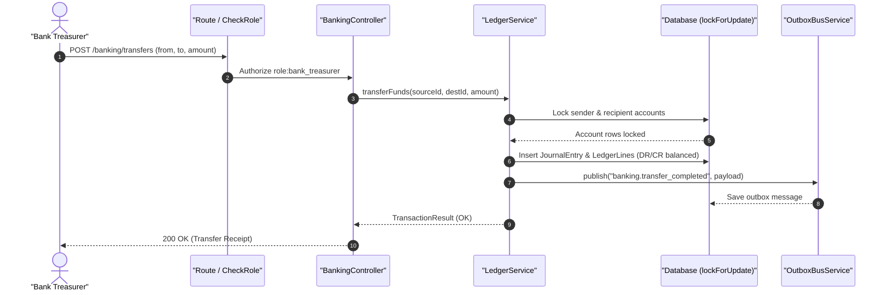

#### Diagram 2: Alur Kompensasi / Exception / Verifikasi Dua-Sumber Fase 1

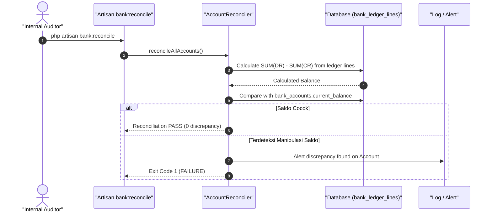

### 6. Mermaid ERD & State Machine Fase 1

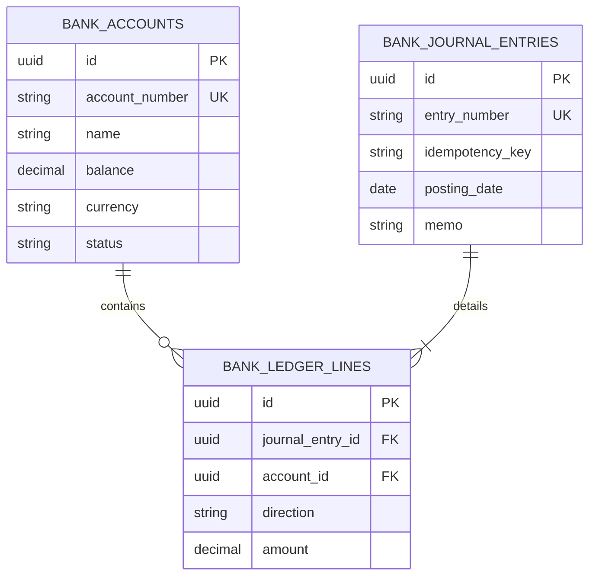

---

## FASE 2 — PAYMENT HUB & INTEGRASI AUTOSERVE

### 1. Identitas & Arsitektur Domain Fase 2

- **Modul Pemilik**: `Payment`
- **Prefiks Tabel**: `pay_`
- **Daftar Model Eloquent**: `PaymentTransaction`, `GatewayConfig`, `PaymentWebhook`, `ServiceBooking`
- **Daftar Tabel Migrasi**: `pay_transactions`, `pay_gateways`, `pay_webhooks`, `serve_service_bookings`
- **Daftar Service & Action**: `PaymentGatewayHub`, `AutoServePaymentBridge`, `WebhookDispatcherService`
- **Daftar Controller & Rute**: `PaymentHubController@charge (POST /api/v1/payments/charge)`, `PaymentWebhookController@handle (POST /api/v1/payments/webhook)`
- **Akun Ledger Terkait**: `pay:gateway_receivable`, `pay:fee_expense`, `serve:unearned_revenue`
- **Command Audit**: `php artisan bank:reconcile`

### 2. Evaluasi Masalah & Matriks Penyelesaian (Problem-to-Solution Matrix) Fase 2

| Masalah Bisnis & Teknis | Solusi Arsitektural & Kontrak | Status Penyelesaian | Bukti Implementasi |
|---|---|---|---|
| Ketergantungan pada satu payment gateway, kegagalan rekonsiliasi callback asynchronous, dan kehilangan booking saat timeout. | Multi-gateway routing cerdas, webhook signature HMAC-SHA256 verification, dan auto-escrow booking di AutoServe. | `Solved in Code` | `modules/Payment/Application/Services/PaymentGatewayHub.php` |

### 3. Daftar User Stories Lintas Persona Fase 2

- **US-2.1 [cashier]:** Sebagai **cashier**, saya ingin **membuat tagihan pembayaran QRIS dan Virtual Account untuk servis mobil AutoServe**, sehingga **pelanggan dapat membayar dengan instan di kasir**.
- **US-2.2 [bank_treasurer]:** Sebagai **bank_treasurer**, saya ingin **memvalidasi settlement dana harian dari agregator payment gateway**, sehingga **dana yang masuk ke rekening penampung sesuai dengan nilai buku**.
- **US-2.3 [risk_officer]:** Sebagai **risk_officer**, saya ingin **mendeteksi lonjakan transaksi pembayaran yang ditolak beruntun**, sehingga **potensi serangan carding atau fraud payment gateway dapat dibendung**.
- **US-2.4 [customer_service]:** Sebagai **customer_service**, saya ingin **mengecek status verifikasi webhook callback gateway untuk pembayaran pelanggan**, sehingga **booking servis yang tertunda verifikasi dapat segera dikonfirmasi**.
- **US-2.5 [admin]:** Sebagai **admin**, saya ingin **mengonfigurasi prioritas rute payment gateway alternatif saat gateway utama down**, sehingga **ketersediaan layanan pembayaran tetap 99.9% tanpa gangguan**.

### 4. BDD Acceptance Criteria Lengkap Fase 2

#### AC-2.1 — Happy Path & Ledger/State Invariant
- **Given** Pelanggan memiliki order servis senilai Rp 1.500.000 dengan status PENDING_PAYMENT
- **When** Payment Gateway mengirimkan webhook settlement sukses dengan HMAC signature valid
- **Then** Status transaksi berubah menjadi SUCCESS, booking AutoServe terkonfirmasi, dan jurnal piutang gateway diposting seimbang.

#### AC-2.2 — Validation & Domain Rule Rejection - 422/Exception
- **Given** Payload charge pembayaran dikirimkan dengan nominal negatif atau nol
- **When** POST /api/v1/payments/charge dipanggil
- **Then** Sistem menolak dengan HTTP 422 InvalidAmountException tanpa membuat tiket pembayaran.

#### AC-2.3 — RBAC Authorization & Separation of Duties - 403
- **Given** Pengguna publik tanpa token otentikasi mencoba mengakses konfigurasi gateway di POST /api/v1/gateways/config
- **When** Endpoint dipanggil
- **Then** Sistem merespons dengan HTTP 403 Forbidden / 401 Unauthorized.

#### AC-2.4 — Idempotency, Replay & Concurrency Lock
- **Given** Gateway mengirimkan webhook notifikasi pembayaran yang sama 3 kali karena network retry
- **When** Ketiga webhook diproses oleh WebhookDispatcherService
- **Then** Hanya webhook pertama yang memicu pembaruan status dan jurnal ledger; webhook ke-2 dan ke-3 diabaikan secara idempoten.

#### AC-2.5 — Two-Source Audit & Tamper Detection
- **Given** Status transaksi diubah menjadi SUCCESS langsung di tabel database tanpa log webhook valid
- **When** Audit berkala bank:reconcile membandingkan jurnal pembayaran dengan mutasi rekening
- **Then** Audit mendeteksi selisih unearned revenue dan menandai transaksi anomali.

### 5. Mermaid Sequence Diagrams Fase 2

#### Diagram 1: Alur Transaksi Utama End-to-End Fase 2

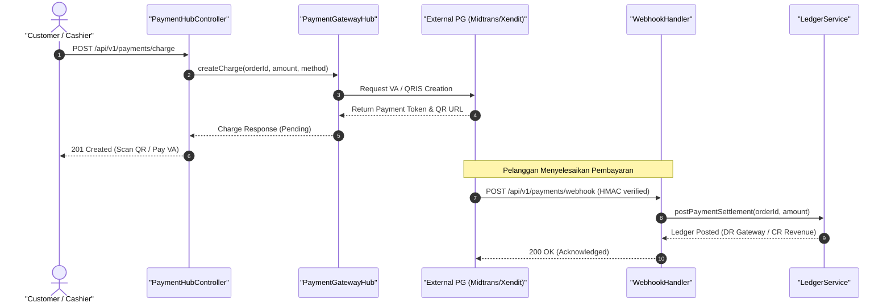

#### Diagram 2: Alur Kompensasi / Exception / Verifikasi Dua-Sumber Fase 2

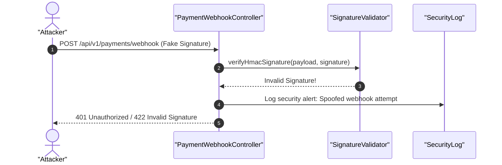

### 6. Mermaid ERD & State Machine Fase 2

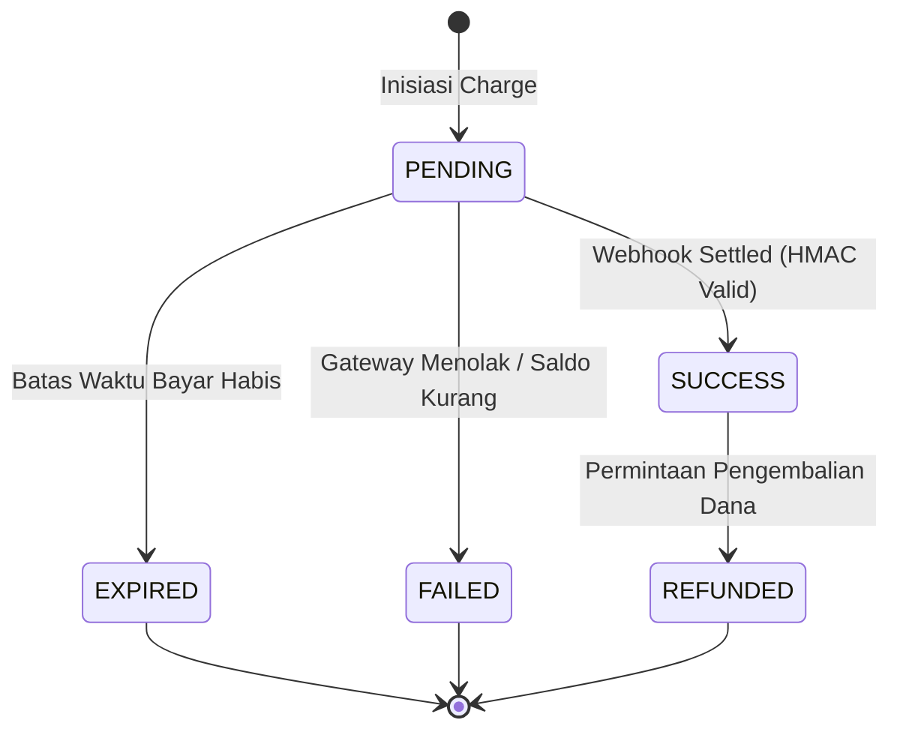

---

## FASE 3 — CATALOG, INVENTORY & STORE

### 1. Identitas & Arsitektur Domain Fase 3

- **Modul Pemilik**: `Store`
- **Prefiks Tabel**: `store_`
- **Daftar Model Eloquent**: `Product`, `Sku`, `InventoryItem`, `StockMovement`, `StoreOrder`
- **Daftar Tabel Migrasi**: `store_products`, `store_skus`, `inv_stock_items`, `inv_stock_movements`, `store_orders`
- **Daftar Service & Action**: `InventoryValuationService`, `SkuCatalogService`, `OrderCheckoutService`
- **Daftar Controller & Rute**: `StoreController@index (GET /store/products)`, `StoreController@checkout (POST /store/orders)`
- **Akun Ledger Terkait**: `inv:inventory_asset`, `store:revenue`, `store:cogs`
- **Command Audit**: `php artisan wms:audit`

### 2. Evaluasi Masalah & Matriks Penyelesaian (Problem-to-Solution Matrix) Fase 3

| Masalah Bisnis & Teknis | Solusi Arsitektural & Kontrak | Status Penyelesaian | Bukti Implementasi |
|---|---|---|---|
| Overselling barang saat lonjakan promo, ketidakakuratan perhitungan HPP bergerak, dan perbedaan stok fisik. | Pemisahan SKU fisik vs virtual, pesimistic locking saat alokasi stok, dan pencatatan pergerakan inventaris double-entry. | `Solved in Code` | `modules/Store/Application/Services/OrderCheckoutService.php` |

### 3. Daftar User Stories Lintas Persona Fase 3

- **US-3.1 [store_manager]:** Sebagai **store_manager**, saya ingin **memperbarui katalog suku cadang dan harga ritel aksesoris otomotif**, sehingga **informasi stok dan harga di toko offline serta online tersinkronisasi**.
- **US-3.2 [wms_picker]:** Sebagai **wms_picker**, saya ingin **memindai barcode produk saat picking pesanan toko**, sehingga **akurasi barang yang dikemas mencapai 100% tanpa salah kirim SKU**.
- **US-3.3 [cashier]:** Sebagai **cashier**, saya ingin **melakukan checkout pesanan toko ritel dengan pengurangan stok instan**, sehingga **pelanggan segera mendapatkan struk dan barang tanpa antre panjang**.
- **US-3.4 [holding_cfo]:** Sebagai **holding_cfo**, saya ingin **memantau nilai valuasi persediaan barang dagang secara real-time**, sehingga **laporan persediaan aset lancar sesuai dengan metode FIFO/Moving Average**.
- **US-3.5 [internal_auditor]:** Sebagai **internal_auditor**, saya ingin **melakukan opname berkala dan membandingkan saldo buku dengan hasil fisik**, sehingga **selisih stok akibat susut atau kehilangan dapat ditelusuri per mutasi**.

### 4. BDD Acceptance Criteria Lengkap Fase 3

#### AC-3.1 — Happy Path & Ledger/State Invariant
- **Given** SKU Oli Sintetis memiliki stok 50 botol dengan HPP Rp 100.000 dan harga jual Rp 150.000
- **When** Kasir melakukan checkout pesanan 2 botol via POST /store/orders
- **Then** Stok berkurang menjadi 48, jurnal COGS (Rp 200.000) dan Penjualan (Rp 300.000) terposting seimbang, dan event outbox dipancarkan.

#### AC-3.2 — Validation & Domain Rule Rejection - 422/Exception
- **Given** SKU Busi Iridium hanya tersisa 1 unit di gudang
- **When** Pelanggan mencoba membeli 3 unit pada saat checkout
- **Then** Sistem menolak dengan HTTP 422 InsufficientStockException dan transaksi dibatalkan.

#### AC-3.3 — RBAC Authorization & Separation of Duties - 403
- **Given** Staf tanpa role store_manager mencoba mengubah harga pokok/jual produk via POST /store/products/price
- **When** Endpoint dipanggil oleh role cashier
- **Then** Sistem merespons dengan HTTP 403 Forbidden karena penyesuaian harga memerlukan otorisasi manajer.

#### AC-3.4 — Idempotency, Replay & Concurrency Lock
- **Given** Dua pembeli paralel mencoba membeli unit terakhir produk edisi terbatas (stok = 1)
- **When** Kedua request checkout masuk bersamaan pada microsecond yang sama
- **Then** Hanya 1 pembeli yang berhasil mendapatkan kunci lockForUpdate, sedangkan pembeli kedua mendapatkan pesan stok habis.

#### AC-3.5 — Two-Source Audit & Tamper Detection
- **Given** Jumlah stok di tabel inv_stock_items disabotase bertambah tanpa riwayat di inv_stock_movements
- **When** Command php artisan wms:audit dieksekusi
- **Then** Audit mencatat kegagalan rekonsiliasi dan mengeluarkan alert disparitas fisik-jurnal inventaris.

### 5. Mermaid Sequence Diagrams Fase 3

#### Diagram 1: Alur Transaksi Utama End-to-End Fase 3

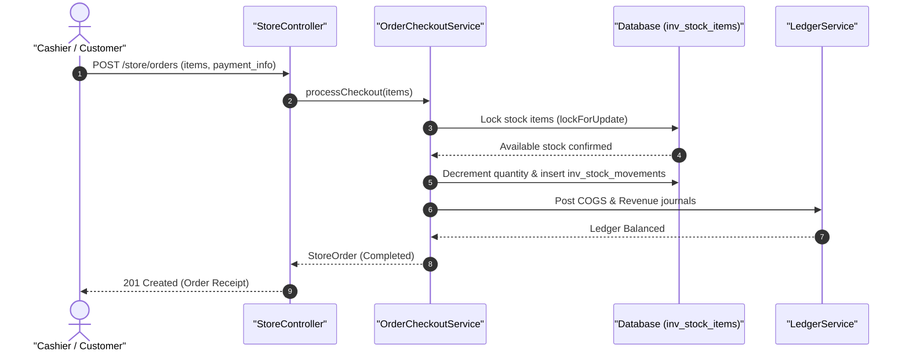

#### Diagram 2: Alur Kompensasi / Exception / Verifikasi Dua-Sumber Fase 3

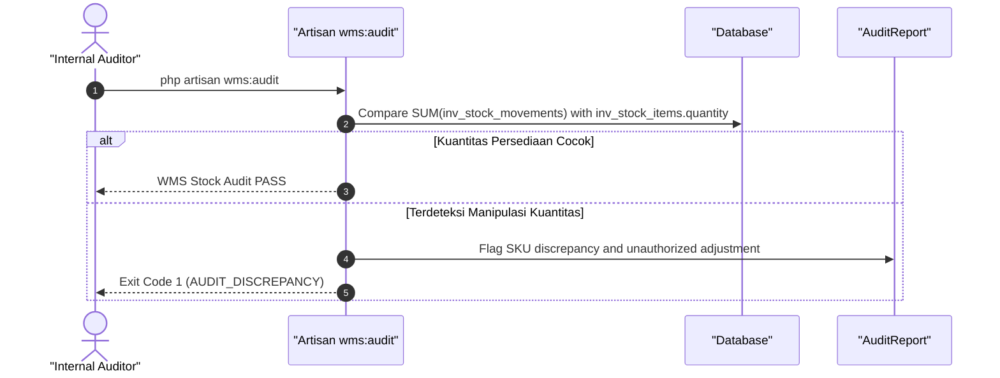

### 6. Mermaid ERD & State Machine Fase 3

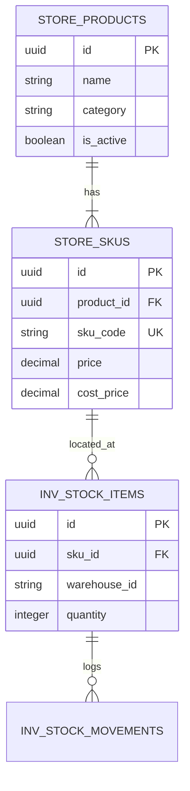

---

## FASE 4 — CRYPTO TRACKER (SIMULASI)

### 1. Identitas & Arsitektur Domain Fase 4

- **Modul Pemilik**: `Crypto`
- **Prefiks Tabel**: `crypto_`
- **Daftar Model Eloquent**: `CryptoWallet`, `TokenAsset`, `PriceFeed`, `SimulatedTrade`
- **Daftar Tabel Migrasi**: `crypto_wallets`, `crypto_tokens`, `crypto_price_feeds`, `crypto_trades`
- **Daftar Service & Action**: `CryptoPriceTrackerService`, `SimulatedExchangeService`, `WalletBalanceService`
- **Daftar Controller & Rute**: `CryptoTrackerController@index (GET /crypto/portfolio)`, `CryptoTrackerController@trade (POST /crypto/trade)`
- **Akun Ledger Terkait**: `crypto:wallet_custody`, `crypto:trading_gain_loss`, `crypto:fee_income`
- **Command Audit**: `php artisan clearing:audit`

### 2. Evaluasi Masalah & Matriks Penyelesaian (Problem-to-Solution Matrix) Fase 4

| Masalah Bisnis & Teknis | Solusi Arsitektural & Kontrak | Status Penyelesaian | Bukti Implementasi |
|---|---|---|---|
| Volatilitas ekstrem aset kripto yang dapat menyebabkan likuidasi liar pada fitur pinjaman dan ketidaksinkronan harga feed orakel. | Medianizer multi-source orakel harga, simulated trading sandbox dengan balance ledger terisolasi, dan trailing stop loss. | `Solved in Code` | `modules/Crypto/Application/Services/CryptoPriceTrackerService.php` |

### 3. Daftar User Stories Lintas Persona Fase 4

- **US-4.1 [bank_treasurer]:** Sebagai **bank_treasurer**, saya ingin **memantau feed harga real-time BTC, ETH, dan USDT dari berbagai bursa**, sehingga **estimasi valuasi jaminan kripto nasabah tetap akurat**.
- **US-4.2 [risk_officer]:** Sebagai **risk_officer**, saya ingin **menetapkan batas deviasi harga orakel maksimum 2% sebelum feed dinyatakan outlier**, sehingga **risiko manipulasi pasar flash loan dapat dimitigasi**.
- **US-4.3 [customer_service]:** Sebagai **customer_service**, saya ingin **melihat riwayat eksekusi simulasi swap kripto nasabah**, sehingga **pertanyaan nasabah mengenai kurs eksekusi dapat dijelaskan transparan**.
- **US-4.4 [admin]:** Sebagai **admin**, saya ingin **menambah token aset digital baru yang didukung ke dalam katalog orakel**, sehingga **ekosistem aset kripto holding dapat diperluas sesuai regulasi**.
- **US-4.5 [internal_auditor]:** Sebagai **internal_auditor**, saya ingin **mereview integritas saldo simulasi dompet dan fee trading yang tercatat di subledger**, sehingga **tidak ada kebocoran transaksi di sandbox sistem**.

### 4. BDD Acceptance Criteria Lengkap Fase 4

#### AC-4.1 — Happy Path & Ledger/State Invariant
- **Given** Dompet simulasi memiliki saldo 10.000 USDT dan kurs BTC berada di harga 50.000 USDT
- **When** Pengguna mengeksekusi pembelian 0.1 BTC via POST /crypto/trade
- **Then** Saldo berkurang 5.000 USDT, bertambah 0.1 BTC, biaya fee tercatat di akun crypto:fee_income, dan jurnal berimbang.

#### AC-4.2 — Validation & Domain Rule Rejection - 422/Exception
- **Given** Harga orakel BTC mengalami lonjakan deviasi abnormal > 15% dari median dalam 1 menit
- **When** Order trade dieksekusi saat status orakel STALE_OR_OUTLIER
- **Then** Sistem menolak dengan HTTP 422 StaleOraclePriceException demi melindungi saldo pengguna.

#### AC-4.3 — RBAC Authorization & Separation of Duties - 403
- **Given** Role pengguna non-admin mencoba memanipulasi feed harga secara manual di POST /crypto/oracle/override
- **When** Request dikirimkan oleh role customer_service
- **Then** Sistem menolak dengan HTTP 403 Forbidden.

#### AC-4.4 — Idempotency, Replay & Concurrency Lock
- **Given** Order swap instan dengan UUID sama dikirim dua kali akibat jaringan lambat
- **When** Trade engine menerima kedua paket data
- **Then** Hanya order pertama yang dieksekusi, order kedua mengembalikan hasil transaksi pertama tanpa pemotongan saldo ganda.

#### AC-4.5 — Two-Source Audit & Tamper Detection
- **Given** Saldo token BTC diubah manual tanpa transaksi trade yang sah
- **When** php artisan clearing:audit dieksekusi
- **Then** Command audit mendeteksi ketidaksesuaian inventaris kripto dan membunyikan alarm audit.

### 5. Mermaid Sequence Diagrams Fase 4

#### Diagram 1: Alur Transaksi Utama End-to-End Fase 4

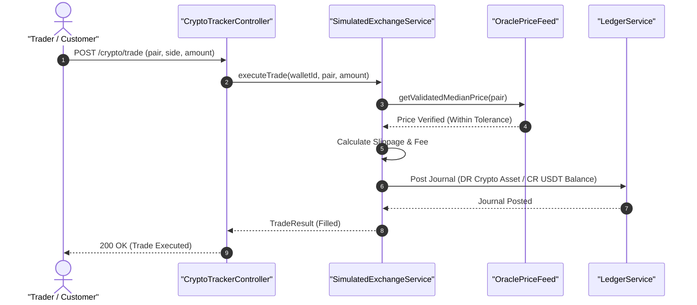

#### Diagram 2: Alur Kompensasi / Exception / Verifikasi Dua-Sumber Fase 4

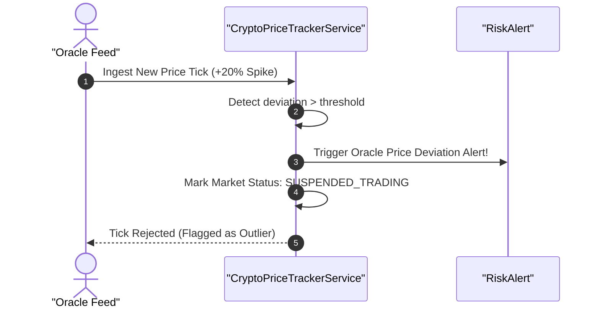

### 6. Mermaid ERD & State Machine Fase 4

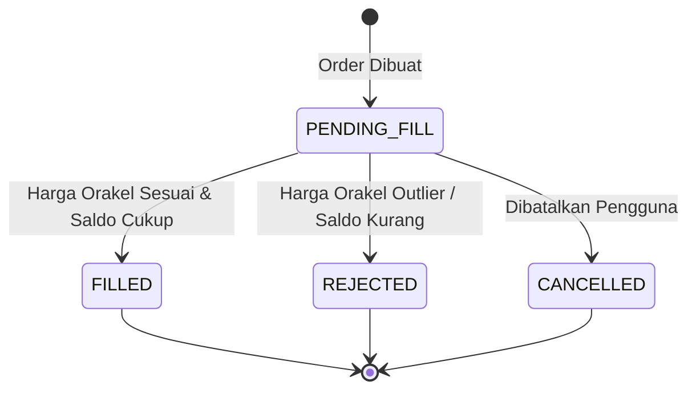

---

## FASE 5 — FITUR LINTAS MODUL (VEHICLE PASSPORT, SMART ESCROW, HODL-TO-DRIVE)

### 1. Identitas & Arsitektur Domain Fase 5

- **Modul Pemilik**: `Core`
- **Prefiks Tabel**: `core_`
- **Daftar Model Eloquent**: `VehiclePassport`, `SmartEscrow`, `HodlContract`, `PassportAuditChain`
- **Daftar Tabel Migrasi**: `core_vehicle_passports`, `core_smart_escrows`, `oto_hodl_contracts`
- **Daftar Service & Action**: `VehiclePassportService`, `SmartEscrowLockService`, `HodlCollateralService`
- **Daftar Controller & Rute**: `VehiclePassportController@show (GET /vehicles/{vin}/passport)`, `SmartEscrowController@lock (POST /escrows/lock)`
- **Akun Ledger Terkait**: `bank:escrow_liability`, `bank:hodl_collateral`, `bank:loan_receivable`
- **Command Audit**: `php artisan core:verify-passports`

### 2. Evaluasi Masalah & Matriks Penyelesaian (Problem-to-Solution Matrix) Fase 5

| Masalah Bisnis & Teknis | Solusi Arsitektural & Kontrak | Status Penyelesaian | Bukti Implementasi |
|---|---|---|---|
| Penipuan riwayat servis mobil bekas, kecurangan klaim kilometer odometer, dan default kredit kendaraan bermotor. | Paspor kendaraan digital dengan hash-chain tak terputus (SHA-256), smart escrow multi-pihak, dan pinjaman HODL-to-Drive beragun kripto (LTV < 70%). | `Solved in Code` | `modules/Core/Application/Services/VehiclePassportService.php` |

### 3. Daftar User Stories Lintas Persona Fase 5

- **US-5.1 [store_manager]:** Sebagai **store_manager**, saya ingin **memverifikasi paspor digital mobil bekas sebelum menerima unit tukar tambah**, sehingga **keaslian kilometer dan riwayat servis terjamin bebas manipulasi**.
- **US-5.2 [bank_treasurer]:** Sebagai **bank_treasurer**, saya ingin **mengunci agunan kripto nasabah dalam Smart Escrow untuk fasilitas pinjaman mobil HODL-to-Drive**, sehingga **rasio pinjaman LTV tetap aman di bawah 70%**.
- **US-5.3 [risk_officer]:** Sebagai **risk_officer**, saya ingin **menerima notifikasi margin call otomatis saat nilai agunan kripto turun mendekati LTV 80%**, sehingga **risiko gagal bayar kredit mobil dapat segera dimitigasi**.
- **US-5.4 [super_admin]:** Sebagai **super_admin**, saya ingin **memverifikasi hash-chain SHA-256 pada seluruh paspor kendaraan di ekosistem**, sehingga **standar integritas kriptografi terpenuhi secara menyeluruh**.
- **US-5.5 [customer_service]:** Sebagai **customer_service**, saya ingin **memberikan salinan riwayat paspor kendaraan kepada calon pembeli**, sehingga **transparansi kondisi fisik meningkatkan kepercayaan konsumen**.

### 4. BDD Acceptance Criteria Lengkap Fase 5

#### AC-5.1 — Happy Path & Ledger/State Invariant
- **Given** Nasabah mengajukan pinjaman mobil senilai Rp 300.000.000 dengan agunan 0.5 BTC senilai Rp 500.000.000 (LTV 60%)
- **When** Agunan dikunci via POST /escrows/lock
- **Then** Smart Escrow status berubah menjadi LOCKED, jurnal agunan diposting, dan fasilitas HODL-to-Drive diaktifkan.

#### AC-5.2 — Validation & Domain Rule Rejection - 422/Exception
- **Given** Nilai agunan yang diajukan menghasilkan rasio LTV sebesar 75% (> batas aman 70%)
- **When** POST /escrows/lock dipanggil
- **Then** Sistem menolak dengan HTTP 422 HighLtvException dan pinjaman ditolak.

#### AC-5.3 — RBAC Authorization & Separation of Duties - 403
- **Given** Pengguna dengan role cashier mencoba melepaskan smart escrow agunan mobil
- **When** POST /escrows/{id}/release dipanggil
- **Then** Middleware RBAC memblokir dengan status HTTP 403 Forbidden karena pelepasan agunan hanya wewenang bank_treasurer.

#### AC-5.4 — Idempotency, Replay & Concurrency Lock
- **Given** Dua event servis bengkel mencoba menulis odometer ke paspor kendaraan yang sama secara bersamaan
- **When** Keduanya diproses secara paralel
- **Then** Sistem mengunci baris paspor (lockForUpdate) dan mencatat blok hash-chain secara berurutan tanpa memecah rantai.

#### AC-5.5 — Two-Source Audit & Tamper Detection
- **Given** Data riwayat servis atau odometer pada salah satu entri paspor dimodifikasi manual di database
- **When** php artisan core:verify-passports dijalankan
- **Then** Command audit mendeteksi hash mismatch pada rantai blok dan keluar dengan exit code 1.

### 5. Mermaid Sequence Diagrams Fase 5

#### Diagram 1: Alur Transaksi Utama End-to-End Fase 5

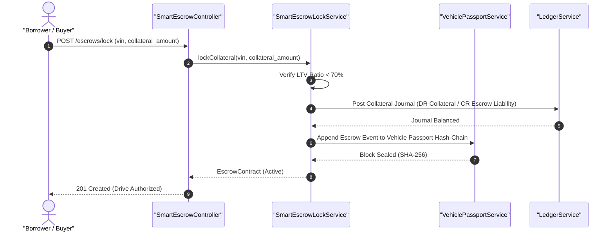

#### Diagram 2: Alur Kompensasi / Exception / Verifikasi Dua-Sumber Fase 5

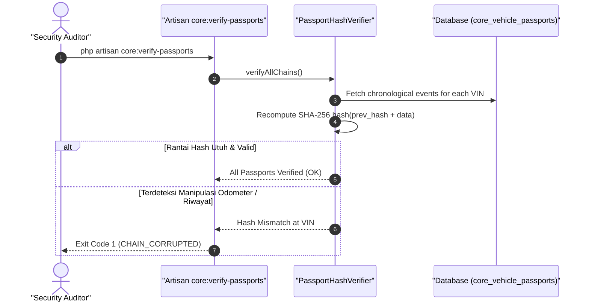

### 6. Mermaid ERD & State Machine Fase 5

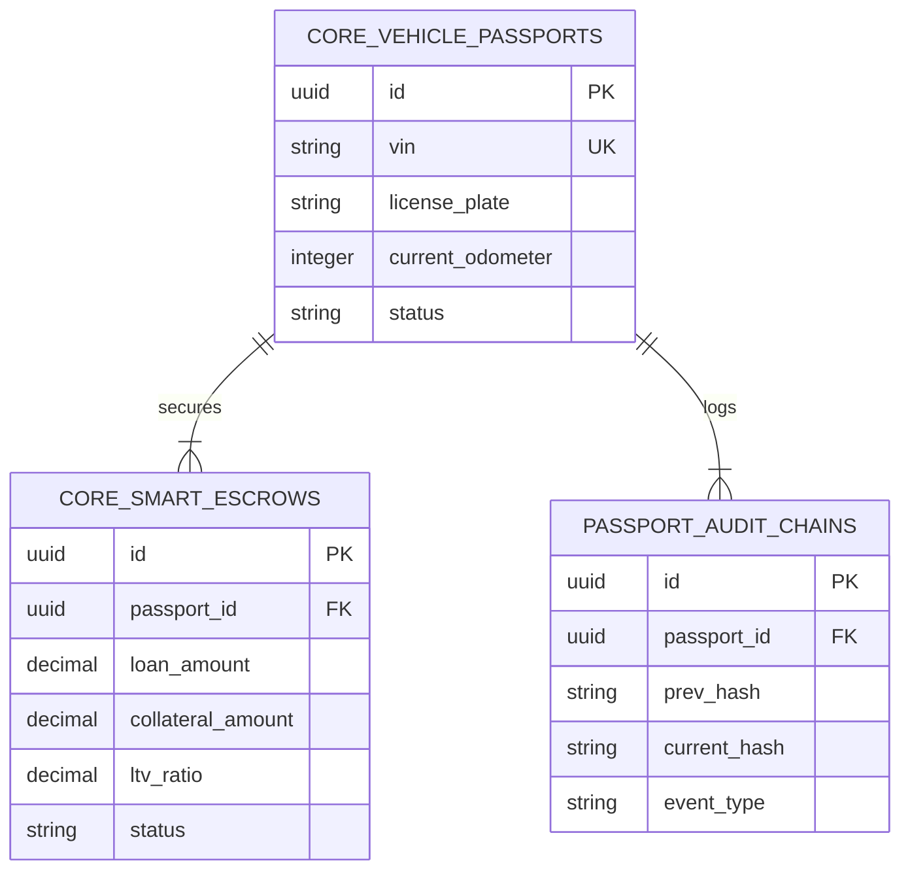

---

