# SPESIFIKASI TEKNIS FASE 6–11: PLATFORM SERVICES & RESTORAN LENGKAP

Dokumen ini mendefinisikan arsitektur domain, matriks penyelesaian, User Stories, BDD Acceptance Criteria, Sequence Diagrams, dan ERD/State Machine untuk Fase 6 s/d Fase 11.

---

## FASE 6 — PLATFORM SERVICES (TENANCY, OUTBOX BUS, HEALTH CHECK, AUDIT TRAIL)

### 1. Identitas & Arsitektur Domain Fase 6

- **Modul Pemilik**: `Core`
- **Prefiks Tabel**: `core_`
- **Daftar Model Eloquent**: `OutboxMessage`, `TenantConfig`, `PlatformHealthCheck`, `AuditLog`
- **Daftar Tabel Migrasi**: `core_outbox_messages`, `core_tenant_configs`, `core_audit_logs`
- **Daftar Service & Action**: `OutboxBusService`, `TenantResolutionService`, `PlatformHealthService`
- **Daftar Controller & Rute**: `PlatformServiceController@index (GET /health)`, `OutboxController@process (POST /admin/outbox/process)`
- **Akun Ledger Terkait**: `bank:clearing_suspense`
- **Command Audit**: `php artisan api:audit`

### 2. Evaluasi Masalah & Matriks Penyelesaian (Problem-to-Solution Matrix) Fase 6

| Masalah Bisnis & Teknis | Solusi Arsitektural & Kontrak | Status Penyelesaian | Bukti Implementasi |
|---|---|---|---|
| Event ganda pada antrean pesan terdistribusi dan kegagalan sinkronisasi status outbox. | Pola Transactional Outbox terjamin at-least-once delivery dengan idempotency consumer. | `Solved in Code` | `modules/Core/Application/Services/OutboxBusService.php` |

### 3. Daftar User Stories Lintas Persona Fase 6

- **US-6.1 [super_admin]:** Sebagai **super_admin**, saya ingin **memantau metriks kesehatan sistem dan status outbox bus**, sehingga **seluruh pesan terdistribusi terkirim tanpa antrean macet**.
- **US-6.2 [admin]:** Sebagai **admin**, saya ingin **memproses ulang (replay) pesan outbox yang berstatus dead-letter**, sehingga **sinkronisasi event bisnis dapat dipulihkan tanpa intervensi DB langsung**.
- **US-6.3 [internal_auditor]:** Sebagai **internal_auditor**, saya ingin **mengaudit jejak log aktivitas pengguna pada core_audit_logs**, sehingga **setiap aksi sensitif memiliki jejak non-repudiation**.
- **US-6.4 [risk_officer]:** Sebagai **risk_officer**, saya ingin **mendeteksi anomali kegagalan service platform secara real-time**, sehingga **ancaman degradasi layanan dapat ditangani sebelum SLA terlanggar**.
- **US-6.5 [customer_service]:** Sebagai **customer_service**, saya ingin **mengecek log event pengiriman notifikasi pelanggan**, sehingga **kendala notifikasi SMS/email pelanggan dapat segera diklarifikasi**.

### 4. BDD Acceptance Criteria Lengkap Fase 6

#### AC-6.1 — Happy Path & Ledger/State Invariant
- **Given** Terdapat 5 pesan outbox berstatus PENDING di tabel core_outbox_messages
- **When** Worker outbox dieksekusi via POST /admin/outbox/process
- **Then** Kelima pesan berhasil dipublikasikan, status berubah menjadi PROCESSED, dan timestamp tercatat.

#### AC-6.2 — Validation & Domain Rule Rejection - 422/Exception
- **Given** Payload outbox rusak atau tidak mematuhi skema JSON standar
- **When** Outbox worker memvalidasi pesan
- **Then** Pesan ditolak dengan InvalidOutboxPayloadException dan dipindahkan ke dead-letter queue.

#### AC-6.3 — RBAC Authorization & Separation of Duties - 403
- **Given** Pengguna dengan role cashier mencoba memicu outbox processing
- **When** POST /admin/outbox/process dipanggil
- **Then** Sistem menolak dengan HTTP 403 Forbidden.

#### AC-6.4 — Idempotency, Replay & Concurrency Lock
- **Given** Dua worker outbox memproses batch yang sama secara paralel
- **When** Keduanya mengeksekusi lockForUpdate pada baris outbox
- **Then** Tidak ada pesan yang terkirim dua kali ke event bus eksternal.

#### AC-6.5 — Two-Source Audit & Tamper Detection
- **Given** Checksum integritas log audit diubah langsung di database
- **When** php artisan api:audit dijalankan
- **Then** Audit mendeteksi pelanggaran checksum integritas outbox dan keluar dengan kode 1.

### 5. Mermaid Sequence Diagrams Fase 6

#### Diagram 1: Alur Transaksi Utama End-to-End Fase 6

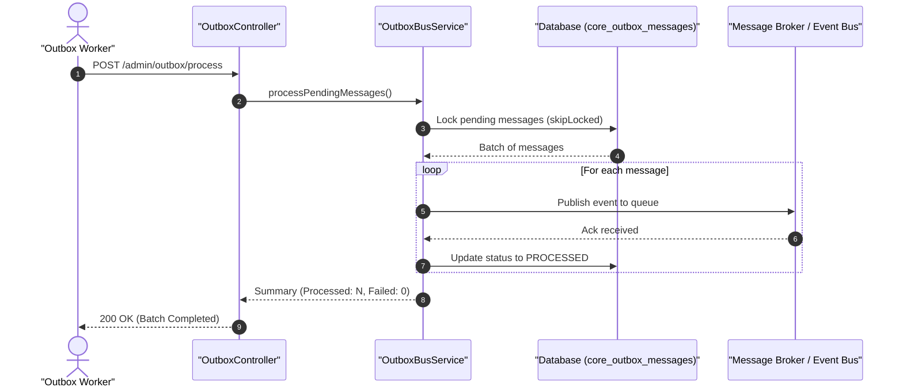

#### Diagram 2: Alur Kompensasi / Exception / Verifikasi Dua-Sumber Fase 6

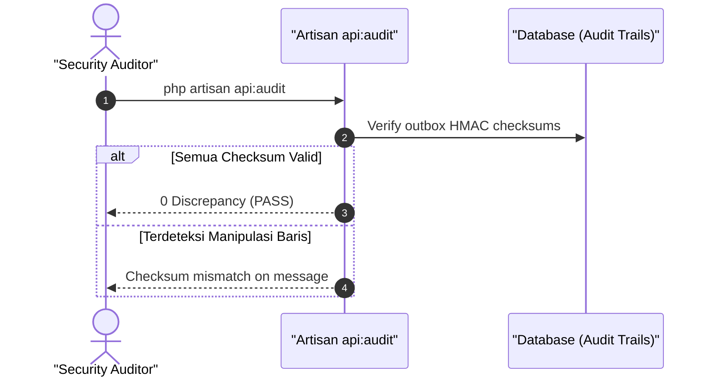

### 6. Mermaid ERD & State Machine Fase 6

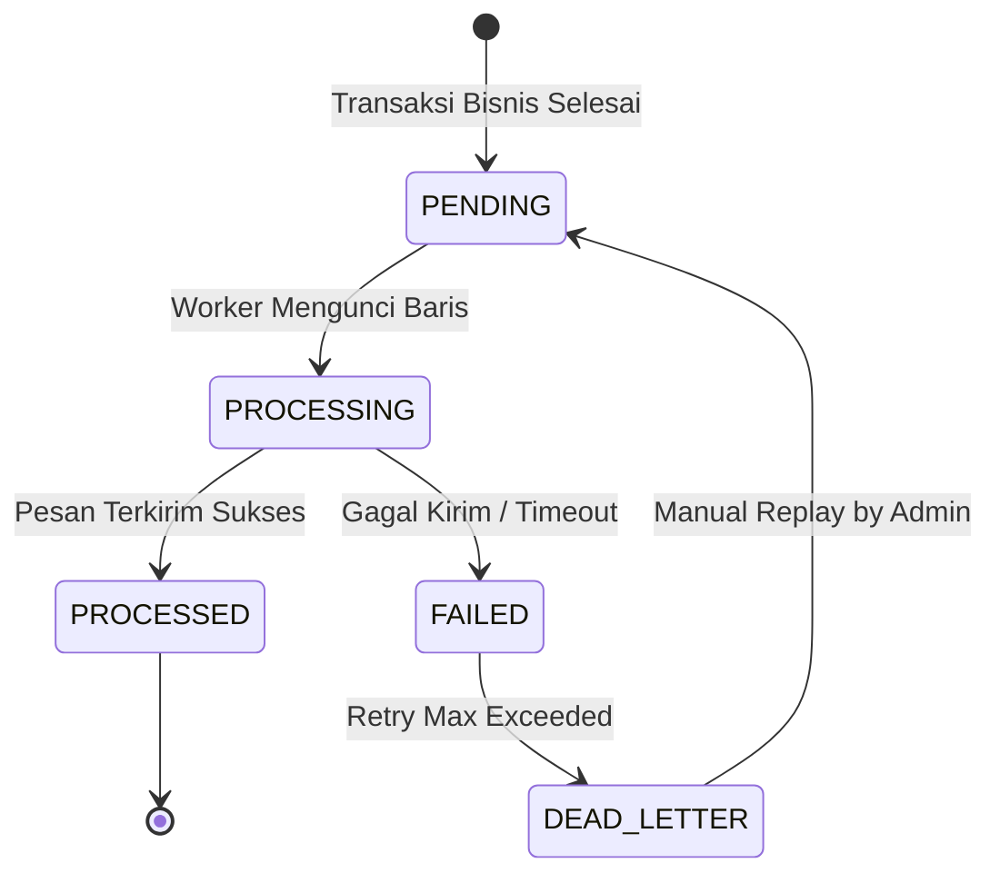

---

## FASE 7 — MODUL RESTO: FONDASI, MENU, RESEP, HPP

### 1. Identitas & Arsitektur Domain Fase 7

- **Modul Pemilik**: `Resto`
- **Prefiks Tabel**: `resto_`
- **Daftar Model Eloquent**: `RestoMenu`, `RestoCategory`, `RestoRecipe`, `RestoIngredient`, `RestoHppCalculation`
- **Daftar Tabel Migrasi**: `resto_menus`, `resto_categories`, `resto_recipes`, `resto_ingredients`
- **Daftar Service & Action**: `RecipeCostingService`, `HppCalculationEngine`, `MenuEngineeringService`
- **Daftar Controller & Rute**: `RestoMenuController@index (GET /resto/menu)`, `RestoRecipeController@store (POST /resto/recipes)`
- **Akun Ledger Terkait**: `resto:inventory_raw`, `resto:cogs_food`, `resto:wip_kitchen`
- **Command Audit**: `php artisan wms:audit`

### 2. Evaluasi Masalah & Matriks Penyelesaian (Problem-to-Solution Matrix) Fase 7

| Masalah Bisnis & Teknis | Solusi Arsitektural & Kontrak | Status Penyelesaian | Bukti Implementasi |
|---|---|---|---|
| Ketidakpastian margin kotor restoran akibat fluktuasi harga bahan baku mentah dan pemborosan resep. | Kalkulator HPP otomatis berbasis Bill of Materials (BOM) bertingkat dan yield percentage. | `Solved in Code` | `modules/Resto/Application/Services/RecipeCostingService.php` |

### 3. Daftar User Stories Lintas Persona Fase 7

- **US-7.1 [kitchen_chef]:** Sebagai **kitchen_chef**, saya ingin **membuat resep standar dengan takaran gramasi bahan baku yang presisi**, sehingga **konsistensi rasa dan estimasi biaya pokok produksi terstandar**.
- **US-7.2 [store_manager]:** Sebagai **store_manager**, saya ingin **melihat kalkulasi HPP aktual versus target food cost percentage**, sehingga **harga jual menu dapat disesuaikan untuk menjaga margin profitabilitas**.
- **US-7.3 [procurement_buyer]:** Sebagai **procurement_buyer**, saya ingin **memperbarui harga kontrak bahan baku segar ke dalam sistem resep**, sehingga **perubahan harga pasar langsung merefleksikan HPP menu terkini**.
- **US-7.4 [holding_cfo]:** Sebagai **holding_cfo**, saya ingin **menganalisis kontribusi margin per kategori menu di seluruh jaringan resto**, sehingga **strategi promosi dan penghapusan menu merugi dapat diputuskan akurat**.
- **US-7.5 [internal_auditor]:** Sebagai **internal_auditor**, saya ingin **memeriksa kepatuhan formula BOM dan yield bahan terhadap standar audit**, sehingga **mencegah kebocoran bahan baku dapur melalui manipulasi takaran**.

### 4. BDD Acceptance Criteria Lengkap Fase 7

#### AC-7.1 — Happy Path & Ledger/State Invariant
- **Given** Resep Nasi Goreng Spesial membutuhkan Beras (Rp 3.000), Telur (Rp 2.500), dan Bumbu (Rp 1.500)
- **When** Kitchen Chef mendaftarkan resep baru via POST /resto/recipes
- **Then** HPP otomatis terhitung Rp 7.000, margin kotor terverifikasi, dan data resep tersimpan aktif.

#### AC-7.2 — Validation & Domain Rule Rejection - 422/Exception
- **Given** Kitchen Chef memasukkan takaran bahan baku dengan nilai negatif atau nol
- **When** POST /resto/recipes dipanggil
- **Then** Sistem menolak dengan HTTP 422 InvalidIngredientQuantityException.

#### AC-7.3 — RBAC Authorization & Separation of Duties - 403
- **Given** Kasir (cashier) mencoba mengubah formula resep menu di POST /resto/recipes
- **When** Request dikirim oleh role cashier
- **Then** Sistem menolak dengan HTTP 403 Forbidden karena modifikasi resep dibatasi untuk kitchen_chef.

#### AC-7.4 — Idempotency, Replay & Concurrency Lock
- **Given** Dua update biaya bahan baku terjadi bersamaan pada bahan baku yang sama
- **When** Engine HPP menghitung ulang seluruh menu terkait
- **Then** Kalkulasi dieksekusi secara atomik dan menghasilkan nilai HPP akhir yang konsisten.

#### AC-7.5 — Two-Source Audit & Tamper Detection
- **Given** Data HPP pada tabel resto_menus diubah paksa tanpa melalui formula resep
- **When** Command php artisan wms:audit dijalankan
- **Then** Audit menemukan diskrepansi antara HPP tersimpan dan kalkulasi BOM, lalu mengeluarkan alert.

### 5. Mermaid Sequence Diagrams Fase 7

#### Diagram 1: Alur Transaksi Utama End-to-End Fase 7

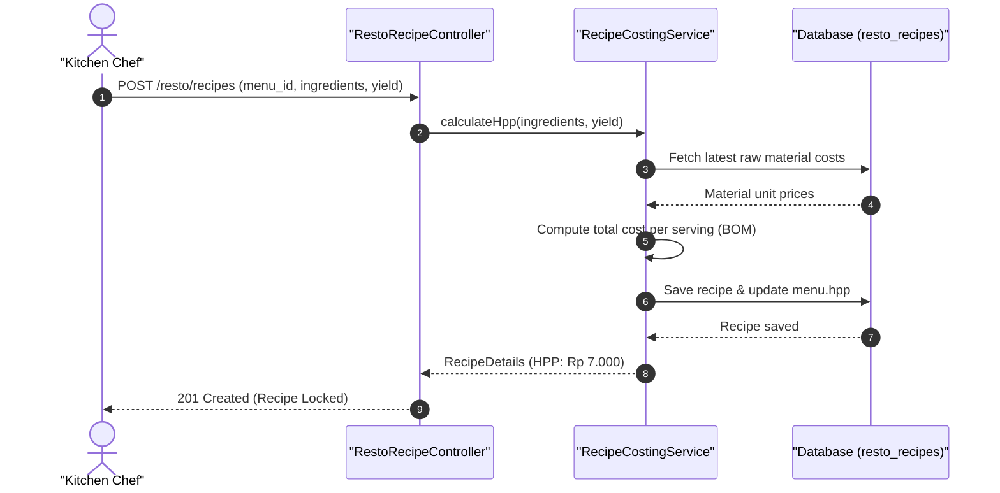

#### Diagram 2: Alur Kompensasi / Exception / Verifikasi Dua-Sumber Fase 7

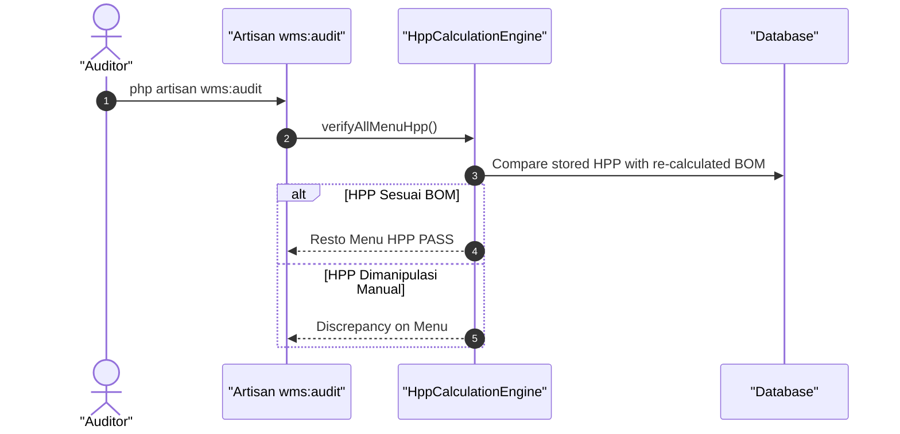

### 6. Mermaid ERD & State Machine Fase 7

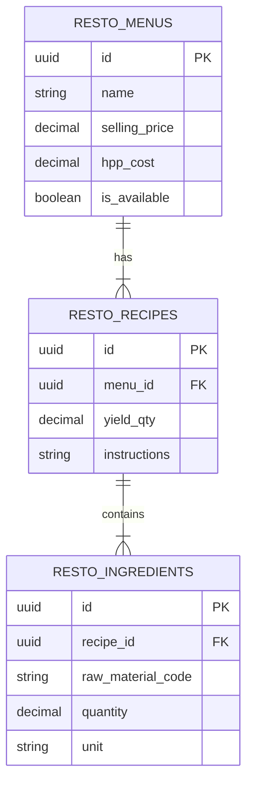

---

## FASE 8 — RESTO: DAPUR, BATCH PRODUKSI & SIKLUS ETALASE HIDANG

### 1. Identitas & Arsitektur Domain Fase 8

- **Modul Pemilik**: `Resto`
- **Prefiks Tabel**: `resto_`
- **Daftar Model Eloquent**: `KitchenOrder`, `ProductionBatch`, `DisplayCycle`, `FoodWastage`
- **Daftar Tabel Migrasi**: `resto_kitchen_orders`, `resto_production_batches`, `resto_display_cycles`, `resto_waste_logs`
- **Daftar Service & Action**: `KitchenDisplayService`, `BatchProductionService`, `DisplayFreshnessMonitor`
- **Daftar Controller & Rute**: `KitchenController@bump (POST /resto/kitchen/bump)`, `KitchenController@rotate (POST /resto/display/rotate)`
- **Akun Ledger Terkait**: `resto:wip_kitchen`, `resto:finished_display`, `resto:spoilage_expense`
- **Command Audit**: `php artisan wms:audit`

### 2. Evaluasi Masalah & Matriks Penyelesaian (Problem-to-Solution Matrix) Fase 8

| Masalah Bisnis & Teknis | Solusi Arsitektural & Kontrak | Status Penyelesaian | Bukti Implementasi |
|---|---|---|---|
| Penyajian makanan dingin/basi di etalase hidang serta pemborosan makanan tanpa pencatatan limbah akurat. | Siklus etalase hidang berbasis timer kualitas (holding time), auto-waste disposal, dan KDS real-time. | `Solved in Code` | `modules/Resto/Application/Services/BatchProductionService.php` |

### 3. Daftar User Stories Lintas Persona Fase 8

- **US-8.1 [kitchen_chef]:** Sebagai **kitchen_chef**, saya ingin **memulai batch masak baru dan menyelesaikannya pada Kitchen Display System (KDS)**, sehingga **status makanan langsung berpindah ke etalase saji**.
- **US-8.2 [store_manager]:** Sebagai **store_manager**, saya ingin **memantau batas holding time makanan di etalase pemanas hidang**, sehingga **makanan yang melewati batas kesegaran dapat segera di-rotasi atau dibuang**.
- **US-8.3 [waste_manager]:** Sebagai **waste_manager**, saya ingin **mencatat volume dan penyebab makanan sisa yang dibuang (waste)**, sehingga **perusahaan dapat menghitung rasio pemborosan makanan untuk evaluasi ESG**.
- **US-8.4 [cashier]:** Sebagai **cashier**, saya ingin **melihat ketersediaan porsi hidang yang siap jual di etalase secara real-time**, sehingga **kasir tidak menawarkan menu yang sedang habis atau kedaluwarsa**.
- **US-8.5 [internal_auditor]:** Sebagai **internal_auditor**, saya ingin **mereview pencatatan jurnal kerugian makanan sisa (spoilage expense)**, sehingga **tidak ada penggelapan bahan makanan dengan alasan basi fiktif**.

### 4. BDD Acceptance Criteria Lengkap Fase 8

#### AC-8.1 — Happy Path & Ledger/State Invariant
- **Given** Batch Ayam Goreng (20 porsi) selesai dimasak di dapur
- **When** Kitchen Chef melakukan 'bump' pada KDS via POST /resto/kitchen/bump
- **Then** Makanan masuk ke status READY_DISPLAY dengan timer holding 120 menit, dan jurnal WIP ke Finished Goods terposting seimbang.

#### AC-8.2 — Validation & Domain Rule Rejection - 422/Exception
- **Given** Makanan di etalase telah melewati holding time maksimal (> 120 menit)
- **When** Kasir mencoba menjual menu tersebut pada POS
- **Then** Sistem menolak penjualan dengan HTTP 422 ExpiredDisplayFoodException dan mengunci porsi.

#### AC-8.3 — RBAC Authorization & Separation of Duties - 403
- **Given** Pengguna dengan role cashier mencoba membuang batch etalase tanpa verifikasi chef
- **When** POST /resto/display/rotate dipanggil dengan aksi DISCARD
- **Then** Sistem menolak dengan HTTP 403 Forbidden.

#### AC-8.4 — Idempotency, Replay & Concurrency Lock
- **Given** Dua chef menekan tombol selesai masak pada batch yang sama di dua layar KDS berbeda
- **When** Keduanya mengirimkan POST /resto/kitchen/bump
- **Then** Hanya satu request yang memindahkan status; request kedua menerima konfirmasi batch sudah di etalase.

#### AC-8.5 — Two-Source Audit & Tamper Detection
- **Given** Jumlah porsi yang terbuang tidak cocok dengan selisih stok batch awal dikurangi penjualan
- **When** php artisan wms:audit dijalankan
- **Then** Audit mencatat anomali porsi etalase yang hilang dan membunyikan alarm selisih stok hidang.

### 5. Mermaid Sequence Diagrams Fase 8

#### Diagram 1: Alur Transaksi Utama End-to-End Fase 8

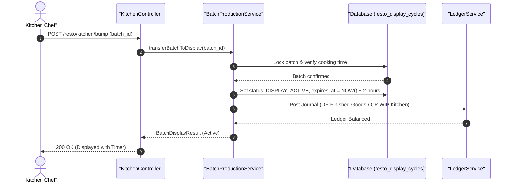

#### Diagram 2: Alur Kompensasi / Exception / Verifikasi Dua-Sumber Fase 8

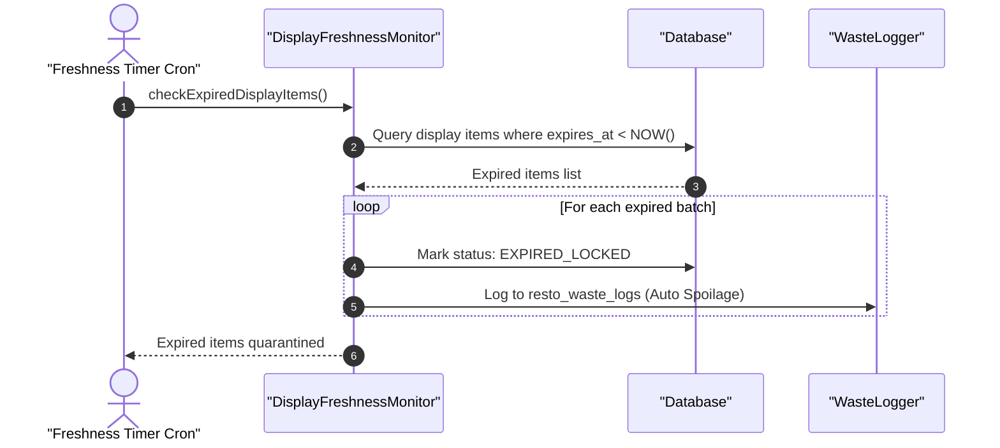

### 6. Mermaid ERD & State Machine Fase 8

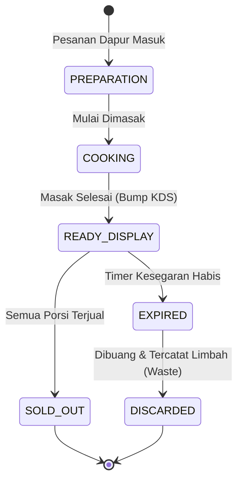

---

## FASE 9 — RESTO: POS HIDANG, SESI MEJA, SHIFT KASIR & TUTUP HARIAN

### 1. Identitas & Arsitektur Domain Fase 9

- **Modul Pemilik**: `Resto`
- **Prefiks Tabel**: `resto_`
- **Daftar Model Eloquent**: `CashierShift`, `TableSession`, `PosOrder`, `SplitBillPayment`, `EndOfDaySummary`
- **Daftar Tabel Migrasi**: `resto_cashier_shifts`, `resto_table_sessions`, `resto_orders`, `resto_payments`
- **Daftar Service & Action**: `PosCheckoutService`, `CashierShiftService`, `DayEndReconciliationService`
- **Daftar Controller & Rute**: `RestoPosController@checkout (POST /resto/pos/checkout)`, `RestoShiftController@close (POST /resto/shifts/close)`
- **Akun Ledger Terkait**: `resto:cash_drawer`, `resto:sales_revenue`, `bank:qris_clearing`
- **Command Audit**: `php artisan bank:reconcile`

### 2. Evaluasi Masalah & Matriks Penyelesaian (Problem-to-Solution Matrix) Fase 9

| Masalah Bisnis & Teknis | Solusi Arsitektural & Kontrak | Status Penyelesaian | Bukti Implementasi |
|---|---|---|---|
| Selisih kas fisik di laci kasir saat pergantian shift dan keterlambatan rekonsiliasi QRIS/EDC. | Shift kasir dengan blind cash-count, pembagian tagihan (split bill) fleksibel, dan auto-reconcile QRIS. | `Solved in Code` | `modules/Resto/Application/Services/PosCheckoutService.php` |

### 3. Daftar User Stories Lintas Persona Fase 9

- **US-9.1 [cashier]:** Sebagai **cashier**, saya ingin **membuka shift kasir dengan memasukkan modal awal dan melayani pembayaran meja pelanggan**, sehingga **transaksi tercatat tertib di bawah nomor shift yang valid**.
- **US-9.2 [store_manager]:** Sebagai **store_manager**, saya ingin **menutup harian restoran (End-of-Day) dan memvalidasi selisih kas fisik**, sehingga **seluruh penerimaan tunai, kartu, dan QRIS klop dengan buku besar**.
- **US-9.3 [bank_treasurer]:** Sebagai **bank_treasurer**, saya ingin **menerima transfer penyetoran kas harian restoran ke rekening bank penampung**, sehingga **dana hasil penjualan aman masuk ke rekening bank holding**.
- **US-9.4 [customer_service]:** Sebagai **customer_service**, saya ingin **mencetak ulang struk pembayaran pelanggan yang membutuhkan bukti reimburs**, sehingga **layanan purna jual restoran memuaskan pelanggan**.
- **US-9.5 [internal_auditor]:** Sebagai **internal_auditor**, saya ingin **memeriksa riwayat void atau diskon kasir yang melebihi batas kewajaran**, sehingga **kecurangan manipulasi pembatalan bon dapat diungkap**.

### 4. BDD Acceptance Criteria Lengkap Fase 9

#### AC-9.1 — Happy Path & Ledger/State Invariant
- **Given** Pelanggan di Meja 05 memiliki tagihan Rp 250.000
- **When** Kasir memproses pembayaran tunai Rp 300.000 via POST /resto/pos/checkout
- **Then** Kembalian terhitung Rp 50.000, sesi meja ditutup, dan jurnal Kas (DR Rp 250.000) vs Penjualan (CR Rp 250.000) terposting seimbang.

#### AC-9.2 — Validation & Domain Rule Rejection - 422/Exception
- **Given** Kasir mencoba memproses checkout pada shift kasir yang sudah ditutup
- **When** POST /resto/pos/checkout dipanggil
- **Then** Sistem menolak dengan HTTP 422 InactiveShiftException.

#### AC-9.3 — RBAC Authorization & Separation of Duties - 403
- **Given** Kasir mencoba menyetujui void tagihan tanpa otorisasi store_manager
- **When** POST /resto/pos/orders/{id}/void dipanggil
- **Then** Sistem merespons dengan HTTP 403 Forbidden.

#### AC-9.4 — Idempotency, Replay & Concurrency Lock
- **Given** Dua kasir di tablet berbeda memproses pembayaran untuk meja yang sama secara paralel
- **When** Kedua request pembayaran diproses
- **Then** Table lock mencegah double payment dan kasir kedua mendapatkan notifikasi meja sudah terbayar.

#### AC-9.5 — Two-Source Audit & Tamper Detection
- **Given** Saldo kas fisik pada penutupan shift tidak cocok dengan total penjualan tunai
- **When** Command php artisan bank:reconcile dijalankan
- **Then** Sistem mencatat adanya cash over/short variance dan membukukannya ke akun penampung selisih kas.

### 5. Mermaid Sequence Diagrams Fase 9

#### Diagram 1: Alur Transaksi Utama End-to-End Fase 9

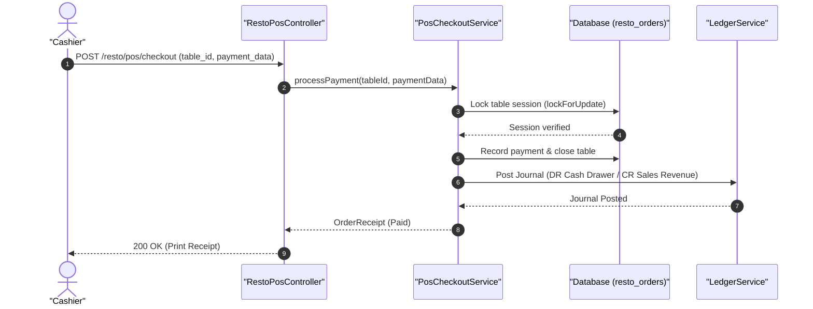

#### Diagram 2: Alur Kompensasi / Exception / Verifikasi Dua-Sumber Fase 9

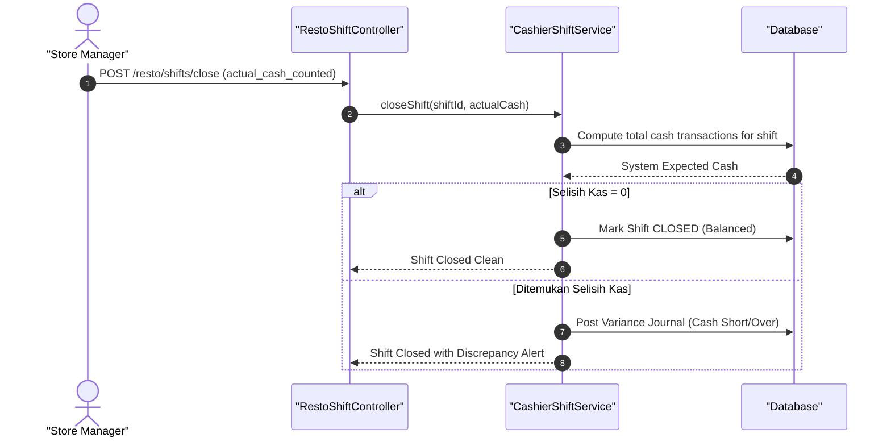

### 6. Mermaid ERD & State Machine Fase 9

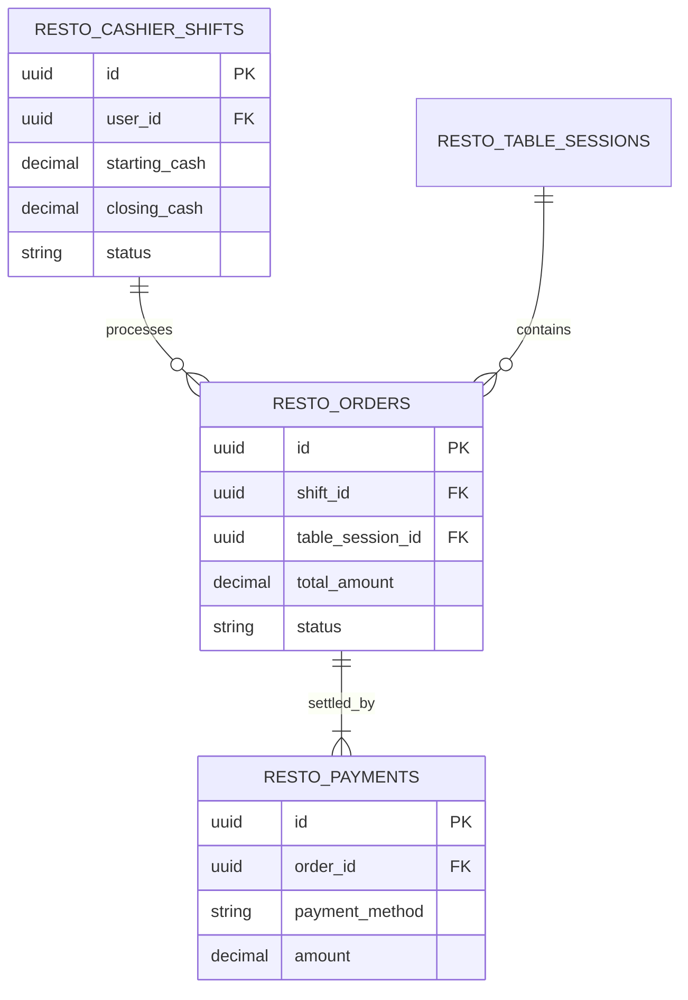

---

## FASE 10 — RESTO: RANTAI PASOK, DAPUR SENTRAL & MULTI-OUTLET

### 1. Identitas & Arsitektur Domain Fase 10

- **Modul Pemilik**: `Resto`
- **Prefiks Tabel**: `resto_`
- **Daftar Model Eloquent**: `CentralKitchenOrder`, `InterOutletTransfer`, `CommissaryBatch`, `OutletReplenishment`
- **Daftar Tabel Migrasi**: `resto_central_orders`, `resto_outlet_transfers`, `resto_commissary_logs`
- **Daftar Service & Action**: `CommissaryProductionService`, `OutletReplenishmentService`, `TransferManifestService`
- **Daftar Controller & Rute**: `CentralKitchenController@dispatch (POST /resto/commissary/dispatch)`, `OutletTransferController@receive (POST /resto/transfers/receive)`
- **Akun Ledger Terkait**: `resto:inventory_central`, `resto:transit_inventory`, `resto:inter_outlet_clearing`
- **Command Audit**: `php artisan wms:audit`

### 2. Evaluasi Masalah & Matriks Penyelesaian (Problem-to-Solution Matrix) Fase 10

| Masalah Bisnis & Teknis | Solusi Arsitektural & Kontrak | Status Penyelesaian | Bukti Implementasi |
|---|---|---|---|
| Ketidakseimbangan stok bumbu racik antar-outlet dan kehilangan barang saat pengiriman transit dingin. | Manifes transfer digital ber-barcode dengan penerimaan blind scan dan rekonsiliasi transit clearing. | `Solved in Code` | `modules/Resto/Application/Services/CommissaryProductionService.php` |

### 3. Daftar User Stories Lintas Persona Fase 10

- **US-10.1 [kitchen_chef]:** Sebagai **kitchen_chef**, saya ingin **memproduksi saus bumbu sentral dalam batch besar di dapur sentral (commissary)**, sehingga **standarisasi rasa seragam di seluruh cabang restoran**.
- **US-10.2 [store_manager]:** Sebagai **store_manager**, saya ingin **membuat pesanan pengisian ulang (replenishment) bumbu dan bahan beku ke dapur sentral**, sehingga **outlet tidak kehabisan stok saat jam ramai pengunjung**.
- **US-10.3 [logistics_driver]:** Sebagai **logistics_driver**, saya ingin **membawa manifes pengiriman ber-barcode dengan pemantauan suhu boks pendingin**, sehingga **kualitas bahan baku terjaga selama proses pengantaran antar-kota**.
- **US-10.4 [holding_cfo]:** Sebagai **holding_cfo**, saya ingin **memantau nilai persediaan yang sedang berada dalam perjalanan (inventory in transit)**, sehingga **posisi aset lancar logistik tercatat transparan**.
- **US-10.5 [internal_auditor]:** Sebagai **internal_auditor**, saya ingin **memeriksa selisih kuantitas kirim vs kuantitas terima pada mutasi antar-outlet**, sehingga **potensi kehilangan barang di jalan dapat terdeteksi segera**.

### 4. BDD Acceptance Criteria Lengkap Fase 10

#### AC-10.1 — Happy Path & Ledger/State Invariant
- **Given** Dapur Sentral mengirim 50 kg Bumbu Rendang ke Outlet Mall A
- **When** Outlet Mall A menerima barang dan memindai barcode via POST /resto/transfers/receive
- **Then** Stok bumbu bertambah 50 kg di Outlet Mall A, inventaris transit menjadi 0, dan jurnal kliring berimbang.

#### AC-10.2 — Validation & Domain Rule Rejection - 422/Exception
- **Given** Kuantitas yang diterima di outlet melebihi kuantitas yang tercatat di manifes kirim
- **When** POST /resto/transfers/receive dipanggil dengan angka over-receipt
- **Then** Sistem menolak dengan HTTP 422 OverReceiptQuantityException.

#### AC-10.3 — RBAC Authorization & Separation of Duties - 403
- **Given** Pengemudi (logistics_driver) mencoba mengonfirmasi penerimaan barang atas nama store_manager
- **When** Driver memanggil endpoint penerimaan
- **Then** Sistem menolak dengan HTTP 403 Forbidden demi asas pemisahan tugas.

#### AC-10.4 — Idempotency, Replay & Concurrency Lock
- **Given** Staf outlet memindai barcode penerimaan yang sama dua kali
- **When** Request diproses
- **Then** Sistem mendeteksi manifes sudah berstatus RECEIVED dan tidak menambah stok ganda.

#### AC-10.5 — Two-Source Audit & Tamper Detection
- **Given** Stok transit diubah langsung di database tanpa berita acara selisih
- **When** Command php artisan wms:audit dijalankan
- **Then** Audit mencatat kegagalan rekonsiliasi transfer antar-outlet dan mengeluarkan peringatan.

### 5. Mermaid Sequence Diagrams Fase 10

#### Diagram 1: Alur Transaksi Utama End-to-End Fase 10

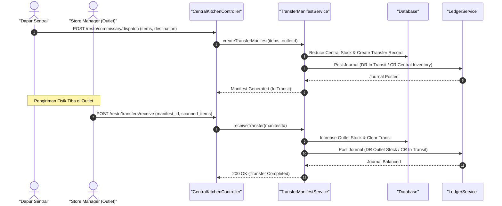

#### Diagram 2: Alur Kompensasi / Exception / Verifikasi Dua-Sumber Fase 10

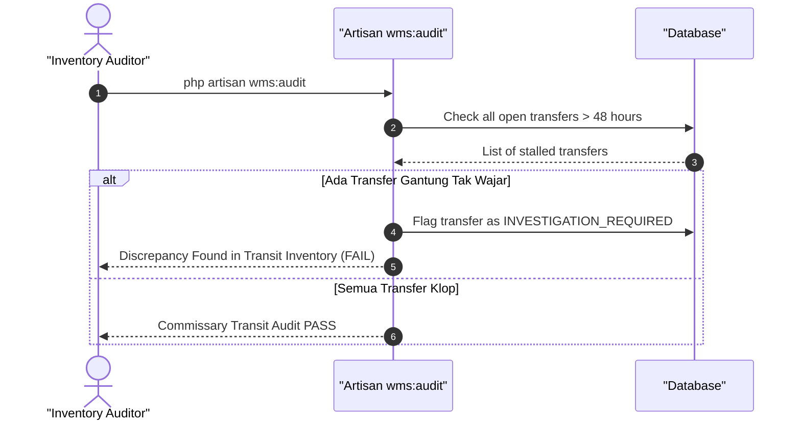

### 6. Mermaid ERD & State Machine Fase 10

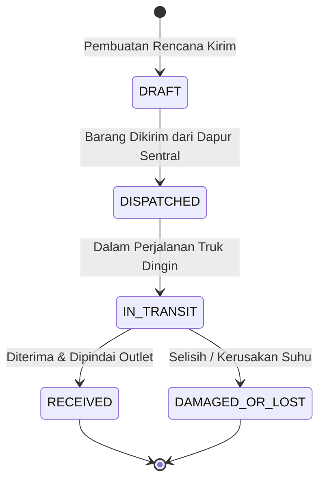

---

## FASE 11 — RESTO: KANAL PENJUALAN, KATERING, FRANCHISE & ANALITIK

### 1. Identitas & Arsitektur Domain Fase 11

- **Modul Pemilik**: `Resto`
- **Prefiks Tabel**: `resto_`
- **Daftar Model Eloquent**: `CateringContract`, `FranchiseAgreement`, `RoyaltyCalculation`, `ChannelSale`
- **Daftar Tabel Migrasi**: `resto_catering_contracts`, `resto_franchise_agreements`, `resto_royalty_ledgers`
- **Daftar Service & Action**: `CateringBookingService`, `FranchiseRoyaltyService`, `ChannelMarginAnalytics`
- **Daftar Controller & Rute**: `CateringController@book (POST /resto/catering/book)`, `FranchiseController@royalty (POST /resto/franchise/royalty)`
- **Akun Ledger Terkait**: `resto:catering_receivable`, `resto:royalty_revenue`, `resto:marketing_pool`
- **Command Audit**: `php artisan bank:reconcile`

### 2. Evaluasi Masalah & Matriks Penyelesaian (Problem-to-Solution Matrix) Fase 11

| Masalah Bisnis & Teknis | Solusi Arsitektural & Kontrak | Status Penyelesaian | Bukti Implementasi |
|---|---|---|---|
| Keterlambatan penagihan royalti franchise dan kebocoran margin akibat diskon komisi aggregator pihak ketiga. | Penghitungan royalti otomatis berbasis omzet POS, escrow pembayaran katering korporat, dan analitik margin multi-kanal. | `Solved in Code` | `modules/Resto/Application/Services/FranchiseRoyaltyService.php` |

### 3. Daftar User Stories Lintas Persona Fase 11

- **US-11.1 [store_manager]:** Sebagai **store_manager**, saya ingin **membuat kontrak katering acara korporat dengan jadwal pengiriman bertahap**, sehingga **uang muka dan pembayaran termin katering terkunci aman**.
- **US-11.2 [holding_cfo]:** Sebagai **holding_cfo**, saya ingin **menghitung dan menagih royalti franchise 5% bulanan secara otomatis dari omzet mitra**, sehingga **pendapatan holding masuk tepat waktu tanpa manipulasi laporan penjualan**.
- **US-11.3 [bank_treasurer]:** Sebagai **bank_treasurer**, saya ingin **merekonsiliasi pencairan dana dari platform pesan-antar makanan online**, sehingga **selisih potongan komisi agregator dapat dihitung transparan**.
- **US-11.4 [risk_officer]:** Sebagai **risk_officer**, saya ingin **memantau kepatuhan standar merek dan pembayaran royalti mitra waralaba**, sehingga **risiko wanprestasi mitra franchise dapat terdeteksi sejak dini**.
- **US-11.5 [internal_auditor]:** Sebagai **internal_auditor**, saya ingin **mengaudit perhitungan bagi hasil dan dana pemasaran bersama (marketing pool)**, sehingga **alokasi dana kampanye transparan dan akuntabel**.

### 4. BDD Acceptance Criteria Lengkap Fase 11

#### AC-11.1 — Happy Path & Ledger/State Invariant
- **Given** Mitra Franchise Resto B mencatatkan omzet kotor Rp 500.000.000 pada bulan Oktober
- **When** FranchiseRoyaltyService dieksekusi via POST /resto/franchise/royalty
- **Then** Tagihan royalti 5% (Rp 25.000.000) dan marketing fee 1% (Rp 5.000.000) terbit dengan jurnal piutang berimbang.

#### AC-11.2 — Validation & Domain Rule Rejection - 422/Exception
- **Given** Kontrak franchise berstatus SUSPENDED karena audit higienitas gagal
- **When** Sistem mencoba menerbitkan jadwal operasional katering baru
- **Then** Sistem menolak dengan HTTP 422 SuspendedFranchiseException.

#### AC-11.3 — RBAC Authorization & Separation of Duties - 403
- **Given** Pengguna non-finance mencoba mengubah persentase royalti di kontrak franchise
- **When** POST /resto/franchise/agreements/{id}/terms dipanggil oleh store_manager
- **Then** Sistem memblokir dengan status HTTP 403 Forbidden.

#### AC-11.4 — Idempotency, Replay & Concurrency Lock
- **Given** Perhitungan royalti bulanan dijalankan dua kali untuk periode bulan yang sama
- **When** Batch job dieksekusi
- **Then** Sistem mendeteksi tagihan royalti periode tersebut sudah terbit dan tidak membuat invoice ganda.

#### AC-11.5 — Two-Source Audit & Tamper Detection
- **Given** Angka omzet diubah di laporan penagihan tanpa penyesuaian di data transaksi POS
- **When** Command php artisan bank:reconcile dijalankan
- **Then** Audit menemukan ketidaksinkronan data omzet dan menandai perbedaan royalti.

### 5. Mermaid Sequence Diagrams Fase 11

#### Diagram 1: Alur Transaksi Utama End-to-End Fase 11

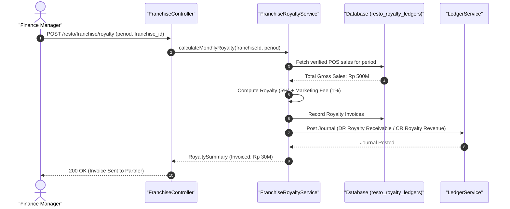

#### Diagram 2: Alur Kompensasi / Exception / Verifikasi Dua-Sumber Fase 11

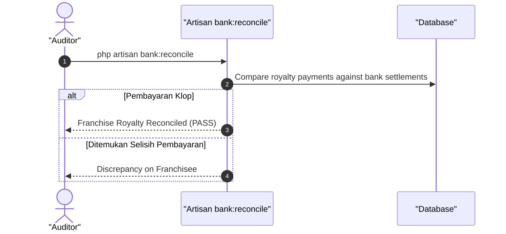

### 6. Mermaid ERD & State Machine Fase 11

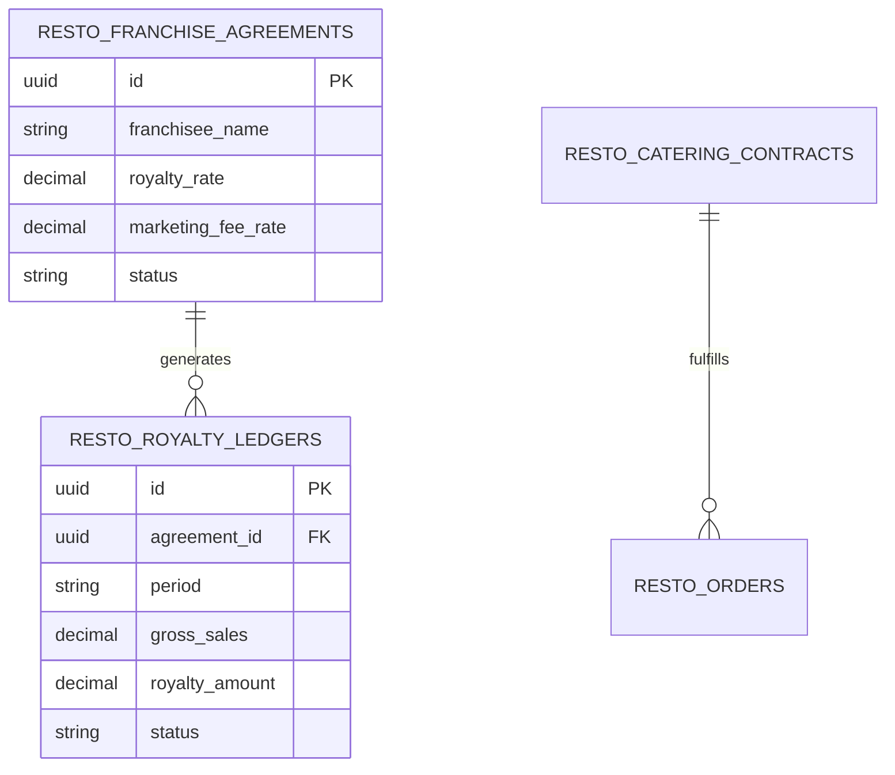

---

