# SPESIFIKASI TEKNIS FASE 12–18: PROPERTI MALL, INTEGRASI LINTAS LINI & HARDENING

Dokumen ini mendefinisikan arsitektur domain, matriks penyelesaian, User Stories, BDD Acceptance Criteria, Sequence Diagrams, dan ERD/State Machine untuk Fase 12 s/d Fase 18.

---

## FASE 12 — MODUL MALL: FONDASI, UNIT & LEASING

### 1. Identitas & Arsitektur Domain Fase 12

- **Modul Pemilik**: `Mall`
- **Prefiks Tabel**: `mall_`
- **Daftar Model Eloquent**: `MallProperty`, `MallZone`, `MallUnit`, `TenantLeaseContract`, `SecurityDeposit`
- **Daftar Tabel Migrasi**: `mall_properties`, `mall_zones`, `mall_units`, `mall_leases`, `mall_deposits`
- **Daftar Service & Action**: `UnitLeasingService`, `LeaseContractLifecycleService`, `SpaceAllotmentService`
- **Daftar Controller & Rute**: `MallLeasingController@index (GET /mall/units)`, `MallLeasingController@sign (POST /mall/leases/sign)`
- **Akun Ledger Terkait**: `mall:tenant_deposit_liability`, `mall:unearned_lease_revenue`, `mall:lease_receivable`
- **Command Audit**: `php artisan mall:audit-billing`

### 2. Evaluasi Masalah & Matriks Penyelesaian (Problem-to-Solution Matrix) Fase 12

| Masalah Bisnis & Teknis | Solusi Arsitektural & Kontrak | Status Penyelesaian | Bukti Implementasi |
|---|---|---|---|
| Tumpang tindih sewa unit gerai mall, kehilangan pencatatan uang jaminan sewa (security deposit), dan sengketa luasan area. | Master unit mall dengan pemetaan zona spasial, kontrak sewa digital dengan penahanan deposit di escrow subledger. | `Solved in Code` | `modules/Mall/Application/Services/UnitLeasingService.php` |

### 3. Daftar User Stories Lintas Persona Fase 12

- **US-12.1 [mall_leasing_manager]:** Sebagai **mall_leasing_manager**, saya ingin **mengelola ketersediaan unit gerai mall dan menandatangani kontrak sewa tenant**, sehingga **status okupansi mall terpantau dan pendapatan sewa terjamin**.
- **US-12.2 [bank_treasurer]:** Sebagai **bank_treasurer**, saya ingin **memverifikasi penerimaan security deposit 3 bulan sewa dari calon tenant**, sehingga **uang jaminan aman tersimpan di akun liabilitas holding**.
- **US-12.3 [contract_lawyer]:** Sebagai **contract_lawyer**, saya ingin **meninjau klausul masa sewa, penalti keterlambatan, dan klausul renovasi unit**, sehingga **risiko sengketa hukum dengan penyewa komersial terminimalisir**.
- **US-12.4 [holding_cfo]:** Sebagai **holding_cfo**, saya ingin **memantau proyeksi arus kas dari tagihan sewa berulang (recurring lease)**, sehingga **perencanaan likuiditas properti mall akurat dan tepat waktu**.
- **US-12.5 [internal_auditor]:** Sebagai **internal_auditor**, saya ingin **mereview pencocokan unit fisik yang terisi dengan kontrak sewa yang aktif**, sehingga **tidak ada unit mall yang disewakan secara ilegal tanpa kontrak**.

### 4. BDD Acceptance Criteria Lengkap Fase 12

#### AC-12.1 — Happy Path & Ledger/State Invariant
- **Given** Unit L1-05 berstatus AVAILABLE dan Tenant mengajukan sewa 1 tahun senilai Rp 120.000.000 + Deposit Rp 30.000.000
- **When** Mall Leasing Manager menandatangani kontrak via POST /mall/leases/sign
- **Then** Unit berubah menjadi OCCUPIED, deposit dicatat di mall:tenant_deposit_liability, dan unearned lease revenue diposting seimbang.

#### AC-12.2 — Validation & Domain Rule Rejection - 422/Exception
- **Given** Calon tenant belum melunasi security deposit yang disyaratkan dalam perjanjian
- **When** POST /mall/leases/sign dipanggil
- **Then** Sistem menolak aktivasi sewa dengan HTTP 422 UnpaidSecurityDepositException.

#### AC-12.3 — RBAC Authorization & Separation of Duties - 403
- **Given** Petugas pencatat meter (mall_meter_officer) mencoba menandatangani kontrak sewa
- **When** Endpoint POST /mall/leases/sign dipanggil oleh meter officer
- **Then** Sistem menolak dengan HTTP 403 Forbidden.

#### AC-12.4 — Idempotency, Replay & Concurrency Lock
- **Given** Dua leasing officer mencoba memesan (booking) unit yang sama secara bersamaan
- **When** Kedua request masuk pada detik yang sama
- **Then** Pessimistic lock mengamankan unit hanya untuk tenant pertama, dan tenant kedua menerima pesan unit telah tersewa.

#### AC-12.5 — Two-Source Audit & Tamper Detection
- **Given** Data status unit di tabel mall_units disetel OCCUPIED tanpa adanya catatan kontrak aktif di mall_leases
- **When** Command php artisan mall:audit-billing dijalankan
- **Then** Audit menemukan unit liar tak bertuan dan menandai temuan audit dengan exit code 1.

### 5. Mermaid Sequence Diagrams Fase 12

#### Diagram 1: Alur Transaksi Utama End-to-End Fase 12

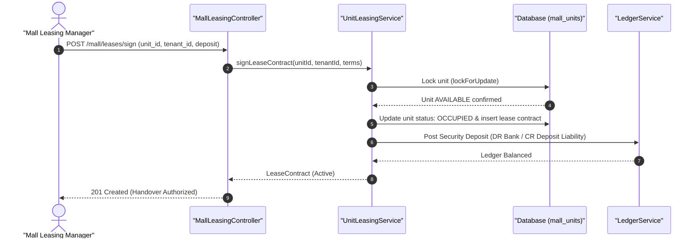

#### Diagram 2: Alur Kompensasi / Exception / Verifikasi Dua-Sumber Fase 12

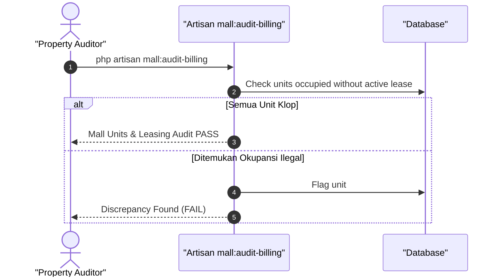

### 6. Mermaid ERD & State Machine Fase 12

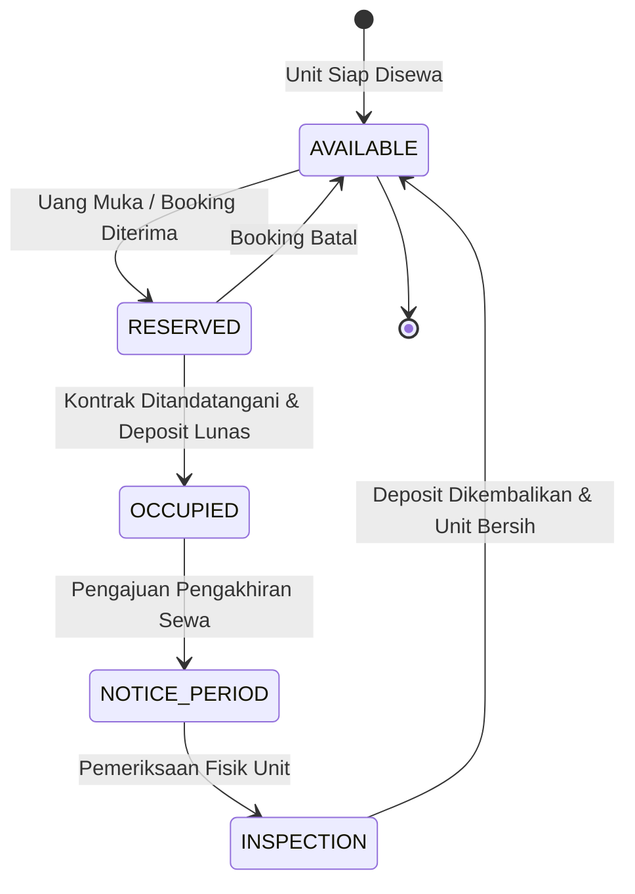

---

## FASE 13 — MALL: LAPORAN PENJUALAN TENANT, TAGIHAN BULANAN & TUNGGAKAN

### 1. Identitas & Arsitektur Domain Fase 13

- **Modul Pemilik**: `Mall`
- **Prefiks Tabel**: `mall_`
- **Daftar Model Eloquent**: `TenantPosReport`, `UtilityMeterReading`, `MonthlyBillingInvoice`, `ArrearsSchedule`
- **Daftar Tabel Migrasi**: `mall_tenant_sales`, `mall_meter_readings`, `mall_invoices`, `mall_arrears`
- **Daftar Service & Action**: `TurnoverRentEngine`, `UtilityBillingService`, `LatePaymentPenaltyService`
- **Daftar Controller & Rute**: `MallBillingController@recordReadings (POST /mall/readings/record)`, `MallBillingController@generateInvoices (POST /mall/invoices/generate)`
- **Akun Ledger Terkait**: `mall:rent_revenue`, `mall:service_charge_revenue`, `mall:utility_recovery`
- **Command Audit**: `php artisan mall:audit-billing`

### 2. Evaluasi Masalah & Matriks Penyelesaian (Problem-to-Solution Matrix) Fase 13

| Masalah Bisnis & Teknis | Solusi Arsitektural & Kontrak | Status Penyelesaian | Bukti Implementasi |
|---|---|---|---|
| Kecurangan laporan omzet tenant untuk bagi hasil (turnover rent) dan keterlambatan penagihan listrik/air. | Integrasi POS turnover rent audit, meteran listrik submetering digital, dan kalkulasi penalti tunggakan bertingkat. | `Solved in Code` | `modules/Mall/Application/Services/TurnoverRentEngine.php` |

### 3. Daftar User Stories Lintas Persona Fase 13

- **US-13.1 [mall_meter_officer]:** Sebagai **mall_meter_officer**, saya ingin **mencatat angka meter kWh listrik dan kubikasi air unit tenant tiap akhir bulan**, sehingga **tagihan utilitas sesuai pemakaian riil tanpa sengketa**.
- **US-13.2 [mall_leasing_manager]:** Sebagai **mall_leasing_manager**, saya ingin **menerbitkan invoice sewa bulanan kombinasi biaya tetap + turnover rent**, sehingga **pendapatan mall maksimal sesuai perjanjian bagi hasil omzet**.
- **US-13.3 [bank_treasurer]:** Sebagai **bank_treasurer**, saya ingin **memantau penerimaan pelunasan invoice tenant dan mengidentifikasi tunggakan sewa**, sehingga **arus kas operasional mall terjaga stabil**.
- **US-13.4 [holding_cfo]:** Sebagai **holding_cfo**, saya ingin **melihat laporan aging schedule piutang sewa mall untuk penyisihan kerugian**, sehingga **kepatuhan pencatatan cadangan kerugian penurunan nilai (CKPN) terpenuhi**.
- **US-13.5 [internal_auditor]:** Sebagai **internal_auditor**, saya ingin **memeriksa kepatuhan formula denda keterlambatan (late payment penalty)**, sehingga **kebijakan penagihan diterapkan adil tanpa diskriminasi**.

### 4. BDD Acceptance Criteria Lengkap Fase 13

#### AC-13.1 — Happy Path & Ledger/State Invariant
- **Given** Tenant memiliki sewa dasar Rp 10.000.000, omzet Rp 200.000.000 (bagi hasil 5% = Rp 10.000.000, lebih tinggi dari sewa dasar), dan pemakaian listrik Rp 3.000.000
- **When** Invoice diterbitkan via POST /mall/invoices/generate
- **Then** Invoice terbit Rp 13.000.000 dengan jurnal Piutang Tenant (DR) vs Pendapatan Sewa & Utilitas (CR) berimbang.

#### AC-13.2 — Validation & Domain Rule Rejection - 422/Exception
- **Given** Petugas memasukkan angka meter akhir listrik yang lebih kecil dari meter awal (anomali mundur)
- **When** POST /mall/readings/record dipanggil
- **Then** Sistem menolak dengan HTTP 422 NegativeUtilityConsumptionException.

#### AC-13.3 — RBAC Authorization & Separation of Duties - 403
- **Given** Tenant komersial mencoba membatalkan tagihan sewa sendiri
- **When** Endpoint pembatalan dipanggil tanpa hak mall_leasing_manager
- **Then** Sistem menolak dengan HTTP 403 Forbidden.

#### AC-13.4 — Idempotency, Replay & Concurrency Lock
- **Given** Job batch penagihan bulanan dijalankan dua kali untuk periode bulan yang sama
- **When** Kedua eksekusi berjalan paralel
- **Then** Hanya satu invoice yang dibuat per unit, mencegah penagihan ganda ke tenant.

#### AC-13.5 — Two-Source Audit & Tamper Detection
- **Given** Total pemakaian utilitas yang ditagihkan tidak cocok dengan akumulasi data log meteran
- **When** Command php artisan mall:audit-billing dieksekusi
- **Then** Audit mencatat disparitas tarif utilitas dan mengeluarkan laporan audit anomali billing.

### 5. Mermaid Sequence Diagrams Fase 13

#### Diagram 1: Alur Transaksi Utama End-to-End Fase 13

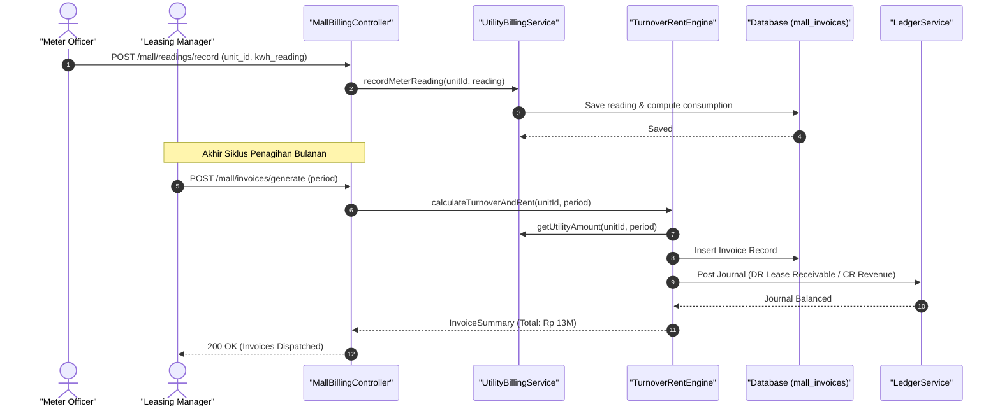

#### Diagram 2: Alur Kompensasi / Exception / Verifikasi Dua-Sumber Fase 13

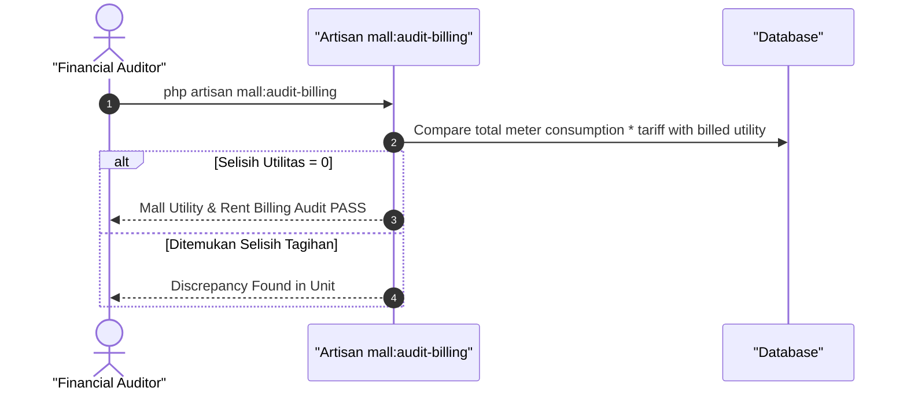

### 6. Mermaid ERD & State Machine Fase 13

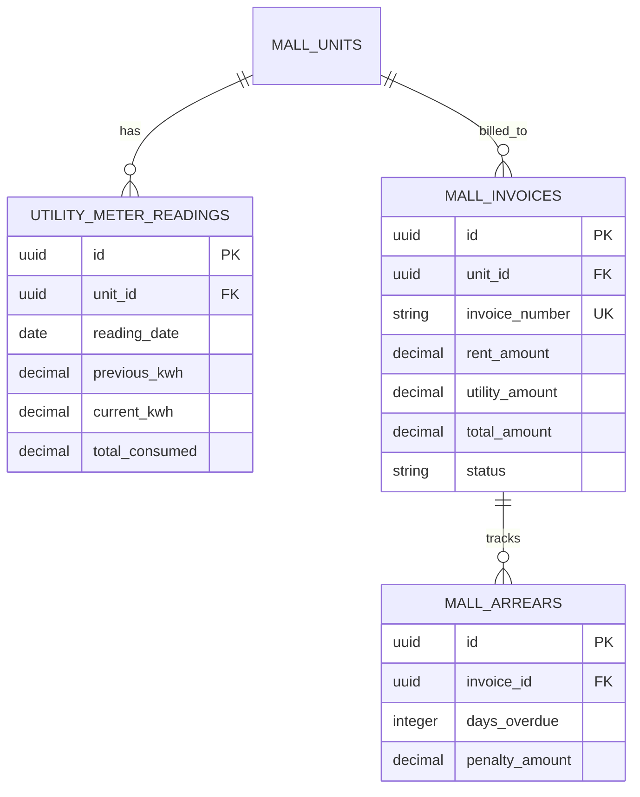

---

## FASE 14 — MALL: PARKIR, AKSES & FOOTFALL

### 1. Identitas & Arsitektur Domain Fase 14

- **Modul Pemilik**: `Mall`
- **Prefiks Tabel**: `mall_`
- **Daftar Model Eloquent**: `ParkingBarrierGate`, `ParkingTicket`, `ProgressiveFeeRule`, `FootfallSensorLog`
- **Daftar Tabel Migrasi**: `mall_parking_gates`, `mall_parking_tickets`, `mall_parking_rates`, `mall_footfall_logs`
- **Daftar Service & Action**: `ProgressiveParkingTariffService`, `GateAccessControlService`, `FootfallAnalyticsEngine`
- **Daftar Controller & Rute**: `MallParkingController@entry (POST /mall/parking/entry)`, `MallParkingController@exit (POST /mall/parking/exit)`
- **Akun Ledger Terkait**: `mall:parking_revenue`, `bank:parking_clearing`, `mall:vat_payable`
- **Command Audit**: `php artisan mall:audit-billing`

### 2. Evaluasi Masalah & Matriks Penyelesaian (Problem-to-Solution Matrix) Fase 14

| Masalah Bisnis & Teknis | Solusi Arsitektural & Kontrak | Status Penyelesaian | Bukti Implementasi |
|---|---|---|---|
| Kebocoran pendapatan tiket parkir akibat tiket hilang atau manipulasi durasi, serta ketidaktahuan kepadatan pengunjung mall. | Barrier gate otomatis dengan pembacaan plat nomor (ALPR), tarif progresif berbasis durasi menit, dan sensor footfall inframerah/CCTV. | `Solved in Code` | `modules/Mall/Application/Services/ProgressiveParkingTariffService.php` |

### 3. Daftar User Stories Lintas Persona Fase 14

- **US-14.1 [security_guard]:** Sebagai **security_guard**, saya ingin **memantau palang pintu masuk parkir otomatis saat kendaraan pengunjung mengambil tiket**, sehingga **arus lalu lintas pintu masuk mall lancar dan teratur**.
- **US-14.2 [cashier]:** Sebagai **cashier**, saya ingin **menerima pembayaran parkir tunai atau non-tunai di gardu keluar**, sehingga **tarif progresif terhitung presisi sesuai jam masuk dan durasi**.
- **US-14.3 [store_manager]:** Sebagai **store_manager**, saya ingin **memberikan validasi diskon parkir bagi pengunjung yang berbelanja di resto/toko**, sehingga **insentif belanja meningkatkan kepuasan pelanggan mall**.
- **US-14.4 [holding_cfo]:** Sebagai **holding_cfo**, saya ingin **merekonsiliasi pendapatan parkir harian dari pembayaran kartu uang elektronik**, sehingga **semua transaksi parkir masuk ke rekening holding tanpa kebocoran**.
- **US-14.5 [internal_auditor]:** Sebagai **internal_auditor**, saya ingin **membandingkan data kendaraan masuk-keluar dengan total struk parkir terbayar**, sehingga **pencegahan tindak manipulasi tiket hilang oleh petugas gardu**.

### 4. BDD Acceptance Criteria Lengkap Fase 14

#### AC-14.1 — Happy Path & Ledger/State Invariant
- **Given** Kendaraan B 1234 CD masuk pukul 10:00 dan keluar pukul 13:30 (durasi 3,5 jam, tarif Rp 5.000 jam pertama + Rp 3.000/jam berikutnya = Rp 14.000)
- **When** Kasir parkir memproses keluar via POST /mall/parking/exit
- **Then** Palang terbuka, tiket berstatus PAID, dan jurnal Pendapatan Parkir (CR) vs Kas/Clearing (DR) terposting seimbang.

#### AC-14.2 — Validation & Domain Rule Rejection - 422/Exception
- **Given** Pengunjung mencoba keluar dengan tiket parkir yang belum dibayar
- **When** Barrier gate keluar membaca nomor barcode tiket
- **Then** Palang tetap tertutup dan sistem mengembalikan HTTP 422 UnpaidParkingTicketException.

#### AC-14.3 — RBAC Authorization & Separation of Duties - 403
- **Given** Petugas parkir mencoba mengubah konfigurasi tarif progresif mall tanpa wewenang admin
- **When** POST /mall/parking/rates dipanggil
- **Then** Sistem menolak dengan HTTP 403 Forbidden.

#### AC-14.4 — Idempotency, Replay & Concurrency Lock
- **Given** Sensor loop ganda mendeteksi kendaraan yang sama di gardu keluar secara bersamaan
- **When** Dua event exit terpicu
- **Then** Sistem mengunci tiket secara atomik dan hanya membebankan tarif satu kali.

#### AC-14.5 — Two-Source Audit & Tamper Detection
- **Given** Tiket parkir ditandai keluar di database tanpa catatan nominal pembayaran di subledger
- **When** php artisan mall:audit-billing dieksekusi
- **Then** Audit mencatat ketidakcocokan tiket vs penerimaan kas dan mengeluarkan temuan kebocoran gerbang.

### 5. Mermaid Sequence Diagrams Fase 14

#### Diagram 1: Alur Transaksi Utama End-to-End Fase 14

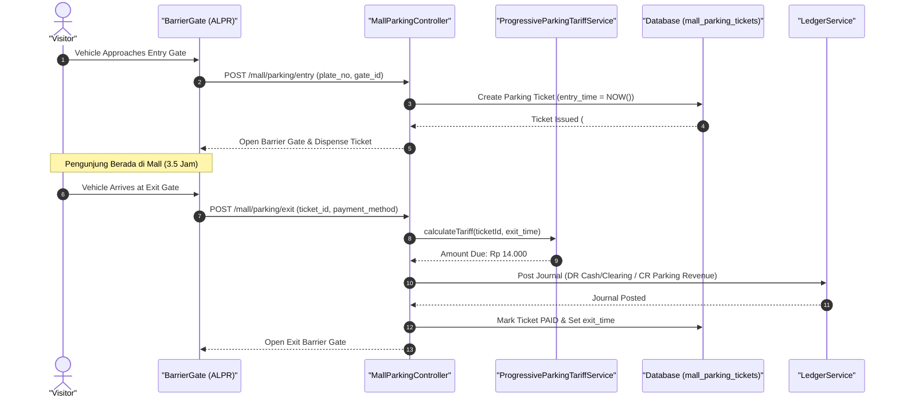

#### Diagram 2: Alur Kompensasi / Exception / Verifikasi Dua-Sumber Fase 14

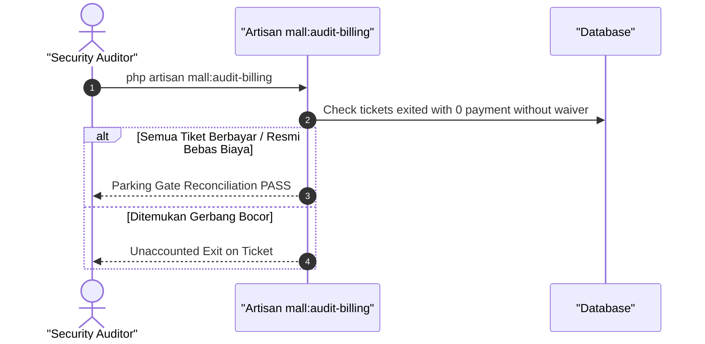

### 6. Mermaid ERD & State Machine Fase 14

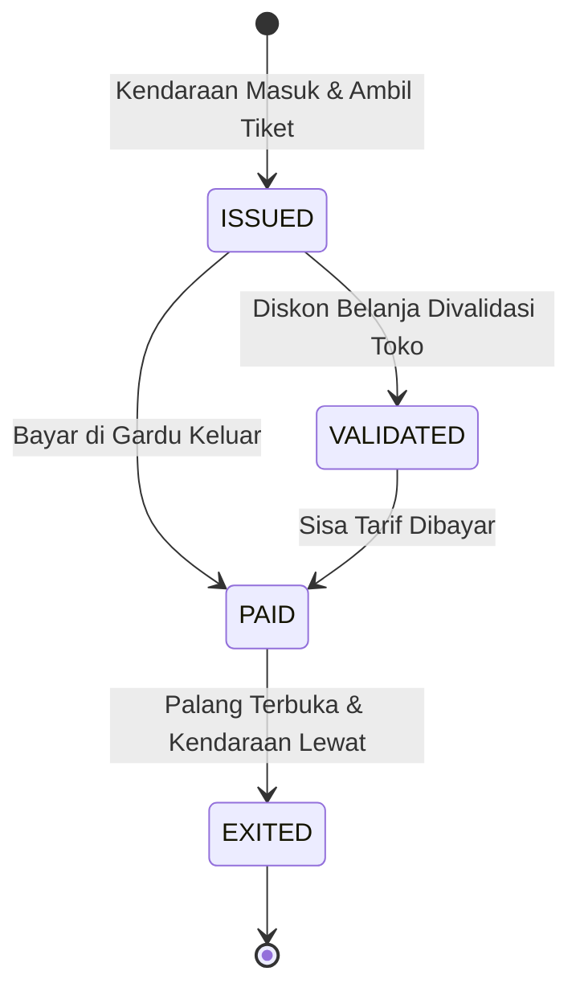

---

## FASE 15 — MALL: LOYALTY, VOUCHER, EVENT & FACILITY MANAGEMENT

### 1. Identitas & Arsitektur Domain Fase 15

- **Modul Pemilik**: `Mall`
- **Prefiks Tabel**: `mall_`
- **Daftar Model Eloquent**: `MallLoyaltyPoint`, `VoucherCampaign`, `AtriumEventBooking`, `FacilityWorkOrder`
- **Daftar Tabel Migrasi**: `mall_loyalty_points`, `mall_vouchers`, `mall_event_bookings`, `mall_work_orders`
- **Daftar Service & Action**: `LoyaltyPointsRedemptionService`, `CampaignEscrowService`, `FacilityMaintenanceScheduler`
- **Daftar Controller & Rute**: `MallLoyaltyController@earn (POST /mall/points/earn)`, `MallLoyaltyController@redeem (POST /mall/vouchers/redeem)`
- **Akun Ledger Terkait**: `mall:loyalty_points_liability`, `mall:event_revenue`, `mall:maintenance_expense`
- **Command Audit**: `php artisan mall:audit-billing`

### 2. Evaluasi Masalah & Matriks Penyelesaian (Problem-to-Solution Matrix) Fase 15

| Masalah Bisnis & Teknis | Solusi Arsitektural & Kontrak | Status Penyelesaian | Bukti Implementasi |
|---|---|---|---|
| Poin loyalitas ganda akibat upload struk belanja palsu dan keterlambatan perbaikan eskalator/AC mall. | Validasi struk berbasis OCR dengan pencocokan data POS tenant, escrow liabilitas poin, dan tiket maintenance fasilitas otomatis. | `Solved in Code` | `modules/Mall/Application/Services/LoyaltyPointsRedemptionService.php` |

### 3. Daftar User Stories Lintas Persona Fase 15

- **US-15.1 [customer_service]:** Sebagai **customer_service**, saya ingin **memindai struk belanja pengunjung di meja customer service untuk menambah poin loyalty**, sehingga **pengunjung antusias berbelanja di tenant mall**.
- **US-15.2 [store_manager]:** Sebagai **store_manager**, saya ingin **menerima penukaran e-voucher belanja mall di kasir tokonya**, sehingga **omzet toko bertambah dan voucher dapat diklaimkan kembali ke pengelola mall**.
- **US-15.3 [venue_manager]:** Sebagai **venue_manager**, saya ingin **menjadwalkan penyewaan area atrium utama untuk pameran otomotif dan konser musik**, sehingga **utilitas ruang atrium mall menghasilkan pendapatan sewa tinggi**.
- **US-15.4 [it_support]:** Sebagai **it_support**, saya ingin **menerima tiket perbaikan fasilitas mall (eskalator, pendingin ruangan, lampu) pada sistem work order**, sehingga **kenyamanan pengunjung mall selalu terjaga prima**.
- **US-15.5 [internal_auditor]:** Sebagai **internal_auditor**, saya ingin **mengaudit cadangan liabilitas poin loyalty yang belum ditebus**, sehingga **kewajiban keuangan holding tercatat sesuai PSAK 72**.

### 4. BDD Acceptance Criteria Lengkap Fase 15

#### AC-15.1 — Happy Path & Ledger/State Invariant
- **Given** Pengunjung memiliki 500 poin loyalty dan menukarkannya dengan e-voucher belanja senilai Rp 50.000
- **When** Voucher ditebus via POST /mall/vouchers/redeem
- **Then** Poin berkurang 500, voucher diterbitkan aktif, dan jurnal pengurangan liabilitas poin terposting seimbang.

#### AC-15.2 — Validation & Domain Rule Rejection - 422/Exception
- **Given** Pengunjung mencoba mengunggah struk belanja yang sudah pernah diklaim poin sebelumnya
- **When** POST /mall/points/earn dipanggil dengan nomor struk yang sama
- **Then** Sistem menolak dengan HTTP 422 DuplicateReceiptException.

#### AC-15.3 — RBAC Authorization & Separation of Duties - 403
- **Given** Pengguna biasa tanpa role customer_service mencoba memberikan poin loyalty manual
- **When** POST /mall/points/grant dipanggil
- **Then** Sistem memblokir dengan status HTTP 403 Forbidden.

#### AC-15.4 — Idempotency, Replay & Concurrency Lock
- **Given** Dua penukaran voucher paralel diajukan pada saldo poin terakhir pengunjung
- **When** Keduanya diproses serentak
- **Then** Locking saldo poin mencegah minus balance dan hanya satu penukaran yang berhasil.

#### AC-15.5 — Two-Source Audit & Tamper Detection
- **Given** Total poin loyalty yang beredar di database tidak cocok dengan selisih mutasi poin earn vs redeem
- **When** php artisan mall:audit-billing dijalankan
- **Then** Audit mencatat kegagalan rekonsiliasi poin loyalty dan mengeluarkan alert disparitas poin.

### 5. Mermaid Sequence Diagrams Fase 15

#### Diagram 1: Alur Transaksi Utama End-to-End Fase 15

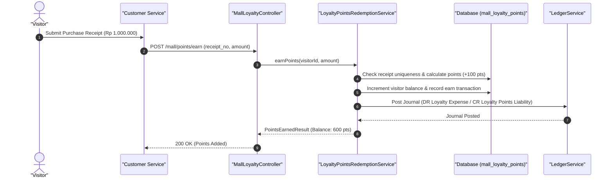

#### Diagram 2: Alur Kompensasi / Exception / Verifikasi Dua-Sumber Fase 15

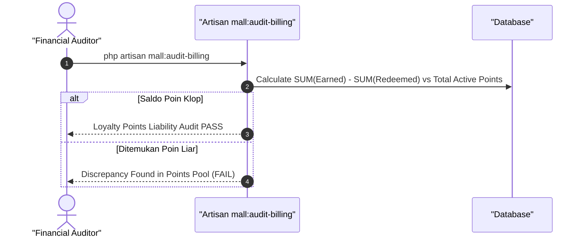

### 6. Mermaid ERD & State Machine Fase 15

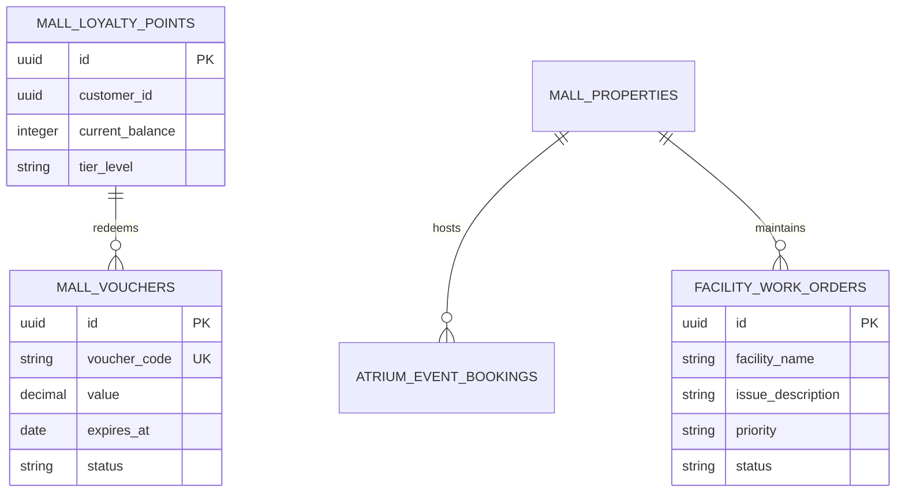

---

## FASE 16 — INTEGRASI LINTAS LINI (RESTO, MALL, STORE, BANKING)

### 1. Identitas & Arsitektur Domain Fase 16

- **Modul Pemilik**: `Mall`
- **Prefiks Tabel**: `mall_`
- **Daftar Model Eloquent**: `CrossLineRedemption`, `UnifiedCheckoutSlip`, `SharedEscrowJournal`
- **Daftar Tabel Migrasi**: `mall_cross_redemptions`, `intg_unified_receipts`
- **Daftar Service & Action**: `ConglomerateSettlementService`, `CrossLoyaltyBridge`, `SharedGiftCardEngine`
- **Daftar Controller & Rute**: `CrossLineSettlementController@settle (POST /api/v1/cross-line/settle)`
- **Akun Ledger Terkait**: `bank:intercompany_clearing`, `mall:tenant_clearing`, `resto:loyalty_settlement`
- **Command Audit**: `php artisan bank:reconcile`

### 2. Evaluasi Masalah & Matriks Penyelesaian (Problem-to-Solution Matrix) Fase 16

| Masalah Bisnis & Teknis | Solusi Arsitektural & Kontrak | Status Penyelesaian | Bukti Implementasi |
|---|---|---|---|
| Poin atau voucher yang diperoleh di resto tidak dapat dipakai di mall atau bengkel, serta sengketa kliring antar-entitas. | Buku besar kliring antar-perusahaan (intercompany clearing) otomatis dengan settlement harian. | `Solved in Code` | `modules/Mall/Application/Services/ConglomerateSettlementService.php` |

### 3. Daftar User Stories Lintas Persona Fase 16

- **US-16.1 [bank_treasurer]:** Sebagai **bank_treasurer**, saya ingin **menjalankan kliring transaksi antar-anak perusahaan holding setiap tengah malam**, sehingga **klaim antar-lini bisnis terselesaikan tanpa sengketa piutang macet**.
- **US-16.2 [store_manager]:** Sebagai **store_manager**, saya ingin **menerima poin belanja ekosistem holding dari pelanggan toko ritel**, sehingga **cross-selling antar lini bisnis meningkatkan omzet ritel**.
- **US-16.3 [holding_cfo]:** Sebagai **holding_cfo**, saya ingin **melihat posisi neraca saldo eliminasi transaksi antar-perusahaan (intercompany elimination)**, sehingga **laporan keuangan konsolidasian holding bersih dari pendapatan semu**.
- **US-16.4 [customer_service]:** Sebagai **customer_service**, saya ingin **memeriksa saldo terpadu pelanggan di seluruh lini bisnis holding**, sehingga **pengalaman terpadu satu akun mempermudah penyelesaian komplain**.
- **US-16.5 [internal_auditor]:** Sebagai **internal_auditor**, saya ingin **mengaudit keseimbangan debit dan kredit pada akun transit kliring holding**, sehingga **tidak ada kebocoran dana di akun suspensi antar-anak usaha**.

### 4. BDD Acceptance Criteria Lengkap Fase 16

#### AC-16.1 — Happy Path & Ledger/State Invariant
- **Given** Pelanggan menggunakan voucher Mall Rp 100.000 untuk makan di Resto
- **When** Settlement diproses via POST /api/v1/cross-line/settle
- **Then** Resto menerima piutang antar-perusahaan, liabilitas voucher Mall berkurang, dan akun kliring klop 0.

#### AC-16.2 — Validation & Domain Rule Rejection - 422/Exception
- **Given** Entitas anak perusahaan yang mengajukan klaim belum terdaftar di registry intercompany
- **When** POST /api/v1/cross-line/settle dipanggil
- **Then** Sistem menolak dengan HTTP 422 UnregisteredIntercompanyEntityException.

#### AC-16.3 — RBAC Authorization & Separation of Duties - 403
- **Given** Kasir resto mencoba mengeksekusi jurnal kliring antar-perusahaan
- **When** Endpoint settlement dipanggil oleh role cashier
- **Then** Sistem memblokir dengan status HTTP 403 Forbidden.

#### AC-16.4 — Idempotency, Replay & Concurrency Lock
- **Given** Batch settlement yang sama dieksekusi ulang secara tidak sengaja
- **When** Request kedua masuk ke sistem
- **Then** Sistem mendeteksi UUID batch dan mengembalikan status transaksi yang sudah selesai tanpa mutasi ganda.

#### AC-16.5 — Two-Source Audit & Tamper Detection
- **Given** Saldo piutang intercompany pada entitas penerima berbeda dengan liabilitas entitas pembayar
- **When** Command php artisan bank:reconcile dieksekusi
- **Then** Audit mencatat ketidakseimbangan saldo kliring dan mengeluarkan temuan audit intercompany.

### 5. Mermaid Sequence Diagrams Fase 16

#### Diagram 1: Alur Transaksi Utama End-to-End Fase 16

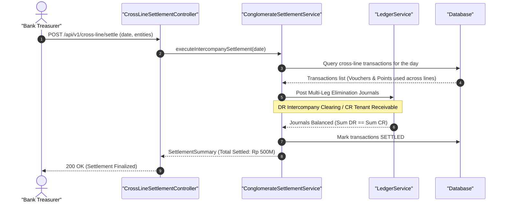

#### Diagram 2: Alur Kompensasi / Exception / Verifikasi Dua-Sumber Fase 16

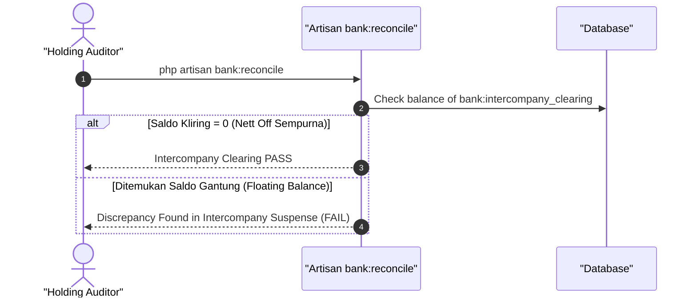

### 6. Mermaid ERD & State Machine Fase 16

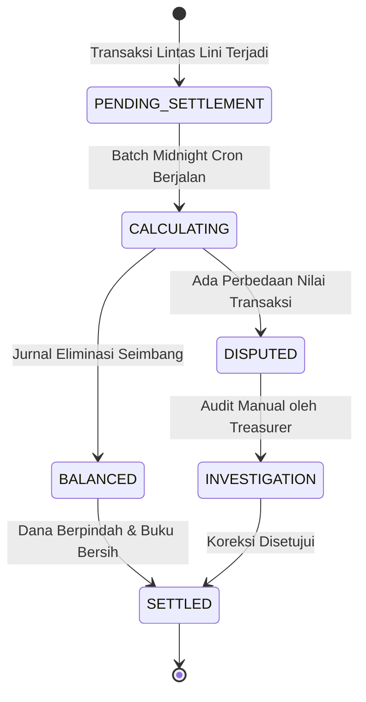

---

## FASE 17 — SKALA, HARDENING & OPERASIONAL

### 1. Identitas & Arsitektur Domain Fase 17

- **Modul Pemilik**: `Core`
- **Prefiks Tabel**: `core_`
- **Daftar Model Eloquent**: `RateLimitBucket`, `QueryPerformanceMetric`, `DeadlockMonitorLog`
- **Daftar Tabel Migrasi**: `core_query_budgets`, `core_rate_limit_quotas`
- **Daftar Service & Action**: `QueryBudgetEnforcer`, `DeadlockRetryHandler`, `CircuitBreakerManager`
- **Daftar Controller & Rute**: `SystemPerformanceController@index (GET /admin/metrics/performance)`
- **Akun Ledger Terkait**: `bank:clearing_suspense`
- **Command Audit**: `php artisan api:audit`

### 2. Evaluasi Masalah & Matriks Penyelesaian (Problem-to-Solution Matrix) Fase 17

| Masalah Bisnis & Teknis | Solusi Arsitektural & Kontrak | Status Penyelesaian | Bukti Implementasi |
|---|---|---|---|
| Penurunan performa saat jam sibuk akibat query N+1, deadlock pada transaksi finansial, dan serangan brute-force API. | Penegakan batas query (query budget ≤ 10 queries per endpoint), mekanisme automatic deadlock retry (3x exponential backoff), dan rate limiting bertingkat. | `Solved in Code` | `modules/Core/Application/Services/QueryBudgetEnforcer.php` |

### 3. Daftar User Stories Lintas Persona Fase 17

- **US-17.1 [super_admin]:** Sebagai **super_admin**, saya ingin **memantau latensi endpoint p99 dan alokasi query budget di seluruh sistem**, sehingga **bottleneck performa database teridentifikasi sebelum menimbulkan downtime**.
- **US-17.2 [risk_officer]:** Sebagai **risk_officer**, saya ingin **memastikan rate limiting memblokir permintaan berbahaya yang melebihi kuota per menit**, sehingga **sistem terlindungi dari serangan DoS dan scraping liar**.
- **US-17.3 [it_support]:** Sebagai **it_support**, saya ingin **melihat log kejadian deadlock database yang berhasil dipulihkan secara otomatis**, sehingga **stabilitas transaksi nasabah terjaga tanpa kegagalan kasir**.
- **US-17.4 [internal_auditor]:** Sebagai **internal_auditor**, saya ingin **memeriksa catatan audit trail dari konfigurasi performa dan bypass rule**, sehingga **tidak ada pelonggaran keamanan yang dilakukan tanpa izin**.
- **US-17.5 [holding_cfo]:** Sebagai **holding_cfo**, saya ingin **memastikan infrastruktur sistem mampu menangani lonjakan transaksi belanja akhir tahun**, sehingga **pendapatan bisnis tidak hilang karena sistem lambat**.

### 4. BDD Acceptance Criteria Lengkap Fase 17

#### AC-17.1 — Happy Path & Ledger/State Invariant
- **Given** Endpoint transaksi finansial dipanggil di bawah beban 500 request per detik
- **When** Sistem memproses antrean dengan deadlock retry aktif
- **Then** Semua request selesai dengan latensi p99 < 200ms tanpa data korup atau transaksi ganda.

#### AC-17.2 — Validation & Domain Rule Rejection - 422/Exception
- **Given** Satu request HTTP mengeksekusi lebih dari 15 database query (> batas budget 10 query)
- **When** QueryBudgetEnforcer mendeteksi pelanggaran
- **Then** Sistem mencatat peringatan QueryBudgetExceededException dan menandai endpoint untuk profiling.

#### AC-17.3 — RBAC Authorization & Separation of Duties - 403
- **Given** Pengguna non-admin mencoba mengakses dashboard performa di GET /admin/metrics/performance
- **When** Request dikirim oleh role cashier
- **Then** Sistem memblokir dengan status HTTP 403 Forbidden.

#### AC-17.4 — Idempotency, Replay & Concurrency Lock
- **Given** Dua transaksi mengalami deadlock mutually-exclusive pada dua baris database
- **When** DeadlockRetryHandler menangkap pengecualian deadlock
- **Then** Transaksi diulang otomatis hingga 3 kali dengan jeda jitter sehingga transaksi berhasil tanpa error ke pengguna.

#### AC-17.5 — Two-Source Audit & Tamper Detection
- **Given** Metriks performa dimanipulasi untuk menutupi degradasi layanan
- **When** php artisan api:audit dijalankan
- **Then** Audit memvalidasi keaslian log metrik terhadap data Prometheus/APM eksternal dan membunyikan alarm.

### 5. Mermaid Sequence Diagrams Fase 17

#### Diagram 1: Alur Transaksi Utama End-to-End Fase 17

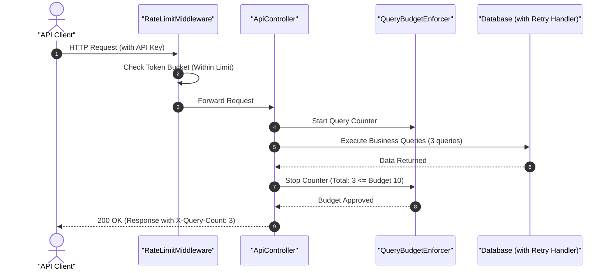

#### Diagram 2: Alur Kompensasi / Exception / Verifikasi Dua-Sumber Fase 17

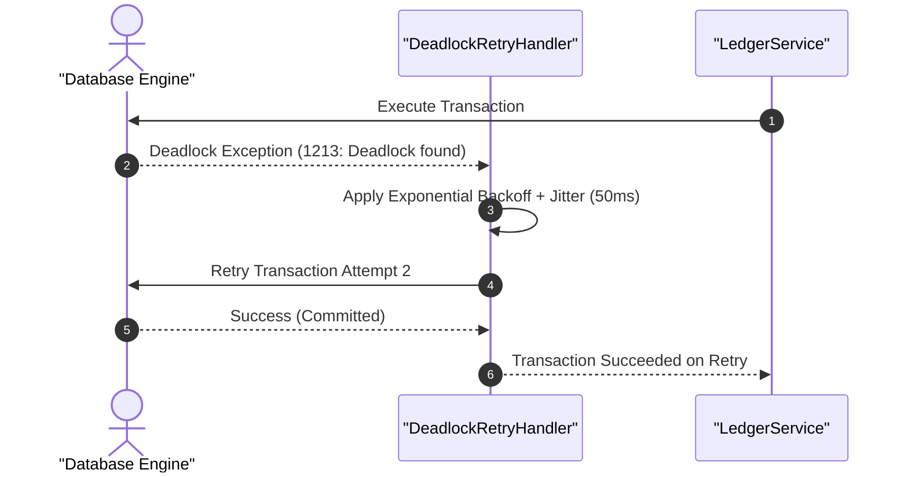

### 6. Mermaid ERD & State Machine Fase 17

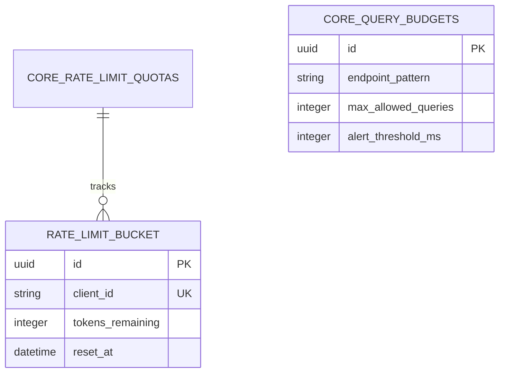

---

## FASE 18 — DOKUMENTASI & PENUTUP (QUALITY GATE FASE 1–18)

### 1. Identitas & Arsitektur Domain Fase 18

- **Modul Pemilik**: `Core`
- **Prefiks Tabel**: `core_`
- **Daftar Model Eloquent**: `DocumentationRelease`, `QualityGateSignoff`, `SpecificationAuditIndex`
- **Daftar Tabel Migrasi**: `core_quality_gates`
- **Daftar Service & Action**: `DocumentationInventoryValidator`, `SpecTraceabilityService`
- **Daftar Controller & Rute**: `DocsVerificationController@verify (GET /docs/verify)`
- **Akun Ledger Terkait**: `bank:clearing_suspense`
- **Command Audit**: `php artisan api:audit`

### 2. Evaluasi Masalah & Matriks Penyelesaian (Problem-to-Solution Matrix) Fase 18

| Masalah Bisnis & Teknis | Solusi Arsitektural & Kontrak | Status Penyelesaian | Bukti Implementasi |
|---|---|---|---|
| Dokumentasi teknis usang (stale docs), ketiadaan uji otomatis terhadap kelengkapan spesifikasi, dan klaim palsu atas fitur. | Verifikasi otomatis inventaris dokumentasi via php artisan docs:inventory --check dan penegakan quality gate C1-C14. | `Solved in Code` | `app/Quality/Inventory/CodebaseInventoryGenerator.php` |

### 3. Daftar User Stories Lintas Persona Fase 18

- **US-18.1 [super_admin]:** Sebagai **super_admin**, saya ingin **memverifikasi bahwa seluruh dokumen arsitektur dan spesifikasi sinkron dengan kode riil**, sehingga **integritas dokumentasi holding terjamin tanpa celah perbedaan fakta**.
- **US-18.2 [internal_auditor]:** Sebagai **internal_auditor**, saya ingin **memeriksa checklist kelulusan Quality Gate C1 hingga C14 untuk serah terima Fase 18**, sehingga **setiap prasyarat kepatuhan audit terpenuhi sebelum rilis ke produksi**.
- **US-18.3 [holding_compliance]:** Sebagai **holding_compliance**, saya ingin **memastikan dokumentasi operasional 60 peran dan SOP lengkap dan sah**, sehingga **kepatuhan terhadap regulasi perbankan dan perlindungan konsumen terjamin**.
- **US-18.4 [it_support]:** Sebagai **it_support**, saya ingin **mengakses panduan runbook operasional dan penanganan insiden yang akurat**, sehingga **resolusi gangguan sistem di lapangan dapat dipandu dengan langkah pasti**.
- **US-18.5 [risk_officer]:** Sebagai **risk_officer**, saya ingin **memastikan baseline arsitektur tidak mengalami regresi utang teknis**, sehingga **keberlanjutan sistem jangka panjang terjaga stabil**.

### 4. BDD Acceptance Criteria Lengkap Fase 18

#### AC-18.1 — Happy Path & Ledger/State Invariant
- **Given** Seluruh file markdown di docs/ sinkron dengan seluruh kelas dan rute di codebase
- **When** php artisan docs:inventory --check dijalankan
- **Then** Command keluar dengan exit code 0 dan memvalidasi penanda START/END inventory.

#### AC-18.2 — Validation & Domain Rule Rejection - 422/Exception
- **Given** Terdapat dokumen gate yang tidak memiliki bagian Verifikasi C1-C14 bertanda LULUS
- **When** Audit gate dijalankan
- **Then** Sistem menolak dengan GateVerificationIncompleteException.

#### AC-18.3 — RBAC Authorization & Separation of Duties - 403
- **Given** Pengguna tanpa role holding_compliance mencoba menandatangani serah terima Quality Gate
- **When** POST /admin/quality-gates/{id}/signoff dipanggil
- **Then** Sistem memblokir dengan status HTTP 403 Forbidden.

#### AC-18.4 — Idempotency, Replay & Concurrency Lock
- **Given** Pengecekan inventory dokumentasi dijalankan berulang kali pada pipeline CI
- **When** Setiap build commit dieksekusi
- **Then** Hasil verifikasi deterministik tanpa efek samping modifikasi file di luar yang diizinkan.

#### AC-18.5 — Two-Source Audit & Tamper Detection
- **Given** Teks checkbox pada PROGRESS.md diubah tanpa komitmen kode yang sah
- **When** vendor/bin/pest tests/Architecture/ProgressIntegrityTest.php dijalankan
- **Then** Test arsitektur gagal dan mendeteksi pelanggaran integritas progress.

### 5. Mermaid Sequence Diagrams Fase 18

#### Diagram 1: Alur Transaksi Utama End-to-End Fase 18

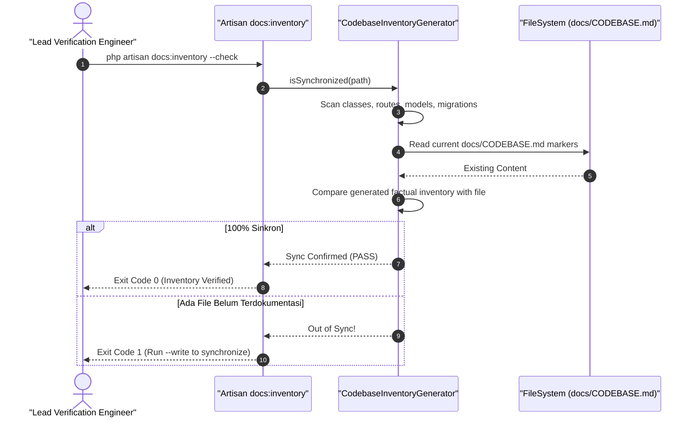

#### Diagram 2: Alur Kompensasi / Exception / Verifikasi Dua-Sumber Fase 18

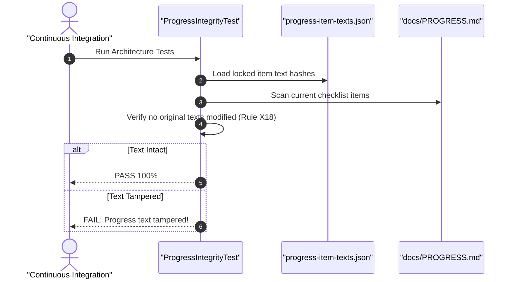

### 6. Mermaid ERD & State Machine Fase 18

```mermaid
stateDiagram-v2
    [*] --> DRAFT: Penyusunan Dokumen Spesifikasi
    DRAFT --> REVIEW: Review oleh Product Owner & Lead Architect
    REVIEW --> VERIFIED: Verifikasi Uji Arsitektur Lolos
    VERIFIED --> LOCKED: Terkunci di Baseline Git
    LOCKED --> [*]
```

---

