# SPESIFIKASI TEKNIS FASE 19–25: LOGISTIK, MULTIMODA, KEUANGAN EKSPEDISI & CONTROL TOWER

Dokumen ini mendefinisikan arsitektur domain, matriks penyelesaian, User Stories, BDD Acceptance Criteria, Sequence Diagrams, dan ERD/State Machine untuk Fase 19 s/d Fase 25.

---

## FASE 19 — PENUTUPAN UTANG FASE 18 (ZERO DEBT & DEMO SEEDER)

### 1. Identitas & Arsitektur Domain Fase 19

- **Modul Pemilik**: `Core`
- **Prefiks Tabel**: `core_`
- **Daftar Model Eloquent**: `TechnicalDebtLedger`, `RemediationCommitLog`, `SeedIntegrityAssertion`
- **Daftar Tabel Migrasi**: `core_tech_debt_logs`
- **Daftar Service & Action**: `ZeroDebtAssertionService`, `RegressionFenceVerification`
- **Daftar Controller & Rute**: `DebtRemediationController@verify (POST /admin/debt/verify)`
- **Akun Ledger Terkait**: `bank:clearing_suspense`
- **Command Audit**: `php artisan bank:reconcile`

### 2. Evaluasi Masalah & Matriks Penyelesaian (Problem-to-Solution Matrix) Fase 19

| Masalah Bisnis & Teknis | Solusi Arsitektural & Kontrak | Status Penyelesaian | Bukti Implementasi |
|---|---|---|---|
| Sisa utang teknis dari fase sebelumnya yang dapat menghambat skalabilitas modul logistik baru. | Penutupan utang komprehensif via seeder deterministik (DemoCustomerSeeder), pembersihan TODO, dan penguncian baseline nol utang. | `Solved in Code` | `database/seeders/DemoCustomerSeeder.php` |

### 3. Daftar User Stories Lintas Persona Fase 19

- **US-19.1 [super_admin]:** Sebagai **super_admin**, saya ingin **memastikan seluruh seeder data demo berjalan sempurna tanpa error foreign key**, sehingga **lingkungan pengujian dan demo investor selalu siap pakai**.
- **US-19.2 [lead_architect]:** Sebagai **lead_architect**, saya ingin **mengunci seluruh celah arsitektur sebelum memulai modul logistik terdistribusi**, sehingga **fondasi sistem tetap solid tanpa utang tersembunyi**.
- **US-19.3 [internal_auditor]:** Sebagai **internal_auditor**, saya ingin **memverifikasi bahwa tidak ada bypass keamanan darurat yang tertinggal**, sehingga **seluruh aturan otorisasi berjalan ketat**.
- **US-19.4 [holding_cfo]:** Sebagai **holding_cfo**, saya ingin **memastikan neraca saldo demo seimbang sempurna (reconcile 0)**, sehingga **integritas simulasi finansial terbukti terpercaya**.
- **US-19.5 [it_support]:** Sebagai **it_support**, saya ingin **menjalankan automated test suite dalam waktu di bawah batas toleransi CI**, sehingga **feedback loop pengembang tetap cepat dan efisien**.

### 4. BDD Acceptance Criteria Lengkap Fase 19

#### AC-19.1 — Happy Path & Ledger/State Invariant
- **Given** Database dalam kondisi bersih (fresh migration)
- **When** php artisan db:seed --class=DemoCustomerSeeder dijalankan
- **Then** 20 customer, 20 kendaraan, dan 40+ booking terbuat, rekonsiliasi buku besar seimbang 0, dan exit code 0.

#### AC-19.2 — Validation & Domain Rule Rejection - 422/Exception
- **Given** Terdapat data seeder yang melanggar batasan LTV pinjaman (> 70%)
- **When** Seeder memvalidasi invarian domain
- **Then** Seeder membatalkan eksekusi dengan InvariantViolationException.

#### AC-19.3 — RBAC Authorization & Separation of Duties - 403
- **Given** Pengguna tanpa hak admin mencoba memicu eksekusi seeder di endpoint produksi
- **When** POST /admin/debt/verify dipanggil tanpa kredensial admin
- **Then** Sistem menolak dengan HTTP 403 Forbidden.

#### AC-19.4 — Idempotency, Replay & Concurrency Lock
- **Given** Seeder dijalankan berulang kali pada database yang sama
- **When** Method run() dieksekusi
- **Then** Data di-upsert secara aman tanpa menghasilkan duplikasi baris atau pelanggaran unique key.

#### AC-19.5 — Two-Source Audit & Tamper Detection
- **Given** Salah satu akun kas seeder diubah secara manual di DB
- **When** Command php artisan bank:reconcile dijalankan
- **Then** Audit mendeteksi selisih saldo dan menggagalkan verifikasi tahap.

### 5. Mermaid Sequence Diagrams Fase 19

#### Diagram 1: Alur Transaksi Utama End-to-End Fase 19

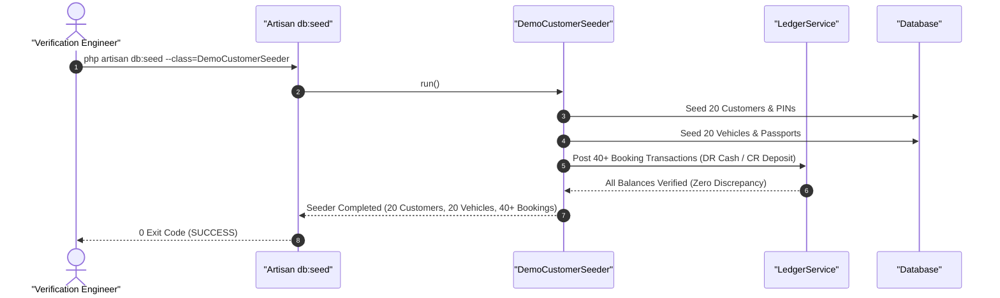

#### Diagram 2: Alur Kompensasi / Exception / Verifikasi Dua-Sumber Fase 19

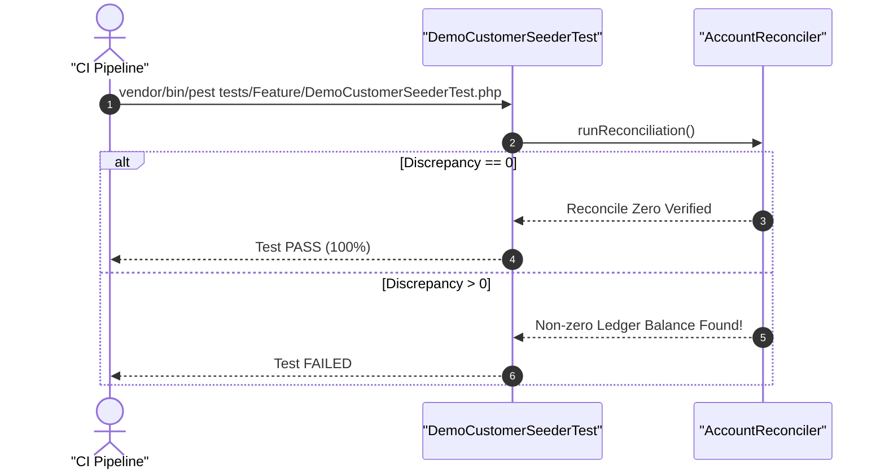

### 6. Mermaid ERD & State Machine Fase 19

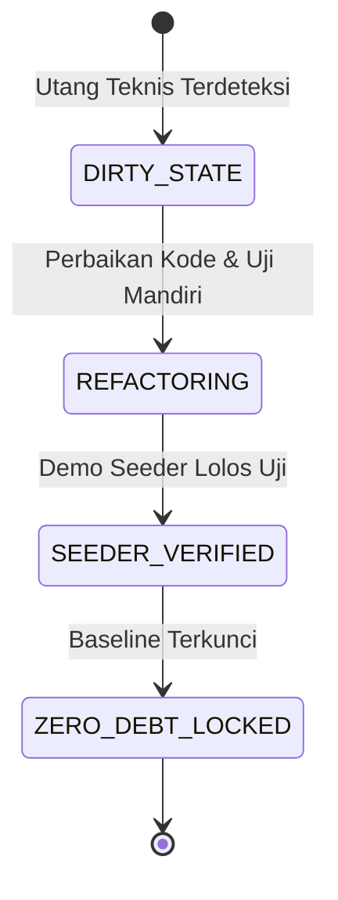

---

## FASE 20 — FONDASI LOGISTIK: MODUL, JARINGAN, ARMADA

### 1. Identitas & Arsitektur Domain Fase 20

- **Modul Pemilik**: `Logistics`
- **Prefiks Tabel**: `lgx_`
- **Daftar Model Eloquent**: `LogisticsHub`, `TransportRoute`, `VehicleAsset`, `DriverProfile`, `FleetMaintenanceSchedule`
- **Daftar Tabel Migrasi**: `lgx_hubs`, `lgx_routes`, `flt_vehicles`, `flt_drivers`, `flt_schedules`
- **Daftar Service & Action**: `HubNetworkService`, `FleetAvailabilityService`, `DriverRosterEngine`
- **Daftar Controller & Rute**: `LogisticsNetworkController@hubs (GET /logistics/hubs)`, `FleetController@assign (POST /fleet/vehicles/assign)`
- **Akun Ledger Terkait**: `ast:vehicle_fixed_asset`, `flt:maintenance_accrual`, `flt:fuel_inventory`
- **Command Audit**: `php artisan flt:audit`

### 2. Evaluasi Masalah & Matriks Penyelesaian (Problem-to-Solution Matrix) Fase 20

| Masalah Bisnis & Teknis | Solusi Arsitektural & Kontrak | Status Penyelesaian | Bukti Implementasi |
|---|---|---|---|
| Armada truk yang beroperasi tanpa jadwal servis berkala, pengemudi tanpa sertifikasi rute, dan ketiadaan topologi hub logistik. | Master jaringan hub logistik berhierarki (Origin-Hub-Spoke-Destination), registrasi armada terpadu dengan modul Fleet, dan roster driver cerdas. | `Solved in Code` | `modules/Logistics/Application/Services/HubNetworkService.php` |

### 3. Daftar User Stories Lintas Persona Fase 20

- **US-20.1 [fleet_manager]:** Sebagai **fleet_manager**, saya ingin **mendaftarkan truk ekspedisi baru dan menugaskan pengemudi berlisensi resmi**, sehingga **operasional pengiriman barang memiliki kepastian sarana dan awak**.
- **US-20.2 [logistics_driver]:** Sebagai **logistics_driver**, saya ingin **melihat jadwal penugasan rute perjalanan dan checklist pemeriksaan kendaraan sebelum jalan**, sehingga **keselamatan berkendara dan kesiapan teknis armada terjamin**.
- **US-20.3 [wms_supervisor]:** Sebagai **wms_supervisor**, saya ingin **memantau kapasitas daya tampung dan jadwal kedatangan truk di hub logistik**, sehingga **antrean bongkar muat di loading dock dapat diatur optimal**.
- **US-20.4 [holding_cfo]:** Sebagai **holding_cfo**, saya ingin **memantau beban biaya bahan bakar dan penyusutan aset tetap armada logistik**, sehingga **biaya operasional kendaraan per kilometer (CPK) terkontrol**.
- **US-20.5 [internal_auditor]:** Sebagai **internal_auditor**, saya ingin **mengaudit kepatuhan masa berlaku uji KIR dan izin trayek seluruh kendaraan**, sehingga **perusahaan terbebas dari sanksi tilang atau pembekuan izin operasi**.

### 4. BDD Acceptance Criteria Lengkap Fase 20

#### AC-20.1 — Happy Path & Ledger/State Invariant
- **Given** Truk Tronton B 9999 LGX dalam status AVAILABLE dan Pengemudi bersertifikat B2 Umum aktif
- **When** Fleet Manager menugaskan armada ke Rute Jakarta-Surabaya via POST /fleet/vehicles/assign
- **Then** Status truk berubah menjadi ASSIGNED, jadwal perjalanan terbentuk, dan aset kendaraan terikat pada rute aktif.

#### AC-20.2 — Validation & Domain Rule Rejection - 422/Exception
- **Given** Masa berlaku uji KIR kendaraan telah kedaluwarsa
- **When** Fleet Manager mencoba menugaskan kendaraan
- **Then** Sistem menolak dengan HTTP 422 ExpiredInspectionCertificateException.

#### AC-20.3 — RBAC Authorization & Separation of Duties - 403
- **Given** Pengemudi (logistics_driver) mencoba mengesahkan sendiri status kelayakan kendaraannya
- **When** POST /fleet/vehicles/{id}/certify dipanggil
- **Then** Sistem menolak dengan HTTP 403 Forbidden karena otorisasi kelaikan jalan dipegang fleet_manager.

#### AC-20.4 — Idempotency, Replay & Concurrency Lock
- **Given** Dua dispatcher mencoba menugaskan truk yang sama ke dua rute berbeda pada waktu yang sama
- **When** Kedua request dieksekusi
- **Then** Row-level lock memastikan truk hanya ditugaskan pada satu rute; penugasan kedua ditolak.

#### AC-20.5 — Two-Source Audit & Tamper Detection
- **Given** Status armada di database diubah aktif meskipun catatan odometer menunjukkan interval servis wajib terlewati
- **When** php artisan flt:audit dijalankan
- **Then** Audit mencatat pelanggaran standar perawatan armada dan menurunkan status kelaikan kendaraan.

### 5. Mermaid Sequence Diagrams Fase 20

#### Diagram 1: Alur Transaksi Utama End-to-End Fase 20

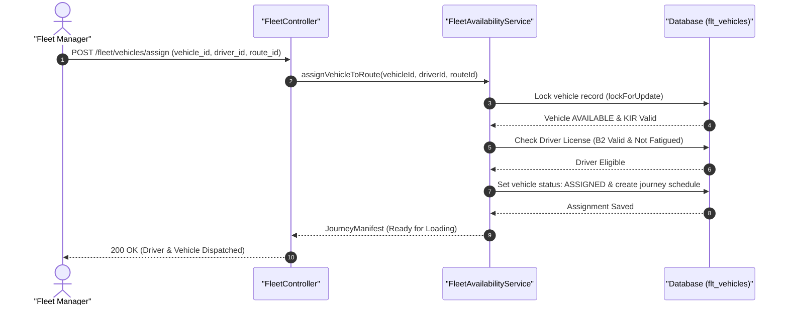

#### Diagram 2: Alur Kompensasi / Exception / Verifikasi Dua-Sumber Fase 20

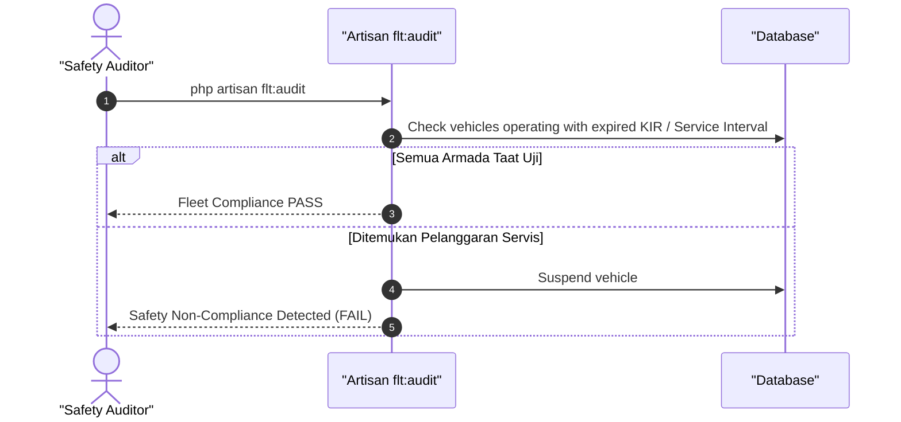

### 6. Mermaid ERD & State Machine Fase 20

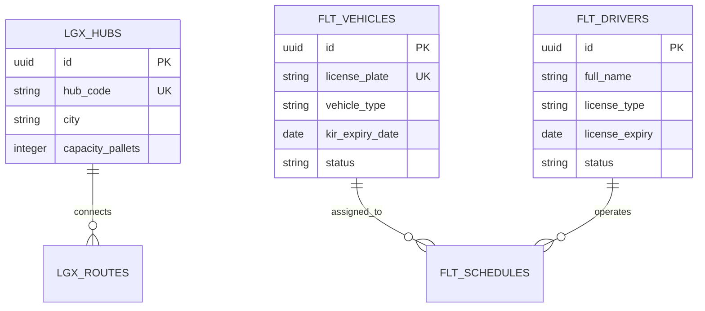

---

## FASE 21 — SHIPMENT, TARIF, BOOKING & PORTAL SHIPPER

### 1. Identitas & Arsitektur Domain Fase 21

- **Modul Pemilik**: `Logistics`
- **Prefiks Tabel**: `lgx_`
- **Daftar Model Eloquent**: `WaybillShipment`, `RateTariffRule`, `ShipperBooking`, `DimensionWeightLog`
- **Daftar Tabel Migrasi**: `lgx_shipments`, `lgx_tariffs`, `lgx_bookings`, `lgx_volumetric_audits`
- **Daftar Service & Action**: `VolumetricRatingEngine`, `ShipperBookingService`, `WaybillGenerationService`
- **Daftar Controller & Rute**: `LogisticsShipmentController@quote (POST /logistics/shipments/quote)`, `LogisticsShipmentController@book (POST /logistics/bookings)`
- **Akun Ledger Terkait**: `lgx:unearned_freight`, `lgx:freight_receivable`, `lgx:freight_revenue`
- **Command Audit**: `php artisan lgx:audit-billing`

### 2. Evaluasi Masalah & Matriks Penyelesaian (Problem-to-Solution Matrix) Fase 21

| Masalah Bisnis & Teknis | Solusi Arsitektural & Kontrak | Status Penyelesaian | Bukti Implementasi |
|---|---|---|---|
| Kesalahan perhitungan berat volumetrik paket yang merugikan perusahaan ekspedisi dan tarif manual yang lambat. | Volumetric Rating Engine (panjang x lebar x tinggi / 5000), kode waybill otomatis berstandar GS1-128, dan portal shipper swalayan. | `Solved in Code` | `modules/Logistics/Application/Services/VolumetricRatingEngine.php` |

### 3. Daftar User Stories Lintas Persona Fase 21

- **US-21.1 [store_manager]:** Sebagai **store_manager**, saya ingin **membuat booking pengiriman kargo barang ritel melalui portal shipper**, sehingga **resi pengiriman langsung terbit lengkap dengan estimasi waktu tiba**.
- **US-21.2 [wms_picker]:** Sebagai **wms_picker**, saya ingin **menimbang dan mengukur dimensi paket pada alat timbang digital saat serah terima barang**, sehingga **berat yang ditagihkan sesuai antara berat aktual vs volumetrik tertinggi**.
- **US-21.3 [bank_treasurer]:** Sebagai **bank_treasurer**, saya ingin **memverifikasi uang muka ongkos kirim (freight prepaid) yang dibayar shipper**, sehingga **dana freight tersimpan di akun pendapatan diterima di muka**.
- **US-21.4 [customer_service]:** Sebagai **customer_service**, saya ingin **melacak posisi paket kiriman berdasarkan nomor resi waybill**, sehingga **informasi status paket dapat disampaikan transparan kepada pengirim**.
- **US-21.5 [internal_auditor]:** Sebagai **internal_auditor**, saya ingin **memeriksa kepatuhan penerapan matriks diskon tarif shipper korporat**, sehingga **tidak ada penerapan tarif di bawah batas biaya pokok transportasi**.

### 4. BDD Acceptance Criteria Lengkap Fase 21

#### AC-21.1 — Happy Path & Ledger/State Invariant
- **Given** Paket memiliki berat aktual 2 kg tetapi dimensi 40x30x30 cm (berat volumetrik = 7.2 kg -> dibulatkan 8 kg) dengan tarif Rp 10.000/kg
- **When** Shipper melakukan booking via POST /logistics/bookings
- **Then** Tarif terhitung Rp 80.000 (berdasarkan berat terbesar), nomor waybill terbit, dan jurnal piutang freight terposting seimbang.

#### AC-21.2 — Validation & Domain Rule Rejection - 422/Exception
- **Given** Shipper memasukkan alamat tujuan di luar jangkauan jaringan hub logistik
- **When** POST /logistics/shipments/quote dipanggil
- **Then** Sistem menolak dengan HTTP 422 DestinationOutOfCoverageException.

#### AC-21.3 — RBAC Authorization & Separation of Duties - 403
- **Given** Pengemudi (logistics_driver) mencoba mengubah tarif dasar pengiriman pada tabel tarif
- **When** Endpoint modifikasi tarif dipanggil
- **Then** Sistem menolak dengan HTTP 403 Forbidden.

#### AC-21.4 — Idempotency, Replay & Concurrency Lock
- **Given** Shipper menekan tombol 'Booking' dua kali dengan Idempotency-Key yang sama
- **When** Kedua request booking diterima server
- **Then** Hanya 1 resi waybill yang dibuat dan respons identik dikembalikan pada kedua panggilan.

#### AC-21.5 — Two-Source Audit & Tamper Detection
- **Given** Nilai ongkos kirim pada waybill diturunkan secara ilegal di database tanpa riwayat promo
- **When** Command php artisan lgx:audit-billing dijalankan
- **Then** Audit mendeteksi ketidaksesuaian antara berat * tarif matriks vs total tagihan dan mengeluarkan alert.

### 5. Mermaid Sequence Diagrams Fase 21

#### Diagram 1: Alur Transaksi Utama End-to-End Fase 21

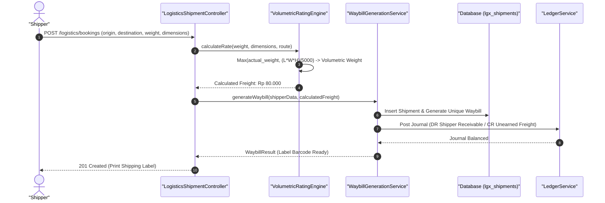

#### Diagram 2: Alur Kompensasi / Exception / Verifikasi Dua-Sumber Fase 21

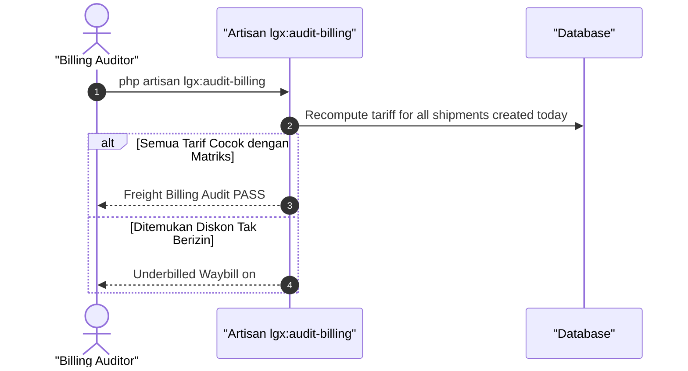

### 6. Mermaid ERD & State Machine Fase 21

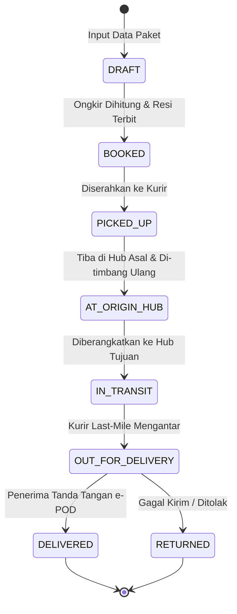

---

## FASE 22 — OPERASI JARINGAN MULTIMODA: KAPASITAS, RUTE, KONSOLIDASI, HUB, LAST-MILE

### 1. Identitas & Arsitektur Domain Fase 22

- **Modul Pemilik**: `Logistics`
- **Prefiks Tabel**: `lgx_`
- **Daftar Model Eloquent**: `ConsolidatorManifest`, `LegTransitHop`, `HubBaggingSortation`, `ProofOfDeliveryEpod`
- **Daftar Tabel Migrasi**: `lgx_manifests`, `lgx_transit_hops`, `lgx_bagging_logs`, `lgx_epod_records`
- **Daftar Service & Action**: `MultimodalRoutingService`, `CrossDockConsolidationService`, `LastMileDispatchService`
- **Daftar Controller & Rute**: `HubOperationsController@consolidate (POST /logistics/manifests/consolidate)`, `LastMileController@epod (POST /logistics/epod/sign)`
- **Akun Ledger Terkait**: `lgx:freight_in_transit`, `lgx:hub_handling_expense`, `lgx:carrier_payable`
- **Command Audit**: `php artisan lgx:verify-custody`

### 2. Evaluasi Masalah & Matriks Penyelesaian (Problem-to-Solution Matrix) Fase 22

| Masalah Bisnis & Teknis | Solusi Arsitektural & Kontrak | Status Penyelesaian | Bukti Implementasi |
|---|---|---|---|
| Kehilangan paket kecil saat sortasi manual di hub besar dan sengketa paket hilang di serah terima kurir last-mile. | Bagging sortasi digital dengan segel pengaman barcode, rute multimoda (Darat-Laut-Udara) berantai, dan e-POD dengan tanda tangan digital + geolokasi. | `Solved in Code` | `modules/Logistics/Application/Services/CrossDockConsolidationService.php` |

### 3. Daftar User Stories Lintas Persona Fase 22

- **US-22.1 [wms_supervisor]:** Sebagai **wms_supervisor**, saya ingin **mengonsolidasikan ratusan paket tujuan yang sama ke dalam satu kantong bagging ber-barcode**, sehingga **proses sortasi cepat dan risiko paket tercecer terminimalisir**.
- **US-22.2 [logistics_driver]:** Sebagai **logistics_driver**, saya ingin **memindai kantong bagging saat menaikkan barang ke truk kontainer multimoda**, sehingga **rantai kustodi barang berpindah secara sah dan tercatat di sistem**.
- **US-22.3 [customer_service]:** Sebagai **customer_service**, saya ingin **melihat foto bukti serah terima (e-POD) dan koordinat GPS saat kurir mengantar paket**, sehingga **klaim paket hilang oleh penerima dapat diverifikasi faktual**.
- **US-22.4 [holding_cfo]:** Sebagai **holding_cfo**, saya ingin **memantau biaya handling hub dan kewajiban pembayaran ke vendor pengangkut (carrier)**, sehingga **biaya lintas moda tercatat akurat sesuai realisasi bongkar muat**.
- **US-22.5 [internal_auditor]:** Sebagai **internal_auditor**, saya ingin **memverifikasi kontinuitas rantai pindah tangan (custody hash-chain) dari hub ke kurir**, sehingga **titik kebocoran atau kehilangan paket dapat diidentifikasi presisi**.

### 4. BDD Acceptance Criteria Lengkap Fase 22

#### AC-22.1 — Happy Path & Ledger/State Invariant
- **Given** Kurir mengantarkan paket ke penerima di alamat tujuan
- **When** Penerima menandatangani e-POD di aplikasi mobile via POST /logistics/epod/sign lengkap dengan foto & GPS
- **Then** Waybill status berubah menjadi DELIVERED, pendapatan freight diakui penuh, dan rantai kustodi ditutup sempurna.

#### AC-22.2 — Validation & Domain Rule Rejection - 422/Exception
- **Given** Kurir mencoba menyelesaikan e-POD tanpa mengunggah tanda tangan penerima atau koordinat GPS
- **When** POST /logistics/epod/sign dipanggil
- **Then** Sistem menolak dengan HTTP 422 IncompleteProofOfDeliveryException.

#### AC-22.3 — RBAC Authorization & Separation of Duties - 403
- **Given** Staf administrasi mencoba menandatangani e-POD mewakili kurir lapangan
- **When** Endpoint e-POD dipanggil tanpa kredensial kurir bersangkutan
- **Then** Sistem memblokir dengan HTTP 403 Forbidden.

#### AC-22.4 — Idempotency, Replay & Concurrency Lock
- **Given** Aplikasi kurir offline mengirimkan sinkronisasi e-POD yang sama dua kali saat sinyal kembali online
- **When** Kedua payload masuk ke server
- **Then** Sistem memproses e-POD pertama dan mengabaikan event kedua tanpa menduplikasi log penyelesaian.

#### AC-22.5 — Two-Source Audit & Tamper Detection
- **Given** Status paket diubah menjadi DELIVERED tanpa catatan digital signature e-POD di tabel arsip
- **When** php artisan lgx:verify-custody dijalankan
- **Then** Audit menemukan pelanggaran bukti serah terima dan mengeluarkan peringatan paket tanpa e-POD sah.

### 5. Mermaid Sequence Diagrams Fase 22

#### Diagram 1: Alur Transaksi Utama End-to-End Fase 22

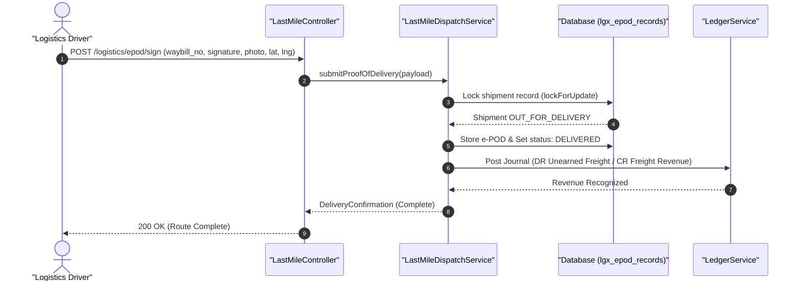

#### Diagram 2: Alur Kompensasi / Exception / Verifikasi Dua-Sumber Fase 22

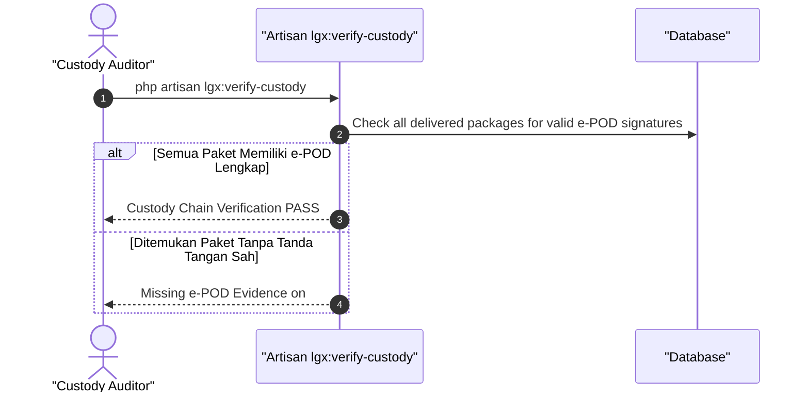

### 6. Mermaid ERD & State Machine Fase 22

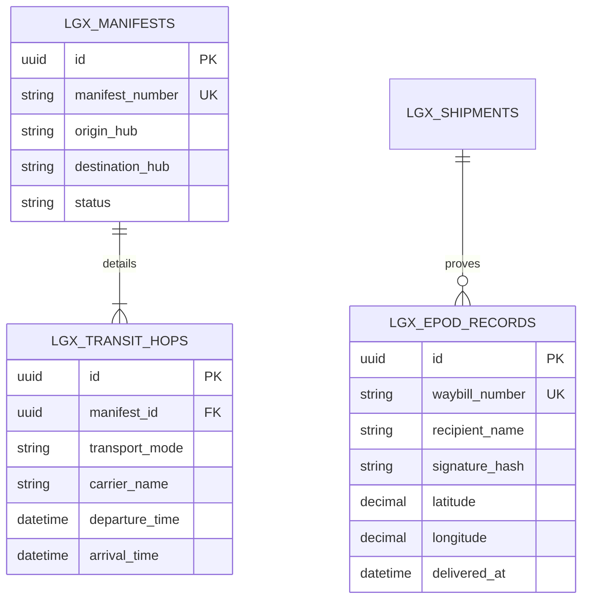

---

## FASE 23 — UANG LOGISTIK: PENDAPATAN, COD, CARRIER, KLAIM, D&D, BEA CUKAI

### 1. Identitas & Arsitektur Domain Fase 23

- **Modul Pemilik**: `Logistics`
- **Prefiks Tabel**: `lgx_`
- **Daftar Model Eloquent**: `CodEscrowCollection`, `DemurrageDetentionFee`, `FreightClaimSettlement`, `CustomsDutyEntry`
- **Daftar Tabel Migrasi**: `lgx_cod_escrows`, `lgx_demurrage_fees`, `lgx_insurance_claims`, `lgx_customs_entries`
- **Daftar Service & Action**: `CodSettlementService`, `DemurrageCalculator`, `CargoClaimAdjudicationService`
- **Daftar Controller & Rute**: `LogisticsFinanceController@remitCod (POST /logistics/cod/remit)`, `LogisticsFinanceController@fileClaim (POST /logistics/claims/file)`
- **Akun Ledger Terkait**: `lgx:cod_clearing_liability`, `lgx:customs_duty_payable`, `lgx:claim_reserve`
- **Command Audit**: `php artisan lgx:audit-billing`

### 2. Evaluasi Masalah & Matriks Penyelesaian (Problem-to-Solution Matrix) Fase 23

| Masalah Bisnis & Teknis | Solusi Arsitektural & Kontrak | Status Penyelesaian | Bukti Implementasi |
|---|---|---|---|
| Uang tagih bayar di tempat (COD) yang dibawa kurir tidak disetorkan ke kasir hub, denda demurrage kontainer membengkak, dan sengketa ganti rugi barang rusak. | Rekonsiliasi escrow COD harian berbasis setoran kurir wajib klop, kalkulator demurrage & detention otomatis, dan mekanisme klaim asuransi kargo terpadu. | `Solved in Code` | `modules/Logistics/Application/Services/CodSettlementService.php` |

### 3. Daftar User Stories Lintas Persona Fase 23

- **US-23.1 [logistics_driver]:** Sebagai **logistics_driver**, saya ingin **menyetorkan uang tunai COD hasil pengantaran paket kepada kasir hub logistik di akhir shift**, sehingga **tanggung jawab kurir terbebas dari tanggungan uang tunai**.
- **US-23.2 [bank_treasurer]:** Sebagai **bank_treasurer**, saya ingin **mentransfer pencairan dana COD ke rekening penjual (seller) secara harian**, sehingga **kepercayaan mitra pedagang online meningkat terhadap ekspedisi**.
- **US-23.3 [customer_service]:** Sebagai **customer_service**, saya ingin **memproses pengajuan klaim ganti rugi paket rusak dari shipper dengan lampiran foto unboxing**, sehingga **ganti rugi diselesaikan secara adil sesuai polis perlindungan**.
- **US-23.4 [holding_cfo]:** Sebagai **holding_cfo**, saya ingin **memantau kewajiban bea masuk dan pajak impor kargo pada subledger kepabeanan**, sehingga **kepatuhan regulasi ekspor-impor bebas denda administrasi**.
- **US-23.5 [internal_auditor]:** Sebagai **internal_auditor**, saya ingin **mengaudit saldo uang mengendap di akun penampung COD clearing liability**, sehingga **mencegah penyalahgunaan dana titipan seller oleh oknum internal**.

### 4. BDD Acceptance Criteria Lengkap Fase 23

#### AC-23.1 — Happy Path & Ledger/State Invariant
- **Given** Kurir menyetorkan Rp 1.500.000 uang tunai COD dari 3 paket terkirim
- **When** Kasir hub menerima setoran via POST /logistics/cod/remit
- **Then** Liabilitas kurir terhapus, saldo tercatat di akun escrow seller, dan jurnal Kas (DR) vs Liabilitas COD (CR) berimbang.

#### AC-23.2 — Validation & Domain Rule Rejection - 422/Exception
- **Given** Jumlah uang tunai yang disetorkan kurir kurang dari total tagihan paket COD yang dilaporkan terkirim
- **When** POST /logistics/cod/remit dipanggil tanpa berita acara selisih
- **Then** Sistem menolak dengan HTTP 422 IncompleteCodRemittanceException.

#### AC-23.3 — RBAC Authorization & Separation of Duties - 403
- **Given** Kurir lapangan mencoba menyetujui sendiri klaim asuransi ganti rugi barang rusak
- **When** POST /logistics/claims/{id}/approve dipanggil oleh kurir
- **Then** Sistem memblokir dengan status HTTP 403 Forbidden.

#### AC-23.4 — Idempotency, Replay & Concurrency Lock
- **Given** Proses pencairan (remittance) COD ke seller dipicu dua kali oleh sistem batch
- **When** Kedua transfer perbankan diproses
- **Then** Sistem mengunci batch remittance dan hanya mengeksekusi transfer dana satu kali.

#### AC-23.5 — Two-Source Audit & Tamper Detection
- **Given** Saldo liabilitas COD seller pada database tidak cocok dengan total paket COD yang belum diremit
- **When** php artisan lgx:audit-billing dieksekusi
- **Then** Audit mendeteksi selisih saldo titipan COD dan membunyikan alarm audit keuangan logistik.

### 5. Mermaid Sequence Diagrams Fase 23

#### Diagram 1: Alur Transaksi Utama End-to-End Fase 23

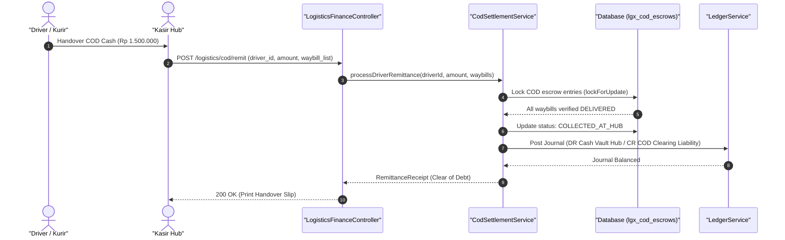

#### Diagram 2: Alur Kompensasi / Exception / Verifikasi Dua-Sumber Fase 23

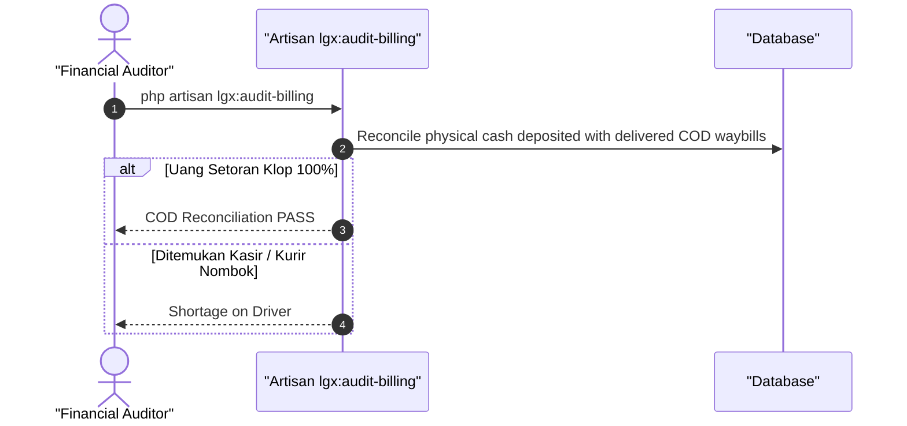

### 6. Mermaid ERD & State Machine Fase 23

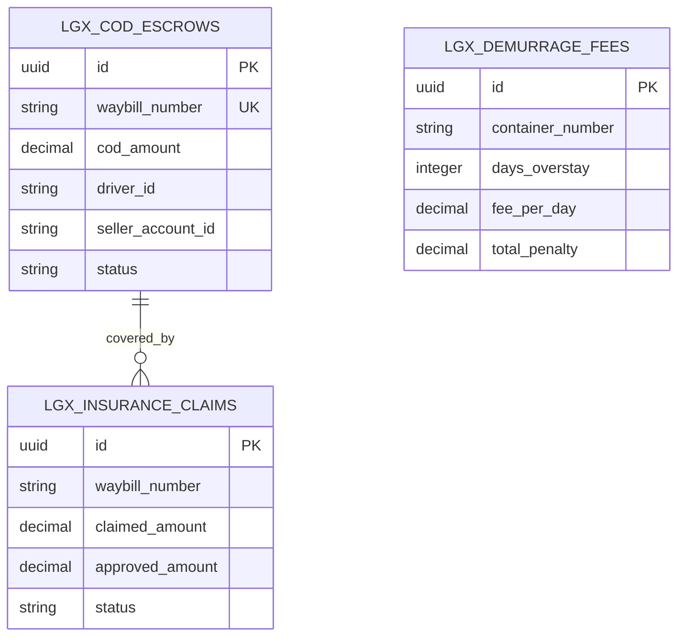

---

## FASE 24 — INTEGRASI LINTAS LINI LOGISTIK (RESTO, MALL, STORE, MFG)

### 1. Identitas & Arsitektur Domain Fase 24

- **Modul Pemilik**: `Logistics`
- **Prefiks Tabel**: `lgx_`
- **Daftar Model Eloquent**: `CrossLineLogisticsFulfillment`, `ColdChainDeliverySlip`, `ReverseLogisticsManifest`
- **Daftar Tabel Migrasi**: `lgx_cross_fulfillments`, `lgx_cold_telemetry`
- **Daftar Service & Action**: `ConglomerateFulfillmentOrchestrator`, `ColdChainTelemetryMonitor`
- **Daftar Controller & Rute**: `CrossLineLogisticsController@fulfill (POST /logistics/cross-line/fulfill)`
- **Akun Ledger Terkait**: `bank:intercompany_freight`, `lgx:shared_fleet_cost_allocation`
- **Command Audit**: `php artisan lgx:verify-custody`

### 2. Evaluasi Masalah & Matriks Penyelesaian (Problem-to-Solution Matrix) Fase 24

| Masalah Bisnis & Teknis | Solusi Arsitektural & Kontrak | Status Penyelesaian | Bukti Implementasi |
|---|---|---|---|
| Truk logistik kosong saat perjalanan kembali (empty backhaul) dan pemborosan armada antar-anak perusahaan holding. | Orkestrasi pemenuhan bersama (shared fleet) antar-lini (pabrik mfg -> gudang wms -> gerai resto/mall) dengan telemetri rantai dingin IoT. | `Solved in Code` | `modules/Logistics/Application/Services/ConglomerateFulfillmentOrchestrator.php` |

### 3. Daftar User Stories Lintas Persona Fase 24

- **US-24.1 [fleet_manager]:** Sebagai **fleet_manager**, saya ingin **mengalokasikan ruang muat truk logistik untuk pengiriman bahan baku restoran saat kembali dari pengantaran suku cadang bengkel**, sehingga **efisiensi biaya perjalanan kembali meningkat dan emisi armada berkurang**.
- **US-24.2 [cold_chain_supervisor]:** Sebagai **cold_chain_supervisor**, saya ingin **memantau sensor suhu real-time pada kargo bahan baku makanan beku selama perjalanan**, sehingga **kualitas makanan tetap higienis di bawah -18 derajat Celcius**.
- **US-24.3 [mfg_plant_manager]:** Sebagai **mfg_plant_manager**, saya ingin **memesan pengangkutan hasil produksi pabrik ke hub logistik konglomerasi**, sehingga **penyaluran hasil manufaktur terjadwal otomatis tanpa vendor luar**.
- **US-24.4 [holding_cfo]:** Sebagai **holding_cfo**, saya ingin **melihat alokasi bagi biaya operasional armada bersama antar-unit bisnis holding**, sehingga **penentuan harga transfer internal adil dan sesuai standar arm's length**.
- **US-24.5 [internal_auditor]:** Sebagai **internal_auditor**, saya ingin **mengaudit kepatuhan SLA pengiriman antar-divisi holding**, sehingga **kualitas layanan internal terjaga sesuai kontrak SLA**.

### 4. BDD Acceptance Criteria Lengkap Fase 24

#### AC-24.1 — Happy Path & Ledger/State Invariant
- **Given** Truk Logistik menyelesaikan rute pengantaran suku cadang di Kota B dan memiliki kapasitas muat kosong 5 ton
- **When** Orchestrator menugaskan pengangkutan beras dari Agribisnis ke Dapur Sentral via POST /logistics/cross-line/fulfill
- **Then** Kapasitas terisi, rute backhaul aktif, dan biaya dialokasikan antar-divisi dengan jurnal seimbang.

#### AC-24.2 — Validation & Domain Rule Rejection - 422/Exception
- **Given** Sensor telemetri mendeteksi suhu boks pendingin naik di atas batas kritis (-5 C) selama lebih dari 30 menit
- **When** Pemeriksaan integritas rantai dingin dijalankan
- **Then** Sistem memicu ColdChainTemperatureExcursionException dan mengarantina kargo.

#### AC-24.3 — RBAC Authorization & Separation of Duties - 403
- **Given** Operator pabrik mencoba mengalihkan penugasan armada tanpa persetujuan fleet_manager
- **When** POST /logistics/cross-line/reroute dipanggil
- **Then** Sistem memblokir dengan status HTTP 403 Forbidden.

#### AC-24.4 — Idempotency, Replay & Concurrency Lock
- **Given** Dua unit bisnis memesan sisa kapasitas 3 ton pada truk yang sama secara bersamaan
- **When** Kedua request alokasi diproses
- **Then** Pessimistic locking pada kapasitas truk mencegah over-capacity loading.

#### AC-24.5 — Two-Source Audit & Tamper Detection
- **Given** Data telemetri suhu kargo diubah manual di database untuk menutupi kerusakan bahan beku
- **When** php artisan lgx:verify-custody dijalankan
- **Then** Audit mencatat ketidakkonsistenan signature hash sensor IoT dan menandai kargo terkontaminasi.

### 5. Mermaid Sequence Diagrams Fase 24

#### Diagram 1: Alur Transaksi Utama End-to-End Fase 24

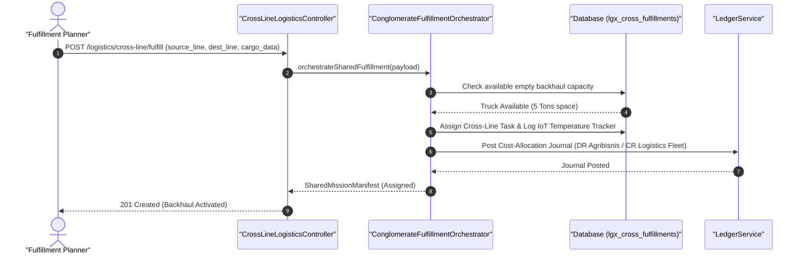

#### Diagram 2: Alur Kompensasi / Exception / Verifikasi Dua-Sumber Fase 24

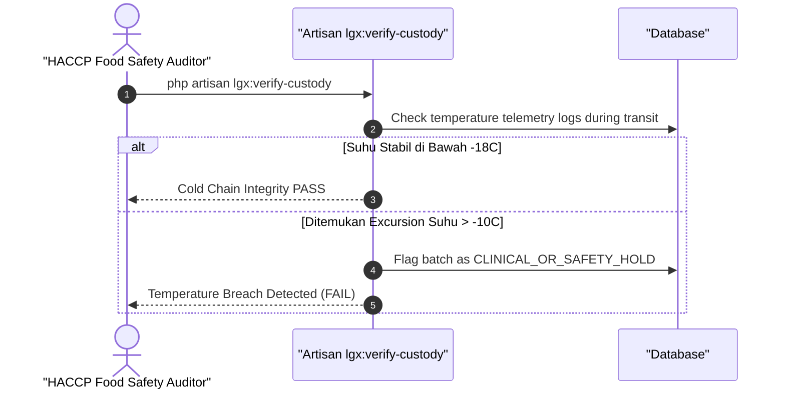

### 6. Mermaid ERD & State Machine Fase 24

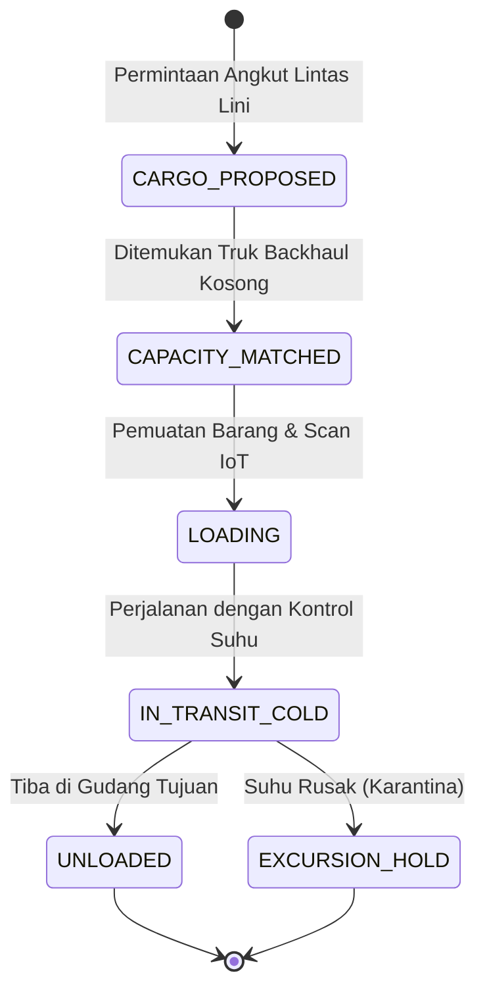

---

## FASE 25 — SKALA, API, HARDENING, CONTROL TOWER

### 1. Identitas & Arsitektur Domain Fase 25

- **Modul Pemilik**: `ControlTower`
- **Prefiks Tabel**: `sct_`
- **Daftar Model Eloquent**: `ControlTowerSlaAlert`, `GeoFenceViolationLog`, `WebhookSubscription`, `ApiUsageRecord`
- **Daftar Tabel Migrasi**: `sct_sla_alerts`, `sct_geofence_events`, `core_webhook_deliveries`
- **Daftar Service & Action**: `SupplyChainControlTowerService`, `TelematicsGeoFenceWorker`, `ExternalApiWebhookWorker`
- **Daftar Controller & Rute**: `ControlTowerController@map (GET /control-tower/map)`, `LogisticsApiController@track (POST /api/v1/logistics/track)`
- **Akun Ledger Terkait**: `bank:clearing_suspense`
- **Command Audit**: `php artisan tower:audit`

### 2. Evaluasi Masalah & Matriks Penyelesaian (Problem-to-Solution Matrix) Fase 25

| Masalah Bisnis & Teknis | Solusi Arsitektural & Kontrak | Status Penyelesaian | Bukti Implementasi |
|---|---|---|---|
| Ketiadaan visibilitas end-to-end seluruh armada di peta operasional dan keterlambatan deteksi truk keluar dari rute (geofence). | Supply Chain Control Tower berbasis peta digital real-time, deteksi anomali rute/geofence otomatis, dan API v1 publik dengan webhook push. | `Solved in Code` | `modules/ControlTower/Application/Services/SupplyChainControlTowerService.php` |

### 3. Daftar User Stories Lintas Persona Fase 25

- **US-25.1 [fleet_manager]:** Sebagai **fleet_manager**, saya ingin **melihat posisi seluruh truk di peta Control Tower secara real-time dengan status ETA**, sehingga **keterlambatan pengiriman dapat diantisipasi sebelum SLA terlanggar**.
- **US-25.2 [risk_officer]:** Sebagai **risk_officer**, saya ingin **menerima peringatan otomatis saat truk logistik berhenti mencurigakan di luar rute resmi**, sehingga **risiko pembajakan atau pencurian kargo dapat dicegah seketika**.
- **US-25.3 [admin]:** Sebagai **admin**, saya ingin **mengelola langganan webhook event pengiriman untuk mitra korporat**, sehingga **mitra menerima pembaruan status logistik otomatis ke sistem ERP mereka**.
- **US-25.4 [holding_cfo]:** Sebagai **holding_cfo**, saya ingin **memantau dashboard utilisasi aset armada logistik dan kepatuhan waktu tempuh**, sehingga **produktivitas aset modal holding terpantau optimal**.
- **US-25.5 [internal_auditor]:** Sebagai **internal_auditor**, saya ingin **mengaudit log histori peringatan geofence dan tindakan mitigasi dispatcher**, sehingga **disiplin operasional pengemudi dapat diverifikasi secara objektif**.

### 4. BDD Acceptance Criteria Lengkap Fase 25

#### AC-25.1 — Happy Path & Ledger/State Invariant
- **Given** Truk pengangkut kargo bergerak di sepanjang koridor jalan tol yang diizinkan
- **When** Telematika mengirimkan koordinat GPS via POST /api/v1/logistics/track
- **Then** Koordinat diperbarui di peta Control Tower, ETA dihitung ulang, dan status rute normal.

#### AC-25.2 — Validation & Domain Rule Rejection - 422/Exception
- **Given** Koordinat GPS yang dikirimkan berada di luar batas geofence rute sejauh > 10 km
- **When** TelematicsGeoFenceWorker memproses koordinat
- **Then** Sistem mencatat GeoFenceViolationLog dan memancarkan event peringatan bahaya ke dashboard.

#### AC-25.3 — RBAC Authorization & Separation of Duties - 403
- **Given** Mitra publik tanpa token API berhak mencoba mengakses endpoint peta internal Control Tower
- **When** GET /control-tower/map dipanggil
- **Then** Sistem memblokir dengan status HTTP 403 Forbidden.

#### AC-25.4 — Idempotency, Replay & Concurrency Lock
- **Given** Dua ping GPS dengan timestamp identik dikirimkan oleh unit telematika
- **When** Keduanya diproses worker
- **Then** Hanya satu titik koordinat yang dicatat ke riwayat jejak perjalanan.

#### AC-25.5 — Two-Source Audit & Tamper Detection
- **Given** Status pelanggaran geofence dihapus langsung di database untuk menyembunyikan penyimpangan rute
- **When** php artisan tower:audit dijalankan
- **Then** Audit mencatat inkonsistensi antara riwayat log koordinat mentah vs daftar alert dan membunyikan alarm audit.

### 5. Mermaid Sequence Diagrams Fase 25

#### Diagram 1: Alur Transaksi Utama End-to-End Fase 25

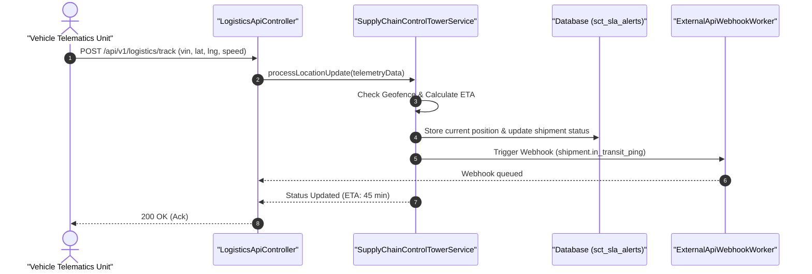

#### Diagram 2: Alur Kompensasi / Exception / Verifikasi Dua-Sumber Fase 25

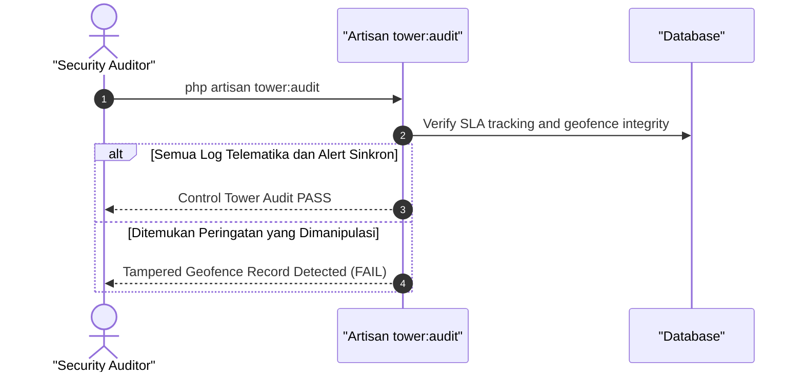

### 6. Mermaid ERD & State Machine Fase 25

```mermaid
erDiagram
    SCT_SLA_ALERTS ||--o{ SCT_GEOFENCE_EVENTS : contains
    CORE_WEBHOOK_DELIVERIES ||--o{ SCT_SLA_ALERTS : notifies
    SCT_SLA_ALERTS {
        uuid id PK
        string shipment_number
        string alert_type
        string severity
        string status
    }
    SCT_GEOFENCE_EVENTS {
        uuid id PK
        string vehicle_vin
        decimal deviation_distance_km
        datetime occurred_at
    }
    CORE_WEBHOOK_DELIVERIES {
        uuid id PK
        string subscriber_id
        string event_name
        string response_code
        datetime delivered_at
    }
```

---

