# SPESIFIKASI TEKNIS FASE 26–31: PLATFORM SANCTUM, PARTY MASTER, KONTRAK & ASET

Dokumen ini mendefinisikan arsitektur domain, matriks penyelesaian, User Stories, BDD Acceptance Criteria, Sequence Diagrams, dan ERD/State Machine untuk Fase 26 s/d Fase 31.

---

## FASE 26 — PELUNASAN UTANG TEKNIS & FONDASI PLATFORM (SANCTUM/RBAC/OUTBOX/APPROVAL)

### 1. Identitas & Arsitektur Domain Fase 26

- **Modul Pemilik**: `Core`
- **Prefiks Tabel**: `core_`
- **Daftar Model Eloquent**: `User`, `RoleAssignment`, `OutboxMessage`, `ApprovalRequest`
- **Daftar Tabel Migrasi**: `users`, `role_assignments`, `core_outbox_messages`, `core_approvals`
- **Daftar Service & Action**: `RoleAuthorizationService`, `MakerCheckerApprovalService`, `OutboxPublisherService`
- **Daftar Controller & Rute**: `RbacAdminController@assign (POST /admin/roles/assign)`, `ApprovalController@decide (POST /admin/approvals/decide)`
- **Akun Ledger Terkait**: `bank:clearing_suspense`
- **Command Audit**: `php artisan api:audit`

### 2. Evaluasi Masalah & Matriks Penyelesaian (Problem-to-Solution Matrix) Fase 26

| Masalah Bisnis & Teknis | Solusi Arsitektural & Kontrak | Status Penyelesaian | Bukti Implementasi |
|---|---|---|---|
| Pemberian hak akses longgar tanpa prinsip pemisahan tugas (SoD) dan aksi mutasi finansial tanpa maker-checker. | Penegakan otorisasi RBAC 60+ peran berbasis middleware ketat dan alur kerja persetujuan ganda (Four-Eyes Principle). | `Solved in Code` | `app/Quality/ArchScan/Rules/ForbiddenRoleRule.php` |

### 3. Daftar User Stories Lintas Persona Fase 26

- **US-26.1 [super_admin]:** Sebagai **super_admin**, saya ingin **menugaskan peran operasional terisolasi kepada staf baru sesuai job description**, sehingga **prinsip least privilege terpenuhi di seluruh modul konglomerasi**.
- **US-26.2 [holding_cfo]:** Sebagai **holding_cfo**, saya ingin **menyetujui atau menolak transaksi pengeluaran dana di atas batas limit finansial**, sehingga **transaksi bernilai material melewati verifikasi berjenjang**.
- **US-26.3 [internal_auditor]:** Sebagai **internal_auditor**, saya ingin **memverifikasi bahwa tidak ada pengguna yang memiliki peran ganda yang bertentangan (SoD conflict)**, sehingga **risiko kecurangan kolutif internal terminimalisir**.
- **US-26.4 [admin]:** Sebagai **admin**, saya ingin **mencabut akses token Sanctum secara instan saat terjadi indikasi kompromi akun**, sehingga **keamanan sesi dan integritas data pengguna terjaga**.
- **US-26.5 [risk_officer]:** Sebagai **risk_officer**, saya ingin **memantau log eskalasi izin darurat (break-glass access) pada sistem holding**, sehingga **setiap pengecualian hak istimewa dapat dipertanggungjawabkan**.

### 4. BDD Acceptance Criteria Lengkap Fase 26

#### AC-26.1 — Happy Path & Ledger/State Invariant
- **Given** Transaksi pengeluaran dana Rp 2.000.000.000 diajukan oleh bank_treasurer (Maker)
- **When** Holding CFO (Checker) menyetujui transaksi via POST /admin/approvals/decide
- **Then** Status approval menjadi APPROVED, transaksi diteruskan ke ledger, dan event outbox dipancarkan.

#### AC-26.2 — Validation & Domain Rule Rejection - 422/Exception
- **Given** Maker mencoba menyetujui sendiri permintaan approval yang dia buat
- **When** POST /admin/approvals/decide dipanggil oleh pembuat transaksi
- **Then** Sistem menolak dengan HTTP 422 MakerCannotBeCheckerException.

#### AC-26.3 — RBAC Authorization & Separation of Duties - 403
- **Given** Role internal_auditor mencoba memanggil aksi approve pada transaksi keuangan
- **When** Endpoint dipanggil oleh auditor
- **Then** Sistem menolak dengan HTTP 403 Forbidden karena auditor hanya memiliki hak baca.

#### AC-26.4 — Idempotency, Replay & Concurrency Lock
- **Given** Dua checker menyetujui approval yang sama secara bersamaan
- **When** Keduanya mengirimkan keputusan paralel
- **Then** Locking status approval memastikan hanya keputusan pertama yang diproses.

#### AC-26.5 — Two-Source Audit & Tamper Detection
- **Given** Status approval diubah menjadi APPROVED langsung di database tanpa riwayat jejak audit checker
- **When** php artisan api:audit dijalankan
- **Then** Audit mendeteksi anomali integritas alur persetujuan dan keluar dengan kode 1.

### 5. Mermaid Sequence Diagrams Fase 26

#### Diagram 1: Alur Transaksi Utama End-to-End Fase 26

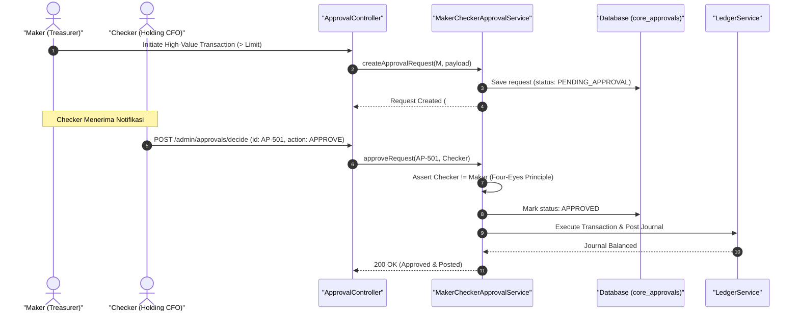

#### Diagram 2: Alur Kompensasi / Exception / Verifikasi Dua-Sumber Fase 26

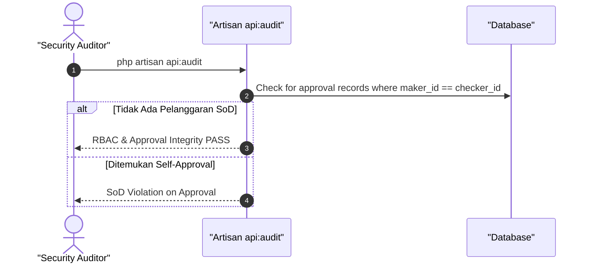

### 6. Mermaid ERD & State Machine Fase 26

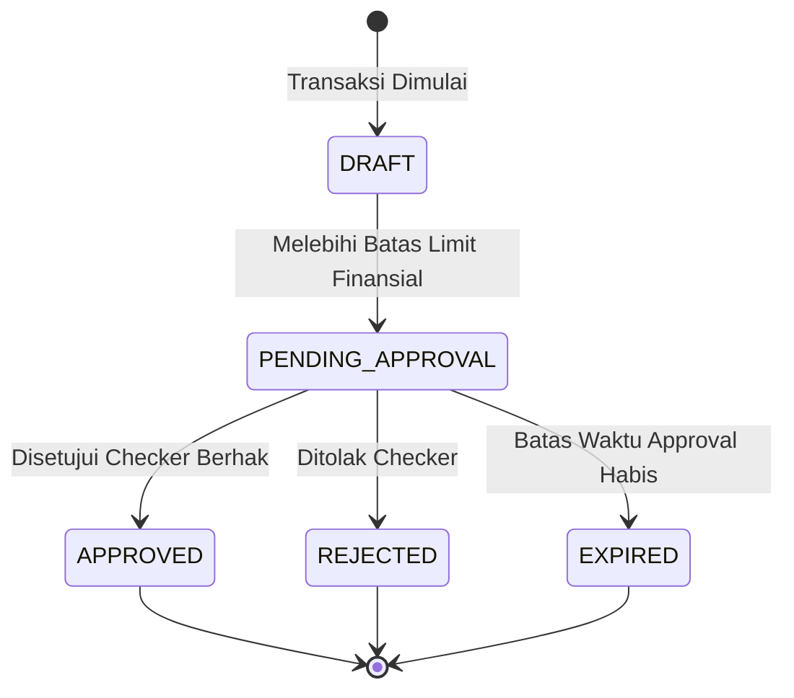

---

## FASE 27 — PARTY MASTER & BADAN HUKUM (FONDASI PIHAK & KYC/AML)

### 1. Identitas & Arsitektur Domain Fase 27

- **Modul Pemilik**: `Party`
- **Prefiks Tabel**: `pty_`
- **Daftar Model Eloquent**: `Party`, `LegalEntity`, `KycVerification`, `TaxIdentifier`, `SanctionScreeningLog`
- **Daftar Tabel Migrasi**: `pty_parties`, `pty_legal_entities`, `pty_kyc_verifications`, `pty_tax_identifiers`
- **Daftar Service & Action**: `PartyMasterService`, `AmlScreeningEngine`, `LegalEntityRegistryService`
- **Daftar Controller & Rute**: `PartyController@store (POST /parties)`, `KycController@screen (POST /parties/{id}/kyc/screen)`
- **Akun Ledger Terkait**: `bank:clearing_suspense`
- **Command Audit**: `php artisan api:audit`

### 2. Evaluasi Masalah & Matriks Penyelesaian (Problem-to-Solution Matrix) Fase 27

| Masalah Bisnis & Teknis | Solusi Arsitektural & Kontrak | Status Penyelesaian | Bukti Implementasi |
|---|---|---|---|
| Duplikasi identitas nasabah/vendor (party duplicity) dan risiko transaksi dengan pihak yang masuk daftar hitam (AML/CFT sanction list). | Master data entitas pihak (Party Master) terpadu dengan penyaringan sanksi PBB/OFAC/PPATK otomatis dan verifikasi NPWP/NIB. | `Solved in Code` | `modules/Party/Application/Services/PartyMasterService.php` |

### 3. Daftar User Stories Lintas Persona Fase 27

- **US-27.1 [holding_compliance]:** Sebagai **holding_compliance**, saya ingin **memverifikasi hasil skrining AML/CFT calon mitra bisnis holding sebelum kontrak diteken**, sehingga **perusahaan terbebas dari risiko pendanaan terorisme dan pencucian uang**.
- **US-27.2 [procurement_buyer]:** Sebagai **procurement_buyer**, saya ingin **mendaftarkan badan hukum vendor baru lengkap dengan NIB dan NPWP yang tervalidasi**, sehingga **data pemasok akurat dan sah di hadapan hukum pajak**.
- **US-27.3 [bank_treasurer]:** Sebagai **bank_treasurer**, saya ingin **memastikan nomor rekening bank pihak terafiliasi cocok dengan nama legal perusahaan**, sehingga **tidak ada salah bayar ke rekening pihak ketiga yang tidak berhak**.
- **US-27.4 [customer_service]:** Sebagai **customer_service**, saya ingin **memeriksa status verifikasi identitas (KYC) pelanggan di seluruh ekosistem**, sehingga **proses onboarding pelanggan baru berlangsung cepat dan sesuai aturan**.
- **US-27.5 [internal_auditor]:** Sebagai **internal_auditor**, saya ingin **mengaudit riwayat perubahan beneficial ownership badan hukum di tabel arsip**, sehingga **transparansi pemilik manfaat akhir (UBO) terjamin**.

### 4. BDD Acceptance Criteria Lengkap Fase 27

#### AC-27.1 — Happy Path & Ledger/State Invariant
- **Given** Calon mitra PT Maju Jaya mengajukan registrasi dengan dokumen NIB dan NPWP valid
- **When** PartyController memproses pendaftaran dan skrining AML via POST /parties
- **Then** Party master terbuat dengan status KYC_APPROVED dan skor risiko AML LOW.

#### AC-27.2 — Validation & Domain Rule Rejection - 422/Exception
- **Given** Nama entitas atau pemilik manfaat terdeteksi pada database daftar sanksi terorisme (Sanctions List)
- **When** AmlScreeningEngine mengeksekusi penyaringan otomatis
- **Then** Sistem menolak dengan HTTP 422 SanctionedEntityException dan membekukan registrasi.

#### AC-27.3 — RBAC Authorization & Separation of Duties - 403
- **Given** Staf procurement biasa mencoba membatalkan status sanksi AML tanpa wewenang holding_compliance
- **When** POST /parties/{id}/override-sanction dipanggil
- **Then** Sistem memblokir dengan status HTTP 403 Forbidden.

#### AC-27.4 — Idempotency, Replay & Concurrency Lock
- **Given** Dua permintaan skrining identitas dikirimkan bersamaan untuk pihak yang sama
- **When** Keduanya diproses paralel
- **Then** Sistem mengunci baris party dan hanya melakukan satu panggilan skrining ke provider kepatuhan.

#### AC-27.5 — Two-Source Audit & Tamper Detection
- **Given** Status kepatuhan pihak disetel APPROVED secara manual di DB tanpa log audit skrining AML
- **When** php artisan api:audit dijalankan
- **Then** Audit mencatat anomali bypass KYC dan mengeluarkan bendera merah kepatuhan hukum.

### 5. Mermaid Sequence Diagrams Fase 27

#### Diagram 1: Alur Transaksi Utama End-to-End Fase 27

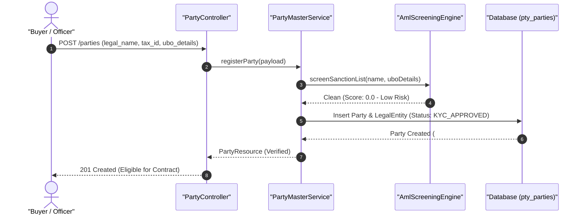

#### Diagram 2: Alur Kompensasi / Exception / Verifikasi Dua-Sumber Fase 27

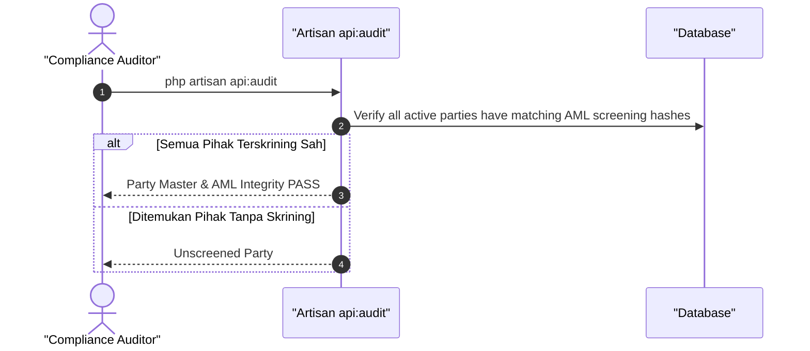

### 6. Mermaid ERD & State Machine Fase 27

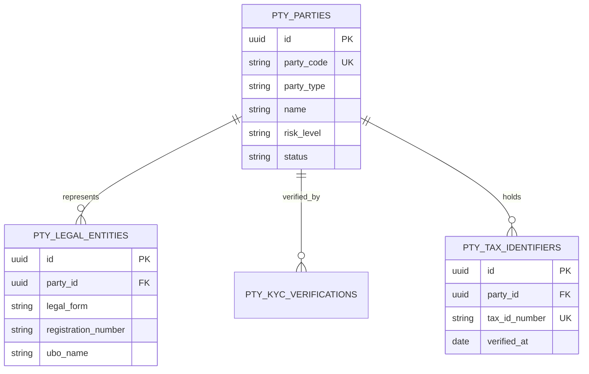

---

## FASE 28 — KONTRAK INTI HASH-CHAIN (MODUL `CTR_`)

### 1. Identitas & Arsitektur Domain Fase 28

- **Modul Pemilik**: `Contract`
- **Prefiks Tabel**: `ctr_`
- **Daftar Model Eloquent**: `ContractMaster`, `ContractClause`, `ContractSignatory`, `ContractAuditChain`
- **Daftar Tabel Migrasi**: `ctr_contracts`, `ctr_clauses`, `ctr_signatories`, `ctr_audit_chains`
- **Daftar Service & Action**: `ContractLifecycleService`, `ContractHashChainService`, `DigitalSignatureSealer`
- **Daftar Controller & Rute**: `ContractController@draft (POST /contracts/draft)`, `ContractController@sign (POST /contracts/{id}/sign)`
- **Akun Ledger Terkait**: `bank:clearing_suspense`
- **Command Audit**: `php artisan ctr:audit`

### 2. Evaluasi Masalah & Matriks Penyelesaian (Problem-to-Solution Matrix) Fase 28

| Masalah Bisnis & Teknis | Solusi Arsitektural & Kontrak | Status Penyelesaian | Bukti Implementasi |
|---|---|---|---|
| Pemalsuan lampiran kontrak komersial pasca tanda tangan dan perselisihan versi klausul final. | Rantai blok audit kontrak (Contract Hash-Chain) dengan segel SHA-256 pada setiap klausul dan stempel waktu digital. | `Solved in Code` | `modules/Contract/Application/Services/ContractHashChainService.php` |

### 3. Daftar User Stories Lintas Persona Fase 28

- **US-28.1 [contract_lawyer]:** Sebagai **contract_lawyer**, saya ingin **menyusun draf kontrak komersial dengan klausul standar ber-hash unik**, sehingga **isi perjanjian terkunci dan tidak dapat diubah sepihak tanpa otorisasi**.
- **US-28.2 [holding_cfo]:** Sebagai **holding_cfo**, saya ingin **menandatangani kontrak pengadaan strategis secara digital dengan segel kriptografi**, sehingga **keabsahan komitmen finansial perusahaan terjamin secara hukum**.
- **US-28.3 [procurement_manager]:** Sebagai **procurement_manager**, saya ingin **memantau kelengkapan tanda tangan seluruh pihak pada kontrak kerjasama**, sehingga **kontrak hanya berlaku aktif setelah semua penandatangan sah membubuhkan persetujuan**.
- **US-28.4 [internal_auditor]:** Sebagai **internal_auditor**, saya ingin **memvalidasi integritas rantai hash kontrak dari draf awal hingga amandemen terakhir**, sehingga **setiap manipulasi isi perjanjian pasca tandatangan terdeteksi instan**.
- **US-28.5 [super_admin]:** Sebagai **super_admin**, saya ingin **mengeksekusi verifikasi integritas seluruh kontrak di database holding**, sehingga **kepatuhan non-repudiation tercapai 100%**.

### 4. BDD Acceptance Criteria Lengkap Fase 28

#### AC-28.1 — Happy Path & Ledger/State Invariant
- **Given** Draf kontrak pengadaan telah disetujui legal dan menunggu tanda tangan para pihak
- **When** Semua penandatangan membubuhkan tanda tangan via POST /contracts/{id}/sign
- **Then** Blok segel hash-chain tercipta, status kontrak berubah menjadi SEALED_ACTIVE, dan dokumen terkunci read-only.

#### AC-28.2 — Validation & Domain Rule Rejection - 422/Exception
- **Given** Penandatangan yang tidak terdaftar dalam matriks signatories mencoba menandatangani kontrak
- **When** POST /contracts/{id}/sign dipanggil
- **Then** Sistem menolak dengan HTTP 422 UnauthorizedSignatoryException.

#### AC-28.3 — RBAC Authorization & Separation of Duties - 403
- **Given** Pengguna tanpa role contract_lawyer mencoba mengubah klausul kontrak berstatus FINAL_REVIEW
- **When** PUT /contracts/{id}/clauses dipanggil
- **Then** Sistem memblokir dengan status HTTP 403 Forbidden.

#### AC-28.4 — Idempotency, Replay & Concurrency Lock
- **Given** Dua pihak menandatangani kontrak secara bersamaan pada detik yang sama
- **When** Kedua tanda tangan masuk
- **Then** Sistem mengunci rantai hash secara serial, mencegah percabangan rantai hash-chain kontrak.

#### AC-28.5 — Two-Source Audit & Tamper Detection
- **Given** Satu kata pada teks klausul di tabel ctr_clauses diubah langsung di database
- **When** Command php artisan ctr:audit dijalankan
- **Then** Audit mendeteksi ketidakcocokan SHA-256 hash dengan blok audit chain dan keluar dengan exit code 1.

### 5. Mermaid Sequence Diagrams Fase 28

#### Diagram 1: Alur Transaksi Utama End-to-End Fase 28

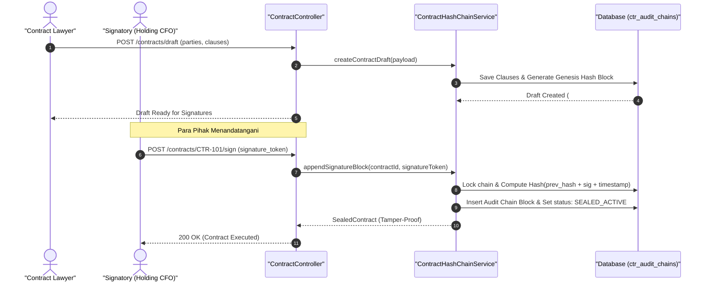

#### Diagram 2: Alur Kompensasi / Exception / Verifikasi Dua-Sumber Fase 28

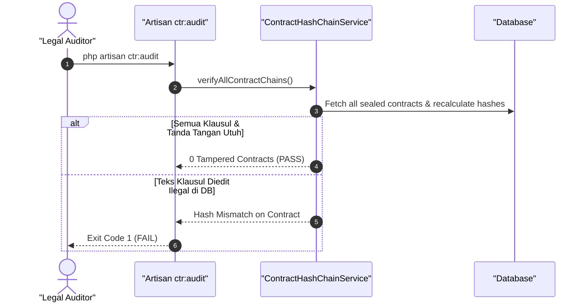

### 6. Mermaid ERD & State Machine Fase 28

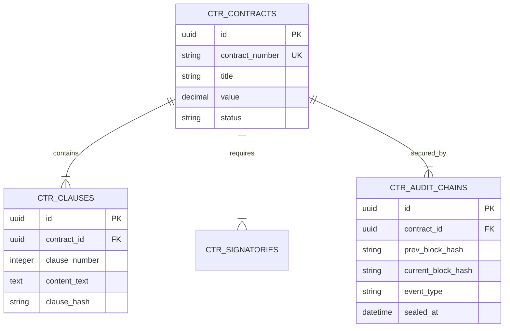

---

## FASE 29 — KONTRAK LANJUTAN: KEUANGAN, KEPATUHAN & INTEGRASI

### 1. Identitas & Arsitektur Domain Fase 29

- **Modul Pemilik**: `Contract`
- **Prefiks Tabel**: `ctr_`
- **Daftar Model Eloquent**: `FinancialMilestone`, `ComplianceCovenant`, `PenaltyRule`, `ContractBillingSchedule`
- **Daftar Tabel Migrasi**: `ctr_milestones`, `ctr_covenants`, `ctr_penalties`, `ctr_billing_schedules`
- **Daftar Service & Action**: `MilestoneSettlementService`, `CovenantMonitoringEngine`, `PenaltyAccrualCalculator`
- **Daftar Controller & Rute**: `ContractBillingController@milestone (POST /contracts/milestones/complete)`, `ContractCovenantController@check (POST /contracts/covenants/check)`
- **Akun Ledger Terkait**: `ctr:contract_liability`, `ctr:milestone_clearing`, `ctr:penalty_income`
- **Command Audit**: `php artisan ctr:audit`

### 2. Evaluasi Masalah & Matriks Penyelesaian (Problem-to-Solution Matrix) Fase 29

| Masalah Bisnis & Teknis | Solusi Arsitektural & Kontrak | Status Penyelesaian | Bukti Implementasi |
|---|---|---|---|
| Pembayaran termin kontrak mendahului penyelesaian prestasi kerja fisik dan pelanggaran rasio keuangan kovenan bank. | Penguncian pembayaran termin berbasis pembuktian milestone digital dan pemantauan kovenan kepatuhan otomatis. | `Solved in Code` | `modules/Contract/Application/Services/MilestoneSettlementService.php` |

### 3. Daftar User Stories Lintas Persona Fase 29

- **US-29.1 [procurement_manager]:** Sebagai **procurement_manager**, saya ingin **memverifikasi berita acara serah terima pekerjaan (BAST) sebelum membuka termin pembayaran**, sehingga **uang perusahaan hanya dibayarkan untuk prestasi kerja yang nyata**.
- **US-29.2 [holding_cfo]:** Sebagai **holding_cfo**, saya ingin **memantau pemenuhan kovenan rasio utang terhadap ekuitas (DER < 2.5) pada kontrak kredit sindikasi**, sehingga **perusahaan terhindar dari klaim wanprestasi atau percepatan pelunasan utang**.
- **US-29.3 [bank_treasurer]:** Sebagai **bank_treasurer**, saya ingin **mencairkan pembayaran termin milestone sesuai instruksi sistem yang tervalidasi**, sehingga **arus kas pengeluaran proyek terkontrol dan disiplin anggaran terjaga**.
- **US-29.4 [contract_lawyer]:** Sebagai **contract_lawyer**, saya ingin **menerapkan penalti denda keterlambatan otomatis sesuai rumus hari kalender kontrak**, sehingga **hak ganti rugi perusahaan ditagihkan tanpa kompromi informal**.
- **US-29.5 [internal_auditor]:** Sebagai **internal_auditor**, saya ingin **mengaudit kepatuhan tanggal jatuh tempo kovenan pelaporan keuangan audit**, sehingga **seluruh kewajiban hukum kontrak terpenuhi tepat waktu**.

### 4. BDD Acceptance Criteria Lengkap Fase 29

#### AC-29.1 — Happy Path & Ledger/State Invariant
- **Given** Milestone Konstruksi Tahap 1 (Rp 500.000.000) telah dilengkapi dokumen BAST dan foto fisik terverifikasi
- **When** Procurement Manager menyelesaikan milestone via POST /contracts/milestones/complete
- **Then** Milestone berubah menjadi COMPLETED, tagihan siap bayar terbentuk, dan jurnal pencadangan berimbang.

#### AC-29.2 — Validation & Domain Rule Rejection - 422/Exception
- **Given** Vendor mengajukan pencairan termin tanpa melampirkan berkas BAST yang sah
- **When** POST /contracts/milestones/complete dipanggil
- **Then** Sistem menolak dengan HTTP 422 MissingBastEvidenceException.

#### AC-29.3 — RBAC Authorization & Separation of Duties - 403
- **Given** Vendor atau pihak ketiga mencoba mengubah status kovenan kepatuhan kontrak
- **When** POST /contracts/covenants/check dipanggil oleh pengguna non-compliance
- **Then** Sistem menolak dengan HTTP 403 Forbidden.

#### AC-29.4 — Idempotency, Replay & Concurrency Lock
- **Given** Pengajuan penyelesaian milestone yang sama dipanggil berulang kali
- **When** Sistem memproses request
- **Then** Idempotency check mendeteksi milestone sudah selesai dan tidak menerbitkan invoice ganda.

#### AC-29.5 — Two-Source Audit & Tamper Detection
- **Given** Status kovenan breach diubah menjadi COMPLIANT di database tanpa ada perbaikan rasio keuangan
- **When** php artisan ctr:audit dijalankan
- **Then** Audit mencatat kecurangan pemalsuan kovenan dan membunyikan alarm audit kepatuhan kontrak.

### 5. Mermaid Sequence Diagrams Fase 29

#### Diagram 1: Alur Transaksi Utama End-to-End Fase 29

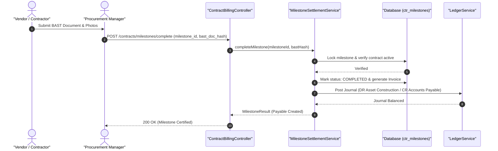

#### Diagram 2: Alur Kompensasi / Exception / Verifikasi Dua-Sumber Fase 29

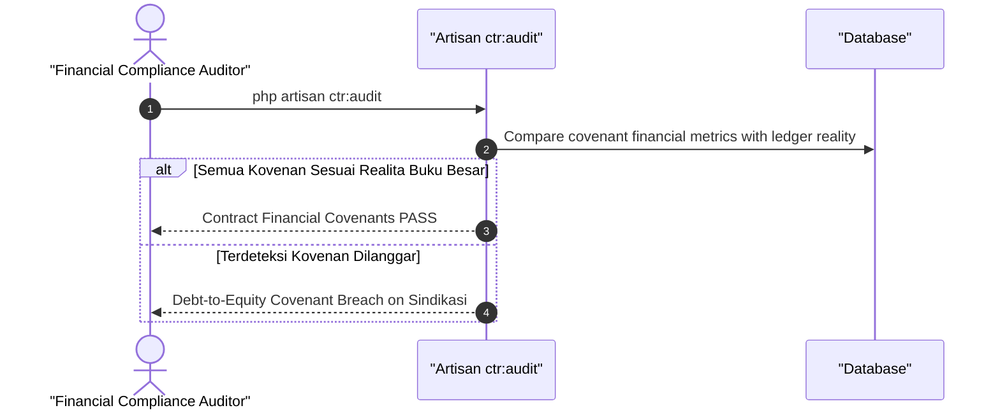

### 6. Mermaid ERD & State Machine Fase 29

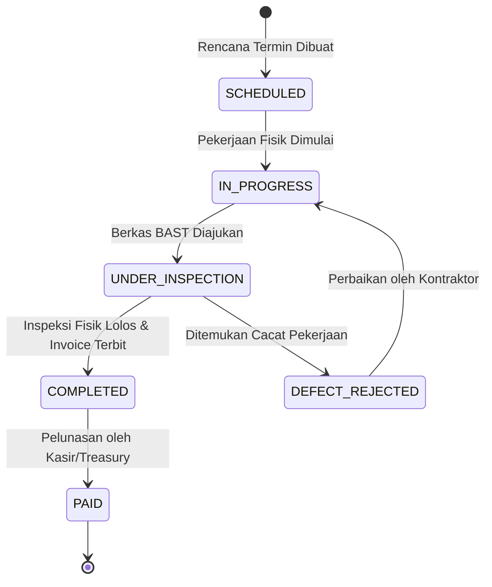

---

## FASE 30 — ASET INTI (FIXED ASSET MASTER & TAGGING, MODUL `AST_`)

### 1. Identitas & Arsitektur Domain Fase 30

- **Modul Pemilik**: `Asset`
- **Prefiks Tabel**: `ast_`
- **Daftar Model Eloquent**: `AssetMaster`, `AssetLocation`, `AssetTagLog`, `AssetAssignment`
- **Daftar Tabel Migrasi**: `ast_assets`, `ast_locations`, `ast_tag_logs`, `ast_assignments`
- **Daftar Service & Action**: `AssetRegistryService`, `AssetBarcodeTaggingService`, `AssetTransferService`
- **Daftar Controller & Rute**: `AssetController@register (POST /assets)`, `AssetController@transfer (POST /assets/{id}/transfer)`
- **Akun Ledger Terkait**: `ast:fixed_asset_equipment`, `ast:fixed_asset_vehicle`, `ast:fixed_asset_building`
- **Command Audit**: `php artisan ast:audit`

### 2. Evaluasi Masalah & Matriks Penyelesaian (Problem-to-Solution Matrix) Fase 30

| Masalah Bisnis & Teknis | Solusi Arsitektural & Kontrak | Status Penyelesaian | Bukti Implementasi |
|---|---|---|---|
| Aset tetap (kendaraan, mesin, laptop, furniture) hilang tanpa jejak penanggung jawab dan ketiadaan inventarisasi fisik. | Master aset tetap dengan pelabelan QR/RFID unik, riwayat penugasan karyawan, dan pencatatan lokasi fisik. | `Solved in Code` | `modules/Asset/Application/Services/AssetRegistryService.php` |

### 3. Daftar User Stories Lintas Persona Fase 30

- **US-30.1 [it_support]:** Sebagai **it_support**, saya ingin **mendaftarkan laptop dan perangkat IT baru lengkap dengan serial number dan label barcode**, sehingga **peralatan kantor tercatat rapi dan siap diserahkan ke staf**.
- **US-30.2 [fleet_manager]:** Sebagai **fleet_manager**, saya ingin **memindahkan lokasi operasional truk dari Hub Jakarta ke Hub Semarang**, sehingga **posisi aset kendaraan selalu akurat di sistem inventaris aset**.
- **US-30.3 [holding_cfo]:** Sebagai **holding_cfo**, saya ingin **melihat nilai total perolehan aset tetap di seluruh anak perusahaan konglomerasi**, sehingga **neraca aset tidak lancar tersaji transparan sesuai standar PSAK 16**.
- **US-30.4 [store_manager]:** Sebagai **store_manager**, saya ingin **menerima penyerahan mesin POS dan etalase hidang untuk gerai baru**, sehingga **tanggung jawab pemeliharaan aset gerai terdefinisi jelas**.
- **US-30.5 [internal_auditor]:** Sebagai **internal_auditor**, saya ingin **melakukan stock opname fisik aset dan memindai barcode RFID di lokasi**, sehingga **selisih aset fisik versus nilai buku langsung teridentifikasi**.

### 4. BDD Acceptance Criteria Lengkap Fase 30

#### AC-30.1 — Happy Path & Ledger/State Invariant
- **Given** Mesin Industri senilai Rp 150.000.000 dibeli dan tiba di pabrik
- **When** Aset didaftarkan via POST /assets dengan tag RFID #AST-MACH-01
- **Then** Master aset terbuat aktif, lokasi tercatat di Pabrik 1, dan jurnal Aset Tetap (DR) terposting seimbang.

#### AC-30.2 — Validation & Domain Rule Rejection - 422/Exception
- **Given** Petugas mendaftarkan aset dengan nomor seri pabrikan (serial number) yang sudah terdaftar di sistem
- **When** POST /assets dipanggil
- **Then** Sistem menolak dengan HTTP 422 DuplicateSerialNumberException.

#### AC-30.3 — RBAC Authorization & Separation of Duties - 403
- **Given** Karyawan pemegang aset mencoba menghapus status kepemilikan aset sendiri
- **When** DELETE /assets/{id} dipanggil oleh role non-admin
- **Then** Sistem memblokir dengan status HTTP 403 Forbidden.

#### AC-30.4 — Idempotency, Replay & Concurrency Lock
- **Given** Dua pemindahan lokasi diajukan bersamaan untuk aset yang sama
- **When** Kedua request masuk
- **Then** Locking baris aset memastikan mutasi lokasi terjadi berurutan dan riwayat transfer konsisten.

#### AC-30.5 — Two-Source Audit & Tamper Detection
- **Given** Aset berstatus DISPOSED di tabel database tetapi masih memiliki mutasi aktif
- **When** php artisan ast:audit dijalankan
- **Then** Audit mencatat diskrepansi status aset dan mengeluarkan temuan audit fisik aset.

### 5. Mermaid Sequence Diagrams Fase 30

#### Diagram 1: Alur Transaksi Utama End-to-End Fase 30

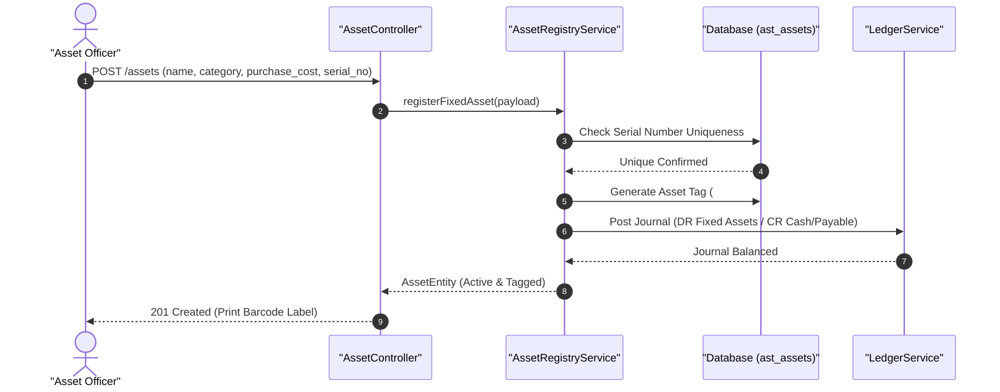

#### Diagram 2: Alur Kompensasi / Exception / Verifikasi Dua-Sumber Fase 30

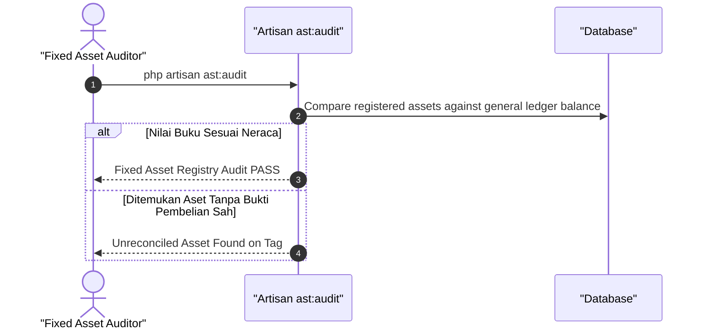

### 6. Mermaid ERD & State Machine Fase 30

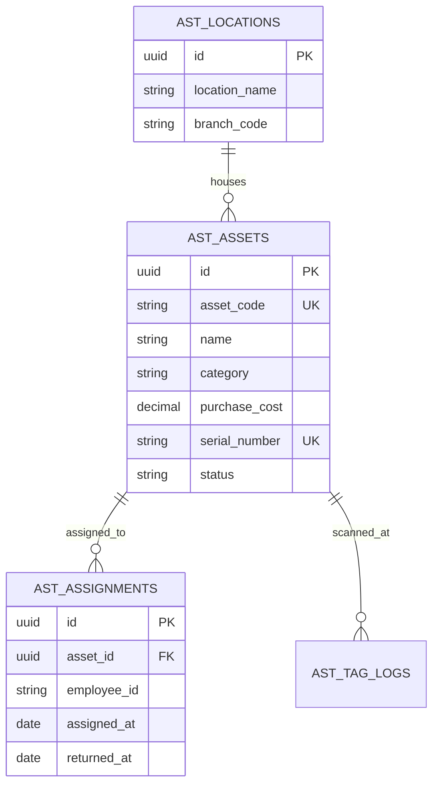

---

## FASE 31 — ASET: PENYUSUTAN, PEMELIHARAAN, REVALUASI & DISPOSAL

### 1. Identitas & Arsitektur Domain Fase 31

- **Modul Pemilik**: `Asset`
- **Prefiks Tabel**: `ast_`
- **Daftar Model Eloquent**: `AssetDepreciation`, `AssetMaintenanceSchedule`, `AssetRevaluation`, `AssetDisposal`
- **Daftar Tabel Migrasi**: `ast_depreciations`, `ast_maintenance_logs`, `ast_revaluations`, `ast_disposals`
- **Daftar Service & Action**: `DepreciationCalculationEngine`, `PreventiveMaintenanceScheduler`, `AssetDisposalService`
- **Daftar Controller & Rute**: `AssetDepreciationController@run (POST /assets/depreciation/run)`, `AssetDisposalController@dispose (POST /assets/{id}/dispose)`
- **Akun Ledger Terkait**: `ast:accumulated_depreciation`, `ast:depreciation_expense`, `ast:gain_loss_disposal`
- **Command Audit**: `php artisan ast:audit`

### 2. Evaluasi Masalah & Matriks Penyelesaian (Problem-to-Solution Matrix) Fase 31

| Masalah Bisnis & Teknis | Solusi Arsitektural & Kontrak | Status Penyelesaian | Bukti Implementasi |
|---|---|---|---|
| Kesalahan perhitungan akumulasi penyusutan aset bulanan, pemeliharaan mesin terlambat hingga rusak total, dan penjualan aset di bawah nilai buku. | Mesin penyusutan otomatis garis lurus (Straight-Line) & saldo menurun, jadwal perawatan preventif terikat telematika, dan kliring laba/rugi pelepasan aset. | `Solved in Code` | `modules/Asset/Application/Services/DepreciationCalculationEngine.php` |

### 3. Daftar User Stories Lintas Persona Fase 31

- **US-31.1 [holding_cfo]:** Sebagai **holding_cfo**, saya ingin **menjalankan penutupan penyusutan aset bulanan otomatis untuk seluruh lini konglomerasi**, sehingga **beban penyusutan teralokasi tepat ke pusat biaya departemen terkait**.
- **US-31.2 [mfg_plant_manager]:** Sebagai **mfg_plant_manager**, saya ingin **menerima peringatan jadwal servis mesin pabrik sebelum jam kerja operasional kritis terlampaui**, sehingga **waktu henti pabrik (downtime) berkurang drastis**.
- **US-31.3 [bank_treasurer]:** Sebagai **bank_treasurer**, saya ingin **mencatat penerimaan kas hasil lelang disposal aset lama yang sudah habis masa manfaat**, sehingga **laba atau rugi pelepasan aset tercatat seimbang pada buku besar**.
- **US-31.4 [contract_lawyer]:** Sebagai **contract_lawyer**, saya ingin **memverifikasi dokumen legal berita acara penghapusan (disposal) aset rusak berat**, sehingga **penghapusan aset mematuhi ketentuan hukum perseroan dan pajak**.
- **US-31.5 [internal_auditor]:** Sebagai **internal_auditor**, saya ingin **mengaudit perhitungan nilai sisa (salvage value) dan masa manfaat ekonomis aset**, sehingga **mencegah manipulasi laba holding melalui pembebanan depresiasi palsu**.

### 4. BDD Acceptance Criteria Lengkap Fase 31

#### AC-31.1 — Happy Path & Ledger/State Invariant
- **Given** Mesin cetak memiliki nilai buku Rp 120.000.000 dengan masa manfaat 5 tahun (penyusutan Rp 2.000.000/bulan)
- **When** Batch penyusutan bulanan dieksekusi via POST /assets/depreciation/run
- **Then** Akumulasi penyusutan bertambah Rp 2.000.000, jurnal Beban Penyusutan (DR) vs Akumulasi Penyusutan (CR) terposting seimbang.

#### AC-31.2 — Validation & Domain Rule Rejection - 422/Exception
- **Given** Aset telah mencapai nilai sisa (salvage value) atau nilai buku sudah nol
- **When** Sistem mencoba menyusutkan kembali aset tersebut
- **Then** Sistem menghentikan penyusutan aset tersebut dengan ZeroBookValueException.

#### AC-31.3 — RBAC Authorization & Separation of Duties - 403
- **Given** Operator mesin biasa mencoba menghapus atau melepas aset berharga tinggi (disposal)
- **When** POST /assets/{id}/dispose dipanggil oleh role mfg_line_operator
- **Then** Sistem memblokir dengan status HTTP 403 Forbidden.

#### AC-31.4 — Idempotency, Replay & Concurrency Lock
- **Given** Job penyusutan bulanan dijalankan dua kali untuk periode bulan yang sama
- **When** Batch job dieksekusi
- **Then** Sistem mendeteksi periode depresiasi sudah tertutup dan tidak membukukan beban ganda.

#### AC-31.5 — Two-Source Audit & Tamper Detection
- **Given** Nilai buku aset pada tabel master sengaja diubah tanpa melalui jurnal depresiasi sah
- **When** Command php artisan ast:audit dijalankan
- **Then** Audit mendeteksi selisih antara nilai perolehan - akumulasi penyusutan vs nilai buku master dan gagal.

### 5. Mermaid Sequence Diagrams Fase 31

#### Diagram 1: Alur Transaksi Utama End-to-End Fase 31

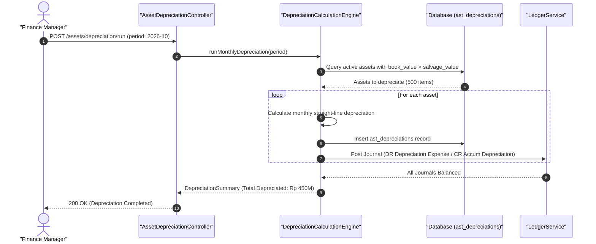

#### Diagram 2: Alur Kompensasi / Exception / Verifikasi Dua-Sumber Fase 31

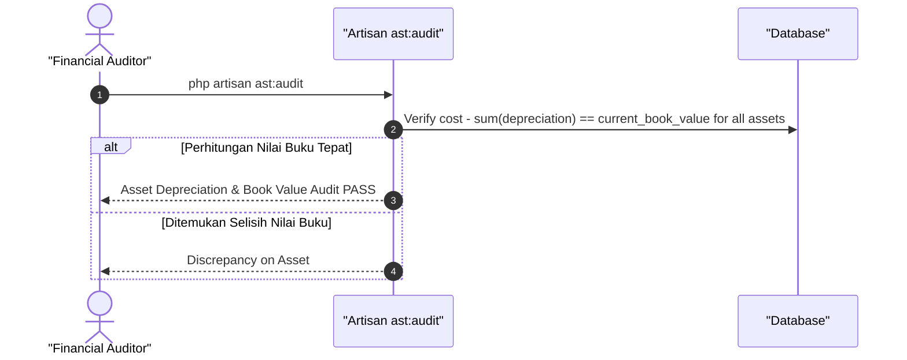

### 6. Mermaid ERD & State Machine Fase 31

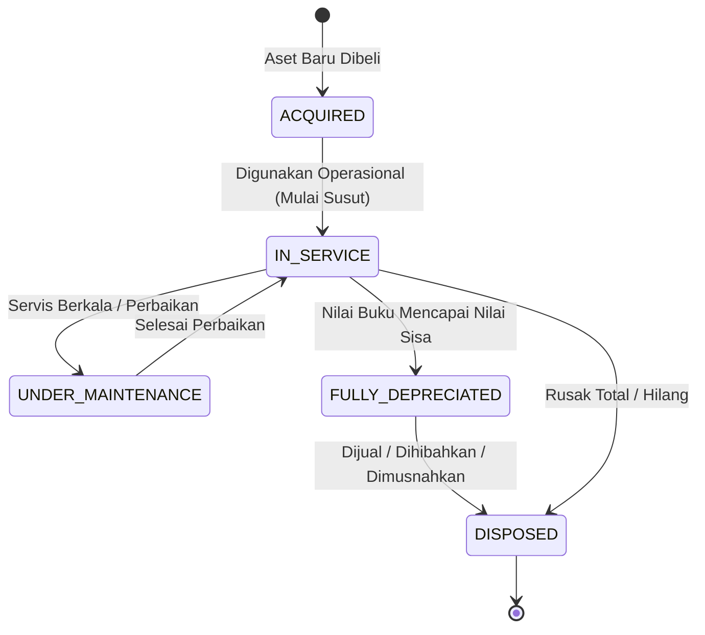

---

