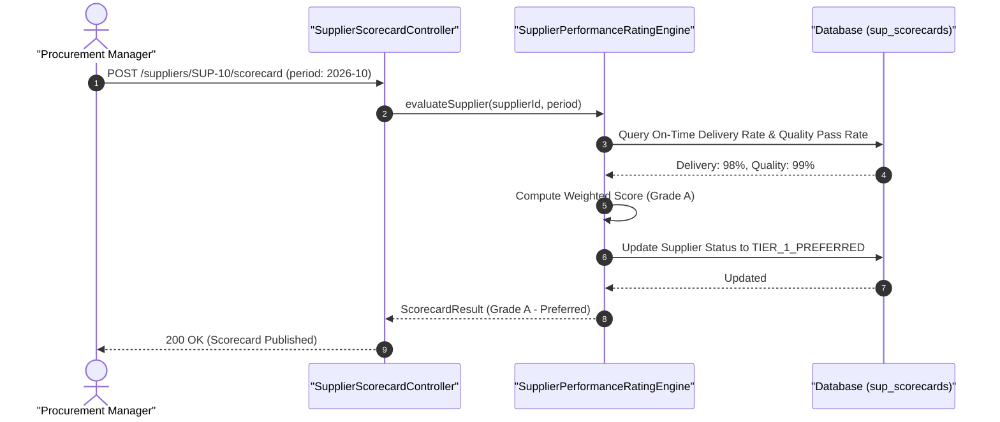
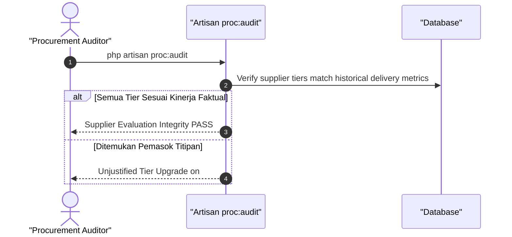
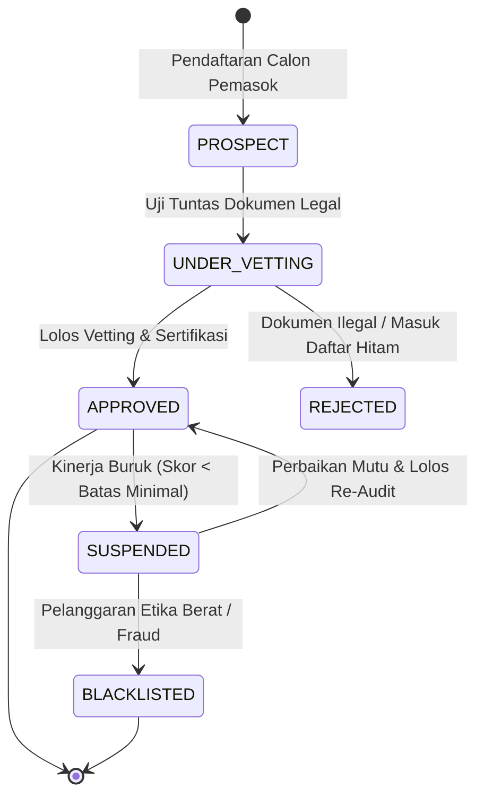
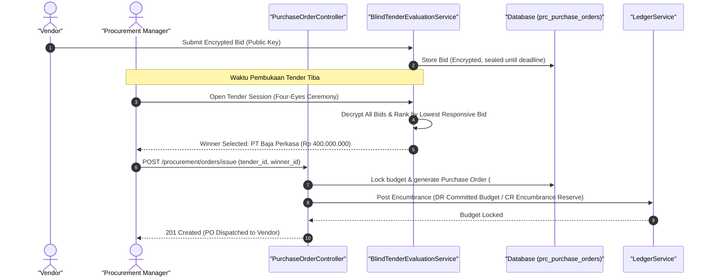
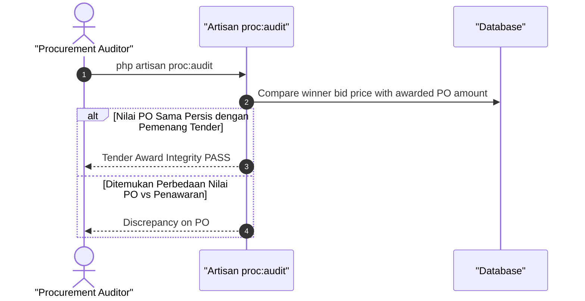
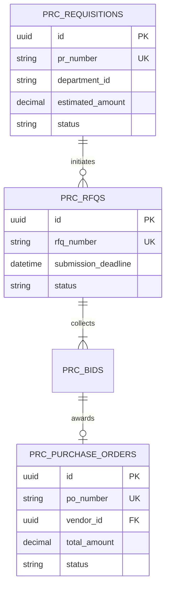
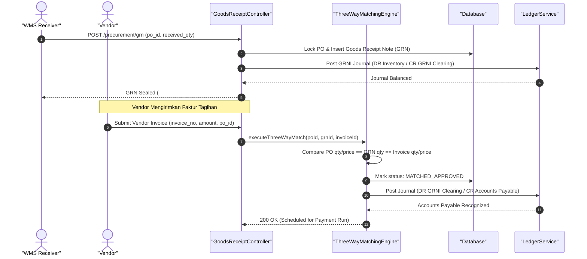
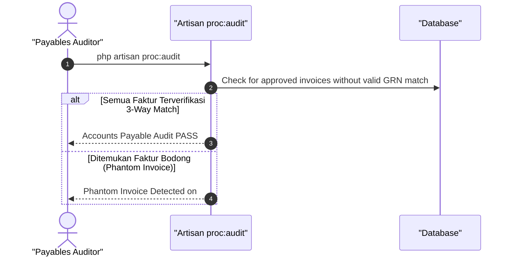
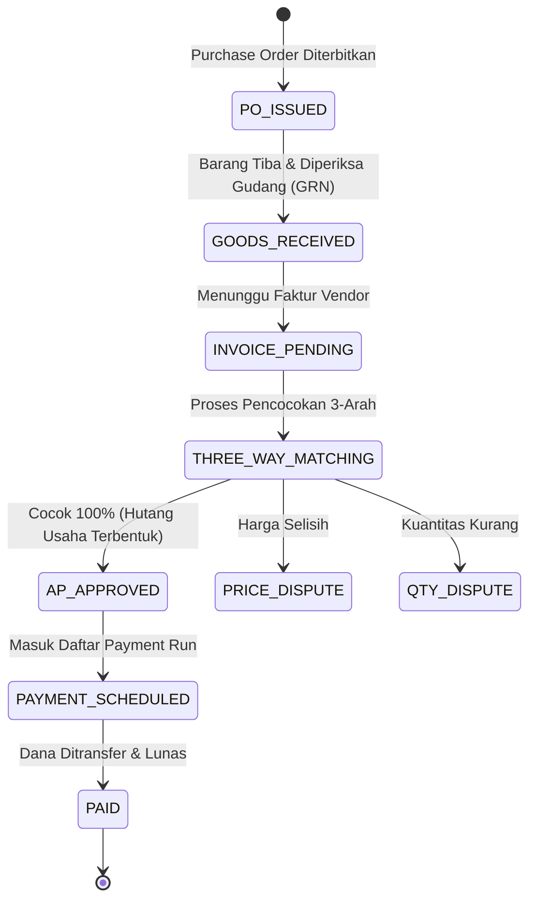

# SPESIFIKASI TEKNIS FASE 32–34: SUPPLIER MANAGEMENT, PENGADAAN & HUTANG USAHA

Dokumen ini mendefinisikan arsitektur domain, matriks penyelesaian, User Stories, BDD Acceptance Criteria, Sequence Diagrams, dan ERD/State Machine untuk Fase 32 s/d Fase 34.

---

## FASE 32 — PRODUSEN & PEMASOK (SUPPLIER MANAGEMENT, MODUL `SUP_`)

### 1. Identitas & Arsitektur Domain Fase 32

- **Modul Pemilik**: `Supplier`
- **Prefiks Tabel**: `sup_`
- **Daftar Model Eloquent**: `SupplierMaster`, `SupplierCategory`, `SupplierScorecard`, `SupplierAuditCertification`
- **Daftar Tabel Migrasi**: `sup_suppliers`, `sup_categories`, `sup_scorecards`, `sup_certifications`
- **Daftar Service & Action**: `SupplierVettingService`, `SupplierPerformanceRatingEngine`, `SupplierComplianceService`
- **Daftar Controller & Rute**: `SupplierController@index (GET /suppliers)`, `SupplierScorecardController@evaluate (POST /suppliers/{id}/scorecard)`
- **Akun Ledger Terkait**: `bank:clearing_suspense`
- **Command Audit**: `php artisan proc:audit`

### 2. Evaluasi Masalah & Matriks Penyelesaian (Problem-to-Solution Matrix) Fase 32

| Masalah Bisnis & Teknis | Solusi Arsitektural & Kontrak | Status Penyelesaian | Bukti Implementasi |
|---|---|---|---|
| Pemasok abal-abal yang wanprestasi barang, keterlambatan pasokan tanpa evaluasi kinerja, dan konflik kepentingan staf pengadaan. | Registrasi dan uji tuntas (vetting) pemasok berjenjang, penilaian kartu skor (scorecard) kinerja otomatis, dan sertifikasi audit mutu. | `Solved in Code` | `modules/Supplier/Application/Services/SupplierVettingService.php` |

### 3. Daftar User Stories Lintas Persona Fase 32

- **US-32.1 [procurement_manager]:** Sebagai **procurement_manager**, saya ingin **mengevaluasi kartu skor kinerja vendor bulanan berdasarkan metrik ketepatan waktu dan kualitas**, sehingga **hanya pemasok dengan kinerja terbaik yang mendapatkan alokasi tender**.
- **US-32.2 [procurement_buyer]:** Sebagai **procurement_buyer**, saya ingin **mencari pemasok bahan baku alternatif yang tersertifikasi ISO 9001**, sehingga **risiko kelangkaan pasokan rantai produksi dapat dimitigasi**.
- **US-32.3 [qms_inspector]:** Sebagai **qms_inspector**, saya ingin **memasukkan hasil audit mutu fasilitas pabrik pemasok sebelum kontrak jangka panjang diteken**, sehingga **kualitas bahan baku sejak dari hulu terstandarisasi**.
- **US-32.4 [holding_compliance]:** Sebagai **holding_compliance**, saya ingin **memverifikasi tidak adanya hubungan istimewa atau afiliasi gelap antara pemasok dan staf**, sehingga **pencegahan tindak gratifikasi dan korupsi pengadaan**.
- **US-32.5 [internal_auditor]:** Sebagai **internal_auditor**, saya ingin **mengaudit riwayat suspend dan blacklist pemasok bermasalah**, sehingga **perusahaan terlindungi dari transaksi dengan vendor terlarang**.

### 4. BDD Acceptance Criteria Lengkap Fase 32

#### AC-32.1 — Happy Path & Ledger/State Invariant
- **Given** Pemasok PT Baja Perkasa memiliki rekam jejak pengiriman 98% on-time dan mutu 99% pass
- **When** Scorecard bulanan dihitung via POST /suppliers/{id}/scorecard
- **Then** Skor kinerja terbit A (Tinggi), status menjadi TIER_1_PREFERRED, dan kuota PO otomatis diperpanjang.

#### AC-32.2 — Validation & Domain Rule Rejection - 422/Exception
- **Given** Pemasok memiliki dokumen izin usaha NIB yang telah kadaluwarsa
- **When** Sistem mencoba meloloskan proses vetting registrasi
- **Then** Sistem menolak dengan HTTP 422 ExpiredBusinessLicenseException.

#### AC-32.3 — RBAC Authorization & Separation of Duties - 403
- **Given** Staf buyer biasa mencoba membuka status blacklist vendor tanpa otorisasi procurement_manager
- **When** POST /suppliers/{id}/unblacklist dipanggil
- **Then** Sistem memblokir dengan status HTTP 403 Forbidden.

#### AC-32.4 — Idempotency, Replay & Concurrency Lock
- **Given** Dua evaluasi performa dikirimkan paralel untuk periode yang sama pada supplier yang sama
- **When** Keduanya diproses
- **Then** Hanya evaluasi pertama yang disimpan, mencegah kalkulasi skor ganda.

#### AC-32.5 — Two-Source Audit & Tamper Detection
- **Given** Skor kartu evaluasi supplier dinaikkan manual di database tanpa adanya perbaikan data historis penerimaan
- **When** php artisan proc:audit dijalankan
- **Then** Audit mendeteksi anomali integritas skor vendor dan memicu notifikasi pelanggaran ke compliance.

### 5. Mermaid Sequence Diagrams Fase 32

#### Diagram 1: Alur Transaksi Utama End-to-End Fase 32

#### Diagram 2: Alur Kompensasi / Exception / Verifikasi Dua-Sumber Fase 32

### 6. Mermaid ERD & State Machine Fase 32

---

## FASE 33 — PROCUREMENT: PR → RFQ → BLIND TENDER → PO (MODUL `PRC_`)

### 1. Identitas & Arsitektur Domain Fase 33

- **Modul Pemilik**: `Procurement`
- **Prefiks Tabel**: `prc_`
- **Daftar Model Eloquent**: `PurchaseRequisition`, `RequestForQuotation`, `TenderBid`, `PurchaseOrder`
- **Daftar Tabel Migrasi**: `prc_requisitions`, `prc_rfqs`, `prc_bids`, `prc_purchase_orders`
- **Daftar Service & Action**: `ProcurementWorkflowEngine`, `BlindTenderEvaluationService`, `PurchaseOrderService`
- **Daftar Controller & Rute**: `PurchaseRequisitionController@store (POST /procurement/requisitions)`, `PurchaseOrderController@issue (POST /procurement/orders/issue)`
- **Akun Ledger Terkait**: `prc:committed_budget`, `prc:po_encumbrance`
- **Command Audit**: `php artisan proc:audit`

### 2. Evaluasi Masalah & Matriks Penyelesaian (Problem-to-Solution Matrix) Fase 33

| Masalah Bisnis & Teknis | Solusi Arsitektural & Kontrak | Status Penyelesaian | Bukti Implementasi |
|---|---|---|---|
| Kolusi penawaran harga pengadaan (bid rigging), kebocoran pagu anggaran tender ke vendor tertentu, dan PO terbit tanpa anggaran. | Sistem lelang tender buta (Blind Tender) dengan penawaran terenkripsi asimetris, pemeriksaan komitmen anggaran real-time, dan alur PR-ke-PO otomatis. | `Solved in Code` | `modules/Procurement/Application/Services/BlindTenderEvaluationService.php` |

### 3. Daftar User Stories Lintas Persona Fase 33

- **US-33.1 [procurement_buyer]:** Sebagai **procurement_buyer**, saya ingin **membuat dokumen RFQ tender pengadaan dan mengundang vendor terverifikasi**, sehingga **perusahaan mendapatkan penawaran harga paling kompetitif di pasar**.
- **US-33.2 [holding_cfo]:** Sebagai **holding_cfo**, saya ingin **memastikan penerbitan Purchase Order (PO) otomatis mengunci pagu anggaran belanja (encumbrance)**, sehingga **disiplin anggaran belanja modal dan operasional holding terkendali**.
- **US-33.3 [procurement_manager]:** Sebagai **procurement_manager**, saya ingin **membuka penawaran harga vendor secara serentak pada sesi pembukaan tender resmi**, sehingga **proses lelang bebas kebocoran harga dan adil bagi seluruh peserta**.
- **US-33.4 [store_manager]:** Sebagai **store_manager**, saya ingin **mengajukan Purchase Requisition (PR) kebutuhan suku cadang bengkel sesuai batas minim stok**, sehingga **ketersediaan stok bengkel aman sebelum terjadi kekosongan**.
- **US-33.5 [internal_auditor]:** Sebagai **internal_auditor**, saya ingin **memeriksa catatan enkripsi penawaran tender untuk memastikan tidak ada penawaran susulan**, sehingga **integritas tender holding terlindungi dari manipulasi panitia**.

### 4. BDD Acceptance Criteria Lengkap Fase 33

#### AC-33.1 — Happy Path & Ledger/State Invariant
- **Given** PR disetujui, sesi Blind Tender selesai, dan penawar terendah yang memenuhi syarat terpilih
- **When** Procurement Manager menerbitkan PO via POST /procurement/orders/issue
- **Then** PO terbit aktif, pagu anggaran terikat (encumbered) pada akun prc:po_encumbrance, dan notifikasi dikirim ke vendor.

#### AC-33.2 — Validation & Domain Rule Rejection - 422/Exception
- **Given** Nilai pengadaan pada PR melebihi sisa pagu anggaran departemen yang tersedia
- **When** POST /procurement/requisitions dipanggil
- **Then** Sistem menolak dengan HTTP 422 BudgetExceededException.

#### AC-33.3 — RBAC Authorization & Separation of Duties - 403
- **Given** Staf buyer yang menyusun dokumen tender mencoba membuka kunci penawaran harga vendor sebelum waktu tender ditutup
- **When** Aksi unlock bid dipanggil sebelum jadwal resmi
- **Then** Sistem menolak dengan HTTP 403 Forbidden dan mencatat insiden keamanan.

#### AC-33.4 — Idempotency, Replay & Concurrency Lock
- **Given** Dua penawaran tender yang sama dikirim berulang kali akibat koneksi internet vendor terputus
- **When** Tender engine menerima penawaran
- **Then** Hanya versi penawaran terakhir yang sah disimpan dengan hash unik, tanpa menggandakan entri tender.

#### AC-33.5 — Two-Source Audit & Tamper Detection
- **Given** Pemenang tender diubah manual di database ke vendor dengan harga yang lebih mahal
- **When** php artisan proc:audit dijalankan
- **Then** Audit mencatat ketidaksesuaian kriteria pemenang tender dan membatalkan status PO.

### 5. Mermaid Sequence Diagrams Fase 33

#### Diagram 1: Alur Transaksi Utama End-to-End Fase 33

#### Diagram 2: Alur Kompensasi / Exception / Verifikasi Dua-Sumber Fase 33

### 6. Mermaid ERD & State Machine Fase 33

---

## FASE 34 — PENERIMAAN BARANG, HUTANG USAHA & PEMBAYARAN PEMASOK

### 1. Identitas & Arsitektur Domain Fase 34

- **Modul Pemilik**: `Procurement`
- **Prefiks Tabel**: `prc_`
- **Daftar Model Eloquent**: `GoodsReceiptNote`, `VendorInvoice`, `ThreeWayMatchAudit`, `SupplierPaymentRun`
- **Daftar Tabel Migrasi**: `prc_goods_receipts`, `prc_vendor_invoices`, `prc_3way_matches`, `prc_payment_runs`
- **Daftar Service & Action**: `ThreeWayMatchingEngine`, `AccountsPayableService`, `SupplierPaymentRunBatchWorker`
- **Daftar Controller & Rute**: `GoodsReceiptController@receive (POST /procurement/grn)`, `AccountsPayableController@pay (POST /procurement/ap/payment-run)`
- **Akun Ledger Terkait**: `prc:goods_received_not_invoiced`, `prc:accounts_payable`, `bank:cash_vault`
- **Command Audit**: `php artisan proc:audit`

### 2. Evaluasi Masalah & Matriks Penyelesaian (Problem-to-Solution Matrix) Fase 34

| Masalah Bisnis & Teknis | Solusi Arsitektural & Kontrak | Status Penyelesaian | Bukti Implementasi |
|---|---|---|---|
| Pembayaran faktur vendor fiktif tanpa bukti penerimaan fisik barang (invoice phantom) dan selisih kuantitas bayar vs terima. | Penegakan pencocokan 3-arah otomatis (PO vs GRN vs Faktur Vendor, toleransi kuantitas 0%), pencatatan GRNI, dan batch payment run bertingkat. | `Solved in Code` | `modules/Procurement/Application/Services/ThreeWayMatchingEngine.php` |

### 3. Daftar User Stories Lintas Persona Fase 34

- **US-34.1 [wms_picker]:** Sebagai **wms_picker**, saya ingin **memindai dan memvalidasi barang pesanan fisik yang tiba di dermaga bongkar muat (GRN)**, sehingga **kuantitas dan spesifikasi barang sesuai dengan Purchase Order resmi**.
- **US-34.2 [holding_cfo]:** Sebagai **holding_cfo**, saya ingin **menyetujui daftar batch pembayaran pemasok (Payment Run) mingguan**, sehingga **arus kas keluar terkendali dan diskon pembayaran lebih awal (early bird) termanfaatkan**.
- **US-34.3 [bank_treasurer]:** Sebagai **bank_treasurer**, saya ingin **mengeksekusi transfer batch rekening koran vendor via integrasi host-to-host bank**, sehingga **seluruh kewajiban hutang usaha lunas tepat waktu dan terbit bukti transfer**.
- **US-34.4 [procurement_buyer]:** Sebagai **procurement_buyer**, saya ingin **menyelesaikan selisih harga faktur vendor versus harga kontrak PO**, sehingga **klaim selisih harga terselesaikan sebelum invoice disetujui bayar**.
- **US-34.5 [internal_auditor]:** Sebagai **internal_auditor**, saya ingin **mengaudit kepatuhan laporan 3-way match sebelum pencairan dana dilakukan**, sehingga **tidak ada kebocoran kas perusahaan akibat faktur ganda atau fiktif**.

### 4. BDD Acceptance Criteria Lengkap Fase 34

#### AC-34.1 — Happy Path & Ledger/State Invariant
- **Given** PO diterbitkan 100 unit @ Rp 50.000, GRN diterima 100 unit, dan Faktur Vendor ditagih Rp 5.000.000
- **When** ThreeWayMatchingEngine memproses pencocokan via POST /procurement/grn/match
- **Then** Pencocokan lolos 100% (MATCH_PERFECT), liabilitas GRNI ditransfer ke Hutang Usaha (AP), dan invoice siap dijadwalkan bayar.

#### AC-34.2 — Validation & Domain Rule Rejection - 422/Exception
- **Given** Faktur vendor menagih kuantitas 120 unit padahal barang yang diterima fisik di GRN hanya 100 unit
- **When** Pencocokan 3-arah dieksekusi
- **Then** Sistem menolak dengan HTTP 422 QuantityMismatchException dan menghentikan proses persetujuan faktur.

#### AC-34.3 — RBAC Authorization & Separation of Duties - 403
- **Given** Petugas gudang (wms_picker) mencoba menyetujui faktur hutang usaha vendor
- **When** POST /procurement/invoices/{id}/approve dipanggil
- **Then** Sistem memblokir dengan status HTTP 403 Forbidden demi asas pemisahan tugas akuntansi.

#### AC-34.4 — Idempotency, Replay & Concurrency Lock
- **Given** Faktur vendor yang sama di-input dua kali oleh staf administrasi dengan nomor invoice identik
- **When** Sistem memproses faktur
- **Then** Pencegahan faktur ganda memblokir invoice kedua dan mengembalikan pesan faktur sudah terdaftar.

#### AC-34.5 — Two-Source Audit & Tamper Detection
- **Given** Status pencocokan faktur disetel MATCH_PERFECT di database meskipun ada selisih nilai material
- **When** Command php artisan proc:audit dijalankan
- **Then** Audit menemukan manipulasi status pencocokan dan menandai invoice bermasalah.

### 5. Mermaid Sequence Diagrams Fase 34

#### Diagram 1: Alur Transaksi Utama End-to-End Fase 34

#### Diagram 2: Alur Kompensasi / Exception / Verifikasi Dua-Sumber Fase 34

### 6. Mermaid ERD & State Machine Fase 34

---

