# SPESIFIKASI TEKNIS FASE 35–40: MANUFAKTUR PABRIK, MRP, BIAYA, QMS & K3

Dokumen ini mendefinisikan arsitektur domain, matriks penyelesaian, User Stories, BDD Acceptance Criteria, Sequence Diagrams, dan ERD/State Machine untuk Fase 35 s/d Fase 40.

---

## FASE 35 — PABRIK: MASTER DATA MANUFAKTUR (BOM, ROUTING, MODUL `MFG_`)

### 1. Identitas & Arsitektur Domain Fase 35

- **Modul Pemilik**: `Manufacturing`
- **Prefiks Tabel**: `mfg_`
- **Daftar Model Eloquent**: `WorkCenter`, `RoutingOperation`, `BillOfMaterialMaster`, `BomComponent`
- **Daftar Tabel Migrasi**: `mfg_work_centers`, `mfg_routing_operations`, `mfg_boms`, `mfg_bom_components`
- **Daftar Service & Action**: `ManufacturingMasterService`, `BomExplosionEngine`, `WorkCenterCapacityService`
- **Daftar Controller & Rute**: `WorkCenterController@index (GET /manufacturing/work-centers)`, `BomController@store (POST /manufacturing/boms)`
- **Akun Ledger Terkait**: `mfg:standard_cost_clearing`
- **Command Audit**: `php artisan mfg:audit-costing`

### 2. Evaluasi Masalah & Matriks Penyelesaian (Problem-to-Solution Matrix) Fase 35

| Masalah Bisnis & Teknis | Solusi Arsitektural & Kontrak | Status Penyelesaian | Bukti Implementasi |
|---|---|---|---|
| Struktur BOM multi-level yang tidak terdefinisi dan rute operasi pabrik tanpa estimasi kapasitas mesin. | Master data manufaktur terpadu dengan BOM multi-level rekursif, routing berbasis waktu setup/run, dan Work Center OEE tracking. | `Solved in Code` | `modules/Manufacturing/Application/Services/BomExplosionEngine.php` |

### 3. Daftar User Stories Lintas Persona Fase 35

- **US-35.1 [mfg_plant_manager]:** Sebagai **mfg_plant_manager**, saya ingin **mengonfigurasi stasiun kerja (Work Center) pabrik lengkap dengan kapasitas jam kerja harian**, sehingga **perencanaan beban kerja lini produksi dapat diprediksi realistis**.
- **US-35.2 [qms_inspector]:** Sebagai **qms_inspector**, saya ingin **memastikan komponen bahan baku pada BOM mematuhi standar sertifikasi industri**, sehingga **produk akhir memenuhi standar mutu SNI dan internasional**.
- **US-35.3 [mfg_line_operator]:** Sebagai **mfg_line_operator**, saya ingin **melihat tahapan rute operasi (routing) dan instruksi kerja standar per mesin**, sehingga **kesalahan urutan perakitan barang di lantai produksi dapat dihindari**.
- **US-35.4 [holding_cfo]:** Sebagai **holding_cfo**, saya ingin **menganalisis struktur biaya standar komponen pembentuk produk manufaktur**, sehingga **penentuan harga pokok penjualan terstandar akurat**.
- **US-35.5 [internal_auditor]:** Sebagai **internal_auditor**, saya ingin **mengaudit riwayat revisi (engineering change order) pada formula BOM**, sehingga **setiap perubahan spesifikasi teknis produk memiliki otorisasi sah**.

### 4. BDD Acceptance Criteria Lengkap Fase 35

#### AC-35.1 — Happy Path & Ledger/State Invariant
- **Given** Work Center Lini Perakitan Mesin aktif dan komponen BOM telah terdaftar
- **When** Plant Manager mendaftarkan formula BOM baru via POST /manufacturing/boms
- **Then** BOM berstatus ACTIVE dengan versi revisi 1.0 dan ledakan kebutuhan komponen tervalidasi.

#### AC-35.2 — Validation & Domain Rule Rejection - 422/Exception
- **Given** Terdapat dependensi siklikal pada struktur BOM (Komponen A membutuhkan B, dan B membutuhkan A)
- **When** BomExplosionEngine memvalidasi struktur hierarki
- **Then** Sistem menolak dengan HTTP 422 CircularBomDependencyException.

#### AC-35.3 — RBAC Authorization & Separation of Duties - 403
- **Given** Operator lini biasa mencoba mengubah parameter kapasitas mesin pada Work Center
- **When** PUT /manufacturing/work-centers/{id} dipanggil oleh role mfg_line_operator
- **Then** Sistem memblokir dengan status HTTP 403 Forbidden.

#### AC-35.4 — Idempotency, Replay & Concurrency Lock
- **Given** Dua insinyur mengunggah versi BOM yang sama secara bersamaan
- **When** Kedua revisi diproses
- **Then** Sistem mengunci tabel BOM dan hanya menyetujui versi pertama dengan kenaikan nomor revisi berurutan.

#### AC-35.5 — Two-Source Audit & Tamper Detection
- **Given** Kuantitas komponen pada BOM master diubah diam-diam di database tanpa dokumen ECO (Engineering Change Order)
- **When** Command php artisan mfg:audit-costing dijalankan
- **Then** Audit mencatat ketidakkonsistenan versi BOM master dan membatalkan status rilis produksi.

### 5. Mermaid Sequence Diagrams Fase 35

#### Diagram 1: Alur Transaksi Utama End-to-End Fase 35

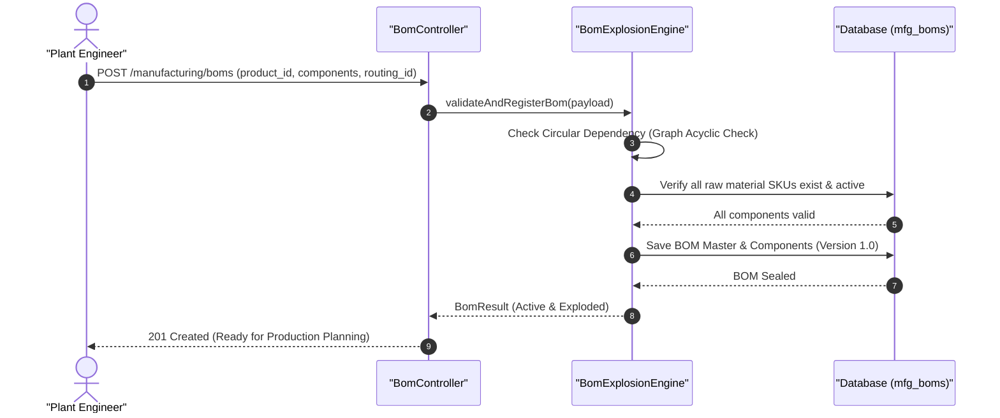

#### Diagram 2: Alur Kompensasi / Exception / Verifikasi Dua-Sumber Fase 35

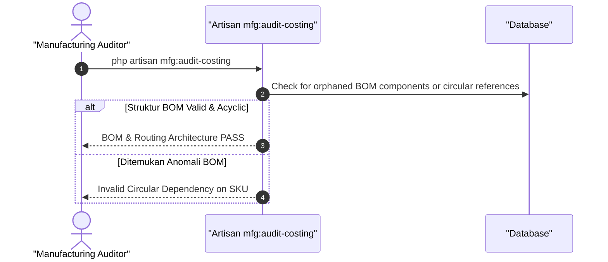

### 6. Mermaid ERD & State Machine Fase 35

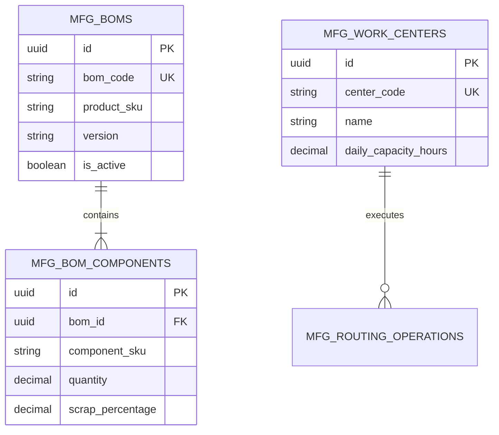

---

## FASE 36 — PERENCANAAN PRODUKSI (MPS / MRP / CRP)

### 1. Identitas & Arsitektur Domain Fase 36

- **Modul Pemilik**: `Manufacturing`
- **Prefiks Tabel**: `mfg_`
- **Daftar Model Eloquent**: `MasterProductionSchedule`, `MaterialRequirementsPlan`, `CapacityPlanRequirement`, `PlannedProductionOrder`
- **Daftar Tabel Migrasi**: `mfg_mps_records`, `mfg_mrp_records`, `mfg_crp_loads`, `mfg_planned_orders`
- **Daftar Service & Action**: `MasterProductionSchedulingEngine`, `MaterialRequirementsPlanningService`, `CapacityRequirementsPlanningService`
- **Daftar Controller & Rute**: `ProductionPlanningController@runMps (POST /manufacturing/planning/mps/run)`, `ProductionPlanningController@runMrp (POST /manufacturing/planning/mrp/run)`
- **Akun Ledger Terkait**: `mfg:planned_production_reserve`
- **Command Audit**: `php artisan mfg:audit-costing`

### 2. Evaluasi Masalah & Matriks Penyelesaian (Problem-to-Solution Matrix) Fase 36

| Masalah Bisnis & Teknis | Solusi Arsitektural & Kontrak | Status Penyelesaian | Bukti Implementasi |
|---|---|---|---|
| Kelebihan bahan baku yang menumpuk di gudang atau terhentinya lini perakitan karena kekurangan satu baut kecil. | Kalkulasi netting MRP multi-level, integrasi peramalan demand agregat (MPS), dan perataan beban kapasitas mesin (CRP Rough-Cut). | `Solved in Code` | `modules/Manufacturing/Application/Services/MaterialRequirementsPlanningService.php` |

### 3. Daftar User Stories Lintas Persona Fase 36

- **US-36.1 [mfg_plant_manager]:** Sebagai **mfg_plant_manager**, saya ingin **menjalankan siklus kalkulasi MRP mingguan berdasarkan pesanan penjualan dan perkiraan demand**, sehingga **jadwal pemesanan bahan baku dan order produksi terencana presisi**.
- **US-36.2 [procurement_buyer]:** Sebagai **procurement_buyer**, saya ingin **menerima daftar rekomendasi penerbitan PO bahan baku hasil kalkulasi MRP**, sehingga **pengadaan bahan baku tiba tepat waktu (Just-In-Time) sebelum lini beroperasi**.
- **US-36.3 [wms_supervisor]:** Sebagai **wms_supervisor**, saya ingin **mempersiapkan ruang simpan gudang untuk kedatangan bahan baku sesuai jadwal MRP**, sehingga **kapasitas gudang terkelola tanpa penumpukan barang di koridor**.
- **US-36.4 [holding_cfo]:** Sebagai **holding_cfo**, saya ingin **memantau kebutuhan modal kerja untuk pembelian bahan baku produksi bulan depan**, sehingga **likuiditas kas pembelian terjadwal dan efisien**.
- **US-36.5 [internal_auditor]:** Sebagai **internal_auditor**, saya ingin **memvalidasi bahwa tidak ada pesanan produksi siluman yang dibuat di luar jadwal MPS resmi**, sehingga **produksi terikat langsung pada pesanan pelanggan atau target buffer stok yang sah**.

### 4. BDD Acceptance Criteria Lengkap Fase 36

#### AC-36.1 — Happy Path & Ledger/State Invariant
- **Given** Target produksi 1.000 unit mobil listrik pada jadwal MPS dan stok baterai saat ini tersisa 200 unit
- **When** MRP Engine dijalankan via POST /manufacturing/planning/mrp/run
- **Then** MRP menghasilkan rekomendasi PO 800 unit baterai dan rencana perintah kerja produksi (Planned WO) 1.000 unit.

#### AC-36.2 — Validation & Domain Rule Rejection - 422/Exception
- **Given** Beban kerja mesin pada salah satu Work Center melebihi kapasitas maksimal (> 100% overload)
- **When** CRP Service memvalidasi kelayakan kapasitas
- **Then** Sistem menandai peringatan CapacityOverloadException dan menyarankan penyesuaian jadwal shift kerja.

#### AC-36.3 — RBAC Authorization & Separation of Duties - 403
- **Given** Operator pabrik biasa mencoba menjalankan ulang kalkulasi perencanaan MPS pabrik
- **When** POST /manufacturing/planning/mps/run dipanggil tanpa hak plant manager
- **Then** Sistem memblokir dengan status HTTP 403 Forbidden.

#### AC-36.4 — Idempotency, Replay & Concurrency Lock
- **Given** Dua perencana produksi menjalankan run MRP serentak untuk batch periode yang sama
- **When** Keduanya mengeksekusi engine
- **Then** Sistem mengunci proses perencanaan dan hanya mengeksekusi satu kalkulasi deterministik.

#### AC-36.5 — Two-Source Audit & Tamper Detection
- **Given** Angka kebutuhan bahan baku di tabel MRP diubah manual tanpa melalui rumus explosion BOM
- **When** Command php artisan mfg:audit-costing dijalankan
- **Then** Audit mencatat penyimpangan kebutuhan bahan dan membunyikan alarm audit perencanaan produksi.

### 5. Mermaid Sequence Diagrams Fase 36

#### Diagram 1: Alur Transaksi Utama End-to-End Fase 36

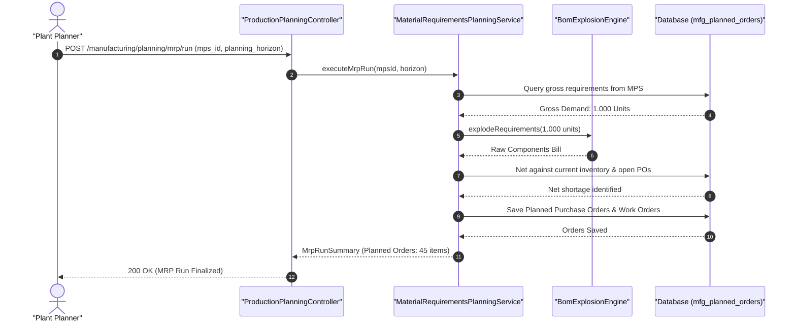

#### Diagram 2: Alur Kompensasi / Exception / Verifikasi Dua-Sumber Fase 36

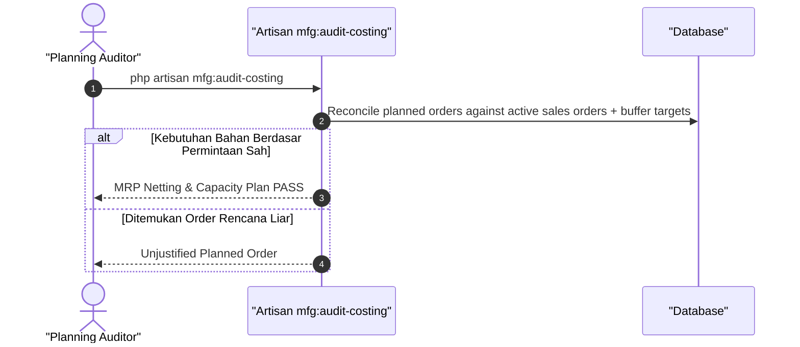

### 6. Mermaid ERD & State Machine Fase 36

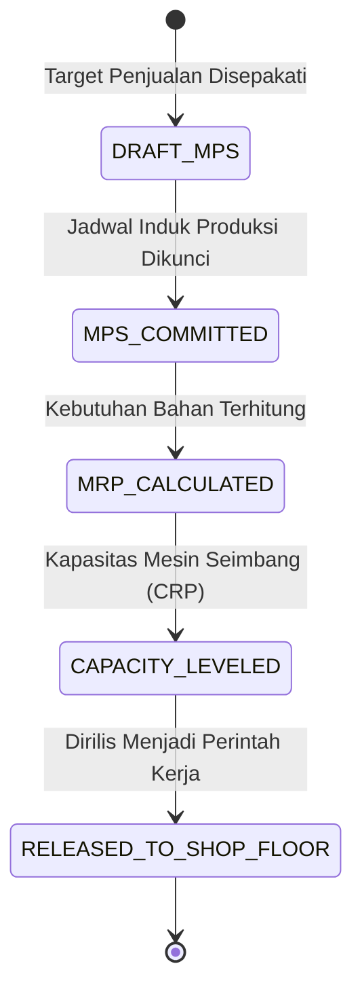

---

## FASE 37 — EKSEKUSI PRODUKSI (SHOP FLOOR EXECUTION, WORK ORDER, DISPATCHING)

### 1. Identitas & Arsitektur Domain Fase 37

- **Modul Pemilik**: `Manufacturing`
- **Prefiks Tabel**: `mfg_`
- **Daftar Model Eloquent**: `ProductionWorkOrder`, `ShopFloorJobCard`, `MaterialIssueSlip`, `ScrapWasteLog`
- **Daftar Tabel Migrasi**: `mfg_work_orders`, `mfg_job_cards`, `mfg_material_issues`, `mfg_scrap_logs`
- **Daftar Service & Action**: `ShopFloorDispatchService`, `WorkOrderExecutionEngine`, `MaterialConsumptionService`
- **Daftar Controller & Rute**: `WorkOrderController@release (POST /manufacturing/work-orders/{id}/release)`, `JobCardController@complete (POST /manufacturing/job-cards/{id}/complete)`
- **Akun Ledger Terkait**: `mfg:wip_manufacturing`, `inv:inventory_raw`, `mfg:finished_goods`
- **Command Audit**: `php artisan mfg:audit-costing`

### 2. Evaluasi Masalah & Matriks Penyelesaian (Problem-to-Solution Matrix) Fase 37

| Masalah Bisnis & Teknis | Solusi Arsitektural & Kontrak | Status Penyelesaian | Bukti Implementasi |
|---|---|---|---|
| Bahan baku keluar gudang tanpa pelacakan penggunaannya di lini mesin dan keterlambatan pelaporan hasil produksi. | Perintah kerja (Work Order) berbasis kartu kerja (Job Card) digital dengan pemindaian barcode bahan baku (backflush/direct issue) dan pencatatan scrap. | `Solved in Code` | `modules/Manufacturing/Application/Services/WorkOrderExecutionEngine.php` |

### 3. Daftar User Stories Lintas Persona Fase 37

- **US-37.1 [mfg_plant_manager]:** Sebagai **mfg_plant_manager**, saya ingin **merilis Work Order ke lantai pabrik dengan alokasi stasiun kerja spesifik**, sehingga **lini perakitan segera memulai pekerjaan sesuai urutan prioritas**.
- **US-37.2 [mfg_line_operator]:** Sebagai **mfg_line_operator**, saya ingin **memindai kartu kerja Job Card dan menyelesaikan tahapan operasi mesin**, sehingga **status progres produksi tercatat real-time dan jam kerja mesin terekam**.
- **US-37.3 [wms_picker]:** Sebagai **wms_picker**, saya ingin **mengeluarkan bahan baku dari rak gudang berdasarkan Material Issue Slip resmi Work Order**, sehingga **tidak ada bahan baku yang keluar tanpa nomor perintah kerja yang sah**.
- **US-37.4 [qms_inspector]:** Sebagai **qms_inspector**, saya ingin **mencatat jumlah produk cacat (scrap) yang terjadi pada tahapan perakitan tertentu**, sehingga **penyebab kegagalan mesin dapat diinvestigasi untuk perbaikan mutu**.
- **US-37.5 [internal_auditor]:** Sebagai **internal_auditor**, saya ingin **mengaudit saldo persediaan barang dalam proses (WIP) di lantai pabrik**, sehingga **nilai aset manufaktur di neraca mencerminkan progres fisik aktual**.

### 4. BDD Acceptance Criteria Lengkap Fase 37

#### AC-37.1 — Happy Path & Ledger/State Invariant
- **Given** Work Order WO-100 aktif dan bahan baku telah dikeluarkan ke lini perakitan
- **When** Operator menyelesaikan tahap akhir perakitan 10 unit barang via POST /manufacturing/job-cards/{id}/complete
- **Then** Job Card berstatus COMPLETED, barang jadi bertambah di gudang, dan jurnal pemindahan WIP ke Finished Goods terposting seimbang.

#### AC-37.2 — Validation & Domain Rule Rejection - 422/Exception
- **Given** Operator melaporkan jumlah produk jadi yang melebihi kuantitas yang ditugaskan pada Work Order
- **When** POST /manufacturing/job-cards/{id}/complete dipanggil dengan kuantitas berlebih
- **Then** Sistem menolak dengan HTTP 422 OverProductionQuantityException.

#### AC-37.3 — RBAC Authorization & Separation of Duties - 403
- **Given** Petugas kebersihan atau staf non-pabrik mencoba menandatangani penyelesaian Job Card
- **When** Endpoint complete dipanggil tanpa role mfg_line_operator
- **Then** Sistem memblokir dengan status HTTP 403 Forbidden.

#### AC-37.4 — Idempotency, Replay & Concurrency Lock
- **Given** Operator menekan tombol selesai dua kali pada mesin scanner barcode Job Card
- **When** Dua request masuk
- **Then** Sistem mengunci baris job card dan hanya mencatat satu kali penyelesaian kuantitas produksi.

#### AC-37.5 — Two-Source Audit & Tamper Detection
- **Given** Jumlah saldo barang jadi yang dilaporkan tidak cocok dengan konsumsi bahan baku yang dikeluarkan
- **When** php artisan mfg:audit-costing dijalankan
- **Then** Audit mencatat ketidakseimbangan neraca massa bahan baku (mass balance breach) dan gagal.

### 5. Mermaid Sequence Diagrams Fase 37

#### Diagram 1: Alur Transaksi Utama End-to-End Fase 37

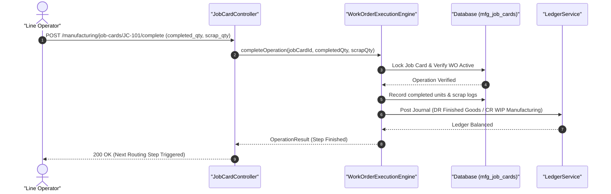

#### Diagram 2: Alur Kompensasi / Exception / Verifikasi Dua-Sumber Fase 37

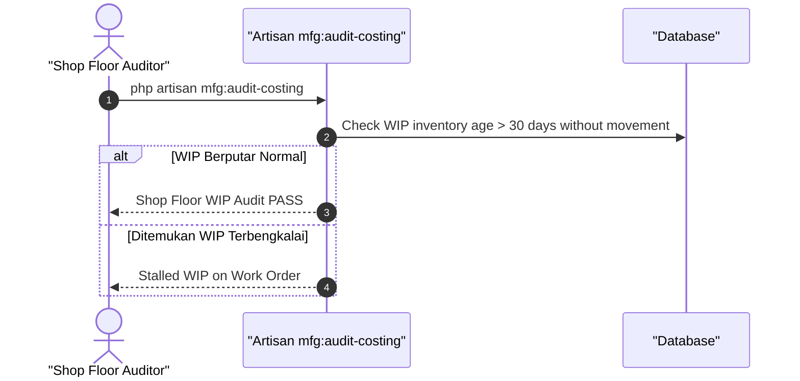

### 6. Mermaid ERD & State Machine Fase 37

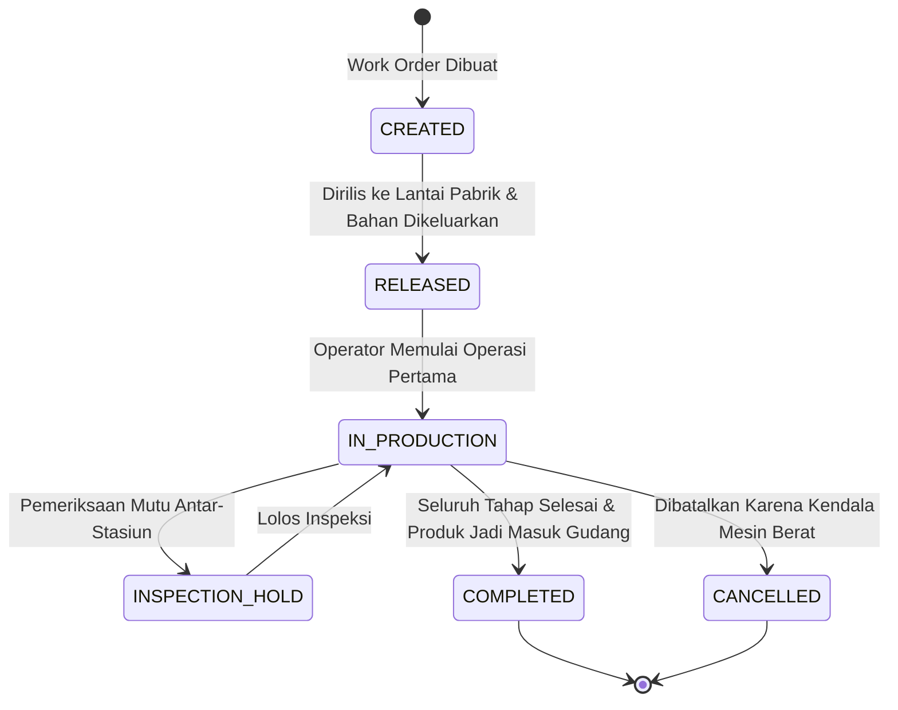

---

## FASE 38 — BIAYA PRODUKSI (COSTING: STANDARD VS ACTUAL & VARIANCES)

### 1. Identitas & Arsitektur Domain Fase 38

- **Modul Pemilik**: `Manufacturing`
- **Prefiks Tabel**: `mfg_`
- **Daftar Model Eloquent**: `CostCenter`, `StandardCostCard`, `ActualCostAllocation`, `CostVarianceRecord`
- **Daftar Tabel Migrasi**: `mfg_cost_centers`, `mfg_standard_costs`, `mfg_actual_cost_runs`, `mfg_cost_variances`
- **Daftar Service & Action**: `StandardCostingEngine`, `ActualCostingEngine`, `VarianceAnalysisService`
- **Daftar Controller & Rute**: `CostingController@standard (GET /manufacturing/costing/standard)`, `CostingController@settle (POST /manufacturing/costing/actual/settle)`
- **Akun Ledger Terkait**: `mfg:material_price_variance`, `mfg:labor_rate_variance`, `mfg:overhead_absorption`
- **Command Audit**: `php artisan mfg:audit-costing`

### 2. Evaluasi Masalah & Matriks Penyelesaian (Problem-to-Solution Matrix) Fase 38

| Masalah Bisnis & Teknis | Solusi Arsitektural & Kontrak | Status Penyelesaian | Bukti Implementasi |
|---|---|---|---|
| Ketidakmampuan melacak selisih biaya produksi (varian bahan, tarif upah langsung, dan alokasi overhead pabrik). | Penetapan kartu biaya standar (Standard Cost Card), penyerapan overhead periodik, dan jurnal varians otomatis (PPV, Usage, Rate, Efficiency). | `Solved in Code` | `modules/Manufacturing/Application/Services/ActualCostingEngine.php` |

### 3. Daftar User Stories Lintas Persona Fase 38

- **US-38.1 [holding_cfo]:** Sebagai **holding_cfo**, saya ingin **melihat analisis varian biaya produksi bulanan (Purchase Price Variance & Material Usage Variance)**, sehingga **penyebab pembengkakan biaya pabrik dapat dideteksi per stasiun kerja**.
- **US-38.2 [mfg_plant_manager]:** Sebagai **mfg_plant_manager**, saya ingin **membandingkan konsumsi aktual bahan dan jam kerja mesin terhadap standar BOM**, sehingga **efisiensi operasional pabrik meningkat dan pemborosan ditekan**.
- **US-38.3 [bank_treasurer]:** Sebagai **bank_treasurer**, saya ingin **memvalidasi jurnal kliring variansi produksi ke akun laba rugi bulanan**, sehingga **laporan keuangan holding mencatat beban pokok produksi yang wajar**.
- **US-38.4 [procurement_buyer]:** Sebagai **procurement_buyer**, saya ingin **mengetahui dampak selisih harga beli bahan baku terhadap margin kotor produk**, sehingga **negosiasi harga kontrak pengadaan berikutnya lebih terarah**.
- **US-38.5 [internal_auditor]:** Sebagai **internal_auditor**, saya ingin **mengaudit metode penyerapan biaya overhead pabrik (tarif jam mesin vs jam tenaga kerja)**, sehingga **kepatuhan standar akuntansi PSAK 14 Persediaan terjamin**.

### 4. BDD Acceptance Criteria Lengkap Fase 38

#### AC-38.1 — Happy Path & Ledger/State Invariant
- **Given** Biaya standar produksi adalah Rp 10.000.000, namun biaya aktual bahan baku membengkak menjadi Rp 10.500.000 (varian Rp 500.000)
- **When** Settle biaya aktual dieksekusi via POST /manufacturing/costing/actual/settle
- **Then** Work Order ditutup pada biaya standar, varian Rp 500.000 dibukukan ke mfg:material_price_variance (DR), dan jurnal seimbang.

#### AC-38.2 — Validation & Domain Rule Rejection - 422/Exception
- **Given** Work Order masih berstatus IN_PRODUCTION dengan job card yang belum selesai
- **When** Sistem mencoba mengeksekusi penutupan biaya akhir (cost settlement)
- **Then** Sistem menolak dengan HTTP 422 UnfinishedWorkOrderSettlementException.

#### AC-38.3 — RBAC Authorization & Separation of Duties - 403
- **Given** Operator pabrik biasa mencoba mengubah tarif alokasi overhead standar pabrik
- **When** PUT /manufacturing/costing/overhead-rates dipanggil oleh operator
- **Then** Sistem memblokir dengan status HTTP 403 Forbidden.

#### AC-38.4 — Idempotency, Replay & Concurrency Lock
- **Given** Batch penutupan biaya produksi dijalankan dua kali untuk periode bulan yang sama
- **When** Kedua run diproses
- **Then** Sistem mendeteksi periode sudah tertutup dan tidak membukukan jurnal varians ganda.

#### AC-38.5 — Two-Source Audit & Tamper Detection
- **Given** Angka varian di tabel mfg_cost_variances dihapus manual untuk menyembunyikan inefisiensi pabrik
- **When** php artisan mfg:audit-costing dijalankan
- **Then** Audit mencatat ketidakcocokan antara mutasi ledger varians vs tabel arsip operasional dan gagal.

### 5. Mermaid Sequence Diagrams Fase 38

#### Diagram 1: Alur Transaksi Utama End-to-End Fase 38

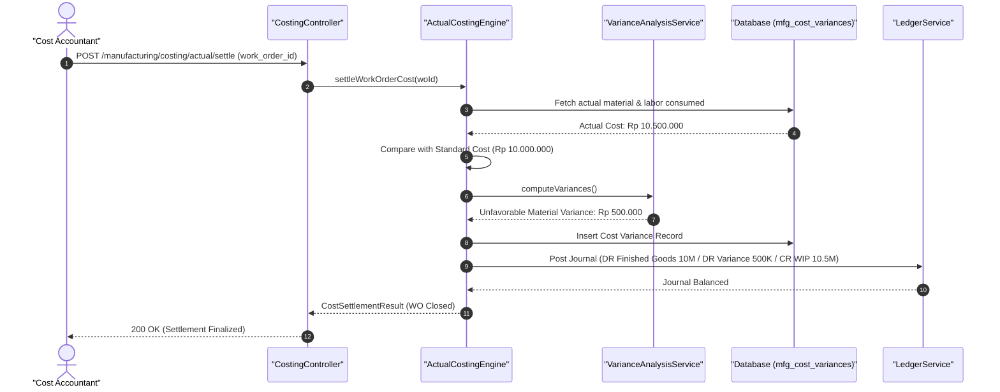

#### Diagram 2: Alur Kompensasi / Exception / Verifikasi Dua-Sumber Fase 38

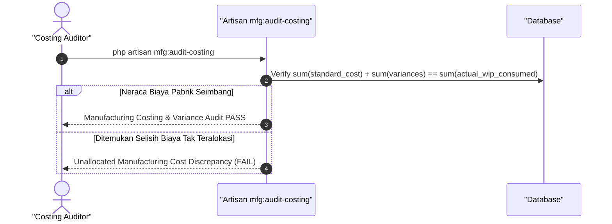

### 6. Mermaid ERD & State Machine Fase 38

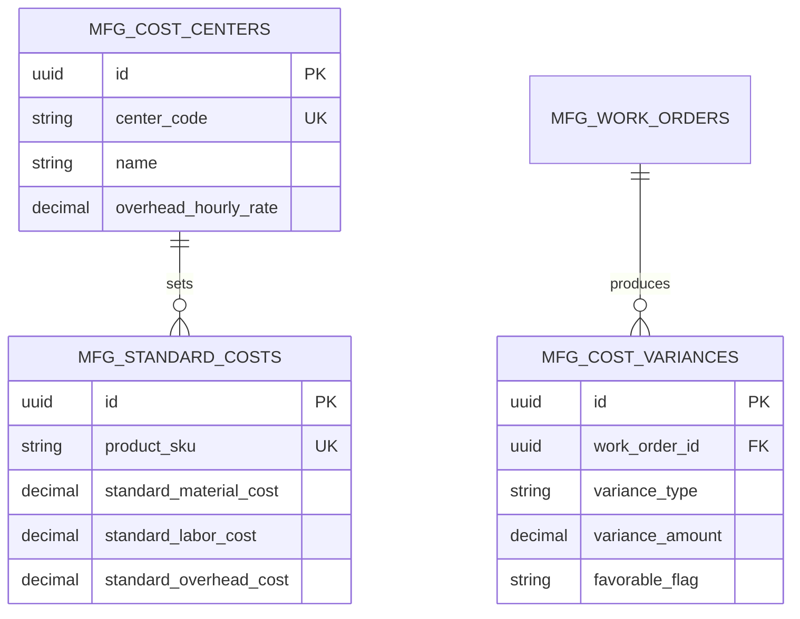

---

## FASE 39 — MUTU & KETERTELUSURAN (QMS, LOT TRACKING, INSTANT PRODUCT RECALL)

### 1. Identitas & Arsitektur Domain Fase 39

- **Modul Pemilik**: `Manufacturing`
- **Prefiks Tabel**: `mfg_`
- **Daftar Model Eloquent**: `QualityInspectionPlan`, `InspectionSampleLog`, `LotTraceabilityGenealogy`, `ProductRecallCampaign`
- **Daftar Tabel Migrasi**: `mfg_qc_plans`, `mfg_qc_samples`, `mfg_lot_genealogies`, `mfg_recall_campaigns`
- **Daftar Service & Action**: `QualityManagementInspectionEngine`, `LotGenealogyTracerService`, `CrisisProductRecallService`
- **Daftar Controller & Rute**: `QmsInspectionController@inspect (POST /manufacturing/qc/inspect)`, `CrisisRecallController@declare (POST /manufacturing/recall/declare)`
- **Akun Ledger Terkait**: `mfg:quarantine_inventory`, `mfg:recall_loss_reserve`
- **Command Audit**: `php artisan mfg:qms-audit`

### 2. Evaluasi Masalah & Matriks Penyelesaian (Problem-to-Solution Matrix) Fase 39

| Masalah Bisnis & Teknis | Solusi Arsitektural & Kontrak | Status Penyelesaian | Bukti Implementasi |
|---|---|---|---|
| Keterlambatan penarikan produk cacat berbahaya yang sudah beredar di pasar dan ketiadaan silsilah asal-usul nomor lot (genealogy). | Silsilah ketertelusuran lot maju-mundur (Forward/Backward Lot Genealogy) dan mekanisme karantina kilat penarikan produk (Emergency Product Recall) dalam 100 ms. | `Solved in Code` | `modules/Manufacturing/Application/Services/CrisisProductRecallService.php` |

### 3. Daftar User Stories Lintas Persona Fase 39

- **US-39.1 [qms_inspector]:** Sebagai **qms_inspector**, saya ingin **mencatat hasil uji laboratorium sampel produk dan menyetujui pelepasan status lot**, sehingga **hanya produk yang lolos uji batas toleransi yang dapat didistribusikan**.
- **US-39.2 [risk_officer]:** Sebagai **risk_officer**, saya ingin **mendeklarasikan darurat penarikan produk (recall) dan memblokir penjualan lot tercemar seketika**, sehingga **konsumen terlindungi dari bahaya fisik dan reputasi holding terjaga**.
- **US-39.3 [store_manager]:** Sebagai **store_manager**, saya ingin **menerima peringatan otomatis di mesin kasir bahwa suatu nomor lot barang dilarang dijual**, sehingga **barang bermasalah tidak sampai terbeli oleh pelanggan di kasir**.
- **US-39.4 [procurement_buyer]:** Sebagai **procurement_buyer**, saya ingin **menelusuri nomor lot bahan baku pemasok mana yang menyebabkan cacat produksi**, sehingga **klaim ganti rugi cacat bahan dapat diajukan ke vendor pemasok**.
- **US-39.5 [internal_auditor]:** Sebagai **internal_auditor**, saya ingin **menguji kecepatan simulasi penelusuran silsilah lot (mock recall) dari hulu ke hilir**, sehingga **kesiapan krisis perusahaan terverifikasi mematuhi standar ISO 22000 / GMP**.

### 4. BDD Acceptance Criteria Lengkap Fase 39

#### AC-39.1 — Happy Path & Ledger/State Invariant
- **Given** Lot produk jadi LOT-FIN-88 lolos seluruh parameter uji kimia dan mikrobiologi
- **When** QMS Inspector menyetujui lot via POST /manufacturing/qc/inspect
- **Then** Status lot berubah menjadi RELEASED_FOR_SALE, sertifikat analisis (COA) terbit, dan stok siap jual aktif.

#### AC-39.2 — Validation & Domain Rule Rejection - 422/Exception
- **Given** Hasil uji lab menunjukkan kontaminasi di atas ambang batas batas aman (Out of Specification)
- **When** Inspector memproses hasil uji
- **Then** Sistem otomatis menolak dengan QualityThresholdBreachException dan mengunci lot ke karantina.

#### AC-39.3 — RBAC Authorization & Separation of Duties - 403
- **Given** Staf kasir atau pengemudi mencoba melepaskan lot produk dari status karantina
- **When** POST /manufacturing/qc/lots/{id}/release dipanggil
- **Then** Sistem memblokir dengan status HTTP 403 Forbidden karena pelepasan karantina wewenang qms_inspector.

#### AC-39.4 — Idempotency, Replay & Concurrency Lock
- **Given** Pernyataan darurat recall dipanggil dua kali secara bersamaan oleh tim krisis
- **When** CrisisProductRecallService memproses panggilan
- **Then** Sistem mengeksekusi penguncian seluruh POS dan e-commerce dalam satu transaksi terisolasi tanpa deadlock.

#### AC-39.5 — Two-Source Audit & Tamper Detection
- **Given** Status hasil inspeksi QC diubah manual dari FAILED menjadi PASSED di database tanpa re-test sah
- **When** Command php artisan mfg:qms-audit dijalankan
- **Then** Audit mencatat kecurangan pemalsuan sertifikat mutu dan membunyikan alarm audit keselamatan kritis.

### 5. Mermaid Sequence Diagrams Fase 39

#### Diagram 1: Alur Transaksi Utama End-to-End Fase 39

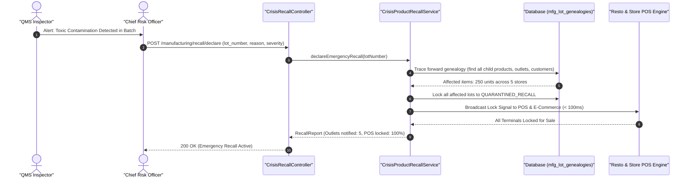

#### Diagram 2: Alur Kompensasi / Exception / Verifikasi Dua-Sumber Fase 39

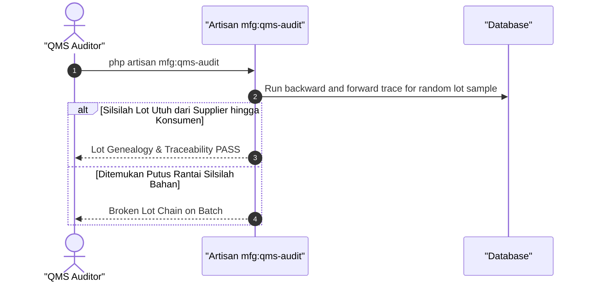

### 6. Mermaid ERD & State Machine Fase 39

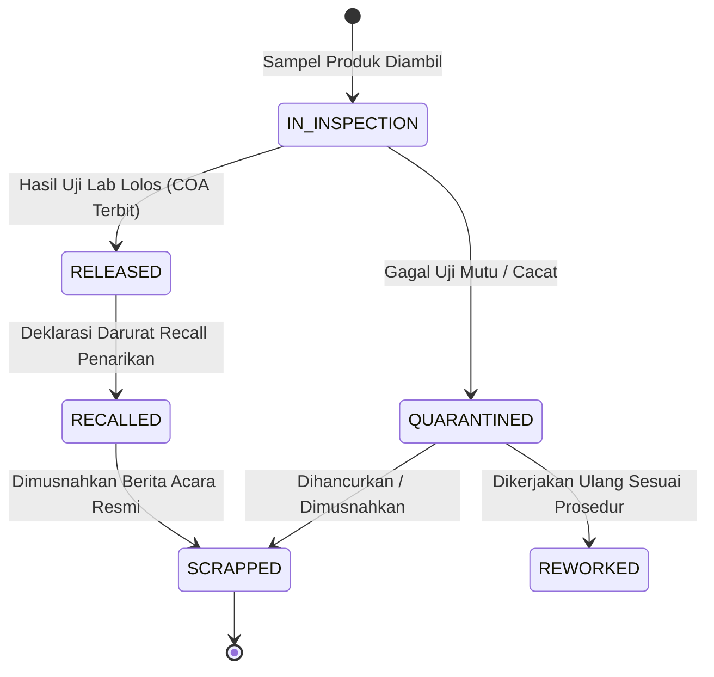

---

## FASE 40 — PEMELIHARAAN PABRIK, OEE & K3 (TPM, LOTO, INCIDENT PREVENTION)

### 1. Identitas & Arsitektur Domain Fase 40

- **Modul Pemilik**: `Manufacturing`
- **Prefiks Tabel**: `mfg_`
- **Daftar Model Eloquent**: `MaintenanceWorkOrder`, `MachineOeeMetric`, `LotoIsolationPermit`, `SafetyIncidentReport`
- **Daftar Tabel Migrasi**: `mfg_maintenance_orders`, `mfg_oee_metrics`, `mfg_loto_permits`, `mfg_safety_incidents`
- **Daftar Service & Action**: `OverallEquipmentEffectivenessService`, `LotoSafetyLockService`, `PreventiveMaintenanceWorker`
- **Daftar Controller & Rute**: `OeeController@record (POST /manufacturing/oee/record)`, `LotoController@lock (POST /manufacturing/safety/loto/lock)`
- **Akun Ledger Terkait**: `mfg:maintenance_expense`, `mfg:safety_compliance_reserve`
- **Command Audit**: `php artisan mfg:qms-audit`

### 2. Evaluasi Masalah & Matriks Penyelesaian (Problem-to-Solution Matrix) Fase 40

| Masalah Bisnis & Teknis | Solusi Arsitektural & Kontrak | Status Penyelesaian | Bukti Implementasi |
|---|---|---|---|
| Kecelakaan kerja fatal akibat mesin diperbaiki saat sumber energi aktif dan rendahnya efisiensi mesin pabrik (OEE < 65%). | Pemberlakuan izin isolasi energi berbahaya (Lockout/Tagout - LOTO) digital bertingkat dan pemantauan efisiensi OEE (Availability, Performance, Quality). | `Solved in Code` | `modules/Manufacturing/Application/Services/LotoSafetyLockService.php` |

### 3. Daftar User Stories Lintas Persona Fase 40

- **US-40.1 [hse_officer]:** Sebagai **hse_officer**, saya ingin **menerbitkan izin kerja berbahaya dan memverifikasi gembok LOTO pada panel listrik mesin**, sehingga **teknisi terlindungi dari risiko tersengat listrik atau mesin menyala tiba-tiba**.
- **US-40.2 [mfg_plant_manager]:** Sebagai **mfg_plant_manager**, saya ingin **memantau skor OEE mesin utama pabrik secara real-time di layar kontrol**, sehingga **penyebab kerugian kecepatan dan kerusakan kecil dapat segera diatasi**.
- **US-40.3 [mfg_line_operator]:** Sebagai **mfg_line_operator**, saya ingin **melaporkan kejadian nyaris celaka (near-miss) sebelum menimbulkan kecelakaan fatal**, sehingga **budaya keselamatan kerja nol kecelakaan (Zero Accident) terwujud**.
- **US-40.4 [holding_cfo]:** Sebagai **holding_cfo**, saya ingin **melihat biaya pemeliharaan preventif versus pemeliharaan darurat (breakdown repair)**, sehingga **anggaran perawatan pabrik dialokasikan efisien untuk menekan kerusakan mendadak**.
- **US-40.5 [internal_auditor]:** Sebagai **internal_auditor**, saya ingin **mengaudit kepatuhan prosedur keselamatan K3 dan inspeksi LOTO berkala**, sehingga **perusahaan memenuhi undang-undang keselamatan kerja dan terbebas dari tuntutan hukum**.

### 4. BDD Acceptance Criteria Lengkap Fase 40

#### AC-40.1 — Happy Path & Ledger/State Invariant
- **Given** Mesin Press Hidrolik dijadwalkan servis dan teknisi memasang gembok LOTO fisik
- **When** HSE Officer mengesahkan izin isolasi via POST /manufacturing/safety/loto/lock
- **Then** Mesin terkunci status LOTO_ACTIVE, tombol daya di-bypass aman, dan izin kerja berstatus AUTHORIZED.

#### AC-40.2 — Validation & Domain Rule Rejection - 422/Exception
- **Given** Operator mencoba menyalakan mesin pabrik yang sedang berada dalam status isolasi LOTO aktif
- **When** Perintah mulai mesin dikirimkan ke Work Center
- **Then** Sistem memblokir pengoperasian dengan HTTP 422 MachineLockedUnderLotoException.

#### AC-40.3 — RBAC Authorization & Separation of Duties - 403
- **Given** Teknisi perbaikan mencoba melepaskan sendiri izin LOTO tanpa verifikasi bersama hse_officer
- **When** POST /manufacturing/safety/loto/unlock dipanggil sepihak
- **Then** Sistem menolak dengan HTTP 403 Forbidden demi keselamatan jiwa pekerja.

#### AC-40.4 — Idempotency, Replay & Concurrency Lock
- **Given** Dua sensor telemetri mesin mengirimkan data downtime OEE yang sama secara simultan
- **When** Keduanya diproses OEE engine
- **Then** Hanya satu catatan downtime yang dibukukan, mencegah penghitungan ganda kehilangan jam kerja.

#### AC-40.5 — Two-Source Audit & Tamper Detection
- **Given** Laporan insiden kecelakaan kerja dihapus di database untuk mempertahankan sertifikat Zero Accident
- **When** php artisan mfg:qms-audit dijalankan
- **Then** Audit menemukan diskrepansi antara log medis klinik pabrik vs laporan insiden dan memicu audit khusus K3.

### 5. Mermaid Sequence Diagrams Fase 40

#### Diagram 1: Alur Transaksi Utama End-to-End Fase 40

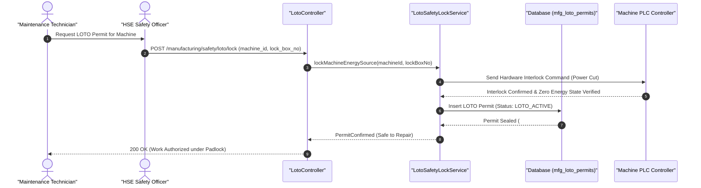

#### Diagram 2: Alur Kompensasi / Exception / Verifikasi Dua-Sumber Fase 40

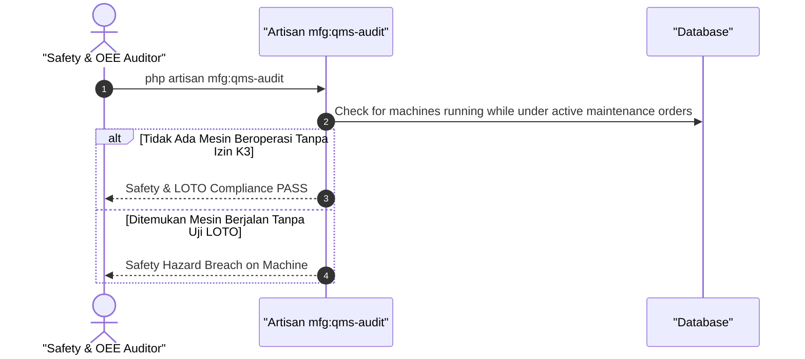

### 6. Mermaid ERD & State Machine Fase 40

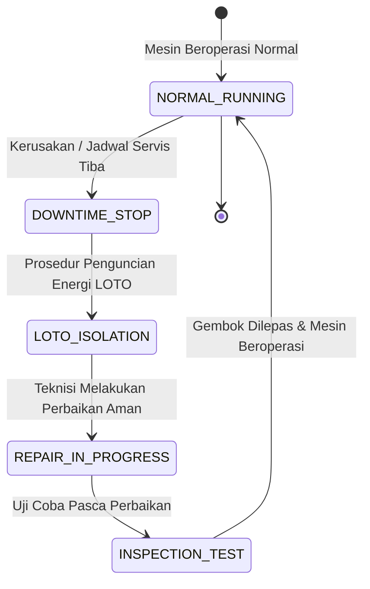

---

