# SPESIFIKASI TEKNIS FASE 41–50: WMS, DISTRIBUSI, PRICING, AGENSI, TREASURY & TRADE FINANCE

Dokumen ini mendefinisikan arsitektur domain, matriks penyelesaian, User Stories, BDD Acceptance Criteria, Sequence Diagrams, dan ERD/State Machine untuk Fase 41 s/d Fase 50.

---

## FASE 41 — GUDANG & PUSAT DISTRIBUSI (WMS, MODUL `WMS_`)

### 1. Identitas & Arsitektur Domain Fase 41

- **Modul Pemilik**: `Wms`
- **Prefiks Tabel**: `wms_`
- **Daftar Model Eloquent**: `WarehouseZone`, `StorageBinLocation`, `WavePickPlan`, `CrossDockConsignment`
- **Daftar Tabel Migrasi**: `wms_zones`, `wms_bin_locations`, `wms_wave_plans`, `wms_cross_dock_lots`
- **Daftar Service & Action**: `BinLocationManagementService`, `WavePickingOptimizationEngine`, `CrossDockingRouter`
- **Daftar Controller & Rute**: `WmsBinController@index (GET /wms/bins)`, `WmsWaveController@release (POST /wms/waves/release)`
- **Akun Ledger Terkait**: `wms:warehouse_inventory`, `wms:crossdock_transit`
- **Command Audit**: `php artisan wms:audit`

### 2. Evaluasi Masalah & Matriks Penyelesaian (Problem-to-Solution Matrix) Fase 41

| Masalah Bisnis & Teknis | Solusi Arsitektural & Kontrak | Status Penyelesaian | Bukti Implementasi |
|---|---|---|---|
| Pencarian barang yang lama di gudang raksasa akibat penempatan acak dan pemborosan waktu jalan petugas picking. | Manajemen bin lokasi 3D (Aisle-Rack-Shelf-Bin), algoritma wave picking multi-order, dan cross-docking tanpa put-away. | `Solved in Code` | `modules/Wms/Application/Services/WavePickingOptimizationEngine.php` |

### 3. Daftar User Stories Lintas Persona Fase 41

- **US-41.1 [wms_supervisor]:** Sebagai **wms_supervisor**, saya ingin **merilis gelombang picking (Wave Pick) pesanan yang mengelompokkan rute jalan terpendek**, sehingga **efisiensi waktu pemenuhan pesanan gudang meningkat 40%**.
- **US-41.2 [wms_picker]:** Sebagai **wms_picker**, saya ingin **memindai barcode bin lokasi dan barcode produk menggunakan terminal pemindai genggam**, sehingga **akurasi pengambilan barang mencapai 99.9% bebas salah ambil**.
- **US-41.3 [fleet_manager]:** Sebagai **fleet_manager**, saya ingin **mengalihkan barang masuk langsung ke dermaga muat truk keluar (Cross-Docking)**, sehingga **barang cepat terkirim ke gerai tanpa mengendap di rak gudang**.
- **US-41.4 [holding_cfo]:** Sebagai **holding_cfo**, saya ingin **memantau utilisasi ruang simpan gudang dan biaya pergudangan per meter kubik**, sehingga **biaya sewa dan operasional fasilitas logistik termonitor efisien**.
- **US-41.5 [internal_auditor]:** Sebagai **internal_auditor**, saya ingin **menjalankan audit cycle count berkala terhadap akurasi persediaan per bin lokasi**, sehingga **selisih stok fisik terdeteksi sebelum tutup buku tahunan**.

### 4. BDD Acceptance Criteria Lengkap Fase 41

#### AC-41.1 — Happy Path & Ledger/State Invariant
- **Given** 10 pesanan dengan total 50 SKU berada di zona rak yang berdekatan
- **When** Wave Pick dirilis via POST /wms/waves/release
- **Then** Wave plan terbuat dengan urutan bin berurutan (S-path), tugas picking teralokasi, dan stok ter-reserve.

#### AC-41.2 — Validation & Domain Rule Rejection - 422/Exception
- **Given** Petugas mencoba menaruh barang kimia beracun di bin yang berdampingan dengan bin bahan baku makanan
- **When** Put-away engine memvalidasi aturan kompatibilitas zona
- **Then** Sistem menolak dengan HTTP 422 HazardousMaterialStorageConflictException.

#### AC-41.3 — RBAC Authorization & Separation of Duties - 403
- **Given** Petugas picking biasa mencoba menyesuaikan saldo stok bin tanpa penghitungan cycle count resmi
- **When** POST /wms/bins/{id}/adjust dipanggil
- **Then** Sistem memblokir dengan status HTTP 403 Forbidden.

#### AC-41.4 — Idempotency, Replay & Concurrency Lock
- **Given** Dua picker mengambil sisa kuantitas barang terakhir di bin lokasi yang sama secara simultan
- **When** Kedua scan konfirmasi dikirim
- **Then** Locking baris bin memastikan kuantitas dialokasikan ke picker pertama dan picker kedua dialihkan ke bin cadangan.

#### AC-41.5 — Two-Source Audit & Tamper Detection
- **Given** Kuantitas barang di tabel wms_bin_locations diubah manual tanpa riwayat transaksi picking/putaway
- **When** php artisan wms:audit dijalankan
- **Then** Audit mencatat ketidakcocokan saldo bin vs riwayat pergerakan inventaris dan mengeluarkan alert.

### 5. Mermaid Sequence Diagrams Fase 41

#### Diagram 1: Alur Transaksi Utama End-to-End Fase 41

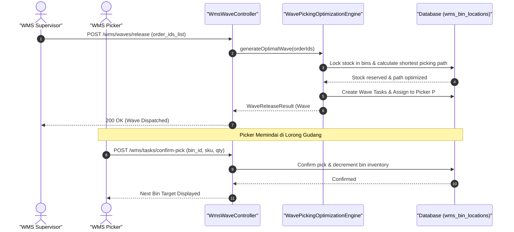

#### Diagram 2: Alur Kompensasi / Exception / Verifikasi Dua-Sumber Fase 41

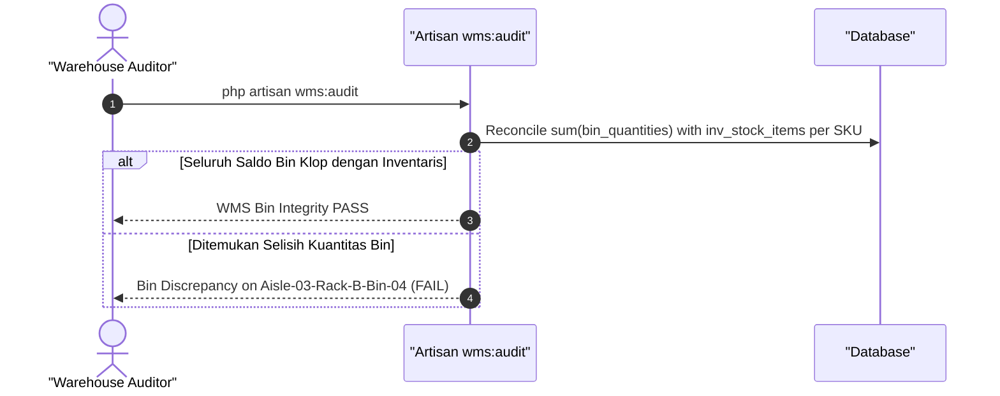

### 6. Mermaid ERD & State Machine Fase 41

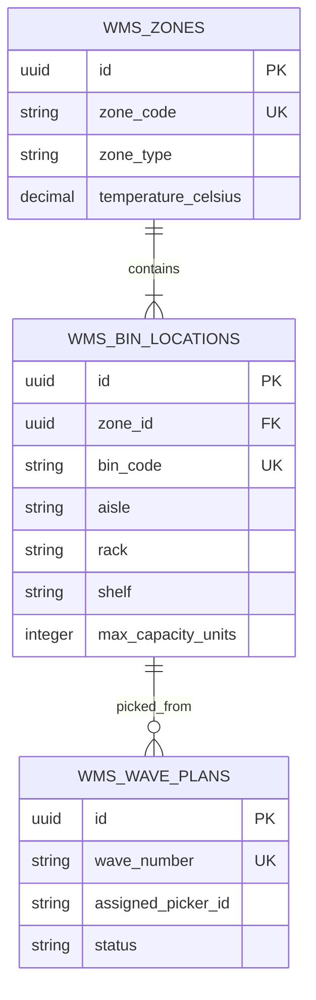

---

## FASE 42 — JARINGAN DISTRIBUTOR (MODUL `DIST_`)

### 1. Identitas & Arsitektur Domain Fase 42

- **Modul Pemilik**: `Distribution`
- **Prefiks Tabel**: `dist_`
- **Daftar Model Eloquent**: `DistributorMaster`, `TerritoryAssignment`, `DistributorTier`, `CreditLimitLedger`
- **Daftar Tabel Migrasi**: `dist_distributors`, `dist_territories`, `dist_tiers`, `dist_credit_limits`
- **Daftar Service & Action**: `DistributorNetworkService`, `TerritoryExclusivityEngine`, `DistributorCreditService`
- **Daftar Controller & Rute**: `DistributorController@index (GET /distributors)`, `DistributorCreditController@check (POST /distributors/{id}/credit/check)`
- **Akun Ledger Terkait**: `dist:credit_exposure`, `dist:receivable_distributor`
- **Command Audit**: `php artisan dist:audit`

### 2. Evaluasi Masalah & Matriks Penyelesaian (Problem-to-Solution Matrix) Fase 42

| Masalah Bisnis & Teknis | Solusi Arsitektural & Kontrak | Status Penyelesaian | Bukti Implementasi |
|---|---|---|---|
| Kanibalisasi penjualan antar-distributor akibat batas teritori tidak jelas dan kredit macet distributor. | Manajemen jaringan distributor berbasis zonasi teritori eksklusif, evaluasi credit limit otomatis, dan tiering insentif. | `Solved in Code` | `modules/Distribution/Application/Services/TerritoryExclusivityEngine.php` |

### 3. Daftar User Stories Lintas Persona Fase 42

- **US-42.1 [procurement_manager]:** Sebagai **procurement_manager**, saya ingin **mendaftarkan distributor regional resmi dengan perjanjian wilayah cakupan eksklusif**, sehingga **distribusi barang tertata rapi tanpa perang harga antar-mitra**.
- **US-42.2 [holding_cfo]:** Sebagai **holding_cfo**, saya ingin **menetapkan batas plafon kredit (credit limit) distributor berdasarkan skor solvabilitas**, sehingga **risiko piutang tak tertagih dari jaringan distribusi terkendali**.
- **US-42.3 [bank_treasurer]:** Sebagai **bank_treasurer**, saya ingin **memantau sisa limit kredit distributor sebelum menyetujui pelepasan order baru**, sehingga **barang tidak dikirim kepada distributor yang menunggak pembayaran**.
- **US-42.4 [store_manager]:** Sebagai **store_manager**, saya ingin **menerima pasokan produk dari distributor resmi wilayahnya dengan harga grosir terikat**, sehingga **kepastian ketersediaan barang ritel di toko terjamin**.
- **US-42.5 [internal_auditor]:** Sebagai **internal_auditor**, saya ingin **mengaudit kepatuhan wilayah distribusi terhadap pesanan yang masuk**, sehingga **tidak ada pelanggaran teritori (cross-border leakage) antar-distributor**.

### 4. BDD Acceptance Criteria Lengkap Fase 42

#### AC-42.1 — Happy Path & Ledger/State Invariant
- **Given** Distributor Utama memiliki plafon kredit Rp 1.000.000.000 dan sisa pemakaian Rp 400.000.000
- **When** Order baru senilai Rp 200.000.000 diajukan via POST /distributors/{id}/credit/check
- **Then** Pemeriksaan kredit lolos (CREDIT_APPROVED), sisa limit menjadi Rp 400.000.000, dan order disetujui kirim.

#### AC-42.2 — Validation & Domain Rule Rejection - 422/Exception
- **Given** Nilai order baru menyebabkan total eksposur piutang melebihi plafon kredit resmi
- **When** Pemeriksaan kelayakan kredit dieksekusi
- **Then** Sistem menolak dengan HTTP 422 CreditLimitExceededException.

#### AC-42.3 — RBAC Authorization & Separation of Duties - 403
- **Given** Staf sales biasa mencoba menaikkan limit kredit distributor tanpa persetujuan holding_cfo
- **When** POST /distributors/{id}/credit/increase dipanggil
- **Then** Sistem memblokir dengan status HTTP 403 Forbidden.

#### AC-42.4 — Idempotency, Replay & Concurrency Lock
- **Given** Dua order besar diajukan bersamaan yang jika digabungkan melebihi sisa credit limit
- **When** Kedua order diproses secara paralel
- **Then** Pessimistic locking pada ledger credit limit memastikan hanya order pertama yang lolos; order kedua tertahan.

#### AC-42.5 — Two-Source Audit & Tamper Detection
- **Given** Angka plafon kredit di database diubah manual tanpa dokumen persetujuan komite kredit
- **When** php artisan dist:audit dijalankan
- **Then** Audit mencatat kenaikan limit tidak sah dan memulihkan nilai limit ke baseline awal.

### 5. Mermaid Sequence Diagrams Fase 42

#### Diagram 1: Alur Transaksi Utama End-to-End Fase 42

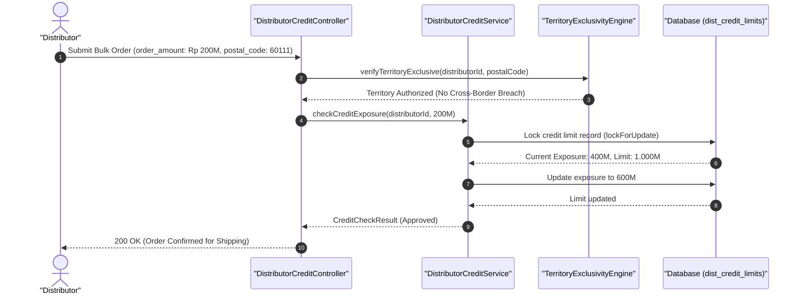

#### Diagram 2: Alur Kompensasi / Exception / Verifikasi Dua-Sumber Fase 42

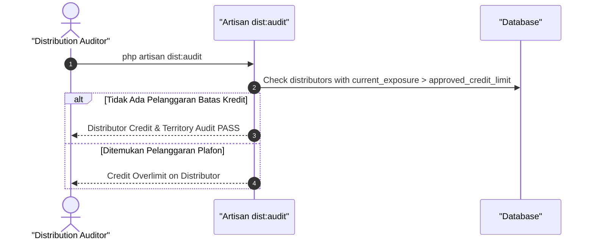

### 6. Mermaid ERD & State Machine Fase 42

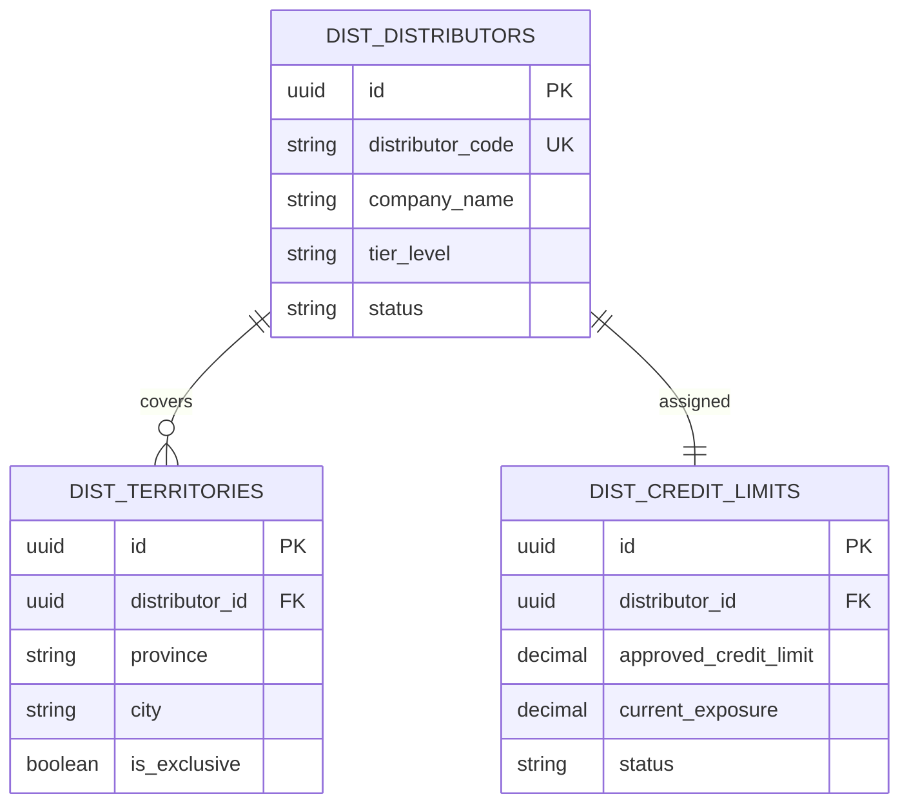

---

## FASE 43 — DISTRIBUSI: ORDER, SELL-IN/SELL-OUT, KONSINYASI, RETUR, REBATE

### 1. Identitas & Arsitektur Domain Fase 43

- **Modul Pemilik**: `Distribution`
- **Prefiks Tabel**: `dist_`
- **Daftar Model Eloquent**: `DistributionOrder`, `SellOutReport`, `ConsignmentInventoryBatch`, `DistributorRebateAccrual`
- **Daftar Tabel Migrasi**: `dist_orders`, `dist_sell_outs`, `dist_consignments`, `dist_rebates`
- **Daftar Service & Action**: `SellInSellOutReconciliationService`, `ConsignmentInventoryManager`, `RebateCalculationEngine`
- **Daftar Controller & Rute**: `DistributionOrderController@order (POST /distribution/orders)`, `RebateController@calculate (POST /distribution/rebates/calculate)`
- **Akun Ledger Terkait**: `dist:consignment_liability`, `dist:rebate_expense`, `dist:sales_returns_reserve`
- **Command Audit**: `php artisan dist:audit`

### 2. Evaluasi Masalah & Matriks Penyelesaian (Problem-to-Solution Matrix) Fase 43

| Masalah Bisnis & Teknis | Solusi Arsitektural & Kontrak | Status Penyelesaian | Bukti Implementasi |
|---|---|---|---|
| Penumpukan stok semu di gudang distributor (channel stuffing) dan sengketa perhitungan bonus rebate tahunan. | Rekonsiliasi data penjualan Sell-In vs Sell-Out riil ke konsumen akhir, manajemen stok konsinyasi, dan kalkulator rebate progresif. | `Solved in Code` | `modules/Distribution/Application/Services/RebateCalculationEngine.php` |

### 3. Daftar User Stories Lintas Persona Fase 43

- **US-43.1 [procurement_manager]:** Sebagai **procurement_manager**, saya ingin **memantau laporan Sell-Out distributor sebelum mengesahkan pesanan Sell-In baru**, sehingga **perusahaan terhindar dari ilusi kenaikan penjualan akibat channel stuffing**.
- **US-43.2 [store_manager]:** Sebagai **store_manager**, saya ingin **menerima barang dagangan dengan skema konsinyasi dan hanya membayar saat barang terjual**, sehingga **beban modal kerja gerai ritel lebih ringan dan efisien**.
- **US-43.3 [holding_cfo]:** Sebagai **holding_cfo**, saya ingin **menghitung dan mencadangkan kewajiban rebate distributor berdasarkan pencapaian target tahunan**, sehingga **pencadangan beban insentif penjualan akurat sesuai PSAK 72**.
- **US-43.4 [bank_treasurer]:** Sebagai **bank_treasurer**, saya ingin **mencairkan kredit nota rebate atau potongan tagihan distributor yang berhak**, sehingga **hubungan kemitraan distributor loyal dan termotivasi**.
- **US-43.5 [internal_auditor]:** Sebagai **internal_auditor**, saya ingin **mengaudit bukti klaim retur barang rusak atau mendekati tanggal kedaluwarsa**, sehingga **tidak ada manipulasi barang retur fiktif untuk mendapatkan kredit pembayaran**.

### 4. BDD Acceptance Criteria Lengkap Fase 43

#### AC-43.1 — Happy Path & Ledger/State Invariant
- **Given** Distributor mencapai target pembelian Rp 5.000.000.000 dengan hak rebate 3%
- **When** Rebate dihitung via POST /distribution/rebates/calculate
- **Then** Nota kredit rebate Rp 150.000.000 terbit, jurnal Beban Rebate (DR) vs Hutang Rebate (CR) terposting seimbang.

#### AC-43.2 — Validation & Domain Rule Rejection - 422/Exception
- **Given** Distributor mengajukan retur barang yang sudah melewati batas waktu toleransi retur (> 60 hari)
- **When** Pengajuan retur diproses
- **Then** Sistem menolak dengan HTTP 422 ExpiredReturnWindowException.

#### AC-43.3 — RBAC Authorization & Separation of Duties - 403
- **Given** Staf sales biasa mencoba menyetujui klaim retur barang bernilai besar
- **When** POST /distribution/returns/{id}/approve dipanggil tanpa hak manajer
- **Then** Sistem menolak dengan HTTP 403 Forbidden.

#### AC-43.4 — Idempotency, Replay & Concurrency Lock
- **Given** Kalkulasi rebate tahunan dijalankan dua kali untuk periode target yang sama
- **When** Keduanya diproses sistem
- **Then** Sistem mendeteksi rebate periode tersebut sudah dihitung dan mencegah penerbitan nota kredit ganda.

#### AC-43.5 — Two-Source Audit & Tamper Detection
- **Given** Klaim rebate disetujui di tabel dist_rebates padahal data Sell-In faktual belum mencapai target kuota
- **When** php artisan dist:audit dijalankan
- **Then** Audit mencatat ketidakabsahan pemberian rebate dan membatalkan nota kredit.

### 5. Mermaid Sequence Diagrams Fase 43

#### Diagram 1: Alur Transaksi Utama End-to-End Fase 43

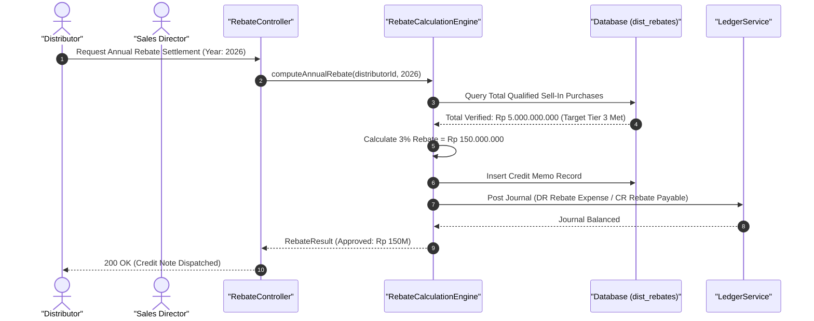

#### Diagram 2: Alur Kompensasi / Exception / Verifikasi Dua-Sumber Fase 43

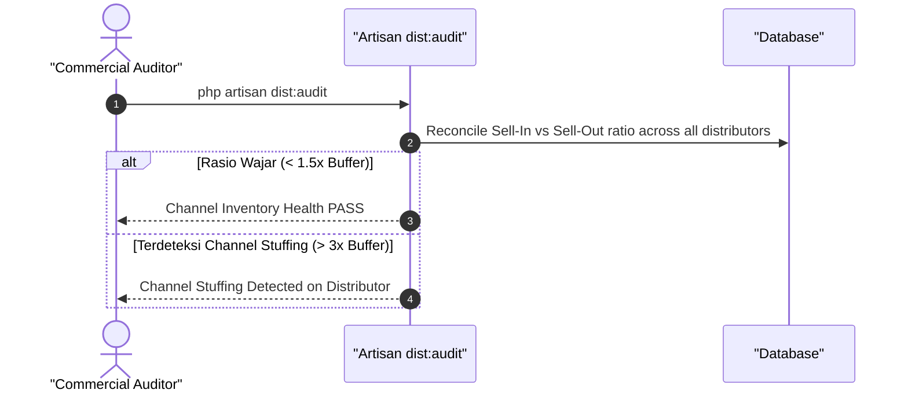

### 6. Mermaid ERD & State Machine Fase 43

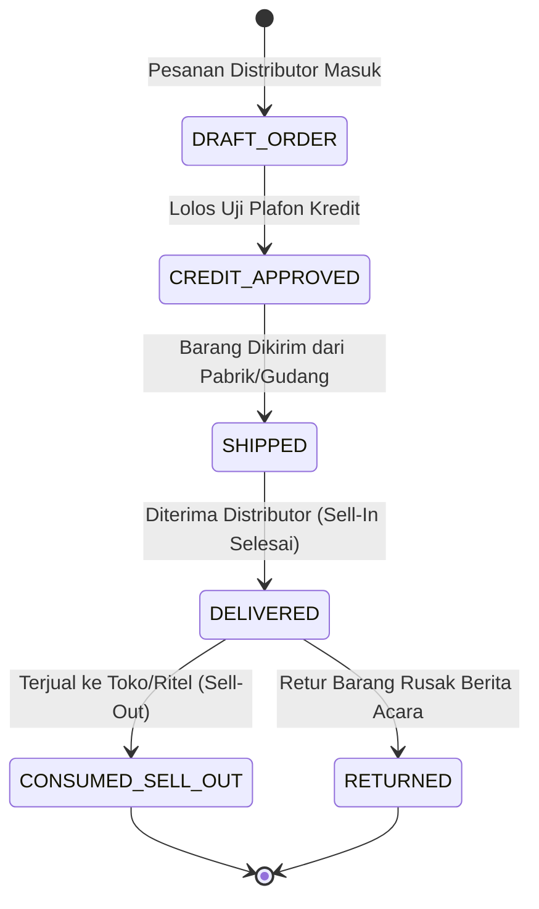

---

## FASE 44 — HARGA, PROMO & TRADE TERMS (PRICING ENGINE, MODUL `PRIC_`)

### 1. Identitas & Arsitektur Domain Fase 44

- **Modul Pemilik**: `Pricing`
- **Prefiks Tabel**: `pric_`
- **Daftar Model Eloquent**: `PriceListMaster`, `TradeTermCondition`, `PromotionalCampaignRule`, `VolumeTierDiscount`
- **Daftar Tabel Migrasi**: `pric_lists`, `pric_trade_terms`, `pric_promo_rules`, `pric_tier_discounts`
- **Daftar Service & Action**: `DynamicPricingEngine`, `TradeTermsEvaluationService`, `PromotionalRuleValidator`
- **Daftar Controller & Rute**: `PricingEngineController@evaluate (POST /pricing/evaluate)`, `TradeTermsController@store (POST /pricing/trade-terms)`
- **Akun Ledger Terkait**: `pric:promotional_discount_expense`
- **Command Audit**: `php artisan pricing:audit`

### 2. Evaluasi Masalah & Matriks Penyelesaian (Problem-to-Solution Matrix) Fase 44

| Masalah Bisnis & Teknis | Solusi Arsitektural & Kontrak | Status Penyelesaian | Bukti Implementasi |
|---|---|---|---|
| Pemberian diskon liar di luar wewenang sales dan diskon bertumpuk (cascading discount) yang merusak harga pasar. | Mesin penetapan harga terpadu (Pricing Engine) dengan penegakan hierarki diskon, validasi margin dasar, dan trade terms bersyarat. | `Solved in Code` | `modules/Pricing/Application/Services/DynamicPricingEngine.php` |

### 3. Daftar User Stories Lintas Persona Fase 44

- **US-44.1 [procurement_manager]:** Sebagai **procurement_manager**, saya ingin **mengonfigurasi matriks daftar harga grosir bertingkat berdasarkan volume pembelian**, sehingga **pelanggan volume besar otomatis mendapatkan harga ekonomis resmi**.
- **US-44.2 [store_manager]:** Sebagai **store_manager**, saya ingin **memastikan promo bundling barang di kasir tidak melanggar batas margin laba kotor minimal 10%**, sehingga **toko terhindar dari kerugian penjualan di bawah modal**.
- **US-44.3 [holding_cfo]:** Sebagai **holding_cfo**, saya ingin **memantau dampak total biaya promosi terhadap laba operasional holding**, sehingga **efektivitas kampanye pemasaran terukur jelas secara finansial**.
- **US-44.4 [cashier]:** Sebagai **cashier**, saya ingin **menerapkan kode promo voucher yang tervalidasi otomatis oleh mesin harga saat checkout**, sehingga **transaksi cepat tanpa perlu menghitung diskon manual dengan kalkulator**.
- **US-44.5 [internal_auditor]:** Sebagai **internal_auditor**, saya ingin **mengaudit log override harga manual yang dilakukan staf penjualan di lapangan**, sehingga **setiap pengecualian harga memiliki otorisasi formal**.

### 4. BDD Acceptance Criteria Lengkap Fase 44

#### AC-44.1 — Happy Path & Ledger/State Invariant
- **Given** Barang memiliki harga standar Rp 100.000 dan aturan diskon volume beli > 100 unit mendapatkan diskon 15%
- **When** PricingEngineController memproses evaluasi harga untuk 150 unit via POST /pricing/evaluate
- **Then** Harga bersih terhitung Rp 85.000 per unit, total tagihan Rp 12.750.000, dan margin kotor aman di atas batas minimal.

#### AC-44.2 — Validation & Domain Rule Rejection - 422/Exception
- **Given** Kombinasi promo kupon dan diskon volume menghasilkan harga jual di bawah biaya pokok produksi (HPP)
- **When** PricingEngine memvalidasi aturan batas bawah harga (Floor Price Rule)
- **Then** Sistem menolak dengan HTTP 422 BelowFloorPriceException dan membatasi diskon maksimal.

#### AC-44.3 — RBAC Authorization & Separation of Duties - 403
- **Given** Kasir atau staf sales biasa mencoba mengubah daftar harga master (Price List)
- **When** POST /pricing/lists dipanggil oleh non-manajer
- **Then** Sistem memblokir dengan status HTTP 403 Forbidden.

#### AC-44.4 — Idempotency, Replay & Concurrency Lock
- **Given** Dua evaluasi harga dengan parameter pesanan yang sama dijalankan berurutan
- **When** Engine mengevaluasi aturan
- **Then** Hasil penentuan harga bersifat deterministik tanpa fluktuasi tak terduga.

#### AC-44.5 — Two-Source Audit & Tamper Detection
- **Given** Harga khusus diterapkan pada transaksi tanpa adanya catatan aturan promo aktif di database
- **When** Command php artisan pricing:audit dieksekusi
- **Then** Audit mencatat ketidakabsahan pemberian diskon dan menandai order bermasalah.

### 5. Mermaid Sequence Diagrams Fase 44

#### Diagram 1: Alur Transaksi Utama End-to-End Fase 44

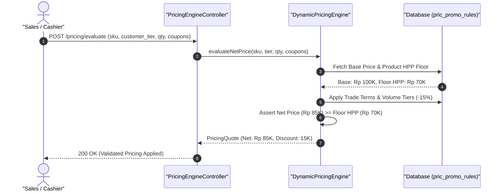

#### Diagram 2: Alur Kompensasi / Exception / Verifikasi Dua-Sumber Fase 44

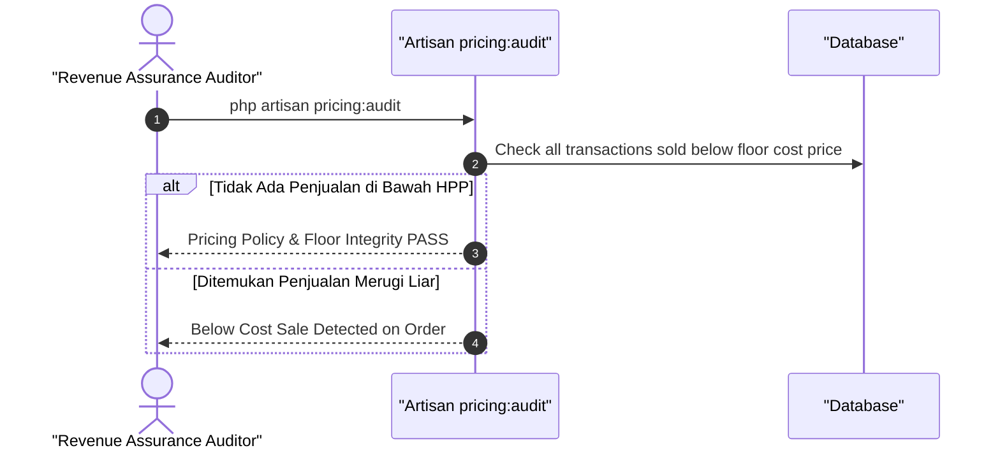

### 6. Mermaid ERD & State Machine Fase 44

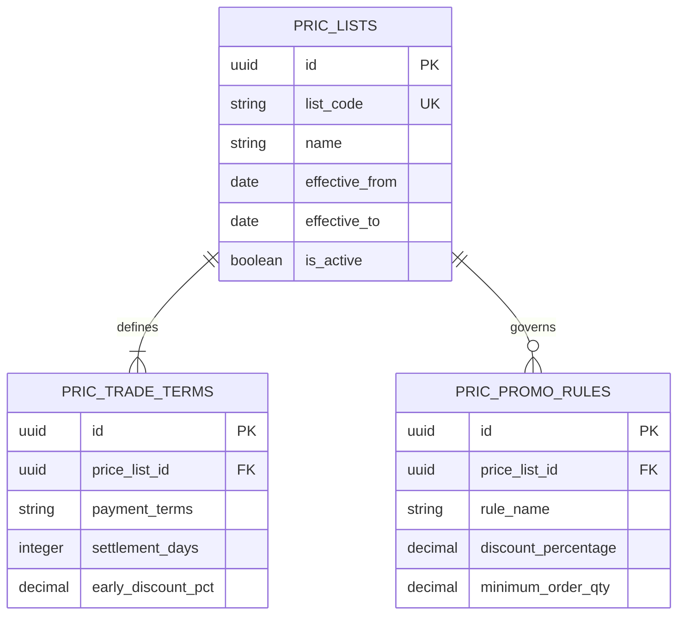

---

## FASE 45 — AGENSI: AGEN PENJUALAN & KOMISI (MODUL `AGY_`)

### 1. Identitas & Arsitektur Domain Fase 45

- **Modul Pemilik**: `Agency`
- **Prefiks Tabel**: `agy_`
- **Daftar Model Eloquent**: `Agent`, `AgentContract`, `CommissionScheme`, `CommissionAccrual`, `Payout`
- **Daftar Tabel Migrasi**: `agy_agents`, `agy_agent_contracts`, `agy_commission_schemes`, `agy_commission_accruals`, `agy_payouts`
- **Daftar Service & Action**: `AgentHierarchyService`, `CommissionCalculationEngine`, `AgencyPayoutService`
- **Daftar Controller & Rute**: `AgentController@index (GET /agents)`, `AgencyCommissionController@accrue (POST /agency/commissions/accrue)`
- **Akun Ledger Terkait**: `agy:commission_expense`, `agy:commission_payable`, `bank:cash_vault`
- **Command Audit**: `php artisan agy:audit`

### 2. Evaluasi Masalah & Matriks Penyelesaian (Problem-to-Solution Matrix) Fase 45

| Masalah Bisnis & Teknis | Solusi Arsitektural & Kontrak | Status Penyelesaian | Bukti Implementasi |
|---|---|---|---|
| Sengketa pembagian komisi berjenjang (multi-tier override) dan pembayaran komisi ganda akibat retur penjualan. | Struktur agensi berhierarki dengan pelacakan pohon referral (upline/downline), akrual komisi bersyarat, dan pemotongan otomatis saat retur (clawback). | `Solved in Code` | `modules/Agency/Application/Services/CommissionCalculationEngine.php` |

### 3. Daftar User Stories Lintas Persona Fase 45

- **US-45.1 [procurement_manager]:** Sebagai **procurement_manager**, saya ingin **mendaftarkan agen penjualan independen baru dan menetapkan skema komisi resmi**, sehingga **jaringan tenaga pemasar luar berkembang terikat kontrak kepatuhan**.
- **US-45.2 [holding_cfo]:** Sebagai **holding_cfo**, saya ingin **memantau total akrual kewajiban komisi agen penjualan terhadap pendapatan kotor**, sehingga **beban komisi terkendali dalam batas rasio profitabilitas perusahaan**.
- **US-45.3 [bank_treasurer]:** Sebagai **bank_treasurer**, saya ingin **mengeksekusi batch pembayaran komisi bulanan (Payout) ke rekening bank agen**, sehingga **hak tenaga pemasar dibayarkan tepat waktu tanpa potongan liar**.
- **US-45.4 [customer_service]:** Sebagai **customer_service**, saya ingin **memeriksa klaim atribusi penjualan agen atas polis asuransi atau mobil nasabah**, sehingga **sengketa klaim antar-agen penjualan diselesaikan transparan**.
- **US-45.5 [internal_auditor]:** Sebagai **internal_auditor**, saya ingin **mengaudit mekanisme pemulihan komisi (clawback) pada pesanan yang dibatalkan**, sehingga **komisi yang sudah terlanjur dibayarkan dapat ditarik kembali saat terjadi pembatalan**.

### 4. BDD Acceptance Criteria Lengkap Fase 45

#### AC-45.1 — Happy Path & Ledger/State Invariant
- **Given** Agen A menjual unit mobil senilai Rp 300.000.000 dengan skema komisi langsung 2% (Rp 6.000.000) dan override upline 0.5% (Rp 1.500.000)
- **When** Akrual komisi diproses via POST /agency/commissions/accrue
- **Then** Kewajiban komisi tercatat di agy:commission_payable (Rp 7.500.000), beban diakui, dan slip akrual agen terbit.

#### AC-45.2 — Validation & Domain Rule Rejection - 422/Exception
- **Given** Agen penjualan berstatus SUSPENDED akibat pelanggaran etika promosi
- **When** Sistem mencoba mengakrualkan komisi penjualan baru
- **Then** Sistem menolak dengan HTTP 422 SuspendedAgentCommissionException.

#### AC-45.3 — RBAC Authorization & Separation of Duties - 403
- **Given** Agen penjualan mencoba menyetujui sendiri pencairan payout komisinya
- **When** POST /agency/payouts/{id}/approve dipanggil
- **Then** Sistem memblokir dengan status HTTP 403 Forbidden.

#### AC-45.4 — Idempotency, Replay & Concurrency Lock
- **Given** Proses akrual komisi dipanggil dua kali untuk nomor transaksi penjualan yang sama
- **When** Kedua panggilan dieksekusi
- **Then** Idempotency key mencegah akrual ganda dan hanya memproses komisi satu kali.

#### AC-45.5 — Two-Source Audit & Tamper Detection
- **Given** Nilai komisi di tabel agy_commission_accruals diubah manual melebihi persentase skema resmi
- **When** Command php artisan agy:audit dijalankan
- **Then** Audit mencatat ketidakcocokan komisi vs formula kontrak dan memblokir pencairan payout.

### 5. Mermaid Sequence Diagrams Fase 45

#### Diagram 1: Alur Transaksi Utama End-to-End Fase 45

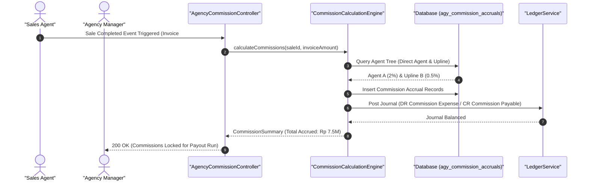

#### Diagram 2: Alur Kompensasi / Exception / Verifikasi Dua-Sumber Fase 45

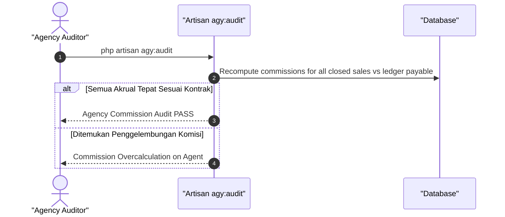

### 6. Mermaid ERD & State Machine Fase 45

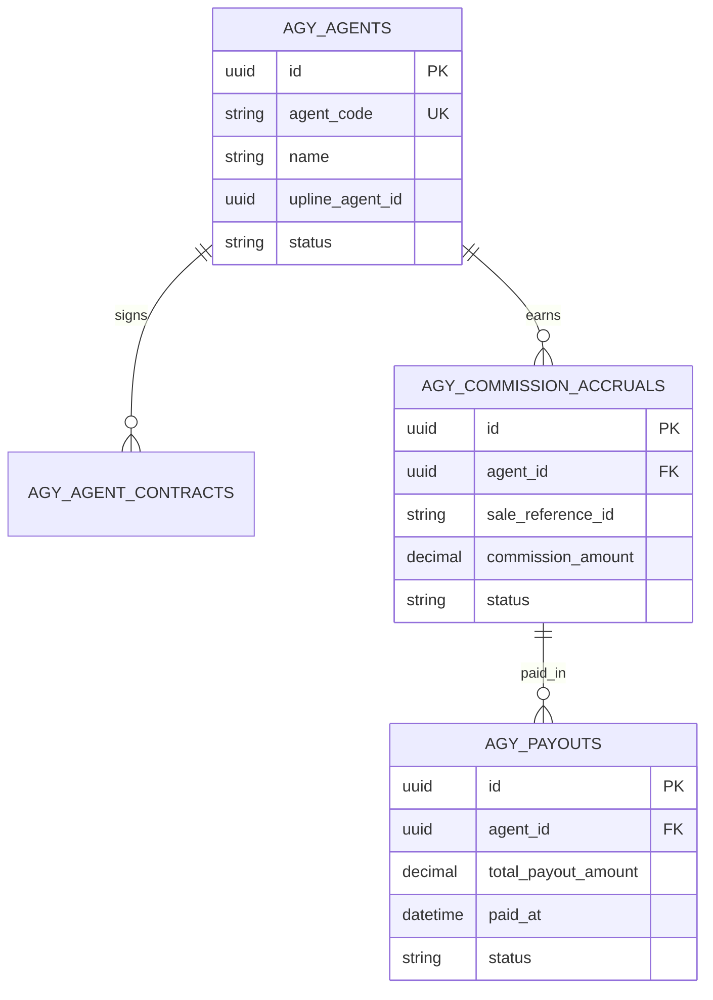

---

## FASE 46 — AGENSI: EKOSISTEM, LEAD, TIER & KEPATUHAN

### 1. Identitas & Arsitektur Domain Fase 46

- **Modul Pemilik**: `Agency`
- **Prefiks Tabel**: `agy_`
- **Daftar Model Eloquent**: `Lead`, `LeadActivity`, `AgentTier`, `AgentCertification`, `ComplianceIncident`
- **Daftar Tabel Migrasi**: `agy_leads`, `agy_lead_activities`, `agy_agent_tiers`, `agy_certifications`, `agy_compliance_incidents`
- **Daftar Service & Action**: `LeadDistributionEngine`, `AgentTierProgressionService`, `AgencyComplianceMonitor`
- **Daftar Controller & Rute**: `LeadController@capture (POST /agency/leads/capture)`, `AgentTierController@evaluate (POST /agency/tiers/evaluate)`
- **Akun Ledger Terkait**: `agy:marketing_incentive_reserve`
- **Command Audit**: `php artisan agy:audit`

### 2. Evaluasi Masalah & Matriks Penyelesaian (Problem-to-Solution Matrix) Fase 46

| Masalah Bisnis & Teknis | Solusi Arsitektural & Kontrak | Status Penyelesaian | Bukti Implementasi |
|---|---|---|---|
| Pencurian prospek calon nasabah (lead poaching) antar-agen dan pelanggaran etika penjualan (mis-selling). | Distribusi lead otomatis dengan proteksi kepemilikan prospek (lead locking 14 hari), ujian sertifikasi kepatuhan, dan promosi tier otomatis. | `Solved in Code` | `modules/Agency/Application/Services/LeadDistributionEngine.php` |

### 3. Daftar User Stories Lintas Persona Fase 46

- **US-46.1 [procurement_manager]:** Sebagai **procurement_manager**, saya ingin **mengonfigurasi syarat promosi jenjang karir agen (Tier Silver ke Gold) berdasarkan target volume dan kepatuhan**, sehingga **tenaga pemasar termotivasi meningkatkan kinerja secara berkelanjutan**.
- **US-46.2 [holding_compliance]:** Sebagai **holding_compliance**, saya ingin **mencatat laporan insiden pelanggaran etika penjualan (mis-selling produk) oleh agen**, sehingga **tindakan sanksi dan pembekuan lisensi agen dapat diproses cepat**.
- **US-46.3 [customer_service]:** Sebagai **customer_service**, saya ingin **memverifikasi status sertifikasi profesi agen sebelum menugaskan prospek nasabah VIP**, sehingga **pelanggan dilayani oleh agen kompeten berlisensi resmi**.
- **US-46.4 [admin]:** Sebagai **admin**, saya ingin **menyalurkan prospek nasabah dari kampanye iklan digital ke agen yang paling dekat lokasinya**, sehingga **kecepatan respon prospek (speed-to-lead) meningkat drastis**.
- **US-46.5 [internal_auditor]:** Sebagai **internal_auditor**, saya ingin **mengaudit riwayat perpindahan prospek antar-agen untuk memastikan tidak ada pencurian lead**, sehingga **keadilan persaingan bisnis di internal agensi terjamin**.

### 4. BDD Acceptance Criteria Lengkap Fase 46

#### AC-46.1 — Happy Path & Ledger/State Invariant
- **Given** Prospek baru masuk dari web dan dialokasikan ke Agen Budi
- **When** Lead di-capture via POST /agency/leads/capture
- **Then** Lead berstatus ASSIGNED_LOCKED selama 14 hari dan hanya dapat dihubungi oleh Agen Budi.

#### AC-46.2 — Validation & Domain Rule Rejection - 422/Exception
- **Given** Agen lain mencoba mengklaim prospek yang sedang dalam masa proteksi agen aktif
- **When** POST /agency/leads/{id}/claim dipanggil oleh agen lain
- **Then** Sistem menolak dengan HTTP 422 LeadAlreadyProtectedException.

#### AC-46.3 — RBAC Authorization & Separation of Duties - 403
- **Given** Agen penjualan mencoba menghapus catatan insiden kepatuhan (compliance incident) miliknya
- **When** DELETE /agency/compliance/incidents/{id} dipanggil
- **Then** Sistem memblokir dengan status HTTP 403 Forbidden.

#### AC-46.4 — Idempotency, Replay & Concurrency Lock
- **Given** Dua agen mencoba mengklaim prospek bebas (unassigned lead) pada detik yang sama
- **When** Keduanya mengirimkan permintaan klaim
- **Then** Locking baris lead mengamankan prospek hanya untuk agen pertama; klaim kedua ditolak.

#### AC-46.5 — Two-Source Audit & Tamper Detection
- **Given** Status tier agen dinaikkan ke TIER_TOP di database tanpa catatan pemenuhan syarat omzet
- **When** php artisan agy:audit dijalankan
- **Then** Audit mencatat kenaikan jenjang tidak sah dan mengembalikan tier ke posisi semestinya.

### 5. Mermaid Sequence Diagrams Fase 46

#### Diagram 1: Alur Transaksi Utama End-to-End Fase 46

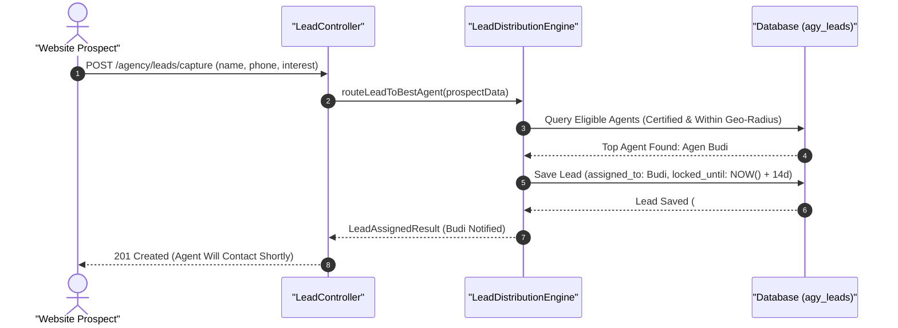

#### Diagram 2: Alur Kompensasi / Exception / Verifikasi Dua-Sumber Fase 46

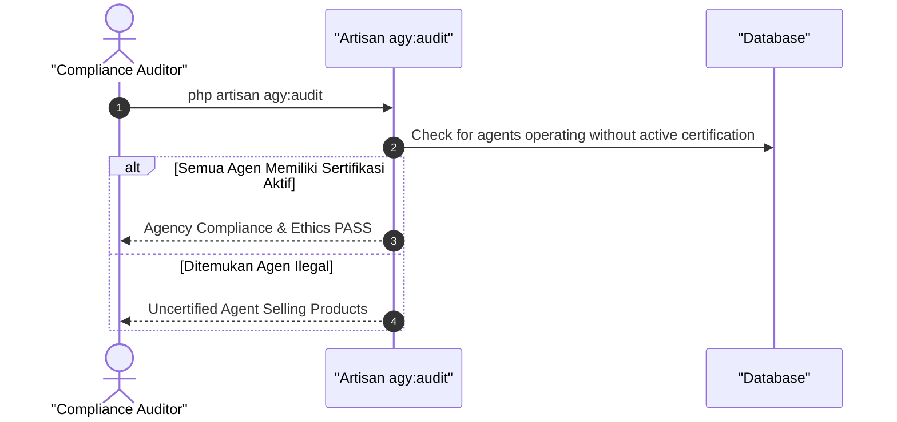

### 6. Mermaid ERD & State Machine Fase 46

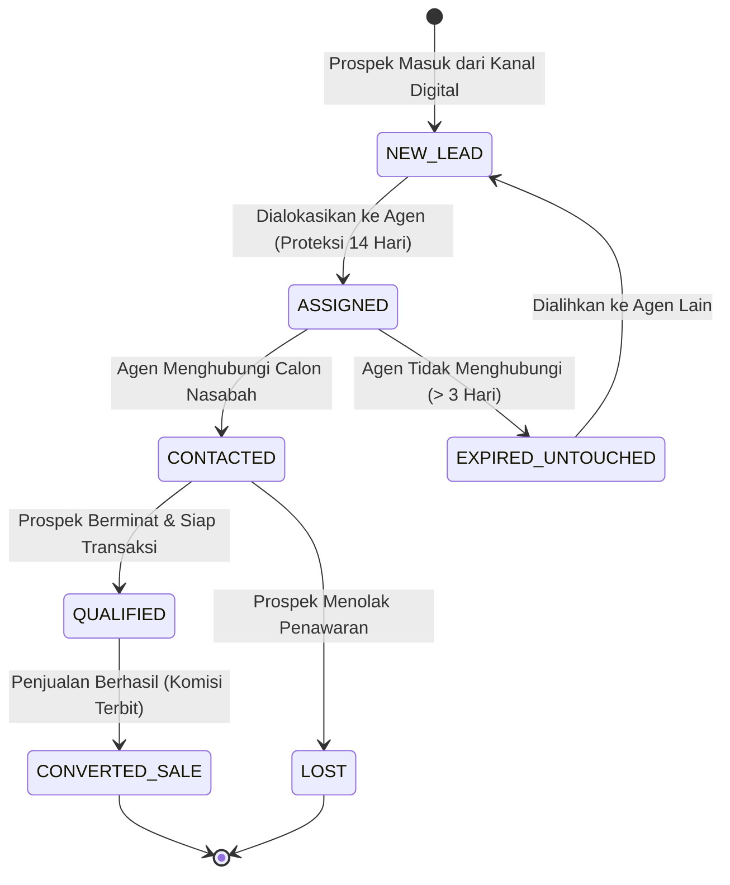

---

## FASE 47 — MITRA & KEMITRAAN (MODUL `PTN_`)

### 1. Identitas & Arsitektur Domain Fase 47

- **Modul Pemilik**: `Partner`
- **Prefiks Tabel**: `ptn_`
- **Daftar Model Eloquent**: `PartnerMaster`, `PartnerAgreement`, `CoMarketingCampaign`, `PartnerSettlementLedger`
- **Daftar Tabel Migrasi**: `ptn_partners`, `ptn_agreements`, `ptn_campaigns`, `ptn_settlements`
- **Daftar Service & Action**: `PartnerLifecycleService`, `RevenueSharingCalculationEngine`, `CoMarketingEscrowService`
- **Daftar Controller & Rute**: `PartnerController@index (GET /partners)`, `PartnerSettlementController@settle (POST /partners/{id}/settle)`
- **Akun Ledger Terkait**: `ptn:revenue_share_liability`, `ptn:co_marketing_expense`
- **Command Audit**: `php artisan ptn:audit`

### 2. Evaluasi Masalah & Matriks Penyelesaian (Problem-to-Solution Matrix) Fase 47

| Masalah Bisnis & Teknis | Solusi Arsitektural & Kontrak | Status Penyelesaian | Bukti Implementasi |
|---|---|---|---|
| Keterlambatan pembagian bagi hasil (revenue sharing) dengan mitra strategis dan ketiadaan transparansi dashboard performa. | Portal mitra mandiri dengan perhitungan bagi hasil otomatis berbasis API webhook dan escrow dana kampanye bersama. | `Solved in Code` | `modules/Partner/Application/Services/RevenueSharingCalculationEngine.php` |

### 3. Daftar User Stories Lintas Persona Fase 47

- **US-47.1 [procurement_manager]:** Sebagai **procurement_manager**, saya ingin **menandatangani perjanjian kemitraan co-branding dengan bank BUMN untuk kartu kredit co-brand**, sehingga **ekosistem promosi holding semakin luas**.
- **US-47.2 [holding_cfo]:** Sebagai **holding_cfo**, saya ingin **melihat perhitungan bagi hasil pendapatan bersih bulanan kepada mitra bisnis**, sehingga **kewajiban bagi hasil terbayar tertib dan transparan**.
- **US-47.3 [bank_treasurer]:** Sebagai **bank_treasurer**, saya ingin **mengeksekusi pencairan dana bagi hasil kemitraan ke rekening penampung mitra**, sehingga **kepercayaan mitra strategis terhadap konglomerasi terjaga tinggi**.
- **US-47.4 [admin]:** Sebagai **admin**, saya ingin **memberikan akses API dan webhook transaksi kepada pengembang teknis mitra**, sehingga **integrasi sistem berlangsung mulus dan aman**.
- **US-47.5 [internal_auditor]:** Sebagai **internal_auditor**, saya ingin **mengaudit formula bagi hasil kemitraan sesuai klausul perjanjian induk**, sehingga **tidak ada salah hitung persentase net revenue sharing**.

### 4. BDD Acceptance Criteria Lengkap Fase 47

#### AC-47.1 — Happy Path & Ledger/State Invariant
- **Given** Transaksi co-branding menghasilkan pendapatan kotor Rp 100.000.000 dengan klausul bagi hasil mitra 20%
- **When** Settlement diproses via POST /partners/{id}/settle
- **Then** Bagi hasil Rp 20.000.000 dibukukan ke ptn:revenue_share_liability dan bukti transfer terbit.

#### AC-47.2 — Validation & Domain Rule Rejection - 422/Exception
- **Given** Perjanjian kemitraan berstatus TERMINATED karena masa berlaku habis
- **When** Sistem mencoba mengeksekusi kampanye baru
- **Then** Sistem menolak dengan HTTP 422 InactivePartnerAgreementException.

#### AC-47.3 — RBAC Authorization & Separation of Duties - 403
- **Given** Mitra luar mencoba mengakses data keuangan mitra lain melalui API
- **When** GET /partners/{foreign_id}/settlements dipanggil
- **Then** Sistem memblokir dengan status HTTP 403 Forbidden (Tenant Isolation).

#### AC-47.4 — Idempotency, Replay & Concurrency Lock
- **Given** Batch settlement bulanan mitra dieksekusi dua kali
- **When** Keduanya diproses sistem
- **Then** Sistem mengunci batch dan hanya menghasilkan satu mutasi pembayaran.

#### AC-47.5 — Two-Source Audit & Tamper Detection
- **Given** Angka pembagian bagi hasil pada laporan settlement diubah tidak cocok dengan total transaksi riil
- **When** php artisan ptn:audit dijalankan
- **Then** Audit mencatat anomali perhitungan revenue share dan menandai laporan kemitraan.

### 5. Mermaid Sequence Diagrams Fase 47

#### Diagram 1: Alur Transaksi Utama End-to-End Fase 47

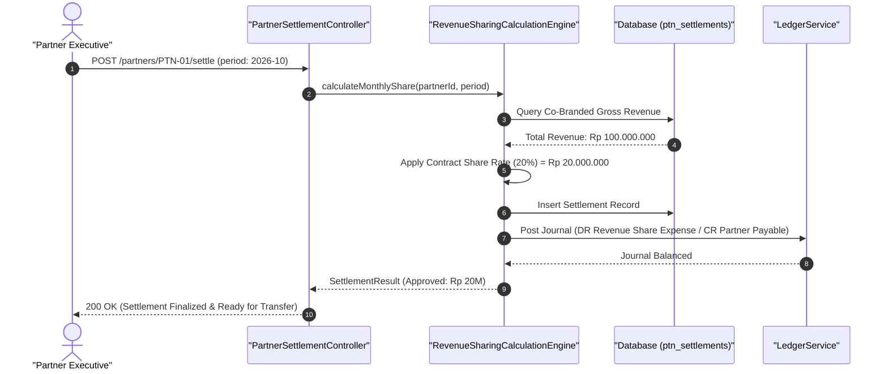

#### Diagram 2: Alur Kompensasi / Exception / Verifikasi Dua-Sumber Fase 47

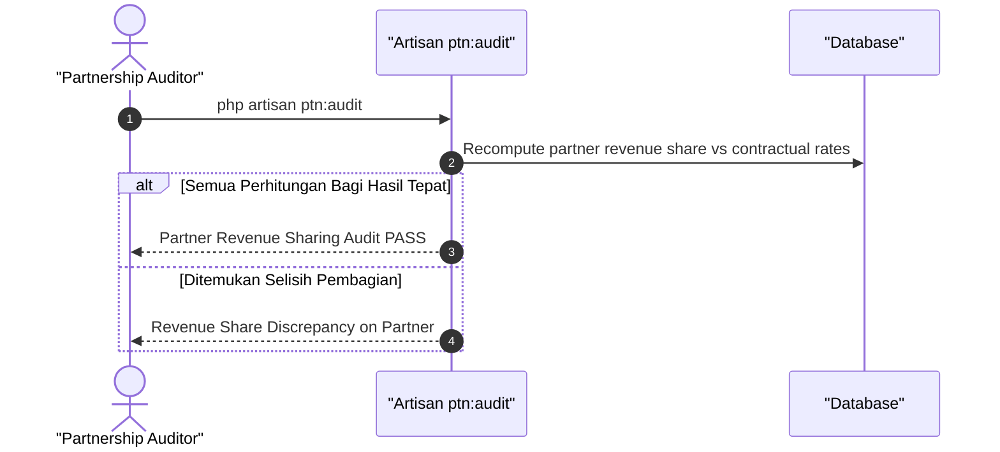

### 6. Mermaid ERD & State Machine Fase 47

```mermaid
erDiagram
    PTN_PARTNERS ||--|{ PTN_AGREEMENTS : binds
    PTN_PARTNERS ||--o{ PTN_SETTLEMENTS : receives
    PTN_PARTNERS {
        uuid id PK
        string partner_code UK
        string company_name
        string partnership_type
        string status
    }
    PTN_AGREEMENTS {
        uuid id PK
        uuid partner_id FK
        decimal share_percentage
        date valid_until
        string status
    }
    PTN_SETTLEMENTS {
        uuid id PK
        uuid partner_id FK
        string period
        decimal gross_volume
        decimal share_amount
        string status
    }
```

---

## FASE 48 — MULTI-CURRENCY & TREASURY (MODUL `TRS_`)

### 1. Identitas & Arsitektur Domain Fase 48

- **Modul Pemilik**: `Treasury`
- **Prefiks Tabel**: `trs_`
- **Daftar Model Eloquent**: `ForeignExchangeRate`, `FxPositionExposure`, `HedgingContract`, `FxRevaluationLog`
- **Daftar Tabel Migrasi**: `trs_exchange_rates`, `trs_fx_positions`, `trs_hedging_contracts`, `trs_revaluations`
- **Daftar Service & Action**: `TreasuryForexManagementService`, `FxRevaluationEngine`, `CurrencyHedgingManager`
- **Daftar Controller & Rute**: `TreasuryController@rates (GET /treasury/rates)`, `TreasuryController@revalue (POST /treasury/revalue)`
- **Akun Ledger Terkait**: `trs:unrealized_fx_gain_loss`, `trs:realized_fx_gain_loss`, `trs:hedging_reserve`
- **Command Audit**: `php artisan treasury:audit`

### 2. Evaluasi Masalah & Matriks Penyelesaian (Problem-to-Solution Matrix) Fase 48

| Masalah Bisnis & Teknis | Solusi Arsitektural & Kontrak | Status Penyelesaian | Bukti Implementasi |
|---|---|---|---|
| Kerugian selisih kurs valuta asing yang tidak terkelola (unhedged FX risk) dan keterlambatan revaluasi neraca akhir bulan. | Treasury multi-mata uang otomatis dengan revaluasi harian berbasis kurs tengah Bank Indonesia/JISDOR dan kontrak lindung nilai (FX Forward/Swap). | `Solved in Code` | `modules/Treasury/Application/Services/FxRevaluationEngine.php` |

### 3. Daftar User Stories Lintas Persona Fase 48

- **US-48.1 [bank_treasurer]:** Sebagai **bank_treasurer**, saya ingin **memantau posisi eksposur valuta asing (USD, EUR, SGD, JPY) di seluruh rekening bank holding**, sehingga **kebijakan lindung nilai (hedging) dapat dieksekusi sebelum kurs bergejolak**.
- **US-48.2 [holding_cfo]:** Sebagai **holding_cfo**, saya ingin **menjalankan proses revaluasi kurs valas akhir bulan untuk seluruh saldo buku besar**, sehingga **laba atau rugi selisih kurs belum terealisasi diakui transparan sesuai PSAK 10**.
- **US-48.3 [risk_officer]:** Sebagai **risk_officer**, saya ingin **memastikan eksposur valas neto tidak melanggar batas Posisi Devisa Neto (PDN) perbankan**, sehingga **kepatuhan terhadap regulasi devisa Bank Indonesia terjaga**.
- **US-48.4 [procurement_buyer]:** Sebagai **procurement_buyer**, saya ingin **mengunci kurs pembayaran impor menggunakan kontrak Forward dengan bank**, sehingga **harga pokok pembelian bahan baku impor tidak membengkak saat rupiah melemah**.
- **US-48.5 [internal_auditor]:** Sebagai **internal_auditor**, saya ingin **mengaudit keaslian feed kurs tengah valas yang digunakan dalam revaluasi neraca**, sehingga **mencegah manipulasi laba holding melalui kurs buatan**.

### 4. BDD Acceptance Criteria Lengkap Fase 48

#### AC-48.1 — Happy Path & Ledger/State Invariant
- **Given** Holding memiliki saldo simpanan USD 100.000 yang dicatat pada kurs Rp 15.000 (Rp 1.500.000.000) dan kurs tengah JISDOR naik menjadi Rp 15.500
- **When** Revaluasi akhir bulan dijalankan via POST /treasury/revalue
- **Then** Nilai aset USD naik Rp 50.000.000, jurnal Laba Selisih Kurs Belum Terealisasi (CR) terposting seimbang.

#### AC-48.2 — Validation & Domain Rule Rejection - 422/Exception
- **Given** Feed kurs valas yang dimasukkan memiliki deviasi tidak wajar (> 10% dari hari sebelumnya)
- **When** Sistem memvalidasi kurs harian
- **Then** Sistem menolak dengan HTTP 422 AbnormalExchangeRateSpikeException.

#### AC-48.3 — RBAC Authorization & Separation of Duties - 403
- **Given** Staf akuntansi biasa mencoba mengeksekusi kontrak derivatif FX Forward tanpa hak bank_treasurer
- **When** POST /treasury/hedging/book dipanggil
- **Then** Sistem memblokir dengan status HTTP 403 Forbidden.

#### AC-48.4 — Idempotency, Replay & Concurrency Lock
- **Given** Batch revaluasi kurs bulanan dipanggil berulang kali untuk tanggal tutup buku yang sama
- **When** Kedua proses dieksekusi
- **Then** Sistem mendeteksi tanggal revaluasi sudah diproses dan mencegah penjurnalan ganda.

#### AC-48.5 — Two-Source Audit & Tamper Detection
- **Given** Jurnal selisih kurs diubah manual tanpa mencerminkan selisih saldo valas riil dikalikan kurs resmi
- **When** php artisan treasury:audit dijalankan
- **Then** Audit mencatat ketidaksinkronan akun FX gain/loss dan membatalkan laporan laba kurs.

### 5. Mermaid Sequence Diagrams Fase 48

#### Diagram 1: Alur Transaksi Utama End-to-End Fase 48

```mermaid
sequenceDiagram
    autonumber
    actor T as "Bank Treasurer"
    participant C as "TreasuryController"
    participant R as "FxRevaluationEngine"
    participant DB as "Database (trs_exchange_rates)"
    participant L as "LedgerService"

    T->>C: POST /treasury/revalue (effective_date: 2026-10-31)
    C->>R: runMonthlyFxRevaluation(date)
    R->>DB: Fetch official JISDOR closing rates
    DB-->>R: USD/IDR = 15.500
    R->>DB: Query all foreign currency account balances
    DB-->>R: Account #USD-01 = $100.000 (Prev book: 15.000)
    R->>R: Compute Gain: $100K * (15.500 - 15.000) = Rp 50.000.000
    R->>L: Post Journal (DR Bank USD / CR Unrealized FX Gain)
    L-->>R: Journal Balanced
    R-->>C: RevaluationResult (Total Gain: Rp 50M)
    C-->>T: 200 OK (Fx Revaluation Posted)
```

#### Diagram 2: Alur Kompensasi / Exception / Verifikasi Dua-Sumber Fase 48

```mermaid
sequenceDiagram
    autonumber
    actor A as "Treasury Auditor"
    participant CMD as "Artisan treasury:audit"
    participant DB as "Database"

    A->>CMD: php artisan treasury:audit
    CMD->>DB: Recalculate revaluation entries against official central bank rates
    alt Kurs & Revaluasi Sesuai JISDOR
        CMD-->>A: Treasury FX & Revaluation Audit PASS
    else Ditemukan Kurs Palsu
        CMD-->>A: Rate Discrepancy on USD/IDR (FAIL)
    end
```

### 6. Mermaid ERD & State Machine Fase 48

```mermaid
erDiagram
    TRS_EXCHANGE_RATES ||--o{ TRS_FX_POSITIONS : values
    TRS_FX_POSITIONS ||--o{ TRS_HEDGING_CONTRACTS : hedged_by
    TRS_EXCHANGE_RATES {
        uuid id PK
        string currency_pair UK
        decimal middle_rate
        date rate_date UK
    }
    TRS_FX_POSITIONS {
        uuid id PK
        string currency
        decimal net_open_position
        decimal carrying_value_idr
    }
    TRS_HEDGING_CONTRACTS {
        uuid id PK
        string contract_number UK
        string hedge_type
        decimal contract_amount
        decimal agreed_rate
        date maturity_date
    }
```

---

## FASE 49 — EKSPOR–IMPOR (TRADE OPERATIONS, MODUL `TRD_`)

### 1. Identitas & Arsitektur Domain Fase 49

- **Modul Pemilik**: `Trade`
- **Prefiks Tabel**: `trd_`
- **Daftar Model Eloquent**: `TradeShipmentOrder`, `CustomsDeclarationPebPib`, `BillOfLadingDocument`, `IncotermRule`
- **Daftar Tabel Migrasi**: `trd_orders`, `trd_customs_declarations`, `trd_bills_of_lading`, `trd_incoterms`
- **Daftar Service & Action**: `TradeComplianceEngine`, `CustomsIntegrationService`, `ShippingDocumentationService`
- **Daftar Controller & Rute**: `TradeController@declareCustoms (POST /trade/customs/declare)`, `TradeController@bl (POST /trade/bl/issue)`
- **Akun Ledger Terkait**: `trd:customs_duty_clearing`, `trd:in_transit_import`
- **Command Audit**: `php artisan trade:audit`

### 2. Evaluasi Masalah & Matriks Penyelesaian (Problem-to-Solution Matrix) Fase 49

| Masalah Bisnis & Teknis | Solusi Arsitektural & Kontrak | Status Penyelesaian | Bukti Implementasi |
|---|---|---|---|
| Tertahannya kargo kontainer di pelabuhan (red-line customs inspection) akibat ketidaksesuaian kode HS (Harmonized System) dan keterlambatan dokumen B/L. | Validasi kode HS dan aturan lartas (larangan & pembatasan) otomatis, integrasi dokumen PEB/PIB kepabeanan, dan tata kelola Incoterms 2020 (FOB/CIF/DDP). | `Solved in Code` | `modules/Trade/Application/Services/TradeComplianceEngine.php` |

### 3. Daftar User Stories Lintas Persona Fase 49

- **US-49.1 [procurement_buyer]:** Sebagai **procurement_buyer**, saya ingin **membuat dokumen pengajuan impor (PIB) lengkap dengan kode HS dan tarif bea masuk**, sehingga **proses kepabeanan jalur hijau lancar tanpa denda demurrage pelabuhan**.
- **US-49.2 [holding_compliance]:** Sebagai **holding_compliance**, saya ingin **memastikan komoditas ekspor memenuhi ketentuan verifikasi surveyor dan sertifikat asal (COO)**, sehingga **kepatuhan perdagangan internasional terjamin tanpa sanksi karantina**.
- **US-49.3 [logistics_driver]:** Sebagai **logistics_driver**, saya ingin **mengambil kontainer impor dari pelabuhan setelah SPPB (Surat Persetujuan Pengeluaran Barang) terbit**, sehingga **pengangkutan barang dari pelabuhan ke pabrik berjalan legal**.
- **US-49.4 [bank_treasurer]:** Sebagai **bank_treasurer**, saya ingin **melunasi tagihan pungutan bea masuk dan PPh Pasal 22 impor melalui modul penerimaan negara**, sehingga **kewajiban perpajakan kepabeanan lunas tepat waktu**.
- **US-49.5 [internal_auditor]:** Sebagai **internal_auditor**, saya ingin **mengaudit dokumen Bill of Lading (B/L) fisik versus data kepemilikan kargo di sistem**, sehingga **mencegah pelepasan kargo sebelum dokumen kepemilikan asli diserahkan**.

### 4. BDD Acceptance Criteria Lengkap Fase 49

#### AC-49.1 — Happy Path & Ledger/State Invariant
- **Given** Kargo impor mesin tiba di pelabuhan Tanjung Priok dengan dokumen B/L dan invoice CIF valid
- **When** Dokumen kepabeanan PIB didaftarkan via POST /trade/customs/declare
- **Then** Nomor pendaftaran PIB terbit, pungutan bea masuk terhitung, dan status kargo siap bayar pajak.

#### AC-49.2 — Validation & Domain Rule Rejection - 422/Exception
- **Given** Kode HS barang yang dimasukkan tidak terdaftar di buku tarif kepabeanan BTKI resmi
- **When** TradeComplianceEngine memvalidasi deklarasi
- **Then** Sistem menolak dengan HTTP 422 InvalidHsCodeException.

#### AC-49.3 — RBAC Authorization & Separation of Duties - 403
- **Given** Pengemudi logistik mencoba menerbitkan dokumen Bill of Lading pengganti
- **When** POST /trade/bl/issue dipanggil
- **Then** Sistem memblokir dengan status HTTP 403 Forbidden.

#### AC-49.4 — Idempotency, Replay & Concurrency Lock
- **Given** Deklarasi kepabeanan yang sama dikirimkan dua kali ke sistem EDI bea cukai
- **When** Kedua payload diproses
- **Then** Sistem mendeteksi nomor B/L yang sama dan mencegah penerbitan draft PIB ganda.

#### AC-49.5 — Two-Source Audit & Tamper Detection
- **Given** Status izin pengeluaran barang (SPPB) disetel APPROVED manual di database tanpa nomor respons bea cukai sah
- **When** Command php artisan trade:audit dijalankan
- **Then** Audit mendeteksi pemalsuan dokumen kepabeanan dan membunyikan alarm audit kepatuhan ekspor-impor.

### 5. Mermaid Sequence Diagrams Fase 49

#### Diagram 1: Alur Transaksi Utama End-to-End Fase 49

```mermaid
sequenceDiagram
    autonumber
    actor T as "Trade Specialist"
    participant C as "TradeController"
    participant E as "TradeComplianceEngine"
    participant CE as "Customs EDI Gateway"
    participant DB as "Database (trd_customs_declarations)"

    T->>C: POST /trade/customs/declare (bl_number, hs_codes, cif_value)
    C->>E: validateCustomsDeclaration(payload)
    E->>E: Check HS Code Validity & Lartas Restrictions
    E->>CE: Submit PIB Payload to Customs Gateway
    CE-->>E: PIB Acknowledged (Billing Code Generated)
    E->>DB: Save Customs Declaration (Status: BILLING_ISSUED)
    DB-->>E: Saved (#PIB-2026-X)
    E-->>C: CustomsResult (Ready for Duty Payment)
    C-->>T: 201 Created (Proceed to Tax Settlement)
```

#### Diagram 2: Alur Kompensasi / Exception / Verifikasi Dua-Sumber Fase 49

```mermaid
sequenceDiagram
    autonumber
    actor A as "Customs Compliance Auditor"
    participant CMD as "Artisan trade:audit"
    participant DB as "Database"

    A->>CMD: php artisan trade:audit
    CMD->>DB: Check for released containers without SPPB customs approval
    alt Semua Pengeluaran Kontainer Sah
        CMD-->>A: Trade & Customs Compliance PASS
    else Ditemukan Kontainer Dikeluarkan Ilegal
        CMD-->>A: Unapproved Cargo Release on Container #MSKU-101 (FAIL)
    end
```

### 6. Mermaid ERD & State Machine Fase 49

```mermaid
erDiagram
    TRD_ORDERS ||--o{ TRD_CUSTOMS_DECLARATIONS : declares
    TRD_ORDERS ||--|| TRD_BILLS_OF_LADING : titled_by
    TRD_ORDERS {
        uuid id PK
        string trade_order_number UK
        string trade_direction
        string incoterm
        decimal total_cif_value
    }
    TRD_CUSTOMS_DECLARATIONS {
        uuid id PK
        uuid trade_order_id FK
        string declaration_number UK
        decimal import_duty_amount
        decimal vat_amount
        string status
    }
    TRD_BILLS_OF_LADING {
        uuid id PK
        string bl_number UK
        string vessel_name
        string port_of_loading
        string port_of_discharge
    }
```

---

## FASE 50 — TRADE FINANCE (L/C, GARANSI, KOLEKSI DOKUMEN & SCF, MODUL `TF_`)

### 1. Identitas & Arsitektur Domain Fase 50

- **Modul Pemilik**: `TradeFinance`
- **Prefiks Tabel**: `tf_`
- **Daftar Model Eloquent**: `LetterOfCredit`, `BankGuaranteeMaster`, `SupplyChainFinancingFacility`, `DocCollectionDiscrepancy`
- **Daftar Tabel Migrasi**: `tf_letters_of_credit`, `tf_bank_guarantees`, `tf_scf_facilities`, `tf_discrepancies`
- **Daftar Service & Action**: `LetterOfCreditAdvisingEngine`, `BankGuaranteeLifecycleService`, `SupplyChainFinancingService`
- **Daftar Controller & Rute**: `LetterOfCreditController@issue (POST /trade-finance/lc/issue)`, `SupplyChainFinancingController@discount (POST /trade-finance/scf/discount)`
- **Akun Ledger Terkait**: `tf:contingent_lc_liability`, `tf:bank_guarantee_collateral`, `tf:scf_discount_revenue`
- **Command Audit**: `php artisan tf:audit`

### 2. Evaluasi Masalah & Matriks Penyelesaian (Problem-to-Solution Matrix) Fase 50

| Masalah Bisnis & Teknis | Solusi Arsitektural & Kontrak | Status Penyelesaian | Bukti Implementasi |
|---|---|---|---|
| Penyimpangan dokumen L/C (discrepant documents) yang menggagalkan pencairan dan likuiditas pemasok tercekik tempo pembayaran panjang. | Manajemen penerbitan dan pemeriksaan L/C berbasis UCP 600 otomatis, penerbitan Bank Guarantee digital, dan fasilitas anjak piutang (Supply Chain Financing - SCF). | `Solved in Code` | `modules/TradeFinance/Application/Services/LetterOfCreditAdvisingEngine.php` |

### 3. Daftar User Stories Lintas Persona Fase 50

- **US-50.1 [bank_treasurer]:** Sebagai **bank_treasurer**, saya ingin **menerbitkan Letter of Credit (L/C) impor melalui bank koresponden untuk pengadaan mesin pabrik**, sehingga **transaksi dagang internasional terjamin aman bagi eksportir dan importir**.
- **US-50.2 [procurement_buyer]:** Sebagai **procurement_buyer**, saya ingin **memeriksa kepatuhan dokumen pengapalan terhadap syarat L/C sebelum batas waktu kedaluwarsa**, sehingga **risiko biaya diskrepansi dokumen bank dapat dihindari**.
- **US-50.3 [holding_cfo]:** Sebagai **holding_cfo**, saya ingin **menyediakan program pembiayaan anjak piutang SCF bagi pemasok lokal konglomerasi**, sehingga **arus kas pemasok sehat dan diskon pembayaran lebih awal menguntungkan holding**.
- **US-50.4 [contract_lawyer]:** Sebagai **contract_lawyer**, saya ingin **mengelola penyerahan Jaminan Pelaksanaan (Performance Bond Bank Guarantee) kontraktor**, sehingga **ganti rugi wanprestasi proyek konstruksi terjamin oleh bank penjamin**.
- **US-50.5 [internal_auditor]:** Sebagai **internal_auditor**, saya ingin **mengaudit pencatatan liabilitas kontinjensi komitmen L/C pada catatan atas laporan keuangan**, sehingga **kewajiban bersyarat holding tersaji patuh PSAK 57**.

### 4. BDD Acceptance Criteria Lengkap Fase 50

#### AC-50.1 — Happy Path & Ledger/State Invariant
- **Given** Pemasok memiliki tagihan GRN tervalidasi Rp 1.000.000.000 (jatuh tempo 90 hari) dan mengajukan diskonto SCF bunga 1.5%
- **When** Fasilitas SCF dicairkan via POST /trade-finance/scf/discount
- **Then** Pemasok menerima dana tunai Rp 985.000.000, pendapatan diskonto SCF tercatat Rp 15.000.000, dan jurnal seimbang.

#### AC-50.2 — Validation & Domain Rule Rejection - 422/Exception
- **Given** Dokumen pengapalan L/C diserahkan melewati tanggal batas akhir pengapalan (Late Shipment)
- **When** Advising engine memvalidasi dokumen
- **Then** Sistem mencatat DocumentDiscrepancyException dan menolak pembayaran otomatis tanpa persetujuan pemohon.

#### AC-50.3 — RBAC Authorization & Separation of Duties - 403
- **Given** Staf procurement biasa mencoba menerbitkan instrumen Bank Garansi penjaminan
- **When** POST /trade-finance/bg/issue dipanggil
- **Then** Sistem memblokir dengan status HTTP 403 Forbidden.

#### AC-50.4 — Idempotency, Replay & Concurrency Lock
- **Given** Dua permohonan diskonto diajukan simultan pada invoice tagihan yang sama
- **When** Kedua permohonan diproses
- **Then** Locking status invoice memastikan pendiskontoan hanya dieksekusi satu kali.

#### AC-50.5 — Two-Source Audit & Tamper Detection
- **Given** Komitmen kewajiban L/C kontinjensi di database dihapus tanpa adanya bukti pembatalan bank
- **When** php artisan tf:audit dijalankan
- **Then** Audit mencatat ketidaksesuaian neraca komitmen kontinjensi dan mengeluarkan temuan audit trade finance.

### 5. Mermaid Sequence Diagrams Fase 50

#### Diagram 1: Alur Transaksi Utama End-to-End Fase 50

```mermaid
sequenceDiagram
    autonumber
    actor V as "Supplier / Vendor"
    actor T as "Bank Treasurer"
    participant C as "SupplyChainFinancingController"
    participant S as "SupplyChainFinancingService"
    participant DB as "Database (tf_scf_facilities)"
    participant L as "LedgerService"

    V->>C: POST /trade-finance/scf/discount (invoice_id, amount: 1M)
    C->>S: processEarlyPaymentDiscount(invoiceId)
    S->>DB: Lock verified invoice & check SCF credit line
    DB-->>S: Invoice Verified & Facility Active
    S->>S: Compute Discount Fee (1.5% = Rp 15.000.000)
    S->>L: Post Journal (DR Invoice Payable 1M / CR Cash 985M / CR SCF Revenue 15M)
    L-->>S: Journal Balanced
    S->>DB: Mark Invoice: EARLY_PAID_BY_SCF
    S-->>C: ScfPayoutResult (Disbursed: Rp 985M)
    C-->>V: 200 OK (Funds Transferred to Vendor)
```

#### Diagram 2: Alur Kompensasi / Exception / Verifikasi Dua-Sumber Fase 50

```mermaid
sequenceDiagram
    autonumber
    actor A as "Trade Finance Auditor"
    participant CMD as "Artisan tf:audit"
    participant DB as "Database"

    A->>CMD: php artisan tf:audit
    CMD->>DB: Verify contingent LC and Bank Guarantee commitments match off-balance subledger
    alt Liabilitas Kontinjensi Klop 100%
        CMD-->>A: Trade Finance & Contingent Liability Audit PASS
    else Ditemukan Komitmen Tanpa Cadangan Agunan
        CMD-->>A: Unsecured Contingent LC Found #LC-909 (FAIL)
    end
```

### 6. Mermaid ERD & State Machine Fase 50

```mermaid
stateDiagram-v2
    [*] --> DRAFT_APPLICATION: Permohonan Penerbitan L/C
    DRAFT_APPLICATION --> ISSUED: L/C Diterbitkan Bank Pembuka
    ISSUED --> ADVISE_CONFIRMED: Dikonfirmasi Bank Penerima
    ADVISE_CONFIRMED --> DOCS_PRESENTED: Dokumen Pengapalan Diserahkan
    DOCS_PRESENTED --> CLEAN_DOCS: Dokumen Lolos Uji UCP 600
    DOCS_PRESENTED --> DISCREPANT: Ditemukan Diskrepansi Dokumen
    CLEAN_DOCS --> SETTLED_PAID: Dana Dicairkan & Dokumen Ditebus
    DISCREPANT --> SETTLED_PAID: Diskrepansi Diterima Pemohon
    DISCREPANT --> REJECTED: Diskrepansi Ditolak
    SETTLED_PAID --> [*]
    REJECTED --> [*]
```

---

