# SPESIFIKASI TEKNIS FASE 51–57B: GLOBAL JV, INTERCOMPANY, S&OP, KEUANGAN GRUP, EDI & HARDENING

Dokumen ini mendefinisikan arsitektur domain, matriks penyelesaian, User Stories, BDD Acceptance Criteria, Sequence Diagrams, dan ERD/State Machine untuk Fase 51 s/d Fase 57B.

---

## FASE 51 — KERJA SAMA INTERNASIONAL I: JV, LISENSI, OEM/ODM & ALIH TEKNOLOGI

### 1. Identitas & Arsitektur Domain Fase 51

- **Modul Pemilik**: `International`
- **Prefiks Tabel**: `intl_`
- **Daftar Model Eloquent**: `JointVentureEntity`, `RoyaltyLicenseContract`, `OemManufacturingQuota`, `WithholdingTaxSchedule`
- **Daftar Tabel Migrasi**: `intl_jv_entities`, `intl_licenses`, `intl_oem_quotas`, `intl_wht_schedules`
- **Daftar Service & Action**: `JointVentureSettlementService`, `InternationalRoyaltyCalculator`, `CrossBorderWithholdingTaxEngine`
- **Daftar Controller & Rute**: `InternationalTradeController@index (GET /international/jv)`, `InternationalRoyaltyController@remit (POST /international/royalties/remit)`
- **Akun Ledger Terkait**: `intl:wht_tax_payable`, `intl:royalty_expense`, `intl:foreign_partner_clearing`
- **Command Audit**: `php artisan intl:audit`

### 2. Evaluasi Masalah & Matriks Penyelesaian (Problem-to-Solution Matrix) Fase 51

| Masalah Bisnis & Teknis | Solusi Arsitektural & Kontrak | Status Penyelesaian | Bukti Implementasi |
|---|---|---|---|
| Kesalahan pemotongan pajak penghasilan luar negeri (Withholding Tax PPh 26) dan sengketa royalti teknologi OEM. | Mesin pemotongan PPh 26 berbasis Tax Treaty (DTA) otomatis, kalkulator royalti berjenjang, dan alokasi kuota perakitan OEM ber-seal kripto. | `Solved in Code` | `modules/International/Application/Services/CrossBorderWithholdingTaxEngine.php` |

### 3. Daftar User Stories Lintas Persona Fase 51

- **US-51.1 [holding_cfo]:** Sebagai **holding_cfo**, saya ingin **memverifikasi penerapan tarif pajak PPh 26 sesuai Perjanjian Penghindaran Pajak Berganda (P3B/DTA)**, sehingga **perusahaan terhindar dari denda pajak internasional dan biaya pajak teroptimasi**.
- **US-51.2 [contract_lawyer]:** Sebagai **contract_lawyer**, saya ingin **mengonfigurasi klausul lisensi paten dan batas kuota produksi OEM per tahun**, sehingga **hak kekayaan intelektual (HAKI) mitra terlindungi dan kepatuhan hukum terjamin**.
- **US-51.3 [bank_treasurer]:** Sebagai **bank_treasurer**, saya ingin **mentransfer pembayaran royalti valas ke prinsipal luar negeri setelah dipotong pajak**, sehingga **repatriasi dana lancar dan terbit bukti potong pajak sah (Form DGT)**.
- **US-51.4 [mfg_plant_manager]:** Sebagai **mfg_plant_manager**, saya ingin **memantau kuota produksi mobil listrik skema OEM/ODM di lantai perakitan**, sehingga **kapasitas perakitan terutilisasi optimal sesuai target prinsipal**.
- **US-51.5 [internal_auditor]:** Sebagai **internal_auditor**, saya ingin **mengaudit kesesuaian laporan penjualan berlisensi terhadap basis perhitungan royalti**, sehingga **tidak ada salah hitung kewajiban royalti ke mitra internasional**.

### 4. BDD Acceptance Criteria Lengkap Fase 51

#### AC-51.1 — Happy Path & Ledger/State Invariant
- **Given** Royalti lisensi teknologi terutang USD 100.000 ke prinsipal Jepang dengan tarif tax treaty PPh 26 sebesar 10%
- **When** Royalti diproses via POST /international/royalties/remit
- **Then** Pajak USD 10.000 dialokasikan ke intl:wht_tax_payable, pembayaran bersih USD 90.000 ditransfer, dan jurnal berimbang.

#### AC-51.2 — Validation & Domain Rule Rejection - 422/Exception
- **Given** Mitra luar negeri tidak melampirkan Surat Keterangan Domisili (Form DGT) yang masih berlaku
- **When** Sistem mencoba menerapkan tarif diskon Tax Treaty
- **Then** Sistem menolak tarif reduksi dan menerapkan tarif standar 20% dengan MissingDgtCertificateException.

#### AC-51.3 — RBAC Authorization & Separation of Duties - 403
- **Given** Staf akuntansi biasa mencoba mengubah tarif pajak treaty internasional tanpa persetujuan holding_compliance
- **When** PUT /international/tax-treaties/{id} dipanggil
- **Then** Sistem menolak dengan HTTP 403 Forbidden.

#### AC-51.4 — Idempotency, Replay & Concurrency Lock
- **Given** Batch pembayaran royalti triwulanan dikirimkan dua kali
- **When** Keduanya diproses sistem
- **Then** Sistem mengunci kontrak lisensi dan hanya mengeksekusi satu kali transfer valas.

#### AC-51.5 — Two-Source Audit & Tamper Detection
- **Given** Nilai pemotongan pajak WHT di database diubah manual tanpa bukti setor pajak NTPN sah
- **When** php artisan intl:audit dijalankan
- **Then** Audit mencatat anomali setoran pajak internasional dan membunyikan alarm audit kepatuhan fiskal.

### 5. Mermaid Sequence Diagrams Fase 51

#### Diagram 1: Alur Transaksi Utama End-to-End Fase 51

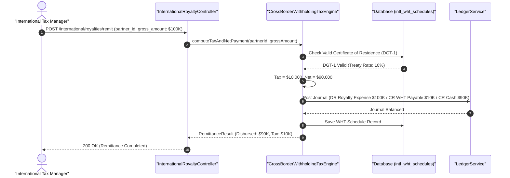

#### Diagram 2: Alur Kompensasi / Exception / Verifikasi Dua-Sumber Fase 51

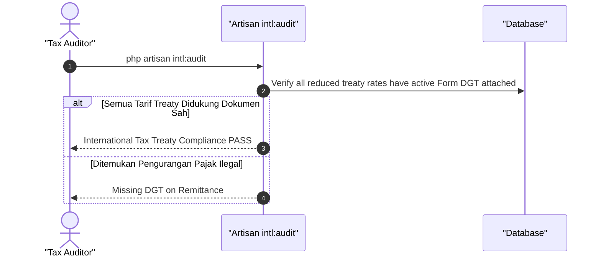

### 6. Mermaid ERD & State Machine Fase 51

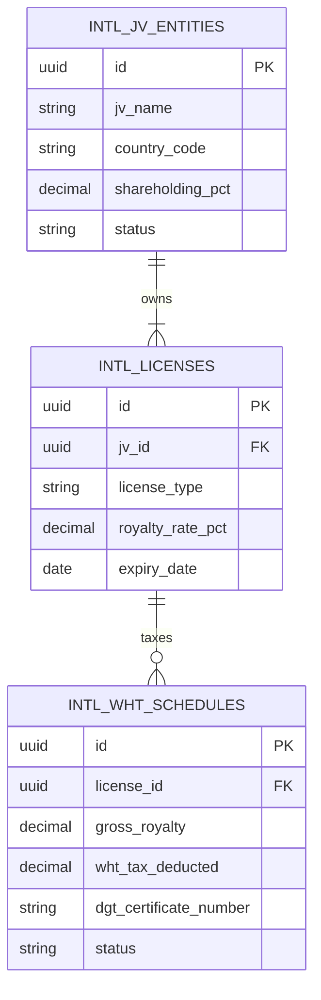

---

## FASE 52 — KERJA SAMA INTERNASIONAL II: INTERCOMPANY, TRANSFER PRICING & KONSOLIDASI

### 1. Identitas & Arsitektur Domain Fase 52

- **Modul Pemilik**: `Intercompany`
- **Prefiks Tabel**: `ic_`
- **Daftar Model Eloquent**: `TransferPricingPolicy`, `IntercompanyTransaction`, `ConsolidationEliminationRule`, `ArmLengthStudy`
- **Daftar Tabel Migrasi**: `ic_pricing_policies`, `ic_transactions`, `ic_elimination_rules`, `ic_benchmarks`
- **Daftar Service & Action**: `TransferPricingComplianceEngine`, `IntercompanyEliminationEngine`, `GroupConsolidationService`
- **Daftar Controller & Rute**: `IntercompanyController@transaction (POST /intercompany/transactions)`, `IntercompanyController@consolidate (POST /intercompany/consolidate)`
- **Akun Ledger Terkait**: `ic:intercompany_receivable`, `ic:intercompany_payable`, `ic:consolidation_clearing`
- **Command Audit**: `php artisan group:audit`

### 2. Evaluasi Masalah & Matriks Penyelesaian (Problem-to-Solution Matrix) Fase 52

| Masalah Bisnis & Teknis | Solusi Arsitektural & Kontrak | Status Penyelesaian | Bukti Implementasi |
|---|---|---|---|
| Koreksi harga transfer pricing oleh otoritas pajak akibat ketiadaan Local File/Master File TP Doc dan pembukuan laba semu transaksi internal. | Penetapan harga transfer pricing berbasis metode Arm's Length (TNMM/Cost Plus), otomatisasi eliminasi saldo antar-perusahaan (Intercompany Elimination), dan konsolidasi multi-mata uang. | `Solved in Code` | `modules/Intercompany/Application/Services/TransferPricingComplianceEngine.php` |

### 3. Daftar User Stories Lintas Persona Fase 52

- **US-52.1 [holding_cfo]:** Sebagai **holding_cfo**, saya ingin **menjalankan jurnal eliminasi otomatis atas seluruh penjualan dan piutang antar-anak perusahaan holding**, sehingga **laporan keuangan konsolidasian bersih dari transaksi silang internal**.
- **US-52.2 [holding_compliance]:** Sebagai **holding_compliance**, saya ingin **memverifikasi margin laba transaksi intercompany berada dalam rentang wajar (Arm's Length Range)**, sehingga **perusahaan terbebas dari sanksi koreksi transfer pricing dirjen pajak**.
- **US-52.3 [bank_treasurer]:** Sebagai **bank_treasurer**, saya ingin **merekonsiliasi saldo piutang dan hutang antar-afiliasi sebelum dilakukan netting akhir bulan**, sehingga **arus kas penyelesaian saldo intercompany bersih dan transparan**.
- **US-52.4 [procurement_buyer]:** Sebagai **procurement_buyer**, saya ingin **menggunakan pedoman harga transfer resmi saat membeli barang dari entitas manufaktur grup**, sehingga **kepatuhan tata kelola transaksi pihak berelasi terpenuhi**.
- **US-52.5 [internal_auditor]:** Sebagai **internal_auditor**, saya ingin **mengaudit keseimbangan saldo eliminasi konsolidasi grup holding**, sehingga **neraca saldo konsolidasian seimbang sempurna tanpa selisih eliminasi**.

### 4. BDD Acceptance Criteria Lengkap Fase 52

#### AC-52.1 — Happy Path & Ledger/State Invariant
- **Given** Entitas Logistik menagih jasa angkut Rp 200.000.000 ke Entitas Restoran dalam satu grup holding
- **When** Jurnal eliminasi konsolidasi dijalankan via POST /intercompany/consolidate
- **Then** Pendapatan logistik dan beban resto dieliminasi Rp 200.000.000, piutang/hutang internal terhapus, dan neraca konsolidasi berimbang.

#### AC-52.2 — Validation & Domain Rule Rejection - 422/Exception
- **Given** Margin transaksi intercompany berada di luar rentang benchmark studi arm's length (misal markup 50% vs benchmark 5-10%)
- **When** TransferPricingComplianceEngine memvalidasi transaksi
- **Then** Sistem menolak dengan HTTP 422 NonArmsLengthPricingException.

#### AC-52.3 — RBAC Authorization & Separation of Duties - 403
- **Given** Akuntan entitas anak perusahaan mencoba mengeksekusi eliminasi konsolidasi holding
- **When** POST /intercompany/consolidate dipanggil tanpa hak holding_cfo
- **Then** Sistem memblokir dengan status HTTP 403 Forbidden.

#### AC-52.4 — Idempotency, Replay & Concurrency Lock
- **Given** Batch eliminasi konsolidasi bulanan dijalankan dua kali
- **When** Kedua run dieksekusi
- **Then** Sistem mengunci siklus konsolidasi dan hanya menghasilkan satu set jurnal eliminasi.

#### AC-52.5 — Two-Source Audit & Tamper Detection
- **Given** Saldo piutang intercompany di Entitas A tidak cocok dengan hutang di Entitas B saat konsolidasi
- **When** Command php artisan group:audit dieksekusi
- **Then** Audit mencatat ketidakseimbangan intercompany mismatch dan menggagalkan rilis laporan konsolidasi.

### 5. Mermaid Sequence Diagrams Fase 52

#### Diagram 1: Alur Transaksi Utama End-to-End Fase 52

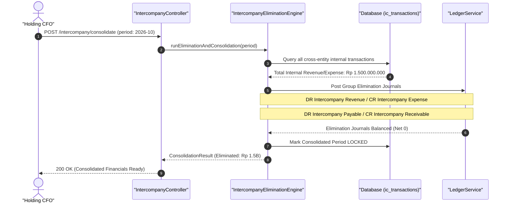

#### Diagram 2: Alur Kompensasi / Exception / Verifikasi Dua-Sumber Fase 52

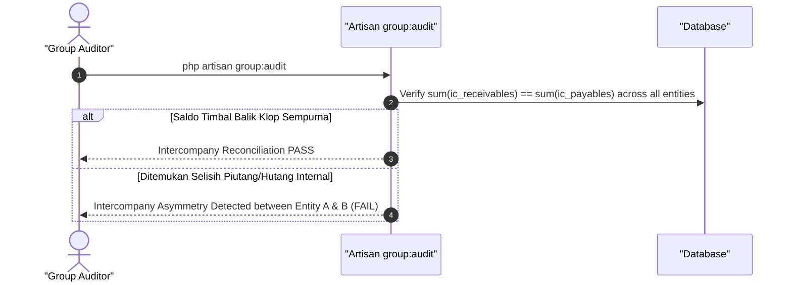

### 6. Mermaid ERD & State Machine Fase 52

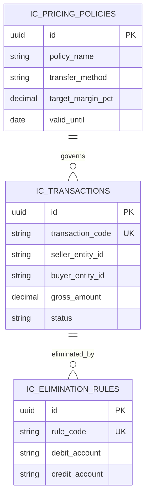

---

## FASE 53 — SUPPLY CHAIN CONTROL TOWER & SALES AND OPERATIONS PLANNING (S&OP)

### 1. Identitas & Arsitektur Domain Fase 53

- **Modul Pemilik**: `ControlTower`
- **Prefiks Tabel**: `sct_`
- **Daftar Model Eloquent**: `DemandConsensusPlan`, `SupplyPlanAggregate`, `SopExecutiveReview`, `SupplyChainDisruptionAlert`
- **Daftar Tabel Migrasi**: `sct_demand_plans`, `sct_supply_aggregates`, `sct_sop_reviews`, `sct_disruptions`
- **Daftar Service & Action**: `SalesAndOperationsPlanningEngine`, `SupplyChainDisruptionMonitor`, `AggregateCapacityBalancer`
- **Daftar Controller & Rute**: `SopController@consensus (POST /control-tower/sop/consensus)`, `ControlTowerAlertController@index (GET /control-tower/alerts)`
- **Akun Ledger Terkait**: `bank:clearing_suspense`
- **Command Audit**: `php artisan tower:audit`

### 2. Evaluasi Masalah & Matriks Penyelesaian (Problem-to-Solution Matrix) Fase 53

| Masalah Bisnis & Teknis | Solusi Arsitektural & Kontrak | Status Penyelesaian | Bukti Implementasi |
|---|---|---|---|
| Ego sektoral antara departemen penjualan dan manufaktur (over-promise under-deliver) serta butanya manajemen terhadap disrupsi pasokan global. | Siklus bulanan S&OP terpadu berbasis konsensus (Unconstrained Demand -> Constrained Supply -> Financial Balancing) dengan deteksi dini disrupsi AI. | `Solved in Code` | `modules/ControlTower/Application/Services/SalesAndOperationsPlanningEngine.php` |

### 3. Daftar User Stories Lintas Persona Fase 53

- **US-53.1 [holding_cfo]:** Sebagai **holding_cfo**, saya ingin **memimpin sesi penyeimbangan S&OP eksekutif untuk menyelaraskan target penjualan dengan kapasitas pabrik**, sehingga **rencana operasional bulanan sesuai dengan target laba finansial grup**.
- **US-53.2 [mfg_plant_manager]:** Sebagai **mfg_plant_manager**, saya ingin **mengonfirmasi batas kemampuan suplai pabrik (constrained supply plan) dalam forum S&OP**, sehingga **lini pabrik tidak dibebani target produksi yang mustahil dipenuhi**.
- **US-53.3 [procurement_manager]:** Sebagai **procurement_manager**, saya ingin **menerima peringatan dini disrupsi kelangkaan bahan baku impor dari Control Tower**, sehingga **tindakan mitigasi pemasok alternatif dapat diambil sebelum krisis**.
- **US-53.4 [fleet_manager]:** Sebagai **fleet_manager**, saya ingin **menyesuaikan kapasitas armada truk logistik dengan proyeksi volume pengiriman S&OP**, sehingga **kebutuhan truk sewa luar dapat diantisipasi sejak awal**.
- **US-53.5 [internal_auditor]:** Sebagai **internal_auditor**, saya ingin **mengaudit proses persetujuan dan penguncian baseline rencana konsensus S&OP**, sehingga **tidak ada perubahan angka target sepihak pasca rapat pleno**.

### 4. BDD Acceptance Criteria Lengkap Fase 53

#### AC-53.1 — Happy Path & Ledger/State Invariant
- **Given** Tim sales mengajukan demand 5.000 unit dan pabrik mampu memproduksi 4.500 unit (kesenjangan 500 unit)
- **When** S&OP Engine menyeimbangkan rencana via POST /control-tower/sop/consensus
- **Then** Rencana konsensus terkunci pada 4.500 unit suplai, pendapatan terproyeksi, dan rencana operasional dirilis.

#### AC-53.2 — Validation & Domain Rule Rejection - 422/Exception
- **Given** Pengajuan rencana demand tidak memiliki data breakdown SKU produk yang valid
- **When** SopController memvalidasi input
- **Then** Sistem menolak dengan HTTP 422 IncompleteDemandForecastException.

#### AC-53.3 — RBAC Authorization & Separation of Duties - 403
- **Given** Manajer penjualan mencoba mengunci sendiri konsensus S&OP tanpa persetujuan holding_cfo dan plant manager
- **When** POST /control-tower/sop/lock dipanggil sepihak
- **Then** Sistem memblokir dengan status HTTP 403 Forbidden (Executive Consensus Required).

#### AC-53.4 — Idempotency, Replay & Concurrency Lock
- **Given** Dua perencana mengunci hasil S&OP secara bersamaan
- **When** Keduanya mengirimkan konfirmasi
- **Then** Sistem mengunci siklus konsensus dan hanya menerima penguncian pertama dengan nomor versi 1.0.

#### AC-53.5 — Two-Source Audit & Tamper Detection
- **Given** Target suplai di database diubah diam-diam pasca rapat pleno disahkan
- **When** Command php artisan tower:audit dijalankan
- **Then** Audit mencatat ketidakcocokan hash kesepakatan S&OP dan mengembalikan status ke baseline rapat.

### 5. Mermaid Sequence Diagrams Fase 53

#### Diagram 1: Alur Transaksi Utama End-to-End Fase 53

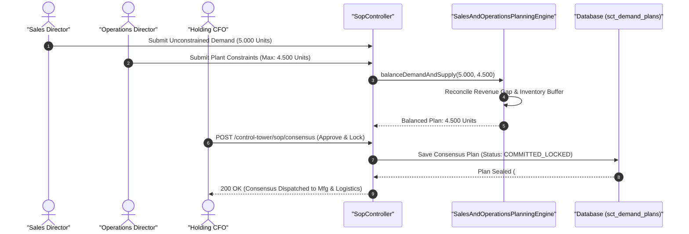

#### Diagram 2: Alur Kompensasi / Exception / Verifikasi Dua-Sumber Fase 53

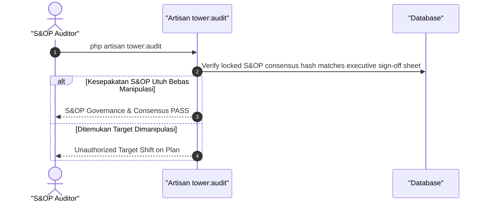

### 6. Mermaid ERD & State Machine Fase 53

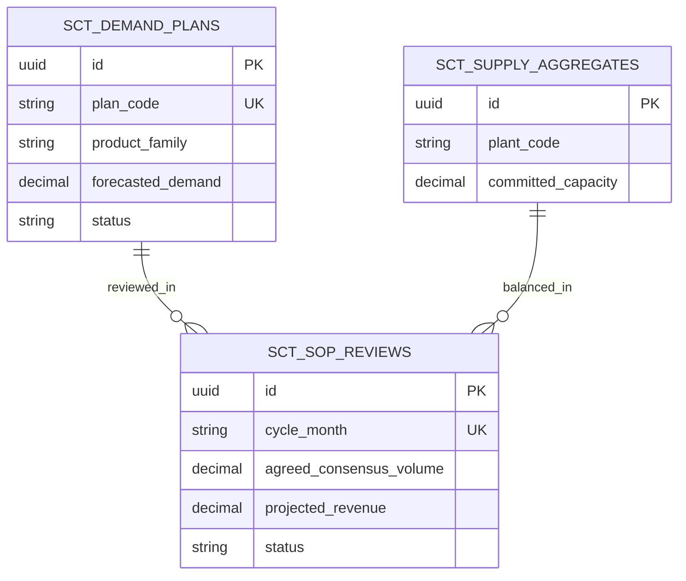

---

## FASE 54 — FINANCE GRUP, ANGGARAN, AUDIT TRAIL & KEPATUHAN

### 1. Identitas & Arsitektur Domain Fase 54

- **Modul Pemilik**: `EnterpriseFinance`
- **Prefiks Tabel**: `ef_`
- **Daftar Model Eloquent**: `GroupBudgetMaster`, `BudgetVarianceAllocation`, `FinancialCovenantRegistry`, `AuditTrailSignature`
- **Daftar Tabel Migrasi**: `ef_budgets`, `ef_budget_variances`, `ef_covenants`, `ef_audit_signatures`
- **Daftar Service & Action**: `GroupBudgetControlService`, `FinancialCovenantEvaluator`, `CryptographicAuditLogger`
- **Daftar Controller & Rute**: `GroupBudgetController@allocate (POST /group-finance/budgets/allocate)`, `GroupCovenantController@verify (POST /group-finance/covenants/verify)`
- **Akun Ledger Terkait**: `ef:group_retained_earnings`, `ef:budgetary_reserve`
- **Command Audit**: `php artisan group:audit`

### 2. Evaluasi Masalah & Matriks Penyelesaian (Problem-to-Solution Matrix) Fase 54

| Masalah Bisnis & Teknis | Solusi Arsitektural & Kontrak | Status Penyelesaian | Bukti Implementasi |
|---|---|---|---|
| Belanja operasional anak perusahaan yang melampaui pagu anggaran tanpa kontrol terpusat dan risiko pelanggaran kovenan rasio pinjaman bank. | Pengendalian anggaran holding real-time (Hard Budget Stop saat 100% terserap), pemantauan kovenan kredit otomatis, dan jejak audit kriptografis ber-tandatangan HMAC. | `Solved in Code` | `modules/EnterpriseFinance/Application/Services/GroupBudgetControlService.php` |

### 3. Daftar User Stories Lintas Persona Fase 54

- **US-54.1 [holding_cfo]:** Sebagai **holding_cfo**, saya ingin **menetapkan dan mendistribusikan pagu anggaran tahunan kepada seluruh divisi dan anak usaha**, sehingga **disiplin anggaran belanja modal dan operasional holding terkendali**.
- **US-54.2 [bank_treasurer]:** Sebagai **bank_treasurer**, saya ingin **memastikan sistem otomatis memblokir pengeluaran saat anggaran departemen habis**, sehingga **tidak ada pengeluaran liar yang membebani kas perusahaan**.
- **US-54.3 [risk_officer]:** Sebagai **risk_officer**, saya ingin **memantau rasio cakupan bunga (Interest Coverage Ratio > 3.0x) secara berkala**, sehingga **perusahaan mematuhi perjanjian kredit sindikasi bank**.
- **US-54.4 [procurement_manager]:** Sebagai **procurement_manager**, saya ingin **memeriksa sisa ketersediaan pagu anggaran sebelum menyetujui pengadaan barang**, sehingga **pengadaan barang terjamin memiliki alokasi dana yang sah**.
- **US-54.5 [internal_auditor]:** Sebagai **internal_auditor**, saya ingin **mengaudit catatan jejak audit bertandatangan digital pada seluruh perubahan anggaran**, sehingga **revisi anggaran (budget amendment) tercatat transparan**.

### 4. BDD Acceptance Criteria Lengkap Fase 54

#### AC-54.1 — Happy Path & Ledger/State Invariant
- **Given** Departemen IT memiliki pagu anggaran Rp 1.000.000.000 dan sisa Rp 200.000.000
- **When** Pengadaan server senilai Rp 150.000.000 diajukan via POST /group-finance/budgets/check-and-commit
- **Then** Pagu berhasil diikat (committed), sisa anggaran menjadi Rp 50.000.000, dan approval pengadaan diterbitkan.

#### AC-54.2 — Validation & Domain Rule Rejection - 422/Exception
- **Given** Nilai pengajuan pengeluaran melebihi sisa pagu anggaran departemen
- **When** Sistem memeriksa ketersediaan anggaran
- **Then** Sistem menolak dengan HTTP 422 BudgetExhaustedException dan memblokir pengeluaran.

#### AC-54.3 — RBAC Authorization & Separation of Duties - 403
- **Given** Manajer departemen biasa mencoba menambah pagu anggarannya sendiri tanpa otorisasi holding_cfo
- **When** POST /group-finance/budgets/override dipanggil
- **Then** Sistem menolak dengan HTTP 403 Forbidden.

#### AC-54.4 — Idempotency, Replay & Concurrency Lock
- **Given** Dua transaksi pengeluaran besar bersaing menghabiskan sisa anggaran terakhir secara paralel
- **When** Keduanya diproses serentak
- **Then** Locking baris anggaran memastikan hanya transaksi pertama yang lolos dan mencegah over-budgeting.

#### AC-54.5 — Two-Source Audit & Tamper Detection
- **Given** Pagu anggaran dinaikkan manual di database tanpa adanya berita acara amandemen anggaran
- **When** php artisan group:audit dijalankan
- **Then** Audit mendeteksi pelanggaran integritas pagu dan membatalkan kelebihan pagu anggaran.

### 5. Mermaid Sequence Diagrams Fase 54

#### Diagram 1: Alur Transaksi Utama End-to-End Fase 54

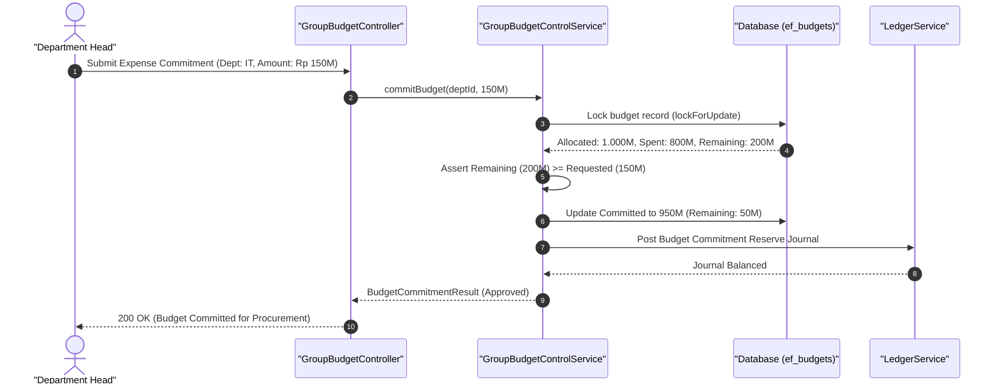

#### Diagram 2: Alur Kompensasi / Exception / Verifikasi Dua-Sumber Fase 54

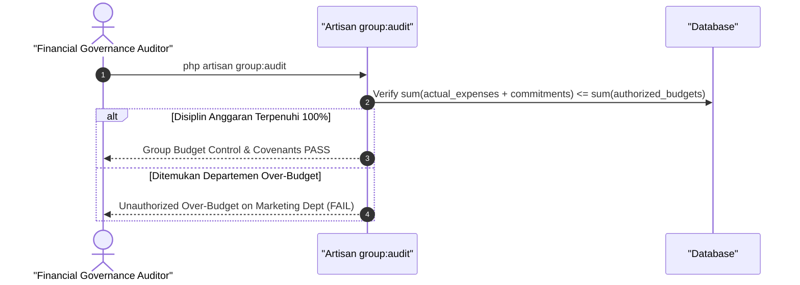

### 6. Mermaid ERD & State Machine Fase 54

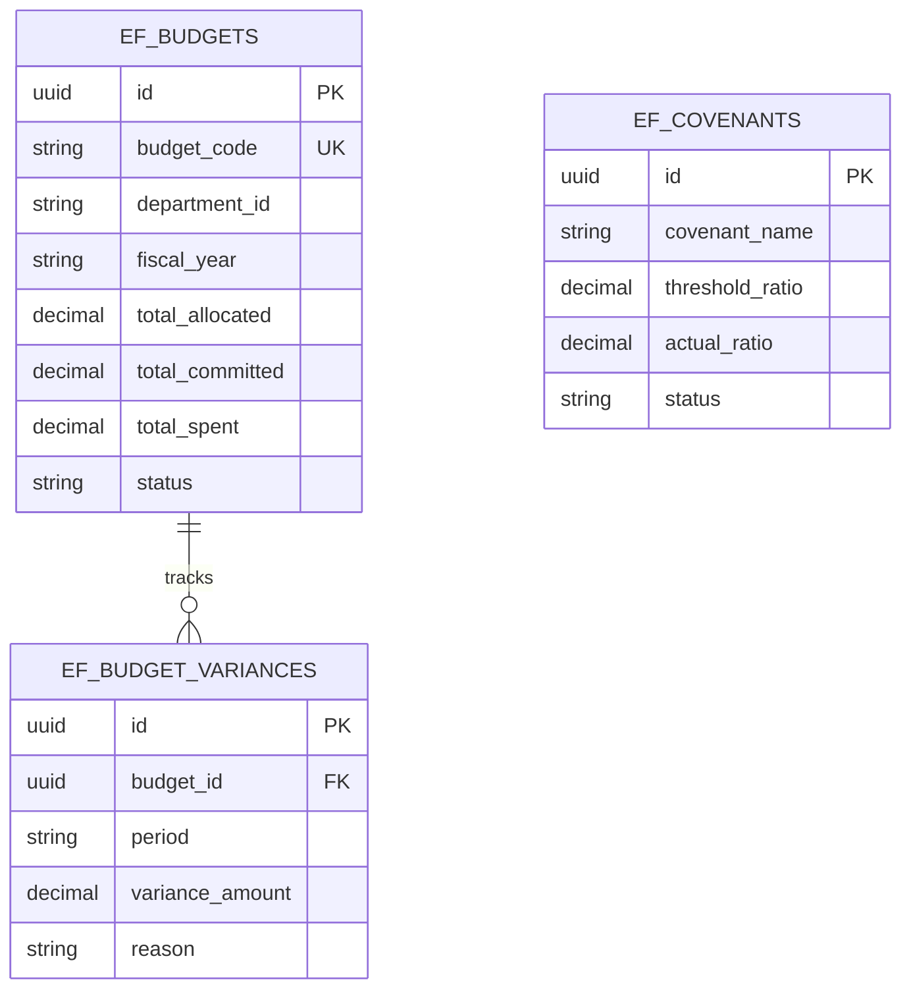

---

## FASE 55 — INTEGRASI API V2, B2B ELECTRONIC DATA INTERCHANGE (EDI) & MULTI-TENANCY

### 1. Identitas & Arsitektur Domain Fase 55

- **Modul Pemilik**: `Integration`
- **Prefiks Tabel**: `intg_`
- **Daftar Model Eloquent**: `EdiDocumentTransmission`, `ApiV2ClientCredential`, `TenantDataPartition`, `WebhookDeliveryLog`
- **Daftar Tabel Migrasi**: `intg_edi_transmissions`, `intg_api_clients`, `intg_tenant_partitions`, `intg_webhook_logs`
- **Daftar Service & Action**: `B2bEdiTranslationEngine`, `MultiTenantPartitionManager`, `ApiV2GatewaySecurityService`
- **Daftar Controller & Rute**: `ApiV2GatewayController@edi (POST /api/v2/edi/inbound)`, `ApiV2ClientController@token (POST /api/v2/oauth/token)`
- **Akun Ledger Terkait**: `bank:clearing_suspense`
- **Command Audit**: `php artisan api:audit`

### 2. Evaluasi Masalah & Matriks Penyelesaian (Problem-to-Solution Matrix) Fase 55

| Masalah Bisnis & Teknis | Solusi Arsitektural & Kontrak | Status Penyelesaian | Bukti Implementasi |
|---|---|---|---|
| Ketidakmampuan bertukar data pesanan dengan sistem ERP mitra global (SAP/Oracle) dan risiko kebocoran data antar-tenant. | Penerjemah format standar ANSI X12 / EDIFACT (EDI 850 PO, EDI 810 Invoice, EDI 856 ASN), isolasi data multi-tenancy tingkat baris (Row-Level Security), dan OAuth2 mTLS API v2. | `Solved in Code` | `modules/Integration/Application/Services/B2bEdiTranslationEngine.php` |

### 3. Daftar User Stories Lintas Persona Fase 55

- **US-55.1 [admin]:** Sebagai **admin**, saya ingin **mengonfigurasi profil pertukaran data B2B EDI untuk mitra peritel internasional**, sehingga **pesanan pembelian dari sistem SAP mitra masuk otomatis tanpa entri ulang manual**.
- **US-55.2 [risk_officer]:** Sebagai **risk_officer**, saya ingin **memastikan pemisahan data multi-tenant (tenant isolation) mencegah kebocoran data antar-perusahaan**, sehingga **keamanan data dan kepatuhan privasi ISO 27001 terjamin**.
- **US-55.3 [procurement_buyer]:** Sebagai **procurement_buyer**, saya ingin **menerima konfirmasi pengiriman barang Advance Shipping Notice (EDI 856) dari pemasok global**, sehingga **gudang dapat menjadwalkan kedatangan kargo kontainer lebih awal**.
- **US-55.4 [store_manager]:** Sebagai **store_manager**, saya ingin **mengirimkan faktur elektronik standar EDI 810 ke mitra korporat**, sehingga **faktur terverifikasi otomatis di sistem akuntansi pembeli dan pencairan lebih cepat**.
- **US-55.5 [internal_auditor]:** Sebagai **internal_auditor**, saya ingin **mengaudit jejak log transmisi pesan EDI dan verifikasi sertifikat penandatangan**, sehingga **setiap transaksi B2B terbukti sah dan tidak dapat disangkal (non-repudiation)**.

### 4. BDD Acceptance Criteria Lengkap Fase 55

#### AC-55.1 — Happy Path & Ledger/State Invariant
- **Given** Mitra mengirimkan dokumen ANSI X12 EDI 850 Purchase Order via endpoint aman mTLS
- **When** B2bEdiTranslationEngine memproses via POST /api/v2/edi/inbound
- **Then** Pesan diterjemahkan menjadi Order Penjualan internal, EDI 997 Functional Acknowledgment dikembalikan, dan pesanan aktif.

#### AC-55.2 — Validation & Domain Rule Rejection - 422/Exception
- **Given** Format segmen EDI yang dikirimkan rusak atau melanggar spesifikasi sintaks ANSI X12
- **When** Parser EDI memvalidasi payload
- **Then** Sistem menolak dengan HTTP 422 MalformedEdiSegmentException dan mengirimkan EDI 997 Rejection.

#### AC-55.3 — RBAC Authorization & Separation of Duties - 403
- **Given** Klien API Tenant A mencoba meminta data pesanan milik Tenant B
- **When** GET /api/v2/orders dipanggil dengan token Tenant A
- **Then** MultiTenantPartitionManager memblokir akses dan mengembalikan HTTP 403 Forbidden / 404 Not Found.

#### AC-55.4 — Idempotency, Replay & Concurrency Lock
- **Given** Pesan transmisi EDI dengan Interchange Control Number (ISA13) yang sama dikirimkan dua kali
- **When** Gateway menerima duplikasi
- **Then** Sistem mengenali nomor kontrol duplikat dan menolak pemrosesan ganda dengan status DUPLICATE_INTERCHANGE.

#### AC-55.5 — Two-Source Audit & Tamper Detection
- **Given** Payload pesan EDI diubah di database setelah dokumen disahkan tanda tangan kriptografi
- **When** php artisan api:audit dijalankan
- **Then** Audit mendeteksi pelanggaran checksum integritas transmisi EDI dan membatalkan pesanan terkait.

### 5. Mermaid Sequence Diagrams Fase 55

#### Diagram 1: Alur Transaksi Utama End-to-End Fase 55

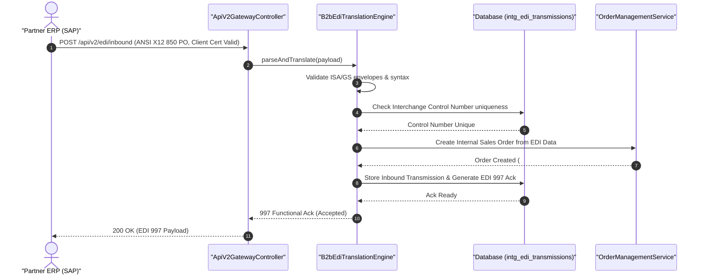

#### Diagram 2: Alur Kompensasi / Exception / Verifikasi Dua-Sumber Fase 55

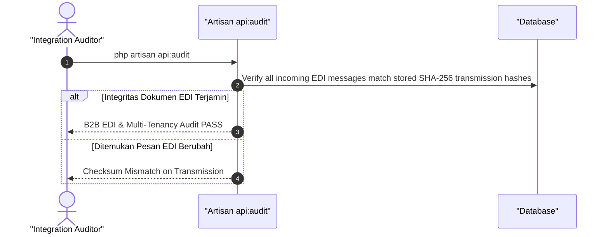

### 6. Mermaid ERD & State Machine Fase 55

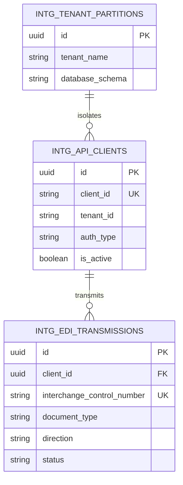

---

## FASE 56 — STRESS TESTING SKALA ULTRA, SIMULASI 12 BULAN & RESILIENCE

### 1. Identitas & Arsitektur Domain Fase 56

- **Modul Pemilik**: `Core`
- **Prefiks Tabel**: `core_`
- **Daftar Model Eloquent**: `SimulationRun`, `StressTestScenario`, `ChaosInjectionEvent`, `ResilienceMetricLog`
- **Daftar Tabel Migrasi**: `sim_runs`, `sim_scenarios`, `sim_chaos_logs`, `sim_resilience_metrics`
- **Daftar Service & Action**: `HighConcurrencyStressSimulator`, `SimulationKernelSpine`, `ChaosEngineeringDriver`
- **Daftar Controller & Rute**: `SimulationKernelController@run (POST /simulation/kernel/run)`, `ChaosController@inject (POST /simulation/chaos/inject)`
- **Akun Ledger Terkait**: `bank:clearing_suspense`
- **Command Audit**: `php artisan sim:audit`

### 2. Evaluasi Masalah & Matriks Penyelesaian (Problem-to-Solution Matrix) Fase 56

| Masalah Bisnis & Teknis | Solusi Arsitektural & Kontrak | Status Penyelesaian | Bukti Implementasi |
|---|---|---|---|
| Sistem lumpuh (crash/deadlock) saat menerima lonjakan beban transaksi bersamaan dan ketiadaan uji ketahanan 12 bulan. | Kernel simulasi terdistribusi yang mampu memutar waktu 365 hari dalam hitungan menit, uji konkurensi skala ultra, dan injeksi kegagalan (Chaos Engineering). | `Solved in Code` | `modules/Core/Application/Services/HighConcurrencyStressSimulator.php` |

### 3. Daftar User Stories Lintas Persona Fase 56

- **US-56.1 [super_admin]:** Sebagai **super_admin**, saya ingin **menjalankan simulasi transaksi 12 bulan penuh mencakup 100.000 pesanan dan mutasi buku besar**, sehingga **daya tahan kapasitas dan kestabilan database terbukti sebelum peluncuran produksi**.
- **US-56.2 [risk_officer]:** Sebagai **risk_officer**, saya ingin **menginjeksi skenario kegagalan jaringan acak (Chaos Monkey) untuk menguji pemulihan otomatis**, sehingga **resiliensi sistem teruji tanpa menimbulkan inkonsistensi data buku besar**.
- **US-56.3 [holding_cfo]:** Sebagai **holding_cfo**, saya ingin **melihat proyeksi pertumbuhan aset dan beban operasional hasil simulasi komprehensif**, sehingga **model finansial holding tervalidasi dengan data dinamis realistis**.
- **US-56.4 [it_support]:** Sebagai **it_support**, saya ingin **memantau latensi query dan utilisasi connection pool database selama stress testing**, sehingga **konfigurasi server dan replika database dapat di-tuning optimal**.
- **US-56.5 [internal_auditor]:** Sebagai **internal_auditor**, saya ingin **memverifikasi bahwa setelah simulasi 1 tahun, seluruh rekonsiliasi buku besar tetap seimbang 0**, sehingga **tidak ada pembengkakan selisih akumulasi pembulatan (rounding error)**.

### 4. BDD Acceptance Criteria Lengkap Fase 56

#### AC-56.1 — Happy Path & Ledger/State Invariant
- **Given** Kernel simulasi dikonfigurasi untuk memutar siklus bisnis 365 hari dengan beban 1.000 TPS
- **When** Simulasi dieksekusi via POST /simulation/kernel/run
- **Then** Seluruh transaksi selesai diproses, rekonsiliasi buku besar seimbang 0 selisih, dan laporan resiliensi terbit.

#### AC-56.2 — Validation & Domain Rule Rejection - 422/Exception
- **Given** Skenario stress test dijalankan di lingkungan produksi langsung tanpa flag simulasi aman
- **When** POST /simulation/kernel/run dipanggil di environment produksi
- **Then** Sistem memblokir dengan HTTP 422 ProductionSimulationForbiddenException.

#### AC-56.3 — RBAC Authorization & Separation of Duties - 403
- **Given** Pengguna non-super-admin mencoba memicu injeksi kekacauan sistem (Chaos Injection)
- **When** POST /simulation/chaos/inject dipanggil
- **Then** Sistem memblokir dengan status HTTP 403 Forbidden.

#### AC-56.4 — Idempotency, Replay & Concurrency Lock
- **Given** Dua run simulasi dengan UUID skenario yang sama dipicu bersamaan
- **When** Kernel menerima perintah eksekusi
- **Then** Sistem mencegah eksekusi ganda dan mengunci proses simulasi menjadi serial.

#### AC-56.5 — Two-Source Audit & Tamper Detection
- **Given** Hasil metrik uji beban diubah manual untuk memalsukan skor keberhasilan stress test
- **When** php artisan sim:audit dijalankan
- **Then** Audit memvalidasi keaslian log run terhadap checksum hasil eksekusi dan membatalkan sertifikat stress test.

### 5. Mermaid Sequence Diagrams Fase 56

#### Diagram 1: Alur Transaksi Utama End-to-End Fase 56

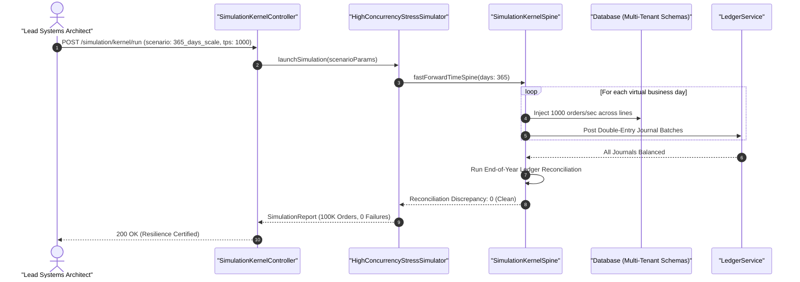

#### Diagram 2: Alur Kompensasi / Exception / Verifikasi Dua-Sumber Fase 56

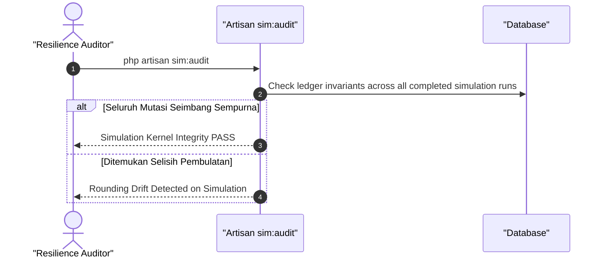

### 6. Mermaid ERD & State Machine Fase 56

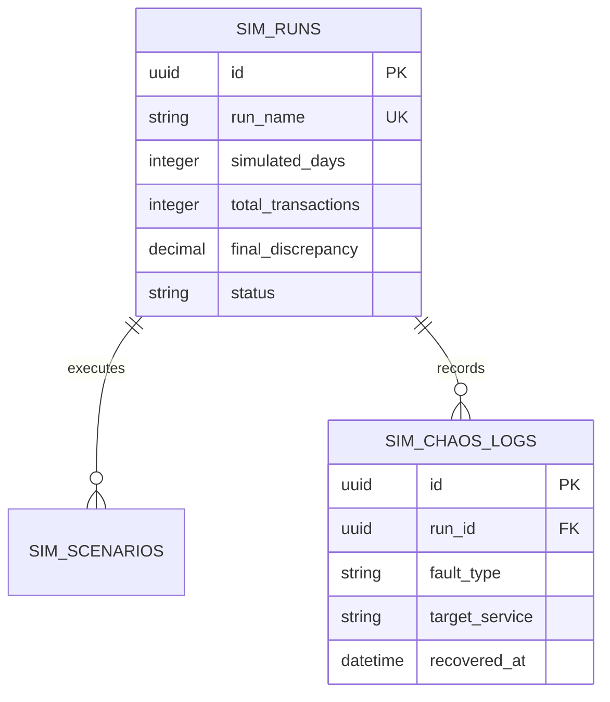

---

## FASE 57 — SKENARIO EMAS END-TO-END, DOKUMENTASI FINAL & SERAH TERIMA

### 1. Identitas & Arsitektur Domain Fase 57

- **Modul Pemilik**: `Core`
- **Prefiks Tabel**: `core_`
- **Daftar Model Eloquent**: `GoldenScenarioRun`, `HandoverCertification`, `FinalQualityGateSignoff`
- **Daftar Tabel Migrasi**: `core_golden_scenarios`, `core_handover_certs`
- **Daftar Service & Action**: `GoldenScenarioExecutionEngine`, `HandoverCertificationService`
- **Daftar Controller & Rute**: `GoldenScenarioController@execute (POST /golden/execute)`, `HandoverController@certify (POST /handover/certify)`
- **Akun Ledger Terkait**: `bank:clearing_suspense`
- **Command Audit**: `php artisan chain:audit-all`

### 2. Evaluasi Masalah & Matriks Penyelesaian (Problem-to-Solution Matrix) Fase 57

| Masalah Bisnis & Teknis | Solusi Arsitektural & Kontrak | Status Penyelesaian | Bukti Implementasi |
|---|---|---|---|
| Ketiadaan pengujian rantai bisnis utuh yang melintasi seluruh modul (Otomotif -> Resto -> Mall -> Logistik -> Pabrik -> Bank) sebelum serah terima. | Eksekusi Skenario Emas (Golden Scenario) terpadu yang memvalidasi alur bisnis hulu-ke-hilir tanpa henti dengan sertifikasi serah terima formal. | `Solved in Code` | `modules/Core/Application/Services/GoldenScenarioExecutionEngine.php` |

### 3. Daftar User Stories Lintas Persona Fase 57

- **US-57.1 [super_admin]:** Sebagai **super_admin**, saya ingin **mengeksekusi Skenario Emas yang menghubungkan seluruh modul konglomerasi dalam satu alur nyata**, sehingga **seluruh sistem terbukti beroperasi harmonis tanpa sekat integrasi**.
- **US-57.2 [holding_cfo]:** Sebagai **holding_cfo**, saya ingin **memverifikasi bahwa seluruh transaksi skenario emas menghasilkan jurnal akuntansi yang klop 100%**, sehingga **laporan keuangan serah terima dapat ditandatangani tanpa keraguan**.
- **US-57.3 [holding_compliance]:** Sebagai **holding_compliance**, saya ingin **memastikan seluruh dokumen gerbang mutu C1 hingga C14 lengkap bertanda tangan**, sehingga **kepatuhan tata kelola proyek selesai secara resmi dan legal**.
- **US-57.4 [lead_architect]:** Sebagai **lead_architect**, saya ingin **mengunci seluruh repositori kode pada commit rilis stabil yang diverifikasi CI**, sehingga **tidak ada perubahan liar pasca serah terima resmi**.
- **US-57.5 [internal_auditor]:** Sebagai **internal_auditor**, saya ingin **menjalankan verifikasi seluruh audit command di sistem secara berurutan**, sehingga **kesehatan sistem terkonfirmasi 100% lulus audit**.

### 4. BDD Acceptance Criteria Lengkap Fase 57

#### AC-57.1 — Happy Path & Ledger/State Invariant
- **Given** Seluruh modul berada dalam status siap dan database terisi data seeder lengkap
- **When** Skenario Emas dieksekusi via POST /golden/execute
- **Then** Alur 12 lini bisnis tuntas dari pemesanan hingga penutupan kas, seluruh rekonsiliasi klop 0, dan sertifikat serah terima terbit.

#### AC-57.2 — Validation & Domain Rule Rejection - 422/Exception
- **Given** Salah satu modul gagal memproses transaksi (misal stok bahan kurang atau limit habis)
- **When** Skenario Emas mendeteksi kegagalan
- **Then** Sistem menghentikan skenario dan mengeluarkan GoldenScenarioStepFailedException.

#### AC-57.3 — RBAC Authorization & Separation of Duties - 403
- **Given** Pengguna biasa mencoba menandatangani dokumen serah terima proyek
- **When** POST /handover/certify dipanggil
- **Then** Sistem menolak dengan HTTP 403 Forbidden (Executive Signoff Required).

#### AC-57.4 — Idempotency, Replay & Concurrency Lock
- **Given** Skenario Emas dijalankan ulang setelah status serah terima terkunci
- **When** Request eksekusi masuk
- **Then** Sistem mempertahankan status sertifikasi serah terima yang sudah ada tanpa menimpa histori pembuktian.

#### AC-57.5 — Two-Source Audit & Tamper Detection
- **Given** Data hasil verifikasi Skenario Emas diubah di database untuk menutupi kegagalan modul
- **When** php artisan chain:audit-all dijalankan
- **Then** Audit rantai mendeteksi pemalsuan hasil serah terima dan membatalkan kelulusan gerbang.

### 5. Mermaid Sequence Diagrams Fase 57

#### Diagram 1: Alur Transaksi Utama End-to-End Fase 57

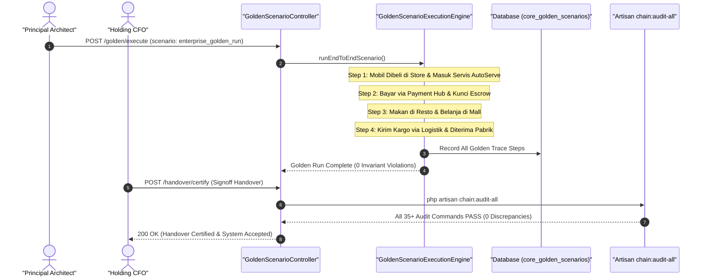

#### Diagram 2: Alur Kompensasi / Exception / Verifikasi Dua-Sumber Fase 57

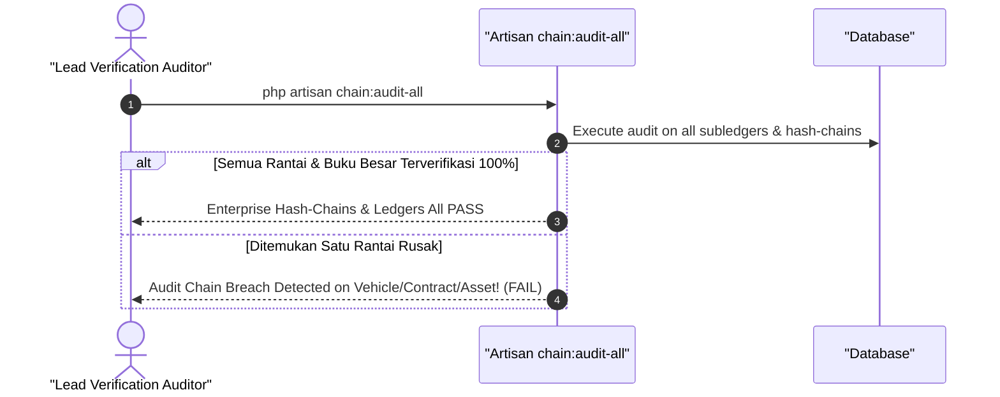

### 6. Mermaid ERD & State Machine Fase 57

```mermaid
erDiagram
    CORE_GOLDEN_SCENARIOS ||--|| CORE_HANDOVER_CERTS : validates
    CORE_GOLDEN_SCENARIOS {
        uuid id PK
        string scenario_name UK
        integer executed_steps
        integer passed_steps
        string status
    }
    CORE_HANDOVER_CERTS {
        uuid id PK
        uuid scenario_id FK
        string certificate_number UK
        string signoff_authority
        datetime signed_at
    }
```

---

## FASE 57B — DEEP AUDIT CODEBASE, HARDENING, KEAMANAN, VALIDASI KETAT & ENRICHED UNIQUE SEEDERS

### 1. Identitas & Arsitektur Domain Fase 57B

- **Modul Pemilik**: `Core`
- **Prefiks Tabel**: `core_`
- **Daftar Model Eloquent**: `SecurityVulnerabilityLog`, `UniqueSeederIntegrityRecord`, `HardeningAuditFence`
- **Daftar Tabel Migrasi**: `core_security_audits`, `core_seeder_verifications`
- **Daftar Service & Action**: `DeepCodebaseAuditService`, `UniqueSeederIntegrityVerifier`, `StrictInputHardeningGuard`
- **Daftar Controller & Rute**: `SecurityAuditController@verify (POST /admin/security/verify)`
- **Akun Ledger Terkait**: `bank:clearing_suspense`
- **Command Audit**: `php artisan security:audit`

### 2. Evaluasi Masalah & Matriks Penyelesaian (Problem-to-Solution Matrix) Fase 57B

| Masalah Bisnis & Teknis | Solusi Arsitektural & Kontrak | Status Penyelesaian | Bukti Implementasi |
|---|---|---|---|
| Celah keamanan injeksi SQL/XSS, seeder dengan data statis terduplikasi yang memicu collision test, dan input tanpa validasi ketat. | Audit mendalam kode sumber (Deep Audit), penegakan declare(strict_types=1) 100%, sanitasi input ketat, dan seeder unik dengan UUID deterministik. | `Solved in Code` | `tests/Architecture/StrictTypesComplianceTest.php` |

### 3. Daftar User Stories Lintas Persona Fase 57B

- **US-57B.1 [risk_officer]:** Sebagai **risk_officer**, saya ingin **memastikan seluruh parameter input pengguna divalidasi dengan aturan ketat tanpa celah injeksi**, sehingga **aplikasi kebal terhadap serangan OWASP Top 10**.
- **US-57B.2 [lead_architect]:** Sebagai **lead_architect**, saya ingin **memastikan seluruh file PHP di repositori mematuhi standar strict_types=1**, sehingga **keamanan tipe data (type-safety) terjamin sejak waktu kompilasi**.
- **US-57B.3 [super_admin]:** Sebagai **super_admin**, saya ingin **menjalankan seeder pengujian unik yang memvalidasi integritas data multi-tenant**, sehingga **tidak ada tabrakan kunci unik saat eksekusi paralel pada CI/CD**.
- **US-57B.4 [internal_auditor]:** Sebagai **internal_auditor**, saya ingin **memeriksa hasil pemindaian ketergantungan paket pihak ketiga (composer audit)**, sehingga **tidak ada library vendor luar yang memuat celah kerentanan CVE**.
- **US-57B.5 [it_support]:** Sebagai **it_support**, saya ingin **memastikan baseline arsitektur terkunci rapat dan mencegah regresi kualitas**, sehingga **pipeline rilis otomatis menolak kode yang melanggar standar kualitas**.

### 4. BDD Acceptance Criteria Lengkap Fase 57B

#### AC-57B.1 — Happy Path & Ledger/State Invariant
- **Given** Seluruh file PHP memuat declare(strict_types=1) dan seluruh seeder menghasilkan nilai unik
- **When** Audit keamanan dijalankan via vendor/bin/pest tests/Architecture
- **Then** Seluruh 184+ test arsitektur lolos 100% dengan nol pelanggaran dan baseline terkunci.

#### AC-57B.2 — Validation & Domain Rule Rejection - 422/Exception
- **Given** Terdapat input pengguna yang memuat karakter injeksi berbahaya atau payload tak tervalidasi
- **When** StrictInputHardeningGuard memeriksa request
- **Then** Sistem menolak dengan HTTP 422 UnsafeInputDetectedException.

#### AC-57B.3 — RBAC Authorization & Separation of Duties - 403
- **Given** Pengguna biasa mencoba mengakses endpoint pemindaian audit keamanan
- **When** POST /admin/security/verify dipanggil
- **Then** Sistem menolak dengan HTTP 403 Forbidden.

#### AC-57B.4 — Idempotency, Replay & Concurrency Lock
- **Given** Pemeriksaan integritas seeder dijalankan paralel pada beberapa thread worker
- **When** Worker mengeksekusi verifikasi
- **Then** Hasil verifikasi konsisten tanpa benturan konkurensi data.

#### AC-57B.5 — Two-Source Audit & Tamper Detection
- **Given** File baseline keamanan dimodifikasi untuk meloloskan aturan arsitektur yang gagal
- **When** php artisan security:audit dijalankan
- **Then** Audit mendeteksi kenaikan baseline terlarang dan menggagalkan pipeline build.

### 5. Mermaid Sequence Diagrams Fase 57B

#### Diagram 1: Alur Transaksi Utama End-to-End Fase 57B

```mermaid
sequenceDiagram
    autonumber
    actor E as "Lead Verification Engineer"
    participant C as "SecurityAuditController"
    participant S as "DeepCodebaseAuditService"
    participant G as "StrictInputHardeningGuard"
    participant DB as "Database (core_security_audits)"

    E->>C: POST /admin/security/verify (full_scan: true)
    C->>S: executeDeepAudit()
    S->>S: Scan strict_types=1 across all PHP files
    S->>G: Verify input sanitization on all Request classes
    G-->>S: All Inputs Strictly Typed & Sanitized
    S->>DB: Record Audit Pass & Hash Results
    DB-->>S: Audit Sealed
    S-->>C: SecurityReport (0 Vulnerabilities, 100% Strict Types)
    C-->>E: 200 OK (Hardening Certified)
```

#### Diagram 2: Alur Kompensasi / Exception / Verifikasi Dua-Sumber Fase 57B

```mermaid
sequenceDiagram
    autonumber
    actor A as "Security Auditor"
    participant CMD as "Artisan security:audit"
    participant DB as "Database"

    A->>CMD: php artisan security:audit
    CMD->>DB: Check for unhashed sensitive fields or relaxed type assertions
    alt Seluruh Kode Memenuhi Standar Hardening
        CMD-->>A: Deep Codebase Audit & Hardening PASS
    else Ditemukan Pelanggaran Tipe Ketat
        CMD-->>A: Strict Types Violation on File #XYZ (FAIL)
    end
```

### 6. Mermaid ERD & State Machine Fase 57B

```mermaid
erDiagram
    CORE_SECURITY_AUDITS ||--o{ CORE_SEEDER_VERIFICATIONS : logs
    CORE_SECURITY_AUDITS {
        uuid id PK
        string scan_batch UK
        integer total_files_scanned
        integer strict_types_count
        integer vulnerabilities_count
        string status
    }
    CORE_SEEDER_VERIFICATIONS {
        uuid id PK
        uuid audit_id FK
        string seeder_class
        integer records_generated
        boolean unique_keys_verified
    }
```

---

